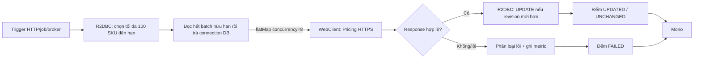
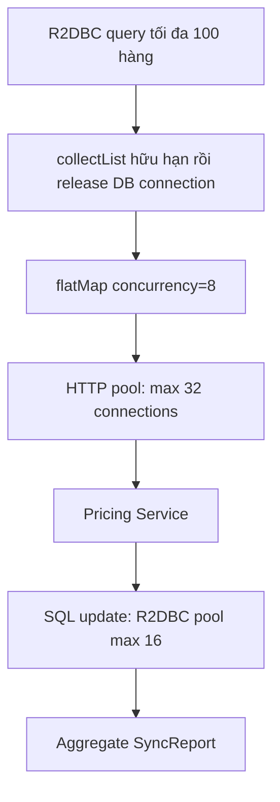
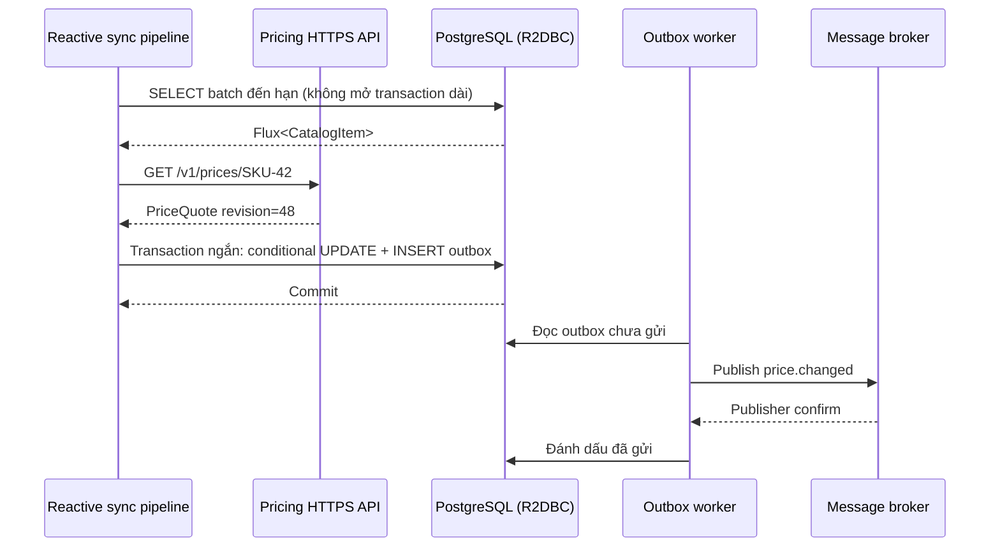

# Xử lý dữ liệu reactive với R2DBC, WebClient và giới hạn tài nguyên

## 1. Mục tiêu và tình huống thực hành

Trong một luồng tích hợp dữ liệu, ứng dụng thường phải **đọc nhiều bản ghi từ database**, gọi dịch vụ khác để bổ sung thông tin, rồi **cập nhật dữ liệu hoặc phát sự kiện**. Nếu xử lý tuần tự, tổng thời gian chờ I/O có thể lớn. Nếu mở hàng nghìn request đồng thời mà không giới hạn, hệ thống dễ làm cạn connection pool, memory, thread, rate limit của đối tác hoặc khả năng chịu tải database.

**Spring Data R2DBC** giúp truy cập cơ sở dữ liệu quan hệ bằng API reactive; **WebClient** giúp gọi HTTP theo mô hình reactive. Kết hợp hai công nghệ chỉ có ích khi toàn bộ pipeline được thiết kế hợp lý: **không chặn event loop, không gom dữ liệu vô hạn, không tạo quá nhiều kết nối, không nuốt lỗi và không giữ giao dịch SQL trong lúc chờ HTTP**.

Bài này thuộc chương **Thực hành tổng hợp** của module **SPRING_BOOT_INTEGRATION**. Phạm vi của module là tổ chức tích hợp Spring Boot qua HTTP client, database, cache, message broker và adapter Spring Integration, nhấn mạnh **cấu hình, hợp đồng dữ liệu, transaction, lỗi, xử lý trùng lặp, kiểm thử và quan sát**. Bài tập minh họa một luồng thực tế thay vì chỉ trình diễn `Flux`/`Mono` riêng lẻ.

Sau bài học, bạn sẽ có thể:

- Dựng một luồng `Flux<CatalogItem>` từ PostgreSQL qua R2DBC → WebClient → cập nhật PostgreSQL.
- Phân biệt **số phần tử đang xử lý**, **pool HTTP**, **pool R2DBC**, **timeout** và **giới hạn bộ nhớ**.
- Dùng `flatMap` có concurrency hữu hạn, truy vấn theo batch, lỗi theo từng item và deadline tổng.
- Áp dụng cập nhật SQL có điều kiện để chống ghi đè dữ liệu mới bằng response cũ.
- Tách HTTP khỏi reactive transaction, biết khi nào cần idempotency và transactional outbox.
- Kiểm thử đúng các ranh giới: nghiệp vụ reactive, PostgreSQL/R2DBC, HTTP thật, timeout, rate limit và backpressure.

> **Phiên bản giả định:** Java 17+, Spring Boot 3.2+, Spring Framework 6.1+ và Reactor 3.6+ theo BOM/parent của dự án. Ví dụ dùng Spring WebFlux/WebClient, Spring Data R2DBC, R2DBC PostgreSQL và Reactor Netty. Tên tùy chọn hoặc API có thể khác theo phiên bản; không pin tùy ý các bản Spring/Reactor/driver không tương thích. Code được chia theo lớp và lược bỏ `import` thông dụng để tập trung vào thiết kế; cần tạo package/import thực tế khi đưa vào dự án.

### 1.1. Bối cảnh: đồng bộ giá sản phẩm

Inventory Service có bảng `catalog_item` chứa SKU, giá hiện tại, revision từ nguồn và thời điểm cần refresh tiếp. Pricing Service là API HTTPS trả giá và revision mới nhất.

| Hợp đồng | Request/nguồn | Dữ liệu kỳ vọng |
|---|---|---|
| Truy vấn danh sách đến hạn | PostgreSQL `catalog_item` | Danh sách giới hạn N hàng có `next_refresh_at <= now()` |
| Lấy giá từ xa | `GET /v1/prices/{sku}` | `200` với `sku`, `priceCents` và `revision` |
| Cập nhật giá | SQL `UPDATE ... WHERE price_revision < :revision` | Chỉ nhận phiên bản mới hơn, không làm giảm revision |
| Đến hạn kiểm tra tiếp | `next_refresh_at` | Dời lịch khi đã xử lý response hợp lệ |

Ví dụ JSON từ Pricing:

```json
{
  "sku": "SKU-42",
  "priceCents": 199900,
  "revision": 48
}
```

Giả định `priceCents` là số nguyên theo đơn vị nhỏ nhất của đồng tiền đã thống nhất; contract production cần bổ sung `currency` nếu có nhiều loại tiền và quy định rõ nguồn/ý nghĩa revision. **Không dùng số thực `double` để tích lũy giá tiền**.

Pipeline mục tiêu:



**Ranh giới quan trọng:** không mở transaction database bao trùm thời gian chờ HTTP; mỗi cập nhật SQL được kiểm soát riêng. Một thất bại của SKU không nên làm cả batch mất kết quả, nhưng cũng không được biến lỗi HTTP thành giá bằng 0.

### 1.2. Tiêu chí nghiệm thu

1. Mỗi lần chạy chỉ chọn **tối đa 100–200 bản ghi** theo cấu hình.
2. Có giới hạn số item xử lý đồng thời, ví dụ **8**, không `flatMap` vô hạn.
3. WebClient giới hạn số connection, số request chờ acquire, connect timeout, response timeout và kích thước body.
4. Pool R2DBC có giới hạn phù hợp với nhiều replica; không giữ connection trong khi WebClient đang chờ.
5. Response sai `sku`, revision âm hoặc giá âm bị từ chối; `404`, `429`, `503` được phân loại rõ.
6. Bản cập nhật cũ không thể ghi đè revision mới hơn khi có nhiều worker.
7. Có test chứng minh concurrency hữu hạn, SQL compare-and-set, HTTP timeout và tình huống backend lỗi.

## 2. Mô hình reactive: không blocking không có nghĩa không giới hạn

`Mono<T>` biểu diễn tối đa một phần tử hoặc một lỗi/completion; `Flux<T>` biểu diễn 0 đến nhiều phần tử. Một pipeline Reactor thường **lười thực thi**: chỉ chạy khi có subscription. Trong WebFlux, framework subscribe ở ranh giới HTTP; trong một scheduled job hoặc message consumer cần xác định rõ nơi điều phối subscription/vòng đời.

| Khái niệm | Ý nghĩa trong bài tập |
|---|---|
| `Flux<CatalogItem>` | Tập SKU được đọc từ R2DBC và đưa qua pipeline |
| `Mono<PriceQuote>` | Một response từ Pricing API |
| `Mono<Integer>` | Số hàng chịu tác động bởi một câu `UPDATE` |
| `flatMap(mapper, concurrency, prefetch)` | Cho phép xử lý nhiều Publisher bên trong với giới hạn |
| Backpressure | Downstream thể hiện nhu cầu nhận phần tử theo Reactive Streams; phải kết hợp với source/driver |
| Connection pool | Giới hạn connection tới DB hoặc HTTP downstream, **khác** với số Publisher đang xử lý |
| `timeout` | Giới hạn chờ tín hiệu trong một chuỗi Publisher; không tự rollback tác động bên ngoài |



**Ba con số 100, 8, 32 không tương đương:** 100 là kích thước batch; 8 là số item được pipeline xử lý đồng thời; 32 là trần HTTP connection trong pool. Có thể có nhiều batch chạy đồng thời ở các request/job khác nhau nên tổng HTTP concurrency của ứng dụng vẫn vượt 8. Cần kiểm soát **cả số batch đang chạy** và tổng tài nguyên.

### 2.1. Những anti-pattern cần nhận diện

```java
// Không thực hiện như sau trong WebFlux:
List<CatalogItem> all = repository.findAll().collectList().block();
for (CatalogItem item : all) {
    PriceQuote quote = pricingClient.getPrice(item.sku()).block();
    // cập nhật database bằng lệnh blocking...
}
```

Đoạn trên vừa chặn thread, vừa có thể gom toàn bộ bảng vào RAM. Thay JDBC `findAll()` bằng R2DBC mà vẫn `.block()` ở event loop không làm hệ thống reactive hơn.

```java
// Cũng không an toàn nếu số record không giới hạn:
return repository.findAll()
        .flatMap(item -> pricingClient.getPrice(item.sku()));
```

`flatMap` không đặt giới hạn cụ thể ở đây; độ song song mặc định phụ thuộc Reactor và có thể quá lớn so với rate limit hoặc pool DB/HTTP. Không dựa vào default để đưa ra một SLA tài nguyên. Trong ứng dụng production, quy định **batch limit + concurrency + pool capacity + deadline + error policy**.

## 3. Dependency và cấu hình PostgreSQL/R2DBC

### 3.1. Maven

Khi dự án đã dùng Spring Boot parent/BOM:

```xml
<dependencies>
    <dependency>
        <groupId>org.springframework.boot</groupId>
        <artifactId>spring-boot-starter-webflux</artifactId>
    </dependency>
    <dependency>
        <groupId>org.springframework.boot</groupId>
        <artifactId>spring-boot-starter-data-r2dbc</artifactId>
    </dependency>
    <dependency>
        <groupId>org.postgresql</groupId>
        <artifactId>r2dbc-postgresql</artifactId>
        <scope>runtime</scope>
    </dependency>
    <dependency>
        <groupId>org.springframework.boot</groupId>
        <artifactId>spring-boot-starter-actuator</artifactId>
    </dependency>
    <dependency>
        <groupId>org.springframework.boot</groupId>
        <artifactId>spring-boot-starter-test</artifactId>
        <scope>test</scope>
    </dependency>
    <dependency>
        <groupId>io.projectreactor</groupId>
        <artifactId>reactor-test</artifactId>
        <scope>test</scope>
    </dependency>
</dependencies>
```

- `spring-boot-starter-data-r2dbc` cấp Spring Data R2DBC, nhưng **vẫn cần driver R2DBC** đúng database.
- `org.postgresql:r2dbc-postgresql` là R2DBC driver; `org.postgresql:postgresql` là JDBC driver, **không thay thế nhau**.
- `spring-boot-starter-webflux` cung cấp HTTP reactive server và WebClient.
- `reactor-test` mang `StepVerifier` cho kiểm thử luồng reactive.

Thêm module Testcontainers/PostgreSQL ở phần kiểm thử khi cần database thật. Không đưa `spring-boot-starter-data-jpa` vào bài mẫu chỉ vì dùng PostgreSQL: JPA thường dùng JDBC blocking và transaction manager khác.

### 3.2. SQL schema

```sql
CREATE TABLE catalog_item (
    sku VARCHAR(80) PRIMARY KEY,
    price_cents BIGINT NOT NULL CHECK (price_cents >= 0),
    price_revision BIGINT NOT NULL DEFAULT 0,
    next_refresh_at TIMESTAMPTZ NOT NULL
);

CREATE INDEX idx_catalog_item_refresh
    ON catalog_item (next_refresh_at, sku);

INSERT INTO catalog_item
    (sku, price_cents, price_revision, next_refresh_at)
VALUES
    ('SKU-42', 180000, 47, TIMESTAMPTZ '2025-01-01 00:00:00+00'),
    ('SKU-43', 220000, 12, TIMESTAMPTZ '2025-01-01 00:00:00+00');
```

Ở production, schema phải được quản lý bằng migration có version (Flyway/Liquibase hoặc công cụ tương đương). Nhiều công cụ migration dùng **JDBC** và JDBC driver riêng dù truy vấn runtime dùng R2DBC; đừng dùng `schema.sql` không version làm chiến lược migration production.

### 3.3. Cấu hình connection pool và endpoint

```yaml
# application.yml — giá trị mặc định chỉ dành cho local development
spring:
  r2dbc:
    url: ${R2DBC_URL:r2dbc:postgresql://localhost:5432/catalog}
    username: ${R2DBC_USERNAME}
    password: ${R2DBC_PASSWORD}
    pool:
      enabled: true
      initial-size: 2
      max-size: 16
      max-acquire-time: 1s
      max-idle-time: 30m

integration:
  pricing:
    base-url: ${PRICING_BASE_URL:http://localhost:8089}
    max-batch-size: 100
    item-concurrency: 8
```

Trong production, `PRICING_BASE_URL` phải là endpoint **HTTPS được phép gọi**, có CA và hostname verification, token/quyền truy cập phù hợp. Local URL `http://localhost:8089` chỉ để kết nối fake Pricing API trong bài thực hành. Mật khẩu database và token không được đặt thẳng trong repository; nên lấy từ secret manager hoặc cơ chế triển khai.

**Tính pool theo nhiều replica:** 6 instance × R2DBC `max-size=16` có thể cần đến **96** kết nối database (chưa tính service khác, migration và quản trị). Giới hạn pool chỉ giảm lượng kết nối phía client; không thay thế tối ưu SQL, index hay kiểm soát workload. `max-acquire-time=1s` giới hạn thời gian chờ mượn connection, **không phải** timeout cho toàn bộ truy vấn.

## 4. Hợp đồng HTTP và mapping dữ liệu

### 4.1. DTO cho Pricing API

```java
// PriceQuote.java
public record PriceQuote(
        String sku,
        long priceCents,
        long revision
) {}
```

Contract cần quy định rõ:

| Thành phần | Quy tắc |
|---|---|
| `GET /v1/prices/{sku}` | SKU là path variable; URL phải được encode bởi client |
| `200` | JSON có `sku` khớp request, `priceCents >= 0`, `revision >= 0` |
| `404` | SKU không tồn tại ở Pricing, **không** chuyển thành giá 0 |
| `429` | Rate limited; đọc `Retry-After` khi có và tôn trọng ngân sách thời gian |
| `502/503/504` | Có thể tạm thời; retry giới hạn chỉ khi policy cho phép |
| `401/403` | Credential hoặc quyền không hợp lệ; không retry vô hạn |
| Body sai/rỗng | Lỗi hợp đồng, cần được quan sát và cách ly |

Trong hệ thống tiền tệ thực, nên bổ sung currency và cơ chế làm tròn theo nghiệp vụ. `revision` phải tăng đơn điệu **trong phạm vi một SKU** theo hợp đồng provider; nếu không, câu SQL so sánh revision ở mục 5 sẽ không còn ý nghĩa.

### 4.2. Entity R2DBC phản ánh schema, không phải HTTP DTO

```java
// CatalogItem.java
@Table("catalog_item")
public record CatalogItem(
        @Id String sku,
        @Column("price_cents") long priceCents,
        @Column("price_revision") long priceRevision,
        @Column("next_refresh_at") Instant nextRefreshAt
) {}
```

`@Table`/`@Column` thuộc `org.springframework.data.relational.core.mapping`; `@Id` thuộc `org.springframework.data.annotation`. Dùng DTO HTTP riêng với entity database để thay đổi schema của Pricing API không tự kéo theo thay đổi cấu trúc dữ liệu persistence.

## 5. Truy vấn và cập nhật có điều kiện qua R2DBC

### 5.1. Repository reactive

```java
// CatalogRepository.java — imports rút gọn
public interface CatalogRepository
        extends ReactiveCrudRepository<CatalogItem, String> {

    @Query("""
        SELECT sku, price_cents, price_revision, next_refresh_at
          FROM catalog_item
         WHERE next_refresh_at <= CURRENT_TIMESTAMP
         ORDER BY next_refresh_at, sku
         LIMIT :limit
        """)
    Flux<CatalogItem> findDue(@Param("limit") int limit);

    @Modifying
    @Query("""
        UPDATE catalog_item
           SET price_cents = :priceCents,
               price_revision = :revision,
               next_refresh_at = :nextRefreshAt
         WHERE sku = :sku
           AND price_revision < :revision
        """)
    Mono<Integer> updateIfNewer(
            @Param("sku") String sku,
            @Param("priceCents") long priceCents,
            @Param("revision") long revision,
            @Param("nextRefreshAt") Instant nextRefreshAt
    );

    @Modifying
    @Query("""
        UPDATE catalog_item
           SET next_refresh_at = :nextRefreshAt
         WHERE sku = :sku
           AND next_refresh_at <= CURRENT_TIMESTAMP
        """)
    Mono<Integer> deferNextCheck(
            @Param("sku") String sku,
            @Param("nextRefreshAt") Instant nextRefreshAt
    );
}
```

Các annotation `@Query`/`@Modifying` thuộc `org.springframework.data.r2dbc.repository`; `@Param` thuộc `org.springframework.data.repository.query`. Repository trả `Flux`/`Mono`, nên người gọi không cần `.block()` để dùng nó trong pipeline.

**Tại sao `LIMIT :limit` quan trọng?** Một batch hữu hạn tránh vô tình kéo toàn bộ bảng khi có hàng triệu SKU. Trên PostgreSQL, index ở `(next_refresh_at, sku)` giúp việc truy vấn theo thời gian đến hạn hiệu quả hơn khi dữ liệu và kế hoạch thực thi phù hợp. Chọn giới hạn batch theo ngân sách thời gian và khả năng chịu tải downstream.

**Tại sao điều kiện `price_revision < :revision` quan trọng?** Nếu hai worker gửi request cho cùng SKU rồi nhận response khác thứ tự, phiên bản cũ không được ghi đè phiên bản mới. Một câu `UPDATE` có điều kiện là thao tác atomic ở database, tốt hơn cách `SELECT` revision rồi cập nhật không điều kiện:

```text
Worker A đọc revision=47, nhận API revision=49.
Worker B đọc revision=47, nhận API revision=48.
A cập nhật trước -> DB revision=49.
B cập nhật sau -> UPDATE ... WHERE revision < 48 ảnh hưởng 0 hàng.
Kết quả DB vẫn là revision=49, không quay lại 48.
```

Số hàng ảnh hưởng bằng `0` không nhất thiết là lỗi mạng: có thể một worker khác đã ghi revision mới hơn, SKU đã bị xóa hoặc response cũ. Với ví dụ này, nhóm chúng vào trạng thái **UNCHANGED**; nếu cần phân biệt chính xác, truy vấn trạng thái và định nghĩa hợp đồng rõ hơn.

`deferNextCheck` dành cho response hợp lệ nhưng revision không mới: dời lịch kiểm tra khi hàng vẫn còn đến hạn. Điều kiện `next_refresh_at <= CURRENT_TIMESTAMP` hạn chế ghi đè lịch tương lai do worker khác vừa đặt. Tuy vậy, trong cụm nhiều replica, các worker vẫn có thể **đọc và gọi HTTP trùng** trước khi cập nhật; `UPDATE` chỉ bảo vệ dữ liệu cuối cùng, không ngăn duplicate outbound traffic. Mục 9 sẽ trình bày cách claim/lease.

### 5.2. Tránh transaction ôm cả HTTP request

Đừng mở một reactive transaction SQL rồi gọi WebClient trong `flatMap` trước khi commit:

```java
// Mẫu không nên dùng: transaction DB mở trong lúc đợi mạng.
@Transactional
public Mono<Void> refreshOneBad(String sku) {
    return repository.findById(sku)
            .flatMap(item -> pricingClient.getPrice(sku))
            .flatMap(quote -> repository.updateIfNewer(
                    sku, quote.priceCents(), quote.revision(),
                    Instant.now().plusSeconds(900)))
            .then();
}
```

Transaction reactive được gắn vào Reactor Context của chuỗi khi subscribe, nên nó có thể giữ connection/transaction trong lúc chờ Pricing API. Điều đó làm tăng lock/connection occupancy và khiến pool dễ đầy. Với một `UPDATE` atomic độc lập như ví dụ, không cần transaction xuyên đoạn đọc + HTTP + ghi.

Nếu một lần cập nhật còn phải ghi outbox event trong **cùng** transaction, chỉ bao phần **database update + insert outbox** bằng `TransactionalOperator` hoặc `@Transactional` ở method reactive riêng, **sau khi đã nhận giá** từ HTTP. Phần này được minh họa ở mục 8.

## 6. Cấu hình WebClient có giới hạn tài nguyên

### 6.1. Một transport dùng lại, không tạo client mỗi SKU

Trong ứng dụng có Reactor Netty, tạo một `ConnectionProvider` với giới hạn cho Pricing API, rồi đưa nó vào `WebClient` qua `ReactorClientHttpConnector`. Không tạo `ConnectionProvider`/`WebClient` trong mỗi lần gọi; làm vậy có thể gây bùng nổ connection và khó quản lý vòng đời tài nguyên.

```java
// PricingHttpConfiguration.java — imports rút gọn
@Configuration(proxyBeanMethods = false)
public class PricingHttpConfiguration {

    @Bean(destroyMethod = "dispose")
    ConnectionProvider pricingConnectionProvider() {
        return ConnectionProvider.builder("pricing-pool")
                .maxConnections(32)
                .pendingAcquireMaxCount(64)
                .pendingAcquireTimeout(Duration.ofSeconds(1))
                .build();
    }

    @Bean
    WebClient pricingWebClient(
            WebClient.Builder builder,
            ConnectionProvider pricingConnectionProvider,
            @Value("${integration.pricing.base-url}") URI baseUri
    ) {
        HttpClient httpClient = HttpClient
                .create(pricingConnectionProvider)
                .option(ChannelOption.CONNECT_TIMEOUT_MILLIS, 1_000)
                .responseTimeout(Duration.ofSeconds(2))
                .followRedirect(false);

        return builder
                .baseUrl(baseUri.toString())
                .clientConnector(
                        new ReactorClientHttpConnector(httpClient))
                .codecs(configurer ->
                        configurer.defaultCodecs()
                                .maxInMemorySize(256 * 1024))
                .build();
    }
}
```

Các lớp thường dùng:

| Type | Package |
|---|---|
| `WebClient` | `org.springframework.web.reactive.function.client` |
| `ReactorClientHttpConnector` | `org.springframework.http.client.reactive` |
| `HttpClient` | `reactor.netty.http.client` |
| `ConnectionProvider` | `reactor.netty.resources` |
| `ChannelOption` | `io.netty.channel` |
| `Duration` / `URI` | `java.time` / `java.net` |

**Ý nghĩa giới hạn:**

| Cấu hình | Giá trị ví dụ | Giới hạn nào? |
|---|---:|---|
| `maxConnections` | 32 | Số connection đồng thời tối đa của provider cho các endpoint thuộc pool |
| `pendingAcquireMaxCount` | 64 | Số yêu cầu đang chờ connection khi pool đầy |
| `pendingAcquireTimeout` | 1 s | Thời gian chờ mượn connection từ pool |
| `CONNECT_TIMEOUT_MILLIS` | 1 s | Giới hạn thời gian thiết lập kết nối TCP |
| `responseTimeout` | 2 s | Giới hạn phản hồi HTTP theo semantics Reactor Netty |
| `maxInMemorySize` | 256 KiB | Giới hạn bộ đệm khi codec cần gom payload để decode |

Các giới hạn trên giải quyết **những công đoạn khác nhau**. `maxConnections=32` không có nghĩa ứng dụng chỉ được có 32 `Mono` đang chờ; khi pool đầy, một số request có thể vào hàng đợi acquire tới giới hạn. `maxInMemorySize` không tự đặt giới hạn cho mọi kiểu streaming hoặc memory buffer do code tự tạo.

### 6.2. TLS, redirect và HTTP connection security

Reactor Netty client xử lý HTTPS qua TLS khi URL dùng scheme `https`, nhưng production vẫn phải xác minh certificate chain/hostname và trust material theo chính sách. Nếu Pricing dùng CA nội bộ hoặc mTLS, cấu hình SSL context/credential riêng cho client và test ca certificate sai. Không dùng `InsecureTrustManagerFactory` hay tắt hostname verification để sửa lỗi handshake.

`followRedirect(false)` tránh tự chuyển yêu cầu chứa header xác thực sang host khác khi Pricing trả redirect. Nếu hợp đồng thực tế cần redirect, phải định nghĩa allowlist và cách giữ/bỏ credential theo đúng bảo mật. `baseUri` từ cấu hình phải được kiểm tra là URI hợp lệ, HTTPS ở production, và host được cho phép; không cho người gọi nhập URL bất kỳ để tránh SSRF.

Nếu dùng OAuth2 client credentials, thêm cơ chế lấy/refresh token và filter phù hợp vào outbound WebClient, không hardcode bearer token trong code. Có `WebClient` bean không chứng minh request thực đã dùng TLS: chỉ bài test với HTTPS server test/certificate mới kiểm chứng được điều đó.

### 6.3. WebClient adapter với retry có chọn lọc

```java
// PricingClient.java
public interface PricingClient {
    Mono<PriceQuote> getPrice(String sku);
}
```

```java
// WebClientPricingClient.java — imports rút gọn
@Service
public class WebClientPricingClient implements PricingClient {
    private final WebClient client;

    public WebClientPricingClient(
            @Qualifier("pricingWebClient") WebClient client
    ) {
        this.client = client;
    }

    @Override
    public Mono<PriceQuote> getPrice(String sku) {
        return client.get()
                .uri("/v1/prices/{sku}", sku)
                .accept(MediaType.APPLICATION_JSON)
                .retrieve()
                .bodyToMono(PriceQuote.class)
                .switchIfEmpty(Mono.error(
                        new IllegalStateException(
                                "Pricing trả response rỗng")))
                .retryWhen(
                        Retry.backoff(2, Duration.ofMillis(200))
                                .maxBackoff(Duration.ofMillis(800))
                                .jitter(0.5)
                                .filter(this::retryable))
                .timeout(Duration.ofSeconds(4));
    }

    private boolean retryable(Throwable error) {
        if (!(error instanceof WebClientResponseException ex)) {
            return false;
        }
        int status = ex.getStatusCode().value();
        return status == 502 || status == 503 || status == 504;
    }
}
```

Trong ví dụ:

- `retrieve()` biến HTTP `4xx/5xx` thành `WebClientResponseException` theo cơ chế mặc định; `bodyToMono` decode JSON khi thành công.
- Chỉ retry một số `5xx` tạm thời đối với **GET**, tối đa hai lần thử thêm, với backoff/jitter. `401`, `403`, `404` và JSON sai **không** được retry.
- `429` được **phát ra lỗi để tầng điều phối nhận biết**; policy thực tế cần đọc `Retry-After`, áp rate limit chung và chỉ retry nếu còn ngân sách. Retry `429` ngay lập tức có thể làm tình hình xấu hơn.
- `WebClientRequestException` có thể đến từ DNS, TCP, timeout hoặc TLS; ví dụ **không tự retry tất cả lỗi mạng** để tránh retry vô nghĩa khi certificate/credential sai. Nếu muốn retry kết nối tạm thời, cần lọc theo cause/khả năng phục hồi thực.
- `timeout(4s)` đặt sau `retryWhen` để giới hạn thời gian của **toàn publisher gồm các lần thử lại**. Thời gian chờ thực còn tùy thời điểm subscription/cancellation và phần tác động phía server.

Trong contract nghiêm ngặt, body lỗi nên có mã lỗi có cấu trúc, không dựa vào text exception hoặc log toàn bộ response chứa dữ liệu nhạy cảm. Cũng không tự biến lỗi Pricing thành `PriceQuote(priceCents=0)`: điều đó có thể ghi giá sai vào database.

## 7. Điều phối pipeline R2DBC → WebClient → R2DBC

### 7.1. Định nghĩa kết quả batch có thể quan sát được

```java
// SyncOutcome.java
public enum SyncOutcome {
    UPDATED,
    UNCHANGED,
    FAILED
}

// SyncReport.java
public record SyncReport(
        long updated,
        long unchanged,
        long failed
) {
    public static SyncReport empty() {
        return new SyncReport(0, 0, 0);
    }

    public SyncReport add(SyncOutcome outcome) {
        return switch (outcome) {
            case UPDATED ->
                    new SyncReport(updated + 1, unchanged, failed);
            case UNCHANGED ->
                    new SyncReport(updated, unchanged + 1, failed);
            case FAILED ->
                    new SyncReport(updated, unchanged, failed + 1);
        };
    }
}
```

`UPDATED` nghĩa là câu `UPDATE` đã ghi một revision mới; `UNCHANGED` nghĩa là phiên bản trả về không đủ điều kiện cập nhật hoặc bản ghi không còn phù hợp; `FAILED` là lỗi được **ghi nhận**, không phải “giá bằng 0”. Bản report chỉ phản ánh các SKU trong batch hiện tại, chưa thay thế metric tổng thể và runbook xử lý lỗi.

### 7.2. Service reactive với concurrency được kiểm soát

```java
// CatalogSyncService.java — imports rút gọn
@Service
public class CatalogSyncService {
    private static final Logger log =
            LoggerFactory.getLogger(CatalogSyncService.class);
    private static final int HARD_MAX_BATCH_SIZE = 200;
    private static final Duration NEXT_CHECK_DELAY =
            Duration.ofMinutes(15);

    private final CatalogRepository repository;
    private final PricingClient pricingClient;
    private final Clock clock;
    private final int maxBatchSize;
    private final int itemConcurrency;
    private final AtomicBoolean running = new AtomicBoolean();

    public CatalogSyncService(
            CatalogRepository repository,
            PricingClient pricingClient,
            Clock clock,
            @Value("${integration.pricing.max-batch-size:100}")
            int maxBatchSize,
            @Value("${integration.pricing.item-concurrency:8}")
            int itemConcurrency
    ) {
        if (maxBatchSize < 1
                || maxBatchSize > HARD_MAX_BATCH_SIZE
                || itemConcurrency < 1 || itemConcurrency > 32) {
            throw new IllegalArgumentException(
                    "Batch size/concurrency vượt ngưỡng cấu hình");
        }
        this.repository = repository;
        this.pricingClient = pricingClient;
        this.clock = clock;
        this.maxBatchSize = maxBatchSize;
        this.itemConcurrency = itemConcurrency;
    }

    public Mono<SyncReport> refreshDue(int limit) {
        if (limit < 1 || limit > maxBatchSize) {
            return Mono.error(new IllegalArgumentException(
                    "Batch size không hợp lệ hoặc vượt cấu hình"));
        }

        // Mono.defer thực hiện check đồng thời khi có subscription,
        // không phải khi chỉ mới xây Publisher.
        return Mono.defer(() -> {
            if (!running.compareAndSet(false, true)) {
                return Mono.error(new IllegalStateException(
                        "Đã có batch đồng bộ trên instance này"));
            }

            return repository.findDue(limit)
                    // SQL đã LIMIT <=200 hàng. Hoàn tất truy vấn
                    // trước khi chờ HTTP; không giữ R2DBC connection
                    // trong suốt các yêu cầu Pricing.
                    .collectList()
                    .flatMapMany(Flux::fromIterable)
                    .flatMap(item -> refreshOne(item)
                            .onErrorResume(error -> {
                                // Production: metric + log sampling,
                                // không log token hoặc toàn bộ payload.
                                log.warn("Pricing sync failed: type={}",
                                        error.getClass().getSimpleName());
                                return Mono.just(SyncOutcome.FAILED);
                            }), itemConcurrency, 1)
                    .reduce(SyncReport.empty(), SyncReport::add)
                    .doFinally(signal -> running.set(false));
        });
    }

    private Mono<SyncOutcome> refreshOne(CatalogItem item) {
        Instant nextCheckAt =
                clock.instant().plus(NEXT_CHECK_DELAY);

        return pricingClient.getPrice(item.sku())
                .flatMap(quote -> {
                    if (quote.sku() == null
                            || !quote.sku().equals(item.sku())
                            || quote.priceCents() < 0
                            || quote.revision() < 0) {
                        return Mono.error(new IllegalStateException(
                                "Response Pricing vi phạm contract"));
                    }

                    return repository.updateIfNewer(
                                    item.sku(),
                                    quote.priceCents(),
                                    quote.revision(),
                                    nextCheckAt)
                            .flatMap(rows -> {
                                if (rows == 1) {
                                    return Mono.just(SyncOutcome.UPDATED);
                                }
                                return repository
                                        .deferNextCheck(
                                                item.sku(), nextCheckAt)
                                        .thenReturn(SyncOutcome.UNCHANGED);
                            });
                });
    }
}
```

Đăng ký `Clock` để kiểm thử được các mốc thời gian:

```java
@Configuration(proxyBeanMethods = false)
class ClockConfiguration {
    @Bean
    Clock applicationClock() {
        return Clock.systemUTC();
    }
}
```

**Đọc chuỗi gọi theo thứ tự:**

1. `refreshDue(limit)` xác minh giới hạn do `integration.pricing.max-batch-size` cấu hình, với hard cap 200; constructor cũng kiểm tra concurrency từ 1 đến 32.
2. `Mono.defer` + `AtomicBoolean` ngăn hai subscription chạy **hai batch cùng lúc trong một JVM**. `doFinally` giải phóng cờ khi complete, error hoặc cancel.
3. `repository.findDue(limit)` trả tối đa N hàng. `collectList()` ở đây **an toàn vì SQL đã LIMIT tối đa 200** và giúp kết thúc truy vấn/nhả connection R2DBC trước khi chờ WebClient; sau đó `Flux.fromIterable` xử lý danh sách hữu hạn. Khác hoàn toàn với `findAll().collectList()` trên toàn bộ bảng.
4. `flatMap(..., itemConcurrency, 1)` giữ tối đa số inner Publisher đang hoạt động theo cấu hình (mặc định 8); tham số cuối là prefetch cho inner Publisher.
5. Mỗi inner Publisher gọi Pricing API, validate response, rồi chạy SQL update. Khi revision không mới, dời lịch xem lại.
6. `onErrorResume` nằm **bên trong mỗi item**, nên một item lỗi được tính `FAILED` và các item khác vẫn tiếp tục; không biến lỗi thành kết quả tồn kho/giá giả.
7. `reduce` tạo một `Mono<SyncReport>` với số item đã cập nhật, không đổi và thất bại.

Không thêm `.subscribe()` bên trong `refreshOne` hoặc gọi `.block()` trong pipeline. Với HTTP controller WebFlux, **framework subscribe** kết quả được trả về. Với Quartz, scheduler hoặc consumer message mang API imperative, cần một **application boundary adapter** quản lý subscription và vòng đời, không fire-and-forget mà không theo dõi lỗi/hủy.

### 7.3. Ví dụ endpoint nội bộ kích hoạt batch

```java
// CatalogRefreshController.java
@RestController
@RequestMapping("/internal/catalog")
public class CatalogRefreshController {
    private final CatalogSyncService syncService;

    public CatalogRefreshController(CatalogSyncService syncService) {
        this.syncService = syncService;
    }

    @PostMapping("/refresh")
    public Mono<SyncReport> refresh(
            @RequestParam(defaultValue = "20") int limit
    ) {
        return syncService.refreshDue(limit);
    }
}
```

Endpoint minh họa trả report **sau khi batch hoàn tất**. Không công khai endpoint này cho người dùng không có quyền: phải bảo vệ bằng authentication/authorization và rate limit; với hệ thống thật nên cân nhắc kích hoạt job bất đồng bộ rồi trả `202 Accepted` cùng job ID để tránh giữ HTTP request qua một batch kéo dài. Đặt timeout tại inbound HTTP và quy trình hủy phù hợp: nếu caller đóng kết nối, có thể có một số SQL update **đã commit** trước khi pipeline bị cancel.

### 7.4. AtomicBoolean chỉ bảo vệ một instance

`AtomicBoolean` giúp ngăn hai request cùng kích hoạt batch trên **một JVM**. Nó **không phải distributed lock**. Nếu có ba replicas, mỗi node có cờ riêng và có thể cùng chọn `SKU-42` từ database.

Các hướng xử lý ở production:

- **Một worker duy nhất** được scheduler/leader election điều phối cho luồng này; chỉ phù hợp nếu SLA và HA cho phép.
- **Lease/claim ở database**: khóa/đánh dấu các bản ghi đến hạn trong transaction ngắn, mỗi worker nhận batch riêng, có thời hạn lease để phục hồi khi crash.
- **Queue công việc**: các SKU được phân phối qua broker với key idempotent; consumer giới hạn concurrency và quản lý redelivery/DLQ.

Dù chọn cách nào, `price_revision < :revision` vẫn bảo vệ dữ liệu trước response cũ. Nhưng muốn tránh lãng phí request hoặc tránh vượt rate limit của Pricing, phải điều phối **đầu vào batch** trên toàn cluster, không chỉ database update.

## 8. Transaction reactive, lỗi và cập nhật outbox

### 8.1. Transaction không bao trùm HTTP

Spring Data R2DBC dùng `R2dbcTransactionManager`/`ReactiveTransactionManager` và Reactor Context để quản lý transaction. Việc gọi `@Transactional` trên method trả Publisher có thể áp dụng transaction khi được subscribe, nhưng nếu method đó chứa WebClient request, transaction SQL có thể giữ connection không cần thiết trong lúc chờ mạng.

**Ranh giới tốt hơn:**



HTTP response từ Pricing **không nằm trong transaction DB**. Database transaction chỉ bao những thao tác SQL cần atomic cùng nhau. Khi cần phát event, ghi outbox vào transaction đó; gửi broker **sau commit**. Outbox có thể được publish nhiều lần nếu process crash sau broker confirm nhưng trước lúc đánh dấu đã gửi, nên consumer vẫn cần xử lý message trùng.

### 8.2. Minh họa `TransactionalOperator` cho cập nhật + outbox

Giả sử đã có `OutboxRepository` phù hợp với R2DBC, `OutboxEvent` chứa operation ID có unique constraint và `TransactionalOperator` được cấu hình với reactive transaction manager.

```java
// Trích đoạn trong một application service, sau khi đã có quote hợp lệ:
Mono<SyncOutcome> commitPriceAndOutbox(
        CatalogItem item,
        PriceQuote quote,
        Instant nextCheckAt
) {
    Mono<SyncOutcome> databaseWork = repository.updateIfNewer(
                    item.sku(),
                    quote.priceCents(),
                    quote.revision(),
                    nextCheckAt)
            .flatMap(rows -> {
                if (rows == 0) {
                    return Mono.just(SyncOutcome.UNCHANGED);
                }
                OutboxEvent event = OutboxEvent.priceUpdated(
                        item.sku(), quote.revision(),
                        quote.priceCents());
                return outboxRepository.save(event)
                        .thenReturn(SyncOutcome.UPDATED);
            });

    return transactionalOperator.transactional(databaseWork);
}
```

Đây là **khung mở rộng** chứ không phải lớp hoàn chỉnh: cần định nghĩa `OutboxEvent`, `OutboxRepository`, unique constraint và injection các collaborator. Nếu muốn thay cách xử lý ở mục 7, phải xử lý cả nhánh `UNCHANGED` và lịch refresh, thống nhất tình huống SQL affected rows `0`. Chỉ dùng cùng R2DBC database/connection factory và transaction manager phù hợp; không mong method này atomic với WebClient hoặc broker.

### 8.3. Xử lý thất bại của từng item

Trong `CatalogSyncService`, `onErrorResume` chuyển lỗi một item thành `FAILED` để batch tiếp tục. Cách này **không tự tạo retry job hay dead-letter**: hàng thất bại vẫn đến hạn, có thể được chọn lại trong lần chạy tiếp theo. Nếu scheduler lặp quá nhanh khi Pricing outage, hàng đến hạn có thể bị gọi lại liên tục.

Ở production nên có trường `next_attempt_at`, `last_error_code`, `attempt_count` hoặc bảng sync attempts riêng với chính sách backoff; chỉ ghi mã lỗi an toàn, không lưu token/payload bí mật. Khi thất bại:

1. Phân loại `404`/schema sai là lỗi hợp đồng hoặc dữ liệu có khả năng cần can thiệp.
2. Phân loại `503`/timeout/rate limit theo policy transient có ngân sách.
3. Dời lần thử tiếp theo bằng một cập nhật SQL có điều kiện và giới hạn số lần thử.
4. Báo động nếu một SKU thất bại lặp nhiều lần hoặc backlog tăng liên tục.

Không được catch mọi exception và báo `UPDATED` hay coi giá bằng 0; điều đó che mất sự cố và có thể gây sai lệch kinh doanh.

## 9. Giới hạn tài nguyên: batch, concurrency, pool, buffer và thời gian

### 9.1. Mỗi giới hạn chặn một loại quá tải khác nhau

| Giới hạn | Cấu hình/vị trí | Nếu thiếu |
|---|---|---|
| Kích thước batch | SQL `LIMIT`, validate HTTP input | Đọc khối lượng dữ liệu khó kiểm soát, xử lý quá lâu |
| Item concurrency | `flatMap(..., 8, 1)` | Nhiều HTTP/DB thao tác cùng lúc, vượt SLA downstream |
| Batch concurrency | `AtomicBoolean` hoặc lease trên cluster | Hai trigger cùng quét một tập SKU, request nhân đôi |
| HTTP connection | `ConnectionProvider.maxConnections` | Quá nhiều TCP/TLS connection, tài nguyên downstream tăng |
| HTTP acquire queue | `pendingAcquireMaxCount` / timeout | Hàng đợi ngầm tăng, request chờ lâu hoặc hết RAM |
| R2DBC connection | `spring.r2dbc.pool.max-size` | Áp lực kết nối database hoặc pool acquire timeout |
| HTTP body memory | `maxInMemorySize` | Payload JSON lớn chiếm bộ nhớ khi decode |
| Deadline | Connect/response timeout + Reactor `timeout` | Request/chuỗi retry kéo dài không có giới hạn |
| Rate limit | Token bucket/quota theo service và toàn cluster | HTTP `429` và bão retry làm đối tác quá tải |
| Buffer/cache | Bounded buffer, TTL/eviction | Tồn đọng vô hạn khi consumer chậm hoặc upstream không điều tiết |

Các giới hạn phải **được tính cùng nhau**. Nếu mỗi batch có concurrency 8 nhưng có 10 batch chạy song song trên nhiều node, số request Pricing đang hoạt động có thể tới khoảng 80. Pool HTTP 32 trên **mỗi instance** và 3 replicas có thể cho phép nhiều connection hơn mức downstream muốn; muốn giới hạn toàn cluster, cần cơ chế cấp quota phân tán hoặc điều phối worker.

### 9.2. Backpressure không thay thế giới hạn batch

Reactive Streams hỗ trợ cơ chế downstream yêu cầu số phần tử; khi pipeline subscribe `repository.findDue(limit)` rồi `flatMap`, demand có thể giúp điều tiết. Nhưng:

1. SQL `LIMIT` vẫn cần thiết; không nên để toàn bộ bảng hàng triệu dòng trở thành một luồng vô hạn của một request.
2. Driver có thể fetch/buffer dữ liệu ở mức protocol/implementation riêng; cần đo memory thực tế, không giả định mọi rows luôn nằm trọn trong một bộ đệm có kích thước bằng concurrency.
3. `flatMap` giữ tối đa số inner Publisher hoạt động được chỉ định, nhưng các Publisher có thể tự tạo hàng đợi/buffer; `prefetch` và operator khác cũng ảnh hưởng.
4. HTTP downstream có rate limit theo giây, không chỉ theo số connection đồng thời. Backpressure của Reactor không tự tuân thủ `Retry-After` hoặc hạn mức toàn tổ chức.
5. Nếu source là Kafka, RabbitMQ hoặc Redis stream, từng adapter có quy tắc demand/ack/backpressure riêng; không tự suy rằng `Flux` áp quyền điều tiết đến tận broker.

Đừng dùng `onBackpressureBuffer()` không giới hạn hoặc `collectList()` trên dữ liệu khối lượng không biết trước. Với một tác vụ đọc nhiều hàng, nên kết hợp **pagination/keyset**, batch hữu hạn và cơ chế claim/scheduler; giới hạn concurrency không làm hết rủi ro của một query trả quá nhiều hàng.

### 9.3. Chọn tham số ban đầu rồi đo thay vì đoán

Ví dụ cấu hình trong bài:

- Batch tối đa `100` SKU cho một lần chạy thông thường (hard cap `200`).
- Concurrency trong pipeline `8`.
- HTTP pool `32` connection, pending acquire tối đa `64`.
- R2DBC pool tối đa `16` connection cho mỗi service instance.
- Connect timeout `1s`, response timeout `2s`, overall WebClient publisher timeout `4s`.
- JSON decode giới hạn `256 KiB` mỗi response theo codec.

Đây là **giá trị minh họa**, không phải cấu hình tối ưu phổ quát. Với 100 SKU và 8 request đồng thời, batch có thể cần nhiều đợt xử lý, nên HTTP endpoint đồng bộ có thể chạy hàng chục giây nếu mỗi Pricing response chậm. Hãy đo throughput, p95/p99, retry rate, CPU, connection pool usage và độ trễ ở DB/HTTP rồi tinh chỉnh.

Nếu deadline của caller chỉ 5 giây, không được giả định một batch 100 SKU có thể hoàn tất chỉ vì từng request có timeout 4 giây. Khi khối lượng lớn, chuyển sang cơ chế **job có trạng thái, streaming/batch theo lô nhỏ và phản hồi 202**.

### 9.4. Claim/lease cho nhiều worker: không giữ SQL lock trong lúc gọi HTTP

Một hướng nâng cấp khi có nhiều replica:

1. Thêm các cột `claimed_by`, `lease_until` hoặc một bảng `catalog_sync_task` riêng.
2. Trong **một transaction SQL ngắn**, chọn các SKU đến hạn chưa bị claim hoặc đã hết lease, ví dụ `SELECT ... FOR UPDATE SKIP LOCKED` trên PostgreSQL, rồi cập nhật lease cho worker.
3. Commit transaction claim **trước khi** gọi Pricing API; sau đó xử lý WebClient với concurrency hữu hạn.
4. Khi cập nhật giá, kiểm tra revision và trạng thái/owner lease theo contract, rồi giải phóng hoặc dời lịch.
5. Nếu worker chết, lease hết hạn để worker khác được nhận lại; xử lý lặp phải an toàn.

`FOR UPDATE SKIP LOCKED` là cú pháp PostgreSQL, không nên sao chép nguyên sang mọi database mà chưa kiểm tra semantics. Cũng không nên giữ transaction chứa `SELECT ... FOR UPDATE` mở trong thời gian chờ HTTP: điều đó khóa row và giữ connection rất lâu, gây nghẽn khi outage.

Nếu dùng message broker để phân phối SKU, cần thiết kế queue, ack/nack, retry, DLQ và **idempotency theo SKU + revision hoặc operation ID** tương ứng. Reactive code không tự cung cấp exactly-once trên nhiều hệ thống.

### 9.5. Ngăn thác retry khi downstream bị lỗi

Một Pricing Service trả `503` cho nhiều SKU có thể khiến toàn bộ worker retry cùng lúc. Thiết kế nên kết hợp:

- Retry **chỉ** với lỗi có khả năng tạm thời và thao tác an toàn, số lần hạn chế, exponential backoff + jitter.
- Budget cho **toàn request**, không chỉ từng lần thử.
- Global rate limit và concurrency cap nếu provider có quota chung.
- Circuit breaker hoặc load shedding khi outage kéo dài; trả `FAILED`/để lần quét sau, không cứ mở thêm kết nối.
- Delay giữa các lần chạy job hoặc `next_attempt_at` theo trạng thái failure; tránh quét lại ngay các bản ghi lỗi.

Retry có thể tạo trùng lặp ở downstream nếu là POST/ghi dữ liệu. Khi đó cần idempotency key và đối soát kết quả; không áp policy GET của ví dụ sang một command ghi.

## 10. Kiểm thử từ Reactor đến PostgreSQL và HTTP thật

### 10.1. Unit test pipeline bằng `StepVerifier`

Test orchestration cần kiểm tra rằng một `PriceQuote` hợp lệ tạo đúng update, report trả `UPDATED` và không có `.block()` trong application code. Dùng Mockito hoặc fake để không phụ thuộc database hay Pricing network:

```java
// CatalogSyncServiceTest.java — imports/static imports lược bỏ
@ExtendWith(MockitoExtension.class)
class CatalogSyncServiceTest {
    @Mock
    CatalogRepository repository;

    @Mock
    PricingClient pricingClient;

    @Test
    void updatesWhenPricingRevisionIsNewer() {
        CatalogItem item = new CatalogItem(
                "SKU-42", 180000, 47, Instant.EPOCH);
        Clock clock = Clock.fixed(
                Instant.parse("2026-11-21T00:00:00Z"),
                ZoneOffset.UTC);

        when(repository.findDue(1))
                .thenReturn(Flux.just(item));
        when(pricingClient.getPrice("SKU-42"))
                .thenReturn(Mono.just(
                        new PriceQuote("SKU-42", 199900, 48)));
        when(repository.updateIfNewer(
                eq("SKU-42"), eq(199900L), eq(48L),
                any(Instant.class)))
                .thenReturn(Mono.just(1));

        CatalogSyncService service =
                new CatalogSyncService(
                        repository, pricingClient, clock, 100, 8);

        StepVerifier.create(service.refreshDue(1))
                .expectNext(new SyncReport(1, 0, 0))
                .verifyComplete();

        verify(repository).updateIfNewer(
                eq("SKU-42"), eq(199900L), eq(48L),
                eq(Instant.parse("2026-11-21T00:15:00Z")));
    }
}
```

Test này xác minh logic orchestration với dependency giả, **không chứng minh** SQL update chạy đúng trên PostgreSQL, HTTP header/TLS hoặc pool size được áp dụng. Cần những bài test khác cho từng ranh giới.

### 10.2. Kiểm tra concurrency hữu hạn

Có thể dựng fake `PricingClient` trả `Mono.delay(...)` để tạo yêu cầu bất đồng bộ, đồng thời dùng `AtomicInteger` đếm số tác vụ đang xử lý và giá trị lớn nhất:

```java
AtomicInteger inFlight = new AtomicInteger();
AtomicInteger peak = new AtomicInteger();

PricingClient delayedPricing = sku -> Mono.defer(() -> {
    int current = inFlight.incrementAndGet();
    peak.accumulateAndGet(current, Math::max);

    return Mono.delay(Duration.ofMillis(30))
            .map(ignored -> new PriceQuote(sku, 120000, 2))
            .doFinally(signal -> inFlight.decrementAndGet());
});

// Trong test hoàn chỉnh, fake repository trả khoảng 40 SKU đến hạn
// và updateIfNewer(...) trả Mono.just(1).
// Sau khi StepVerifier xác minh hoàn thành batch:
assertTrue(peak.get() <= 8);
```

Đây là **phần minh họa của một test**: cần tạo fake repository, inject clock và chờ `refreshDue(40)` hoàn thành trước dòng assert. Nó kiểm tra ràng buộc `flatMap` trong **một subscription**, không bảo đảm tổng concurrency giữa nhiều instance hay cả service nếu có nhiều pipeline khác.

### 10.3. Test repository với PostgreSQL Testcontainers

Để kiểm tra SQL có điều kiện, cần PostgreSQL thực hoặc một database đủ tương đồng với production. H2 in-memory không chắc phản ánh đúng `TIMESTAMPTZ`, lock, index, expression và transaction semantics của PostgreSQL.

Dependency test Maven:

```xml
<dependency>
    <groupId>org.springframework.boot</groupId>
    <artifactId>spring-boot-testcontainers</artifactId>
    <scope>test</scope>
</dependency>
<dependency>
    <groupId>org.testcontainers</groupId>
    <artifactId>junit-jupiter</artifactId>
    <scope>test</scope>
</dependency>
<dependency>
    <groupId>org.testcontainers</groupId>
    <artifactId>postgresql</artifactId>
    <scope>test</scope>
</dependency>
```

Ví dụ test thực hiện update với revision cũ:

```java
// CatalogRepositoryIT.java — imports rút gọn
@DataR2dbcTest(properties = "spring.sql.init.mode=always")
@Testcontainers
class CatalogRepositoryIT {
    @Container
    @ServiceConnection
    static PostgreSQLContainer<?> postgres =
            new PostgreSQLContainer<>("postgres:16-alpine");

    @Autowired
    CatalogRepository repository;

    @Autowired
    DatabaseClient databaseClient;

    @Test
    void olderPriceCannotOverwriteNewRevision() {
        String sku = "IT-SKU-101";
        Mono<CatalogItem> operation = databaseClient
                .sql("""
                    INSERT INTO catalog_item
                        (sku, price_cents, price_revision,
                         next_refresh_at)
                    VALUES (:sku, 200000, 5, CURRENT_TIMESTAMP)
                    ON CONFLICT (sku)
                    DO UPDATE SET price_cents = 200000,
                                  price_revision = 5
                    """)
                .bind("sku", sku)
                .then()
                .then(repository.updateIfNewer(
                        sku, 99999, 4,
                        Instant.parse("2027-01-01T00:00:00Z")))
                .flatMap(rows -> {
                    assertEquals(0, rows);
                    return repository.findById(sku);
                });

        StepVerifier.create(operation)
                .assertNext(item -> {
                    assertEquals(5L, item.priceRevision());
                    assertEquals(200000L, item.priceCents());
                })
                .verifyComplete();
    }
}
```

Test cần tạo bảng `catalog_item` trước, ví dụ đặt SQL của mục 3 vào `src/test/resources/schema.sql` hoặc chạy migration test. `@ServiceConnection` với các dependency tương thích có thể cung cấp R2DBC connection details từ PostgreSQL container; nếu bản Boot/test support không phù hợp, dùng `@DynamicPropertySource` để đặt `spring.r2dbc.url`, username/password đúng theo container.

Với `@DataR2dbcTest`, chỉ một **slice dữ liệu reactive** được nạp, không mặc nhiên có toàn bộ CatalogSyncService hay WebClient. Nếu cần chạy pipeline đầy đủ thì dùng `@SpringBootTest` với database và HTTP test server cùng lúc, kiểm soát side effect của các job/listener khác.

### 10.4. Kiểm thử WebClient qua HTTP server thực

`MockWebServer` (OkHttp) hoặc WireMock cho phép tạo một HTTP server test, kiểm tra đường dẫn/header và trả JSON/status/response chậm. Ví dụ bên dưới dùng MockWebServer phiên bản tương thích được bổ sung vào `testImplementation`/`test scope` của dự án:

```java
// WebClientPricingClientTest.java — imports rút gọn
class WebClientPricingClientTest {

    @Test
    void deserializesPriceOverHttp() throws Exception {
        MockWebServer server = new MockWebServer();
        server.start();
        try {
            server.enqueue(new MockResponse()
                    .setResponseCode(200)
                    .addHeader("Content-Type", "application/json")
                    .setBody("""
                        {"sku":"SKU-42",
                         "priceCents":199900,
                         "revision":48}
                        """));

            WebClient client = WebClient.builder()
                    .baseUrl(server.url("/").toString())
                    .build();
            PricingClient pricingClient =
                    new WebClientPricingClient(client);

            StepVerifier.create(pricingClient.getPrice("SKU-42"))
                    .expectNext(
                            new PriceQuote("SKU-42", 199900, 48))
                    .verifyComplete();

            RecordedRequest request =
                    server.takeRequest(2, TimeUnit.SECONDS);
            assertNotNull(request);
            assertEquals("/v1/prices/SKU-42", request.getPath());
        } finally {
            server.shutdown();
        }
    }
}
```

Test này dùng socket HTTP local nên kiểm tra adapter thực sự gửi request và decode body. Nó **chưa** dùng `PricingHttpConfiguration` với ConnectionProvider riêng, chưa kiểm tra pool/timeouts/TLS. Muốn nghiệm thu cấu hình production, dựng Spring context bằng `@SpringBootTest` hoặc kiểm thử bean từ configuration thật với server test, rồi kiểm tra timeouts, connection pressure, TLS và cleanup.

### 10.5. Test lỗi HTTP và thời gian chờ

Có thể dùng server test điều khiển phản hồi để kiểm tra:

| Tình huống fake Pricing | Kỳ vọng ở adapter | Kỳ vọng ở batch |
|---|---|---|
| `200` + JSON hợp lệ | Tạo `PriceQuote` | `UPDATED` hoặc `UNCHANGED` theo SQL |
| `200` + JSON thiếu field bắt buộc | Lỗi hợp đồng hoặc validate fail | `FAILED`, không ghi giá sai |
| `404` | Không retry | Phân loại SKU không tồn tại, ghi nhận `FAILED`/quarantine |
| `401/403` | Không retry mù quáng | Cảnh báo credential/permission, không ghi DB |
| `429` + `Retry-After` | Truyền lỗi cho rate-limit policy | Hoãn thử lại theo ngân sách; không retry storm |
| `503` rồi `200` | Retry tối đa số lần đã chốt với backoff | Hoàn thành nếu vẫn trong deadline |
| `503` liên tục | Dừng sau retry/deadline | Đếm `FAILED`, không chặn cả batch |
| HTTP response chậm | Response timeout hoặc overall timeout | Item failed, pipeline giải phóng nhu cầu xử lý |
| Body quá lớn | Codec vượt `maxInMemorySize` | Lỗi rõ, không kéo payload vô hạn |
| TLS CA/hostname sai | Handshake bị từ chối | Không kết nối; không tắt verify |
| Pool đầy | Acquire wait có giới hạn | Theo dõi acquire timeout, giảm concurrency/load |

Ví dụ với MockWebServer, để mô phỏng response chậm:

```java
server.enqueue(new MockResponse()
        .setResponseCode(200)
        .addHeader("Content-Type", "application/json")
        .setBody(
                "{\"sku\":\"SKU-42\",\"priceCents\":199900,"
                        + "\"revision\":48}")
        .setBodyDelay(3, TimeUnit.SECONDS));
```

Tuy nhiên đoạn này chỉ thiết lập **server chậm**. Để xác nhận giới hạn `responseTimeout=2s`, test phải tạo WebClient bằng **chính Reactor Netty connector/timeout của `PricingHttpConfiguration`** rồi assert loại lỗi/timing bằng `StepVerifier`; cấu hình WebClient mặc định ở test 10.4 không có cùng giới hạn. Tránh assert thời gian chính xác đến mili giây trên CI; kiểm tra lỗi có thời hạn và có đủ độ dư cho scheduling.

Kiểm thử TLS cần HTTPS server test với certificate SAN đúng hostname và trust material đúng; thêm ca CA khác, cert hết hạn và hostname không khớp phải bị từ chối. `MockRestServiceServer` hoặc Mockito mock không thực hiện handshake TCP/TLS thật.

### 10.6. Test batch không kéo theo sự cố dây chuyền

Một tình huống cần có trong suite:

- SKU A trả `200` revision mới → SQL affected rows `1`.
- SKU B trả `404` → không retry, report `FAILED`.
- SKU C trả `200` revision cũ → SQL affected rows `0` và dời lịch.
- SKU D trả `503` liên tục → retry hữu hạn, report `FAILED`.

Kỳ vọng `SyncReport(updated=1, unchanged=1, failed=2)`, không có giá nào bị biến thành 0. Vì `flatMap` có thể hoàn thành các inner Publisher **không theo thứ tự input**, test không nên dựa vào thứ tự kết thúc SKU nếu không có yêu cầu nghiệp vụ. Nếu cần bảo toàn thứ tự, phải cân nhắc `concatMap` hoặc `flatMapSequential` và chi phí tài nguyên/độ trễ tương ứng.

### 10.7. Kiểm thử concurrency, pool và transaction trên môi trường gần production

Những điều sau **không thể kết luận từ unit test StepVerifier đơn lẻ**:

1. PostgreSQL có thực sự giới hạn số connection ở giá trị đã tính cho tất cả replicas không?
2. WebClient có mở quá nhiều socket hoặc tạo pending queue ngoài ý muốn không?
3. Khi Pricing trả chậm, R2DBC connection có bị giữ trong suốt HTTP call vì một `@Transactional` đặt sai không?
4. Khi một worker bị kill giữa update SQL và outbox event, dữ liệu còn nhất quán không?
5. Khi hai worker cùng thấy một SKU đến hạn, dữ liệu có giữ revision lớn nhất không?
6. Khi caller cancel, SQL statement đang chạy, HTTP request và subscriber có được giải phóng tài nguyên phù hợp không?

Để kiểm chứng, dựng test/staging với **PostgreSQL thực + fake Pricing server có thể điều chỉnh latency + profile pool hữu hạn**, chạy tải đồng thời và quan sát các chỉ số connection, memory, latency, cancellation và retry. Không kiểm thử bằng database/queue production.

## 11. Liên hệ HTTP, database, cache, broker và Spring Integration

### 11.1. Bản chất của các hệ thống ở mỗi ranh giới

| Ranh giới | Hành vi nên kiểm soát | Vấn đề không tự giải quyết |
|---|---|---|
| R2DBC/PostgreSQL | SQL, transaction, pool, lock, revision | Không quản lý transaction HTTP |
| WebClient/HTTP | URL, TLS, timeout, status, codec, retry | Không đảm bảo provider không xử lý trùng command |
| Redis/cache | TTL, invalidation, tách dữ liệu theo tenant | Cache không thay nguồn sự thật database |
| RabbitMQ/Kafka/JMS | Queue/topic, ack, redelivery, DLQ | Không bảo đảm SQL commit và publish atomic |
| Spring Integration | Channel, router, transformer, adapter và error flow | Không tự tạo transaction phân tán hay backpressure xuyên mọi connector |
| Scheduler/Quartz | Thời điểm kích hoạt và recovery lịch | Không đảm bảo business effect exactly-once |

Khi thêm cache vào pipeline giá, cần chọn rõ nguồn dữ liệu: `CatalogItem.priceCents` là giá vừa được đồng bộ gần nhất, không nhất thiết là giá giao dịch hợp lệ khi thanh toán. Nếu cache hiển thị giá nhưng checkout dùng API Pricing khác, contract phải nói rõ độ mới và nguyên tắc bảo toàn tính nhất quán.

### 11.2. Nếu chuyển từ HTTP trigger sang message broker

Một message `RefreshSkuRequested(operationId, sku)` có thể được broker giao lại sau crash. Consumer nên:

1. Validate payload/schema version và operation ID.
2. Giới hạn concurrency **trên message consumer** và pool downstream.
3. Gọi WebClient, cập nhật SQL theo revision.
4. Lưu trạng thái đã xử lý theo operation ID hoặc idempotent key thích hợp trong database.
5. Ack sau khi kết quả đã được ghi bền theo policy; nếu lỗi tạm thời, retry giới hạn, sau ngưỡng chuyển DLQ.

Backpressure Reactor không đồng nghĩa broker sẽ tự dừng deliver đúng nhu cầu của một `Flux`; phải cấu hình prefetch/ack/concurrency và adapter tương ứng. Với Spring Integration, cần xác định error channel, retry advice và transaction boundary thật; không coi một flow chứa channel là đủ chống lặp.

### 11.3. Nếu chuyển sang Quartz/job định kỳ

Quartz có thể kích hoạt batch `refreshDue(100)` theo lịch, nhưng scheduler không tự subscribe một Publisher rồi chờ nó hoàn tất theo ngữ nghĩa của service. Phải tạo **adapter có trách nhiệm quản lý completion/error/cancellation**, giới hạn số batch đang chạy và không đánh dấu execution thành công khi chỉ mới gọi `Mono.subscribe()` mà chưa biết kết quả.

Trong một ứng dụng nhiều instance, RAM scheduler trên mỗi node có thể cùng kích hoạt một batch; JDBC JobStore cluster hoặc leader election chỉ giải quyết **điều phối lịch**, không tự chặn mọi tác động lặp do retry/HTTP timeout. Cần tiếp tục dùng claim/lease và SQL revision checks.

## 12. Bảo mật và khả năng quan sát

### 12.1. Những chỉ số tối thiểu

| Nhóm | Metric/sự kiện nên có |
|---|---|
| R2DBC | Active/idle/pending acquire, acquire timeout, SQL latency, query error |
| WebClient | HTTP status theo downstream/route template, latency p95/p99, connect/response timeout |
| Resource | Concurrency item/batch, HTTP pool saturation, event-loop delay, heap/GC |
| Batch | Tổng SKU chọn, UPDATED/UNCHANGED/FAILED, thời lượng batch, số batch bị từ chối vì đang chạy |
| Retry | Số lần retry theo loại lỗi, retry exhaustion, `429` và `Retry-After` |
| Data consistency | Revision stale, update affected rows = 0, duplicate work, pending quá hạn |
| Integration | Backlog/outbox, broker publish/ack/DLQ nếu có các adapter tương ứng |

Spring Boot Actuator, Micrometer và các instrumentation được cấu hình có thể cung cấp một phần các tín hiệu đó; không mặc định mọi metric xuất hiện chỉ vì thêm starter. Cần xác định dashboard theo service, host downstream, nhóm operation và ngưỡng alert cụ thể.

**Tránh high-cardinality labels:** không dùng SKU, order ID, token, operation ID hoặc URL chứa path variable làm metric tag. Dùng route template như `/v1/prices/{sku}`, loại lỗi, HTTP status và tên downstream. Nếu cần truy vết một SKU khi điều tra, log đã được kiểm soát truy cập có thể chứa correlation ID hoặc SKU đã được chính sách dữ liệu cho phép, nhưng không log toàn bộ response chứa thông tin nhạy cảm.

### 12.2. Truyền trace/correlation qua reactive chain

Reactive operators có thể chạy trên nhiều thread khác nhau; không nên dựa vào `ThreadLocal` tự tạo để giữ correlation ID xuyên mọi `flatMap`. Dùng cơ chế tracing/context propagation được Spring/Micrometer và Reactor hỗ trợ phù hợp với phiên bản dự án. Khi ghi outbox/broker, định nghĩa rõ header correlation, propagation và giới hạn thông tin được truyền.

Việc gọi `publishOn(Schedulers.boundedElastic())` hoặc `subscribeOn(...)` không phải cách mặc định để sửa WebClient/R2DBC “chậm”: chúng vốn thiết kế cho I/O reactive. `boundedElastic` phù hợp hơn khi buộc phải cô lập một API blocking legacy trong một nhánh được giới hạn, nhưng nó không biến JDBC hoặc HTTP blocking thành R2DBC/WebClient và vẫn cần đo số thread/task chờ.

### 12.3. Bảo mật dữ liệu và endpoint

- Kết nối Pricing qua HTTPS/TLS với hostname validation; truststore/credential từ nơi lưu secret được quản lý.
- Database role dùng least privilege; migration role tách biệt runtime role khi phù hợp.
- Endpoint kích hoạt batch nội bộ phải xác thực, phân quyền và giới hạn tần suất; tránh một người dùng kích hoạt lượng xử lý tùy ý.
- Whitelist host Pricing cấu hình được phép kết nối, không lấy URL tùy ý từ payload/parameter để tránh SSRF.
- Kiểm tra input SKU, kích thước JSON, version contract, số lượng batch và giới hạn retry.
- Có chính sách xử lý PII, GDPR/quy định tổ chức khi log/trace/cache; không ghi token, password, private key hoặc body lỗi nhạy cảm.

## 13. Checklist nghiệm thu và lỗi thường gặp

| Kiểm tra | Kết quả mong đợi |
|---|---|
| Starter và driver | WebFlux, Spring Data R2DBC, PostgreSQL R2DBC tương thích cùng BOM |
| Database schema | `catalog_item` có index và constraint, migration có version |
| Query đầu vào | Mỗi batch có `LIMIT` và sắp xếp ổn định |
| WebClient | Reuse connection, HTTPS production, codec limit, timeout và không redirect không kiểm soát |
| Pipeline | Không `.block()`, không `.subscribe()` ẩn trong service, `flatMap` concurrency hữu hạn |
| Batch concurrency | Một JVM không chạy hai batch cùng lúc; có phương án distributed claim cho cluster |
| Error policy | `404/429/503` và body sai không thành giá giả; retry hữu hạn |
| Database update | Revision cũ không ghi đè revision mới; affected rows được giải thích đúng |
| Transaction | Không giữ transaction SQL trong khi gọi HTTP; outbox atomic với SQL nếu phát event |
| Testing | Có StepVerifier, HTTP socket test, PostgreSQL integration test, lỗi/timeout/concurrency |
| Observability | Dashboard latency, pool, retry, failed items, stale revision và backlog |
| Security | TLS, secret, IAM/DB ACL, rate limit, audit và log không lộ thông tin |

### Các lỗi cần tránh

1. **Tưởng reactive đồng nghĩa tài nguyên vô hạn:** không giới hạn batch/concurrency, làm pool và downstream quá tải.
2. **Dùng `collectList()` cho toàn bộ bảng:** tăng memory, phá lợi ích streaming/batch.
3. **Chặn event loop bằng `.block()`:** khiến throughput giảm hoặc gây lỗi `Blocking call`.
4. **Dùng `@Transactional` bao quanh cả WebClient:** giữ connection/lock SQL trong lúc chờ HTTP.
5. **Chỉ đặt HTTP timeout mà không đặt acquisition/overall deadline:** hàng đợi ngầm kéo dài khi bão tải.
6. **Retry cả `401`/`404`/TLS error:** không giải quyết lỗi permanent và có thể gây bão request.
7. **Ghi giá = 0 khi Pricing không phản hồi:** làm mất phân biệt giữa lỗi và dữ liệu hợp lệ.
8. **Cập nhật không điều kiện theo SKU:** response revision cũ ghi đè dữ liệu mới.
9. **Tin rằng một `AtomicBoolean` bảo vệ toàn cluster:** các replica vẫn có thể cùng chọn SKU.
10. **Chỉ test với mock mà tuyên bố đã kiểm tra TLS/R2DBC:** mock không thực hiện database protocol hay HTTPS handshake.

### Bài tập mở rộng

**Bài tập A — Tự động dời lịch khi lỗi:** thêm `next_attempt_at` và `attempt_count`, đặt backoff cho `429`/`503` mà không tạo retry storm; viết test cho nhiều lần chạy.

**Bài tập B — Nâng concurrency có kiểm soát:** thử các mức `2, 4, 8, 16` trên staging, đo p95/p99, CPU, HTTP pool wait và R2DBC acquire; chọn mức đáp ứng SLA mà không gây `429`.

**Bài tập C — Multi-replica:** thiết kế claim/lease bằng PostgreSQL `SKIP LOCKED` trong transaction ngắn; kill một worker rồi kiểm tra lease hết hạn và không ghi đè revision mới.

**Bài tập D — Event-driven:** sau mỗi bản cập nhật giá thành công, ghi `price.changed` vào outbox trong transaction R2DBC, publish qua RabbitMQ/Kafka và chứng minh consumer xử lý idempotent khi event trùng.

### Câu hỏi tự kiểm tra

1. R2DBC khác JDBC ở điểm nào? Thêm `spring-boot-starter-data-r2dbc` có đủ để kết nối PostgreSQL chưa?
2. Vì sao `findDue(limit)` vẫn cần `LIMIT` dù Reactor có backpressure?
3. `flatMap(..., 8, 1)` giới hạn điều gì, và không giới hạn điều gì khi có nhiều request/replicas?
4. HTTP connection pool và R2DBC connection pool có chia sẻ tài nguyên hay transaction không?
5. Connect timeout, response timeout, pending acquire timeout và overall Publisher timeout khác nhau thế nào?
6. Vì sao `maxInMemorySize` không bảo đảm tổng heap của service không vượt ngưỡng?
7. Vì sao retry `GET` có thể hợp lý trong một số lỗi `503` nhưng retry `POST` sau timeout có thể nguy hiểm?
8. `price_revision < :revision` ngăn tình huống tranh chấp nào, và vì sao nó chưa ngăn hai worker cùng gọi HTTP?
9. Tại sao không mở reactive transaction quanh WebClient và R2DBC update?
10. Khi nào cần transactional outbox và consumer idempotency trong luồng đồng bộ giá?
11. Một `@DataR2dbcTest` có chứng minh HTTP timeout hoặc TLS hoạt động không? Vì sao?
12. Làm sao đo và giới hạn concurrency trên nhiều instance thay vì chỉ trong một JVM?
13. Nếu user hủy request sau khi 70/100 SKU đã cập nhật, làm sao xử lý trạng thái batch và kết quả từng item?

**Ghi nhớ:** Một pipeline reactive đáng tin cậy cần **R2DBC query có giới hạn, WebClient với timeout/connection pool, `flatMap` có concurrency hữu hạn, cập nhật revision atomic, xử lý lỗi theo từng item và tài nguyên được quan sát**. Reactive I/O giúp sử dụng thread hiệu quả khi chờ mạng, **không miễn trừ** giới hạn của database, HTTP provider, memory hay yêu cầu nhất quán. Khi hệ thống lớn lên, bổ sung distributed claim, retry/backoff có ngân sách, transaction SQL ngắn, outbox, test thực với PostgreSQL/HTTP và chính sách bảo mật rõ ràng.
