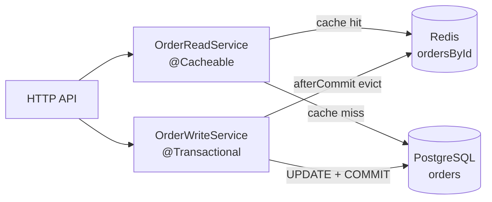
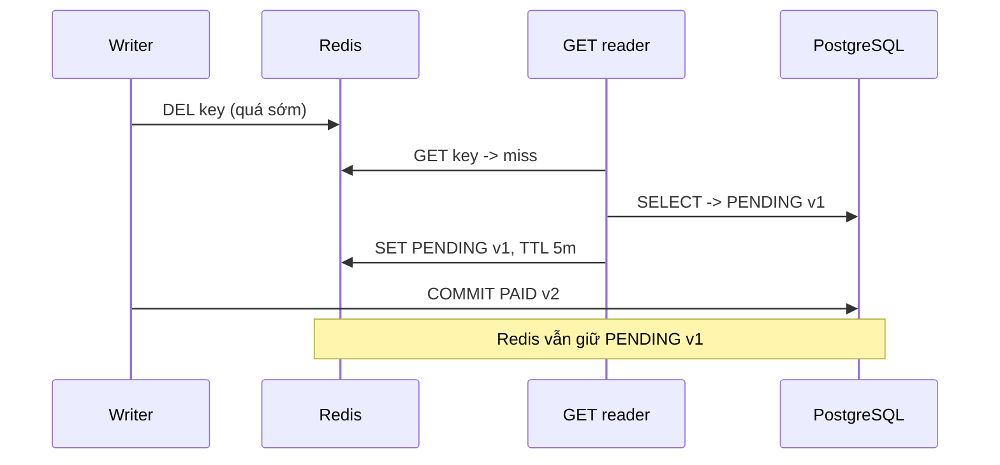
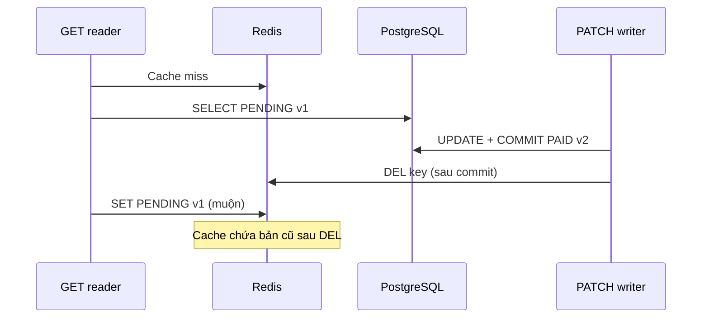
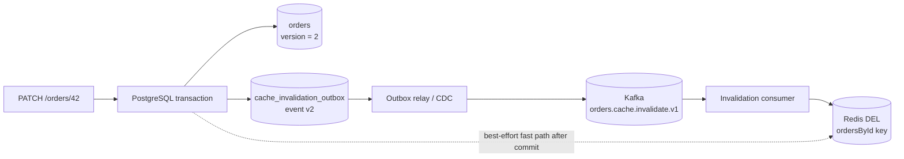

# Tích hợp Redis cache với chính sách vô hiệu hóa sau cập nhật dữ liệu

## 1. Bài toán thực hành: database đã thay đổi, Redis vẫn trả dữ liệu cũ

Giả sử một dịch vụ Spring Boot đọc đơn hàng từ PostgreSQL và cache thông tin này trong Redis để giảm độ trễ. Khi người dùng sửa trạng thái, hệ thống có hai nơi lưu cùng một sự thật ở hai thời điểm khác nhau:

```text
GET   /api/orders/42         -> Order(status=PENDING, version=1)
PATCH /api/orders/42/status  -> cập nhật thành PAID, version=2
GET   /api/orders/42         -> mong đợi PAID, nhưng có thể vẫn là PENDING
```

Nếu chỉ thêm `@Cacheable` lên method đọc thì response cũ tiếp tục được lấy từ Redis cho tới khi hết TTL. Nếu xóa cache **trước khi** transaction database commit, một GET đồng thời có thể điền lại cache bằng dữ liệu cũ. Ngay cả khi xóa **sau commit**, vẫn có race condition khác: GET đã đọc bản cũ trước commit có thể ghi cache **sau khi** thao tác xóa đã chạy.

Vì vậy, chính sách cache không chỉ là cấu hình một lệnh Redis `DEL`. Nó phải xác định rõ **khóa nào được xóa, vào lúc nào, có chấp nhận stale bao lâu, khi Redis không khả dụng thì sao, và cách bảo vệ các side effect nghiệp vụ trước dữ liệu cũ**.

Đây là bài **Thực hành tổng hợp** thuộc module `SPRING_BOOT_INTEGRATION`: tổ chức tích hợp trong Spring Boot qua HTTP client, database, cache, broker và adapter Spring Integration, chú trọng cấu hình, hợp đồng dữ liệu, giao dịch, lỗi, idempotency, kiểm thử và vận hành.

**Sau bài học, bạn có thể:**

1. Thiết kế luồng đọc **cache-aside** với `@Cacheable` và Redis Cache Manager.
2. Cập nhật PostgreSQL có kiểm tra version rồi vô hiệu hóa cache tương ứng **sau commit**.
3. Cấu hình TTL, serializer, cách ly tenant và cache key nhất quán giữa các pod.
4. Phân biệt `@CacheEvict`, `@CachePut` và cache manager transaction-aware.
5. Nhận biết race stale refill, DB commit thành công nhưng Redis invalidation thất bại, hoặc invalidation event bị trễ.
6. Thiết kế transactional outbox/Kafka khi cần vô hiệu hóa cache bền vững giữa nhiều service.
7. Kiểm thử hit/miss, rollback, TTL, Redis outage, concurrent requests, replay và đo metrics cần thiết.

> **Phiên bản:** Các ví dụ dùng Java 17+, Spring Boot 3.x, Spring Framework 6.x, Spring Data Redis 3.x, PostgreSQL và Redis 7.x. Với Spring Boot 4.x hoặc phiên bản thư viện khác, cần đối chiếu API/BOM và auto-configuration trước khi áp dụng nguyên mã. Mã dưới đây chia theo file/class; đặt từng public class/record trong file Java riêng tương ứng.

## 2. Cache là bản sao, database là nguồn chân lý

Trước khi lập trình, cần công bố hợp đồng dữ liệu và nhất quán:

| Quyết định | Chính sách của bài thực hành |
| --- | --- |
| Nguồn chân lý | PostgreSQL, bảng `orders`. |
| Dữ liệu cache | `OrderView` chỉ chứa trường được phép đọc: ID, tenant, status, version. |
| Định danh cache | Cặp `(tenantId, orderId)`; không dùng một order ID đơn lẻ trong ứng dụng nhiều tenant. |
| Cách điền cache | Cache miss → SELECT DB → Redis SET với TTL. |
| Cách cập nhật dữ liệu | DB UPDATE có điều kiện optimistic version; Redis không là nơi ghi nghiệp vụ. |
| Thời điểm invalidation | Sau transaction DB commit thành công. |
| TTL | Ví dụ 5 phút để giới hạn tuổi dữ liệu nếu thiếu invalidation. |
| Trạng thái không tồn tại | Không cache null trong ví dụ; 404 từ DB. |
| Độ nhất quán | **Eventual consistency** với cache-aside; luồng ghi quan trọng kiểm tra DB trực tiếp. |
| Redis unavailable | GET có thể được thiết kế fallback DB; lỗi invalidation sau ghi phải được đo và phục hồi. |

Cache-aside có ích khi read nhiều hơn write, dữ liệu có thể stale trong một khoảng được chấp nhận, và Redis được dùng để tăng hiệu năng. Nó **không** thích hợp làm nguồn quyết định cuối cùng cho việc trừ tiền, cấp quyền, trừ tồn kho, kiểm tra giới hạn giao dịch hoặc thay đổi trạng thái một chiều. Các invariant đó phải được kiểm tra tại nguồn chân lý trong transaction/version guard.

### 2.1. Luồng GET và PATCH



```text
GET:
  Redis GET key
    hit  -> trả OrderView
    miss -> SELECT DB -> Redis SET key + TTL -> trả OrderView

PATCH:
  BEGIN transaction
  UPDATE order WHERE id, tenant, expectedVersion, expectedStatus
  COMMIT transaction
  DEL đúng cache key sau commit
```

Redis Cache Manager giúp mã Java sử dụng các annotation của Spring Cache, nhưng **không** tạo distributed transaction giữa Redis và PostgreSQL. Một crash sau DB commit trước Redis DEL vẫn có thể để lại cache cũ. Nếu cần phục hồi chính xác khoảng này, dùng transactional outbox ở phần sau.

### 2.2. Hai định nghĩa thành công

Một request PATCH có thể đạt trạng thái `DB_COMMITTED` nhưng `CACHE_INVALIDATION_FAILED`. Không được mô tả như “database đã rollback”; cũng không được tuyên bố cache đã được cập nhật. Ứng dụng cần log, metrics, cơ chế retry bất đồng bộ hoặc TTL fallback và chính sách response rõ ràng.

## 3. Lược đồ dữ liệu và HTTP contract

Định nghĩa bảng PostgreSQL:

```sql
CREATE TABLE orders (
    id          BIGINT       NOT NULL,
    tenant_id   VARCHAR(80)  NOT NULL,
    status      VARCHAR(30)  NOT NULL,
    version     BIGINT       NOT NULL DEFAULT 0,
    updated_at  TIMESTAMPTZ  NOT NULL DEFAULT CURRENT_TIMESTAMP,
    PRIMARY KEY (tenant_id, id),
    CHECK (status IN ('PENDING', 'PAID', 'CANCELLED')),
    CHECK (version >= 0)
);

CREATE INDEX idx_orders_tenant_status ON orders(tenant_id, status);

INSERT INTO orders(id, tenant_id, status, version)
VALUES (42, 'tenant-a', 'PENDING', 1);
```

Trường `version` được tăng sau mỗi lần chuyển trạng thái và sử dụng như điều kiện optimistic concurrency. Khóa chính ghép tenant và ID giúp ngăn việc truy vấn chéo tenant tại database. Với hệ thống có authentication, không nhận tenant ID tùy ý từ header user mà chưa xác thực; identity/permission phải được kiểm tra ở tầng API và DAO.

DTO:

```java
// OrderView.java
package com.example.orders;

public record OrderView(
    long id,
    String tenantId,
    String status,
    long version
) {}
```

| Request | Kết quả mong đợi |
| --- | --- |
| `GET /api/orders/42` | 200 + `OrderView` hoặc 404. |
| `PATCH /api/orders/42/status` | 200 + `OrderView` mới sau commit. |
| PATCH với version đã cũ | 409 Conflict (hoặc 412 nếu API dùng HTTP preconditions/ETag). |
| PATCH không đúng trạng thái nguồn | 409 do business transition không hợp lệ. |
| Redis fail khi GET | DB fallback hoặc lỗi theo SLO đã định nghĩa. |
| Redis fail sau DB commit | DB vẫn đã commit; ghi sự cố invalidation để phục hồi. |

## 4. Dependencies và cấu hình ứng dụng

Sử dụng Spring Boot parent/BOM phù hợp để quản lý version:

```xml
<dependencies>
  <dependency>
    <groupId>org.springframework.boot</groupId>
    <artifactId>spring-boot-starter-web</artifactId>
  </dependency>
  <dependency>
    <groupId>org.springframework.boot</groupId>
    <artifactId>spring-boot-starter-jdbc</artifactId>
  </dependency>
  <dependency>
    <groupId>org.postgresql</groupId>
    <artifactId>postgresql</artifactId>
    <scope>runtime</scope>
  </dependency>
  <dependency>
    <groupId>org.springframework.boot</groupId>
    <artifactId>spring-boot-starter-data-redis</artifactId>
  </dependency>
  <dependency>
    <groupId>org.springframework.boot</groupId>
    <artifactId>spring-boot-starter-cache</artifactId>
  </dependency>
  <dependency>
    <groupId>org.springframework.boot</groupId>
    <artifactId>spring-boot-starter-test</artifactId>
    <scope>test</scope>
  </dependency>
</dependencies>
```

Ví dụ cấu hình dành cho môi trường phát triển; các biến môi trường không được commit secret thật:

```yaml
# application.yml
spring:
  datasource:
    url: ${JDBC_URL:jdbc:postgresql://localhost:5432/orders_db}
    username: ${DB_USERNAME:orders_app}
    password: ${DB_PASSWORD}
  data:
    redis:
      host: ${REDIS_HOST:localhost}
      port: ${REDIS_PORT:6379}
      username: ${REDIS_USERNAME:}
      password: ${REDIS_PASSWORD:}
      timeout: 2s
  cache:
    type: redis
```

Trong Spring Boot 3.x, Redis properties thường thuộc `spring.data.redis.*`; cấu hình cũ dưới `spring.redis.*` có thể không đúng phiên bản. Với production, bật TLS, xác minh certificate/hostname, cấu hình ACL/secret manager, timeout và pool hợp lý. `RedisTemplate` là API Redis trực tiếp; `RedisCacheManager` là adapter cho Spring Cache abstraction.

**Migration:** Bảng `orders` cần được tạo bằng Flyway/Liquibase hoặc quy trình schema versioned của dự án, không tùy ý tạo/xóa trong startup production. SQL trong bài chỉ minh họa schema cần có.

## 5. RedisCacheManager: TTL, serialization và transaction-aware

Đây là cấu hình trung tâm:

```java
// RedisCachingConfiguration.java
package com.example.orders;

import java.time.Duration;
import org.springframework.cache.CacheManager;
import org.springframework.cache.annotation.EnableCaching;
import org.springframework.context.annotation.Bean;
import org.springframework.context.annotation.Configuration;
import org.springframework.data.redis.cache.RedisCacheConfiguration;
import org.springframework.data.redis.cache.RedisCacheManager;
import org.springframework.data.redis.connection.RedisConnectionFactory;
import org.springframework.data.redis.serializer.Jackson2JsonRedisSerializer;
import org.springframework.data.redis.serializer.RedisSerializationContext;

@Configuration(proxyBeanMethods = false)
@EnableCaching
public class RedisCachingConfiguration {

    @Bean
    CacheManager cacheManager(
        RedisConnectionFactory connectionFactory
    ) {
        var serializer =
            new Jackson2JsonRedisSerializer<>(OrderView.class);

        RedisCacheConfiguration config =
            RedisCacheConfiguration.defaultCacheConfig()
                .entryTtl(Duration.ofMinutes(5))
                .disableCachingNullValues()
                .serializeValuesWith(
                    RedisSerializationContext.SerializationPair
                        .fromSerializer(serializer)
                );

        return RedisCacheManager.builder(connectionFactory)
            .withCacheConfiguration("ordersById", config)
            .disableCreateOnMissingCache()
            .transactionAware()
            .build();
    }
}
```

**Phân tích từng lựa chọn:**

- `@EnableCaching` bật Spring Cache interceptors. Không phải một annotation cấu hình transaction.
- `ordersById` là tên cache duy nhất dùng cho kiểu `OrderView`, giúp serializer typed JSON tương ứng. Nếu thêm cache chứa type khác, cấu hình serializer riêng cho nó.
- `entryTtl(5m)` quy định thời gian lưu kể từ lúc entry được ghi. Một GET hit thông thường không đồng nghĩa TTL tự gia hạn theo sliding expiration.
- `disableCachingNullValues()` không cho cache giá trị null. API hiện ném NotFound thay vì trả null, vì vậy miss của order không tồn tại tiếp tục được kiểm tra ở DB.
- `disableCreateOnMissingCache()` giúp lỗi tên cache được phát hiện thay vì âm thầm tạo cache mới không có chính sách.
- **`transactionAware()`** đồng bộ các thao tác cache tiêu chuẩn `put`/`evict`/`clear` với transaction Spring đang hoạt động: nếu có transaction synchronization, thao tác được trì hoãn tới sau commit; nếu rollback thì bỏ qua.

Spring Data Redis 3.x hỗ trợ chế độ transaction-aware trong builder. Một phương án khác là bọc cache manager bằng `TransactionAwareCacheManagerProxy`. Không nên dùng nhiều lớp wrapper tùy tiện; chọn một phương án, rồi xác minh bằng integration test thật.

**Điều không được bảo đảm:** đây không phải giao dịch hai pha giữa PostgreSQL và Redis. Nếu DEL sau commit thất bại, PostgreSQL vẫn đã thay đổi. Các lệnh có semantics immediate như `Cache.evictIfPresent()` hoặc `putIfAbsent()` cần được hiểu riêng; đừng coi chúng là after-commit chỉ vì đặt cùng bean manager.

### 5.1. Tên key thực tế trong Redis

Theo cấu hình Spring Data Redis thông thường, tên cache có tiền tố:

```text
ordersById::tenant-a:o:42
```

Khi một service dùng `Cache.evict("tenant-a:o:42")` thông qua cache `ordersById`, cache manager tự thêm prefix tương ứng. Nếu một worker khác gọi `StringRedisTemplate.delete("tenant-a:o:42")`, nó có thể xóa **sai key** vì thiếu prefix. Nên đi qua cùng cache abstraction và cùng key builder, hoặc version hóa giao thức key nếu nhiều ứng dụng cùng quản lý.

JSON typed cache có ưu điểm dễ hiểu, nhưng DTO evolution phải được xử lý: đổi field/type có thể làm dữ liệu cũ trong Redis không deserialize được. Dùng version cache namespace, rollout compatible serializer hoặc xóa key cũ có kiểm soát. Không bật deserialization polymorphic rộng cho dữ liệu không tin cậy để sửa lỗi tương thích.

### 5.2. Key builder bảo đảm cách ly tenant

```java
// OrderCacheKeys.java
package com.example.orders;

import org.springframework.stereotype.Component;

@Component("orderCacheKeys")
public class OrderCacheKeys {
    public String key(String tenantId, long orderId) {
        if (tenantId == null
            || !tenantId.matches("[A-Za-z0-9_-]{1,80}")
            || orderId <= 0) {
            throw new IllegalArgumentException(
                "Invalid tenant/order key"
            );
        }
        return tenantId + ":o:" + orderId;
    }
}
```

Quy tắc canonical key phải giống nhau ở mọi pod, mọi nơi đọc và nơi invalidation. Tenant ID trong production phải đến từ identity đã xác thực; không tin cậy một HTTP header hoặc query parameter do client tự đặt. Nếu tenant ID cho phép ký tự khác ví dụ Unicode, hãy chọn encoding ổn định và có quy định collision thay vì sao chép regex demo một cách máy móc.

## 6. Repository JDBC: nguồn dữ liệu và optimistic version guard

```java
// OrderJdbcRepository.java
package com.example.orders;

import java.util.List;
import java.util.Map;
import java.util.Optional;
import org.springframework.jdbc.core.namedparam.NamedParameterJdbcTemplate;
import org.springframework.stereotype.Repository;

@Repository
public class OrderJdbcRepository {
    private final NamedParameterJdbcTemplate jdbc;

    public OrderJdbcRepository(NamedParameterJdbcTemplate jdbc) {
        this.jdbc = jdbc;
    }

    public Optional<OrderView> find(
        String tenantId, long id
    ) {
        List<OrderView> rows = jdbc.query("""
            SELECT id, tenant_id, status, version
            FROM orders
            WHERE tenant_id = :tenantId AND id = :id
            """,
            Map.of("tenantId", tenantId, "id", id),
            (rs, row) -> new OrderView(
                rs.getLong("id"),
                rs.getString("tenant_id"),
                rs.getString("status"),
                rs.getLong("version")
            )
        );
        return rows.stream().findFirst();
    }

    public int updateStatus(
        String tenantId,
        long id,
        long expectedVersion,
        String newStatus
    ) {
        return jdbc.update("""
            UPDATE orders
            SET status = :newStatus,
                version = version + 1,
                updated_at = CURRENT_TIMESTAMP
            WHERE tenant_id = :tenantId
              AND id = :id
              AND version = :expectedVersion
              AND status = 'PENDING'
            """,
            Map.of(
                "newStatus", newStatus,
                "tenantId", tenantId,
                "id", id,
                "expectedVersion", expectedVersion
            )
        );
    }
}
```

`updateStatus` chỉ sửa khi version kỳ vọng và trạng thái PENDING cùng khớp. Đây là ví dụ transition `PENDING → PAID` hoặc `PENDING → CANCELLED`. Nếu row count bằng 0, có thể là ID không tồn tại, version cũ hoặc trạng thái không hợp lệ; phải phân loại theo business contract, không giả định retry là thành công.

**Lưu ý:** `Map.of(...)` không cho các giá trị null; ở tầng API cần validate tenant ID/status trước khi đi vào repository. SQL parameter binding tránh injection; không nối chuỗi input vào câu SQL.

## 7. Dịch vụ đọc với `@Cacheable`

```java
// OrderReadService.java
package com.example.orders;

import org.springframework.cache.annotation.Cacheable;
import org.springframework.stereotype.Service;

@Service
public class OrderReadService {
    private final OrderJdbcRepository orders;

    public OrderReadService(OrderJdbcRepository orders) {
        this.orders = orders;
    }

    @Cacheable(
        cacheNames = "ordersById",
        key = "@orderCacheKeys.key(#tenantId, #orderId)"
    )
    public OrderView get(String tenantId, long orderId) {
        return orders.find(tenantId, orderId)
            .orElseThrow(() -> new OrderNotFoundException(orderId));
    }
}
```

```java
// OrderNotFoundException.java
package com.example.orders;

public class OrderNotFoundException extends RuntimeException {
    public OrderNotFoundException(long id) {
        super("Order not found: " + id);
    }
}
```

Khi gọi qua Spring-managed proxy:

1. Cache interceptor tính key bằng `@orderCacheKeys.key(...)`.
2. Nếu cache có value, trả `OrderView` ngay; method `get` không chạy.
3. Nếu cache miss, gọi method đọc PostgreSQL.
4. Nếu tìm thấy, Spring Cache put value vào Redis theo TTL đã cấu hình.
5. Nếu không tìm thấy, ném exception; method không trả value để cache.

**Điểm dễ bỏ sót:** SpEL `#tenantId` và `#orderId` đòi hỏi parameter-name metadata được Java compiler giữ lại, chẳng hạn `-parameters`. Nhiều dự án Spring Boot parent đã thiết lập phù hợp; nếu không, dùng `#p0`/`#p1` hoặc cấu hình compiler. Phải test actual Redis key để tránh mọi request cùng ghi nhầm vào một key.

Với `@Cacheable`, dữ liệu có thể được lưu trước khi người gọi thực hiện bước business tiếp theo. Tránh dùng cache cho những thao tác phải kiểm tra trạng thái mới nhất tại thời điểm commit; các luồng ghi bên dưới luôn dùng SQL version guard.

## 8. Dịch vụ ghi với `@Transactional` và `@CacheEvict`

```java
// OrderWriteService.java
package com.example.orders;

import java.util.Set;
import org.springframework.cache.annotation.CacheEvict;
import org.springframework.stereotype.Service;
import org.springframework.transaction.annotation.Transactional;

@Service
public class OrderWriteService {
    private final OrderJdbcRepository orders;

    public OrderWriteService(OrderJdbcRepository orders) {
        this.orders = orders;
    }

    @Transactional
    @CacheEvict(
        cacheNames = "ordersById",
        key = "@orderCacheKeys.key(#tenantId, #orderId)",
        beforeInvocation = false
    )
    public OrderView changeStatus(
        String tenantId,
        long orderId,
        long expectedVersion,
        String newStatus
    ) {
        if (!Set.of("PAID", "CANCELLED").contains(newStatus)) {
            throw new IllegalArgumentException(
                "Invalid target status"
            );
        }

        int updated = orders.updateStatus(
            tenantId, orderId, expectedVersion, newStatus
        );
        if (updated != 1) {
            throw new OrderVersionConflictException(orderId);
        }

        return orders.find(tenantId, orderId)
            .orElseThrow(() -> new IllegalStateException(
                "Order disappeared after update"
            ));
    }
}
```

```java
// OrderVersionConflictException.java
package com.example.orders;

public class OrderVersionConflictException
    extends RuntimeException {
    public OrderVersionConflictException(long id) {
        super("Order version/status conflict: " + id);
    }
}
```

Phân tích:

- `@Transactional` bao UPDATE và SELECT bằng một local JDBC transaction.
- `beforeInvocation=false` (giá trị mặc định) chỉ evict sau khi method hoàn tất bình thường theo cache advice.
- Cache manager đã gọi `transactionAware()`, vì vậy nếu evict được thực thi trong active transaction, Spring hoãn nó tới **after-commit**. Nếu transaction rollback, thao tác evict đã đăng ký không chạy.
- Nếu cache advice chạy bên ngoài transaction advice, lúc nó evict thì transaction method đã commit; thứ tự vẫn phù hợp. Tuy nhiên phải kiểm thử proxy/advice thực tế thay vì suy luận đơn thuần từ thứ tự annotation.
- Nếu UPDATE trả 0, service ném conflict; không evict theo đường thành công và không thay đổi DB.

**Không được suy diễn rằng transaction-aware cache manager đưa Redis vào cùng transaction.** PostgreSQL commit có thể thành công nhưng thao tác evict của Redis thất bại sau đó. Exception tại thời điểm này cần được giám sát, không được thông báo sai rằng DB rollback.

### 8.1. Vì sao tránh `beforeInvocation=true`?

Nếu xóa Redis trước khi method cập nhật và commit DB, một GET đến giữa chừng có thể đọc DB phiên bản cũ và ghi lại cache. Nếu transaction sau đó rollback, xóa đã xảy ra vô ích; nếu commit, entry cũ có thể vẫn còn. Với write-through hoặc một chiến lược chủ động khác, có thể có lý do riêng, nhưng **đây không phải chính sách ta chọn trong bài**.

### 8.2. Vì sao không dùng `@CachePut` theo thói quen?

`@CachePut` luôn gọi method rồi đặt kết quả trả về vào cache. Có thể dùng khi giá trị trả về chính xác là representation cần cache, nhưng gặp các rủi ro:

- Một update khác hoàn tất sau đó, trong khi lời ghi cache của update cũ đến muộn.
- Method chỉ trả status code/partial DTO không tương đương `OrderView` dùng cho GET.
- Redis write thất bại sau DB commit.
- Một thay đổi ảnh hưởng nhiều cache keys/list/query pages chứ không chỉ một entity.

Ta chọn **invalidate-on-write**: lần GET sau tra DB làm nguồn chân lý. Nếu cần cache update trực tiếp dưới concurrency, phải thiết kế so sánh version atomically; `@CachePut` đơn thuần không phải version guard.

### 8.3. Spring AOP proxy và self-invocation

Các annotation `@Cacheable`, `@CacheEvict` và `@Transactional` thường được thực thi qua Spring proxies. Lệnh `this.get(...)` gọi trong chính class có thể bỏ qua cache interceptor; `this.changeStatus(...)` có thể bỏ qua transaction/cache advice. Tách service đọc/ghi như ví dụ, dùng public method qua Spring-managed bean và có integration test để bắt sai cấu hình này.

## 9. HTTP endpoint để thực hành

Một controller minh họa (giả định cơ chế xác thực đã cung cấp tenant đã được ủy quyền):

```java
// OrderController.java
package com.example.orders;

import org.springframework.http.ResponseEntity;
import org.springframework.web.bind.annotation.*;

@RestController
@RequestMapping("/api/orders")
public class OrderController {
    private final OrderReadService reads;
    private final OrderWriteService writes;
    private final TenantIdentity tenantIdentity;

    public OrderController(
        OrderReadService reads,
        OrderWriteService writes,
        TenantIdentity tenantIdentity
    ) {
        this.reads = reads;
        this.writes = writes;
        this.tenantIdentity = tenantIdentity;
    }

    @GetMapping("/{id}")
    public OrderView get(@PathVariable long id) {
        String tenant = tenantIdentity.currentTenant();
        return reads.get(tenant, id);
    }

    @PatchMapping("/{id}/status")
    public OrderView update(
        @PathVariable long id,
        @RequestBody ChangeStatusRequest request
    ) {
        String tenant = tenantIdentity.currentTenant();
        return writes.changeStatus(
            tenant, id,
            request.expectedVersion(),
            request.status()
        );
    }

    public record ChangeStatusRequest(
        String status,
        long expectedVersion
    ) {}
}
```

`TenantIdentity` là **interface/adapter do ứng dụng cung cấp**, lấy tenant từ Spring Security principal hoặc trusted identity context, không phải class có sẵn trong Spring Boot. Ví dụ:

```java
// TenantIdentity.java
package com.example.orders;

public interface TenantIdentity {
    String currentTenant();
}
```

Trong ứng dụng thật, cần một implementation tích hợp cơ chế authentication, kiểm tra quyền trên order, map NotFound → 404, Conflict → 409 và validation → 400 bằng `@RestControllerAdvice`. Controller trên cố ý không giả lập authentication bằng cách tin `X-Tenant-Id` của client.

### 9.1. Trình tự thử thủ công

Giả định principal được xác thực thuộc `tenant-a` và database đã seed order 42:

```http
GET /api/orders/42 HTTP/1.1
Authorization: Bearer <token>
```

Response:

```json
{"id":42,"tenantId":"tenant-a","status":"PENDING","version":1}
```

Lặp GET lần hai: dự kiến lấy từ Redis (cần metric/test chứng minh, không chỉ so response).

```http
PATCH /api/orders/42/status HTTP/1.1
Authorization: Bearer <token>
Content-Type: application/json

{"status":"PAID","expectedVersion":1}
```

Response:

```json
{"id":42,"tenantId":"tenant-a","status":"PAID","version":2}
```

Sau khi transaction commit, cache key của order 42 được evict. GET tiếp theo phải đọc DB mới **trong trường hợp tuần tự thông thường, không có reader cũ đang chạy song song**, rồi cache value `PAID`. Một PATCH lặp lại với `expectedVersion: 1` sẽ gặp conflict; muốn idempotent command-level retry cần command ID hoặc tra cứu trạng thái, không chỉ có cache invalidation.

## 10. Cửa sổ lỗi quanh commit và stale refill race

### 10.1. Evict trước commit gây stale



Evict after commit giảm nguy cơ trên: entry không được chủ động xóa trước khi dữ liệu mới sẵn sàng cho các reader. Nó cũng không xóa cache khi transaction rollback.

### 10.2. Evict sau commit vẫn có race



Đây là **stale refill**: một reader đã lấy dữ liệu cũ trước khi writer commit, nhưng write vào cache sau thao tác invalidation. Vì vậy:

- TTL giới hạn tuổi entry stale nhưng không ngăn stale refill.
- `@Cacheable(sync=true)` có thể làm đồng bộ load trong phạm vi hành vi của cache provider, nhưng không tạo atomicity với DB và không giải quyết mọi race giữa writer/reader nhiều pod.
- “Delayed double delete” chỉ là heuristic để giảm xác suất; không có bảo đảm tuyệt đối, có thể tạo thêm miss và tải.
- Nếu một thao tác cần linearizable/read-your-writes thật sự, đọc trực tiếp PostgreSQL hoặc triển khai một version-aware cache protocol được chứng minh.

**Không dựa vào cache để quyết định chuyển trạng thái**: code ghi đã kiểm tra `version` và `status` trong câu UPDATE của PostgreSQL. Đây là lớp bảo vệ nghiệp vụ ngay cả khi GET bị stale.

### 10.3. Các trạng thái lỗi phải phân biệt

| Lỗi xảy ra ở đâu? | DB | Cache | Cách diễn giải |
| --- | --- | --- | --- |
| Validation/SQL lỗi trước commit | Rollback. | Key cũ có thể còn. | Không evict; báo lỗi input/conflict. |
| Crash ngay sau commit trước DEL | Đã thay đổi. | Key cũ còn. | TTL hoặc durable invalidation event phục hồi. |
| Redis DEL timeout | Đã thay đổi. | Không biết key đã xóa chưa. | Retry DEL an toàn, đo unknown invalidation; không rollback giả. |
| Reader cũ ghi cache sau DEL | Đã thay đổi. | Có thể giữ value cũ. | TTL/version guard/strict DB reads. |
| Redis restart hoặc key evicted | Không đổi. | Miss. | DB fallback và kiểm soát stampede. |
| Redis unavailable khi GET | Không đổi. | Không đọc được. | Có thể fallback DB nếu chính sách/CacheErrorHandler cho phép. |

Xóa một Redis key thường là **thao tác lũy đẳng theo kết quả xóa**: gọi lại `DEL key` không tạo side effect nghiệp vụ mới. Vì thế retry invalidation có thể an toàn hơn retry một `POST /payments`, nhưng phải bảo đảm xóa đúng key/tenant/prefix và còn trong ngân sách retry.

## 11. `@TransactionalEventListener(AFTER_COMMIT)`: một lựa chọn nội bộ process

Nếu một thao tác cập nhật cần xóa nhiều cache entries hoặc gửi tín hiệu cho các component trong cùng ứng dụng, có thể phát Spring application event trong transaction và xử lý sau commit.

```java
// OrderChangedEvent.java
package com.example.orders;

public record OrderChangedEvent(
    String tenantId, long orderId, long version
) {}
```

Ví dụ publisher được gọi từ service đang có `@Transactional`:

```java
// Trong method transaction đang cập nhật order:
// OrderView saved = orders.find(...).orElseThrow(...);
events.publishEvent(
    new OrderChangedEvent(
        saved.tenantId(), saved.id(), saved.version()
    )
);
// Transaction commit ở bên ngoài method.
```

`events` ở đây là `ApplicationEventPublisher` được inject từ Spring context. Listener:

```java
// OrderCacheEventListener.java
package com.example.orders;

import org.springframework.cache.Cache;
import org.springframework.cache.CacheManager;
import org.springframework.stereotype.Component;
import org.springframework.transaction.event.TransactionPhase;
import org.springframework.transaction.event.TransactionalEventListener;

@Component
public class OrderCacheEventListener {
    private final CacheManager caches;
    private final OrderCacheKeys keys;

    public OrderCacheEventListener(
        CacheManager caches, OrderCacheKeys keys
    ) {
        this.caches = caches;
        this.keys = keys;
    }

    @TransactionalEventListener(
        phase = TransactionPhase.AFTER_COMMIT
    )
    public void invalidate(OrderChangedEvent event) {
        Cache cache = caches.getCache("ordersById");
        if (cache == null) {
            throw new IllegalStateException("Missing ordersById cache");
        }
        cache.evict(keys.key(event.tenantId(), event.orderId()));
    }
}
```

**Khi chọn phương án này**, nên bỏ `@CacheEvict` trùng chức năng trong cùng flow nếu không có chủ đích cho hai đường xóa; dùng một owner rõ ràng. `AFTER_COMMIT` giúp tránh xóa khi DB rollback, nhưng **event vẫn là tín hiệu trong process**:

- Process crash ngay sau DB commit trước khi listener hoàn tất có thể làm mất invalidation.
- Listener ném exception sau commit **không rollback được** transaction đã commit.
- Dùng `@Async` cho listener không tự tạo durable queue; chỉ chuyển cửa sổ mất event sang nơi khác.
- Nếu sự kiện được phát ngoài transaction, mặc định `@TransactionalEventListener` có thể không chạy trừ khi cấu hình fallback có chủ đích.
- Không viết DB transactional mới trong callback after-commit mà không xác định transaction mới. Với business update bổ sung có thể cần `REQUIRES_NEW`; ở đây listener chỉ thực hiện Redis DEL.

**Khi nào dùng?** Một ứng dụng đơn, Redis shared, TTL ngắn và có thể chịu một khoảng stale nếu process crash. Nếu cần khôi phục invalidation sau crash hoặc phối hợp nhiều service, dùng **transactional outbox** ở phần tiếp theo.

## 12. Invalidation bền vững: transactional outbox + Kafka

Giải pháp transaction-aware cache manager xử lý đúng **thời điểm** thao tác cache khi process còn sống. Nhưng DB và Redis không commit atomically. Để giảm nguy cơ mất invalidation sau DB commit, lưu sự kiện cần vô hiệu hóa trong **cùng transaction PostgreSQL** với update.



**Bất biến:** nếu order update commit thì outbox event tương ứng cũng commit. Nếu transaction rollback thì cả order update lẫn event không tồn tại. Relay có thể publish lại event sau crash; vì xóa cache cùng key là idempotent, replay thường an toàn ở mức side effect cache.

### 12.1. Schema outbox

```sql
CREATE TABLE cache_invalidation_outbox (
    event_id       VARCHAR(180) PRIMARY KEY,
    tenant_id      VARCHAR(80) NOT NULL,
    order_id       BIGINT NOT NULL,
    order_version  BIGINT NOT NULL,
    published      BOOLEAN NOT NULL DEFAULT FALSE,
    created_at     TIMESTAMPTZ NOT NULL DEFAULT CURRENT_TIMESTAMP,
    published_at   TIMESTAMPTZ
);

CREATE INDEX idx_cache_outbox_pending
    ON cache_invalidation_outbox(published, created_at);
```

Một order update v2 sinh event ID ổn định, ví dụ `invalidate:tenant-a:42:v2`. Không dùng random event ID mới khi relay thử lại **cùng outbox row**. Hợp đồng event cần gồm tenant, order ID, version và schema version nếu nhiều consumer liên quan.

### 12.2. Ghi outbox trong transaction update

```java
// InvalidationOutboxRepository.java
package com.example.orders;

import java.util.Map;
import org.springframework.jdbc.core.namedparam.NamedParameterJdbcTemplate;
import org.springframework.stereotype.Repository;

@Repository
public class InvalidationOutboxRepository {
    private final NamedParameterJdbcTemplate jdbc;

    public InvalidationOutboxRepository(
        NamedParameterJdbcTemplate jdbc
    ) {
        this.jdbc = jdbc;
    }

    public void record(OrderView order) {
        String eventId = "invalidate:"
            + order.tenantId() + ":"
            + order.id() + ":v" + order.version();

        int inserted = jdbc.update("""
            INSERT INTO cache_invalidation_outbox
                (event_id, tenant_id, order_id, order_version)
            VALUES (:eventId, :tenantId, :orderId, :version)
            ON CONFLICT (event_id) DO NOTHING
            """,
            Map.of(
                "eventId", eventId,
                "tenantId", order.tenantId(),
                "orderId", order.id(),
                "version", order.version()
            )
        );
        if (inserted != 1) {
            throw new IllegalStateException(
                "Duplicate invalidation event identity"
            );
        }
    }
}
```

Để bật durable invalidation, **mở rộng `OrderWriteService`** đã viết ở mục 8:

```java
// Thêm dependency vào constructor:
private final InvalidationOutboxRepository outbox;

// Trong cùng method @Transactional changeStatus(...),
// ngay sau UPDATE thành công, thay đoạn return bằng:
OrderView saved = orders.find(tenantId, orderId)
    .orElseThrow(() -> new IllegalStateException(
        "Order disappeared after update"
    ));
outbox.record(saved);  // Cùng transaction DB với UPDATE.
return saved;
```

Đây là **đoạn chỉnh sửa minh họa** cho method trước, không phải một class Java độc lập. Nếu `outbox.record(...)` lỗi, transaction update cũng rollback. Có thể giữ `@CacheEvict` after-commit làm **fast path** và để outbox event là lớp phục hồi sau crash/Redis outage; như vậy có hai đường xóa idempotent với mục tiêu khác nhau, cần đo chúng riêng.

Nếu ứng dụng cần một chính sách tập trung thay vì fast path, có thể chỉ dùng outbox event; nhưng invalidation khi đó là **bất đồng bộ**, làm thời gian stale phụ thuộc relay và consumer lag. Không mô tả đường này là read-after-write tức thời.

### 12.3. Relay phải chờ broker acknowledgment

Một relay/CDC worker đọc những event `published=false`, gửi message với Kafka **record key** là cặp tenant/order ID và sau khi broker xác nhận mới đánh dấu `published=true`:

```text
SELECT unpublished events (batch có lease/claim)
  -> Kafka send(topic, aggregateKey, eventJson)
  -> chờ broker acknowledgment
  -> UPDATE published=true, published_at=now()
```

Điểm vận hành:

- Nhiều relay instances phải claim/lease rows an toàn; không chỉ cùng SELECT tất cả `published=false` rồi coi mỗi row có một owner.
- Không giữ DB transaction mở trong thời gian chờ Kafka lâu; có thể dùng lease và optimistic update/fencing.
- Relay crash **sau broker ack nhưng trước UPDATE published** sẽ phát lại. Consumer phải chịu duplicate event.
- Nếu outbox backlog tăng vô hạn, table/disk cũng đầy; cần quota, cleanup/archival, retry budget và giám sát oldest-unpublished age.
- Nếu dùng Debezium/CDC, vẫn phải cấu hình routing/serialization và đo connector lag; outbox không tự bảo đảm business event ordering trong mọi thiết kế multi-relay.

Một Kafka transaction không tự tạo ACID transaction chung với PostgreSQL. Outbox chính là cách chuyển trách nhiệm phát sự kiện sang một quy trình có thể replay.

### 12.4. Consumer xóa cache

Ví dụ consumer Spring Kafka, với JSON event từ outbox:

```java
// OrderInvalidationEvent.java
package com.example.orders;

public record OrderInvalidationEvent(
    String eventId,
    String tenantId,
    long orderId,
    long orderVersion
) {}
```

```java
// OrderInvalidationConsumer.java
package com.example.orders;

import com.fasterxml.jackson.core.JsonProcessingException;
import com.fasterxml.jackson.databind.ObjectMapper;
import org.springframework.cache.Cache;
import org.springframework.cache.CacheManager;
import org.springframework.kafka.annotation.KafkaListener;
import org.springframework.stereotype.Component;

@Component
public class OrderInvalidationConsumer {
    private final ObjectMapper mapper;
    private final CacheManager caches;
    private final OrderCacheKeys keys;

    public OrderInvalidationConsumer(
        ObjectMapper mapper,
        CacheManager caches,
        OrderCacheKeys keys
    ) {
        this.mapper = mapper;
        this.caches = caches;
        this.keys = keys;
    }

    @KafkaListener(
        topics = "orders.cache.invalidate.v1",
        groupId = "shared-redis-cache-evictors"
    )
    public void invalidate(String json)
        throws JsonProcessingException {
        OrderInvalidationEvent event = mapper.readValue(
            json, OrderInvalidationEvent.class
        );

        Cache cache = caches.getCache("ordersById");
        if (cache == null) {
            throw new IllegalStateException("ordersById cache missing");
        }
        cache.evict(keys.key(event.tenantId(), event.orderId()));
    }
}
```

Khi Redis thất bại, listener **không được nuốt lỗi** rồi commit Kafka offset như thể invalidation đã hoàn tất. Cần cấu hình error handler/retry/backoff, DLT hoặc durable parking; chọn ai retry và khi nào commit offset theo Spring Kafka container version thực tế.

**Lưu ý về topology:** Khi tất cả pod dùng **cùng Redis shared cache**, chỉ một consumer trong một Kafka group thực hiện DEL cho key cũng đủ tác động đến cache chung. Nếu mỗi pod có thêm **L1 cache local** (ví dụ Caffeine), một consumer group chỉ giao event cho một member, **không broadcast tới mọi instance**. Muốn xóa mọi L1, cần pub/sub/fanout phù hợp hoặc TTL/version check trên từng pod; không nhầm Kafka group assignment với cơ chế broadcast.

### 12.5. Event duplicate, delay và ordering

DEL cùng key hai lần thường an toàn: lần thứ hai chỉ gây thêm cache miss khi entry đã được tạo lại. Tuy vậy, một event cũ đến trễ có thể xóa value version mới hơn gây load DB tăng. Đừng dùng event cũ để **ghi lại value cũ** bằng `@CachePut`, vì như vậy có thể làm dữ liệu regression.

Nếu muốn chỉ áp dụng invalidation khi cần, có thể lưu cache entry kèm version và thao tác compare-version bằng một Lua script/Redis transaction được thiết kế riêng; nhưng vẫn phải chứng minh race giữa DB read và Redis write đã được khống chế. Không gọi một phép GET–so sánh–SET tách rời là atomic.

## 13. Redis outage: fail-open hay fail-closed?

Redis là cache, nhưng lỗi Redis có thể ảnh hưởng API ở hai đường khác nhau:

| Hành động | Khi Redis unavailable | Chính sách có thể chọn |
| --- | --- | --- |
| GET cache | Không thể đọc cache. | Fallback DB để duy trì khả năng đọc nếu DB chịu tải; hoặc fail nếu hệ thống không đáp ứng SLO. |
| PUT cache sau DB read | Không thể lưu kết quả. | Trả dữ liệu DB nếu chấp nhận cache miss; đo cache-write failure. |
| DEL cache sau DB commit | Không thể vô hiệu hóa entry. | Không làm như DB rollback; đảm bảo TTL/outbox + alert/retry. |
| Invalidation Kafka listener | Không DEL được. | Retry/delayed retry, không commit thành công giả. |
| Redis hồi phục sau outage | Cache có thể rỗng hoặc stale. | Refill có kiểm soát, không tạo stampede tới DB. |

### 13.1. `CacheErrorHandler`

Spring Cache có `CacheErrorHandler` để tùy biến cách ứng xử khi đọc/ghi/xóa cache lỗi. Một chính sách có thể cho phép **GET/PUT cache failures degrade** về DB, nhưng **không nên âm thầm bỏ qua evict failures** trong một hệ thống cần invalidation đúng.

Ví dụ ý tưởng:

```text
cache get error -> metric + warning -> tiếp tục đọc PostgreSQL
cache put error -> metric + warning -> trả kết quả PostgreSQL
cache evict error -> metric + alert -> durable retry qua outbox
cache clear error -> metric + alert -> không giả thành công
```

Việc ignore exception từ `@CacheEvict` phải đi kèm outbox/durable recovery đã được kiểm tra, không chỉ vì muốn HTTP endpoint luôn trả 200. Ngoài ra, không phải mọi lỗi Redis là connection timeout: lỗi serializer/type migration không tự hết khi reconnect; cần sửa schema hoặc xóa key sai có kiểm soát.

### 13.2. Chống cache stampede

Khi Redis restart hoặc TTL của nhiều keys hết cùng lúc, nhiều GET cache miss có thể đồng thời đọc cùng bản ghi từ DB:

```text
100 GET đồng thời -> cùng Redis miss
                  -> 100 SELECT PostgreSQL
                  -> 100 SET cache
```

Các biện pháp:

- TTL có jitter để giảm hết hạn đồng loạt (thiết kế per-key TTL/expiration policy tùy stack).
- `@Cacheable(sync=true)` có thể giới hạn số concurrent loads theo khả năng cache provider; kiểm tra hành vi thật **xuyên pod**, không suy ra single-flight phân tán tự động.
- Giới hạn số DB queries đang chạy, circuit breaker/bulkhead, request coalescing phù hợp.
- Đối với hot keys, warm-up an toàn hoặc stale-while-revalidate có hợp đồng rõ ràng.
- Không cache dữ liệu nhạy cảm hoặc tài nguyên không tồn tại chỉ để giảm tải mà không xét TTL và quyền.

### 13.3. Redis không phải nơi quyết định trạng thái payment

Nếu kiểm tra order status trong cache để quyết định thu tiền, stale `PENDING` có thể khiến lệnh payment chạy lại. Trong database, phải dùng transaction và version/idempotency key kiểm tra tác dụng phụ. Cache là lớp hiệu năng, không được dùng như một concurrency lock hoặc business uniqueness guarantee nếu không có thiết kế atomic và độ bền phù hợp.

## 14. Một thay đổi có thể ảnh hưởng nhiều cache keys

Đến đây ví dụ chỉ cache `ordersById`. Trong thực tế, thay đổi trạng thái của order còn có thể ảnh hưởng:

- `ordersByCustomer` — danh sách đơn theo khách hàng.
- `orderSummaryByCustomer` — số lượng và tổng tiền theo trạng thái.
- `pendingOrdersPage` — các trang danh sách có filter/sort.
- `warehouseAvailability` — nếu order làm thay đổi tồn kho.

Xóa riêng key `ordersById::tenant-a:o:42` **không** làm những cache trên cập nhật. Cần lập **dependency map** giữa mutation và các cache chịu ảnh hưởng:

| Mutation | Cache cần xem xét | Cách làm |
| --- | --- | --- |
| Đổi trạng thái order | `ordersById` key theo tenant/order | Evict key sau commit. |
| Đổi trạng thái order | Summary theo tenant/customer | Evict key summary cụ thể hoặc version namespace. |
| Đổi trạng thái order | List/pagination nhiều filter | TTL ngắn, versioned query cache, hoặc invalidation theo nhóm được thiết kế. |
| Xóa order | Cache theo ID và danh sách | Evict các representation có thể chứa bản ghi. |
| Tạo order | List/aggregate có thể bị thiếu order mới | Invalidate các query caches liên quan; không chỉ key của order mới. |

Spring Cache có `@Caching(evict = {...})` để xóa nhiều cache entries ở một method, nhưng **key phải tính đúng** theo từng cache. Một `@CacheEvict(allEntries=true)` dễ viết nhưng có thể làm mất cache của **mọi tenant** và tạo cache stampede. Không chạy `KEYS ordersById::*` rồi DEL hàng loạt trên Redis production như cơ chế invalidation chính: `KEYS` có thể block Redis khi keyspace lớn.

Khi list/query caches có số tổ hợp filter không thể enumerate, các lựa chọn thực tế gồm:

1. Chỉ cache theo ID, các list queries đọc DB/index tìm kiếm.
2. Đặt TTL ngắn cho danh sách, chấp nhận stale theo contract.
3. Dùng versioned namespace theo tenant/customer để đổi key namespace sau mutation, kèm cleanup key cũ.
4. Dùng materialized view/read model được cập nhật bằng event, có version và độ tươi đo được.

Không tối ưu thêm cache khi chưa xác định được cách vô hiệu hóa đúng và chi phí vận hành.

## 15. Kiểm thử tích hợp bằng PostgreSQL và Redis thật

Unit test mock `CacheManager` chỉ chứng minh method đã gọi `evict`, **không** chứng minh TTL, serializer, transaction synchronization hoặc hành vi Redis network. Một bài thực hành tích hợp nên dùng Testcontainers:

```xml
<!-- Testcontainers 1.x tương thích với BOM dự án -->
<dependency>
  <groupId>org.testcontainers</groupId>
  <artifactId>testcontainers</artifactId>
  <scope>test</scope>
</dependency>
<dependency>
  <groupId>org.testcontainers</groupId>
  <artifactId>postgresql</artifactId>
  <scope>test</scope>
</dependency>
<dependency>
  <groupId>org.testcontainers</groupId>
  <artifactId>junit-jupiter</artifactId>
  <scope>test</scope>
</dependency>
```

Nếu dùng outbox/Kafka ở mục 12, thêm `spring-kafka` cho runtime và `spring-kafka-test` hoặc Testcontainers Kafka cho integration tests. Cần cấu hình producer key/value serializers, consumer group, deserializer, listener error handler, topic và broker riêng; các phần này không phải là auto-configuration của Redis.

### 15.1. Test Spring Boot với hai container

Mẫu JUnit 5 sau giả định schema `orders` được tạo bởi migration/fixture của test và `TenantIdentity` có implementation phù hợp (nếu controller ở mục 9 được đăng ký):

```java
// OrderRedisIntegrationTest.java
package com.example.orders;

import static org.junit.jupiter.api.Assertions.*;

import org.junit.jupiter.api.BeforeEach;
import org.junit.jupiter.api.Test;
import org.springframework.beans.factory.annotation.Autowired;
import org.springframework.boot.test.context.SpringBootTest;
import org.springframework.cache.Cache;
import org.springframework.cache.CacheManager;
import org.springframework.jdbc.core.JdbcTemplate;
import org.springframework.test.context.DynamicPropertyRegistry;
import org.springframework.test.context.DynamicPropertySource;
import org.testcontainers.containers.GenericContainer;
import org.testcontainers.containers.PostgreSQLContainer;
import org.testcontainers.junit.jupiter.Container;
import org.testcontainers.junit.jupiter.Testcontainers;

@SpringBootTest
@Testcontainers
class OrderRedisIntegrationTest {

    @Container
    static final PostgreSQLContainer<?> postgres =
        new PostgreSQLContainer<>("postgres:16-alpine");

    @Container
    static final GenericContainer<?> redis =
        new GenericContainer<>("redis:7.4-alpine")
            .withExposedPorts(6379);

    @DynamicPropertySource
    static void properties(DynamicPropertyRegistry registry) {
        registry.add(
            "spring.datasource.url", postgres::getJdbcUrl
        );
        registry.add(
            "spring.datasource.username", postgres::getUsername
        );
        registry.add(
            "spring.datasource.password", postgres::getPassword
        );
        registry.add("spring.data.redis.host", redis::getHost);
        registry.add("spring.data.redis.port",
            () -> redis.getMappedPort(6379));
    }

    @Autowired JdbcTemplate jdbc;
    @Autowired CacheManager cacheManager;
    @Autowired OrderCacheKeys keys;
    @Autowired OrderReadService reads;
    @Autowired OrderWriteService writes;

    private Cache orderCache() {
        Cache cache = cacheManager.getCache("ordersById");
        assertNotNull(cache);
        return cache;
    }

    @BeforeEach
    void seed() {
        jdbc.update("""
            INSERT INTO orders(id, tenant_id, status, version)
            VALUES (42, 'tenant-a', 'PENDING', 1)
            ON CONFLICT (tenant_id, id)
            DO UPDATE SET
                status = EXCLUDED.status,
                version = EXCLUDED.version
            """);
        orderCache().evict(keys.key("tenant-a", 42));
    }

    @Test
    void committedChangeEvictsCachedOrder() {
        String key = keys.key("tenant-a", 42);

        OrderView first = reads.get("tenant-a", 42);
        assertEquals("PENDING", first.status());
        assertNotNull(orderCache().get(key)); // Cache đã được điền.

        OrderView updated =
            writes.changeStatus("tenant-a", 42, 1, "PAID");
        assertEquals("PAID", updated.status());
        assertEquals(2, updated.version());

        // Sau transaction commit, key cũ bị xóa.
        assertNull(orderCache().get(key));

        OrderView after = reads.get("tenant-a", 42);
        assertEquals("PAID", after.status());
        assertEquals(2, after.version());
        assertNotNull(orderCache().get(key));
    }

    @Test
    void rejectedUpdateDoesNotInvalidateCache() {
        String key = keys.key("tenant-a", 42);
        reads.get("tenant-a", 42); // Cache PENDING v1.

        assertThrows(OrderVersionConflictException.class,
            () -> writes.changeStatus(
                "tenant-a", 42, 999, "PAID"
            )
        );

        assertNotNull(orderCache().get(key));
        String currentStatus = jdbc.queryForObject("""
            SELECT status FROM orders
            WHERE tenant_id = 'tenant-a' AND id = 42
            """, String.class);
        assertEquals("PENDING", currentStatus);
    }
}
```

Test trên có hai container thật, không cần server Redis chạy ngoài máy. Các điều kiện:

- Docker phải khả dụng, image và dependency tương thích môi trường test.
- Chạy migration bảng `orders` và cấp đúng quyền DB; không coi test DDL là giải pháp production.
- Nếu có `OrderController` cần `TenantIdentity`, phải cung cấp implementation trong app/test context; code ví dụ chỉ định interface nên chưa là một ứng dụng đóng gói độc lập.
- Nếu bật outbox ở mục 12, migration phải tạo thêm bảng outbox.
- **Không đặt `@Transactional` lên toàn bộ test method** khi kiểm tra after-commit; transaction bao ngoài từ test có thể chưa commit đến lúc assert, làm hành vi eviction khác mong đợi.
- Các test nên cô lập fixture và không để shared Redis key bị các test song song sửa.

### 15.2. Xác minh TTL và key thực tế

Sau một lần GET đầu tiên:

```text
# Chạy trong môi trường test/staging với redis-cli phù hợp:
redis-cli --scan --pattern 'ordersById::*'
redis-cli TTL 'ordersById::tenant-a:o:42'
```

TTL của một key còn sống nên dương và không vượt TTL ban đầu theo điều kiện quan sát thông thường; khi key mất, Redis `TTL` có thể trả mã âm đặc biệt. Không giả định một cache hit sẽ reset TTL.

Trong production không chạy quét toàn keyspace liên tục để đo cache hit. Dùng metrics của cache manager/Redis và sampling có giới hạn.

### 15.3. Kiểm thử hit/miss bằng số lần gọi DAO

Để chứng minh `@Cacheable` không đọc DB trên cache hit:

1. Xóa key qua `CacheManager`.
2. Gọi `reads.get(...)` lần đầu và ghi nhận số lần `OrderJdbcRepository.find(...)` hoặc số SQL SELECT qua instrumentation.
3. Gọi lại với cùng tenant/id → không có SELECT mới.
4. Gọi với tenant khác → phải là cache key khác và có kiểm tra quyền thích hợp.
5. Gọi `writes.changeStatus(...)` rồi GET → SELECT mới, nhận version mới.

Có thể dùng Mockito spy trong test context, datasource proxy hoặc query metrics, nhưng chọn cách không làm thay đổi transaction/order semantics. Response giống nhau ở hai lần GET **chưa đủ** để chứng minh lần thứ hai là cache hit.

### 15.4. Test concurrency tái hiện stale refill

Dùng barrier/`CountDownLatch` trong một DAO test double hoặc interceptor để điều khiển:

```text
Reader A: Redis MISS
Reader A: SELECT PENDING v1, tạm dừng trước cache put
Writer B: UPDATE + COMMIT PAID v2
Writer B: DEL cache key
Reader A: tiếp tục, SET PENDING v1
Assert: có thể tồn tại cache stale nếu chỉ dùng cache-aside + DEL
```

Test này chứng minh **giới hạn thiết kế**, không phải một bug Spring đơn giản. Nếu sản phẩm yêu cầu tránh hoàn toàn kết quả stale, hãy thiết kế version check/serialized cache fill có chứng minh hoặc chuyển luồng đọc quan trọng sang DB.

### 15.5. Test failure injection và outbox replay

| Tình huống | Kết quả phải xác minh |
| --- | --- |
| GET khi Redis miss | SELECT DB rồi cache value đúng. |
| GET lần hai | Cache hit, không SELECT lại. |
| PATCH thành công | DB version tăng; cache key bị evict sau commit. |
| PATCH version conflict | Không đổi DB, không evict cache theo success path. |
| DB rollback sau UPDATE | Không phát invalidation đã commit, cache không bị xóa bởi transaction-aware path. |
| Redis crash sau DB commit trước DEL | Outbox vẫn có event; listener/worker có thể phục hồi. |
| Redis DEL timeout | Không thông báo sai DB rollback; có retry/alert/record bền. |
| Hai GET và một PATCH xen kẽ | Có thể tái hiện stale refill; consistency contract rõ. |
| Redis restart/all keys miss | Không làm DB connection pool bị cạn dưới burst. |
| Outbox relay publish rồi crash trước mark sent | Replay DEL idempotent; event không mất. |
| Listener Kafka gặp Redis lỗi | Offset/DLT/retry theo recovery policy, không nuốt lỗi. |
| Multi-tenant trùng order ID | Không chia sẻ cache entry và không lộ dữ liệu. |
| DTO serializer thay đổi | Có kế hoạch version key/khả năng đọc value cũ. |
| TTL hết hạn | Lần đọc sau DB được gọi và value mới có TTL. |

Unit test chỉ mock Redis không chứng minh outage/restart/transaction boundary. Cần fault injection với Testcontainers hoặc môi trường test riêng có kiểm soát để xác minh cửa sổ mất cache event.

## 16. Monitoring và chỉ số vận hành

Một chính sách invalidation chỉ có ý nghĩa khi có cách biết nó đang hoạt động:

| Chỉ số | Ý nghĩa vận hành |
| --- | --- |
| Cache hit/miss theo cache name | Redis có thực sự giảm DB reads không? |
| Cache GET/SET/DEL latency và errors | Redis network/serializer/TLS có vấn đề không? |
| DB SELECT throughput, p95/p99 và pool utilization | Cache miss có gây DB quá tải không? |
| Invalidation attempts, success/failure | Có key nào không được xóa sau write không? |
| DB commit → Redis eviction latency | Cửa sổ stale trong đường fast path. |
| Outbox unpublished count/oldest age | Durable invalidation có đang bị tồn đọng không? |
| Kafka consumer lag/DLT age | Event cache invalidation có được thực thi không? |
| Cache value version vs DB version (sampling) | Phát hiện stale value do race/mất event. |
| Redis evictions/memory/keyspace/TTL distribution | Cache có áp lực memory hoặc retention không? |
| Business write conflicts/duplicate retries | Có nhiều lệnh cập nhật ngoài thứ tự không? |

Spring Boot Actuator/Micrometer có thể cung cấp một số HTTP/JVM/Redis/cache metrics tùy phiên bản, instrumentation và cấu hình. **Không phải tất cả các metric trên đều có sẵn:** đặc biệt oldest-outbox-age, business version mismatch và lost invalidation cần được ứng dụng tự đo.

Spring Data Redis hỗ trợ local cache statistics khi được bật bằng cơ chế phù hợp của RedisCacheManager; những thống kê này theo cache instance/process, không phải tổng hợp hoàn hảo của một Redis cluster nhiều pod. Cần xác định nguồn metric trước khi giải thích dashboard.

### 16.1. Metric labels phải có cardinality hữu hạn

Tốt: `cacheName=ordersById`, `operation=evict`, `outcome=failed`, `errorCategory=REDIS_TIMEOUT`.

Tránh: mỗi `orderId`/`tenantId`/cache key đầy đủ thành một metric tag. Những tag đó tăng vô hạn và có thể lộ dữ liệu. Business IDs nên xuất hiện trong structured logs/traces có giới hạn quyền và retention phù hợp.

### 16.2. Một cảnh báo có ích

Ví dụ cảnh báo:

```text
invalidation_outbox_oldest_age_seconds > 60
AND invalidation_outbox_pending_count > 0
FOR 5 minutes
```

Đây là **rule minh họa**, không phải cấu hình Prometheus hoàn chỉnh. Ngưỡng thật phải dựa trên freshness SLO; nếu chấp nhận stale tối đa 30 giây thì TTL 5 phút và outbox lag 60 giây đều không đủ để bảo đảm SLO.

## 17. Runbook khi nghi Redis đang trả dữ liệu cũ

1. **Tìm nguồn chân lý:** đọc trực tiếp bảng `orders` theo tenant/ID, lấy status/version/updatedAt.
2. **Kiểm tra key chính xác:** dùng cùng `OrderCacheKeys` và cache name/prefix, không đoán tên key.
3. **Đọc value và TTL an toàn:** xem cache version có nhỏ hơn DB version không; không in dữ liệu nhạy cảm lên log chung.
4. **Đối chiếu transaction:** UPDATE DB có commit thật không, hay đã rollback?
5. **Kiểm tra invalidation fast path:** có DEL sau commit, timeout, serializer error hoặc crash không?
6. **Kiểm tra outbox và Kafka:** event có tồn tại sau commit, đã publish, còn pending/DLT hoặc consumer lag không?
7. **Phân biệt stale refill:** tìm trace GET bắt đầu trước PATCH nhưng kết thúc cache put sau DEL.
8. **Khôi phục:** xóa đúng key hoặc replay event an toàn; không cần FLUSHALL/FLUSHDB hay xóa mọi tenant.
9. **Đánh giá phạm vi:** nếu query caches/list pages phụ thuộc order, kiểm tra chúng cũng được invalidate.
10. **Bổ sung test và metric:** cập nhật failure-injection và cảnh báo để giảm khả năng tái diễn.

**Không dùng `FLUSHALL` hoặc xóa hàng loạt production keys chỉ để sửa một order stale.** Một hành động rộng có thể làm toàn bộ hệ thống cache miss cùng lúc và quá tải PostgreSQL.

## 18. Những sai lầm thường gặp

| Sai lầm | Hậu quả | Cách sửa |
| --- | --- | --- |
| Chỉ có `@Cacheable`, không evict sau write | Dữ liệu cũ tới TTL. | Invalidate đúng key sau commit. |
| Evict trước khi DB commit | GET có thể điền lại bản cũ. | Transaction-aware after-commit. |
| Tin Redis DEL và DB UPDATE cùng ACID transaction | Crash giữa hai hệ thống làm cache cũ còn. | TTL + durable outbox khi cần. |
| Tin after-commit đã loại mọi stale race | Reader cũ vẫn có thể refill muộn. | Version-aware protocol hoặc strict DB read. |
| Key chỉ có orderId ở hệ thống multi-tenant | Trả nhầm dữ liệu người khác. | Composite key có tenant từ identity đã xác thực. |
| `@CacheEvict` và `@Cacheable` dùng key khác nhau | Xóa sai entry, cache cũ còn. | Một key builder chung và integration test. |
| Dùng `StringRedisTemplate.delete(rawKey)` thiếu prefix | Không xóa đúng Spring Cache key. | Qua `CacheManager.getCache(...).evict(key)`. |
| Self-invocation gọi `this.changeStatus(...)` | Bỏ qua proxy/transaction/cache advice. | Spring-managed bean boundary và test. |
| Cho `CacheErrorHandler` nuốt mọi eviction failure | DB commit nhưng stale không được biết/khôi phục. | Error metrics + outbox/durable retry. |
| Chỉ có Spring application event sau commit | Crash có thể mất event. | Transactional outbox để phục hồi. |
| Kafka consumer group được coi là broadcast tới mọi L1 cache | Chỉ một instance nhận event. | Fanout/broadcast hoặc TTL/version cho L1. |
| Dùng `@CachePut` với response thiếu trường | Cache mang DTO không đúng hợp đồng. | Evict rồi đọc representation chuẩn. |
| Quên invalidation list/summary caches | API list vẫn stale dù detail đúng. | Dependency map và TTL/query version. |
| Quá nhiều keys cùng TTL | Cache stampede khi đồng loạt hết hạn. | Jitter/limit concurrency, đo DB load. |
| Test method dùng `@Transactional` nhưng assert after commit ngay | Transaction của test chưa commit. | Test không bao transaction hoặc dùng explicit commit. |
| Dùng Redis như nguồn kiểm tra thanh toán/tồn kho | Stale dẫn đến side effect sai. | Kiểm tra DB/version/idempotency tại commit. |
| Xóa toàn bộ cache để chữa một key | Tăng tải DB và nguy cơ outage. | Evict theo key/namespace có kiểm soát. |

## 19. Checklist triển khai production

1. **Chọn dữ liệu phù hợp để cache:** không dùng Redis cache làm nguồn chân lý của invariant quan trọng.
2. **Định nghĩa freshness SLO:** stale tối đa bao lâu và API nào yêu cầu DB-read trực tiếp.
3. **Thiết kế key:** tenant + aggregate ID + namespace; kiểm tra serializer, quyền và version.
4. **Cấu hình Redis:** TLS/ACL/secret, timeout, TTL, value serializer, memory/eviction policy.
5. **Xác định nguồn mutation duy nhất hoặc liệt kê mọi writer:** bất cứ code nào UPDATE DB đều phải có cách invalidate những cache phụ thuộc.
6. **Bật cache manager transaction-aware:** test evict sau commit và không evict khi rollback.
7. **Chống lost update:** dùng optimistic version/SQL conditions ở DB; không dựa vào GET cache.
8. **Quyết định xử lý failure:** Redis get fail có thể degrade hay không; Redis evict fail phục hồi bằng gì.
9. **Nếu cần durability:** ghi event vào outbox trong DB transaction rồi publish/consume có ack và retry đúng.
10. **Giới hạn race:** mô tả rõ khả năng stale refill; với strong consistency dùng protocol version hoặc đọc DB.
11. **Kiểm thử Redis + PostgreSQL thật:** hit/miss, TTL, version, rollback, crash, replay, multi-pod/tenant và outage.
12. **Quan sát và vận hành:** hit ratio, DEL failures, oldest outbox age, Redis memory, DB load và runbook chính xác.

**Câu hỏi tự kiểm tra**

1. Vì sao `@Cacheable` mà không có invalidation vẫn có thể trả dữ liệu cũ sau DB commit?
2. Evict trước commit tạo ra race condition nào?
3. `RedisCacheManager.transactionAware()` bảo đảm điều gì và **không** bảo đảm điều gì?
4. Vì sao một GET bắt đầu trước PATCH có thể ghi cache cũ **sau** khi PATCH evict?
5. Khi hai tenant cùng có order ID 42, cache key nên chứa gì?
6. Khi `@CacheEvict` chạy lỗi sau commit, PostgreSQL đã rollback chưa?
7. Vì sao Redis TTL là lớp an toàn cuối chứ không thay được cơ chế invalidation?
8. Khi nào nên dùng `@TransactionalEventListener(AFTER_COMMIT)` và khi nào cần transactional outbox?
9. Relay publish event rồi crash trước đánh dấu published: consumer cần bảo đảm gì?
10. Kafka consumer group có broadcast invalidation tới mọi in-memory L1 cache instances không?
11. Tại sao `@Transactional` trên test method có thể khiến kiểm tra after-commit sai thời điểm?
12. Những metric nào giúp phân biệt mất invalidation, stale refill và Redis cache miss bình thường?

## 20. Tài liệu tham khảo

- [Spring Framework — Cache Abstraction](https://docs.spring.io/spring-framework/reference/integration/cache.html): `@Cacheable`, `@CacheEvict`, `@CachePut` và key expressions.
- [Spring Data Redis — Redis Cache](https://docs.spring.io/spring-data/redis/reference/redis/redis-cache.html): `RedisCacheManager`, TTL, key prefix, cache statistics và serializers.
- [Spring Framework — Transaction-aware Cache Decorator](https://docs.spring.io/spring-framework/docs/current/javadoc-api/org/springframework/cache/transaction/TransactionAwareCacheDecorator.html): after-commit semantics và khác biệt với immediate cache operations.
- [Spring Framework — Transaction-bound Events](https://docs.spring.io/spring-framework/reference/data-access/transaction/event.html): `@TransactionalEventListener` và `AFTER_COMMIT`.
- [Spring Boot — Caching](https://docs.spring.io/spring-boot/reference/io/caching.html): cache provider auto-configuration và Redis cache configuration.
- [Spring Boot — Redis](https://docs.spring.io/spring-boot/reference/data/nosql.html#data.nosql.redis): Spring Data Redis và connection configuration.
- [Spring for Apache Kafka — Reference](https://docs.spring.io/spring-kafka/reference/): listener acknowledgments, retries, consumer groups và DLT.
- [Redis — EXPIRE](https://redis.io/docs/latest/commands/expire/): expiration và TTL của keys.
- [Redis — DEL](https://redis.io/docs/latest/commands/del/): semantics của key deletion.
- [Testcontainers — Java](https://java.testcontainers.org/): integration tests với PostgreSQL, Redis container và Docker.
