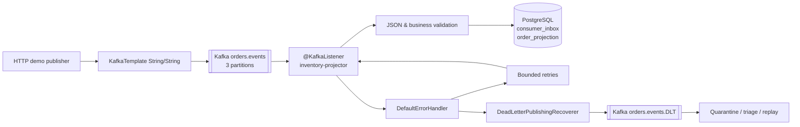
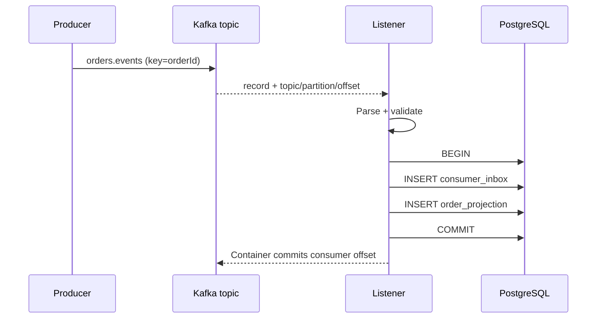
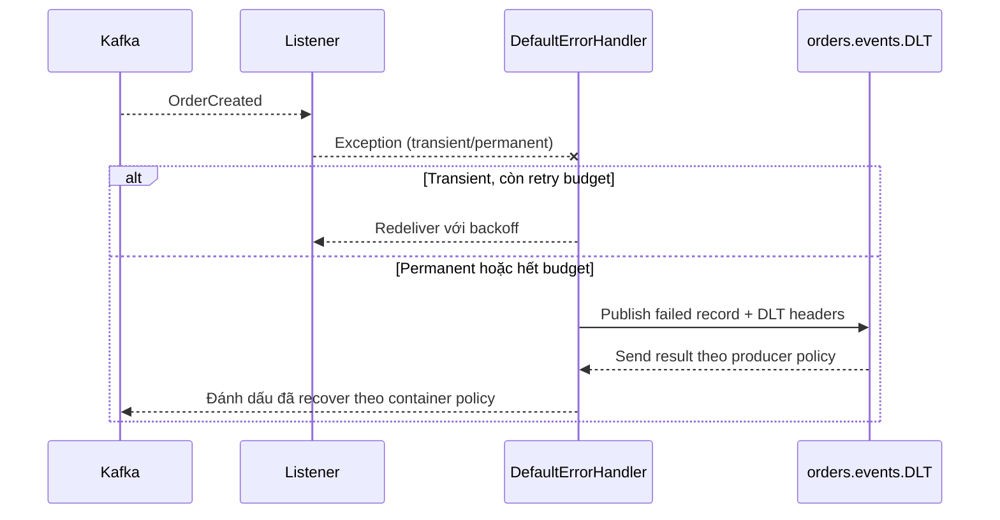
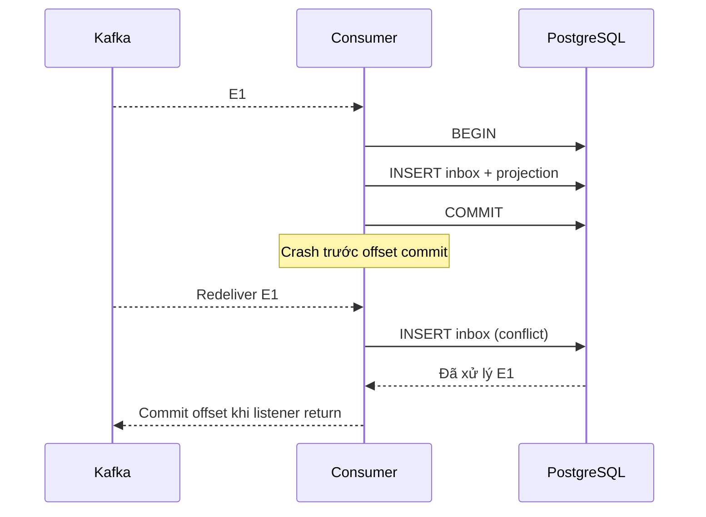
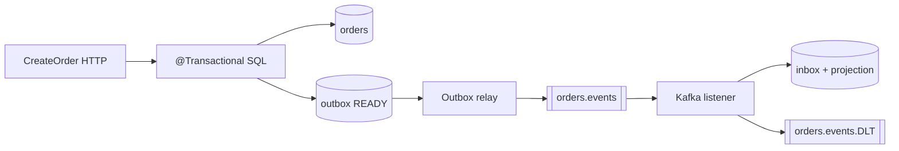
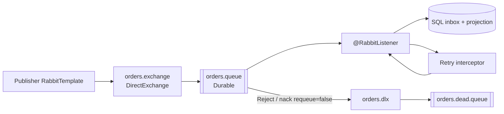

# Xây dựng luồng RabbitMQ hoặc Kafka có retry và dead-letter

Một dịch vụ nhận sự kiện `OrderCreated` từ message broker, ghi kết quả vào PostgreSQL và đôi khi gọi một hệ thống bên ngoài. Khi SQL tạm mất kết nối, consumer cần **thử lại**; khi message chứa JSON sai hoặc hợp đồng dữ liệu không hợp lệ, việc thử lại giống hệt hàng nghìn lần chỉ làm nghẽn luồng. Nếu vượt quá số lần thử, message phải được chuyển vào nơi giữ lỗi có thể **quan sát, điều tra và phát lại** — *dead-letter queue/topic* (DLQ/DLT).

Bài thực hành thuộc chương **Thực hành tổng hợp** của module **SPRING_BOOT_INTEGRATION**, kết hợp HTTP client, cơ sở dữ liệu, cache, message broker và adapter Spring Integration với các vấn đề **cấu hình, hợp đồng dữ liệu, giao dịch, lỗi, chống trùng, kiểm thử và observability**. Ta sẽ xây dựng một luồng **Kafka** làm đường thực hành chính, từ producer → topic → consumer → SQL inbox/projection → retry → dead-letter topic, đồng thời giải thích cách triển khai kiến trúc tương đương với **RabbitMQ**. Chỉ cần chọn một broker để hoàn thành mục tiêu; không cần vận hành cả hai cho cùng bài lab.

> **Phạm vi phiên bản:** Java 17+, Spring Boot **3.4/3.5**, Spring for Apache Kafka **3.x**, PostgreSQL 16 và Kafka 3.9.x là bộ minh họa. APIs/auto-configuration, đặc biệt là retry/DLT, có thể khác ở Spring Boot 4.x/Spring Kafka 4.x. Các giá trị như ba partitions, một replica, backoff 1,5 giây và một broker Docker **chỉ phục vụ môi trường lab**. Không được suy ra rằng đây là cấu hình chịu lỗi cho production.

## 1. Kết quả cuối bài và tiêu chí nghiệm thu

Sau khi thực hành, bạn có thể:

1. Phát một `OrderCreated` có `eventId` bất biến, `orderId` làm Kafka key và JSON có `eventVersion`.
2. Nhận message qua `@KafkaListener` và ghi trạng thái SQL trong một transaction.
3. Dùng **SQL inbox với unique constraint** để cùng một `eventId` không tạo hai tác dụng phụ khi Kafka redeliver.
4. Phân biệt lỗi **transient** (SQL timeout/HTTP 503) và **permanent** (JSON hỏng/vi phạm hợp đồng).
5. Cấu hình `DefaultErrorHandler` với số lần thử hữu hạn, backoff và `DeadLetterPublishingRecoverer`.
6. Đưa record không thể xử lý vào `orders.events.DLT`, giữ payload và thông tin nguồn.
7. Kiểm tra record bị lỗi, có runbook để **sửa–replay–đối soát**, không chỉ để DLT tăng mãi.
8. Xác định chính xác khi nào offset được commit và điểm nào vẫn tồn tại duplicate hoặc unknown outcome.
9. Chứng minh bằng Testcontainers các trường hợp thành công, transient failure, permanent failure, DLT và duplicate.
10. Chuyển cấu trúc tương tự sang RabbitMQ với queue, exchange, acknowledgment và dead-letter exchange (DLX).

**Tiêu chí hoàn thành:**

- Message hợp lệ ghi projection đúng một lần.
- Message bị lỗi transient được xử lý lại tối đa số lần quy định.
- Message lỗi permanent được chuyển tới DLT theo chính sách, không retry vô hạn.
- DLT publish thất bại không được coi là xử lý lỗi thành công.
- Restart/replay không nhân đôi tác dụng phụ SQL.
- Người vận hành biết event nào kẹt, vì sao, và có thể phát lại an toàn.

## 2. Hợp đồng nghiệp vụ của ví dụ

Nguồn gửi phát `OrderCreated` sau khi một order được tạo. Đích là một **read-model/projection** trong PostgreSQL, không giả định đây là hệ thống trừ tồn kho thật. Việc mô phỏng bằng projection giúp tập trung vào cách Kafka chuyển giao và xử lý lỗi; khi thay bằng đặt hàng, thanh toán hoặc giữ tồn kho thật, phải bổ sung idempotency cho API phía ngoài.

Payload:

```json
{
  "eventId": "c975e9a0-5416-450c-bf4f-d88d0769e2d6",
  "orderId": "cbf239e1-49fe-408f-b0da-a8eadfd97e8b",
  "tenantId": "tenant-a",
  "amountMinor": 125500,
  "currency": "VND",
  "eventVersion": 1,
  "aggregateVersion": 1
}
```

Ý nghĩa:

| Trường | Vai trò |
| --- | --- |
| `eventId` | Business event identity để dedup trên mọi lần phát, retry và replay |
| `orderId` | Aggregate identity và Kafka message key |
| `tenantId` | Phân vùng nghiệp vụ/authorization; không được tin tuyệt đối từ client bên ngoài |
| `amountMinor` | Số tiền tính bằng đơn vị nhỏ nhất theo currency; không dùng `double` |
| `currency` | ISO 4217; bài lab chỉ nhận `VND` |
| `eventVersion` | Version của hợp đồng sự kiện, khác Kafka offset |
| `aggregateVersion` | Thứ tự biến đổi nghiệp vụ của một order, khác eventVersion |

Trong bài lab chỉ xử lý `OrderCreated` với `aggregateVersion=1`, nghĩa là mỗi order có đúng một sự kiện tạo đầu tiên. Luồng nhiều sự kiện `OrderPaid/Cancelled` cần cơ chế kiểm tra sequence/gap ở phần mở rộng.

### 2.1. Bất biến cần giữ

- **I1:** Một event hợp lệ cuối cùng được xử lý hoặc nằm ở DLT có thể theo dõi.
- **I2:** Sau SQL commit, broker có thể giao lại nhưng cùng `eventId` không ghi projection thêm lần nữa.
- **I3:** Nếu SQL rollback, **không** ghi inbox như đã xử lý.
- **I4:** Message lỗi schema/semantic không được retry vô hạn, cần được phân loại.
- **I5:** Chuyển sang DLT không đồng nghĩa đã xử lý thành công nghiệp vụ; cần người hoặc workflow chịu trách nhiệm xử lý.
- **I6:** Producer, consumer, DLT publisher và hệ thống SQL đều có timeout, metrics và khả năng khôi phục.

**Lưu ý quan trọng:** At-least-once delivery là đặc tính mục tiêu của xử lý và redelivery. “Một business effect” đến từ SQL transaction + unique constraint, **không** đến từ việc đặt Kafka `enable.idempotence=true` rồi cho rằng toàn hệ thống exactly-once.

## 3. Kiến trúc của bài thực hành Kafka



**Trường hợp thành công:**



**Trường hợp lỗi:**



**Ranh giới:** DLT publish và commit consumer offset **không tự động là một Kafka transaction duy nhất** trong cấu hình ví dụ. Nếu process chết giữa hai bước, có thể xuất hiện bản ghi DLT trùng; đó là lý do replay và triage cũng phải dựa trên event identity.

## 4. Chọn một chiến lược retry trước khi viết code

Kafka và RabbitMQ khác nhau ở nơi giữ dữ liệu và cách xác nhận:

| Chủ đề | Kafka | RabbitMQ |
| --- | --- | --- |
| Dữ liệu chính | Topic log với partitions/offsets | Queue nhận message qua exchange/binding |
| Consumer hoàn tất | Commit offset theo nhóm | Ack delivery theo channel |
| Retry ngắn | `DefaultErrorHandler` redelivery/backoff | Listener retry hoặc nack/requeue có điều khiển |
| Retry chờ dài | Retry topics như `@RetryableTopic` | TTL retry queue + DLX hoặc delayed mechanism phù hợp |
| Khu vực lỗi cuối | Dead-letter **topic** (DLT) | Dead-letter **exchange/queue** (DLX/DLQ) |
| Trùng lặp có thể xảy ra? | Có | Có |
| Ordering | Theo partition, phụ thuộc retry strategy | Theo queue/subscription semantics và requeue |
| Xử lý lỗi vĩnh viễn | Publish sang DLT/quarantine | Dead-letter sang DLQ/quarantine |

Trong bài chính ta dùng **blocking retry của Spring Kafka** với `DefaultErrorHandler` và `FixedBackOff`. Dễ kiểm chứng, nhưng backoff giữ một record trong dòng xử lý của consumer/partition và có thể ảnh hưởng throughput. Khi cần chờ hàng phút/giờ, so sánh thêm retry topics hoặc một durable job scheduler — không đơn thuần tăng backoff từ 1 giây lên 1 giờ.

## 5. Cấu trúc project lab

Ví dụ tổ chức package:

```text
spring-integration-kafka-lab/
  build.gradle
  src/main/resources/
    application.yml
    db/migration/
      V1__create_projection_and_inbox.sql
  src/main/java/com/example/practice/
    IntegrationPracticeApplication.java
    contract/OrderCreated.java
    api/PublishOrderRequest.java
    api/DemoPublishController.java
    kafka/KafkaTopicsConfiguration.java
    kafka/OrderEventPublisher.java
    kafka/OrderCreatedListener.java
    kafka/KafkaErrorConfiguration.java
    domain/InvalidEventException.java
    domain/OrderEventValidator.java
    persistence/ProjectionService.java
  src/test/java/com/example/practice/
    KafkaRetryAndDltIT.java
```

Đây là **cấu trúc tham khảo nằm trong bài học**, không phải yêu cầu worker tạo các file đó trong repository. Những đoạn Java bên dưới có thể đưa vào các file cùng package khi tự làm lab.

## 6. Dependencies và phiên bản được quản lý

Ví dụ Gradle Groovy DSL, giả sử project đã cấu hình plugin Spring Boot 3.5.x và dependency management tương ứng:

```groovy
plugins {
    id 'java'
    id 'org.springframework.boot' version '3.5.7'
    id 'io.spring.dependency-management' version '1.1.7'
}

group = 'com.example'
version = '0.0.1-SNAPSHOT'

java {
    toolchain {
        languageVersion = JavaLanguageVersion.of(17)
    }
}

repositories { mavenCentral() }

dependencies {
    implementation 'org.springframework.boot:spring-boot-starter-web'
    implementation 'org.springframework.boot:spring-boot-starter-validation'
    implementation 'org.springframework.kafka:spring-kafka'
    implementation 'org.springframework.boot:spring-boot-starter-jdbc'
    implementation 'org.springframework.boot:spring-boot-starter-actuator'

    implementation 'org.flywaydb:flyway-core'
    runtimeOnly 'org.flywaydb:flyway-database-postgresql'
    runtimeOnly 'org.postgresql:postgresql'

    testImplementation 'org.springframework.boot:spring-boot-starter-test'
    testImplementation 'org.springframework.boot:spring-boot-testcontainers'
    testImplementation 'org.testcontainers:junit-jupiter'
    testImplementation 'org.testcontainers:kafka'
    testImplementation 'org.testcontainers:postgresql'
}

tasks.named('test') {
    useJUnitPlatform()
}
```

**Kiểm tra version trước khi sao chép:** Version plugin ở đây là **ví dụ pin cho lab trên dòng Boot 3.5**, không phải đề xuất “bản mới nhất”. Gradle 8.x/JDK, starter artifact, Flyway database module và các Testcontainers API cần khớp dependency BOM thực tế. Với project đã dùng parent/BOM khác, không gắn hai bộ version độc lập.

Với **Spring Boot 3.x**, dùng `org.springframework.kafka:spring-kafka` do Boot BOM quản lý; `org.springframework.boot:spring-boot-starter-kafka` là starter xuất hiện ở **dòng Boot 4.x**, không dùng tọa độ đó với Boot 3.5. Tại sao dùng **String serializer** thay vì JSON serializer của Kafka? Để làm ví dụ retry/DLT dễ quan sát: cùng một JSON string được gửi sang DLT, kể cả khi nội dung JSON sai. Chúng ta parse JSON **bên trong listener**, vì vậy lỗi decode là exception được handler xử lý trực tiếp. Khi dùng typed `JsonDeserializer`, cần `ErrorHandlingDeserializer` cho lỗi trước listener và DLT producer có serializer tương thích với raw `byte[]`; phần mở rộng sẽ phân tích riêng.

## 7. Chạy Kafka và PostgreSQL cho môi trường local

Một tùy chọn đơn giản theo Kafka 3.9 quickstart:

```bash
docker run -d --name kafka-lab \
  -p 9092:9092 apache/kafka:3.9.1

docker run -d --name postgres-lab \
  -e POSTGRES_DB=integration \
  -e POSTGRES_USER=integration \
  -e POSTGRES_PASSWORD=devonly \
  -p 5432:5432 postgres:16-alpine
```

Các lệnh dùng cú pháp shell Unix; trên PowerShell có thể viết mỗi lệnh một dòng hoặc sử dụng ký tự tiếp dòng riêng của PowerShell. **Mật khẩu `devonly` chỉ dành cho máy local**, không dùng production; port 5432/9092 phải trống.

Ứng dụng Spring Boot trong ví dụ **chạy trên máy host** và kết nối `localhost:9092` / `localhost:5432`. Nếu đưa application vào Docker network, `localhost` từ container là chính container đó; cần thêm listener quảng bá địa chỉ đúng cho network nội bộ và cấu hình bootstrap tương ứng.

Cách làm ổn định hơn cho integration tests là **Testcontainers**, không phụ thuộc hai containers thủ công đã chạy trước. Phần 23 trình bày cách thực hiện.

## 8. application.yml: tách config runtime và secrets

```yaml
server:
  port: 8081

spring:
  datasource:
    url: ${ORDERS_JDBC_URL:jdbc:postgresql://localhost:5432/integration}
    username: ${ORDERS_DB_USERNAME:integration}
    password: ${ORDERS_DB_PASSWORD:devonly}
    hikari:
      maximum-pool-size: 8
      connection-timeout: 3000  # HikariCP: milliseconds

  flyway:
    enabled: true
    locations: classpath:db/migration

  kafka:
    bootstrap-servers: ${KAFKA_BOOTSTRAP_SERVERS:localhost:9092}

    producer:
      key-serializer: org.apache.kafka.common.serialization.StringSerializer
      value-serializer: org.apache.kafka.common.serialization.StringSerializer
      acks: all
      properties:
        enable.idempotence: true

    consumer:
      group-id: inventory-projector
      auto-offset-reset: earliest
      enable-auto-commit: false
      key-deserializer: org.apache.kafka.common.serialization.StringDeserializer
      value-deserializer: org.apache.kafka.common.serialization.StringDeserializer

    listener:
      ack-mode: record
      concurrency: 3

management:
  endpoints:
    web:
      exposure:
        include: "health,info,metrics,prometheus"
```

Điểm cần hiểu:

- `acks: all` và idempotent producer cải thiện độ tin cậy của **Kafka producer** theo broker/replication policy, không biến Kafka + PostgreSQL thành distributed transaction.
- `enable-auto-commit: false` tránh Kafka client tự commit offset định kỳ ngoài vòng đời xử lý của listener container.
- `ack-mode: record`: với record listener thông thường, container commit sau mỗi record đã xử lý thành công hoặc đã recover theo policy. Kiểm thử lại nếu bạn dùng Kafka transactions, batch listener hoặc custom acknowledgment.
- `concurrency: 3` hữu ích khi có ba partitions nhưng **không đồng nghĩa mọi aggregate được xử lý theo thứ tự toàn cục**. Cần cùng `orderId` làm key.
- `spring.datasource.hikari.connection-timeout` được bind vào thuộc tính HikariCP dạng **mili giây**; trong ví dụ dùng `3000`, không dùng chuỗi `3s` cho long property này. JDBC driver/network timeout phải cấu hình riêng khi cần.
- Actuator endpoints phải được bảo vệ theo chính sách. `prometheus` cần registry dependency nếu muốn endpoint đó thật sự khả dụng; khai báo exposure không tự cài registry.

## 9. Tạo main topic và dead-letter topic

Trong lab, có thể để Spring Kafka admin tạo topics từ `NewTopic` beans:

```java
package com.example.practice.kafka;

import org.apache.kafka.clients.admin.NewTopic;
import org.springframework.context.annotation.Bean;
import org.springframework.context.annotation.Configuration;
import org.springframework.kafka.config.TopicBuilder;

@Configuration(proxyBeanMethods = false)
public class KafkaTopicsConfiguration {

    public static final String MAIN = "orders.events";
    public static final String DLT = "orders.events.DLT";

    @Bean
    NewTopic orderEventsTopic() {
        return TopicBuilder.name(MAIN)
                .partitions(3)
                .replicas(1)
                .build();
    }

    @Bean
    NewTopic orderEventsDeadLetterTopic() {
        return TopicBuilder.name(DLT)
                .partitions(3)
                .replicas(1)
                .build();
    }
}
```

**Tại sao DLT có cùng số partitions?** `DeadLetterPublishingRecoverer` của ví dụ giữ nguyên partition của record lỗi khi gửi sang DLT. Vì vậy DLT phải có partition được chỉ định; thường nên ít nhất bằng số partitions main.

**Chỉ trong lab:** Kafka một broker dùng replication factor 1. Production cần topic provisioning qua hạ tầng được quản lý, replication factor, min ISR, ACL, retention, max message size và chính sách tăng partitions có kiểm soát. Đừng tự bật topic auto-creation không giới hạn ở production chỉ vì tiện demo.

### 9.1. Xem topics từ container

```bash
docker exec kafka-lab \
  /opt/kafka/bin/kafka-topics.sh \
  --bootstrap-server localhost:9092 --list

docker exec kafka-lab \
  /opt/kafka/bin/kafka-topics.sh \
  --bootstrap-server localhost:9092 \
  --describe --topic orders.events.DLT
```

Đường dẫn script và image layout tương ứng với image Kafka 3.9 JVM mẫu; kiểm tra image thực tế nếu đã đổi version.

## 10. DTO và hợp đồng event có version

```java
package com.example.practice.contract;

import java.util.UUID;

public record OrderCreated(
        UUID eventId,
        UUID orderId,
        String tenantId,
        long amountMinor,
        String currency,
        int eventVersion,
        long aggregateVersion
) {}
```

DTO dùng Jackson do `spring-boot-starter-web` quản lý. Để phòng tránh schema drift:

- Không tùy tiện đổi `amountMinor` từ số sang chuỗi.
- Không đổi unit của amount mà giữ tên field.
- Không đổi ý nghĩa `eventId` thành Kafka offset.
- Khi cần field mới, duy trì backward compatibility hoặc tăng eventVersion có contract test.
- Không chứa password, bearer token hoặc PII không cần thiết trong event.
- Nếu dùng Avro/Protobuf/registry, chọn encoding và compatibility policy riêng; bài lab dùng JSON để rõ failure behavior.

### 10.1. Lỗi permanent và transient

```java
package com.example.practice.domain;

public class InvalidEventException extends RuntimeException {
    public InvalidEventException(String message) {
        super(message);
    }
    public InvalidEventException(String message, Throwable cause) {
        super(message, cause);
    }
}

public class TransientIntegrationException extends RuntimeException {
    public TransientIntegrationException(String message, Throwable cause) {
        super(message, cause);
    }
}
```

Khi sao chép thành source Java thực, hãy đặt **mỗi public class ở một file tương ứng** trong package `com.example.practice.domain`; để chung một khối ở đây chỉ giúp đọc liền mạch. `InvalidEventException` được xem là **không nên retry y nguyên**, còn `TransientIntegrationException` là loại có thể retry theo budget.

## 11. Validate event trước khi ghi SQL

```java
package com.example.practice.domain;

import com.example.practice.contract.OrderCreated;
import org.springframework.stereotype.Component;

@Component
public class OrderEventValidator {

    public void validate(OrderCreated event) {
        if (event == null) {
            throw new InvalidEventException("Thiếu event");
        }
        if (event.eventId() == null || event.orderId() == null) {
            throw new InvalidEventException("Thiếu eventId/orderId");
        }
        if (event.tenantId() == null
                || event.tenantId().isBlank()) {
            throw new InvalidEventException("Thiếu tenantId");
        }
        if (event.amountMinor() < 0) {
            throw new InvalidEventException("amountMinor âm");
        }
        if (!"VND".equals(event.currency())) {
            throw new InvalidEventException("currency không hỗ trợ");
        }
        if (event.eventVersion() != 1
                || event.aggregateVersion() != 1) {
            throw new InvalidEventException(
                    "Event/aggregate version không hỗ trợ");
        }
    }
}
```

Validator này chỉ áp dụng hợp đồng của **lab một sự kiện tạo order**; nó chưa giải quyết multi-tenant authorization. Trong production, giới hạn độ dài `tenantId`, kiểm tra source và version compatibility, không lấy field do đối tác gửi làm quyền truy cập database.

### 11.1. Phân biệt lỗi nghiệp vụ với lỗi hạ tầng

| Lỗi | Nhóm | Phản ứng |
| --- | --- | --- |
| JSON sai cú pháp | Permanent | Đưa DLT/quarantine |
| `eventVersion` chưa được consumer hỗ trợ | Permanent cho version đang chạy, cần contract upgrade | DLT/parking lane |
| `amountMinor < 0` | Permanent | DLT, điều tra producer |
| SQL connection unavailable | Transient | Backoff, retry hữu hạn |
| SQL deadlock | Transient trong điều kiện phù hợp | Retry toàn business transaction |
| Duplicate `eventId` cùng payload | Không phải lỗi | No-op, commit offset |
| Duplicate `eventId` khác payload | Contract violation | Rollback, DLT/alert |
| HTTP 503 từ downstream | Transient nếu operation idempotent | Retry theo deadline |
| HTTP 400 từ downstream | Thường permanent | DLT/manual remediation |
| Broker DLT publish thất bại | Recovery failure | **Không bỏ qua record gốc** |

## 12. Tạo schema SQL bằng Flyway

File `src/main/resources/db/migration/V1__create_projection_and_inbox.sql`:

```sql
CREATE TABLE consumer_inbox (
    source_topic   VARCHAR(200) NOT NULL,
    event_id       UUID NOT NULL,
    payload_sha256 CHAR(64) NOT NULL,
    processed_at   TIMESTAMPTZ NOT NULL DEFAULT now(),
    PRIMARY KEY (source_topic, event_id)
);

CREATE TABLE order_projection (
    order_id         UUID PRIMARY KEY,
    tenant_id        VARCHAR(64) NOT NULL,
    amount_minor     BIGINT NOT NULL
                     CHECK (amount_minor >= 0),
    currency         CHAR(3) NOT NULL,
    event_id         UUID NOT NULL UNIQUE,
    aggregate_version BIGINT NOT NULL,
    created_at       TIMESTAMPTZ NOT NULL DEFAULT now()
);

CREATE INDEX idx_order_projection_tenant_created
    ON order_projection (tenant_id, created_at);
```

**Tại sao cần hai bảng?**

- `consumer_inbox` là ledger nói **event nào đã được áp dụng bền vững**.
- `order_projection` là trạng thái nghiệp vụ.
- Cả hai được ghi **trong một SQL transaction**. Nếu ghi projection thất bại, inbox INSERT phải rollback; lần Kafka redelivery sau đó vẫn xử lý được.
- `payload_sha256` giúp phân biệt một event ID được phát lại nguyên trạng với cùng ID nhưng bytes payload khác.

Với nguồn không bảo đảm JSON canonical, cùng nội dung nhưng khác khoảng trắng/thứ tự field sẽ có hash khác; bài lab chủ đích coi **raw bytes** là immutable contract. Production có thể hash canonical payload/semantic fields theo quy tắc chính thức.

## 13. SQL inbox + projection: một transaction xử lý một event

```java
package com.example.practice.persistence;

import java.nio.charset.StandardCharsets;
import java.security.MessageDigest;
import java.security.NoSuchAlgorithmException;
import java.util.HexFormat;
import java.util.Objects;

import com.example.practice.contract.OrderCreated;
import com.example.practice.domain.InvalidEventException;
import org.springframework.jdbc.core.JdbcTemplate;
import org.springframework.stereotype.Service;
import org.springframework.transaction.annotation.Transactional;

@Service
public class ProjectionService {

    private final JdbcTemplate jdbc;

    public ProjectionService(JdbcTemplate jdbc) {
        this.jdbc = jdbc;
    }

    @Transactional
    public void apply(OrderCreated event, String rawJson) {
        String hash = sha256(rawJson);

        int firstSeen = jdbc.update("""
                INSERT INTO consumer_inbox (
                    source_topic, event_id, payload_sha256
                )
                VALUES ('orders.events', ?, ?)
                ON CONFLICT (source_topic, event_id)
                DO NOTHING
                """, event.eventId(), hash);

        if (firstSeen == 0) {
            String existing = jdbc.queryForObject("""
                    SELECT payload_sha256
                    FROM consumer_inbox
                    WHERE source_topic = 'orders.events'
                      AND event_id = ?
                    """, String.class, event.eventId());

            if (!Objects.equals(existing, hash)) {
                throw new InvalidEventException(
                        "Cùng eventId nhưng raw payload khác");
            }
            return; // Duplicate cùng event/payload: no-op.
        }

        int inserted = jdbc.update("""
                INSERT INTO order_projection (
                    order_id, tenant_id, amount_minor, currency,
                    event_id, aggregate_version
                )
                VALUES (?, ?, ?, ?, ?, ?)
                ON CONFLICT (order_id) DO NOTHING
                """,
                event.orderId(), event.tenantId(),
                event.amountMinor(), event.currency(),
                event.eventId(), event.aggregateVersion());

        if (inserted == 0) {
            // Bài lab chỉ cho phép một OrderCreated cho mỗi order.
            throw new InvalidEventException(
                    "Order đã có projection bởi event khác");
        }
    }

    private static String sha256(String value) {
        try {
            MessageDigest digest =
                    MessageDigest.getInstance("SHA-256");
            byte[] bytes = digest.digest(
                    value.getBytes(StandardCharsets.UTF_8));
            return HexFormat.of().formatHex(bytes);
        } catch (NoSuchAlgorithmException impossible) {
            throw new IllegalStateException(
                    "SHA-256 không khả dụng", impossible);
        }
    }
}
```

**Đọc kỹ giao dịch:**

1. `@Transactional` bao phủ **inbox INSERT + projection INSERT** nếu cả hai dùng cùng `DataSource`/transaction manager và được gọi qua Spring proxy.
2. Nếu `INSERT projection` lỗi, transaction rollback cả inbox. Không có chuyện “đánh dấu đã xử lý trước, rồi lỗi business nhưng vẫn ack”.
3. Với hai consumer xử lý cùng `eventId` đồng thời, unique constraint quyết định chỉ một transaction được chấp nhận; transaction còn lại đợi/nhận conflict theo database isolation.
4. Nếu cùng orderId xuất hiện một event khác nhưng business chỉ cho phép một create event, code ném permanent error; không âm thầm ghi đè.
5. Nếu sau này xử lý `OrderPaid`, thay đổi `INSERT ... DO NOTHING` bằng **state transition + aggregate version guard** đúng nghiệp vụ, đừng dùng code một-event/order này cho cả vòng đời order.
6. SQL `ON CONFLICT`, `UUID` và `TIMESTAMPTZ` là cú pháp PostgreSQL; cần port theo database khác.

**Ranh giới:** PostgreSQL commit rồi Kafka offset commit có thể bị lỗi giữa hai bước. Kafka sẽ giao lại message, và inbox làm cho lần thứ hai trở thành no-op. Đây là thiết kế **effectively-once business effect** trên SQL, không phải exactly-once transport.

## 14. Kafka listener: lỗi phải thoát ra ngoài để retry/DLT hoạt động

```java
package com.example.practice.kafka;

import com.example.practice.contract.OrderCreated;
import com.example.practice.domain.InvalidEventException;
import com.example.practice.domain.OrderEventValidator;
import com.example.practice.persistence.ProjectionService;
import com.fasterxml.jackson.core.JsonProcessingException;
import com.fasterxml.jackson.databind.ObjectMapper;

import org.apache.kafka.clients.consumer.ConsumerRecord;
import org.springframework.kafka.annotation.KafkaListener;
import org.springframework.stereotype.Component;

@Component
public class OrderCreatedListener {

    private final ObjectMapper mapper;
    private final OrderEventValidator validator;
    private final ProjectionService projection;

    public OrderCreatedListener(
            ObjectMapper mapper,
            OrderEventValidator validator,
            ProjectionService projection) {
        this.mapper = mapper;
        this.validator = validator;
        this.projection = projection;
    }

    @KafkaListener(
        topics = KafkaTopicsConfiguration.MAIN,
        groupId = "inventory-projector"
    )
    public void onMessage(ConsumerRecord<String, String> record) {
        OrderCreated event;
        try {
            event = mapper.readValue(
                    record.value(), OrderCreated.class);
        } catch (JsonProcessingException ex) {
            throw new InvalidEventException(
                    "Không giải mã được OrderCreated JSON", ex);
        }

        validator.validate(event);
        projection.apply(event, record.value());
    }
}
```

**Điểm then chốt:** Listener **không** catch mọi exception rồi return. Nếu SQL fail và method vẫn return, container có thể coi record đã xử lý và commit offset; retry/DLT sẽ không được kích hoạt.

Các contract errors được chuẩn hóa thành `InvalidEventException`. Các `DataAccessException` do Spring JDBC ném ra được để propagate; chúng sẽ được handler áp dụng policy retry hữu hạn. Trường hợp SQL constraint do event sai dữ liệu không phải transient cũng nên được phân loại riêng nếu có thể, tránh lặp vô ích.

### 14.1. Vì sao dùng ConsumerRecord?

Ta giữ được:

- `record.topic()` và `record.partition()`.
- `record.offset()` để truy vết.
- `record.key()` để so với `event.orderId`.
- `record.headers()` như traceId và contract metadata.

Nếu muốn kiểm soát key:

```java
if (record.key() == null
        || !record.key().equals(event.orderId().toString())) {
    throw new InvalidEventException(
            "Kafka key phải bằng orderId");
}
```

Đưa đoạn này sau `validator.validate(event)` trong listener. Hợp đồng routing quan trọng cho ordering. Không dùng một key ngẫu nhiên theo từng retry nếu cần cùng aggregate vào cùng partition.

## 15. Phát một sự kiện để thử luồng

Producer dùng `KafkaTemplate<String, String>` và chờ broker send result trước khi trả response lab.

```java
package com.example.practice.kafka;

import java.util.concurrent.ExecutionException;
import java.util.concurrent.TimeUnit;
import java.util.concurrent.TimeoutException;

import com.example.practice.contract.OrderCreated;
import com.fasterxml.jackson.core.JsonProcessingException;
import com.fasterxml.jackson.databind.ObjectMapper;

import org.springframework.kafka.core.KafkaTemplate;
import org.springframework.stereotype.Service;

@Service
public class OrderEventPublisher {

    private final KafkaTemplate<String, String> kafka;
    private final ObjectMapper mapper;

    public OrderEventPublisher(
            KafkaTemplate<String, String> kafka,
            ObjectMapper mapper) {
        this.kafka = kafka;
        this.mapper = mapper;
    }

    public void publish(OrderCreated event) {
        String json;
        try {
            json = mapper.writeValueAsString(event);
        } catch (JsonProcessingException ex) {
            throw new IllegalArgumentException(
                    "Không serialize được event", ex);
        }

        try {
            kafka.send(
                    KafkaTopicsConfiguration.MAIN,
                    event.orderId().toString(),
                    json)
                 .get(5, TimeUnit.SECONDS);

        } catch (InterruptedException ex) {
            Thread.currentThread().interrupt();
            throw new IllegalStateException(
                    "Publish bị interrupt", ex);

        } catch (ExecutionException | TimeoutException ex) {
            // Timeout có thể là unknown outcome.
            throw new IllegalStateException(
                    "Không xác nhận được Kafka publish", ex);
        }
    }
}
```

**Không hiểu nhầm:** `get(5, TimeUnit.SECONDS)` giới hạn thời gian chờ ở caller; timeout không chứng minh broker chưa ghi record. Nếu HTTP client thử lại, nó phải giữ **cùng `eventId`**, còn consumer inbox cần chịu được duplicate.

Trong hệ thống tạo order thật, không gửi trực tiếp sau SQL commit rồi coi là atomic; phần outbox ở mục sau phân tích cách lưu durable publish intent.

### 15.1. REST API demo

```java
package com.example.practice.api;

import java.util.UUID;

import com.example.practice.contract.OrderCreated;
import com.example.practice.kafka.OrderEventPublisher;

import jakarta.validation.Valid;
import jakarta.validation.constraints.NotBlank;
import jakarta.validation.constraints.NotNull;
import jakarta.validation.constraints.PositiveOrZero;

import org.springframework.http.ResponseEntity;
import org.springframework.web.bind.annotation.*;

@RestController
@RequestMapping("/demo/events")
public class DemoPublishController {

    public record PublishOrderRequest(
            @NotNull UUID eventId,
            @NotNull UUID orderId,
            @NotBlank String tenantId,
            @PositiveOrZero long amountMinor,
            @NotBlank String currency
    ) {}

    private final OrderEventPublisher publisher;

    public DemoPublishController(OrderEventPublisher publisher) {
        this.publisher = publisher;
    }

    @PostMapping
    ResponseEntity<Void> publish(
            @Valid @RequestBody PublishOrderRequest request) {

        publisher.publish(new OrderCreated(
                request.eventId(), request.orderId(),
                request.tenantId(), request.amountMinor(),
                request.currency(), 1, 1));

        return ResponseEntity.accepted().build();
    }
}
```

**Phạm vi của endpoint:** Đây là demo publisher không ghi business order vào SQL, nên không có dual-write giữa order SQL và Kafka ở bước này. Khi triển khai command `POST /orders` thật, outbox là hướng mở rộng phù hợp. Cần thêm exception mapping `503/504`, auth/rate limiting, API idempotency và validation trước production.

## 16. DefaultErrorHandler: retry hữu hạn rồi dead-letter

Spring Kafka hỗ trợ `DefaultErrorHandler` và `DeadLetterPublishingRecoverer` cho một **record listener**. Spring Boot có thể đưa `CommonErrorHandler` bean vào default auto-configured listener factory khi chưa tự tạo factory thay thế.

```java
package com.example.practice.kafka;

import java.time.Duration;

import com.example.practice.domain.InvalidEventException;

import org.apache.kafka.common.TopicPartition;
import org.springframework.context.annotation.Bean;
import org.springframework.context.annotation.Configuration;
import org.springframework.kafka.core.KafkaTemplate;
import org.springframework.kafka.listener.CommonErrorHandler;
import org.springframework.kafka.listener.DefaultErrorHandler;
import org.springframework.kafka.listener.DeadLetterPublishingRecoverer;
import org.springframework.util.backoff.FixedBackOff;

@Configuration(proxyBeanMethods = false)
public class KafkaErrorConfiguration {

    @Bean
    CommonErrorHandler orderErrorHandler(
            KafkaTemplate<String, String> kafkaTemplate) {

        DeadLetterPublishingRecoverer recoverer =
                new DeadLetterPublishingRecoverer(
                    kafkaTemplate,
                    (record, exception) -> new TopicPartition(
                        KafkaTopicsConfiguration.DLT,
                        record.partition()));

        // DLT publish failure phải được coi là recovery failure.
        recoverer.setFailIfSendResultIsError(true);
        recoverer.setWaitForSendResultTimeout(
                Duration.ofSeconds(5));

        // 2 retries + attempt đầu tiên = tối đa 3 attempts.
        DefaultErrorHandler handler =
                new DefaultErrorHandler(
                        recoverer,
                        new FixedBackOff(1500L, 2L));

        // Lỗi hợp đồng không thử lại cùng payload.
        handler.addNotRetryableExceptions(
                InvalidEventException.class);

        return handler;
    }
}
```

### 16.1. Đọc đúng retry count

`new FixedBackOff(1500L, 2L)` nghĩa là **hai lần retry sau lần xử lý đầu**, tức tối đa ba lần gọi listener cho một record lỗi retryable trong một retry cycle. Đừng mô tả “ba retries” rồi cấu hình 2, hoặc nhân nhầm số lần thử khi kết hợp nhiều tầng retry.

### 16.2. Khi nào lỗi vào DLT?

| Lỗi | Retry? | Điều xảy ra |
| --- | --- | --- |
| `InvalidEventException` | Không, theo classifier trên | Đưa thẳng DLT (sau khi recoverer publish thành công) |
| SQL connection timeout | Có, nếu thuộc loại retryable | Thử lại 2 lần, hết budget thì DLT |
| HTTP 503 từ bước tích hợp | Có, nếu policy coi transient | Thử lại 2 lần, rồi DLT |
| DLT broker không nhận | Recovery failure | Handler không được coi record đã recover |
| Listener thành công lần 2 | Không tới DLT | Ghi projection, container commit offset |
| Listener SQL commit rồi crash trước offset commit | Kafka có thể giao lại | Inbox chặn side effect trùng |

**Giới hạn quan trọng:** Retry của `DefaultErrorHandler` là retry trong memory/container processing loop, không phải durable scheduled retry có lịch hẹn lưu riêng. Sau restart/rebalance, budget có thể bắt đầu lại tùy offset/progress. Với latency dài hoặc retry cần tồn tại theo lịch xuyên restart, dùng retry topics/job scheduler.

### 16.3. DLT message có metadata gì?

`DeadLetterPublishingRecoverer` thường giữ record value/key và thêm headers như:

- Original topic/partition/offset.
- Exception type/cause.
- Exception message/stack trace theo cấu hình.
- Thông tin truy vết hữu ích cho triage.

Mỗi broker record có topic/partition/offset **mới** ở DLT; đừng dùng offset DLT làm event identity. `eventId` trong payload vẫn là business key.

**Bảo mật:** Stacktrace/header exception có thể vô tình chứa URL, payload hoặc PII. Trong production cần lọc/sanitize headers và giới hạn quyền subscribe DLT.

### 16.4. Nếu đã có custom listener factory?

Nếu project tự khai báo `ConcurrentKafkaListenerContainerFactory`, không suy luận Spring Boot sẽ gắn `CommonErrorHandler` cho factory đó. Cần gọi `factory.setCommonErrorHandler(handler)` hoặc sử dụng `ConcurrentKafkaListenerContainerFactoryConfigurer` đúng cách và test wiring. Mọi ví dụ trong bài mặc định dùng **Boot auto-configured factory**.

## 17. Kiểm tra happy path trên local

Chạy service sau khi Kafka/PostgreSQL đã sẵn và Flyway tạo bảng. Gửi một event bằng HTTP:

```bash
curl -X POST http://localhost:8081/demo/events \
  -H "Content-Type: application/json" \
  -d '{
    "eventId": "c975e9a0-5416-450c-bf4f-d88d0769e2d6",
    "orderId": "cbf239e1-49fe-408f-b0da-a8eadfd97e8b",
    "tenantId": "tenant-a",
    "amountMinor": 125500,
    "currency": "VND"
  }'
```

HTTP `202 Accepted` chỉ cho biết **producer demo nhận Kafka ack theo policy và request hoàn thành**; projection có thể còn đang xử lý.

Kiểm tra SQL:

```bash
docker exec -it postgres-lab psql \
  -U integration -d integration \
  -c "SELECT event_id, source_topic FROM consumer_inbox;"

docker exec -it postgres-lab psql \
  -U integration -d integration \
  -c "SELECT order_id, amount_minor, currency FROM order_projection;"
```

Kỳ vọng:

- Một row trong `consumer_inbox` với `eventId`.
- Một row trong `order_projection` với `orderId` và `amountMinor=125500`.
- Không có record mới tương ứng ở DLT.

Gửi **cùng JSON/cùng eventId lần hai**: Kafka có thể có hai records và listener được gọi hai lần, nhưng `consumer_inbox` và projection không nhân đôi. Đây là phép kiểm nghiệm trực tiếp của **at-least-once transport + idempotent business effect**.

## 18. Thử lỗi permanent: JSON hỏng đi thẳng DLT

Một record không phải JSON sẽ khiến `mapper.readValue(...)` ném `JsonProcessingException`; listener chuyển thành `InvalidEventException`, và `DefaultErrorHandler` đã đánh dấu loại này **not retryable**.

Sử dụng Kafka CLI trong container để đưa payload cố tình sai:

```bash
printf 'this-is-not-json\n' |
  docker exec -i kafka-lab \
  /opt/kafka/bin/kafka-console-producer.sh \
  --bootstrap-server localhost:9092 \
  --topic orders.events
```

Đây là cách gửi raw payload không qua HTTP demo controller/validator. Hãy quan sát log application và kiểm tra DLT:

```bash
docker exec kafka-lab \
  /opt/kafka/bin/kafka-console-consumer.sh \
  --bootstrap-server localhost:9092 \
  --topic orders.events.DLT \
  --from-beginning \
  --property print.key=true \
  --property print.headers=true \
  --timeout-ms 10000
```

Kỳ vọng record chứa `this-is-not-json` có mặt ở DLT, kèm metadata lỗi do recoverer bổ sung. Consumer CLI có thể in header dạng bytes hoặc dạng string tùy phiên bản và option.

**Chú ý:** Kafka record gửi bằng console producer ở ví dụ không có key nghiệp vụ. Vì listener fail ngay ở parse JSON, không đến bước kiểm tra key; thực tế publisher production phải dùng key `orderId` theo hợp đồng.

### 18.1. Thử JSON hợp lệ nhưng dữ liệu sai

Dùng payload parse được nhưng vi phạm validation:

```json
{
  "eventId": "814a9594-9b82-4891-a44c-a60f80b26844",
  "orderId": "f1b77271-82f4-40b3-997b-3c447b945719",
  "tenantId": "tenant-a",
  "amountMinor": -10,
  "currency": "VND",
  "eventVersion": 1,
  "aggregateVersion": 1
}
```

Gửi nó trực tiếp tới `orders.events` bằng CLI/test producer; đừng dùng HTTP demo vì `@PositiveOrZero` sẽ chặn từ API. Handler cũng phải đưa record sang DLT mà **không thực hiện SQL projection**.

### 18.2. Cẩn trọng với “tôi đã thấy record ở DLT”

Một record xuất hiện ở DLT chỉ chứng minh recoverer đã ghi nhận lỗi và publish theo policy. Nó không chứng minh:

- Người vận hành đã xử lý incident.
- Event đã được sửa.
- Business side effect đã hoàn tất.
- Bản ghi chính không bị giao lại do crash trước offset commit.
- Không có các bản DLT trùng cùng eventId.

Cần runbook và trạng thái triage riêng, đặc biệt với payment/shipping.

## 19. Thử lỗi transient và giới hạn retry

### 19.1. Cách tái hiện trên local

Với consumer đang chạy, tạm dừng PostgreSQL để gây lỗi SQL. Có thể làm trong môi trường lab cô lập:

```bash
docker stop postgres-lab
```

Sau đó gửi một sự kiện **mới** vào Kafka bằng CLI hoặc bằng một producer độc lập. Nếu dùng HTTP demo, producer Kafka vẫn có thể hoạt động khi DB đang dừng, nhưng HTTP application có thể bị ảnh hưởng nếu startup/health/lifecycle đang kiểm tra SQL.

Khi listener xử lý message mới:

1. JSON decode thành công.
2. Validator chấp nhận.
3. `ProjectionService.apply(...)` không lấy được connection.
4. Spring JDBC ném một `DataAccessException` hoặc exception liên quan.
5. `DefaultErrorHandler` thử lại theo `FixedBackOff(1500L,2L)`.
6. Nếu DB vẫn down sau ba attempts, recoverer gửi record sang DLT.
7. Khi DB phục hồi, event **không tự biến mất khỏi DLT để về lại main topic**; cần replay có kiểm soát.

Khởi động lại PostgreSQL:

```bash
docker start postgres-lab
```

**Không chạy thao tác stop DB trong shared staging/production**. Với automated tests, dùng một injectable test seam hoặc mock dependency gây transient failure, tốt hơn việc dừng container được dùng bởi nhiều tests song song.

### 19.2. Nếu DB phục hồi giữa các attempts

Nếu DB hoạt động lại trước khi hết retry budget:

- Listener retry thành công.
- SQL transaction commit.
- Consumer offset được commit theo container policy.
- Không có record ở DLT tương ứng với failure cycle đó.

Đây là mục tiêu của **bounded short retry**: hấp thụ glitch ngắn mà không giữ message lỗi vĩnh viễn ở main topic.

### 19.3. Khi nào SQL error không nên retry?

Một số `DataAccessException` đại diện lỗi *vĩnh viễn*: thiếu bảng do migration chưa chạy, sai column name, permission denied hoặc constraint vi phạm business contract. Không nên coi **mọi SQLException** đều transient.

Production nên:

- Xem SQLState/vendor error code và type của Spring exception.
- Phân loại `CannotGetJdbcConnectionException` hoặc transient resource error một cách phù hợp.
- Đưa schema/permission error sang alert và dừng triển khai nếu cần.
- Dùng retry budget, không vòng lặp vô hạn.
- Không chuyển một lỗi hạ tầng toàn diện vào DLT hàng triệu lần rồi coi đó là hệ thống khỏe.

## 20. Phân biệt retry cấp ứng dụng, listener và broker

Một record có thể bị retry ở nhiều lớp:

```text
HTTP client POST retry
        |
        v
Kafka producer retry/acks
        |
        v
Consumer DefaultErrorHandler retry
        |
        v
SQL JDBC transaction retry
        |
        v
DLT replay workflow
```

Nếu đặt ba attempts ở mỗi lớp mà không có ngân sách tổng thể, một lệnh có thể gây hàng chục thao tác thực thi. Thời gian phản hồi và tải downstream tăng rất nhanh.

| Tầng retry | Ai quản lý? | Điều phải giữ ổn định |
| --- | --- | --- |
| HTTP request retry | API client/gateway | Idempotency key `eventId`/`operationId` |
| Kafka producer retry | Kafka producer config | Producer acks/delivery timeout, business eventId |
| Consumer retry | `DefaultErrorHandler` | Record value/key, retry budget, offset |
| SQL transaction retry | Application/transaction policy | Toàn bộ transaction, không chỉ một SQL statement nếu logic phụ thuộc |
| DLT replay | Operations/job | Event identity, audit và validation |

**Không phân loại “retryable” chỉ bằng tên exception Java** khi một lỗi là unknown outcome. Ví dụ HTTP timeout sau POST có thể nghĩa đối tác **đã tạo reservation** nhưng response bị mất. Retry an toàn phụ thuộc idempotency của API đích.

## 21. DLT cần runbook, không chỉ một topic

Đề xuất trạng thái triage nằm trong một bảng/job quản trị **riêng**, không phải tự nhận DLT đã được xử lý:

```text
NEW → INVESTIGATING → REPAIRED → REPLAY_REQUESTED
                     ↘  CANCELLED_WITH_REASON
REPLAY_REQUESTED → REPLAYED → VERIFIED
                          ↘ REPLAY_FAILED
```

Tối thiểu cần ghi:

- Original topic, partition, offset.
- DLT topic, partition, offset.
- Kafka key và business `eventId` nếu parse được.
- Timestamp đầu tiên lỗi và lần cuối quan sát.
- Error category: `INVALID_JSON`, `SCHEMA_VERSION`, `DB_UNAVAILABLE`, `HTTP_503`...
- Bản app/consumer đã gặp lỗi.
- Owner, incident/ticket, quyết định sửa hoặc bỏ.
- Quyền ai được replay, thời điểm replay, kết quả.
- Correlation/trace ID và tenant trong phạm vi được phép.

### 21.1. DLT là dữ liệu, không phải log bất biến vĩnh viễn

Kafka retention có thể xóa record theo time/size. Nếu yêu cầu giữ DLT 30 ngày, phải cấu hình `retention.ms`/`retention.bytes` và vận hành capacity tương ứng; việc đặt topic DLT không tự bảo đảm lưu vô hạn.

Không lưu secret hoặc dữ liệu nhạy cảm không cần thiết trong exception stacktrace headers. Cần ACL giới hạn người subscribe, quyền xử lý dữ liệu cá nhân và chính sách purge.

### 21.2. DLT observer không phải DLT processor

Một consumer chỉ đọc DLT và ghi log có thể commit offset của **nhóm observer**, nhưng điều đó không làm event trở thành resolved. Để tránh hiểu nhầm, chia vai trò:

- **Observer/alerting group:** đọc để báo incident và số lượng.
- **Triage workflow:** lưu quyết định và trạng thái sửa.
- **Replay worker:** phát lại sau phê duyệt, có audit/idempotency.
- **Business projection:** consumer main topic đã xử lý hoặc xác nhận bỏ event theo quyết định nghiệp vụ.

Không tự gắn `@KafkaListener(topics="orders.events.DLT")` rồi publish y nguyên ngay lập tức về topic chính: nếu lỗi permanent chưa sửa, sẽ tạo **vòng lặp vô hạn DLT → main → DLT**.

## 22. Phát lại từ DLT: đúng điều kiện và đúng identity

Một quy trình an toàn:

1. Xác định nguyên nhân gốc bằng metadata DLT + logs + SQL state.
2. Phân biệt **record lỗi thật** và record **đã áp dụng SQL nhưng offset/ack bị mất**.
3. Kiểm tra source schema/version và consumer hiện tại có đọc được không.
4. Nếu payload sai, xác định người sở hữu contract cần sửa ở đâu.
5. Chọn **replay giữ nguyên payload** hay **repaired event**; có audit mapping.
6. Giữ `eventId` cũ nếu đây vẫn là cùng business event, và hiểu rằng inbox có thể từ chối nếu cùng ID nhưng payload khác.
7. Giữ Kafka key theo `orderId` khi ordering per aggregate có ý nghĩa.
8. Publish qua producer có broker acknowledgment, kiểm tra kết quả.
9. Quan sát consumer main topic và SQL inbox/projection.
10. Ghi trạng thái `VERIFIED` hoặc `REPLAY_FAILED`; không đánh dấu xong chỉ vì publish future được tạo.

**Lưu ý về repaired event:** Trong lab, inbox lưu hash của **raw payload**. Nếu một event đã commit SQL thành công với raw payload cũ nhưng được replay bằng bytes đã sửa với cùng eventId, inbox sẽ báo conflict — đây là hành vi an toàn nhằm phát hiện dữ liệu bị đổi dưới cùng identity. Nếu business thật sự cần một sự kiện sửa chữa mới, hãy phát một **compensating/correction event mới với ID khác** và quan hệ `correctsEventId`; không âm thầm viết lại lịch sử.

### 22.1. Không dùng Kafka offset làm business idempotency key

Offset chỉ định vị record trong **một topic partition**. Khi replay sang topic khác hoặc republish sau crash, cùng event có offset mới. Vì vậy inbox key không được chỉ dựa vào offset.

### 22.2. Không replay nếu nguồn còn sai

Với `amountMinor=-10` hoặc `eventVersion=99`, replay y nguyên chỉ làm việc lỗi lặp lại. Cần update producer schema/consumer contract, hoặc tạo event sửa chữa theo quy trình có phê duyệt.

## 23. Kiểm thử bằng Kafka/PostgreSQL Testcontainers

### 23.1. Phân biệt test đơn vị và integration test

| Test | Điều chứng minh |
| --- | --- |
| Validator unit test | Field bất hợp lệ tạo `InvalidEventException` |
| ProjectionService SQL test | Inbox + projection commit/rollback cùng nhau |
| Consumer integration test | Topic → listener → SQL thành công |
| Error handler integration test | Retry count và DLT thực |
| DLT publish failure test | Không recover nhầm khi DLT unavailable |
| Duplicate/redelivery test | Cùng eventId không tạo thêm projection |
| Contract test | Old/new JSON versions và business meaning |
| Fault injection | Crash giữa SQL commit/offset commit, broker outage |
| Performance test | Backpressure, lag, nhiều partitions và DB pool |

Để khẳng định bài lab đạt yêu cầu, cần **integration test thực sự có Kafka và PostgreSQL**. Mockito test riêng `DefaultErrorHandler` không chứng minh topic/partition/offset, serializer hoặc listener container được kết nối đúng.

### 23.2. Khởi động hai containers trong JUnit

Với Boot 3.5 và Testcontainers 1.21.x:

```java
package com.example.practice;

import org.junit.jupiter.api.Test;
import org.springframework.boot.test.context.SpringBootTest;
import org.springframework.boot.testcontainers.service.connection.ServiceConnection;

import org.testcontainers.containers.PostgreSQLContainer;
import org.testcontainers.kafka.KafkaContainer;
import org.testcontainers.junit.jupiter.Container;
import org.testcontainers.junit.jupiter.Testcontainers;
import org.testcontainers.utility.DockerImageName;

@SpringBootTest
@Testcontainers
class KafkaRetryAndDltIT {

    @Container
    @ServiceConnection
    static PostgreSQLContainer<?> postgres =
            new PostgreSQLContainer<>("postgres:16-alpine");

    @Container
    @ServiceConnection
    static KafkaContainer kafka =
            new KafkaContainer(
                    DockerImageName.parse("apache/kafka:3.9.1"));

    @Test
    void contextStartsAndFlywayCanMigrate() {
        // Các bài test thực ở dưới sẽ dùng KafkaTemplate/JdbcTemplate.
    }
}
```

`@ServiceConnection` được Spring Boot hỗ trợ cho các container types tương ứng, cấp connection details cho auto-configured Kafka và JDBC/Flyway. Nếu ứng dụng có custom `KafkaTemplate` hoặc Flyway URL hardcode, cần xác minh chúng không bỏ qua Testcontainers connection details.

### 23.3. Test một event thành công

Bổ sung vào class test ở trên, với `KafkaTemplate<String,String>`, `JdbcTemplate`, `ObjectMapper` injected:

```java
@Autowired KafkaTemplate<String, String> kafkaTemplate;
@Autowired JdbcTemplate jdbc;
@Autowired ObjectMapper objectMapper;

@Test
void validEventIsPersisted() throws Exception {
    UUID eventId = UUID.randomUUID();
    UUID orderId = UUID.randomUUID();

    OrderCreated event = new OrderCreated(
            eventId, orderId, "tenant-a",
            125500, "VND", 1, 1);

    kafkaTemplate.send(
            "orders.events", orderId.toString(),
            objectMapper.writeValueAsString(event))
        .get(10, TimeUnit.SECONDS);

    await().atMost(Duration.ofSeconds(30))
        .untilAsserted(() -> {
            Long inboxCount = jdbc.queryForObject("""
                    SELECT COUNT(*) FROM consumer_inbox
                    WHERE event_id = ?
                    """, Long.class, eventId);

            Long projectionCount = jdbc.queryForObject("""
                    SELECT COUNT(*) FROM order_projection
                    WHERE order_id = ?
                    """, Long.class, orderId);

            assertEquals(1L, inboxCount);
            assertEquals(1L, projectionCount);
        });
}
```

Những imports còn cần trong test:

```java
import static org.awaitility.Awaitility.await;
import static org.junit.jupiter.api.Assertions.assertEquals;

import java.time.Duration;
import java.util.UUID;
import java.util.concurrent.TimeUnit;

import com.example.practice.contract.OrderCreated;
import com.fasterxml.jackson.databind.ObjectMapper;
import org.springframework.beans.factory.annotation.Autowired;
import org.springframework.jdbc.core.JdbcTemplate;
import org.springframework.kafka.core.KafkaTemplate;
```

`Awaitility` có mặt trong nhiều bộ `spring-boot-starter-test` của Boot 3.5; nếu không có, khai báo dependency test phù hợp theo BOM. Không phụ thuộc `Thread.sleep(3000)` rồi assert vì tốc độ Kafka/CI thay đổi.

### 23.4. Test duplicate delivery

```java
@Test
void sameEventTwiceChangesBusinessStateOnce()
        throws Exception {

    UUID eventId = UUID.randomUUID();
    UUID orderId = UUID.randomUUID();

    String json = objectMapper.writeValueAsString(
            new OrderCreated(
                    eventId, orderId, "tenant-a",
                    9900, "VND", 1, 1));

    kafkaTemplate.send(
            "orders.events", orderId.toString(), json)
        .get(10, TimeUnit.SECONDS);

    kafkaTemplate.send(
            "orders.events", orderId.toString(), json)
        .get(10, TimeUnit.SECONDS);

    await().atMost(Duration.ofSeconds(30))
        .untilAsserted(() -> {
            Long count = jdbc.queryForObject("""
                    SELECT COUNT(*) FROM consumer_inbox
                    WHERE event_id = ?
                    """, Long.class, eventId);
            assertEquals(1L, count);
        });
}
```

Để xác minh **cả hai records đã được tiêu thụ**, test nên quan sát consumer offset/trace hoặc instrument số lần listener được gọi theo eventId; SQL count bằng 1 một mình không chứng minh consumer đã xử lý duplicate record thứ hai. Có thể dùng Kafka test consumer group lag và chờ group catch up, hoặc metric nhận bản trùng.

### 23.5. Test lỗi permanent có record thật ở DLT

Ý tưởng kiểm thử trong một test riêng có **unique test ID**:

1. Gửi literal `not-json-<random-id>` vào `orders.events`.
2. Mở Kafka consumer test **group riêng**, subscribe `orders.events.DLT`.
3. Poll với deadline 30 giây, lọc record theo marker unique.
4. Assert value chính là raw input.
5. Assert DLT record topic/metadata nguồn.
6. Xác nhận không có SQL row cho marker đó.

Dùng một consumer riêng thay vì một `@KafkaListener` tự động trên DLT để tránh vô tình commit trạng thái triage. Với test chạy song song, không giả định DLT chỉ có record do test hiện tại gửi; hãy lọc theo unique key/payload marker.

### 23.6. Test transient failure chính xác bằng injected fault

Không phải test nào cũng nên stop PostgreSQL container. Có thể tạo một **test-only adapter** giữa listener và `ProjectionService`:

```java
public interface OrderProjectionPort {
    void apply(OrderCreated event, String rawJson);
}
```

Trong code thực, `ProjectionService` implements port; trong test context, một `@Primary` wrapper hoặc test double ném `TransientIntegrationException` ở hai lần đầu rồi gọi service thật ở lần thứ ba.

**Đây là một hướng refactor test seam**, không phải nói các snippets ở mục trước đã có interface này. Khi triển khai, đổi constructor listener để inject port thay vì concrete service, rồi test số lần gọi bằng `AtomicInteger`/latch:

```text
attempt #1 -> transient exception
attempt #2 -> transient exception
attempt #3 -> success
expected:
  SQL projection = 1
  SQL inbox = 1
  DLT không chứa event này
```

Thử tiếp một adapter luôn ném transient error:

```text
attempt #1 -> failure
attempt #2 -> failure
attempt #3 -> failure
expected:
  DLT chứa event
  SQL inbox không commit event
```

Nếu recovery DLT producer bị cấu hình sai, test phải phát hiện **record gốc chưa được coi recovered**, không chỉ thấy log exception.

## 24. Những failure windows bắt buộc hiểu

### 24.1. Consumer SQL commit rồi chết trước offset commit



Vì `consumer_inbox` đã commit cùng projection, lần redelivery có thể bỏ qua side effect mà vẫn cho container commit offset. Đây là tác dụng cụ thể của idempotency.

### 24.2. Consumer SQL rollback nhưng offset được commit sai

Nếu code catch mọi `DataAccessException` và return bình thường, Kafka container **có thể** commit offset; event bị mất về mặt nghiệp vụ. **Không nuốt exception** trừ khi đã có một durable handoff/recovery decision được ghi lại.

### 24.3. DLT publish thành công, consumer crash trước commit offset gốc

Có thể có **hai bản DLT** của cùng Kafka record khi consumer khởi động lại rồi recovery lặp. Không giả định dead-lettering exactly-once khi chưa thiết kế Kafka transaction/offset coordination chuyên biệt.

### 24.4. DLT publish thất bại rồi handler coi là recovered

Đây là lỗi nghiêm trọng: offset gốc có thể tiến mà DLT không giữ event. `setFailIfSendResultIsError(true)` giúp recoverer báo lỗi nếu gửi DLT thất bại theo producer send contract. Cần test timeout, broker outage và publisher completion; không coi một lời gọi `send(...)` trả future là bằng chứng DLT đã nhận.

### 24.5. Producer timeout sau khi Kafka đã nhận

HTTP caller có thể retry, phát cùng eventId lần nữa. SQL inbox đảm bảo projection không nhân đôi, nhưng Kafka topic vẫn có hai records. Đây không phải failure nếu đã cam kết at-least-once.

## 25. Offset, ack và consumer group

### 25.1. Offset là vị trí đọc, không phải event identity

Kafka group tiến độ theo topic/partition/offset. Một record có thể được đọc lại vì:

- Consumer crash trước offset commit.
- Rebalance chuyển partition sang consumer khác.
- Kafka listener throw exception và error handler seek/replay.
- Người vận hành reset group offset.
- Event được republish từ DLT hoặc source theo một offset mới.

Chính vì thế **eventId phải nằm trong hợp đồng payload/header**, không được lấy từ offset.

### 25.2. RECORD acknowledgment

Trong ví dụ:

```yaml
spring:
  kafka:
    consumer:
      enable-auto-commit: false
    listener:
      ack-mode: record
```

Hệ quả dự kiến:

- Listener success → container tiến offset theo record.
- Listener throw → `DefaultErrorHandler` điều phối retry.
- Recoverer publish DLT thành công → container coi record đã recover và có thể tiến offset theo policy.
- Recoverer thất bại → record cần được retry/recovered lại, không skip tùy tiện.

Tuy nhiên, **thời điểm commit offset vật lý** còn phụ thuộc container settings, consumer state và broker availability. Không dùng log `onMessage finished` làm bằng chứng offset đã commit, hãy test với consumer group metadata/lag.

### 25.3. MANUAL_IMMEDIATE không tự tốt hơn

Có thể cấu hình manual ack cho những trường hợp phức tạp, nhưng trách nhiệm tăng: code cần ack đúng sau SQL commit, phối hợp với error handler và recovery; `DefaultErrorHandler.setCommitRecovered(true)` chỉ áp dụng đúng trong những điều kiện ack-mode tương ứng.

**Trong lab này, giữ RECORD ack** để một owner rõ ràng quản lý offset. Không trộn manual acknowledgment vào code chỉ vì muốn “chắc chắn hơn”.

### 25.4. Kafka transactions không gộp SQL transaction

Kafka producer transactions/consumer read-process-write có thể tạo bảo đảm tốt cho phần workflow **Kafka → Kafka**, nhưng không mặc định bao gồm PostgreSQL commit. Nếu app viết SQL rồi phát Kafka, cần transactional outbox hoặc một thiết kế distributed coordination/reconciliation phù hợp.

## 26. Retry backoff, ordering và throughput

### 26.1. Blocking retry và rủi ro giữ partition

`FixedBackOff(1500L, 2L)` giữ record trong vòng xử lý lỗi của container; trong lúc chờ, record sau cùng partition có thể bị trì hoãn. Với một poison event lặp nhiều lần, consumer lag và oldest unprocessed age tăng.

Nếu đồng thời ba partitions:

- Consumer instance A có thể bị kẹt ở partition 0.
- Các partitions 1/2 có thể tiếp tục tùy assignment và concurrency.
- Một order key cần vào cùng partition nếu đòi **per-key ordering**.
- Đổi partition count hoặc key serialization có thể ảnh hưởng mapping và thứ tự của một aggregate qua thời gian.

### 26.2. Non-blocking retry qua retry topics

Spring Kafka còn hỗ trợ `@RetryableTopic` trong các phiên bản tương ứng. Cơ chế khái niệm:

```text
orders.events
     |
     +-- failed → orders.events-retry-1000
     |                   |
     |                   +-- failed → orders.events-retry-2000
     |                                        |
     |                                        +-- failed → orders.events-dlt
     |
     +-- success → SQL projection
```

Ưu điểm: không giữ main partition chờ một backoff dài. Đổi lại:

- Message có thể rời main topic rồi quay lại sau message khác.
- **Mất bảo đảm strict ordering của topic chính** cho những keys được retry theo cách này.
- Tăng số topics/consumer groups/offsets cần vận hành.
- Không nên bật đồng thời cơ chế `@RetryableTopic` và cùng một global handler DLT cho cùng flow mà chưa xác định rõ thứ tự và phạm vi.

Ví dụ **lựa chọn thay thế** (không bật cùng cấu hình handler lab):

```java
@RetryableTopic(
        attempts = "4",
        backOff = @BackOff(delay = 2000, multiplier = 2.0)
)
@KafkaListener(
        topics = "orders.events",
        groupId = "inventory-projector")
public void receive(String json) {
    // Decode, validate, ghi SQL inbox/projection.
}
```

Imports `org.springframework.kafka.annotation.RetryableTopic` và `org.springframework.retry.annotation.BackOff`. Cần cho phép topic provisioning/retry infrastructure tương ứng, xử lý DLT endpoint (`@DltHandler`) theo policy, và viết tests riêng. Với Spring Kafka 3.x, non-blocking retry không kết hợp tùy ý với container Kafka transactions; đối chiếu tài liệu của version thực.

### 26.3. Chọn strategy theo SLA

| Yêu cầu | Cách phù hợp |
| --- | --- |
| Lỗi HTTP/SQL thoáng qua 1–3 giây, throughput vừa | `DefaultErrorHandler` blocking retry |
| Retry phải chờ vài phút mà không giữ main partition | Retry topics hoặc durable job |
| Strict order cho từng aggregate | Tránh đưa một event ra retry topic rồi xử lý event sau trước; dùng aggregate state machine/gap guard |
| Lỗi không sửa được bằng thử lại | DLT/quarantine ngay |
| Phải giữ retry lịch hẹn xuyên restarts | Durable retry state, không chỉ in-memory backoff |
| Side effect ngoài đã timeout không rõ kết quả | Reconciliation + idempotency key trước retry |

## 27. SQL producer và Transactional Outbox: phần mở rộng bắt buộc cho hệ thống thật

HTTP demo ở mục 15 **không** ghi đơn vào SQL, nên publish trực tiếp phù hợp cho bài lab về consumer retry/DLT. Nhưng nghiệp vụ thật thường cần:

```text
POST /orders
  INSERT orders
  PRODUCE OrderCreated
```

Nếu SQL commit xong mà Kafka send fail/crash, có order không có event. Nếu send trước SQL commit, consumer có event về order không tồn tại.

**Transactional Outbox** giải quyết việc không mất ý định gửi:



Một schema đơn giản:

```sql
CREATE TABLE outbox (
    event_id UUID PRIMARY KEY,
    aggregate_id UUID NOT NULL,
    event_type VARCHAR(80) NOT NULL,
    payload_json JSONB NOT NULL,
    status VARCHAR(24) NOT NULL DEFAULT 'READY',
    attempt_count INTEGER NOT NULL DEFAULT 0,
    created_at TIMESTAMPTZ NOT NULL DEFAULT now(),
    published_at TIMESTAMPTZ
);
```

Trong **cùng SQL transaction**:

```java
@Transactional
public void createOrder(CreateOrder command) {
    orderRepository.insert(command);
    outboxRepository.insert(
            stableEventId(command),
            serializeOrderCreated(command));
}
```

`CreateOrder`, `stableEventId` và repositories là những domain ports cần được triển khai. Sau commit, relay claim `READY`, publish Kafka, chờ producer ack rồi đánh dấu `PUBLISHED` theo CAS/lease.

**Cửa sổ trùng lặp không biến mất:** Kafka ack xong nhưng relay crash trước mark published → relay gửi lại cùng `eventId`. Inbox của bài lab xử lý chính trường hợp này. Outbox producer retry/DLT riêng cũng cần quản lý khi broker hoàn toàn unavailable; đừng để outbox row bị xóa sau một lỗi publish không rõ kết quả.

### 27.1. Khi consumer gọi HTTP API ngoài

Một database inbox không tự nguyên tử hóa HTTP side effect. Nếu consumer phải gọi payment/stock reservation API:

1. Lưu operation intent/command outbox trong SQL transaction với inbox.
2. Worker gọi API bằng stable idempotency key.
3. Ghi status theo response/lookup với unknown outcome.
4. Retry chỉ khi an toàn theo contract của API.
5. Reconcile/compensate nếu operation đã xảy ra nhưng consumer/DB chưa biết.

**Không đưa một HTTP side effect không idempotent vào listener rồi dựa vào Kafka retry để “đảm bảo thực hiện”.**

## 28. Phương án RabbitMQ thay thế: exchange → queue → DLX/DLQ

Nếu chọn RabbitMQ thay Kafka, use case vẫn là:



### 28.1. Điểm khác cốt lõi

- Kafka record được lưu theo topic log và group offset.
- RabbitMQ queue có delivery được ack/nack trên channel.
- Rabbit dead-lettering dựa vào **dead-letter exchange** và binding để route sang queue lỗi.
- RabbitMQ có thể dead-letter khi consumer reject/nack `requeue=false`, TTL hết hạn, queue length limit hoặc một số quorum queue delivery-limit conditions.
- Rabbit listener retry trong interceptor có thể là retry trong memory; khi hết số lần thử, cần **reject không requeue** để queue áp dụng DLX.
- RabbitMQ broker redelivery vẫn có thể tạo duplicate; SQL inbox tiếp tục hữu ích.

### 28.2. Dependencies RabbitMQ

Với Spring Boot 3.x:

```groovy
dependencies {
    implementation 'org.springframework.boot:spring-boot-starter-amqp'
    implementation 'org.springframework.retry:spring-retry'
    implementation 'org.springframework.boot:spring-boot-starter-jdbc'

    runtimeOnly 'org.postgresql:postgresql'

    testImplementation 'org.springframework.boot:spring-boot-starter-test'
    testImplementation 'org.springframework.boot:spring-boot-testcontainers'
    testImplementation 'org.testcontainers:rabbitmq'
    testImplementation 'org.testcontainers:postgresql'
    testImplementation 'org.testcontainers:junit-jupiter'
}
```

Dùng Spring Boot BOM để quản lý versions. Tên `spring-boot-starter-amqp` là starter Spring AMQP thông dụng ở Boot 3.x.

### 28.3. Khai báo exchange, main queue và DLQ

```java
package com.example.practice.rabbit;

import org.springframework.amqp.core.*;
import org.springframework.beans.factory.annotation.Qualifier;
import org.springframework.context.annotation.Bean;
import org.springframework.context.annotation.Configuration;

@Configuration(proxyBeanMethods = false)
public class RabbitTopologyConfiguration {

    @Bean
    DirectExchange ordersExchange() {
        return new DirectExchange("orders.exchange", true, false);
    }

    @Bean
    DirectExchange ordersDlx() {
        return new DirectExchange("orders.dlx", true, false);
    }

    @Bean
    Queue ordersQueue() {
        return QueueBuilder.durable("orders.queue")
                .deadLetterExchange("orders.dlx")
                .deadLetterRoutingKey("orders.failed")
                .build();
    }

    @Bean
    Queue ordersDeadQueue() {
        return QueueBuilder.durable("orders.dead.queue").build();
    }

    @Bean
    Binding ordersBinding(
            @Qualifier("ordersQueue") Queue queue,
            @Qualifier("ordersExchange") DirectExchange exchange) {
        return BindingBuilder.bind(queue)
                .to(exchange).with("orders.created");
    }

    @Bean
    Binding ordersDeadBinding(
            @Qualifier("ordersDeadQueue") Queue queue,
            @Qualifier("ordersDlx") DirectExchange dlx) {
        return BindingBuilder.bind(queue)
                .to(dlx).with("orders.failed");
    }
}
```

**Bài lab:** Main queue đặt `x-dead-letter-exchange=orders.dlx` và routing key `orders.failed`. Khi consumer reject không requeue, broker route qua `orders.dlx` sang `orders.dead.queue`.

Binding beans inject queue/exchange theo `@Qualifier` thay vì gọi trực tiếp các `@Bean` methods trong một cấu hình có `proxyBeanMethods=false`, để bảo đảm chúng tham chiếu đúng beans Spring đã quản lý.

**Cẩn trọng khi production đã có queue:** RabbitMQ không cho đổi nhiều queue arguments tùy tiện khi queue đã tồn tại; redeclare với arguments khác có thể gây `PRECONDITION_FAILED`. Nên xem xét RabbitMQ policies thay cho hardcode DLX queue arguments khi cần thay đổi vận hành.

### 28.4. Bounded retries rồi reject để dead-letter

Với Spring AMQP 3.x và `SimpleRabbitListenerContainerFactory`:

```java
package com.example.practice.rabbit;

import org.springframework.amqp.rabbit.config.SimpleRabbitListenerContainerFactory;
import org.springframework.boot.autoconfigure.amqp.SimpleRabbitListenerContainerFactoryConfigurer;
import org.springframework.amqp.rabbit.connection.ConnectionFactory;
import org.springframework.amqp.rabbit.retry.RejectAndDontRequeueRecoverer;
import org.springframework.context.annotation.Bean;
import org.springframework.context.annotation.Configuration;
import org.springframework.amqp.rabbit.config.RetryInterceptorBuilder;

@Configuration(proxyBeanMethods = false)
public class RabbitRetryConfiguration {

    @Bean("retryingRabbitListenerContainerFactory")
    SimpleRabbitListenerContainerFactory factory(
            SimpleRabbitListenerContainerFactoryConfigurer configurer,
            ConnectionFactory connectionFactory) {

        var factory = new SimpleRabbitListenerContainerFactory();
        configurer.configure(factory, connectionFactory);

        factory.setDefaultRequeueRejected(false);
        factory.setAdviceChain(
                RetryInterceptorBuilder.stateless()
                        .maxAttempts(3)
                        .backOffOptions(1000L, 2.0, 5000L)
                        .recoverer(
                                new RejectAndDontRequeueRecoverer())
                        .build());

        return factory;
    }
}
```

Cần kiểm tra package/method của `RetryInterceptorBuilder` theo Spring AMQP version cụ thể. **`maxAttempts(3)` tính cả lần đầu**, khác `FixedBackOff(1500, 2)` của Kafka mô tả hai lần retry.

Listener minh họa:

```java
@Component
public class RabbitOrderListener {

    private final ObjectMapper mapper;
    private final OrderEventValidator validator;
    private final ProjectionService projection;

    public RabbitOrderListener(
            ObjectMapper mapper,
            OrderEventValidator validator,
            ProjectionService projection) {
        this.mapper = mapper;
        this.validator = validator;
        this.projection = projection;
    }

    @RabbitListener(
        queues = "orders.queue",
        containerFactory = "retryingRabbitListenerContainerFactory")
    public void handle(String payload) {
        try {
            OrderCreated event = mapper.readValue(
                    payload, OrderCreated.class);
            validator.validate(event);
            projection.apply(event, payload);
        } catch (JsonProcessingException ex) {
            throw new InvalidEventException("JSON sai", ex);
        }
    }
}
```

**Lưu ý tích hợp:** `RabbitOrderListener` tái sử dụng `ProjectionService` trong phần Kafka, nhưng `ProjectionService` đã hardcode `source_topic='orders.events'` để minh họa Kafka inbox. Khi triển khai RabbitMQ thật, **phải sửa interface service để nhận `sourceName`/event source rõ ràng**, ví dụ `rabbit:orders.queue`, thay vì dùng nguyên source Kafka cho mọi broker. Và cần import classes từ các package ở mục Kafka + `org.springframework.amqp.rabbit.annotation.RabbitListener`. Đoạn code này minh họa lựa chọn **RabbitMQ thay Kafka**, không yêu cầu chạy đồng thời cả hai listeners trong một service lab.

Trong cấu hình Rabbit ở trên, retry interceptor mẫu sẽ thử lại **cả các lỗi permanent** tối đa ba attempts vì chưa gắn classifier riêng. Nếu muốn bỏ qua retry cho `InvalidEventException`, cấu hình `RetryPolicy` có `traverseCauses=true` để nhận biết exception gốc bên trong `ListenerExecutionFailedException`, hoặc dùng một error/recovery policy rõ ràng khác; chỉ làm sau khi đã có test xác nhận rằng invalid payload đi thẳng DLQ.

### 28.5. Vì sao không nack(requeue=true) vô hạn?

Nếu handler luôn ném lỗi và container cứ requeue ngay:

```text
receive → reject requeue=true → receive → reject → ...
```

Message có thể quay lại liên tục, tạo CPU/log storm, không có delay/budget, cản trở các messages khác. Giải pháp cần retry budget, delayed retry hoặc DLQ khi không còn cơ hội phục hồi.

### 28.6. Retry delay dài bằng TTL queue + DLX

Một thiết kế nâng cao với RabbitMQ:

```text
orders.queue
  -- reject/retry route -->
orders.retry.30s (message TTL)
  -- expires / DLX -->
orders.queue
  -- retries exhausted -->
orders.dead.queue
```

Phải quyết định **số lần thử** bằng broker `x-death` metadata hoặc application-owned attempt counter, có consumer idempotency và topology đúng. Nếu chỉ cấu hình main queue DLX tới retry queue rồi sau TTL tự quay main mà không có **đường đi cuối sang DLQ**, có thể tạo vòng lặp vô hạn.

Khi cần hỗ trợ ordering, dùng queue/partitioning phù hợp; TTL/backoff và requeue có thể làm thứ tự xử lý thay đổi. Với quorum queues, broker có một số tính năng delivery limit/dead-letter safety khác classic queues; phải kiểm tra phiên bản/queue type.

### 28.7. Publisher confirms và RabbitMQ DLX durability

Publisher thành công ở `RabbitTemplate.convertAndSend` **không đồng nghĩa** đã route đến queue được bảo vệ. Với production nên:

- Sử dụng publisher confirms và returns thích hợp.
- Đảm bảo exchange/queue durability + persistent delivery mode.
- Xác minh mandatory routing/binding.
- Kiểm thử broker restart và dead-letter target outage.
- Biết RabbitMQ dead-lettering **không mặc định là atomic handoff** với mọi classic queue; quorum queue có cơ chế nâng mức an toàn theo cấu hình.
- Không ack nguồn trước khi dữ liệu cần bảo vệ có điểm bền vững đúng.

Một stack RabbitMQ có thể đạt kết quả tương tự Kafka lab, nhưng các **cơ chế ack và dead-letter routing không thay thế lẫn nhau**.

## 29. Không trộn hai broker thành hai chủ sở hữu của cùng event

Nếu muốn chuyển dần từ RabbitMQ sang Kafka, tránh:

```text
Producer → RabbitMQ → Consumer A
         → Kafka    → Consumer A
```

mà không có dedup/ownership strategy; consumer có thể xử lý cùng business event hai lần. Nếu dual-publish để migration:

1. Xác định nguồn sự thật và eventId chung.
2. Lưu danh sách sinks/đã publish nếu dùng outbox.
3. Đo chênh lệch số event/lag giữa brokers.
4. Consumer inbox dedup theo eventId/source identity.
5. Xác định thứ tự cutover/rollback.
6. Ngừng producer cũ theo quy trình, không dựa vào “tắt topic” rồi cho rằng không còn backlog.

**Một eventId chung qua hai brokers có thể đúng hoặc sai** tùy đó là cùng business event được bridge hay hai sự kiện nghiệp vụ khác nhau. Định nghĩa contract rõ trước.

## 30. Observability: nhìn cả main flow, retry và DLT

| Chỉ số/tín hiệu | Mục đích |
| --- | --- |
| Producer send success/failure/timeout | Kafka/broker đang nhận được message? |
| Main consumer lag per group/partition | Consumer có theo kịp không? |
| Oldest unprocessed event age | Có record bị kẹt lâu? |
| Retry attempt count | Có transient outage/poison event? |
| Permanent validation failures | Producer có vi phạm contract? |
| DLT publish success/failure | Recoverer có thực sự giữ được failed record? |
| DLT record count/age | Có backlog cần người xử lý? |
| SQL inbox duplicate count | Có redelivery/replay? |
| Same eventId payload conflict | Có contract violation hoặc malicious replay? |
| SQL transaction rollback count | Database/batch đang bất ổn? |
| Listener processing duration | Có cần scale consumer? |
| Partition skew/key distribution | Một key/partition có nóng bất thường? |
| RabbitMQ ready/unacked/DLQ depth | Nếu dùng Rabbit, queue có nghẽn/poison? |
| Outbox oldest READY age | Nếu producer SQL, có event đã commit chưa phát? |

Không mặc định Spring Boot Actuator tự cung cấp hết các metrics này. Có thể kết hợp Micrometer, Kafka client metrics, RabbitMQ management/Prometheus, database metrics và application business counters.

### 30.1. Structured logs

```text
service=inventory-projector
operation=kafka-consume
topic=orders.events
partition=1
offset=2071
eventId=c975e9a0-5416-450c-bf4f-d88d0769e2d6
eventVersion=1
attempt=3
outcome=DLT
errorCategory=DB_CONNECTION_TIMEOUT
elapsedMs=3200
traceId=t-b28e
```

- Log eventId trong logs/traces kiểm soát quyền, không đưa vào metric labels có cardinality rất lớn.
- Không log raw PII/secret/payment details từ record/exception headers.
- `attempt` trong log cần lấy từ cơ chế retry được cấu hình; không tự đoán bằng offset.
- Phân biệt `DLT_PUBLISH_REQUESTED` với `DLT_PUBLISHED_CONFIRMED`.

### 30.2. Alert theo tuổi, không chỉ theo tổng số

Một DLT chỉ có **một record** kẹt quá 2 ngày có thể nghiêm trọng hơn 1.000 records lỗi tạm thời rồi phục hồi. Cần alert về:

- DLT oldest unresolved age.
- Main consumer lag tăng liên tục.
- DLT publish failure > 0 theo ngưỡng nghiệp vụ.
- SQL inbox conflict > 0 (thường nghiêm trọng).
- Poison event loop/retry storm.
- Outbox publish lag vượt SLA.
- Consumer không còn active dù process health vẫn xanh.

## 31. Security, retention và dữ liệu nhạy cảm

- Kafka topic ACL: producer chỉ write `orders.events`; consumer read đúng group/topic; DLT publisher chỉ write `orders.events.DLT`; người xem DLT được phân quyền riêng.
- RabbitMQ vhost permissions: producer/consumer/DLX operator có quyền tối thiểu; không dùng `guest` từ bên ngoài local lab.
- Cấu hình TLS/SASL hoặc cơ chế xác thực phù hợp trên production, không dùng PLAINTEXT của Docker demo.
- Không public Actuator `/env`, `/configprops`, `/beans`, DLT payload hoặc Kafka brokers.
- DLT retention phải đáp ứng khả năng replay nhưng không vi phạm chính sách dữ liệu cá nhân.
- Nếu payload chứa tenantId, kiểm tra tenant/source authentication; không tin mọi field gửi từ đối tác ngoài.
- Chặn payload quá lớn và invalid UTF-8/schema bomb bằng kích thước message, parser limits và quota.
- Sử dụng backpressure/rate limit, tránh consumer chạy quá mức DB pool/downstream.
- Mọi thao tác replay phải có audit ai/điều kiện và operation ID.

Không dùng Kafka key/eventId chứa bí mật hoặc dữ liệu nhạy cảm không cần thiết: metadata vẫn có thể được log và truy xuất bởi các thành phần hạ tầng.

## 32. Những anti-pattern thường gặp

1. **Catch mọi exception trong `@KafkaListener` rồi return.** Offset có thể được commit dù SQL chưa xong.
2. **Retry vô hạn với `FixedBackOff.UNLIMITED_ATTEMPTS`** cho JSON sai.
3. **Đưa mọi SQL error vào DLT ngay**, kể cả outage tạm có thể phục hồi.
4. **Coi DLT như đã xử lý business**, không có runbook triage/replay.
5. **Không chờ DLT producer send result**, rồi coi record đã recover.
6. **DLT ít partitions hơn main** nhưng resolver vẫn ép original partition.
7. **Dùng Kafka offset làm idempotency key** thay eventId.
8. **Ghi inbox ngoài SQL transaction của business update**.
9. **Đổi eventId mỗi lần retry** làm duplicate guard mất tác dụng.
10. **Dùng retry topic với strict ordering mà không phân tích reordering**.
11. **Không phân biệt HTTP POST timeout với POST chưa được gửi**.
12. **Dùng `spring-boot-starter-kafka` trong project Boot 3.5** thay vì `org.springframework.kafka:spring-kafka`.
13. **Đặt Hikari connection timeout bằng `3s` trong property long của pool** mà không kiểm tra binding.
14. **Cho Kafka producer auto-retry nhưng không có producer acknowledgment policy**.
15. **Bật listener auto-commit rồi nghĩ `ack-mode: record` vẫn giữ nguyên semantics**.
16. **Dùng StringDeserializer nhưng cho rằng Kafka tự validate JSON schema**.
17. **Bật `@RetryableTopic` đồng thời một global DLT handler thiếu phối hợp**.
18. **Tạo Rabbit queue với DLX nhưng không bind dead-letter queue**.
19. **Rabbit consumer requeue=true liên tục** dẫn đến hot loop.
20. **Rabbit listener có retry nhưng hết budget vẫn ack hoặc log-only**, làm mất message.
21. **Không phân biệt Rabbit publisher confirms với consumer acknowledgment**.
22. **Dùng classic RabbitMQ queue DLX và khẳng định mọi dead-letter transfer exactly-once**.
23. **Không đo lag/oldest age**, chỉ đo số exception.
24. **Test bằng mock, không test topic/queue, serializer và SQL commit thực**.
25. **Replay mọi record DLT về main ngay lập tức**, tạo vòng lặp không kết thúc.
26. **Thay event JSON cùng eventId rồi bỏ qua payload-hash conflict**.
27. **Chỉ xử lý DLT bằng `logger.error`**, không có người vận hành chịu trách nhiệm.
28. **Gộp Kafka và Rabbit vào cùng listener mà không có ownership/dedup**, gây double processing.
29. **Để CI dùng cùng topics/consumer groups production**, gây can thiệp offset và dữ liệu.
30. **Thử stop PostgreSQL production để chứng minh retry**, gây sự cố vận hành.

## 33. Checklist nghiệm thu bài lab

- [ ] Spring Boot version/dependency Kafka hợp lệ, dùng đúng BOM.
- [ ] Có Kafka và PostgreSQL môi trường test cô lập.
- [ ] `orders.events` và `orders.events.DLT` có partitions phù hợp.
- [ ] Producer gửi key theo `orderId`, payload theo hợp đồng version 1.
- [ ] Event có `eventId` ổn định xuyên retries/replay.
- [ ] JSON invalid và business-invalid được phân loại permanent.
- [ ] SQL network error được retry hữu hạn theo policy.
- [ ] `FixedBackOff(1500L,2L)` có đúng 3 total attempts.
- [ ] Recoverer publish DLT đúng topic/partition, có send-result check.
- [ ] DLT publish failure không được skip record gốc.
- [ ] Listener không catch-and-ack lỗi SQL.
- [ ] SQL inbox có unique constraint và cùng transaction với projection.
- [ ] Duplicate event cùng payload không tạo side effect lần hai.
- [ ] Cùng eventId nhưng payload khác bị báo conflict.
- [ ] Offset/ack được xác minh trong integration tests.
- [ ] Không dùng retry count tính từ Kafka offset.
- [ ] Có test permanent error đi DLT và test transient eventually success.
- [ ] Có test retry exhausted đi DLT.
- [ ] Có test consumer crash sau SQL commit trước offset commit.
- [ ] Có runbook DLT triage/replay, không replay tự động vô hạn.
- [ ] Có phương án outbox nếu producer cũng ghi SQL.
- [ ] Có observability trên lag, retries, DLT age, inbox duplicates.
- [ ] Có kiểm soát broker auth/TLS, topic ACL và retention.
- [ ] Với Rabbit thay thế, đã test exchange/binding/nack/requeue/DLX và publish confirms.
- [ ] Không sử dụng thông số một broker/replication=1 của lab cho production.

## 34. Câu hỏi tự kiểm tra

1. Vì sao Kafka consumer retry cùng record có thể làm SQL side effect hai lần nếu thiếu inbox?
2. `eventId` khác Kafka topic/partition/offset thế nào?
3. `ack-mode: record` kết hợp `enable-auto-commit=false` có ý nghĩa gì?
4. `FixedBackOff(1500L,2L)` tạo bao nhiêu total attempts?
5. Vì sao `InvalidEventException` nên được đánh dấu not retryable?
6. Khi nào `DataAccessException` có thể retry, khi nào là permanent?
7. Tại sao JSON string serializer khiến lỗi parse xuất hiện trong listener?
8. Nếu dùng `JsonDeserializer` thật, cần gì để xử lý lỗi **trước listener**?
9. DLT topic là gì? Nó khác RabbitMQ DLX/DLQ ở đâu?
10. Vì sao DLT nên có ít nhất số partitions của main trong ví dụ này?
11. Khi nào `DeadLetterPublishingRecoverer` có thể được coi đã publish thành công?
12. Nếu DLT send thất bại, có được tiến offset original record không?
13. SQL commit thành công rồi consumer crash trước offset commit sẽ ra sao?
14. Vì sao `@Transactional` không gộp PostgreSQL commit với Kafka offset commit?
15. `KafkaTemplate.send` future chưa hoàn tất có chứng minh broker đã nhận không?
16. Khi producer timeout, tại sao caller retry có thể tạo duplicate Kafka records?
17. Tại sao SQL inbox hash raw JSON có thể nhận diện cùng ID/khác bytes?
18. Nếu hai consumer cùng nhận một `eventId` đồng thời, điều gì bảo vệ?
19. `@RetryableTopic` giải quyết vấn đề gì và đánh đổi ordering ra sao?
20. Có nên dùng `@RetryableTopic` cùng `DefaultErrorHandler` toàn cục mà không có chính sách phân luồng?
21. Vì sao RabbitMQ `nack(requeue=true)` liên tục có thể tạo retry storm?
22. Điều gì làm RabbitMQ message được dead-letter sang DLX?
23. RabbitMQ queue có DLX nhưng không có binding đến DLQ sẽ ra sao?
24. Publisher confirms có chứng minh Rabbit consumer đã xử lý không?
25. Vì sao DLT record cần được giữ theo retention và audit policy?
26. Khi nào replay DLT y nguyên hợp lý? Khi nào cần correction event?
27. Vì sao “đã đưa sang DLT” không đồng nghĩa đã xử lý business?
28. Nếu producer lưu order SQL rồi gửi Kafka trực tiếp, còn dual-write gap nào?
29. Outbox + inbox bổ sung những bất biến gì cho retry/DLT?
30. Metric nào phát hiện một poison event kẹt lâu dù tổng số DLT nhỏ?
31. Kiểm thử nào chứng minh không commit inbox khi projection rollback?
32. Tại sao dùng một Kafka broker/replica trong Docker chỉ phù hợp local?
33. Nếu consumer v2 nhận JSON eventVersion=1 từ backlog, cần test gì?
34. Nếu một event lỗi tồn kho nhưng các sự kiện sau của cùng order đến, làm thế nào tránh đảo thứ tự trạng thái?
35. Khi broker Kafka/Rabbit restart trong lúc recoverer publish DLT, bạn chứng minh không mất event bằng cách nào?

### Bài tập mở rộng

**Bài tập A — Kafka full flow:** Triển khai các snippets trong package tương ứng, chạy topic/SQL migrations, publish 20 events hợp lệ, kiểm tra inbox/projection và Kafka consumer lag. Gửi lại 10 events với cùng eventId và đối chiếu SQL row counts.

**Bài tập B — Transient fault:** Thêm test seam cố tình throw transient exception hai lần rồi thành công; ghi metric retry attempts, xác minh không có DLT. Lần thứ hai cho adapter luôn throw; xác nhận DLT và inbox không commit.

**Bài tập C — Contract failure:** Gửi raw bytes `not-json` và JSON có amount âm. Xác minh error category permanent và DLT đúng. Kiểm tra headers không lộ PII.

**Bài tập D — Unknown outcome:** Cố tình để producer gửi Kafka thành công nhưng HTTP demo timeout trước khi trả. Client retry cùng eventId; SQL projection chỉ một row.

**Bài tập E — Outbox:** Thêm bảng orders/outbox vào database producer; tạo command trong cùng SQL transaction. Crash sau SQL commit trước publish, rồi restart relay; xác nhận event không mất và consumer xử lý idempotent.

**Bài tập F — RabbitMQ:** Chọn Rabbit thay Kafka trong một branch lab độc lập, tạo direct exchange, durable queue và DLX/DLQ. Dùng bounded retry interceptor, cố tình ném lỗi thường xuyên rồi xác nhận message xuất hiện ở DLQ sau hết budget. Kiểm tra source headers/`x-death`, publisher confirms và duplicate SQL inbox.

**Bài tập G — Vận hành:** Thiết lập dashboard: producer errors, main lag, retry count, DLT oldest unresolved age, SQL rollback, inbox duplicate/conflict. Tạo một runbook quyết định replay/hủy/compensate với audit.

## 35. Tài liệu tham khảo chính thức

1. [Spring Boot — Apache Kafka Support](https://docs.spring.io/spring-boot/reference/messaging/kafka.html)
2. [Spring for Apache Kafka — Handling Exceptions](https://docs.spring.io/spring-kafka/reference/kafka/annotation-error-handling.html)
3. [Spring for Apache Kafka — Non-Blocking Retries](https://docs.spring.io/spring-kafka/reference/retrytopic.html)
4. [Spring for Apache Kafka — How Retry Topics Work](https://docs.spring.io/spring-kafka/reference/retrytopic/how-the-pattern-works.html)
5. [Spring for Apache Kafka — Dead-Letter Publishing](https://docs.spring.io/spring-kafka/reference/kafka/annotation-error-handling.html#dead-letters)
6. [Apache Kafka 3.9 — Docker Quick Start](https://kafka.apache.org/39/getting-started/quickstart/)
7. [Testcontainers — Kafka Module](https://java.testcontainers.org/modules/kafka/)
8. [Spring Boot — Testcontainers](https://docs.spring.io/spring-boot/reference/testing/testcontainers.html)
9. [Spring AMQP — Exception Handling](https://docs.spring.io/spring-amqp/reference/amqp/exception-handling.html)
10. [Spring AMQP — Resilience and Recovering from Errors](https://docs.spring.io/spring-amqp/reference/amqp/resilience-recovering-from-errors-and-broker-failures.html)
11. [RabbitMQ — Dead Letter Exchanges](https://www.rabbitmq.com/docs/dlx)
12. [RabbitMQ — Consumer Acknowledgements and Publisher Confirms](https://www.rabbitmq.com/docs/confirms)
13. [Spring Framework — Declarative Transaction Management](https://docs.spring.io/spring-framework/reference/data-access/transaction/declarative.html)
14. [Spring Integration — Error Handling](https://docs.spring.io/spring-integration/reference/error-handling.html)

## 36. Ghi nhớ và kết luận

- **Retry có giới hạn** dành cho lỗi tạm thời; **DLT/DLQ** giữ lại thông điệp không thể xử lý để điều tra.
- Với Kafka, `DefaultErrorHandler` kết hợp `DeadLetterPublishingRecoverer` là phương án thực hành đơn giản cho record listener; `FixedBackOff(1500,2)` nghĩa là **một attempt đầu + hai retries**.
- Với RabbitMQ, cơ chế tương ứng dựa trên **retry interceptor/nack**, **DLX** và **dead-letter queue**, với xác nhận message khác Kafka offset.
- **DLT publish phải có tín hiệu thành công theo producer policy** trước khi record gốc được coi đã recover; nếu recovery thất bại, không bỏ qua message.
- **Broker delivery và SQL transaction không tự nguyên tử.** SQL inbox + unique constraint trong cùng transaction với business update giúp duplicate transport không nhân đôi business effect.
- **Outbox** bảo vệ việc tạo dữ liệu SQL và ý định phát event ở phía producer; **inbox** bảo vệ phía consumer trước redelivery/replay.
- Retry topics, requeue, TTL queues và backoff dài đều có **đánh đổi ordering, latency và resource usage**; cần quyết định theo SLA.
- **Dead-letter không có nghĩa business đã hoàn tất.** Cần triage, replay, retention, audit và một owner xử lý.
- Kiểm thử **success, transient, permanent, duplicate, DLT publish failure, crash windows** quan trọng hơn chỉ thấy message đi từ topic A sang topic B.
- Trong **SPRING_BOOT_INTEGRATION**, luồng đáng tin là kết quả của **hợp đồng dữ liệu + ranh giới giao dịch + cơ chế phục hồi + observability**, chứ không phải chỉ thêm một annotation retry.

**Kết luận:** Một luồng RabbitMQ/Kafka có retry và dead-letter chỉ thực sự hoàn chỉnh khi hiểu message được xác nhận ở đâu, khi nào thử lại, khi nào ngừng và lưu vào vùng lỗi, và làm thế nào phục hồi mà không nhân đôi tác dụng phụ. Ví dụ Kafka trong bài cho phép quan sát đầy đủ từ producer tới SQL inbox rồi DLT; mô hình RabbitMQ thay thế cho thấy cùng nguyên tắc nhưng khác cơ chế ack/dead-letter. Khi gắn thêm outbox cho phía producer, hợp đồng JSON rõ ràng, test fault injection và runbook DLT, hệ thống Spring Boot có khả năng duy trì tính nhất quán nghiệp vụ ngay cả khi HTTP, SQL hoặc broker gián đoạn.

