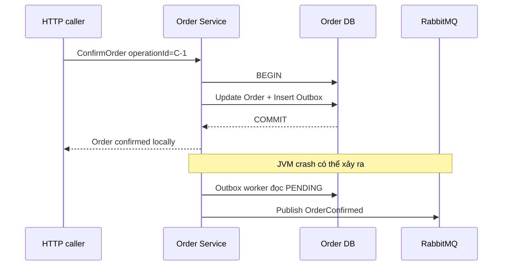
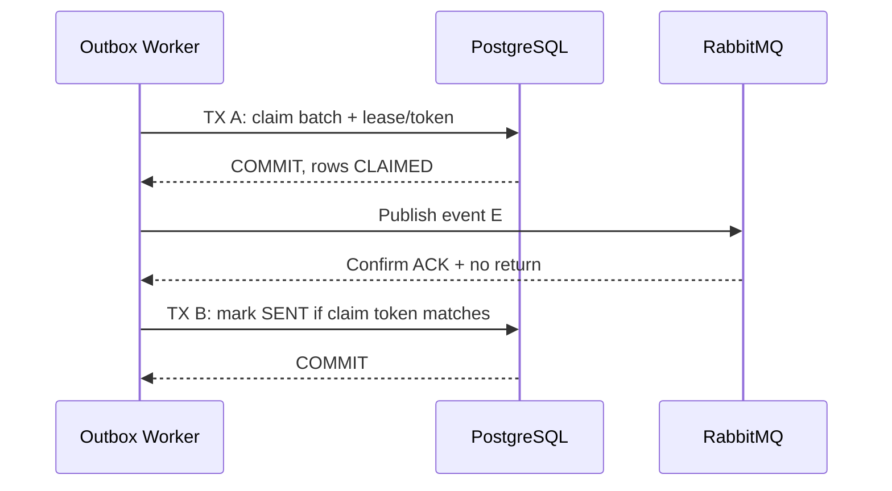
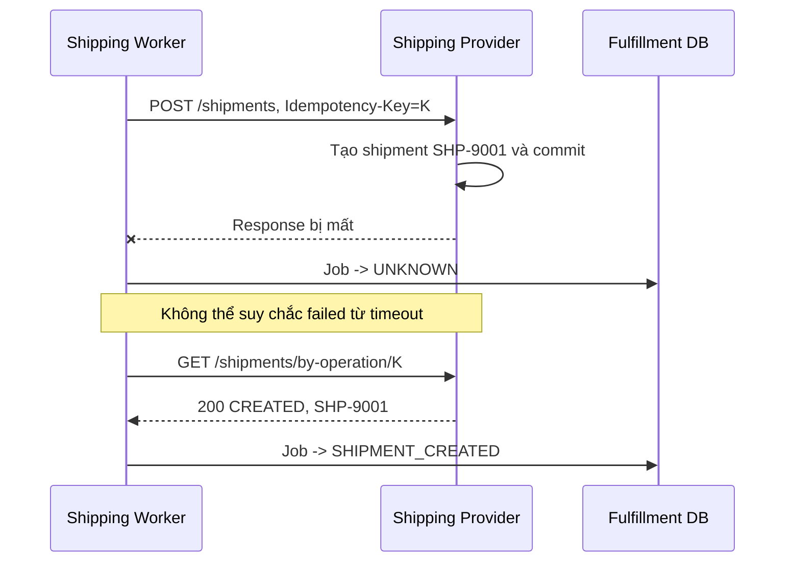
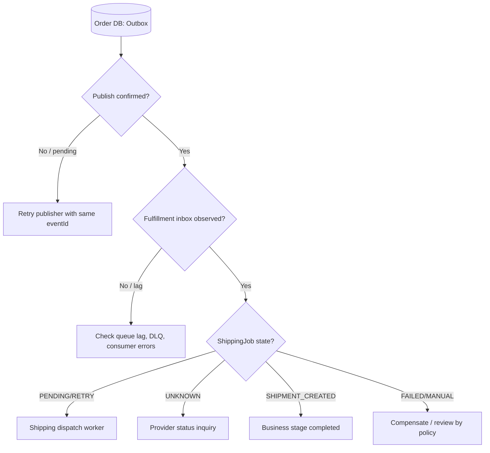
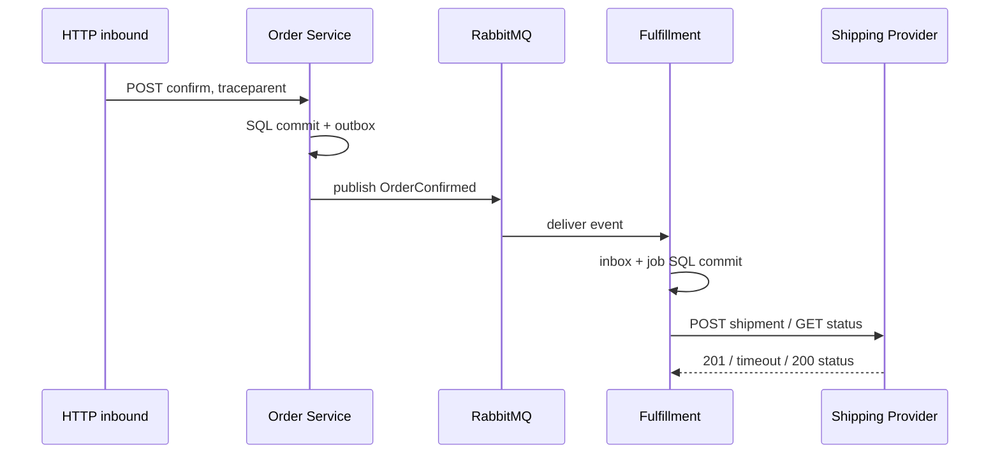

# Triển khai outbox, consumer chống trùng và đối soát sau lỗi

## 1. Bài toán thực hành: một lần xác nhận đơn, nhiều ranh giới commit

Giả sử hệ thống bán hàng có hai ứng dụng Spring Boot:

- **Order Service** nhận lệnh xác nhận đơn hàng, lưu trạng thái vào PostgreSQL rồi phát sự kiện `OrderConfirmed` tới RabbitMQ.
- **Fulfillment Service** tiêu thụ `OrderConfirmed`, tạo công việc giao hàng trong PostgreSQL riêng, sau đó gọi HTTP tới Shipping Provider để tạo vận đơn.

Trong một lần xử lý bình thường, luồng rất đơn giản: người dùng xác nhận đơn, Order commit, broker nhận sự kiện, Fulfillment tạo một shipment, Shipping Provider trả mã vận đơn. Nhưng hệ thống thật có thể hỏng ở bất kỳ khoảng trống nào giữa hai lần commit.

Ba câu hỏi mà bài thực hành phải giải được:

1. **Outbox:** Nếu Order đã commit nhưng broker đang lỗi hoặc JVM chết trước khi publish, làm thế nào sự kiện không biến mất?
2. **Consumer chống trùng:** Nếu broker giao cùng một event hai lần, làm thế nào Fulfillment không tạo hai công việc giao hàng?
3. **Đối soát sau lỗi:** Nếu Shipping Provider tạo vận đơn nhưng HTTP response bị mất, làm thế nào không gửi lại như một lệnh mới hoặc đánh dấu thất bại sai?

Đây là bài trong chương **Thực hành tổng hợp** của module **SPRING_BOOT_INTEGRATION**. Module tập trung tích hợp Spring Boot qua HTTP client, cơ sở dữ liệu, cache, broker thông điệp và Spring Integration, với các trọng tâm về cấu hình, hợp đồng dữ liệu, giao dịch, lỗi, xử lý trùng lặp, kiểm thử và khả năng quan sát. Vì thế giải pháp bên dưới không chỉ “publish event thành công”; nó phải mô tả **source of truth**, **trạng thái bền**, **cửa sổ crash** và **điều kiện replay an toàn**.

### 1.1. Kết quả cần đạt

Sau bài này, bạn có thể:

- Mô tả chính xác ranh giới transaction PostgreSQL, RabbitMQ publisher confirm, consumer acknowledgment và HTTP side effect.
- Thiết kế schema Order/outbox cùng transaction với unique idempotency key và event schema version.
- Implement worker claim outbox bằng `FOR UPDATE SKIP LOCKED`, lease, claim token và update có điều kiện.
- Chỉ mark `SENT` khi publish đã có xác nhận phù hợp; giải thích vì sao publisher vẫn có thể phát trùng.
- Implement inbox consumer với unique `(consumer_name, event_id)` và payload hash; ghi inbox marker cùng business job trong một local transaction.
- Tách HTTP shipping call ra khỏi consumer database transaction; chuyển timeout sau POST sang `UNKNOWN` thay vì mặc định fail.
- Viết reconciler tra cứu trạng thái remote theo stable operation ID, phân biệt `NOT_FOUND` đáng tin và kết quả chưa chắc chắn.
- Kiểm thử happy path, race, crash sau broker confirm, crash sau DB commit trước ack, HTTP timeout và late responses.
- Xây dashboard/runbook theo backlog, age, duplicate, DLQ, UNKNOWN và kết quả nghiệp vụ thực.

> **Phiên bản và phạm vi:** Ví dụ hướng đến Java 17+, Spring Boot 3.2+, Spring AMQP, Spring JDBC và PostgreSQL 15/16; dùng các kiểu của Spring Framework 6.x. Các đoạn Java có thể lược bỏ imports và một vài helper để tập trung vào đường transaction; cấu hình topology, migrations, dependency và test fixtures phải được ghép đủ trong project thật. Không sử dụng trực tiếp hệ thống shipping/mail production khi làm bài.

### 1.2. Nguyên tắc không được đánh tráo

| Tín hiệu quan sát | Điều đã biết | Điều **chưa** được đảm bảo |
|---|---|---|
| `@Transactional` return thành công | Local DB transaction đã hoàn tất theo proxy/manager | RabbitMQ hoặc Shipping đã xử lý |
| `outbox.status=SENT` | Publisher đã nhận xác nhận theo contract | Fulfillment consumer đã commit |
| RabbitMQ publisher confirm ACK | Broker xác nhận publish | Message đã route nếu chưa kiểm tra return; consumer đã commit |
| Consumer method return trong AUTO ack mode | Handler đã hoàn tất; container tiến tới ack theo policy | HTTP shipping side effect đã xong |
| `inbox_event` có event ID | Consumer đã ghi marker trong DB transaction | Tất cả tác động remote đã hoàn tất |
| Shipping HTTP `201 Created` | Provider đã xác nhận tạo vận đơn theo API | Hàng đã được giao tới khách |
| HTTP timeout sau POST | Caller chưa nhận được response | Không có bằng chứng provider chưa tạo vận đơn |

**Phạm vi bảo đảm hướng đến:** local atomic commit + durable intent + at-least-once handoff + idempotent local effect + reconciliation của remote side effect. Không hứa **exactly-once end-to-end** trên PostgreSQL–RabbitMQ–HTTP mà không có giao thức/điều kiện đặc biệt từ tất cả bên.

## 2. Kiến trúc đích và các trạng thái

### 2.1. Sơ đồ luồng bình thường

```mermaid
flowchart LR
    U[POST /orders/{id}/confirm] --> OS[Order Application Service]
    OS --> ODB[(Order PostgreSQL)]
    ODB -->|Order CONFIRMED + Outbox PENDING| PUB[Outbox Publisher]
    PUB -->|publish + confirm| MQ[(RabbitMQ)]
    MQ -->|at-least-once delivery| CON[Order Event Consumer]
    CON --> FDB[(Fulfillment PostgreSQL)]
    FDB -->|Inbox + ShippingJob PENDING| W[Shipping Worker]
    W -->|POST Idempotency-Key| SH[Shipping HTTP API]
    SH -->|201 / 409 / timeout| W
    W --> FDB
    REC[Reconciliation Worker] --> FDB
    REC -->|GET by operation ID| SH
```

**Không có một transaction duy nhất xuyên cả sơ đồ.** Mỗi database commit riêng, broker có publish confirmation/consumer ack riêng và Shipping Provider có transaction của họ. Đường phục hồi dựa trên các record bền và business operation IDs ổn định.

### 2.2. Phân quyền dữ liệu và trách nhiệm

| Thành phần | Nguồn sự thật | Quyền sở hữu |
|---|---|---|
| Order Service | `order_record` và `outbox_event` | Order state; event đã được commit để phát |
| Order outbox worker | `outbox_event` | Claim, publish, retry, mark SENT |
| RabbitMQ | Exchange, queue, delivery state | Handoff và redelivery; **không** quyết định Order đã confirm |
| Fulfillment consumer | `inbox_event` và `shipping_job` | Idempotent acceptance của event |
| Shipping worker | `shipping_job` | Gửi lệnh tạo vận đơn theo operation ID |
| Shipping Provider | Shipment record ở hệ thống remote | Xác nhận vận đơn có tồn tại/được tạo |
| Reconciliation worker | `shipping_job` + provider status API | Giải quyết UNKNOWN/stuck theo contract |

Trong môi trường production, Order và Fulfillment nên có **database ownership riêng**. Chúng có thể chạy cùng một PostgreSQL server trong local test, nhưng không dùng chung một database transaction để “làm giả” tính nhất quán distributed.

### 2.3. State machine của Order, Outbox và Shipping

```text
ORDER
  PENDING -> CONFIRMED

OUTBOX
  PENDING -> CLAIMED -> SENT
                |
                +-- lease expires -> CLAIMED by another worker
                +-- retryable failure -> PENDING / RETRY_SCHEDULED

SHIPPING JOB
  PENDING -> IN_FLIGHT -> SHIPMENT_CREATED
                   |
                   +-- response uncertain -> UNKNOWN
                   +-- known temporary failure -> RETRY_SCHEDULED
                   +-- known permanent rejection -> FAILED_PERMANENT

  UNKNOWN -> RECONCILING -> SHIPMENT_CREATED
                          -> RETRY_SCHEDULED (only if safe to retry)
                          -> MANUAL_REVIEW
```

Một outbox `SENT` và một ShippingJob `SHIPMENT_CREATED` mô tả hai mốc khác nhau. `SENT` không chứng minh đã có shipment. `SHIPMENT_CREATED` vẫn khác `DELIVERED`.

### 2.4. IDs phải ổn định qua mọi lần thử

Ví dụ:

```text
tenantId           = TENANT-A
orderId            = O-1001
confirmOperationId = b00c... (UUID)
eventId            = b00c... (UUID ổn định cho event này)
shippingOperationId= ship:TENANT-A:O-1001:b00c...
traceId            = thay đổi theo execution/trace context
brokerDeliveryTag  = broker-local; thay đổi theo channel/delivery
```

Chúng có mục đích khác nhau:

- `confirmOperationId` khóa lệnh xác nhận được HTTP caller retry.
- `eventId` khóa một event đã commit, không tạo mới khi outbox publisher retry.
- `shippingOperationId` khóa logical create-shipment request tại Shipping Provider.
- `traceId` chỉ dùng correlation/observability, không phải khóa idempotency bền.
- RabbitMQ delivery tag hoặc Spring Message ID không thay thế event ID nghiệp vụ.

Một HTTP retry hay broker redelivery phải **giữ nguyên các business IDs tương ứng**.

## 3. Tạo môi trường thực hành

### 3.1. Stack tối thiểu

Mỗi ứng dụng cần Spring Boot JDBC/JPA theo lựa chọn; bài dùng JDBC cho minh họa SQL rõ:

```xml
<dependencies>
  <dependency>
    <groupId>org.springframework.boot</groupId>
    <artifactId>spring-boot-starter-web</artifactId>
  </dependency>
  <dependency>
    <groupId>org.springframework.boot</groupId>
    <artifactId>spring-boot-starter-jdbc</artifactId>
  </dependency>
  <dependency>
    <groupId>org.springframework.boot</groupId>
    <artifactId>spring-boot-starter-amqp</artifactId>
  </dependency>
  <dependency>
    <groupId>org.flywaydb</groupId>
    <artifactId>flyway-core</artifactId>
  </dependency>
  <dependency>
    <groupId>org.postgresql</groupId>
    <artifactId>postgresql</artifactId>
    <scope>runtime</scope>
  </dependency>
  <dependency>
    <groupId>org.springframework.boot</groupId>
    <artifactId>spring-boot-starter-test</artifactId>
    <scope>test</scope>
  </dependency>
  <dependency>
    <groupId>org.springframework.boot</groupId>
    <artifactId>spring-boot-testcontainers</artifactId>
    <scope>test</scope>
  </dependency>
  <dependency>
    <groupId>org.testcontainers</groupId>
    <artifactId>junit-jupiter</artifactId>
    <scope>test</scope>
  </dependency>
  <dependency>
    <groupId>org.testcontainers</groupId>
    <artifactId>postgresql</artifactId>
    <scope>test</scope>
  </dependency>
  <dependency>
    <groupId>org.testcontainers</groupId>
    <artifactId>rabbitmq</artifactId>
    <scope>test</scope>
  </dependency>
</dependencies>
```

Ví dụ Maven sử dụng Spring Boot parent/BOM. Tùy phiên bản Spring Boot/Flyway/PostgreSQL, có thể cần thêm database-specific Flyway module theo metadata phát hành; đừng dùng `ddl-auto=create` thay migration trong production. Fulfillment HTTP client dùng `RestClient` từ Spring Web. HTTP mock server có thể dùng WireMock, MockWebServer hoặc container riêng trong test.

### 3.2. Local Compose (môi trường demo)

```yaml
# compose.yaml minh họa — dùng đúng profile dev
services:
  order-db:
    image: postgres:16-alpine
    environment:
      POSTGRES_DB: orders
      POSTGRES_USER: orders_user
      POSTGRES_PASSWORD: local-only-orders
    ports:
      - "127.0.0.1:15432:5432"

  fulfillment-db:
    image: postgres:16-alpine
    environment:
      POSTGRES_DB: fulfillment
      POSTGRES_USER: fulfillment_user
      POSTGRES_PASSWORD: local-only-fulfillment
    ports:
      - "127.0.0.1:25432:5432"

  rabbitmq:
    image: rabbitmq:3.13-management-alpine
    ports:
      - "127.0.0.1:5672:5672"
      - "127.0.0.1:15672:15672"
```

Credential chỉ dùng trên loopback local. Host ports cố định có thể trùng với service đã chạy; trong CI dùng Testcontainers mapped ports động. Không để database/RabbitMQ management UI mở ra Internet và không copy credentials vào môi trường thật. Với hai app/schemas, cấu hình datasource riêng, không cho Fulfillment trực tiếp sửa bảng Order.

### 3.3. Order Service config

```yaml
spring:
  datasource:
    url: jdbc:postgresql://127.0.0.1:15432/orders
    username: orders_user
    password: ${ORDER_DB_PASSWORD:local-only-orders}
  rabbitmq:
    host: 127.0.0.1
    port: 5672
    publisher-confirm-type: correlated
    publisher-returns: true
    template:
      mandatory: true

integration:
  outbox:
    batch-size: 10
    lease: 90s
    confirm-timeout: 5s
    retry-delay: 15s
    poll-delay-ms: 1000
```

`spring.rabbitmq.publisher-confirm-type=correlated` bật publisher confirm phù hợp; `publisher-returns=true` cùng `template.mandatory=true` giúp phát hiện unroutable messages. Thực tế cần TLS/vhost/ACL, cluster policy, topology ownership và confirm handling đã kiểm thử. Trong production dùng secret manager, không dùng ví dụ credential mặc định.

### 3.4. Fulfillment Service config

```yaml
spring:
  datasource:
    url: jdbc:postgresql://127.0.0.1:25432/fulfillment
    username: fulfillment_user
    password: ${FULFILLMENT_DB_PASSWORD:local-only-fulfillment}
  rabbitmq:
    host: 127.0.0.1
    port: 5672
    listener:
      simple:
        acknowledge-mode: auto
        default-requeue-rejected: false

integration:
  shipping:
    base-url: http://127.0.0.1:18080
    connect-timeout: 2s
    read-timeout: 4s
    query-timeout: 3s
```

`default-requeue-rejected=false` chỉ là một ví dụ tránh poison-loop vô hạn khi không dùng retry advice. Muốn retry lỗi transient, định nghĩa retry policy/backoff, DLX/DLQ và error classification rõ; không để mọi exception bị drop chỉ vì requeue false. Chưa cần bật retry mặc định cho cả service khi chưa xác định lỗi business và acknowledgement semantics.

### 3.5. Thực hành theo một trình tự có thể kiểm chứng

```text
1. Migrate Order DB và Fulfillment DB.
2. Khai báo Rabbit exchange, queue, binding, DLQ.
3. Gửi ConfirmOrderCommand theo HTTP.
4. Assert Order + Outbox commit atomic.
5. Chạy Outbox Publisher; kiểm tra confirm + SENT.
6. Consumer nhận OrderConfirmed; assert Inbox + ShippingJob.
7. Shipping worker gửi POST với stable operationId.
8. Fake provider tạo shipment; phản hồi thành công hoặc timeout.
9. Reconciler xử lý UNKNOWN; assert không tạo shipment trùng.
10. Tiêm crash/redelivery và kiểm tra invariants.
```

Không bỏ qua bước cuối: một luồng chạy “happy path” không chứng minh outbox, inbox và reconciliation thật sự có giá trị.

## 4. Order Service: schema và hợp đồng event

### 4.1. Migration cho database Order

Tạo migration Flyway (nội dung minh họa để đưa vào dự án, **bài này chỉ sửa Markdown**):

```sql
CREATE TABLE order_record (
    tenant_id    VARCHAR(80) NOT NULL,
    order_id     VARCHAR(80) NOT NULL,
    status       VARCHAR(32) NOT NULL,
    version      BIGINT NOT NULL DEFAULT 0,
    updated_at   TIMESTAMPTZ NOT NULL DEFAULT CURRENT_TIMESTAMP,
    PRIMARY KEY (tenant_id, order_id),
    CONSTRAINT ck_order_status
      CHECK (status IN ('PENDING', 'CONFIRMED', 'CANCELLED'))
);

CREATE TABLE confirm_command (
    tenant_id     VARCHAR(80) NOT NULL,
    operation_id  UUID NOT NULL,
    order_id      VARCHAR(80) NOT NULL,
    processed_at  TIMESTAMPTZ NOT NULL DEFAULT CURRENT_TIMESTAMP,
    PRIMARY KEY (operation_id)
);

CREATE TABLE outbox_event (
    event_id         UUID PRIMARY KEY,
    tenant_id        VARCHAR(80) NOT NULL,
    aggregate_id     VARCHAR(80) NOT NULL,
    event_type       VARCHAR(80) NOT NULL,
    schema_version   INTEGER NOT NULL,
    payload_json     JSONB NOT NULL,
    status           VARCHAR(24) NOT NULL DEFAULT 'PENDING',
    claim_token      UUID,
    claimed_until    TIMESTAMPTZ,
    next_attempt_at  TIMESTAMPTZ NOT NULL DEFAULT CURRENT_TIMESTAMP,
    attempt_count    INTEGER NOT NULL DEFAULT 0,
    created_at       TIMESTAMPTZ NOT NULL DEFAULT CURRENT_TIMESTAMP,
    sent_at          TIMESTAMPTZ,
    last_error_class VARCHAR(80),
    CONSTRAINT ck_outbox_status CHECK (
      status IN ('PENDING', 'RETRY_SCHEDULED', 'CLAIMED', 'SENT')
    )
);

CREATE INDEX ix_outbox_ready
  ON outbox_event(status, next_attempt_at, claimed_until, created_at);
```

Điểm mấu chốt: `order_record`, `confirm_command` và `outbox_event` phải nằm trong cùng datasource và local transaction được quản lý. `confirm_command` ngăn HTTP retry tạo một logical command khác dưới cùng operation ID; `outbox_event` lưu công việc còn lại cho publisher. Dùng unique constraint thực thay vì pattern `SELECT exists → INSERT` dễ race khi hai requests đến đồng thời.

Trong hệ thống đa tenant, không chỉ lưu `tenant_id` trong DTO rồi tin nó: tenant đến từ authentication/authorization, dữ liệu truy vấn phải có tenant predicate và quyền gửi event phải được kiểm soát. Event payload có thể chứa PII nên nên tối thiểu hóa field, mã hóa theo chính sách và giới hạn retention.

### 4.2. Schema event có version

```java
// Trong một module contract dùng chung (minh họa)
public record ConfirmOrderCommand(
        String tenantId,
        String orderId,
        UUID operationId
) {}

public record OrderConfirmedEvent(
        int schemaVersion,
        UUID eventId,
        String tenantId,
        String orderId,
        Instant occurredAt
) {}
```

`eventId` phải sinh **một lần tại business command boundary**. Trong ví dụ một confirm command sinh đúng một event nên có thể dùng `eventId = operationId`. Nếu một command sinh nhiều events, dùng các event IDs riêng được lưu trong SQL transaction, không đổi mỗi lần publisher retry.

`schemaVersion=1` giúp consumer từ chối/quarantine event không tương thích thay vì deserialize sai ngầm. `occurredAt` dùng để audit, không dùng làm khóa chống trùng vì hai events có thể trùng timestamp hoặc đồng hồ các máy lệch nhau.

### 4.3. Cơ chế nhận lệnh HTTP

```http
POST /api/v1/orders/O-1001/confirm
Idempotency-Key: 0c03e587-fbb2-4c8f-bcab-5d09f09e9301
Authorization: Bearer <trusted-session-token>
Content-Type: application/json

{}
```

Ứng dụng lấy `tenantId` từ authenticated principal/claims đã xác thực. Mã đơn đến từ URL, operation ID đến từ header đã validate. Không tin `tenantId` tùy ý trong request body. Lặp request với cùng tenant/order/key phải trả kết quả đã xử lý theo contract; lặp cùng key nhưng order khác phải trả conflict.

Đối với HTTP API, trả `200 OK` hoặc `202 Accepted` cần diễn giải chính xác. Nếu SQL đã commit Order `CONFIRMED` và outbox `PENDING`, có thể trả xác nhận **business state của Order**, nhưng không nói Fulfillment đã tạo vận đơn. Nếu confirmation là workflow bất đồng bộ nhiều bước, dùng `202` cùng tracking endpoint có thể rõ ràng hơn.

## 5. Commit Order và Outbox trong cùng transaction

### 5.1. Application service dùng JDBC

```java
// OrderConfirmationService.java — imports lược bỏ
@Service
public class OrderConfirmationService {
    private final JdbcTemplate jdbc;
    private final ObjectMapper mapper;

    public OrderConfirmationService(
            JdbcTemplate jdbc, ObjectMapper mapper) {
        this.jdbc = jdbc;
        this.mapper = mapper;
    }

    @Transactional
    public void confirm(ConfirmOrderCommand cmd) {
        validate(cmd);

        int first = jdbc.update("""
            INSERT INTO confirm_command(
                tenant_id, operation_id, order_id
            )
            VALUES (?, ?, ?)
            ON CONFLICT (operation_id) DO NOTHING
            """,
            cmd.tenantId(), cmd.operationId(), cmd.orderId());

        if (first == 0) {
            Map<String, Object> previous = jdbc.queryForMap("""
                SELECT tenant_id, order_id
                  FROM confirm_command
                 WHERE operation_id = ?
                """, cmd.operationId());

            if (!cmd.tenantId().equals(previous.get("tenant_id"))
                    || !cmd.orderId().equals(
                            previous.get("order_id"))) {
                throw new IllegalArgumentException(
                        "Idempotency-Key được dùng cho lệnh khác");
            }
            return; // Command cũ đã commit.
        }

        int changed = jdbc.update("""
            UPDATE order_record
               SET status = 'CONFIRMED',
                   version = version + 1,
                   updated_at = CURRENT_TIMESTAMP
             WHERE tenant_id = ?
               AND order_id = ?
               AND status = 'PENDING'
            """, cmd.tenantId(), cmd.orderId());

        if (changed != 1) {
            throw new IllegalStateException(
                    "Order không tồn tại hoặc không thể confirm");
        }

        OrderConfirmedEvent event = new OrderConfirmedEvent(
                1,
                cmd.operationId(),
                cmd.tenantId(),
                cmd.orderId(),
                Instant.now());

        String payload;
        try {
            payload = mapper.writeValueAsString(event);
        } catch (JsonProcessingException e) {
            throw new IllegalStateException(
                    "Không serialize được event", e);
        }

        jdbc.update("""
            INSERT INTO outbox_event(
                event_id, tenant_id, aggregate_id,
                event_type, schema_version, payload_json
            )
            VALUES (?, ?, ?, 'ORDER_CONFIRMED', 1, CAST(? AS jsonb))
            """, event.eventId(), event.tenantId(),
                 event.orderId(), payload);
    }

    private static void validate(ConfirmOrderCommand cmd) {
        if (cmd == null || cmd.operationId() == null ||
            cmd.tenantId() == null ||
            !cmd.tenantId().matches("[A-Za-z0-9_-]{1,80}") ||
            cmd.orderId() == null ||
            !cmd.orderId().matches("[A-Za-z0-9_-]{1,80}")) {
            throw new IllegalArgumentException(
                    "ConfirmOrderCommand không hợp lệ");
        }
    }
}
```

**Điều kiện cần:** method được gọi qua Spring transaction proxy và `JdbcTemplate` dùng cùng `DataSource`/`PlatformTransactionManager`. Các câu SQL trong method tạo **một** commit PostgreSQL. Nếu update Order fail hoặc insert outbox fail, cả `confirm_command` và business state rollback.

Khi hai HTTP requests dùng cùng operation ID đến đồng thời, unique constraint ép một request chờ/không insert; nó không được phép tạo hai outbox events. Ở bản demo, `operation_id` là khóa **globally unique**, phù hợp cách `eventId = operationId` với outbox primary key trên `event_id`. Khi method thứ hai thấy marker đã commit, phải đối chiếu **cả tenant và order**; cùng UUID dùng cho tenant khác bị từ chối, không tiết lộ thông tin tenant gốc. Nếu command có quantity, price, tenant-scoped claims hoặc nhiều field quyết định kết quả, lưu thêm **canonical payload hash** trong `confirm_command` và so sánh toàn bộ semantics, không chỉ `orderId`.

### 5.2. Cửa sổ crash đã được loại và cửa sổ còn tồn tại



Nếu JVM crash **sau Order commit nhưng trước publish**, `outbox_event.status=PENDING` còn tồn tại và publisher có thể tiếp tục sau restart. Nếu JVM crash trước commit, cả Order và outbox rollback, không có “ghost event”.

Một application không có outbox nhưng dùng `@TransactionalEventListener(AFTER_COMMIT)` để publish vẫn có crash window mất event giữa DB commit và callback. Callback chỉ nên làm tín hiệu đánh thức publisher khi outbox là durable source.

### 5.3. Vì sao không gọi RabbitTemplate trong transaction?

Anti-pattern:

```java
@Transactional
public void confirmWrong(ConfirmOrderCommand command) {
    orderRepository.confirm(command.orderId());
    rabbitTemplate.convertAndSend(
            "orders.events.v1",
            "order.confirmed.v1",
            new OrderConfirmedEvent(...));
}
```

RabbitMQ có transaction/confirm domain riêng; nó **không tự enlist** vào PostgreSQL `@Transactional`. Broker có thể nhận event trong khi database commit sau đó lỗi. Gửi message sau commit bằng code thường lại có nguy cơ **mất event** nếu process chết trước send. Outbox là cách biểu diễn bền ý định publish.

### 5.4. Version và ordering của events

Nếu Order có nhiều state transitions, một event `ORDER_CONFIRMED` nên mang `aggregateVersion`/sequence lấy từ database để consumer phân biệt cũ/mới. Trong một broker, routing/partition theo `orderId` có thể giúp ordering, nhưng retries, DLQ redrive và multi-consumer concurrency vẫn có thể làm event đến lệch thứ tự.

Bài ví dụ chỉ có một transition `PENDING → CONFIRMED` để tập trung vào outbox/inbox. Khi mở rộng `CANCELLED`/`REFUNDED`, cần version-aware consumer và conditional state update, không chỉ reliance vào arrival order hoặc event timestamp.

## 6. RabbitMQ topology và hợp đồng publish

### 6.1. Exchange, queue, routing key và DLQ

Giả sử hạ tầng có:

```text
TopicExchange  orders.events.v1
Routing key    order.confirmed.v1
Queue          fulfillment.order-confirmed.v1

Dead-letter exchange    orders.dlx.v1
DLQ                     fulfillment.order-confirmed.dlq.v1
```

Một mẫu Java configuration:

```java
@Configuration(proxyBeanMethods = false)
class OrderMessagingTopology {
    @Bean
    Declarables orderTopology() {
        TopicExchange events =
                ExchangeBuilder.topicExchange(
                        "orders.events.v1").durable(true).build();
        DirectExchange dlx =
                ExchangeBuilder.directExchange(
                        "orders.dlx.v1").durable(true).build();

        Queue consumerQueue = QueueBuilder
                .durable("fulfillment.order-confirmed.v1")
                .deadLetterExchange("orders.dlx.v1")
                .deadLetterRoutingKey(
                        "fulfillment.order-confirmed.dlq.v1")
                .build();
        Queue deadLetterQueue = QueueBuilder
                .durable("fulfillment.order-confirmed.dlq.v1")
                .build();

        return new Declarables(
                events, dlx, consumerQueue, deadLetterQueue,
                BindingBuilder.bind(consumerQueue)
                        .to(events).with("order.confirmed.v1"),
                BindingBuilder.bind(deadLetterQueue)
                        .to(dlx).with(
                            "fulfillment.order-confirmed.dlq.v1")
        );
    }
}
```

Ví dụ dùng queue durable; delivery persistence của message phải được kiểm tra riêng. DLQ không tự quyết định khi nào message được redrive hay xử lý poison event. Production nên xác định **một nguồn sở hữu topology** (deployment/IaC hoặc service được ủy quyền), tránh hai ứng dụng cùng redeclare queue với arguments khác nhau gây `PRECONDITION_FAILED`.

Với nhu cầu HA/replication, đánh giá classic/quorum queue và broker policies của phiên bản RabbitMQ triển khai; không suy rằng durable queue trên một broker đơn lẻ tự bảo đảm không mất dữ liệu khi mất toàn bộ node/disk.

### 6.2. Confirm và return là hai tín hiệu khác nhau

- **Publisher confirm ACK:** broker xác nhận publish theo confirm mode, chưa có nghĩa consumer xử lý.
- **Publisher return:** khi mandatory publish không route được, broker trả message theo cơ chế return.
- **Consumer ack:** consumer container xác nhận delivery đã được xử lý theo ack policy; không đồng nghĩa shipping remote đã hoàn thành.

Ví dụ broker có exchange `orders.events.v1` nhưng queue binding sai. Publish có thể được **ACK bởi broker** mà message **không vào queue mong đợi**. Bởi vậy ví dụ bật `publisher-returns=true` và `template.mandatory=true`, rồi kiểm tra cả result confirm lẫn returned message.

Nếu một tổ chức dùng alternate exchange, unroutable routing contract khác; xác minh semantics của alternate routes/mandatory returns chứ không đánh đồng “ACK” là “đã có người nhận”.

## 7. Outbox publisher: claim rồi gửi ngoài transaction

### 7.1. Không để SQL transaction ôm network publish

Anti-pattern:

```text
BEGIN PostgreSQL TX
SELECT outbox FOR UPDATE
SEND RabbitMQ + wait confirm 5 seconds
UPDATE outbox SENT
COMMIT PostgreSQL TX
```

Giữ SQL row locks và connection qua network I/O gây pool exhaustion khi RabbitMQ lỗi, **nhưng vẫn không làm broker commit atomically cùng database**. Publisher nên dùng hai transaction SQL ngắn, tách bởi network call:



**Cửa sổ lỗi còn lại:** broker ACK rồi worker crash trước SQL TX B; outbox row chưa SENT, sau lease expiry publisher có thể gửi E lần nữa. Điều này được giải quyết ở **consumer idempotency**, không thể xóa bằng một boolean local.

### 7.2. Record ánh xạ row đã claim

```java
public record OutboxClaim(
        UUID eventId,
        String tenantId,
        String aggregateId,
        String eventType,
        int schemaVersion,
        String payloadJson,
        UUID claimToken
) {}
```

`payloadJson` là payload đã commit, không tạo lại event DTO với `UUID.randomUUID()` mỗi lần gửi. Message content, event ID, version và aggregate key phải ổn định qua retries.

### 7.3. Claim batch bằng PostgreSQL SKIP LOCKED

```sql
WITH candidates AS (
    SELECT event_id
      FROM outbox_event
     WHERE (
           status IN ('PENDING', 'RETRY_SCHEDULED')
           AND next_attempt_at <= CURRENT_TIMESTAMP
     ) OR (
           status = 'CLAIMED'
           AND claimed_until <= CURRENT_TIMESTAMP
     )
     ORDER BY created_at, event_id
     LIMIT :batch_size
     FOR UPDATE SKIP LOCKED
)
UPDATE outbox_event AS e
   SET status = 'CLAIMED',
       claim_token = :claim_token,
       claimed_until =
           CURRENT_TIMESTAMP + INTERVAL '90 seconds',
       attempt_count = attempt_count + 1
  FROM candidates AS c
 WHERE e.event_id = c.event_id
RETURNING e.event_id, e.tenant_id, e.aggregate_id,
          e.event_type, e.schema_version,
          e.payload_json, e.claim_token;
```

`FOR UPDATE SKIP LOCKED` giúp nhiều workers tránh claim cùng row đang bị worker khác lock trong lúc **TX A**. Một lease `claimed_until` giúp khôi phục row nếu worker đã commit claim nhưng crash trước publish. Đặt `claim_token` ngẫu nhiên/duy nhất trên mỗi batch để worker cũ không đánh dấu `SENT` cho claim đã được owner khác lấy.

**Chú ý:** query này không tự bảo đảm ordering toàn cục. Nhiều workers với `SKIP LOCKED` có thể phát E2 trước E1 của cùng order khi E1 bị lock/fail. Với aggregate yêu cầu thứ tự, cần partition/sequence logic riêng hoặc hạn chế concurrency theo aggregate.

### 7.4. Repository chia transaction ngắn

```java
// OutboxStore.java — imports lược bỏ
@Repository
public class OutboxStore {
    private final JdbcTemplate jdbc;

    public OutboxStore(JdbcTemplate jdbc) {
        this.jdbc = jdbc;
    }

    @Transactional
    public List<OutboxClaim> claimBatch(int batchSize) {
        UUID token = UUID.randomUUID();

        return jdbc.query("""
            WITH candidates AS (
                SELECT event_id
                  FROM outbox_event
                 WHERE (
                   status IN ('PENDING','RETRY_SCHEDULED')
                   AND next_attempt_at <= CURRENT_TIMESTAMP
                 ) OR (
                   status = 'CLAIMED'
                   AND claimed_until <= CURRENT_TIMESTAMP
                 )
                 ORDER BY created_at, event_id
                 LIMIT ?
                 FOR UPDATE SKIP LOCKED
            )
            UPDATE outbox_event AS e
               SET status='CLAIMED',
                   claim_token=?,
                   claimed_until =
                       CURRENT_TIMESTAMP + INTERVAL '90 seconds',
                   attempt_count=attempt_count+1
              FROM candidates AS c
             WHERE e.event_id = c.event_id
            RETURNING e.event_id, e.tenant_id,
                      e.aggregate_id, e.event_type,
                      e.schema_version, e.payload_json,
                      e.claim_token
            """,
            (rs, i) -> new OutboxClaim(
                    rs.getObject("event_id", UUID.class),
                    rs.getString("tenant_id"),
                    rs.getString("aggregate_id"),
                    rs.getString("event_type"),
                    rs.getInt("schema_version"),
                    rs.getString("payload_json"),
                    rs.getObject("claim_token", UUID.class)),
            batchSize, token);
    }

    @Transactional
    public boolean markSent(OutboxClaim claim) {
        int changed = jdbc.update("""
            UPDATE outbox_event
               SET status='SENT',
                   sent_at=CURRENT_TIMESTAMP,
                   claim_token=NULL,
                   claimed_until=NULL,
                   last_error_class=NULL
             WHERE event_id=?
               AND status='CLAIMED'
               AND claim_token=?
            """, claim.eventId(), claim.claimToken());
        return changed == 1;
    }

    @Transactional
    public boolean deferRetry(
            OutboxClaim claim, String errorClass) {
        int changed = jdbc.update("""
            UPDATE outbox_event
               SET status='RETRY_SCHEDULED',
                   next_attempt_at =
                      CURRENT_TIMESTAMP + INTERVAL '15 seconds',
                   claim_token=NULL,
                   claimed_until=NULL,
                   last_error_class=?
             WHERE event_id=?
               AND status='CLAIMED'
               AND claim_token=?
            """, errorClass, claim.eventId(),
                 claim.claimToken());
        return changed == 1;
    }
}
```

Đây là một repository dùng một `JdbcTemplate`/PostgreSQL transaction manager. Nó trả các row đã claim **sau khi proxy commit** khi caller đi qua bean khác. `markSent`/`deferRetry` dùng claim token làm điều kiện; nếu trả false, owner có thể đã đổi và worker phải **quan sát/alert**, không tự update status bằng event ID đơn thuần.

`errorClass` phải là nhãn hữu hạn như `BROKER_NACK`, `CONFIRM_TIMEOUT` hoặc `RETURNED_UNROUTABLE`. Không ghi exception raw chứa URLs/credentials vào field này. Production bổ sung exponential backoff, max attempts, quarantine và next-attempt scheduling; delay 15 giây chỉ là con số minh họa.

### 7.5. Gửi payload ổn định và chờ confirm

```java
// RabbitOutboxSender.java — imports lược bỏ
@Component
public class RabbitOutboxSender {
    private final RabbitTemplate rabbit;

    public RabbitOutboxSender(RabbitTemplate rabbit) {
        this.rabbit = rabbit;
    }

    public void sendAndConfirm(OutboxClaim row)
            throws InterruptedException,
                   ExecutionException, TimeoutException {

        MessageProperties props = new MessageProperties();
        props.setContentType(
                MessageProperties.CONTENT_TYPE_JSON);
        props.setDeliveryMode(
                MessageDeliveryMode.PERSISTENT);
        props.setMessageId(row.eventId().toString());
        props.setHeader("event-id", row.eventId().toString());
        props.setHeader(
                "schema-version", row.schemaVersion());
        props.setHeader("event-type", row.eventType());

        Message message = new Message(
                row.payloadJson().getBytes(
                        StandardCharsets.UTF_8),
                props);

        CorrelationData correlation =
                new CorrelationData(row.eventId().toString());

        rabbit.send(
                "orders.events.v1",
                "order.confirmed.v1",
                message, correlation);

        CorrelationData.Confirm confirm =
                correlation.getFuture().get(
                        5, TimeUnit.SECONDS);

        if (!confirm.isAck()) {
            throw new IllegalStateException(
                    "RabbitMQ publisher NACK");
        }
        if (correlation.getReturned() != null) {
            throw new IllegalStateException(
                    "Event không route tới queue");
        }
    }
}
```

**Điều kiện runtime:** publisher confirm type phải là `correlated`, returns được bật và template mandatory. Đường xác định publish success gồm **confirm ACK và không có mandatory return** theo cấu hình đã kiểm chứng. `CorrelationData` đại diện một publish attempt; `eventId` vẫn ổn định dù tạo đối tượng correlation mới ở retry.

Publisher confirm giúp biết broker đã chấp nhận publish theo mode đã cấu hình; không bảo đảm consumer đã xử lý, không chứng minh message đang nằm trên đúng queue khi không xử lý unroutable và không thay thế kiểm thử broker topology.

### 7.6. Scheduled publisher không bọc transaction quanh Rabbit call

```java
// @EnableScheduling đặt trên configuration thích hợp.
@Component
public class OutboxPublisherJob {
    private final OutboxStore store;
    private final RabbitOutboxSender sender;

    public OutboxPublisherJob(
            OutboxStore store, RabbitOutboxSender sender) {
        this.store = store;
        this.sender = sender;
    }

    @Scheduled(fixedDelayString =
            "${integration.outbox.poll-delay-ms:1000}")
    public void publishPending() {
        List<OutboxClaim> rows = store.claimBatch(10);
        for (OutboxClaim row : rows) {
            try {
                sender.sendAndConfirm(row);
                if (!store.markSent(row)) {
                    // Claim có thể hết hạn/đổi owner.
                    recordLostOwnership(row.eventId());
                }
            } catch (InterruptedException interrupted) {
                Thread.currentThread().interrupt();
                store.deferRetry(row, "INTERRUPTED");
                break;
            } catch (Exception failure) {
                store.deferRetry(
                        row, classifyPublishFailure(failure));
            }
        }
    }

    private void recordLostOwnership(UUID eventId) {
        // Thay bằng metric + audit log không nhạy cảm.
    }

    private String classifyPublishFailure(Exception ex) {
        if (ex instanceof TimeoutException) {
            return "CONFIRM_TIMEOUT";
        }
        return "BROKER_ERROR";
    }
}
```

`@Scheduled` ở đây gọi `OutboxStore` bean khác; SQL claim/mark được Spring proxy mở transaction độc lập, còn `sendAndConfirm` **nằm ngoài** SQL transaction. `integration.outbox.poll-delay-ms` là app property riêng. Khi publish timeout, broker **có thể vẫn đã nhận** event; hoãn retry thay vì mark `SENT` khi thiếu confirm, và consumer phải deduplicate.

Đoạn worker là skeleton cho bài thực hành, chưa gồm structured logging, retry budget, shutdown coordination, batch heartbeat hay distributed leader election. Một claim batch 10 × timeout 5 giây có thể chạy gần 50 giây chưa tính overhead, nên lease 90 giây chỉ là ví dụ phù hợp ở tải giới hạn. Nếu scale lên batch 50 hoặc timeout dài, **phải gia hạn lease/giảm batch/cho worker độc lập per row**, tránh claim expiry khi event vẫn đang publish. Không dùng một thread pool không giới hạn.

### 7.7. Những gì lease/fencing làm được và không làm được

`claim_token` ngăn worker A đã mất lease đánh dấu `SENT` thay cho worker B. Nó **không** ngăn A và B cùng gửi một event đến broker nếu A bị pause lâu rồi tiếp tục gửi. Đây là failure window tồn tại ngay cả với `SKIP LOCKED`.

Do đó hai invariant khác nhau:

1. **Outbox state không bị stale owner ghi đè** nhờ conditional SQL update.
2. **Business effect không bị thực thi trùng** nhờ consumer inbox unique key và downstream idempotency.

Không dùng Redis lock/synchronized trong một JVM để thay thế SQL uniqueness hoặc idempotent consumer khi có nhiều replicas.

## 8. Fulfillment Service: schema Inbox và ShippingJob

### 8.1. Migration của Fulfillment database

```sql
CREATE TABLE inbox_event (
    consumer_name       VARCHAR(100) NOT NULL,
    event_id            UUID NOT NULL,
    payload_fingerprint CHAR(64) NOT NULL,
    processed_at        TIMESTAMPTZ NOT NULL
                        DEFAULT CURRENT_TIMESTAMP,
    PRIMARY KEY (consumer_name, event_id)
);

CREATE TABLE shipping_job (
    job_id                UUID PRIMARY KEY,
    tenant_id             VARCHAR(80) NOT NULL,
    order_id              VARCHAR(80) NOT NULL,
    shipping_operation_id VARCHAR(240) NOT NULL UNIQUE,
    status                VARCHAR(32) NOT NULL DEFAULT 'PENDING',
    provider_shipment_id  VARCHAR(160),
    attempt_count         INTEGER NOT NULL DEFAULT 0,
    next_attempt_at       TIMESTAMPTZ NOT NULL
                          DEFAULT CURRENT_TIMESTAMP,
    claim_token           UUID,
    claimed_until         TIMESTAMPTZ,
    unknown_since         TIMESTAMPTZ,
    last_error_class      VARCHAR(80),
    created_at            TIMESTAMPTZ NOT NULL
                          DEFAULT CURRENT_TIMESTAMP,
    updated_at            TIMESTAMPTZ NOT NULL
                          DEFAULT CURRENT_TIMESTAMP,
    CONSTRAINT uq_initial_shipment UNIQUE (tenant_id, order_id),
    CONSTRAINT ck_shipping_state CHECK (
      status IN (
        'PENDING', 'IN_FLIGHT', 'RETRY_SCHEDULED',
        'UNKNOWN', 'RECONCILING',
        'SHIPMENT_CREATED', 'FAILED_PERMANENT', 'MANUAL_REVIEW'
      )
    )
);

CREATE INDEX ix_shipping_ready
  ON shipping_job(status, next_attempt_at, claimed_until);
```

Mô hình giả định **mỗi Order chỉ có một initial shipment**; vì vậy unique `(tenant_id,order_id)` là lớp bảo vệ bổ sung khi hai events khác ID nhưng cùng nghiệp vụ xuất hiện. Nếu cho phép chia lô hay gửi lại nhiều kiện, thay constraint bằng business key đủ phân biệt `(tenant_id,order_id,shipment_sequence)`/`fulfillment_operation_id`. Không giữ unique quá chặt rồi cưỡng ép mọi trường hợp đổi trả thành một shipment.

`inbox_event` **không chỉ chứa một boolean đã thấy event**: khi duplicate event ID đến với payload khác, cần phát hiện conflict thay vì im lặng bỏ qua. `payload_fingerprint` lưu fingerprint canonical của những field quyết định nghiệp vụ, không coi hash là bằng chứng nguồn gửi đáng tin. Broker ACL, authentication, schema validation và quyền tenant vẫn cần riêng.

### 8.2. Vì sao Inbox marker và ShippingJob phải cùng transaction?

Một consumer sai có thể:

```text
TX 1: INSERT inbox_event E -> COMMIT
Process crash
TX 2: INSERT shipping_job E -> chưa chạy
Broker redelivers E
Inbox thấy E -> skip
Kết quả: mất shipping job
```

Thiết kế đúng:

```text
BEGIN Fulfillment PostgreSQL transaction
  INSERT inbox_event E (unique per consumer)
  INSERT shipping_job E (unique per business operation)
COMMIT
RETURN from listener
RabbitMQ ACK (AUTO mode)
```

Nếu insertion thứ hai fail, cả inbox marker và job rollback, message có thể được retry/DLQ theo policy. Nếu DB commit rồi process crash trước ack, broker redelivers nhưng inbox marker đã commit nên không tạo job thứ hai.

### 8.3. Fingerprint canonical có giới hạn rõ

Ví dụ contract chỉ có event type, schemaVersion, eventId, tenantId, orderId và occurredAt. Có thể so sánh business fields trực tiếp thay cho hash. Ví dụ helper:

```java
public final class EventFingerprints {
    private EventFingerprints() {}

    public static String orderConfirmed(
            OrderConfirmedEvent event) {
        String canonical = String.join("|",
                "ORDER_CONFIRMED",
                Integer.toString(event.schemaVersion()),
                event.eventId().toString(),
                event.tenantId(),
                event.orderId(),
                event.occurredAt().toString());
        try {
            MessageDigest digest =
                    MessageDigest.getInstance("SHA-256");
            byte[] bytes = digest.digest(
                    canonical.getBytes(StandardCharsets.UTF_8));
            return HexFormat.of().formatHex(bytes);
        } catch (NoSuchAlgorithmException e) {
            throw new IllegalStateException(
                    "JVM không hỗ trợ SHA-256", e);
        }
    }
}
```

Trong ví dụ `tenantId/orderId` được giới hạn ký tự `[A-Za-z0-9_-]` nên delimiter `|` không gây collision do chuỗi chứa ký tự phân tách. Với event thật có nhiều trường tự do, dùng canonical JSON hoặc length-prefixed encoding và **bao gồm tất cả field có ảnh hưởng nghiệp vụ**. Hash canonical phải ổn định qua retry; không thêm trace ID, delivery tag hoặc timestamp **được sinh lại ở consumer**.

### 8.4. Validate trước khi ghi vào Inbox

```java
public final class OrderEventValidator {
    private OrderEventValidator() {}

    public static void validate(OrderConfirmedEvent event) {
        if (event == null || event.schemaVersion() != 1 ||
            event.eventId() == null ||
            event.tenantId() == null ||
            !event.tenantId().matches("[A-Za-z0-9_-]{1,80}") ||
            event.orderId() == null ||
            !event.orderId().matches("[A-Za-z0-9_-]{1,80}") ||
            event.occurredAt() == null) {
            throw new IllegalArgumentException(
                    "OrderConfirmedEvent không hợp lệ");
        }
    }
}
```

Không chấp nhận event vì JSON parse được là đủ. Cần kiểm tra expected schema version, sự kiện thuộc source/topic được phép, tenant authorization và field relationships. Với một source không tin cậy, xác thực HMAC/signature theo contract hoặc hạn chế broker publish ACL, không coi fingerprint SHA-256 (không khóa bí mật) là chứng thực.

## 9. Consumer idempotent: ghi Inbox + ShippingJob rồi mới ack

### 9.1. Transactional service trong Fulfillment

```java
@Service
public class FulfillmentInboxService {
    private static final String CONSUMER =
            "fulfillment-order-confirmed-v1";
    private final JdbcTemplate jdbc;

    public FulfillmentInboxService(JdbcTemplate jdbc) {
        this.jdbc = jdbc;
    }

    @Transactional
    public void accept(OrderConfirmedEvent event) {
        OrderEventValidator.validate(event);
        String fingerprint =
                EventFingerprints.orderConfirmed(event);

        int first = jdbc.update("""
            INSERT INTO inbox_event(
                consumer_name, event_id, payload_fingerprint)
            VALUES (?, ?, ?)
            ON CONFLICT (consumer_name, event_id) DO NOTHING
            """, CONSUMER, event.eventId(), fingerprint);

        if (first == 0) {
            String oldFingerprint = jdbc.queryForObject("""
                SELECT payload_fingerprint
                  FROM inbox_event
                 WHERE consumer_name = ?
                   AND event_id = ?
                """, String.class, CONSUMER, event.eventId());

            if (!fingerprint.equals(oldFingerprint)) {
                throw new IllegalArgumentException(
                        "Trùng eventId nhưng payload khác");
            }
            return; // Duplicate cùng logical event.
        }

        String operationId = "ship:"
                + event.tenantId() + ":"
                + event.orderId() + ":"
                + event.eventId();

        int created = jdbc.update("""
            INSERT INTO shipping_job(
                job_id, tenant_id, order_id,
                shipping_operation_id
            )
            VALUES (?, ?, ?, ?)
            ON CONFLICT (tenant_id, order_id) DO NOTHING
            """, event.eventId(), event.tenantId(),
                 event.orderId(), operationId);

        if (created != 1) {
            // Một event khác đã đại diện cho initial shipment.
            // Không cho event mới tạo tác động trùng.
            throw new IllegalArgumentException(
                    "Order đã có initial shipping operation");
        }
    }
}
```

Nhãn `CONSUMER` phân tách deduplication giữa các consumer độc lập. Email worker có thể dùng cùng event ID nhưng consumer name khác; sự kiện đã được Fulfillment xử lý **không** được ngăn một business consumer khác.

Với cùng `eventId` và payload, consumer return bình thường sau khi kiểm tra marker; RabbitMQ có thể ack duplicate an toàn. Với cùng `eventId` nhưng payload khác, hoặc event mới cố tạo initial shipment khác cho cùng order, ví dụ ném lỗi domain **để đưa tới quarantine/DLQ**, không retry vô hạn. Trong production cần một exception type riêng `InvalidEventContractException` và error classification ở listener container.

### 9.2. Listener chỉ gọi local transactional service

```java
@Component
public class OrderConfirmedListener {
    private final ObjectMapper mapper;
    private final FulfillmentInboxService inbox;

    public OrderConfirmedListener(
            ObjectMapper mapper,
            FulfillmentInboxService inbox) {
        this.mapper = mapper;
        this.inbox = inbox;
    }

    @RabbitListener(
            queues = "fulfillment.order-confirmed.v1")
    public void onEvent(Message message) {
        OrderConfirmedEvent event;
        try {
            event = mapper.readValue(
                    message.getBody(),
                    OrderConfirmedEvent.class);
        } catch (JsonProcessingException invalidJson) {
            throw new AmqpRejectAndDontRequeueException(
                    "Invalid OrderConfirmed JSON", invalidJson);
        }

        try {
            inbox.accept(event);
        } catch (IllegalArgumentException invalidContract) {
            throw new AmqpRejectAndDontRequeueException(
                    "Invalid OrderConfirmed contract",
                    invalidContract);
        }
    }
}
```

Ở đây `Message` là `org.springframework.amqp.core.Message`, không phải Spring Integration `Message<?>`. Listener gọi service **ở bean khác**, nên Spring transaction proxy xử lý `@Transactional`. Khi method return thành công, local PostgreSQL transaction đã commit. Với container **AUTO acknowledgment** phù hợp, container ack sau listener success; nếu process chết sau SQL commit trước ack, event có thể redeliver.

Lỗi JSON/schema/permanent conflict được phân loại để **không requeue vô tận** và route DLQ theo cấu hình queue. Lỗi SQL transient (DB connection, deadlock) cần retry có budget rồi DLQ để redrive có kiểm soát. Một exception từ PostgreSQL không nhất thiết chỉ cần đợi 1 giây; phân loại theo vendor error, SLO và khả năng phục hồi.

### 9.3. AUTO ack không phải ack trước transaction

Trong cấu hình minh họa, listener gọi `inbox.accept` qua proxy, transaction commit hoàn tất trước khi hàm trả về. Khi AUTO ack mode của Spring AMQP container được cấu hình đúng, broker ack diễn ra sau đó. Như vậy:

```text
DB commit thành công
    -> listener return
    -> container ack
```

Nếu ack fail/connection đóng sau DB commit, delivery sẽ có thể được gửi lại. Inbox bảo vệ trùng. Ngược lại nếu listener tự catch toàn bộ `DataAccessException` rồi return bình thường, container có thể ack message dù database rollback — **mất tác động nghiệp vụ**. Đừng nuốt lỗi rồi log “skip” nếu chưa có trạng thái bền xác nhận đã xử lý.

### 9.4. Lý do không gọi Shipping HTTP trực tiếp trong listener

Anti-pattern:

```java
@RabbitListener(queues = "fulfillment.order-confirmed.v1")
public void onMessage(OrderConfirmedEvent event) {
    shippingHttp.createShipment(event); // side effect từ xa
    inboxService.markProcessed(event.eventId());
}
```

Nếu provider tạo shipment thành công nhưng JVM chết trước `markProcessed`/ack, broker redeliver, listener gửi POST lần nữa. Nếu DB xử lý inbox trước HTTP rồi HTTP fail, một retry được dedup có thể không gọi shipping nữa.

**Thiết kế đúng:** listener chỉ commit Inbox + ShippingJob. Sau khi listener return/ack, worker riêng xử lý HTTP job từ database. Điều đó tách transaction boundary, giúp retry/đối soát theo business state và không giữ broker consumer thread trong lúc shipping API chậm.

### 9.5. Bộ ba lớp dedup không thể thay thế nhau

| Lớp | Khóa | Ngăn vấn đề |
|---|---|---|
| HTTP Order command | `operation_id` globally unique, kiểm tra tenant/order | Caller retry không tạo confirm event mới |
| Fulfillment Inbox | `(consumer_name,event_id)` | Broker redelivery không tạo job thứ hai |
| Shipping Provider | `shipping_operation_id` qua idempotency API | Worker retry không tạo hai shipments |

Không dùng một Redis key TTL 30 giây thay cho toàn bộ ba lớp: duplicate có thể đến sau TTL hoặc sau Redis failover, và ghi Redis không atomic với PostgreSQL business state. Có thể dùng Redis cache để giảm DB traffic, nhưng database uniqueness/business status phải là bảo vệ cuối.

## 10. Shipping HTTP API: hợp đồng idempotency và truy vấn trạng thái

### 10.1. Hợp đồng tối thiểu cần giả lập

Shipping Provider test cần hỗ trợ **hai** endpoints:

```http
POST /api/v1/shipments HTTP/1.1
Idempotency-Key: ship:TENANT-A:O-1001:b00c...
Content-Type: application/json

{
  "tenantId": "TENANT-A",
  "orderId": "O-1001"
}
```

Nếu provider chấp nhận:

```http
HTTP/1.1 201 Created
Content-Type: application/json

{
  "operationId": "ship:TENANT-A:O-1001:b00c...",
  "shipmentId": "SHP-9001",
  "state": "CREATED"
}
```

API trạng thái:

```http
GET /api/v1/shipments/by-operation/ship%3ATENANT-A%3AO-1001%3Ab00c...
Accept: application/json
```

Trong demo, provider hiểu tenant/order ID và dữ liệu fixture giao hàng. **Ứng dụng thực cần địa chỉ giao hàng, người nhận và dịch vụ vận chuyển từ nguồn đã xác thực**, thường là một snapshot được tạo trong local business transaction hoặc một reference chỉ Fulfillment được phép tra cứu. Không để Shipping worker tùy tiện đọc thuộc tính shipping mutable từ Order mỗi lần retry làm cùng operation ID mang payload khác.

### 10.2. Server-side idempotency phải là hợp đồng thật

Shipping Provider cần thực hiện tương đương:

```text
Key mới + payload P:
  reserve key / perform shipment create atomically
  persist outcome
  return shipment S

Key cũ + cùng canonical payload P:
  return outcome S previously stored
  không tạo shipment mới

Key cũ + payload Q khác:
  reject conflict, không tạo shipment thứ hai
```

Nếu provider **không** hỗ trợ idempotency hoặc giữ key quá ngắn so với retry/đối soát, local outbox+inbox **không thể bảo đảm** remote create chỉ thực hiện một lần. Khi đó cần provider status lookup/transport reconciliation đáng tin hoặc chấp nhận manual review; không tự phát minh bảo đảm exactly-once.

### 10.3. Endpoint truy vấn status phải có semantics rõ

Giả sử `GET /shipments/by-operation/{id}` trả:

| Kết quả | Ý nghĩa theo hợp đồng provider | Hành động |
|---|---|---|
| `200` + `state=CREATED`, ID khớp | Shipment tồn tại | Mark local `SHIPMENT_CREATED` |
| `200` + `state=PROCESSING` | Command đã nhận, chưa terminal | Giữ `UNKNOWN/RECONCILING`, query lại |
| `404` “not found” | **Chỉ có nghĩa chưa thấy** nếu status index eventually consistent | Chờ và query lại; không tạo mới vội |
| `404` theo contract **linearizable + đã quá visibility horizon** | Có thể coi operation chưa được xử lý | Retry **cùng** operation key nếu được phép |
| `409` same-key/different-payload | Contract conflict | Manual review/quarantine, không tạo key mới |
| `429/5xx/timeout` | Không đủ thông tin chắc chắn | Giữ UNKNOWN, backoff rồi retry query |

Một provider không cung cấp guaranteed visibility cho status lookup có thể trả 404 vài giây sau create, rồi trả 200 sau index update. **Không** dùng 404 đơn lẻ để khẳng định chắc không có shipment.

### 10.4. Cấu hình RestClient tách command và query

```java
@ConfigurationProperties(prefix = "integration.shipping")
public record ShippingHttpProperties(
        URI baseUrl,
        Duration connectTimeout,
        Duration readTimeout,
        Duration queryTimeout
) {}

@Configuration(proxyBeanMethods = false)
@EnableConfigurationProperties(ShippingHttpProperties.class)
class ShippingHttpConfiguration {

    @Bean("shippingCommandClient")
    RestClient shippingCommandClient(
            RestClient.Builder builder,
            ShippingHttpProperties props) {
        return builder
                .baseUrl(props.baseUrl().toString())
                .requestFactory(
                    httpFactory(
                        props.connectTimeout(),
                        props.readTimeout()))
                .build();
    }

    @Bean("shippingQueryClient")
    RestClient shippingQueryClient(
            RestClient.Builder builder,
            ShippingHttpProperties props) {
        return builder
                .baseUrl(props.baseUrl().toString())
                .requestFactory(
                    httpFactory(
                        props.connectTimeout(),
                        props.queryTimeout()))
                .build();
    }

    private static ClientHttpRequestFactory httpFactory(
            Duration connect, Duration read) {
        SimpleClientHttpRequestFactory factory =
                new SimpleClientHttpRequestFactory();
        factory.setConnectTimeout(
                Math.toIntExact(connect.toMillis()));
        factory.setReadTimeout(
                Math.toIntExact(read.toMillis()));
        return factory;
    }
}
```

Trong code production, validate `baseUrl` (HTTP/HTTPS, host allowlist), durations dương và trong phạm vi `int milliseconds` ngay tại startup. Ví dụ dùng `SimpleClientHttpRequestFactory` để dễ học; với volume lớn, cân nhắc Apache HttpClient 5 connection pool, pool lease timeout, TLS/mTLS/proxy, resource cleanup và overall attempt deadline.

**Lưu ý Spring Boot builder:** inject `RestClient.Builder` cho các bean per-client để các Spring Boot customizers/observations phù hợp có hiệu lực. Đừng gắn bearer token của Shipping lên một global customizer áp cho mọi outbound HTTP. Hai builder injection points thường được cung cấp riêng bởi Boot prototype configuration; nếu dự án override builder singleton, phải kiểm tra clone/mutation để tránh lẫn base URL/headers giữa command và query.

### 10.5. Gateway gửi command và truy vấn status

```java
public record CreateShipmentRequest(
        String tenantId, String orderId
) {}

public record ShipmentResponse(
        String operationId, String shipmentId, String state
) {}

@Component
public class ShippingGateway {
    private final RestClient commandClient;
    private final RestClient queryClient;

    public ShippingGateway(
            @Qualifier("shippingCommandClient")
            RestClient commandClient,
            @Qualifier("shippingQueryClient")
            RestClient queryClient) {
        this.commandClient = commandClient;
        this.queryClient = queryClient;
    }

    public ShipmentResponse create(ShippingJob job) {
        ShipmentResponse response = commandClient.post()
                .uri("/api/v1/shipments")
                .header("Idempotency-Key",
                        job.shippingOperationId())
                .contentType(MediaType.APPLICATION_JSON)
                .body(new CreateShipmentRequest(
                        job.tenantId(), job.orderId()))
                .retrieve()
                .body(ShipmentResponse.class);

        validateCreated(job, response);
        return response;
    }

    public ShipmentResponse findByOperation(
            String operationId) {
        // 404 cần được caller phân loại theo provider contract.
        return queryClient.get()
                .uri("/api/v1/shipments/by-operation/{id}",
                        operationId)
                .retrieve()
                .body(ShipmentResponse.class);
    }

    private static void validateCreated(
            ShippingJob job, ShipmentResponse response) {
        if (response == null ||
            !job.shippingOperationId()
                    .equals(response.operationId()) ||
            response.shipmentId() == null ||
            response.shipmentId().isBlank() ||
            !"CREATED".equals(response.state())) {
            throw new IllegalStateException(
                    "Shipping response không hợp lệ");
        }
    }
}
```

`ShippingJob` là DTO từ database, sẽ định nghĩa trong phần tiếp theo. Ví dụ dùng `retrieve().body(...)` nên các status `4xx/5xx` thường ném `RestClientResponseException` thay vì trả `ShipmentResponse`. Việc xử lý 404/409/429 và phân loại network errors phải được xây ở worker/reconciler; **không** catch tất cả exceptions rồi return một shipment ID giả.

Trường hợp HTTP `201` đã tới client nhưng JSON parse fail/thiếu trường, command có thể đã được thực thi ở provider. Dù đó là lỗi contract, về mặt tác động remote vẫn có thể là `UNKNOWN`; hãy tra cứu theo operation ID trước khi tạo lệnh mới.

## 11. Shipping worker: side effect nằm ngoài transaction PostgreSQL

### 11.1. Bản ghi job dùng để gửi

```java
public record ShippingJob(
        UUID jobId,
        String tenantId,
        String orderId,
        String shippingOperationId,
        UUID claimToken
) {}
```

Shipping worker chỉ cần job đã được commit, không lấy directly Rabbit message để gửi POST. Nó có thể sống qua broker redelivery, process restart và HTTP outage vì job và operation ID đã tồn tại trong database.

### 11.2. Claim job PENDING/RETRY_SCHEDULED

```sql
WITH candidates AS (
    SELECT job_id
      FROM shipping_job
     WHERE status IN ('PENDING', 'RETRY_SCHEDULED')
       AND next_attempt_at <= CURRENT_TIMESTAMP
     ORDER BY created_at, job_id
     LIMIT :batch_size
     FOR UPDATE SKIP LOCKED
)
UPDATE shipping_job AS j
   SET status = 'IN_FLIGHT',
       claim_token = :claim_token,
       claimed_until =
           CURRENT_TIMESTAMP + INTERVAL '45 seconds',
       attempt_count = attempt_count + 1,
       updated_at = CURRENT_TIMESTAMP
  FROM candidates AS c
 WHERE j.job_id = c.job_id
RETURNING j.job_id, j.tenant_id, j.order_id,
          j.shipping_operation_id, j.claim_token;
```

Khác với outbox publisher, worker **không tự claim lại `IN_FLIGHT` đã hết lease rồi POST ngay**, vì POST trước đó có thể đã tạo shipment. Lease expired phải dẫn tới `UNKNOWN` và reconciliation; điều này ngăn tự động gửi POST lần thứ hai trước khi biết remote state.

### 11.3. Khi IN_FLIGHT lease hết hạn, đánh dấu UNKNOWN

```sql
UPDATE shipping_job
   SET status = 'UNKNOWN',
       unknown_since =
           COALESCE(unknown_since, CURRENT_TIMESTAMP),
       claim_token = NULL,
       claimed_until = NULL,
       next_attempt_at = CURRENT_TIMESTAMP,
       last_error_class = 'IN_FLIGHT_LEASE_EXPIRED',
       updated_at = CURRENT_TIMESTAMP
 WHERE status = 'IN_FLIGHT'
   AND claimed_until <= CURRENT_TIMESTAMP;
```

Đây là một sweeper chạy định kỳ, dựa trên thời gian database. Nếu worker cũ còn thực thi HTTP khi lease hết hạn, update kết quả của nó phải dùng claim token/expected state để tránh overwrite reconciler. Sau khi sweeper chuyển sang UNKNOWN, reconciler query provider. Không dùng số lần attempt/lease làm bằng chứng remote chưa xử lý.

### 11.4. Update state theo claim token

```sql
-- Chỉ khi provider xác nhận shipment đã tạo:
UPDATE shipping_job
   SET status = 'SHIPMENT_CREATED',
       provider_shipment_id = :shipment_id,
       claim_token = NULL,
       claimed_until = NULL,
       updated_at = CURRENT_TIMESTAMP
 WHERE job_id = :job_id
   AND status = 'IN_FLIGHT'
   AND claim_token = :claim_token;

-- Khi outcome của POST chưa thể xác định:
UPDATE shipping_job
   SET status = 'UNKNOWN',
       unknown_since =
           COALESCE(unknown_since, CURRENT_TIMESTAMP),
       next_attempt_at =
           CURRENT_TIMESTAMP + INTERVAL '10 seconds',
       last_error_class = :error_class,
       claim_token = NULL,
       claimed_until = NULL,
       updated_at = CURRENT_TIMESTAMP
 WHERE job_id = :job_id
   AND status = 'IN_FLIGHT'
   AND claim_token = :claim_token;
```

Cả hai lệnh chạy trong **transaction ngắn sau HTTP request**, không giữ SQL lock trong lúc chờ response. `rows updated = 0` là một tín hiệu cần điều tra: claim đã hết hạn/reclaimed hoặc state đã được reconciler xử lý; không cập nhật cưỡng bức bằng jobId duy nhất.

### 11.5. Luồng xử lý một HTTP attempt

```java
// ShippingDispatchWorker.java — logic minh họa
@Component
public class ShippingDispatchWorker {
    private final ShippingJobStore jobs;
    private final ShippingGateway shipping;

    public ShippingDispatchWorker(
            ShippingJobStore jobs,
            ShippingGateway shipping) {
        this.jobs = jobs;
        this.shipping = shipping;
    }

    @Scheduled(fixedDelayString =
            "${integration.shipping.dispatch-delay-ms:1000}")
    public void dispatch() {
        jobs.expireInflightLeasesToUnknown();
        for (ShippingJob job : jobs.claimReady(5)) {
            try {
                ShipmentResponse response =
                        shipping.create(job);
                boolean committed = jobs.markCreatedFromClaim(
                        job.jobId(), job.claimToken(),
                        response.shipmentId());
                if (!committed) {
                    recordStaleClaim(job.jobId());
                }
            } catch (RestClientResponseException http) {
                classifyHttpOutcome(job, http);
            } catch (Exception ambiguous) {
                jobs.markUnknownFromClaim(
                        job.jobId(), job.claimToken(),
                        "HTTP_OUTCOME_UNKNOWN");
            }
        }
    }

    private void classifyHttpOutcome(
            ShippingJob job,
            RestClientResponseException http) {
        int status = http.getStatusCode().value();
        // Chỉ coi permanent khi provider contract bảo đảm
        // request bị từ chối trước mọi side effect.
        if ((status == 400 || status == 422)
                && providerGuaranteesNoCreate(status)) {
            jobs.markPermanentFailureFromClaim(
                    job.jobId(), job.claimToken(),
                    "INVALID_SHIPMENT_REQUEST");
        } else {
            // 409, 429, 5xx, response không rõ, v.v.
            // Tra cứu trạng thái trước khi POST lại.
            jobs.markUnknownFromClaim(
                    job.jobId(), job.claimToken(),
                    "HTTP_STATUS_UNCERTAIN");
        }
    }

    private boolean providerGuaranteesNoCreate(int code) {
        // Thay bằng policy cấu hình/contract đã được test.
        return false;
    }

    private void recordStaleClaim(UUID jobId) {
        // Metric + audit; không force update state.
    }
}
```

`ShippingJobStore` là adapter PostgreSQL phải triển khai theo hai SQL patterns ở trên, trong các method `@Transactional` gọi qua Spring proxy. Ví dụ giả định helper `markPermanentFailureFromClaim` cũng dùng conditional status/token và `claimReady` claim transaction riêng; nó không phải API mặc định của Spring.

Lỗi `IOException`, `ResourceAccessException`, timeout, invalid JSON response, process crash và đa số lỗi `5xx` sau POST có thể là **outcome không rõ**. Chuyển UNKNOWN rồi **query** provider là hướng bảo thủ. Chỉ phân loại permanent khi contract và bằng chứng xác nhận request chưa tạo shipment.

### 11.6. Tại sao không retry POST ngay khi timeout?



Nếu provider hỗ trợ **đúng** idempotency key và retentions đầy đủ, có thể retry POST với cùng key sau khi hết thời gian đối soát theo contract. Nhưng việc **tạo key mới** cho retry luôn là sai về mặt chống trùng. Với provider không có idempotency/status API đáng tin, phải nâng mức cảnh báo/manual review, không giả rằng một local lock giải quyết được remote effect.

## 12. Reconciliation worker: giải quyết UNKNOWN từ nguồn có thẩm quyền

### 12.1. Đối soát không phải “gửi lại mọi lệnh lỗi”

Mục tiêu của reconciler là **thu thập thêm thông tin** để quyết định trạng thái một operation đã được phát ra. Nó không mặc định gọi lại `POST`. Reconciliation cần:

1. Stable operation ID được lưu trước HTTP call.
2. Provider status/query API có hợp đồng rõ về freshness và response semantics.
3. Database state machine có `UNKNOWN` và `MANUAL_REVIEW`.
4. Deadline, retry budget, backoff, lease và concurrency limit.
5. Điều kiện cập nhật có version/claim token để tránh worker cũ ghi đè.

Nếu remote API không có status query và không cung cấp idempotency, ứng dụng **không thể tự động khẳng định** shipment chưa được tạo sau timeout. Manual review hoặc hỗ trợ từ provider có thể là kết quả đúng.

### 12.2. Claim UNKNOWN để tra cứu theo batch

```sql
WITH candidates AS (
    SELECT job_id
      FROM shipping_job
     WHERE status = 'UNKNOWN'
       AND next_attempt_at <= CURRENT_TIMESTAMP
     ORDER BY COALESCE(unknown_since, created_at), job_id
     LIMIT :batch_size
     FOR UPDATE SKIP LOCKED
)
UPDATE shipping_job AS j
   SET status = 'RECONCILING',
       claim_token = :claim_token,
       claimed_until =
           CURRENT_TIMESTAMP + INTERVAL '30 seconds',
       updated_at = CURRENT_TIMESTAMP
  FROM candidates AS c
 WHERE j.job_id = c.job_id
RETURNING j.job_id, j.tenant_id, j.order_id,
          j.shipping_operation_id,
          j.claim_token, j.unknown_since;
```

Tương tự outbox, claim là SQL transaction **ngắn**, sau đó commit, rồi gọi `GET` tới provider. Nếu `RECONCILING` lease hết hạn, một sweeper đưa job về `UNKNOWN` để worker khác query tiếp, **không** đưa về `PENDING` để POST ngay.

### 12.3. State decision table cho kết quả truy vấn

| Provider response | Điều kiện bổ sung | Local transition |
|---|---|---|
| `200 CREATED` | Operation ID khớp, shipment ID hợp lệ | `SHIPMENT_CREATED` |
| `200 PROCESSING` | Provider đã nhận operation | `UNKNOWN` với next query delay |
| `200 FAILED` | Provider xác nhận terminal và không có shipment | `FAILED_PERMANENT` hoặc `RETRY_SCHEDULED` theo contract |
| `404 NOT_FOUND` | Provider eventual consistency, chưa qua visibility horizon | `UNKNOWN`, query lại |
| `404 NOT_FOUND` | Provider chứng minh key chưa từng được thực thi, qua safety window | Có thể `RETRY_SCHEDULED` **cùng key** |
| `409 CONFLICT` | Key và payload mismatch | `MANUAL_REVIEW` |
| `429` | Rate limited | `UNKNOWN`, backoff/Retry-After |
| `5xx/timeout` | Chưa rõ trạng thái | `UNKNOWN`, backoff |
| Status response sai schema | Không thể tin kết quả | `UNKNOWN`/`MANUAL_REVIEW` |
| Reconciliation quá deadline | Không có bằng chứng rõ sau policy horizon | `MANUAL_REVIEW` |

Không áp quy tắc “404 → POST ngay” cho mọi provider. Một số status indices cập nhật bất đồng bộ; 404 ngay sau accepted create có thể chỉ là **chưa visible**, không phải absent. Cần hiểu SLA độ trễ index, uniqueness/idempotency retention và liệu query có linearizable không.

### 12.4. Ví dụ reconciliation logic

```java
// ShippingReconciliationWorker.java — logic minh họa
@Component
public class ShippingReconciliationWorker {
    private final ShippingJobStore jobs;
    private final ShippingGateway gateway;

    public ShippingReconciliationWorker(
            ShippingJobStore jobs,
            ShippingGateway gateway) {
        this.jobs = jobs;
        this.gateway = gateway;
    }

    @Scheduled(fixedDelayString =
            "${integration.shipping.reconcile-delay-ms:5000}")
    public void reconcile() {
        jobs.expireReconciliationLeasesToUnknown();

        for (ShippingJob job : jobs.claimUnknown(10)) {
            try {
                ShipmentResponse status =
                        gateway.findByOperation(
                            job.shippingOperationId());

                if (status != null &&
                    job.shippingOperationId()
                        .equals(status.operationId()) &&
                    "CREATED".equals(status.state()) &&
                    status.shipmentId() != null &&
                    !status.shipmentId().isBlank()) {

                    jobs.markCreatedFromReconciliation(
                            job.jobId(), job.claimToken(),
                            status.shipmentId());
                } else {
                    jobs.deferUnknownQuery(
                            job.jobId(), job.claimToken(),
                            "NOT_TERMINAL_OR_INVALID");
                }
            } catch (HttpClientErrorException.NotFound notFound) {
                // Chỉ retry POST nếu provider hợp đồng đảm bảo
                // absence và visibility horizon đã qua.
                if (jobs.safeToRetryAfterNotFound(job)) {
                    jobs.scheduleSameOperationRetry(
                            job.jobId(), job.claimToken());
                } else {
                    jobs.deferUnknownQuery(
                            job.jobId(), job.claimToken(),
                            "NOT_YET_VISIBLE");
                }
            } catch (Exception transientFailure) {
                jobs.deferUnknownQuery(
                        job.jobId(), job.claimToken(),
                        "RECONCILE_ERROR");
            }
        }
    }
}
```

`ShippingJobStore` phải định nghĩa các methods được gọi bằng **SQL conditional update với status='RECONCILING' và matching claim_token**. `safeToRetryAfterNotFound` phải dựa trên contract và trạng thái/timestamp bền, không trả true chỉ vì exception là 404. `scheduleSameOperationRetry` đưa status về `RETRY_SCHEDULED` **mà không đổi shipping_operation_id**.

Ví dụ giữ code xử lý deadline/manual review trong `ShippingJobStore` để người học tập trung nguyên tắc; trong project thật cần test bổ sung các transition `FAILED`, `PROCESSING`, `409`, invalid body và max reconciliation age. Không có hoạt động DB nào được phép diễn ra trong một transaction mở xuyên toàn bộ HTTP query.

### 12.5. SQL chuyển lại UNKNOWN sau query chưa rõ

```sql
UPDATE shipping_job
   SET status = 'UNKNOWN',
       next_attempt_at =
           CURRENT_TIMESTAMP + INTERVAL '30 seconds',
       last_error_class = :reason,
       claim_token = NULL,
       claimed_until = NULL,
       updated_at = CURRENT_TIMESTAMP
 WHERE job_id = :job_id
   AND status = 'RECONCILING'
   AND claim_token = :claim_token;
```

Với số attempts tăng hoặc provider rate limit, thay interval cố định bằng exponential backoff + jitter có upper bound. Để tránh query storm, có thể giới hạn rate mỗi provider/tenant và dùng Retry-After khi hợp đồng cho phép. Không để `UNKNOWN` tồn tại vô hạn mà thiếu SLO/cảnh báo.

### 12.6. Khi nào chuyển MANUAL_REVIEW?

Những trường hợp thường cần con người hoặc provider support:

- Provider không có idempotency/status query đáng tin.
- Status API trả inconsistent results giữa các lần; cùng operation ID có nhiều shipment IDs.
- Conflict payload/tenant hoặc dấu hiệu command bị sửa đổi.
- Query luôn 429/5xx quá business deadline.
- Operation ID đã hết retention tại provider nhưng không có bằng chứng create chưa xảy ra.
- Worker nhiều lần ghi `SHIPMENT_CREATED` nhưng DB conflict/state version không cho phép.
- Shipment đã bị provider cancel trong khi local báo created và compensation cần nghiệp vụ quyết định.

**Manual review không phải thùng rác**: job cần audit trail, trách nhiệm owner, SLA và quy trình cho phép xác nhận/đóng/retry với quyền hạn phù hợp. Nếu cho phép operator resend, phải giữ stable operation key hoặc tạo một *logical operation mới* theo quy tắc business được phê duyệt, không tự sửa event ID.

## 13. Đối soát toàn luồng: Outbox, Inbox, DLQ và business status

### 13.1. Reconciliation có ba lớp khác nhau



`SENT` là ranh giới publish, Inbox là ranh giới nhận và ghi job, `SHIPMENT_CREATED` là ranh giới remote side effect. Một dashboard chỉ hiển thị số event SENT không phát hiện Fulfillment đứng hoặc shipping API đang lỗi.

### 13.2. Outbox pending/CLAIMED lâu

Nếu event vẫn `PENDING/RETRY_SCHEDULED` sau SLA, kiểm tra:

1. Scheduler có chạy và còn capacity không?
2. SQL claim query có thấy row với `next_attempt_at` đến hạn không?
3. Event bị claim bởi worker chết chưa? `claimed_until` có expire không?
4. RabbitMQ connection, TLS/ACL/vhost có đúng không?
5. Publisher confirm bị NACK hoặc timeout? Mandatory return có phát hiện unroutable không?
6. Event JSON/schema hoặc routing key có hợp lệ không?
7. Có poison event retry vô hạn vì không có max attempts/quarantine không?

Khôi phục bằng **replay đúng eventId và committed payload** đã lưu; không tạo `OrderConfirmedEvent` mới tùy ý. Nếu outbox bị ghi thiếu từ đầu, đó là vi phạm local SQL invariant cần điều tra transaction/migration, không sửa bằng một cron phát sự kiện không có audit.

### 13.3. Outbox SENT nhưng Fulfillment không có Inbox

Nguyên nhân có thể gồm:

- Event được broker nhận nhưng chưa tới queue dự kiến vì routing contract sai.
- Consumer offline, queue lag hoặc unacked backlog lớn.
- Consumer nhận nhưng schema/payload invalid bị DLQ.
- Consumer DB unavailable, listener retry exhausted và dead-letter.
- Event bị manual purge/queue expiry/TTL/policy theo broker.
- ACL/vhost/topology của producer và consumer không khớp.

Không kết luận **SENT = Fulfillment đã xử lý**. Kiểm tra broker queue/DLQ, listener logs và Fulfillment inbox theo event ID trong một thời gian quan sát có SLA. Nếu cần redrive event, dùng cơ chế replay được audit và cùng `eventId` để consumer idempotent.

### 13.4. Inbox có nhưng ShippingJob không có

Trong mô hình đúng, Inbox marker và ShippingJob được insert trong **cùng database transaction**. Khi thấy marker tồn tại nhưng job không có, cần kiểm tra:

- Có code path nào commit marker riêng không?
- Có ai manually xóa job?
- Migration/constraint/retention có bất nhất không?
- Đã query đúng tenant/database/replica chưa?
- Có một consumer version cũ không còn tạo job?

Đây là **vi phạm invariant**, không phải “chỉ cần retry broker message”: duplicate sẽ được Inbox suppress và không tự tạo lại job. Phải có runbook repair có audit, transaction và authorization; tốt nhất dùng invariant monitoring để phát hiện sớm.

### 13.5. ShippingJob UNKNOWN nhưng provider có shipment

Reconciler query operation ID nhận `CREATED` và đưa job sang `SHIPMENT_CREATED`. Nếu provider chỉ có hệ thống event/webhook asynchronous, cần một inbox/idempotency layer cho webhook đó, correlation với shipping operation và signature validation. Không cho arbitrary webhook báo `CREATED` khi thiếu source authentication.

Nếu shipment tồn tại nhưng operator gửi lại vì “UI chưa cập nhật”, hai tác động có thể xảy ra. UI/operations panel nên hiển thị `UNKNOWN/RECONCILING` và lý do không an toàn để retry, không hiển thị đơn giản “FAILED” cho mọi timeout.

### 13.6. Replay/DLQ redrive phải có quy tắc

Một quy trình redrive an toàn:

1. Xác minh sự kiện thuộc queue/service/tenant nào và nguyên nhân bị DLQ.
2. Kiểm tra Inbox marker/job state hiện tại; nếu đã có business effect thì không tái tạo.
3. Fix schema/consumer/ACL trước khi replay poison messages; không retry vô tận.
4. Replay **cùng eventId/canonical business payload**, không thay bằng UUID mới.
5. Rate limit batch replay và giám sát DB locks, Rabbit queue lag, provider quota.
6. Audit người/operator, thời gian, lý do và số message redriven.
7. Không replay tới production với test credentials hoặc không xác định được tenant ownership.

DLQ là nơi **cô lập và quan sát** lỗi, không phải một transaction rollback tự động cho Shipping Provider.

## 14. Ma trận failure windows và invariant cần chứng minh

| Fault injection | Kết quả có thể xảy ra | Bảo vệ/đối soát |
|---|---|---|
| Order DB rollback sau update nhưng trước outbox commit | Không Order CONFIRMED, không outbox | Một local SQL transaction |
| HTTP caller timeout sau Order DB commit | Caller có thể gửi lại confirm | Same idempotency key + `confirm_command` |
| JVM crash sau Order commit trước publisher | Event PENDING vẫn trong DB | Outbox scanner sau restart |
| RabbitMQ outage khi publish | Outbox vẫn chưa SENT | Retry/lease/backoff |
| Broker nhận event, confirm response mất | Outbox có thể publish lại | Consumer inbox unique event ID |
| Publisher ACK nhưng message unroutable | Consumer không nhận | Mandatory returns + topology validation |
| Publisher confirm ACK rồi crash trước mark SENT | Event được gửi lại | Inbox dedup |
| Outbox lease hết khi worker A vẫn publish | A và B có thể publish | Fencing chỉ bảo vệ DB; Inbox bảo vệ effect |
| Consumer insert Inbox nhưng ShippingJob fail | Transaction rollback cả hai | Local DB atomicity |
| Consumer DB commit xong, crash trước Rabbit ack | Message redeliver | Inbox duplicate suppressed |
| Hai consumers đồng thời xử lý cùng event | Unique constraint race | Một transaction thắng, một thấy marker |
| Event ID trùng nhưng payload khác | Semantic conflict | Fingerprint check + quarantine |
| Event khác ID nhưng cùng initial Order | Hai lệnh muốn tạo cùng shipment | Unique business key (tenant,order) |
| Shipping POST chưa gửi do local worker crash | IN_FLIGHT lease hết | Mark UNKNOWN rồi query |
| Shipping POST tạo shipment, HTTP final response mất | Remote đã có shipment, local UNKNOWN | Query by same operation ID |
| HTTP status API trả 404 trước khi index kịp cập nhật | Chưa chắc absent | Retry GET theo visibility horizon |
| Reconciler crash sau provider query trước local update | Vẫn UNKNOWN | Query lại; idempotent state update |
| Shipping job mark CREATED xong, duplicate event tới | Inbox và job tồn tại | No new job, no new POST |
| Operator replay event với UUID mới | Dedup theo event ID có thể bị bypass | Replay tool phải giữ ID và check business key |
| Shipping Provider hết key retention | Retry key cũ có thể không còn dedup | Deadline/manual review/contract |

**Quy tắc chung:** mỗi failure window phải có **dữ liệu bền cho lần kiểm tra kế tiếp**. Nếu hệ thống chỉ giữ “đã gửi” trong một biến Java hoặc một CompletableFuture mà không có bản ghi sau crash, nó không có đường phục hồi đáng tin.

## 15. Kiểm thử tầng transaction và broker bằng Testcontainers

### 15.1. Phân lớp kiểm thử để biết mình đã chứng minh điều gì

| Mục đích | Loại test | Bằng chứng cần có |
|---|---|---|
| Validate event/version/payload key | Unit test thuần | Reject invalid schema và duplicate conflict |
| Order + outbox cùng commit | PostgreSQL Testcontainers | Query database sau method return |
| Concurrent HTTP confirm retries | Hai threads, PostgreSQL thật | Một command/event được commit |
| Outbox claim giữa hai workers | PostgreSQL thật, `SKIP LOCKED` | Không claim cùng row trong cùng lease |
| Publisher confirm và mandatory return | RabbitMQ Testcontainers | ACK/NACK/return theo routing |
| Consumer redelivery | RabbitMQ + Fulfillment DB | Hai deliveries, một ShippingJob |
| Shipping POST response timeout | HTTP server giả **có state** | Provider đã tạo shipment, local UNKNOWN |
| Reconciliation status lookup | HTTP test server | UNKNOWN → CREATED không POST lại |
| Crash/restart giữa các commits | Integration test/harness điều khiển fault point | Durable rows còn và đúng effect count |
| Full E2E | Hai app contexts + broker + fake provider | Order → Event → Inbox → Shipping |

Mockito verify một lời gọi `repository.save` hoặc `rabbitTemplate.send` **không** chứng minh commit. `@DataJdbcTest`/`@DataJpaTest` thường chạy trong test transaction được rollback sau method; cần tránh nhầm `flush` với commit khi kiểm thử after-commit/publisher.

### 15.2. Test configuration cho Order app

```java
// OrderOutboxIT.java — imports và @SpringBootApplication lược bỏ
@SpringBootTest(
        webEnvironment = SpringBootTest.WebEnvironment.NONE)
@Testcontainers
class OrderOutboxIT {
    @Container
    @ServiceConnection
    static PostgreSQLContainer<?> postgres =
            new PostgreSQLContainer<>("postgres:16-alpine");

    @Autowired
    OrderConfirmationService orders;

    @Autowired
    JdbcTemplate jdbc;

    @Test
    void orderAndOutboxCommitTogether() {
        String tenant = "TENANT-A";
        String orderId = "O-" + UUID.randomUUID();
        UUID commandId = UUID.randomUUID();
        jdbc.update("""
            INSERT INTO order_record(
                tenant_id, order_id, status)
            VALUES (?, ?, 'PENDING')
            """, tenant, orderId);

        orders.confirm(new ConfirmOrderCommand(
                tenant, orderId, commandId));

        assertEquals("CONFIRMED", jdbc.queryForObject("""
            SELECT status FROM order_record
             WHERE tenant_id=? AND order_id=?
            """, String.class, tenant, orderId));

        assertEquals(1, jdbc.queryForObject("""
            SELECT COUNT(*) FROM outbox_event
             WHERE event_id=? AND status='PENDING'
            """, Integer.class, commandId));

        assertEquals(1, jdbc.queryForObject("""
            SELECT COUNT(*) FROM confirm_command
             WHERE tenant_id=? AND operation_id=?
            """, Integer.class, tenant, commandId));
    }
}
```

Test giả định có Flyway migration Order, Spring Boot application context, Jackson `ObjectMapper` và một `PlatformTransactionManager` trên DataSource. **Không annotate `@Transactional` trên test method** để method service commit thật trước lúc JDBC assertions chạy.

Nếu project có hai datasources trong cùng test context, `@ServiceConnection` cho một PostgreSQL container không đủ để tự định tuyến cả hai. Chạy Order Service và Fulfillment Service trong **hai test application contexts**, mỗi context một datasource, hoặc cấu hình đúng qualifiers/managers cho hai datasource khi test monorepo.

### 15.3. Kiểm thử rollback thật

Một test phải cố ý ném exception **sau khi SQL business và outbox đã chạy**:

```java
@TestConfiguration(proxyBeanMethods = false)
class RollbackProbeConfiguration {
    @Bean
    RollbackProbe rollbackProbe(JdbcTemplate jdbc) {
        return new RollbackProbe(jdbc);
    }
}

class RollbackProbe {
    private final JdbcTemplate jdbc;
    RollbackProbe(JdbcTemplate jdbc) {
        this.jdbc = jdbc;
    }

    @Transactional
    public void writeThenFail(
            String tenant, String orderId, UUID eventId) {
        jdbc.update("""
            UPDATE order_record
               SET status='CONFIRMED'
             WHERE tenant_id=? AND order_id=?
            """, tenant, orderId);
        jdbc.update("""
            INSERT INTO outbox_event(
                event_id, tenant_id, aggregate_id,
                event_type, schema_version, payload_json)
            VALUES (?, ?, ?, 'ORDER_CONFIRMED',
                    1, CAST(? AS jsonb))
            """, eventId, tenant, orderId, "{}");
        throw new IllegalStateException(
                "Simulated failure after SQL");
    }
}
```

Import `RollbackProbeConfiguration` vào test Spring context, tạo Order `PENDING`, gọi `rollbackProbe.writeThenFail(...)` qua injected bean/proxy, assert exception; sau đó query Order vẫn `PENDING` và event ID chưa có trong outbox. Đây là bằng chứng local atomicity, không phải mock-based giả định.

### 15.4. Test retry cùng operation ID

```java
ConfirmOrderCommand command =
        new ConfirmOrderCommand(
                "TENANT-A", orderId, UUID.randomUUID());

orders.confirm(command);
orders.confirm(command);

assertEquals(1, jdbc.queryForObject("""
    SELECT COUNT(*) FROM outbox_event WHERE event_id=?
    """, Integer.class, command.operationId()));
```

Kiểm tra thêm:

- Command ID cũ với order ID khác → conflict, không tạo event.
- Hai requests đồng thời cùng key → chỉ một transaction thắng unique constraint.
- Hai command IDs khác nhau cho một Order đã `CONFIRMED` → transition thứ hai bị từ chối hoặc trả idempotent business status theo contract, **không** tạo event thứ hai.

Với concurrency test, dùng `CountDownLatch`/`CyclicBarrier` để kích hoạt hai threads gần như đồng thời, không chia sẻ một `EntityManager` không thread-safe; mỗi lời gọi qua Spring proxy và transaction độc lập.

### 15.5. RabbitMQ Testcontainers và publisher confirms

```java
@SpringBootTest(
        webEnvironment = SpringBootTest.WebEnvironment.NONE)
@Testcontainers
class OrderRabbitPublishIT {
    @Container
    @ServiceConnection
    static RabbitMQContainer rabbit =
            new RabbitMQContainer(
                DockerImageName.parse(
                    "rabbitmq:3.13-management-alpine"));

    @Autowired
    RabbitTemplate rabbitTemplate;

    @Test
    void brokerAcceptsRoutedEvent() throws Exception {
        CorrelationData correlation =
                new CorrelationData(
                        UUID.randomUUID().toString());
        MessageProperties properties =
                new MessageProperties();
        properties.setContentType(
                MessageProperties.CONTENT_TYPE_JSON);
        Message message = new Message(
                "{}".getBytes(StandardCharsets.UTF_8),
                properties);

        rabbitTemplate.send(
                "orders.events.v1",
                "order.confirmed.v1",
                message, correlation);

        CorrelationData.Confirm confirm =
                correlation.getFuture().get(
                        5, TimeUnit.SECONDS);

        assertTrue(confirm.isAck());
        assertNull(correlation.getReturned());
    }
}
```

Test trên giả định `OrderMessagingTopology` đã được import/declare, publisher confirms + returns + mandatory được bật trong **test properties**, và queue/binding tồn tại. Thử riêng một routing key sai để bắt returned message. **Không** dùng `ack==true` để kết luận consumer business commit.

Với test publish message `{}`, nếu một Fulfillment consumer thật đang chạy trên cùng queue, nó có thể nhận message schema invalid và đưa vào DLQ. Vì vậy test Rabbit publish nên dùng **queue chuyên dụng** và không có business consumer đang chạy, hoặc sử dụng một event JSON hợp lệ với fixture riêng. Không làm nhiễm test state giữa các suites.

### 15.6. Test crash sau broker ACK trước mark SENT

Một harness điều khiển failure point:

```text
Given Order DB có outbox E=PENDING
When  Worker A claim E
And   Broker trả publisher ACK
And   Worker A crash trước markSent(E)
Then  E vẫn CLAIMED (hoặc PENDING khi lease hết)
When  Lease hết hạn, Worker B claim E
And   Worker B publish E lần nữa
Then  Broker có thể nhận hai lần eventId=E
And   Fulfillment Inbox chỉ commit một ShippingJob
```

Test có thể thay `RabbitOutboxSender` bằng wrapper fault-injection để ném exception **sau confirm** trước `markSent`, sau đó cho outbox lease hết hạn bằng clock/test SQL có kiểm soát. Không cần chờ 90 giây thật trong CI; điều chỉnh lease ở test profile hoặc set `claimed_until` về quá khứ sau khi worker A dừng. Tuy vậy, một unit test giả lập sender trả ACK không thay thế việc test thực sự với RabbitMQ broker.

### 15.7. Test Inbox dedup độc lập

```java
@Test
void duplicateDeliveryCreatesOneShippingJob() {
    OrderConfirmedEvent event = new OrderConfirmedEvent(
            1, UUID.randomUUID(),
            "TENANT-A", "O-1001", Instant.now());

    inbox.accept(event);
    inbox.accept(event);

    assertEquals(1, jdbc.queryForObject("""
        SELECT COUNT(*) FROM inbox_event
         WHERE consumer_name = ?
           AND event_id = ?
        """, Integer.class,
            "fulfillment-order-confirmed-v1",
            event.eventId()));

    assertEquals(1, jdbc.queryForObject("""
        SELECT COUNT(*) FROM shipping_job
         WHERE job_id = ?
        """, Integer.class, event.eventId()));
}
```

Chạy test trên **Fulfillment PostgreSQL**, không phải Order DB. Không annotate test `@Transactional` nếu mục tiêu chứng minh hai method invocations dùng state đã commit. Thêm test:

- Same eventId, changed orderId → fingerprint conflict, zero extra jobs.
- Different eventId, same tenant/orderId → unique initial-shipment constraint ngăn job thứ hai.
- SQL failure sau Inbox insert → cả marker và job rollback.
- Concurrent delivery hai threads → unique constraint và SQL transaction tránh duplicate effect.

### 15.8. Test broker redelivery sau DB commit trước ack

Nếu dùng Rabbit listener `AUTO`, có thể cần failure injection ở tầng listener container/channel để tái hiện crash sau DB commit nhưng trước ack. Một cách dễ kiểm soát trong test chuyên dụng là dùng **manual acknowledgment** rồi:

1. Consume event E nhưng **chưa ack**.
2. Gọi `inbox.accept(E)` và chờ transaction commit.
3. Đóng channel/connection để broker redeliver E.
4. Consume E lần thứ hai và gọi `inbox.accept(E)`.
5. Assert Inbox một marker, ShippingJob một row; ack an toàn.

Manual mode dùng trong test để điều khiển failure window, không suy tương đương hoàn toàn với listener production AUTO mode. Phải có test production listener/error handler riêng, đặc biệt với requeue/DLQ và poison event.

### 15.9. Test lease expiry và fencing

Thiết lập:

```text
A claim event E -> token=A
A publish E nhưng bị pause
lease E hết hạn
B claim E -> token=B
B mark SENT bằng B -> thành công
A mark SENT bằng A -> rows updated=0
```

Assert `OutboxStore.markSent(A)` trả false; không cho stale owner ghi đè trạng thái. Làm tương tự cho ShippingJob: worker A quá lease, sweeper đưa `IN_FLIGHT → UNKNOWN`, response từ A về muộn không được overwrite reconciler state bằng token cũ.

### 15.10. Không giữ test transaction che business commit

Nếu test dùng `@DataJpaTest`/`@Transactional` trên method, Spring có thể rollback **sau test**, và service `@Transactional(REQUIRED)` sẽ tham gia transaction test thay vì commit thật. `saveAndFlush` chỉ đẩy SQL tới database, **không chứng minh transaction commit**.

Với kiểm thử outbox/after-commit, dùng integration test với method không nằm trong transaction ngoài; hoặc sử dụng `TestTransaction` để commit/rollback test có chủ đích và query từ connection/transaction khác.

## 16. Kiểm thử reconciliation với Shipping API có trạng thái

### 16.1. Fake HTTP server phải nhớ operation đã được thực hiện

Một fake server chỉ trả `500` hoặc timeout mà **không ghi nhận side effect** chưa đủ để kiểm tra trường hợp nguy hiểm nhất. Cần fake provider có một store map theo idempotency key:

```java
// Test fixture — có thể đặt trong standalone test app.
@RestController
class FakeShippingProvider {
    private final ConcurrentMap<String, StoredShipment> shipments =
            new ConcurrentHashMap<>();
    private final AtomicInteger postAttempts =
            new AtomicInteger();
    private final AtomicBoolean delayNextResponse =
            new AtomicBoolean(false);

    record StoredShipment(
            CreateShipmentRequest request,
            ShipmentResponse response) {}

    void delayOnePostResponse() {
        delayNextResponse.set(true);
    }

    int numberOfShipments() {
        return shipments.size();
    }

    int numberOfPostAttempts() {
        return postAttempts.get();
    }

    @PostMapping("/api/v1/shipments")
    ResponseEntity<ShipmentResponse> create(
            @RequestHeader("Idempotency-Key") String key,
            @RequestBody CreateShipmentRequest command)
            throws InterruptedException {

        postAttempts.incrementAndGet();

        StoredShipment stored = shipments.compute(
                key, (id, existing) -> {
                    if (existing != null) {
                        if (!existing.request().equals(command)) {
                            throw new ResponseStatusException(
                                    HttpStatus.CONFLICT,
                                    "Same key, different payload");
                        }
                        return existing;
                    }
                    return new StoredShipment(
                            command,
                            new ShipmentResponse(
                                key,
                                "SHP-" + UUID.randomUUID(),
                                "CREATED"));
                });

        // Quan trọng: commit vào store TRƯỚC delay.
        if (delayNextResponse.compareAndSet(true, false)) {
            Thread.sleep(1500);
        }
        return ResponseEntity.status(
                HttpStatus.CREATED).body(stored.response());
    }

    @GetMapping(
        "/api/v1/shipments/by-operation/{operationId}")
    ShipmentResponse status(
            @PathVariable String operationId) {
        StoredShipment found = shipments.get(operationId);
        if (found == null) {
            throw new ResponseStatusException(
                    HttpStatus.NOT_FOUND);
        }
        return found.response();
    }
}
```

Fixture chủ ý dùng `ConcurrentHashMap.compute` để bảo vệ **same-key concurrent POST**, và tạo shipment ID **một lần** trong compute. Delay ở đây được đặt **sau** khi dữ liệu đã lưu trong fake provider; vì vậy client có thể hết read timeout nhưng remote đã tạo shipment.

Để test thực sự timeout, cấu hình **test profile** `integration.shipping.read-timeout=200ms` và `integration.shipping.query-timeout=2s`. Fake provider chờ 1.500 ms **sau khi commit** nên POST timeout, còn GET status bình thường. Nếu để `read-timeout=4s` như local config ở mục 3, delay 1.500 ms sẽ không tái hiện lỗi — đây là một điều kiện bắt buộc khi chạy test.

Đây không phải Shipping Provider production: store nằm trong bộ nhớ test app, không có durability/TLS/auth hoặc retention. Khi mock hoạt động ở thread pool, không dùng các `AtomicBoolean` điều khiển fault injection chung cho nhiều test chạy song song; khởi tạo fixture tách biệt per test để tránh flakiness.

### 16.2. Bài test quan trọng nhất: remote commit nhưng response mất

```text
Given ShippingJob J=PENDING, operationId=K
And   Fake Provider có zero shipments
And   Fake Provider sẽ delay POST response > client read timeout
When  Shipping Worker claim J và gọi POST K
Then  Provider đã tạo một shipment cho K
And   Client gặp timeout (hoặc I/O error)
And   J chuyển UNKNOWN
When  Reconciler GET /by-operation/K
Then  Provider trả SHIPMENT_CREATED với shipmentId S
And   J chuyển SHIPMENT_CREATED, providerShipmentId=S
And   Provider vẫn chỉ có đúng một shipment
And   Tổng POST attempts vẫn là một
```

Đây là **negative-path acceptance test** bắt buộc cho chủ đề. Nếu code đang catch `ResourceAccessException` rồi chuyển `RETRY_SCHEDULED` và gọi POST một lần nữa trước khi GET, test phải fail. Nếu fixture hỗ trợ idempotency, POST thứ hai cùng key vẫn có thể không tạo shipment thứ hai, nhưng bài vẫn nên chứng minh chính sách reconciliation được thực hiện đúng.

### 16.3. Test eventual-consistency 404

Một fake status API có thể cố ý:

```text
POST K -> state committed
GET K at t+100ms -> 404 (index not ready)
GET K at t+500ms -> 200 CREATED
```

Đảm bảo reconciler **không đổi K** hoặc tạo lệnh POST mới sau 404 đầu tiên. Nó giữ UNKNOWN, đặt `next_attempt_at` và query lại. Chỉ khi provider có hợp đồng “404 chắc chắn chưa tạo” và hết visibility horizon mới cân nhắc retry POST cùng key.

### 16.4. Test payload mismatch và conflict

```text
POST K + payload P -> SHP-9001
POST K + payload Q -> 409 CONFLICT
GET K -> SHP-9001 với payload P
```

Client không được biến `409` thành “đã tạo thành công” nếu chưa xác minh shipment gắn với tenant/order của P. Đây có thể là lỗi programming/duplicate key collision hoặc rủi ro cross-tenant data. Cần manual review/quarantine và log an toàn, không tự tạo một key mới để lách conflict.

### 16.5. Test response mang operationId sai

Fake provider trả:

```json
{
  "operationId": "ship:TENANT-B:O-99:other-id",
  "shipmentId": "SHP-9001",
  "state": "CREATED"
}
```

Trong khi worker gửi `K=ship:TENANT-A:O-1001:...`. `ShippingGateway.validateCreated` phải từ chối response. Vì POST có thể đã được provider xử lý, worker không retry với key mới mà chuyển `UNKNOWN` rồi dùng status query/alert để tìm nguyên nhân. Thiếu validation có thể gắn shipment của tenant khác vào Order sai.

### 16.6. Test khi worker claim hết hạn trong lúc HTTP còn chạy

```text
Worker A: claim J, token=A
Worker A: POST K, provider đang xử lý
DB sweeper: lease A hết, J -> UNKNOWN
Reconciler B: query K, thấy CREATED, mark SHIPMENT_CREATED
Worker A: nhận HTTP 201 muộn, cố mark bằng token A
Expected: update count=0; J vẫn SHIPMENT_CREATED
```

Không dùng `UPDATE shipping_job WHERE job_id=?` không kiểm tra expected state/token, vì worker cũ có thể ghi đè kết quả mới. Trong test, điều khiển thời gian/clock và barrier thay vì dựa vào thread scheduling tự nhiên.

### 16.7. End-to-end acceptance journey

Cho một Order `TENANT-A/O-1001` mới:

| Bước | Kiểm tra trong hệ thống | Dữ liệu kỳ vọng |
|---|---|---|
| 1. HTTP confirm | Order DB | `order_record=CONFIRMED` |
| 2. Local commit | Order DB | Một `confirm_command`, một `outbox_event=PENDING` |
| 3. Publisher | RabbitMQ + Order DB | Confirm ACK, no return, outbox `SENT` |
| 4. Consumer | Fulfillment DB | Một `inbox_event` và một `shipping_job=PENDING` |
| 5. Duplicate delivery | Fulfillment DB | Không tăng số shipping jobs |
| 6. Shipping POST | Fake provider | Một shipment theo stable key |
| 7. HTTP success | Fulfillment DB | `SHIPMENT_CREATED` + provider ID |
| 8. HTTP timeout variant | Fulfillment DB | `UNKNOWN` cho tới khi query |
| 9. Reconciliation | Fake provider + Fulfillment DB | Một shipment, job `SHIPMENT_CREATED` |
| 10. Restart/replay | Cả hệ thống | IDs giữ nguyên; không tạo duplicate business effect |

Với async tests, tránh `Thread.sleep(5000)` cố định và assert ngay khi broker còn đang xử lý. Dùng polling có deadline hữu hạn (ví dụ Awaitility đã thêm dependency test hoặc một loop có sleep nhỏ/timeout rõ), kiểm tra **final business state** và record counts. Một E2E test cần chạy với fixture độc lập, không chia sẻ Rabbit queue và DB rows giữa các jobs CI song song.

### 16.8. Nhận diện lỗi không thể giải được chỉ bằng test happy path

Ngoài “Order confirm thành công”, ít nhất một suite phải chứng minh:

- Outbox worker không mark SENT khi broker publisher confirm timeout.
- Inbox SQL rollback khiến consumer delivery có thể được retry, không ack thành công giả.
- Duplicate same event ID tạo một job, conflict same ID/different payload bị quarantine.
- IN_FLIGHT lease timeout dẫn tới UNKNOWN và **không tự POST lại**.
- Provider created-but-timeout được đối soát bằng same operation ID.
- Provider status 404 eventual consistency không làm gửi duplicate.
- Manual replay giữ stable event ID và ghi audit.

Không test bằng production sender/broker/provider hay dùng dữ liệu thật. Những lỗi này được giả lập trong sandbox/CI với Testcontainers và HTTP fake server.

## 17. Quan sát tích hợp: từ event đã commit tới shipment đã tạo

### 17.1. Không đo mỗi publisher success

Với luồng có nhiều asynchronous stages, dashboard chỉ ghi “Rabbit published = 100%” có thể xanh trong khi Fulfillment đang chết hoặc Shipping Provider trả timeout. Cần phân biệt:

```text
order_confirm_committed
  -> outbox_pending
  -> outbox_publish_confirmed
  -> inbox_event_committed
  -> shipping_job_created
  -> shipping_post_attempt
  -> shipping_provider_accepted
  -> shipping_job_shipment_created
```

Mỗi mốc có owner, timestamp và khả năng retry khác nhau. **Không sử dụng số lượng method calls** như một bằng chứng business commit: `jdbc.update` trả row count trước outer transaction commit, RabbitTemplate.send return trước broker confirm, RestClient request timeout trước khi biết remote outcome.

### 17.2. Metric map theo lớp

| Nhóm | Metric đề xuất | Điều nó giúp trả lời |
|---|---|---|
| Order | `order_confirm_committed_total` | Có bao nhiêu local commits thật? |
| Outbox | `outbox_pending_count` | Có bao nhiêu event chưa publish? |
| Outbox | `outbox_oldest_ready_age_seconds` | Event nào bị chậm quá SLA? |
| Outbox | `outbox_claim_expired_total` | Worker crash/lease quá ngắn? |
| Publisher | `outbox_publish_attempt_total` | Broker receive attempts bao nhiêu? |
| Publisher | `outbox_publish_confirm_total` | Bao nhiêu attempts được ACK? |
| Publisher | `outbox_unroutable_total` | Exchange/queue binding có sai? |
| Publisher | `outbox_stale_claim_update_total` | Worker cũ còn cố ghi state? |
| Broker | Queue ready/unacked/DLQ depth | Consumer còn theo kịp? |
| Inbox | `inbox_event_committed_total` | Consumer đã nhận và ghi bền? |
| Inbox | `inbox_duplicate_suppressed_total` | Redelivery/replay có nhiều? |
| Inbox | `inbox_payload_conflict_total` | Same ID khác payload hoặc schema? |
| Shipping | `shipping_job_pending_count` | Có job chờ gửi không? |
| Shipping | `shipping_http_attempt_total` | Bao nhiêu POST tới provider? |
| Shipping | `shipping_http_outcome_unknown_total` | Bao nhiêu kết quả cần đối soát? |
| Reconciler | `shipping_reconcile_attempt_total` | Query status API có hoạt động? |
| Reconciler | `shipping_unknown_oldest_age_seconds` | Job UNKNOWN lâu nhất? |
| Reconciler | `shipping_manual_review_count` | Có unresolved business operations? |
| Business | `shipping_job_created_remote_total` | Bao nhiêu shipments được xác nhận? |

Spring Boot/Micrometer/Actuator có thể cung cấp metrics về JDBC, HTTP client, JVM và Rabbit listener khi cấu hình đúng, nhưng **không mặc định tự tạo** toàn bộ domain metrics ở bảng. Cần instrumentation sau các mốc commit/ack và ở state transitions. Không double-count một operation vì broker redelivery hoặc HTTP retry.

### 17.3. Time-series cardinality và bảo mật log

Tag metric nên hữu hạn:

```text
flow=order_to_shipping
component=outbox|publisher|inbox|shipping|reconciler
outcome=success|retry|timeout|conflict|unknown
provider=shipping_sandbox
event_type=ORDER_CONFIRMED
```

Không đưa `eventId`, `orderId`, `operationId`, `tenantId` không giới hạn, raw URI, shipping address hoặc recipient vào metric tags. Chúng tạo high cardinality, có thể lộ PII và khiến hệ thống observability quá tải.

Để debug một workflow cụ thể, structured logs được phân quyền có thể giữ hashed/redacted IDs theo chính sách retention. Không log HTTP bearer token, broker credentials, shipping address đầy đủ hay toàn bộ event payload. Broker event ID và trace ID là **correlation**, không phải authentication.

### 17.4. Trace xuyên HTTP–DB–broker–consumer–HTTP



Với async workers, trace có thể tách thành nhiều spans/traces theo thời gian; cần giữ **business correlation ID ổn định** và sử dụng tracing propagation của framework tương ứng. Một event redeliver có thể có trace attempt mới nhưng cùng event ID. Không đánh đồng trace continuity với transaction continuity.

### 17.5. SQL diagnostic ở Order DB

```sql
SELECT status,
       COUNT(*) AS total,
       MIN(created_at) AS oldest_created_at
  FROM outbox_event
 GROUP BY status
 ORDER BY status;

SELECT event_id, tenant_id, aggregate_id,
       attempt_count, status,
       next_attempt_at, claimed_until,
       last_error_class
  FROM outbox_event
 WHERE status <> 'SENT'
 ORDER BY created_at
 LIMIT 30;
```

Query chỉ sử dụng trong môi trường được phép; `tenant_id`/`aggregate_id` có thể là metadata nhạy cảm. Khi public dashboard, tổng hợp count/age và che identifiers. Không sửa status thủ công chỉ vì event có `attempt_count` cao; cần xác định broker confirm, routing và consumer state trước.

### 17.6. SQL diagnostic ở Fulfillment DB

```sql
SELECT status, COUNT(*) AS total,
       MIN(created_at) AS oldest_job
  FROM shipping_job
 GROUP BY status
 ORDER BY status;

SELECT job_id, shipping_operation_id,
       status, attempt_count,
       unknown_since, next_attempt_at,
       claimed_until, last_error_class
  FROM shipping_job
 WHERE status IN ('UNKNOWN', 'RECONCILING',
                  'MANUAL_REVIEW', 'RETRY_SCHEDULED')
 ORDER BY COALESCE(unknown_since, created_at)
 LIMIT 30;

SELECT i.consumer_name, i.event_id
  FROM inbox_event AS i
  LEFT JOIN shipping_job AS j
    ON j.job_id = i.event_id
 WHERE i.consumer_name =
       'fulfillment-order-confirmed-v1'
   AND j.job_id IS NULL
 LIMIT 30;
```

Query cuối cùng tìm **invariant breach** trong cùng Fulfillment DB: có Inbox marker nhưng không có ShippingJob tương ứng. Không trộn một join xuyên Order DB/Fulfillment DB rồi coi chúng cùng transaction. Nếu hệ thống thiết kế nhiều shipments per event hoặc có job archival/retention, cần điều chỉnh diagnostic query theo contract mới.

### 17.7. Alerts theo tuổi công việc và trạng thái UNKNOWN

Một số quy tắc:

- Outbox `oldest_ready_age` vượt SLO trong khi Order HTTP confirms vẫn thành công.
- `publisher_unroutable_total` tăng ngay sau release mới.
- Rabbit DLQ depth tăng hoặc số consumer unacked tăng bất thường.
- Inbox conflict xuất hiện (same eventId/different payload).
- `shipping_unknown_oldest_age` vượt deadline đối soát.
- Shipping jobs `IN_FLIGHT`/`RECONCILING` quá lease thường xuyên.
- Provider `429` tăng, cần giảm concurrency/điều chỉnh rate limit.
- `MANUAL_REVIEW` backlog tăng không có owner.
- `order_confirmed - shipping_created` chênh lệch tăng sau khi điều chỉnh SLA/lag thông thường.

Alert nên có link tới runbook, owner và giới hạn quyền truy cập. Không để liveness probe restart cả service liên tục chỉ vì provider shipping tạm lỗi; process vẫn cần sống để retry/reconcile và nhận alerts. Khi backend không thể ghi outbox/jobs, readiness/backpressure có thể cần chuyển trạng thái theo chính sách.

## 18. Vận hành, an toàn và thay đổi hợp đồng

### 18.1. Checklist ranh giới transaction

```text
Order Service:
  TX: Order + ConfirmCommand + Outbox
  OUTSIDE TX: Rabbit publish / wait confirm

Fulfillment:
  TX: Inbox + ShippingJob
  OUTSIDE TX: Shipping HTTP POST
  TX: ShippingJob state update
  OUTSIDE TX: Shipping HTTP GET status
  TX: Reconciliation state update
```

Không đặt một `@Transactional` trên toàn bộ scheduled publisher/consumer/reconciler rồi tưởng nó bao PostgreSQL–RabbitMQ–HTTP. Transaction phải **ngắn và có owner rõ**, trên datasource thực. Nếu Spring AOP self-invocation bỏ qua proxy, bean methods có thể không mở transaction như mong muốn; dùng injected service/repository beans để đi qua proxy và kiểm thử commit thật.

### 18.2. Hợp đồng schema version và backwards compatibility

Khi event `ORDER_CONFIRMED v2` thêm shipping service level hoặc địa chỉ tham chiếu:

1. Producer không đổi semantics của event ID khi retry.
2. Consumer có support matrix cho v1/v2, validate fields theo version.
3. Outbox chứa payload đã commit; publisher không âm thầm serialize lại một v1 thành v2 với dữ liệu “hiện tại” mới.
4. Redrive các outbox events cũ với schema v1 vẫn phải parse được, hoặc route tới migration/quarantine có kiểm soát.
5. Hash/fingerprint cần canonicalization ổn định cho từng version.
6. Consumer business key/version policy phải ngăn event cũ làm đảo state mới.

Không thêm field bắt buộc vào v1 và bắt các consumers cũ tự xử lý như không có thay đổi. Dùng schema registry/contract tests nếu tổ chức có; versioning là trách nhiệm producer–consumer, không do RabbitMQ thực hiện thay.

### 18.3. Retention và thời hạn idempotency

Ba khoảng thời gian phải phối hợp:

| Dữ liệu | Cần giữ ít nhất tới đâu? | Rủi ro nếu xóa sớm |
|---|---|---|
| `confirm_command` | HTTP retry/redrive horizon cho business command | Một retry muộn có thể được coi là mới |
| Outbox `SENT`/audit | Hết thời hạn cần audit/replay theo chính sách | Mất khả năng chẩn đoán event đã publish |
| `inbox_event` | Broker redelivery/DLQ replay horizon | Duplicate event sau cleanup có thể tạo job |
| `shipping_job`/operation ID | Hết vòng đời shipment và reconciler/manual review | Không biết provider đã nhận operation chưa |
| Provider idempotency key | Ít nhất bằng retry/reconcile horizon agreed | POST cùng key có thể tạo shipment mới sau expiry |

Không đặt inbox retention ngắn hơn thời gian một event có thể được redrive từ DLQ/backups. Nếu phải xóa dữ liệu vì quy định bảo mật, có thể giữ **tombstone/idempotency marker tối thiểu** với thiết kế có quyền/TTL phù hợp, không âm thầm bỏ hoàn toàn bảo vệ chống trùng.

### 18.4. Backpressure và giới hạn đồng thời

Nếu broker chậm trong 30 phút, Order có thể tiếp tục commit outbox nhưng backlog tăng. Cần:

- Giới hạn rate nhận confirm commands nếu outbox DB gần quota.
- Chỉ claim số lượng event phù hợp với publisher confirm throughput và lease.
- Giới hạn Rabbit listener concurrency/prefetch; không giữ unacked message vô hạn.
- Giới hạn Shipping POST concurrency để tuân quota nhà cung cấp.
- Giới hạn Reconciler GET QPS; tránh status query storm khi outage.
- Đặt queue depth/age alerts, DLQ policies và thời hạn manual review.
- Theo dõi JDBC connection pools; không giữ connection trong lúc network timeout.

Một thread pool lớn không thay thế backpressure: 1.000 workers cùng timeout có thể làm cạn network sockets, PostgreSQL pool và provider quota. Với Spring Integration `ExecutorChannel`, `QueueChannel` hoặc `@Async`, handoff trong RAM không tự durable; business jobs phải được lưu trước khi enqueue.

### 18.5. Bảo mật nguồn message và HTTP provider

- Broker vhost/ACL: Order producer chỉ có quyền publish vào exchange hợp lệ; Fulfillment consumer chỉ có quyền consume queue cần thiết.
- TLS/mTLS/truststore và secret rotation cho RabbitMQ, PostgreSQL và Shipping API.
- Validate tenant association ở tất cả queries; không dùng `tenantId` trong event làm nguồn xác thực duy nhất.
- Không cho consumer chấp nhận event giả để tạo shipment cho tenant khác.
- Provider idempotency key phải gắn với tenant/payload, server kiểm tra lại khi reuse key.
- Rate limit/authorization đối với endpoint “replay”, “reconcile now” và manual override.
- Hash/operation ID không phải token bảo mật; không dựa vào khả năng đoán khó để thay authorization.
- Không log shipping address, bearer tokens, raw HTTP bodies hay DB credentials trong error logs.

Khi cần lưu event payload chứa PII, cân nhắc mã hóa dữ liệu nghỉ, retention và quyền truy cập trên outbox/inbox. Một operator có quyền xem metrics không tự có quyền đọc mọi shipping details.

### 18.6. Từ sandbox sang production

Trước deployment thật:

1. Pin/test image versions, migration order và rollback strategy.
2. Bảo đảm exchange/queue/DLX được khai báo có owner, không redeclare conflict.
3. Dùng managed PostgreSQL backup/recovery, SSL và connection pool limits.
4. Bật Rabbit publisher confirms/returns theo broker version và thực nghiệm unroutable case.
5. Đảm bảo consumers thực sự dùng AUTO/MANUAL ack mode được thiết kế, không nuốt SQL errors.
6. Kiểm tra Shipping Provider idempotency key retention và status query freshness bằng hợp đồng.
7. Tách credentials/tenants/profiles local–test–staging–production.
8. Chạy fault-injection tests ở môi trường sandbox; không thử nghiệm “tắt broker/POST duplicate” trên production shipments.
9. Định nghĩa on-call, DLQ redrive, unknown/reconciliation SLA, manual review và audit.
10. Có rollout metrics bảo đảm không tăng duplicate effects hoặc UNKNOWN backlog sau phiên bản mới.

### 18.7. Khi phát hiện dữ liệu lệch

Đừng tự sửa Order thành `PENDING` vì ShippingJob UNKNOWN, hoặc set Outbox `SENT` chỉ để dashboard sạch. Mọi thao tác sửa cần:

- Đối chiếu **nguồn sự thật** của mỗi hệ thống.
- Lấy bằng chứng provider/broker/DB, timestamp/operation IDs.
- Xác định workflow có terminal hay chưa.
- Tạo remediation command có idempotency key, người phê duyệt và audit trail.
- Có rollback/compensation **nghiệp vụ** chứ không kỳ vọng cross-service SQL rollback.
- Có regression test cho nguyên nhân tạo lệch dữ liệu.

Một sự cố do producer phát sai schema/routing phải được sửa ở producer/topology, không chỉ redrive DLQ vô hạn rồi hy vọng tự hết.

## 19. Runbook: từ triệu chứng tới bước khắc phục an toàn

### 19.1. Order đã CONFIRMED nhưng Outbox vẫn PENDING

**Không** đảo trạng thái Order để “thử lại cho hết lỗi”. Kiểm tra publisher scheduler, `next_attempt_at`, DB permissions, worker health, Rabbit connectivity và các exception/NACK/return. Nếu worker chết sau claim, row có thể ở `CLAIMED` tới hết lease; sau đó nó được claim lại với **cùng eventId**.

Kết quả mong đợi: event được publish hoặc chuyển quarantine/manual review theo retry budget. Không chuyển `SENT` khi thiếu publisher confirmation; không sinh event mới bằng một job độc lập không có business audit.

### 19.2. Outbox SENT nhưng không thấy Fulfillment Inbox

Xác minh Rabbit exchange và binding, producer vhost, queue ready/unacked, DLQ và consumer logs. Nếu queue chưa có listener, `SENT` vẫn là trạng thái đúng của publisher; dữ liệu đang đợi downstream.

Nếu event bị DLQ vì schema invalid, sửa contract/consumer trước rồi redrive **same eventId**. Nếu event đã bị purge/mất vì broker policy, replay chỉ sau khi xác minh event/Order state và dùng audit-enabled tool. Đừng đổi eventId để “bypass duplicate”.

### 19.3. Inbox đã có nhưng shipping_job biến mất

Đây là dấu hiệu có thể có **bất nhất local** vì hai bảng phải được ghi cùng transaction. Kiểm tra migration, transaction proxy, manual cleanup, retention, code version và đúng database/tenant. Không xóa Inbox marker để ép consumer tạo lại job khi chưa hiểu nguyên nhân; làm vậy có thể cho phép duplicate effect nếu provider đã có shipment.

Nếu cần repair, viết một one-off transaction được kiểm soát với trạng thái/IDs lấy từ nguồn đáng tin, có operator approval và audit. Thêm invariant alert để ngăn lỗi lặp.

### 19.4. ShippingJob UNKNOWN rất lâu

Kiểm tra theo thứ tự:

1. `unknown_since`, `next_attempt_at` và `RECONCILING` lease.
2. Reconciler scheduler, QPS quota và provider TLS/auth/timeout.
3. Provider GET by operation ID có đúng key và tenant không.
4. Status API có freshness/consistency guarantee gì; 404 có đáng tin không.
5. Có record shipment ID ở provider hoặc webhook được ký số không.
6. Operation key còn nằm trong provider idempotency retention không.
7. Đã vượt business deadline chưa và ai sở hữu manual review.

Không đánh dấu `FAILED_PERMANENT` chỉ vì query timeout. Nếu provider đã tạo shipment nhưng local chưa update, reconciler có thể đóng trạng thái bằng cùng operation ID. Nếu không có bằng chứng, giữ UNKNOWN/MANUAL_REVIEW theo chính sách, không tự phát lại như một lệnh mới.

### 19.5. Provider báo tạo hai shipments cho cùng order

Điều tra:

- Hai POST có **cùng hay khác** `Idempotency-Key`?
- Provider có thực thi uniqueness hay chỉ ghi key để log?
- Request payload thay đổi giữa retries không?
- Đã hết retention key tại provider chưa?
- Có user/manual replay tạo operation mới?
- Có hai ShippingJobs do thiếu unique `(tenant,order)` hoặc consumer version cũ?
- Có hệ thống bên ngoài khác cũng gọi create-shipment?

Nếu đã có hai shipments, không thể rollback từ xa bằng `@Transactional`. Cần compensation/cancel shipment theo provider API, idempotent cancellation operation và audit. Ngăn lặp bằng test same-key/mismatch, retention contract và business uniqueness.

### 19.6. Broker redelivery khiến Inbox conflict

**Same eventId + same canonical business payload** nên được dedup. **Same eventId + changed business payload** là vi phạm producer/event versioning hoặc có nguồn gửi không đáng tin; đưa quarantine, không ack như duplicate bình thường.

Nếu hash thay đổi chỉ vì JSON whitespace/key ordering khi message được reserialized, sửa canonicalization, không đổ cho broker. Khi event contract sử dụng schema version/metadata, đảm bảo fingerprint chỉ gồm field được định nghĩa là bất biến và kết quả nghiệp vụ, đồng thời không bỏ qua thay đổi quan trọng như tenant/order/payload.

### 19.7. Lệnh HTTP bị timeout nhưng caller retry ConfirmOrder

Kiểm tra command ID từ request ban đầu:

```text
POST confirm, Idempotency-Key=C-1
  Order PostgreSQL commit CONFIRMED + outbox E=C-1
  HTTP response bị mất

POST confirm, Idempotency-Key=C-1 (retry)
  confirm_command tồn tại, cùng order
  trả kết quả đã commit
  không tạo outbox E2
```

Nếu client sinh C-2 cho retry, Order vẫn có conditional update chặn transition thứ hai nhưng caller có thể nhận conflict. Cần hướng dẫn client **tái sử dụng command key** qua retry thay vì chỉ tăng exception handling ở server.

### 19.8. Phân biệt sự cố có thể retry và poison messages

| Loại lỗi | Retry tự động? | Cách quản lý |
|---|---|---|
| PostgreSQL tạm unavailable | Có giới hạn, theo DB recovery | Broker redelivery/retry policy |
| Rabbit publisher confirm timeout | Có; event ID giữ nguyên | Outbox retry/backoff |
| Shipping status query 503 | Có giới hạn, chỉ GET/status | UNKNOWN + backoff |
| JSON schema version không được hỗ trợ | Không retry mù | DLQ/quarantine + upgrade |
| Same eventId/different tenant | Không | Security alert/conflict quarantine |
| Shipping provider 409 payload mismatch | Không tạo key mới | Manual review |
| Shipping POST timeout sau DATA | Không retry ngay như operation mới | UNKNOWN + status inquiry |
| Outbox event quá số lần retry được phép | Không retry vô hạn | Manual review/quarantine |

Ngay cả với lỗi transient, tổng retry budget phải tính cả publisher retries, broker redeliveries, Shipping worker và reconciler. Nếu mỗi tầng retry gấp ba lần mà không có budget, một logical operation có thể tạo hàng chục attempts và làm outage nặng hơn.

## 20. Bài tập, tiêu chí nghiệm thu và tự đánh giá

### 20.1. Bài tập A — Local transaction và outbox

Tạo Order `TENANT-A/O-1001=PENDING`, gọi confirm với commandId C. Assert Order `CONFIRMED`, một command marker và một outbox event `PENDING` sau commit. Tiêm lỗi SQL vào insert outbox: Order và marker phải rollback. Gửi cùng command C hai lần: một event, không double-confirm.

**Tiêu chí đạt:** không có trường hợp Order đã commit mà outbox intent bị thiếu do một local SQL failure.

### 20.2. Bài tập B — Worker claim và stale token

Hai outbox workers cùng claim 50 events trong PostgreSQL. Xác minh không có hai workers cùng nhận một row ở cùng lease. Dừng worker A sau claim, cho lease expire, worker B claim lại. Worker A cố mark `SENT` bằng token cũ phải cập nhật 0 row.

**Tiêu chí đạt:** không stale status overwrite; thừa nhận duplicate publish có thể xảy ra và giải quyết ở consumer.

### 20.3. Bài tập C — Rabbit publisher confirm và unroutable

Tạo exchange/queue/binding như phần 6. Publish event E, assert publisher confirm ACK và không có return. Sau đó cố ý dùng routing key sai; assert đường mandatory return/claim retry hoạt động, outbox không mark SENT chỉ vì broker ACK.

**Tiêu chí đạt:** phân biệt publish accepted và routed to queue. Không kiểm tra bằng cách chỉ xem `convertAndSend` có ném exception hay không.

### 20.4. Bài tập D — Inbox dedup và business uniqueness

Gửi cùng event E ba lần, trong đó lần 2/3 gần đồng thời. Assert một Inbox marker và một ShippingJob. Gửi same event ID với order khác: reject/quarantine. Gửi event ID mới nhưng cùng tenant/order ban đầu: business uniqueness không cho tạo shipment thứ hai.

**Tiêu chí đạt:** unique constraints trong PostgreSQL là lớp bảo vệ cuối, không chỉ dựa vào in-memory Set hoặc Redis TTL.

### 20.5. Bài tập E — Remote commit nhưng HTTP timeout

Fake provider commit shipment, trì hoãn response vượt read timeout. Worker phải mark UNKNOWN; reconciler query cùng shippingOperationId và nhận CREATED, rồi mark `SHIPMENT_CREATED`. Assert provider chỉ có một shipment và worker không tạo operation key mới.

**Tiêu chí đạt:** timeout không bị hiểu thành “chắc chắn thất bại”; biết cách lấy source-of-truth từ remote provider.

### 20.6. Bài tập F — 404 không nhất thiết là absent

Cho fake provider trả 404 trong 500 ms đầu sau create, rồi 200. Reconciler không POST lại trong giai đoạn 404 chưa đáng tin. Khi 200 xuất hiện, local job trở thành SHIPMENT_CREATED.

**Tiêu chí đạt:** có visibility horizon/consistency policy thay vì retry theo HTTP code đơn thuần.

### 20.7. Bài tập G — End-to-end crash + redrive

Chạy hai Spring Boot apps với database riêng, RabbitMQ Testcontainers và fake Shipping Provider. Tiêm:

1. JVM Order chết sau SQL commit nhưng trước publish.
2. Rabbit ACK rồi publisher chết trước mark SENT.
3. Consumer DB commit rồi channel đóng trước ack.
4. Shipping POST remote commit rồi response mất.
5. Reconciler nhận success rồi worker chết trước local update.

Khởi động lại các workers và quan sát trạng thái cuối. **Một Order confirm, một ShippingJob, một provider shipment** là mục tiêu; số Rabbit deliveries và HTTP status queries có thể lớn hơn một.

### 20.8. Câu hỏi tự kiểm tra

1. Vì sao Order và Outbox phải nằm trong cùng local PostgreSQL transaction?
2. Vì sao `@TransactionalEventListener(AFTER_COMMIT)` chưa thay thế được outbox?
3. Khi RabbitMQ ACK publish, vì sao vẫn cần kiểm tra mandatory return?
4. Cửa sổ lỗi nào làm publisher gửi cùng event hai lần dù outbox dùng `SKIP LOCKED`?
5. Claim token/fencing có ngăn duplicate **broker publish** không? Nó bảo vệ điều gì?
6. Vì sao `eventId` không được đổi sau publisher timeout?
7. Inbox marker và ShippingJob phải commit cùng nhau vì failure window nào?
8. Vì sao unique key `(consumer_name,event_id)` tốt hơn chỉ event ID khi nhiều consumers độc lập?
9. Same eventId, changed payload phải xử lý như duplicate thành công hay conflict?
10. Vì sao initial-shipment business key cần unique riêng ngoài event ID?
11. Vì sao consumer không nên gọi remote Shipping POST trong DB transaction đang xử lý Inbox?
12. Khi Rabbit AUTO ack sau DB commit nhưng process crash trước ack, hệ thống nên kỳ vọng điều gì?
13. Ba lớp chống trùng của HTTP Order command, Inbox và Shipping Provider có thể thay nhau không?
14. Vì sao Shipping POST timeout không có nghĩa shipment chưa được tạo?
15. `UNKNOWN` khác `FAILED_PERMANENT` thế nào?
16. Vì sao 404 từ provider status API có thể chưa đáng tin?
17. Reconciliation nên ưu tiên GET status hay POST create lại khi outcome chưa rõ?
18. Lease hết ở `IN_FLIGHT` nên đưa ShippingJob về trạng thái nào, tại sao?
19. Vì sao stale worker update phải có expected state/claim token?
20. Khi outbox SENT nhưng Inbox không có, cần kiểm tra những tầng nào?
21. Khi Inbox tồn tại mà ShippingJob không tồn tại, đó là lỗi broker hay vi phạm local invariant?
22. Vì sao trace ID và Rabbit delivery tag không phải business idempotency keys?
23. Khi provider idempotency retention hết trước DLQ redrive horizon, rủi ro gì xảy ra?
24. Khi nào cần MANUAL_REVIEW và quy trình quyền nào phải có?
25. Vì sao test `contextLoads()` hoặc mock repository không chứng minh transaction boundary?
26. Metrics nào giúp phân biệt broker publish success với shipment đã được tạo?
27. Sử dụng Redis `SETNX` có đủ thay thế PostgreSQL unique constraints cho effect chống trùng lâu dài không?
28. Khi cần nhiều shipments cho một Order, constraint và event contract phải đổi như thế nào?

### 20.9. Checklist triển khai trước khi công bố

- [ ] Đã định nghĩa rõ Order/Outbox, Rabbit publish/consume, Inbox/ShippingJob và Shipping Provider là các transaction domains khác nhau.
- [ ] Order + command marker + outbox được commit atomic trên cùng database/manager.
- [ ] HTTP confirm có stable idempotency key, kiểm tra tenant/order/payload conflict và response đúng business stage.
- [ ] Event envelope có eventId, schemaVersion, tenantId, orderId, timestamp bất biến qua retry.
- [ ] Outbox publisher claim/mark qua SQL transactions ngắn và gửi Rabbit **ngoài** transaction.
- [ ] Có `FOR UPDATE SKIP LOCKED`, claim lease, claim token, conditional update và retry delay.
- [ ] Rabbit publisher confirm + returns + mandatory đều được bật/test theo topology thực.
- [ ] Outbox không mark SENT khi chỉ bắt đầu send hoặc khi result UNKNOWN.
- [ ] Có max attempts/quarantine, lease expiry recovery và redrive audit.
- [ ] Fulfillment Inbox có unique consumer/event key và fingerprint conflict detection.
- [ ] Inbox marker + ShippingJob cùng local transaction; DB error không bị listener nuốt rồi ack.
- [ ] Consumer ack/redelivery policy, retry budget và DLQ ownership đã rõ.
- [ ] Có additional unique business key chống hai initial shipments khác event ID.
- [ ] Shipping HTTP command dùng stable operation ID và provider thực sự hỗ trợ idempotency.
- [ ] Shipping HTTP transport có connect/read timeout, overall deadline, TLS/auth và rate limits phù hợp.
- [ ] Worker không POST lại sau timeout như một operation mới; chuyển UNKNOWN và đối soát.
- [ ] IN_FLIGHT/RECONCILING lease expiry không tự tạo duplicate remote POST.
- [ ] Reconciler chỉ diễn giải 404 theo provider consistency/visibility contract.
- [ ] Manual review có deadline, owner, auth, audit và remediation procedure.
- [ ] Đã test PostgreSQL transaction rollback thật, concurrency uniqueness, broker confirm/return và consumer redelivery.
- [ ] Đã test fake provider tạo shipment nhưng mất HTTP response và reconciler phục hồi.
- [ ] Retention của command/inbox/provider idempotency keys bao trùm retry/redrive horizon.
- [ ] Dashboards đo outbox age, DLQ, inbox duplicate, shipping UNKNOWN và remote created count.
- [ ] Phân quyền/secret/TLS/PII policy rõ, không dùng data production trong fault-injection tests.
- [ ] Khi nâng version Boot/Rabbit/PostgreSQL/provider API, có regression suite cho protocol, state transition và crash windows.

**Ghi nhớ:** Bài thực hành dùng **transactional outbox** để không mất ý định phát `OrderConfirmed` sau Order commit, **idempotent inbox + business unique constraint** để broker redelivery không tạo công việc giao hàng trùng, và **ShippingJob UNKNOWN + reconciliation** để xử lý HTTP side effect có thể đã thành công dù response bị mất. Giải pháp chấp nhận nhiều lần delivery/attempt nhưng bảo vệ **business effect** bằng ID ổn định, transaction cục bộ, state machine, claim token và kiểm thử các cửa sổ crash. Không có một `@Transactional` nào tự nối PostgreSQL, RabbitMQ và Shipping HTTP thành một ACID transaction.
