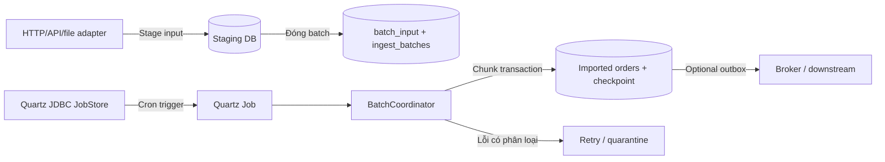
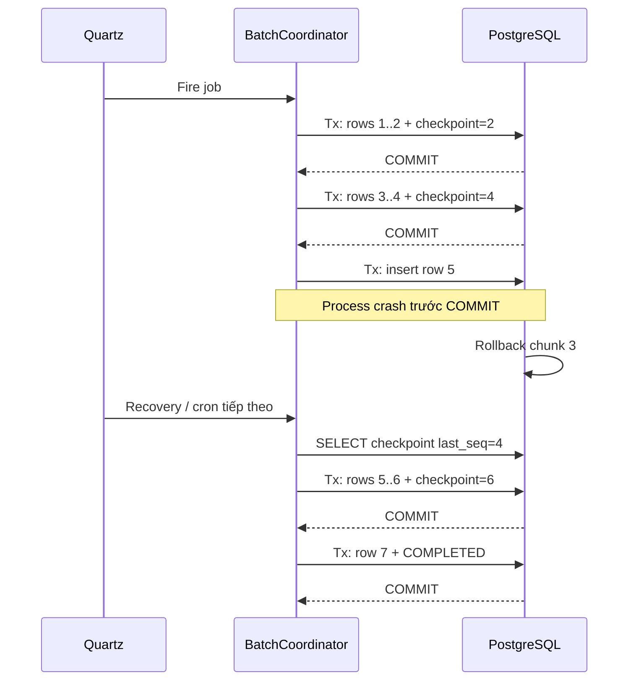

# Lập lịch Quartz để khởi chạy batch có checkpoint và khả năng chạy lại

Trong một hệ thống tích hợp Spring Boot, ứng dụng có thể phải định kỳ lấy dữ liệu từ HTTP API của đối tác, import đơn hàng từ cơ sở dữ liệu trung gian, cập nhật cache và phát kết quả sang message broker. Một batch xử lý hàng chục nghìn bản ghi khó tránh khỏi sự cố: ứng dụng bị restart, database timeout, đối tác gửi lại dữ liệu, hoặc hai instance cùng thức dậy khi đến giờ chạy. Nếu mỗi lần chạy bắt đầu lại từ đầu và không nhận diện bản ghi đã xử lý, batch có thể tạo dữ liệu trùng; nếu chỉ giữ tiến độ trong bộ nhớ, lần restart có thể bỏ sót công việc.

Bài thực hành của chương **Thực hành tổng hợp** trong mô-đun `SPRING_BOOT_INTEGRATION` xây dựng một luồng **Quartz khởi chạy batch, checkpoint lưu trong database và xử lý lại an toàn**. Mục tiêu là quản lý đồng thời lịch chạy, tính toàn vẹn dữ liệu, lỗi/retry, chống trùng, kiểm thử và quan sát. Ví dụ dùng Java, Spring Boot, Quartz JDBC JobStore, Spring JDBC và PostgreSQL; tên bảng/class do ứng dụng tự định nghĩa. Các giá trị cấu hình chỉ để minh họa và cần điều chỉnh theo phiên bản Spring Boot/Quartz, hạ tầng và SLA thực tế.

## 1. Bài toán và tiêu chí hoàn thành

Giả sử một đối tác đẩy dữ liệu đơn hàng vào bảng staging `batch_input`. Mỗi lô có `batch_id`, các dòng có thứ tự `seq`, mã đơn ngoài hệ thống `external_order_id` và số tiền. Khi bên nhận hoàn tất nạp lô, nó đánh dấu lô là `CLOSED`; từ đó danh sách bản ghi của lô là **bất biến**. Cứ năm phút, Quartz kích hoạt một job tìm các lô chưa hoàn tất rồi nhập từng phần vào `imported_orders`.

Yêu cầu:

1. Mỗi batch có thể gồm hàng nghìn bản ghi; **không giữ một transaction DB xuyên toàn bộ batch**.
2. Mỗi chunk commit cả dữ liệu đã import lẫn checkpoint; sau crash chỉ cần chạy lại từ checkpoint gần nhất.
3. Một `external_order_id` của cùng đối tác không được tạo hai đơn dù job được kích hoạt lại hoặc dữ liệu nguồn chứa bản sao.
4. Hai instance Spring Boot chạy chung Quartz cluster hoặc một tác vụ được người vận hành kích hoạt lại không được làm hỏng tiến độ.
5. Có thể phân biệt lỗi tạm thời cần retry với dữ liệu sai cần xử lý riêng.
6. Trạng thái tiến độ quan sát được bằng SQL/metrics; có thể restart/replay có kiểm soát.



**Giới hạn trách nhiệm:** Quartz chịu trách nhiệm *khi nào gọi job* và lưu trạng thái lịch chạy. Checkpoint nghiệp vụ chịu trách nhiệm *đã xử lý đến đâu và có thể chạy lại thế nào*. Hai vai trò có thể cùng dùng PostgreSQL nhưng phải có mô hình dữ liệu và transaction được hiểu riêng.

### 1.1. Chọn nghĩa chính xác của “chạy lại”

| Loại chạy lại | Nguyên nhân | Cách xử lý mong muốn |
| --- | --- | --- |
| Retry chunk | SQL timeout, tiến trình chết trong một chunk | Transaction chunk rollback; lần sau đọc lại chunk đó |
| Resume batch | Một số chunk đã commit, job bị dừng | Đọc `last_seq` đã commit rồi tiếp tục |
| Re-trigger cùng batch | Cron đến giờ, manual trigger hoặc Quartz recovery | Không tạo side effect trùng; batch `COMPLETED` được bỏ qua |
| Replay batch đã xong | Cần chạy lại vì sửa nghiệp vụ hoặc đổi mapping | Phải có yêu cầu rõ; không tự xóa checkpoint rồi import chồng |
| Backfill dữ liệu đến muộn | Dòng mới xuất hiện sau khi lô được đóng | Tạo batch khác hoặc cơ chế quét bù theo quy tắc riêng |

Mục tiêu **effectively once ở database đích** khác với “job chỉ thực thi một lần”. Quartz có thể gọi job nhiều lần, nhưng transaction và unique constraint giúp kết quả nghiệp vụ không bị nhân đôi.

## 2. Vì sao chỉ dùng Quartz JobDataMap không đủ làm checkpoint?

Quartz có `JobDetail`, `Trigger`, `Scheduler` và `JobExecutionContext`:

| Thành phần | Vai trò trong thực hành |
| --- | --- |
| `JobDetail` | Định nghĩa class job, key và một số metadata |
| `CronTrigger` | Quy định thời điểm gọi job, timezone và quy tắc khi lỡ lịch |
| `Scheduler` | Điều phối job, thread và trạng thái lịch chạy |
| JDBC `JobStore` | Lưu job/trigger trong các bảng Quartz; hỗ trợ cluster và recovery theo cấu hình |
| `JobDataMap` | Truyền tham số cho job; một số cơ chế có thể persist dữ liệu giữa lần thực thi |
| **Business checkpoint** | Ghi chunk nào đã commit, cutoff nào đang xử lý, lỗi và trạng thái nghiệp vụ |

Không dùng một counter trong `JobDataMap` làm checkpoint duy nhất của batch tài chính/đơn hàng. Ngay cả với `@PersistJobDataAfterExecution`, việc Quartz lưu JobDataMap sau khi job chạy **không được commit nguyên tử** với những row nghiệp vụ do `JdbcTemplate` cập nhật. Nếu DB đã ghi dữ liệu nhưng tiến trình chết trước khi Quartz persist counter, khi chạy lại vẫn có thể xử lý lại. Nếu counter được ghi trước khi DB hoàn tất, có thể bỏ sót dòng.

**Quy tắc:** đưa checkpoint và thay đổi nghiệp vụ quan trọng vào **cùng một local database transaction** nếu có thể; dựa vào unique constraint để bảo vệ các lần retry. Quartz JobStore vẫn cần riêng để không mất lịch và để cluster chỉ chọn worker chạy job phù hợp.

## 3. Thiết kế dữ liệu nguồn bất biến và checkpoint

Ví dụ chọn **một batch đã đóng**, không cho phép chèn/sửa/xóa dòng khi `ingest_batches.status='CLOSED'`. Mỗi dòng có `seq` nguyên tăng theo phạm vi `batch_id`; `seq` không nhất thiết liên tục nhưng phải có thứ tự xác định.

Điều kiện “đóng trước khi chạy” rất quan trọng: nếu chỉ dùng `WHERE id > last_id` trên bảng tiếp tục được insert đồng thời, transaction cấp ID 101 có thể commit sau transaction ID 102; job tiến tới 102 sẽ bỏ sót 101. Với dữ liệu ngoài có thể đến muộn, cần một cutoff/watermark có đảm bảo riêng, quét bù hoặc tạo batch tiếp theo.

### 3.1. Schema PostgreSQL minh họa

```sql
-- Một batch chỉ chuyển sang CLOSED khi mọi dòng đã được ghi và commit.
CREATE TABLE ingest_batches (
    batch_id VARCHAR(120) PRIMARY KEY,
    status VARCHAR(20) NOT NULL,
    closed_at TIMESTAMPTZ,
    CONSTRAINT chk_ingest_status
        CHECK (status IN ('OPEN', 'CLOSED'))
);

CREATE TABLE batch_input (
    batch_id VARCHAR(120) NOT NULL
        REFERENCES ingest_batches(batch_id),
    seq BIGINT NOT NULL,
    partner_id VARCHAR(80) NOT NULL,
    external_order_id VARCHAR(160) NOT NULL,
    amount NUMERIC(18, 2) NOT NULL,
    PRIMARY KEY (batch_id, seq),
    CONSTRAINT chk_batch_input_seq CHECK (seq > 0)
);

CREATE TABLE imported_orders (
    partner_id VARCHAR(80) NOT NULL,
    external_order_id VARCHAR(160) NOT NULL,
    amount NUMERIC(18, 2) NOT NULL,
    source_batch_id VARCHAR(120) NOT NULL,
    source_seq BIGINT NOT NULL,
    imported_at TIMESTAMPTZ NOT NULL DEFAULT NOW(),
    PRIMARY KEY (partner_id, external_order_id)
);

CREATE TABLE batch_checkpoint (
    batch_id VARCHAR(120) PRIMARY KEY
        REFERENCES ingest_batches(batch_id),
    snapshot_max_seq BIGINT NOT NULL,
    last_seq BIGINT NOT NULL DEFAULT 0,
    status VARCHAR(20) NOT NULL DEFAULT 'READY',
    last_error VARCHAR(500),
    updated_at TIMESTAMPTZ NOT NULL DEFAULT NOW(),
    CONSTRAINT chk_checkpoint_status
        CHECK (status IN ('READY', 'RUNNING', 'COMPLETED', 'FAILED')),
    CONSTRAINT chk_checkpoint_seq
        CHECK (last_seq >= 0 AND last_seq <= snapshot_max_seq)
);

CREATE INDEX ix_batch_input_read
    ON batch_input (batch_id, seq);
```

`batch_input` dùng primary key `(batch_id, seq)` để truy vấn keyset theo thứ tự. `imported_orders` dùng primary key `(partner_id, external_order_id)` để một mã đơn của một đối tác không được import hai lần. `batch_checkpoint` lưu điểm đã commit cuối cùng của mỗi batch và cutoff `snapshot_max_seq` cố định.

Schema chưa tự cấm ứng dụng sửa `batch_input` sau khi đóng lô; đó là một **invariant phải được bảo đảm bởi service nạp nguồn, quyền DB hoặc trigger/ràng buộc vận hành**. Trong sản phẩm thật nên đặt quyền ghi khác nhau cho giai đoạn staging và processing, và bảo đảm việc chuyển `OPEN → CLOSED` xảy ra sau mọi insert liên quan đã commit.

Nếu partner có thể gửi lại **cùng mã đơn với số tiền khác**, không được coi đó là duplicate bình thường. Ví dụ xử lý chunk ở phần sau sẽ kiểm tra nội dung hiện có và báo lỗi hợp đồng khi phát hiện xung đột.

### 3.2. Khởi tạo checkpoint một lần cho batch đã đóng

```sql
INSERT INTO batch_checkpoint (
    batch_id, snapshot_max_seq, last_seq, status
)
SELECT b.batch_id, COALESCE(MAX(i.seq), 0), 0, 'READY'
FROM ingest_batches b
LEFT JOIN batch_input i ON i.batch_id = b.batch_id
WHERE b.batch_id = :batch_id
  AND b.status = 'CLOSED'
GROUP BY b.batch_id
ON CONFLICT (batch_id) DO NOTHING;
```

Đây là PostgreSQL SQL; `:batch_id` là tham số bind trong `NamedParameterJdbcTemplate`, không phải placeholder chạy trực tiếp trong `psql`. Lệnh chỉ thêm checkpoint nếu batch đã `CLOSED` và chưa có checkpoint. Khi worker restart, `ON CONFLICT DO NOTHING` giữ nguyên `last_seq`, tránh reset progress.

Nếu batch không có dòng, `snapshot_max_seq=0` và lần chạy sau có thể chuyển `COMPLETED` ngay. Nếu cần sửa input của batch đã đóng, **không** cập nhật `snapshot_max_seq` âm thầm; hãy tạo phiên bản batch mới hoặc quy trình replay minh bạch.

### 3.3. Một checkpoint tốt cần ghi những gì?

| Trường | Ý nghĩa |
| --- | --- |
| `batch_id` | Xác định dữ liệu nguồn/bộ quy tắc đã đóng |
| `snapshot_max_seq` | Cận trên bất biến của lần import |
| `last_seq` | Seq lớn nhất đã xử lý và commit cùng kết quả |
| `status` | READY/RUNNING/COMPLETED/FAILED cho vận hành |
| `last_error` | Lỗi gần nhất đã rút gọn, không chứa secret/PII |
| `updated_at` | Phát hiện batch đứng lâu, cảnh báo SLA |

Một checkpoint có ích chỉ khi người vận hành biết nó gắn với **phiên bản dữ liệu nguồn, quy tắc chuyển đổi và identity của batch**. Nếu thay đổi mapping, import lại cùng input có thể tạo dữ liệu khác. Có thể bổ sung `mapping_version`, checksum/snapshot ID và tổng số dòng dự kiến khi bài toán yêu cầu audit nghiêm ngặt.

## 4. Khai báo Quartz trong Spring Boot

Ví dụ Gradle, với dependency versions được quản lý bởi Spring Boot tương thích:

```gradle
dependencies {
    implementation 'org.springframework.boot:spring-boot-starter-quartz'
    implementation 'org.springframework.boot:spring-boot-starter-jdbc'
    runtimeOnly 'org.postgresql:postgresql'
    testImplementation 'org.springframework.boot:spring-boot-starter-test'
}
```

Quartz chạy được với RAMJobStore để thử nghiệm, nhưng nếu cần job/trigger tồn tại qua restart và nhiều instance phối hợp, dùng **JDBC JobStore**. Ví dụ `application.yml`:

```yaml
spring:
  quartz:
    scheduler-name: integration-batch-scheduler
    job-store-type: jdbc
    jdbc:
      initialize-schema: never
    overwrite-existing-jobs: false
    properties:
      org.quartz.scheduler.instanceId: AUTO
      org.quartz.jobStore.isClustered: true
      org.quartz.jobStore.clusterCheckinInterval: 20000
      org.quartz.jobStore.misfireThreshold: 60000
      org.quartz.threadPool.threadCount: 3
  datasource:
    url: jdbc:postgresql://localhost:5432/integration
    username: integration_app
    password: change-me-in-secret-store
```

Đây là ví dụ một môi trường demo dùng cùng database cho Quartz tables và dữ liệu nghiệp vụ. Trong production, nạp password qua secret manager/environment và có thể dùng `@QuartzDataSource` để chỉ định datasource riêng cho scheduler. Các bảng **Quartz JDBC** (thường tiền tố `QRTZ_`) phải được tạo từ schema phù hợp với Quartz/DB đã triển khai qua migration có kiểm soát. `initialize-schema: never` ngăn Spring Boot tạo lại bảng; không dùng việc khởi tạo schema phá dữ liệu mỗi lần khởi động ở production.

Lưu ý khi chạy cluster:

- Tất cả instance cần dùng **cùng JDBC JobStore và cùng scheduler name**, nhưng mỗi instance có ID duy nhất (ví dụ `AUTO`).
- Các node cần kết nối ổn định đến DB; clock đồng bộ và tham số cluster phù hợp. Bảo đảm scheduler không dùng `RAMJobStore` ở một instance do cấu hình thiếu.
- Không tự set `org.quartz.jobStore.class` mâu thuẫn với JobStore được Spring Boot cấu hình từ `DataSource`; cách tích hợp và tên lớp phụ thuộc phiên bản.
- Job/trigger có **JobKey/TriggerKey ổn định**. Nếu nhiều replica cùng đăng ký job lúc start, cần kiểm chứng hành vi đăng ký/overwrite của phiên bản đang dùng; triển khai thay đổi lịch qua một nguồn điều khiển rõ ràng.
- `overwrite-existing-jobs: false` giúp tránh tự ý thay trigger đã lưu trong JobStore khi restart. Khi cần đổi cron, thực hiện migration/reschedule có chủ đích, không giả định chỉnh code sẽ đổi lịch đang lưu.

**Không đánh đồng Quartz JDBC JobStore với business checkpoint.** Quartz phục hồi việc kích hoạt job; checkpoint riêng mới cho biết những thay đổi dữ liệu nào đã commit.

### 4.1. Đăng ký JobDetail, CronTrigger và chính sách misfire

```java
@Configuration(proxyBeanMethods = false)
public class ImportQuartzConfiguration {

    @Bean
    JobDetail partnerImportJobDetail() {
        return JobBuilder.newJob(PartnerImportQuartzJob.class)
                .withIdentity("partner-import", "integration")
                .requestRecovery(true)
                .storeDurably()
                .build();
    }

    @Bean
    Trigger partnerImportTrigger(JobDetail partnerImportJobDetail) {
        return TriggerBuilder.newTrigger()
                .withIdentity("partner-import-cron", "integration")
                .forJob(partnerImportJobDetail)
                .withSchedule(CronScheduleBuilder
                        .cronSchedule("0 0/5 * * * ?")
                        .inTimeZone(TimeZone.getTimeZone("Asia/Ho_Chi_Minh"))
                        .withMisfireHandlingInstructionDoNothing())
                .build();
    }

    @Bean
    SchedulerFactoryBeanCustomizer batchSchedulerContext(
            BatchCoordinator coordinator) {
        return scheduler ->
                scheduler.setSchedulerContextAsMap(
                        Map.of("batchCoordinator", coordinator));
    }
}
```

Các import tiêu biểu: `org.quartz.JobBuilder`, `org.quartz.JobDetail`, `org.quartz.Trigger`, `org.quartz.TriggerBuilder`, `org.quartz.CronScheduleBuilder`, `org.springframework.boot.autoconfigure.quartz.SchedulerFactoryBeanCustomizer`, `java.util.TimeZone` và `java.util.Map`. Trong Spring Boot phù hợp, các bean `JobDetail`/`Trigger` được Quartz auto-configuration đăng ký khi scheduler khởi tạo.

Biểu thức `0 0/5 * * * ?` chạy vào phút chia hết cho 5, giây 0, theo timezone được chỉ định. Quy tắc `DoNothing` bỏ qua các lần bị lỡ do scheduler dừng; **không bỏ qua batch đang dở**, vì lần cron kế tiếp vẫn tìm batch chưa hoàn thành từ database. Nếu nghiệp vụ cần chạy bù một lần ngay khi scheduler trở lại, xem xét `withMisfireHandlingInstructionFireAndProceed()` và thử các tình huống restart. Không nên dồn mọi lần cron đã lỡ thành nhiều bản thực thi cùng nội dung.

`requestRecovery(true)` cho phép Quartz tạo lần khôi phục cho job đang thực thi khi một scheduler instance chết trong những điều kiện mà JobStore hỗ trợ. **Không dựa vào cờ này để lưu tiến độ từng dòng**: recovery có thể chạy lại job, nên batch luôn phải idempotent.

`SchedulerFactoryBeanCustomizer` ở ví dụ đặt Spring bean `BatchCoordinator` vào **SchedulerContext của từng process**. Điều này cho phép Quartz job lấy service được inject bởi Spring mà không ghi một Spring bean (không serializable) vào `JobDataMap` được lưu trong JDBC JobStore. Cần xác minh giao diện customizer tương ứng nếu dùng phiên bản Spring Boot khác.

## 5. Quartz Job chỉ làm nhiệm vụ điều phối

Để Quartz tạo được instance job bằng cơ chế mặc định, ví dụ dùng class có constructor không tham số và lấy Spring service qua `SchedulerContext`:

```java
@DisallowConcurrentExecution
public class PartnerImportQuartzJob implements Job {

    @Override
    public void execute(JobExecutionContext context)
            throws JobExecutionException {
        try {
            BatchCoordinator coordinator = (BatchCoordinator)
                    context.getScheduler()
                            .getContext()
                            .get("batchCoordinator");

            if (coordinator == null) {
                throw new IllegalStateException("BatchCoordinator missing");
            }
            for (String batchId : coordinator.findRunnableBatchIds(3)) {
                if (Thread.currentThread().isInterrupted()) {
                    return; // Lần sau tiếp tục từ checkpoint đã commit.
                }
                coordinator.processBatch(batchId, 20, 100);
            }
        } catch (Exception exception) {
            throw new JobExecutionException(
                    "Partner import failed; checkpoint remains durable",
                    exception);
        }
    }
}
```

Imports chính: `org.quartz.Job`, `org.quartz.JobExecutionContext`, `org.quartz.JobExecutionException` và `org.quartz.DisallowConcurrentExecution`. Với `findRunnableBatchIds(3)`, mỗi lần cron thử tối đa ba batch. `processBatch(batchId, 20, 100)` giới hạn tối đa 20 chunk, mỗi chunk nhiều nhất 100 dòng, giúp một lần Quartz fire không giữ worker thread quá lâu. Các batch còn dở được chạy tiếp ở lần cron sau.

`@DisallowConcurrentExecution` ngăn các lần chạy song song **của cùng JobDetail/JobKey** trong scheduler được điều phối đúng, kể cả cluster JDBC hợp lệ. Nó không cấm hai JobDetail có key khác nhau nhưng cùng gọi `BatchCoordinator`, không khóa các lời gọi trực tiếp từ REST admin endpoint và không thay thế khóa DB cho cùng `batch_id`.

Khi job ném `JobExecutionException`, Quartz ghi nhận lỗi; **không mặc định hiểu là job sẽ tự retry ngay**. Ví dụ để cron kế tiếp khởi động lại, trong khi checkpoint giữ vị trí đã commit. Nếu chọn `refireImmediately` hoặc dùng retry advice, cần giới hạn số lần và backoff để tránh vòng lặp nóng khi database hỏng hoặc dữ liệu có lỗi.

Job nhận một Spring service qua SchedulerContext; mọi giao dịch database nằm trong service. Phân chia này giúp job có trách nhiệm hẹp và có thể test batch logic độc lập với Quartz.

## 6. BatchCoordinator: commit dữ liệu và checkpoint trong một transaction chunk

Trong ví dụ, `BatchCoordinator` sử dụng `JdbcTemplate` và `TransactionTemplate`. Điều này cố ý tránh lỗi thường gặp khi một phương thức `@Transactional` bị gọi qua `this.method()` trong cùng bean: Spring proxy mặc định không intercept self-invocation. `TransactionTemplate` cho phép quy định ranh giới transaction ngay nơi thực thi từng chunk.

Phần dưới giả định các bảng ở mục 3 cùng nằm trong **một PostgreSQL transaction manager**. Nếu checkpoint ở DB A còn dữ liệu đích ở DB B độc lập, local transaction **không thể** commit nguyên tử cả hai; cần thiết kế XA thực sự hoặc outbox/idempotency và recovery riêng.

### 6.1. Tìm batch còn phải chạy và khởi tạo checkpoint

```java
@Service
public class BatchCoordinator {
    private final JdbcTemplate jdbc;
    private final TransactionTemplate tx;

    public BatchCoordinator(
            JdbcTemplate jdbc,
            PlatformTransactionManager transactionManager) {
        this.jdbc = jdbc;
        this.tx = new TransactionTemplate(transactionManager);
    }

    public List<String> findRunnableBatchIds(int limit) {
        if (limit < 1) {
            throw new IllegalArgumentException("limit must be positive");
        }
        return jdbc.query(
                """
                SELECT b.batch_id
                  FROM ingest_batches b
                  LEFT JOIN batch_checkpoint c ON c.batch_id = b.batch_id
                 WHERE b.status = 'CLOSED'
                   AND (c.batch_id IS NULL
                        OR c.status IN ('READY', 'RUNNING'))
                 ORDER BY b.closed_at, b.batch_id
                 LIMIT ?
                """,
                (rs, rowNum) -> rs.getString("batch_id"),
                limit);
    }

    public void processBatch(
            String batchId, int maxChunks, int chunkSize) {
        if (maxChunks < 1 || chunkSize < 1 || chunkSize > 1000) {
            throw new IllegalArgumentException("Invalid batch limits");
        }
        tx.executeWithoutResult(status -> initializeCheckpoint(batchId));

        for (int chunk = 0; chunk < maxChunks; chunk++) {
            if (Thread.currentThread().isInterrupted()) {
                return;
            }
            Integer processed = tx.execute(
                    status -> processNextChunk(batchId, chunkSize));
            if (processed == null || processed == 0) {
                return;
            }
        }
    }

    private void initializeCheckpoint(String batchId) {
        jdbc.update(
                """
                INSERT INTO batch_checkpoint
                    (batch_id, snapshot_max_seq, last_seq, status)
                SELECT b.batch_id, COALESCE(MAX(i.seq), 0), 0, 'READY'
                FROM ingest_batches b
                LEFT JOIN batch_input i ON i.batch_id = b.batch_id
                WHERE b.batch_id = ? AND b.status = 'CLOSED'
                GROUP BY b.batch_id
                ON CONFLICT (batch_id) DO NOTHING
                """,
                batchId);
    }

    // processNextChunk và record khai báo ở mục tiếp theo.
}
```

Đây là **phần đầu** của cùng class `BatchCoordinator`; phương thức `processNextChunk` và record trợ giúp ở mục 6.2 được đặt trong class này khi ghép code. Các import chính: `org.springframework.jdbc.core.JdbcTemplate`, `org.springframework.transaction.PlatformTransactionManager`, `org.springframework.transaction.support.TransactionTemplate`, `org.springframework.stereotype.Service` và `java.util.List`.

Trong một dự án có nhiều transaction manager, hãy inject **đúng manager quản lý cả checkpoint và bảng đích** bằng `@Qualifier` hoặc `TransactionTemplate` bean có tên riêng. Nếu dùng default manager cho một DB khác, code vẫn compile nhưng mất bảo đảm atomicity.

### 6.2. Đọc, ghi và checkpoint cùng trong transaction

Các thành viên dưới đây đặt **bên trong cùng class `BatchCoordinator`** ở mục 6.1:

```java
private int processNextChunk(String batchId, int chunkSize) {
    Checkpoint cp = jdbc.queryForObject(
            """
            SELECT last_seq, snapshot_max_seq, status
              FROM batch_checkpoint
             WHERE batch_id = ?
             FOR UPDATE
            """,
            (rs, rowNum) -> new Checkpoint(
                    rs.getLong("last_seq"),
                    rs.getLong("snapshot_max_seq"),
                    rs.getString("status")),
            batchId);

    if (cp == null) {
        throw new IllegalStateException("Checkpoint not found");
    }
    if ("COMPLETED".equals(cp.status())) {
        return 0;
    }
    if ("FAILED".equals(cp.status())) {
        throw new IllegalStateException(
                "Batch requires operator intervention");
    }
    if (cp.lastSeq() == cp.snapshotMaxSeq()) {
        jdbc.update(
                """
                UPDATE batch_checkpoint
                   SET status = 'COMPLETED', updated_at = NOW()
                 WHERE batch_id = ?
                """,
                batchId);
        return 0;
    }

    List<SourceRow> rows = jdbc.query(
            """
            SELECT seq, partner_id, external_order_id, amount
              FROM batch_input
             WHERE batch_id = ?
               AND seq > ?
               AND seq <= ?
             ORDER BY seq
             LIMIT ?
            """,
            (rs, rowNum) -> new SourceRow(
                    rs.getLong("seq"),
                    rs.getString("partner_id"),
                    rs.getString("external_order_id"),
                    rs.getBigDecimal("amount")),
            batchId, cp.lastSeq(), cp.snapshotMaxSeq(), chunkSize);

    if (rows.isEmpty()) {
        throw new IllegalStateException(
                "Immutable batch input unexpectedly missing");
    }

    for (SourceRow row : rows) {
        int inserted = jdbc.update(
                """
                INSERT INTO imported_orders
                    (partner_id, external_order_id, amount,
                     source_batch_id, source_seq)
                VALUES (?, ?, ?, ?, ?)
                ON CONFLICT (partner_id, external_order_id) DO NOTHING
                """,
                row.partnerId(), row.externalOrderId(),
                row.amount(), batchId, row.seq());

        if (inserted == 0) {
            BigDecimal existing = jdbc.queryForObject(
                    """
                    SELECT amount FROM imported_orders
                     WHERE partner_id = ? AND external_order_id = ?
                    """,
                    BigDecimal.class,
                    row.partnerId(), row.externalOrderId());
            if (existing == null ||
                    existing.compareTo(row.amount()) != 0) {
                throw new DataConflictException(
                        "Duplicate business key has different amount");
            }
        }
    }

    long newLastSeq = rows.get(rows.size() - 1).seq();
    jdbc.update(
            """
            UPDATE batch_checkpoint
               SET last_seq = ?,
                   status = ?,
                   last_error = NULL,
                   updated_at = NOW()
             WHERE batch_id = ?
            """,
            newLastSeq,
            newLastSeq >= cp.snapshotMaxSeq()
                    ? "COMPLETED" : "RUNNING",
            batchId);
    return rows.size();
}

private record Checkpoint(
        long lastSeq, long snapshotMaxSeq, String status) {}

private record SourceRow(
        long seq, String partnerId,
        String externalOrderId, BigDecimal amount) {}

private static final class DataConflictException
        extends RuntimeException {
    DataConflictException(String message) {
        super(message);
    }
}
```

Import bổ sung: `java.math.BigDecimal`. Thực thi transaction theo `TransactionTemplate` là phần then chốt. Khi PostgreSQL xử lý:

1. `SELECT ... FOR UPDATE` khóa row checkpoint của `batch_id`. Job thứ hai đang chạy cùng batch phải đợi transaction này hoàn tất; sau đó sẽ đọc checkpoint mới.
2. Chọn tối đa `chunkSize` dòng với điều kiện `seq > last_seq` và `seq <= snapshot_max_seq`; không dùng `OFFSET`, vì offset lớn thường tốn chi phí và dễ sai nếu dữ liệu thay đổi.
3. Insert dữ liệu đích. `PRIMARY KEY(partner_id, external_order_id)` chặn insert trùng ngay trong DB, kể cả có hai request cạnh tranh. Nếu gặp key trùng nhưng số tiền khác, ném lỗi để **rollback chunk**, tránh âm thầm xem dữ liệu sai là đã xử lý.
4. Chỉ sau khi xử lý thành công tất cả row, cập nhật `last_seq` tới giá trị cuối cùng của chunk và commit **trong cùng transaction**.
5. Nếu crash trước commit, cả insert và checkpoint rollback; lần sau xử lý lại chunk. Nếu crash sau commit, cả hai vẫn tồn tại; lần sau bắt đầu sau `last_seq`.

Đoạn code coi `partner_id`, `external_order_id` và `amount` là nội dung hợp đồng của bản ghi. Với sự kiện có thêm currency, version, địa chỉ giao hàng hoặc trạng thái, cần so sánh **đầy đủ những field quyết định ý nghĩa nghiệp vụ**, hoặc lưu fingerprint payload chuẩn hóa; không chỉ so sánh số tiền khi các field khác có thể tạo xung đột.

Không thực hiện HTTP call, gửi email hoặc publish message broker ngay trong vòng lặp transaction này. Nếu cần phát event sau khi import, ghi bản ghi **outbox** trong cùng transaction với `imported_orders` và checkpoint, sau đó để relay phát ra ngoài sau commit. Như vậy retry một chunk có thể phát event từ outbox theo `event_id` ổn định, còn consumer phải idempotent.

### 6.3. Xử lý lỗi tạm thời và lỗi dữ liệu

Ví dụ `processBatch` phía trên để exception truyền ra Quartz, khiến job dừng ở chunk lỗi và lần cron tiếp theo sẽ tiếp tục từ `last_seq` đã commit. Trong môi trường thực tế, nên bổ sung xử lý lỗi **sau khi transaction chunk rollback**:

```java
// Ý tưởng bọc quanh tx.execute(...) trong processBatch:
try {
    Integer processed = tx.execute(
            status -> processNextChunk(batchId, chunkSize));
    if (processed == null || processed == 0) {
        return;
    }
} catch (RuntimeException failure) {
    boolean permanent = failure instanceof DataConflictException;
    String errorCode = failure.getClass().getSimpleName();

    tx.executeWithoutResult(status ->
            jdbc.update(
                    """
                    UPDATE batch_checkpoint
                       SET status = CASE
                               WHEN ? THEN 'FAILED'
                               ELSE status
                           END,
                           last_error = ?,
                           updated_at = NOW()
                     WHERE batch_id = ?
                    """,
                    permanent, errorCode, batchId));
    throw failure;
}
```

Đây là **đoạn thay thế** cho lệnh `tx.execute(...)` trong vòng `for` của `processBatch`, không khai báo song song hai lần xử lý chunk. Nó ghi trạng thái lỗi bằng transaction DB **mới**, vì transaction chunk vừa rollback. Khi lỗi tạm thời như mất kết nối DB, việc ghi `last_error` cũng có thể thất bại; log và metrics vẫn phải ghi được lỗi gốc, tránh làm mất nguyên nhân đầu tiên.

Với `DataConflictException`, trạng thái `FAILED` yêu cầu xem lại nguồn/đích trước khi tiếp tục. Với lỗi hạ tầng tạm thời, batch giữ `READY/RUNNING` để cron sau retry. Một hệ thống production cần bổ sung retry budget, `next_attempt_at`, phân loại SQLSTATE, backoff, dead-letter/quarantine theo policy, tránh thử mỗi năm phút vô hạn với cùng poison record.

**Không tự ý tăng `last_seq` qua bản ghi lỗi vĩnh viễn** để job “chạy xong”. Nếu được phép bỏ qua một record, phải ghi kết quả quarantine/bằng chứng lỗi và cập nhật checkpoint **trong cùng transaction**, có tiêu chí nghiệp vụ phê duyệt; nếu không thì mất dữ liệu âm thầm.

## 7. Phân biệt concurrency ở Quartz và concurrency ở dữ liệu

Có ít nhất bốn lớp cạnh tranh:

| Lớp | Tình huống | Bảo vệ chính |
| --- | --- | --- |
| Một Quartz JobDetail | Cron fire lần mới khi lần trước vẫn chạy | `@DisallowConcurrentExecution` |
| Nhiều Quartz nodes cùng JDBC JobStore | Hai scheduler tranh trigger | Clustered JDBC JobStore và instance ID đúng |
| Hai JobDetails/admin endpoint cùng xử lý một batch | Manual replay cùng lúc cron | `SELECT checkpoint FOR UPDATE`, claim/lease nếu cần |
| Hai event/batch cùng chỉ tới một business key | Nguồn gửi bản sao, nhiều partner feeds | Unique constraint, idempotency và kiểm tra payload |

`@DisallowConcurrentExecution` được áp dụng cho **cùng JobKey**, không phải mọi class `PartnerImportQuartzJob` trong toàn bộ JVM. Một HTTP endpoint gọi trực tiếp `coordinator.processBatch` cũng nằm ngoài Quartz concurrency guard. DB transaction và unique constraint là lớp bảo vệ cuối cùng.

Khi xử lý nhiều batch song song, khóa checkpoint theo từng `batch_id` cho phép xử lý các batch khác nhau đồng thời. Nếu chúng cùng insert một `(partner_id, external_order_id)`, unique constraint tại đích vẫn phân xử. Nếu thứ tự nhập dữ liệu có ý nghĩa nghiệp vụ (ví dụ trạng thái v1 rồi v2), cần thêm version/ordering rule; dedup theo key đơn thuần có thể bỏ qua update hợp lệ.

Nếu dùng **Quartz RAMJobStore** ở nhiều replica, mỗi replica có thể tự fire cùng một cron. Cấu hình `isClustered=true` chỉ có ý nghĩa khi dùng JDBC JobStore cluster đúng và cùng database; không phải công tắc biến mọi scheduler thành một cluster an toàn.

## 8. Một lần crash cụ thể: checkpoint giúp resume thế nào?

Giả sử batch `partner-feed-20261121` có bảy dòng với `seq=1..7`, chunk size bằng 2 và checkpoint ban đầu là `last_seq=0`:

| Lần thực thi | Thao tác | Checkpoint đã commit | Kết quả đích đã commit |
| --- | --- | --- | --- |
| Chunk 1 | Import seq 1, 2 → commit | 2 | 1, 2 |
| Chunk 2 | Import seq 3, 4 → commit | 4 | 1, 2, 3, 4 |
| Chunk 3 | Insert seq 5; process crash trước commit | **4** | Vẫn 1, 2, 3, 4 |
| Restart/Quartz fire tiếp | Đọc checkpoint 4; import seq 5, 6 → commit | 6 | 1..6 |
| Chunk cuối | Import seq 7 → commit | 7, `COMPLETED` | 1..7 |



Nếu tiến trình chết **sau khi DB đã commit chunk 3 nhưng trước khi nhận được kết quả commit**, ứng dụng có thể không biết chắc transaction đã thành công. Khi chạy lại, nó đọc checkpoint từ DB: nếu checkpoint là 6 thì không nhập lại 5/6; nếu vẫn là 4 thì transaction trước đã rollback hoặc chưa hoàn tất theo quan sát của DB và phải tiếp tục. Không tự đặt `last_seq` dựa trên log “đã bắt đầu insert row 5”.

Với bản ghi đích có side effect ngoài database như gọi HTTP tạo shipment, cùng một transaction SQL không thể rollback phía HTTP. Vì thế không gọi HTTP trực tiếp trong chunk; dùng **transactional outbox** và idempotency key để worker sau commit gửi yêu cầu, kiểm tra kết quả ở đích khi timeout.

### 8.1. Khác biệt giữa resume và replay

**Resume** là tiếp tục từ `last_seq` trong một batch chưa hoàn thành; đó là chức năng tự động thường ngày. **Replay** là cố tình xử lý lại dữ liệu đã đánh dấu `COMPLETED` vì sửa lỗi mapping, bổ sung trường mới hoặc thay đổi nghiệp vụ. Replay có thể cần phiên bản import mới, bảng đích tạm, kiểm tra diff trước khi ghi, hoặc thao tác idempotent/upsert có version; không thể mặc định làm như:

```sql
-- KHÔNG thực hiện tùy tiện trên production:
UPDATE batch_checkpoint
SET last_seq = 0, status = 'READY'
WHERE batch_id = 'partner-feed-20261121';
```

Lệnh reset ngây thơ có thể làm logic xử lý lại dữ liệu cũ bằng mapping mới, bỏ qua các update hợp lệ hoặc tạo thông báo trùng ở downstream. Thay vào đó cần quy trình replay được phê duyệt: xác nhận nguồn immutable, version của transformer, phạm vi bản ghi, ảnh hưởng tới business key, cách tránh side effect lặp và audit ai yêu cầu replay.

## 9. Luồng lấy dữ liệu HTTP và đóng lô an toàn

Ví dụ trên bắt đầu từ `batch_input` đã đóng. Trong một hệ thống tích hợp thực tế, dữ liệu có thể được lấy từ HTTP client của đối tác trước khi import. Hai loại checkpoint cần được phân biệt:

| Loại | Mục đích | Ví dụ |
| --- | --- | --- |
| **Acquisition checkpoint** | Đã tải đến trang/cursor nào của API đối tác | `next_page_token`, ETag, source snapshot ID |
| **Processing checkpoint** | Đã commit đến dòng nào vào database đích | `batch_checkpoint.last_seq` |

Một quy trình nhập liệu an toàn:

1. Tạo `ingest_batches(batch_id, status='OPEN')` và nguồn cursor/snapshot ID. Nếu API hỗ trợ idempotent pagination hoặc snapshot token, lưu nó bền vững.
2. Dùng `RestClient` hoặc `WebClient` gọi từng trang với connect/read timeout, retry có giới hạn, xử lý `429 Retry-After` và authentication riêng theo partner.
3. Ghi dữ liệu trang vào staging với unique key `(batch_id, seq)` hoặc source record ID ổn định; commit cùng acquisition cursor theo contract để tránh mất trang khi crash.
4. Kiểm tra đủ trang, checksum/count nếu upstream cung cấp, rồi chuyển batch sang `CLOSED` **sau khi mọi dữ liệu nguồn đã commit**. Không cho thay đổi dòng của batch đã đóng.
5. Quartz batch processor chỉ xử lý lô `CLOSED`; HTTP call không chạy bên trong transaction chunk import.

Nếu API upstream có phân trang offset trên dữ liệu luôn thay đổi, dữ liệu có thể bị lặp hoặc thiếu giữa các page. Cần cơ chế snapshot/version, stable cursor hoặc đọc bù theo watermark và event ID. Không thể chỉ thêm Quartz để sửa tính không ổn định của nguồn.

Khi import xong cần phát sự kiện vào Kafka/RabbitMQ, ghi **outbox event** cùng transaction với bản ghi đích và checkpoint. Nếu relay bị lỗi, nó có thể publish lại cùng `eventId`; consumer dùng unique key hoặc `processed_events` để loại bỏ tác dụng lặp.

## 10. Xử lý poison record, dữ liệu đến muộn và batch quá lớn

### 10.1. Poison record

Một bản ghi vi phạm schema hoặc business invariant có thể làm cùng chunk rollback mãi. Ví dụ mã đơn `E-500` có số tiền không khớp dữ liệu đã import trước đó.

Có hai cách xử lý cần chọn rõ:

- **Fail-fast toàn batch:** đánh dấu `FAILED`, giữ nguyên `last_seq`, báo lỗi cho người vận hành. Sửa nguồn hoặc đích theo hợp đồng, xác minh rồi resume.
- **Quarantine từng bản ghi:** ghi bản ghi lỗi cùng nguyên nhân và source ID vào bảng `batch_quarantine` trong **cùng transaction** với checkpoint vượt qua dòng đó, nếu nghiệp vụ cho phép bỏ qua. Báo cáo batch phải thể hiện `COMPLETED_WITH_ERRORS` hoặc trạng thái tương đương thay vì báo thành công tuyệt đối.

Không đẩy một record lỗi vào một in-memory list rồi tăng checkpoint: nếu process chết, bằng chứng lỗi bị mất nhưng checkpoint đã vượt qua record. Tương tự, không dùng `catch(Exception e) { continue; }` trong transaction import vì dễ biến lỗi DB thành bỏ sót dữ liệu.

### 10.2. Dữ liệu đến muộn

Batch `CLOSED` phải bất biến. Nếu đối tác gửi thêm bản ghi cùng batch ID sau khi đã đóng, hệ thống cần từ chối, tạo batch bổ sung hoặc quy trình sửa có version. Việc append vào batch đã hoàn tất rồi chỉ tăng `snapshot_max_seq` có thể làm sai audit và phá giả định checkpoint. Nếu dữ liệu có timestamp/watermark, cần có quy tắc lateness và quét bù định kỳ với ID ổn định.

### 10.3. Batch dài và giới hạn kích thước chunk

Chunk quá lớn giảm overhead commit nhưng tăng thời gian giữ row lock, rollback cost, heap và connection usage. Chunk quá nhỏ tăng số transaction và truy vấn. Với ví dụ tối đa 100 dòng/chunk, tối đa 20 chunk/fire, một lần Quartz fire xử lý tối đa khoảng 2.000 dòng **mỗi batch**. Đây là giới hạn minh họa; quyết định dựa trên kích thước payload, latency DB, số index, lock contention và SLA.

Khi job phải xử lý vài triệu dòng, cân nhắc:

- Batch keyset paging và index phù hợp, tránh `OFFSET` lớn.
- Giới hạn số batch song song, concurrency và số kết nối DB.
- Dùng bulk/batch JDBC khi có thể nhưng vẫn giữ kiểm tra xung đột dữ liệu.
- Chia partition theo tenant/partner hoặc source ID với checkpoint **riêng cho từng partition**, tránh hai worker tranh cùng checkpoint.
- Dừng nhẹ giữa các lần fire: không giữ một Quartz worker thread hàng giờ nếu có thể chia thành phần công việc nhỏ.

Nếu cần reader/processor/writer, skip/retry policy, metadata job execution và partitioning phức tạp, **Spring Batch** là framework chuyên dụng hơn. Quartz vẫn có thể làm scheduler **khởi chạy Spring Batch Job**, còn Spring Batch quản lý `JobRepository`, `JobExecution`, `StepExecution` và `ExecutionContext`. Khi dùng kết hợp, hãy để **một** cơ chế sở hữu checkpoint của từng batch: không cập nhật đồng thời một checkpoint tự viết và Spring Batch `ExecutionContext` mà không có thiết kế nhất quán.

## 11. Misfire, restart, cluster và shutdown

Một job chạy theo cron có thể không được thực thi đúng giờ vì scheduler đang tắt, thiếu thread, DB JobStore lỗi hoặc hạ tầng đang deploy.

| Tình huống | Hành vi thiết kế |
| --- | --- |
| Scheduler tắt qua thời điểm cron | Misfire instruction quyết định bỏ qua hoặc chạy bù; **business backlog** vẫn nằm trong DB |
| JVM restart giữa chunk | DB rollback transaction chưa commit; Quartz lần sau resume theo checkpoint |
| Node A chết trong cluster | Quartz cluster có thể phát hiện và recovery job theo cấu hình; node khác tiếp tục |
| Node A nhận trigger nhưng nghẽn thread pool | Monitor trigger latency/misfire; không tạo thêm fire độc lập bằng scheduler khác |
| Admin và cron cùng gọi batch | DB row lock và unique key bảo vệ tiến độ/bản ghi |
| Nhiều batch tồn tại | Chọn số batch/chu kỳ có giới hạn và theo dõi oldest backlog |
| Deploy rolling update | Các node cần cùng schema/logic tương thích với checkpoint chưa xong |

`spring.quartz.wait-for-jobs-to-complete-on-shutdown` có thể được cân nhắc tùy phiên bản/config Spring Boot để đợi job kết thúc trong shutdown có kiểm soát. Tuy nhiên container orchestrator vẫn có **grace period hữu hạn**; nếu process bị kill, chunk chưa commit phải rollback và batch phải resume. Đừng biến graceful shutdown thành giả định rằng mọi job luôn kết thúc đầy đủ.

Tại thời điểm deploy thay đổi phiên bản transformer, checkpoint cũ có thể được tiếp tục bởi code mới. Cần chính sách tương thích: khóa version với `batch_id`, lưu mapping version ở checkpoint hoặc hoàn tất batch cũ trước khi đổi xử lý. Đối với contract dữ liệu thay đổi không tương thích, phải migrate/đánh dấu cần replay có kiểm soát.

### 11.1. Bẫy khi dùng cluster

Quartz JDBC cluster cần dùng đúng configuration liên quan scheduler/job store. Một vài lỗi thường thấy:

- Hai instance có `scheduler-name` khác nhau trên cùng DB rồi kỳ vọng chúng phối hợp như một scheduler.
- Một instance đang dùng RAMJobStore trong khi instance khác dùng JDBC JobStore.
- Bảng `QRTZ_` bị khởi tạo lại khi startup và mất các trigger đã lưu.
- Có nhiều JobDetail khác JobKey nhưng cùng quét source; `@DisallowConcurrentExecution` không bảo vệ chúng khỏi chạy đồng thời.
- Service xử lý batch được cấu hình ở một node nhưng thiếu ở node khác; Quartz fire tại node thiếu dependency và liên tục lỗi.

Với một job được admin kích hoạt bằng `scheduler.triggerJob(jobKey)`, Quartz dùng cùng JobDetail và cơ chế concurrency phù hợp. Nếu admin gọi thẳng `BatchCoordinator.processBatch(batchId,...)` ngoài Quartz, chỉ khóa checkpoint DB và unique constraint mới bảo vệ khỏi chạy song song.

## 12. Quan sát tiến độ và xử lý sự cố

Theo dõi riêng **lịch Quartz**, **tiến độ batch** và **tính nhất quán ở đích**:

| Chỉ số | Cách hiểu | Cảnh báo gợi ý |
| --- | --- | --- |
| Quartz trigger fired/misfired | Cron có được xử lý đúng chu kỳ? | Misfire tăng, scheduler node mất kết nối |
| Batch RUNNING age | Batch đang xử lý bao lâu từ lần cập nhật cuối? | `updated_at` quá cũ so với SLA |
| Batch backlog | Số lô CLOSED chưa COMPLETED/FAILED | Lô tồn đọng tăng liên tục |
| Chunk duration | Transaction đọc/ghi/checkpoint mất bao lâu? | p95 cao, DB lock contention |
| Rows scanned / imported / deduplicated | Số dòng đã duyệt, tạo mới, bỏ qua vì bản sao hợp lệ | Duplicate tăng bất thường |
| Failed/quarantined records | Dữ liệu lỗi hợp đồng cần xử lý | Không có xử lý trong SLA |
| Connection pool active/pending | Sức tải JDBC trong lúc batch chạy | Pool cạn, request HTTP chậm |
| Outbox lag, consumer lag | Các bước downstream sau import có theo kịp? | Import xong nhưng broker/consumer đang kẹt |

Ví dụ truy vấn tiến độ theo checkpoint (dùng khi chẩn đoán, không chạy tổng đếm toàn bảng quá thường xuyên):

```sql
SELECT c.batch_id, c.status,
       c.last_seq, c.snapshot_max_seq,
       COUNT(i.seq) AS total_input_rows,
       COUNT(i.seq) FILTER (
           WHERE i.seq <= c.last_seq
       ) AS scanned_rows,
       c.updated_at, c.last_error
  FROM batch_checkpoint c
  LEFT JOIN batch_input i
    ON i.batch_id = c.batch_id
   AND i.seq <= c.snapshot_max_seq
 GROUP BY c.batch_id, c.status, c.last_seq,
          c.snapshot_max_seq, c.updated_at, c.last_error
 ORDER BY c.updated_at;
```

Không dùng `last_seq / snapshot_max_seq` làm tỷ lệ % chính xác nếu `seq` có khoảng trống. Tỷ lệ số dòng **đã quét / tổng số dòng** ở truy vấn trên phù hợp hơn cho mục đích quan sát, dù vẫn có thể đắt khi dataset lớn. Với batch nhiều triệu dòng, lưu tổng số dòng và số dòng đã duyệt trong checkpoint hoặc bảng thống kê được cập nhật cùng transaction; không tính COUNT cho mỗi request dashboard.

Log nên có `batchId`, `jobKey`, `fireInstanceId`, `lastSeqBefore`, `lastSeqAfter`, `chunkSize`, `durationMs`, `attempt` và mã lỗi đã phân loại. Không log toàn bộ payload có thông tin khách hàng, token HTTP hoặc connection string chứa password. Nếu phát sự kiện sang broker, thêm event ID/correlation ID ổn định để nối trace.

### 12.1. Runbook khi batch đứng lâu

1. Xem Quartz có còn fire trigger và node scheduler nào đang hoạt động; kiểm tra misfire và thread pool.
2. Kiểm tra `ingest_batches` đã có lô CLOSED chưa; nếu đang OPEN, điều tra acquisition HTTP/adapter trước.
3. Đọc `batch_checkpoint`: status, `last_seq`, `snapshot_max_seq`, `updated_at` và `last_error`. Phân biệt job không được gọi với job cứ lỗi cùng một chunk.
4. Kiểm tra DB health, connection pool, row lock và transaction đang chờ. Nếu nhiều worker tranh cùng batch, xác minh JobKey, cluster config và lock checkpoint.
5. Nếu lỗi dữ liệu, xác định source row bằng `batch_id`/`seq` và so với target business key. Không tự xóa target/đẩy checkpoint vượt lỗi.
6. Khi đã sửa nguyên nhân, đưa batch từ FAILED về trạng thái chạy được **bằng thao tác có phân quyền và audit** nếu được phép; gọi Quartz để kích hoạt lại hoặc đợi cron, sau đó đối soát kết quả.

Một truy vấn tìm batch READY/RUNNING quá hạn:

```sql
SELECT batch_id, status, last_seq, snapshot_max_seq, updated_at
FROM batch_checkpoint
WHERE status IN ('READY', 'RUNNING')
  AND updated_at < NOW() - INTERVAL '30 minutes'
ORDER BY updated_at;
```

Đây chỉ là tiêu chí cảnh báo minh họa. Nếu cron chạy mỗi năm phút và mỗi lần chỉ được xử lý 20 chunk, một batch lớn có thể cần nhiều chu kỳ; SLA phải dựa trên tốc độ thực tế và thời gian chấp nhận của nghiệp vụ.

### 12.2. Manual trigger có kiểm soát

Một admin service có thể yêu cầu Quartz kích hoạt đúng JobDetail:

```java
public void triggerImport(Scheduler scheduler)
        throws SchedulerException {
    scheduler.triggerJob(
            JobKey.jobKey("partner-import", "integration"));
}
```

Imports: `org.quartz.Scheduler`, `org.quartz.SchedulerException`, `org.quartz.JobKey`. Phương thức này kích hoạt **job tìm các batch chưa hoàn tất**; nó không bảo đảm một batch cụ thể đã xử lý xong trước khi method trả về, và không đặt lại trạng thái COMPLETED. API admin phải có authentication/authorization, audit và rate limit. Để replay có mục tiêu, nên tạo một yêu cầu replay bền vững chứa batch ID, mapping version và lý do, sau đó worker xử lý theo workflow phê duyệt.

## 13. Kiểm thử tích hợp: chứng minh checkpoint và idempotency

Các kiểm thử hữu ích nên chạy trên PostgreSQL thật hoặc Testcontainers với schema của cả business và Quartz; test bằng mock `JdbcTemplate` không thể chứng minh transaction rollback, `FOR UPDATE`, unique constraint hoặc cluster behavior.

| Kịch bản | Kết quả cần chứng minh |
| --- | --- |
| Batch CLOSED có 7 dòng, chunk size 2 | Checkpoint tiến 0→2→4→6→7; cuối cùng COMPLETED |
| Crash giữa chunk thứ 3 trước DB commit | Chỉ hai chunk đầu tồn tại; resume xử lý phần còn lại, không mất dòng |
| Crash sau DB commit nhưng trước khi Quartz job trả về | Checkpoint đã ghi; Quartz recovery/re-fire không tạo bản ghi đích trùng |
| Cùng batch được trigger hai lần đồng thời | DB row lock tuần tự hóa tiến độ; kết quả không bị nhân đôi |
| Hai batch cùng chứa một external order với cùng payload | Target unique constraint giữ một row; checkpoint của cả hai có thể hoàn tất |
| Hai batch cùng business key nhưng số tiền khác | Chunk xung đột rollback; batch FAILED/quarantine, không bỏ qua sai dữ liệu |
| Batch chưa CLOSED | Không được khởi tạo checkpoint hoặc import |
| Batch CLOSED rỗng | Chuyển COMPLETED với `last_seq=0` và `snapshot_max_seq=0` |
| Nguồn cố bị sửa sau khi đóng | Invariant/constraint bảo vệ; test phát hiện lệch đầu vào |
| DB timeout trước commit | Không tăng checkpoint nếu insert chưa commit |
| Quartz scheduler down trong một chu kỳ | Lịch misfire theo chính sách; batch backlog còn và lần sau xử lý được |
| Hai Quartz instances cùng JDBC JobStore | Trigger do cluster điều phối; checkpoint vẫn đúng khi kill một instance |
| Poison row nằm giữa chunk | Không phát sinh partial commit; có cảnh báo và đường xử lý dữ liệu lỗi |
| Tăng số worker/concurrency lớn | Giới hạn transaction/chunk; không cạn JDBC pool hoặc deadlock kéo dài |
| Có outbox phát broker ở cuối chunk | Event và checkpoint commit cùng transaction; consumer chống bản phát trùng |

### 13.1. Ví dụ test resume bằng checkpoint

Ví dụ giả lập bằng các fixture/hàm kiểm thử do dự án triển khai:

```java
@Test
void resumesFromCommittedCheckpoint() {
    String batchId = "test-batch-42";
    insertClosedBatch(batchId, 7); // Dòng seq 1..7.

    coordinator.processBatch(batchId, 2, 2); // 2 chunk x 2 dòng.
    assertThat(checkpointLastSeq(batchId)).isEqualTo(4);
    assertThat(importedRowCount(batchId)).isEqualTo(4);

    // Giả lập ứng dụng ngừng giữa những lần fire:
    coordinator.processBatch(batchId, 10, 2);
    assertThat(checkpointLastSeq(batchId)).isEqualTo(7);
    assertThat(checkpointStatus(batchId)).isEqualTo("COMPLETED");
    assertThat(importedRowCount(batchId)).isEqualTo(7);

    // Re-trigger completed batch không tạo thêm row.
    coordinator.processBatch(batchId, 10, 2);
    assertThat(importedRowCount(batchId)).isEqualTo(7);
}
```

Đoạn này kiểm tra resume giữa các lần gọi `processBatch`, **chưa mô phỏng crash đúng lúc transaction đang chạy**. Các helper `insertClosedBatch`, `checkpointLastSeq`, `checkpointStatus`, `importedRowCount` là test fixture, không phải API Spring; `importedRowCount` chỉ phù hợp nếu fixture dùng business key riêng cho batch. Với test phân biệt crash-before-commit, cần fault injection ở ranh giới trước commit và kiểm tra lại database sau khi process bị kill hoặc transaction rollback.

### 13.2. Thử kill process thay vì chỉ ném exception

Test recovery có giá trị cao:

1. Khởi động PostgreSQL và ứng dụng Quartz với JDBC JobStore, chạy batch gồm nhiều chunk; bật logging `batchId/lastSeq`.
2. Chờ ít nhất một chunk commit, đặt fault injection làm chậm hoặc dừng tiến trình trong chunk kế tiếp.
3. Kill container/process **trước commit**, sau đó khởi động instance mới với **cùng database** và schema Quartz.
4. Chờ trigger recovery/cron hoặc gọi admin trigger. Đối chiếu target count, unique business keys và checkpoint để xác nhận không có mất/dư dữ liệu.
5. Lặp lại với fault injection **sau commit** nhưng trước khi Quartz ghi nhận job đã hoàn thành.
6. Thử hai scheduler nodes và kill node đang xử lý, kiểm tra node còn lại và tiến độ batch.

Đây là bài test hạ tầng cần điều phối container/fault injection và hiểu transaction boundary của driver, không thể thay bằng việc mock `Quartz Scheduler` trả “success”. Không cần giữ mọi test crash ở unit-test suite chạy mỗi commit; có thể đưa vào một nhóm integration/reliability test theo lịch CI.

### 13.3. Tách kiểm thử business logic và scheduler wiring

- **Unit test:** xác thực mapping source → target, so sánh duplicate, phân loại lỗi và giới hạn batch/chunk. Không mock một transaction rồi kết luận đã rollback.
- **DB integration test:** schema, chunk transaction, checkpoint, concurrency, unique constraint, rollback và resume.
- **Quartz integration test:** JobDetail/Trigger được đăng ký đúng, misfire config, JDBC JobStore, scheduler context, cluster và recovery.
- **End-to-end integration test:** HTTP acquisition → staging → CLOSED → Quartz → imported orders → outbox/broker, bao gồm timeout, retry và correlation ID.

Kiểm thử nên dùng source dataset nhỏ nhưng có **khoảng trống seq**, duplicate cùng key, duplicate khác payload và bản ghi ở ranh giới chunk; nếu chỉ có 1..N lý tưởng, nhiều lỗi về cursor không bị phát hiện.

## 14. Những sai lầm thường gặp

| Sai lầm | Hậu quả | Cách sửa |
| --- | --- | --- |
| Lưu duy nhất `lastSeq` vào biến Java | Restart làm mất tiến độ | Checkpoint bền vững trong DB |
| Dùng Quartz `JobDataMap` làm checkpoint business | Không atomic với insert đích | Commit target + checkpoint cùng transaction |
| Cập nhật checkpoint trước khi ghi thành công | Crash có thể bỏ sót dòng | Update checkpoint cuối chunk, cùng transaction |
| Ghi target rồi checkpoint trong hai transaction | Crash tạo khoảng không rõ kết quả | Một transaction nếu cùng DB; còn nhiều hệ thống thì idempotency |
| Dùng `OFFSET` trên tập nguồn thay đổi | Skip/duplicate do dữ liệu dịch chuyển | Stable snapshot và keyset cursor |
| Quét `id > last_id` khi dữ liệu còn commit lệch thứ tự | Bỏ sót bản ghi đến muộn | Đóng batch/snapshot hoặc watermark & quét bù |
| Bật `@DisallowConcurrentExecution` rồi bỏ unique constraint | Manual job/JobKey khác vẫn tạo duplicate | Khóa checkpoint + business unique key |
| Chỉ bật Quartz `isClustered=true` với RAMJobStore | Các node vẫn fire độc lập | JDBC JobStore cluster đúng |
| Giữ một DB transaction xuyên toàn batch | Lock và connection lâu, rollback lớn | Transaction theo chunk |
| Gọi HTTP/Kafka/SMTP trong transaction chunk | Remote side effect không rollback theo DB | Transactional outbox + idempotency |
| Job bắt mọi exception rồi tăng cursor | Mất dữ liệu lỗi không có dấu vết | Fail-fast hoặc quarantine bền cùng checkpoint |
| Quartz misfire được hiểu là batch bị xóa | Không có cơ chế nhận lại backlog | Mọi batch chưa COMPLETED còn trong DB |
| Reset COMPLETED về 0 để replay | Có thể phát lại tác dụng ngoài ý muốn | Replay có phiên bản, idempotency và audit |
| Chỉ test happy path/Quartz fire một lần | Bỏ qua lỗi crash, cluster, duplicate | Test rollback, recovery, concurrency và fault injection |

## 15. Checklist triển khai thực tế

1. **Dữ liệu nguồn:** có batch ID, source ID, thứ tự xác định, cutoff/snapshot và quy tắc đóng lô bất biến chưa?
2. **Scheduler:** Quartz đã dùng JDBC JobStore, tables đúng version, JobKey/TriggerKey ổn định, timezone/misfire và cluster config phù hợp chưa?
3. **Giao dịch:** insert/update nghiệp vụ và `last_seq` được commit trong cùng một DB transaction mỗi chunk chưa?
4. **Chống trùng:** business key có unique constraint, có phát hiện payload conflict và xử lý concurrent duplicate không?
5. **Giới hạn tải:** chunk size, số chunk mỗi fire, số batch cùng lúc, JDBC pool, SQL timeout và lock wait được kiểm soát chưa?
6. **Khởi động lại:** restart trước/sau commit, kill scheduler node và replay job có tiếp tục từ checkpoint bền vững chưa?
7. **Dữ liệu lỗi:** record sai có làm batch FAILED/quarantine với bằng chứng bền vững và đường tiếp tục hợp lệ không?
8. **Ranh giới khác DB:** HTTP acquisition, Redis cache, Kafka/RabbitMQ và email có timeout, outbox/retry/idempotency riêng theo hệ quả không?
9. **Quan sát:** thấy được trigger/misfire, backlog, chunk duration, last_seq, lỗi, duplicate và tuổi batch chưa xong không?
10. **Vận hành:** có runbook reset/replay có audit, phân quyền admin, migration schema, compatibility khi deploy và cảnh báo SLA không?

**Kết quả cần đạt của bài thực hành:** Quartz làm nhiệm vụ đánh thức batch đúng lịch và phục hồi lịch khi scheduler restart; dữ liệu nguồn có phạm vi bất biến; mỗi chunk được xử lý trong một giao dịch ngắn cùng checkpoint; bản ghi đích có ràng buộc chống trùng. Nhờ đó lần thực thi tiếp theo có thể **resume** sau crash hoặc **re-trigger** an toàn. Những side effect ra HTTP, Redis, email và broker vẫn cần hợp đồng riêng, outbox hoặc idempotency để không biến một lần chạy lại của batch thành tác dụng nghiệp vụ lặp lại.
