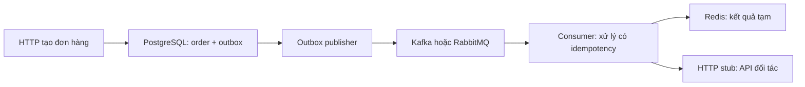
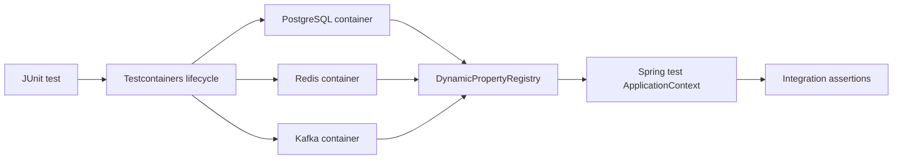
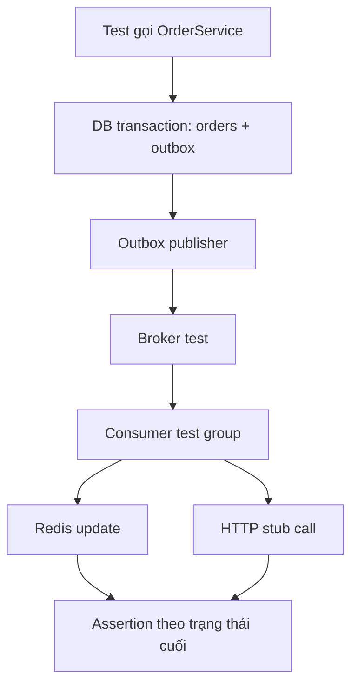

# Chuẩn bị dịch vụ thử nghiệm bằng Docker Compose hoặc Testcontainers

## 1. Mục tiêu của bài thực hành tổng hợp

Trong module **SPRING_BOOT_INTEGRATION**, một luồng nghiệp vụ Spring Boot hiếm khi chỉ cần một bean đơn lẻ. Ứng dụng có thể nhận HTTP request, ghi PostgreSQL, lưu trạng thái ngắn hạn trong Redis, phát sự kiện qua Kafka hoặc RabbitMQ, rồi gọi HTTP API bên ngoài bằng WebClient hay một outbound adapter của Spring Integration. Để học và kiểm thử luồng đó, ta cần **hạ tầng thử nghiệm đủ gần với hệ thống thật nhưng có dữ liệu, quyền và vòng đời riêng**.

Bài này hướng dẫn hai cách chuẩn bị:

- **Docker Compose** để chạy một cụm dịch vụ local có thể quan sát, thử thủ công và giữ dữ liệu qua nhiều lần khởi động.
- **Testcontainers** để tạo các container từ mã kiểm thử, inject endpoint vào Spring Boot và dọn tài nguyên theo vòng đời test.

Sau bài học, bạn có thể dựng một môi trường cho PostgreSQL, Redis, message broker và HTTP stub; cấu hình Spring Boot kết nối đúng endpoint; chạy kiểm thử tích hợp; kiểm soát migration, dữ liệu, retry, duplicate event và hoạt động của các adapter; biết khi nào nên dùng Compose, khi nào nên dùng Testcontainers.

### Tình huống xuyên suốt

Ta giả định một dịch vụ `order-integration` có luồng:



Kiểm thử phải trả lời nhiều hơn câu hỏi "ứng dụng khởi động được hay không": DB có đúng schema không, producer phát đúng event không, consumer có xử lý lặp an toàn không, retry lỗi 503 có giới hạn không, và dữ liệu thử có ở đúng tài nguyên hay không.

**Phạm vi ví dụ:** Các image, cổng và mật khẩu được dùng cho **local/test**; tag image chỉ minh họa cho một môi trường phát triển. Khi áp dụng cần rà soát phiên bản tương thích và chính sách bảo mật của dự án. Các lớp nghiệp vụ như `OrderService`, `OutboxPublisher` là thành phần giả định do ứng dụng tự triển khai.

## 2. Chọn công cụ trước khi dựng hạ tầng

| Tiêu chí | Docker Compose | Testcontainers |
| --- | --- | --- |
| Cách kích hoạt | Developer/CI chạy `docker compose up` hoặc Spring Boot Docker Compose integration quản lý | JUnit/test code khởi tạo container |
| Vòng đời | Thường giữ chạy qua nhiều lần sửa code; dừng theo project | Gắn với bộ test, thường được dọn sau test |
| Endpoint | Cổng publish từ host hoặc DNS service trong Compose network | Host và mapped port lấy lúc chạy từ container object |
| Dữ liệu | Có thể giữ qua named volume để debug | Thường là dữ liệu sạch, tạo lại khi test |
| Phù hợp | Thử API thủ công, debug broker, xem DB/cache, demo | Regression integration test, CI, tái hiện lỗi có assert |
| Rủi ro phổ biến | Volume/cổng/tên project bị dùng chung; dữ liệu cũ gây nhiễu | Test phụ thuộc Docker, startup cost, test context reuse, container đang dùng bị dừng |
| Điều không tự giải quyết | Idempotency, transaction DB–broker, phân quyền, schema hợp đồng | Các vấn đề nghiệp vụ tương tự; container không thay thế test assertion |

Hai cách có thể **cùng tồn tại**: developer chạy Compose khi phát triển, trong khi CI chạy Testcontainers. Tuy nhiên, với **một lần test**, nên có một nguồn cấu hình endpoint rõ ràng; tránh vừa bật Spring Boot Docker Compose integration vừa tự inject Testcontainers khiến kết nối không đi tới nơi mong muốn.

### Bộ dịch vụ tối thiểu theo nhu cầu

| Loại bài test | Dịch vụ nên chuẩn bị | Phần có thể giả lập |
| --- | --- | --- |
| Repository/transaction/outbox | PostgreSQL/MySQL theo DB thật | HTTP client, broker nếu chưa kiểm tra publish |
| Cache và TTL | Redis | DB hoặc HTTP nếu không liên quan |
| Kafka producer/consumer | Kafka broker test, topic/group và serializer thật | HTTP API ngoài |
| RabbitMQ/Spring AMQP | RabbitMQ vhost/queue/exchange test | API ngoài |
| WebClient và HTTP contract | MockWebServer/WireMock | Broker/DB nếu chỉ kiểm tra client |
| End-to-end của integration flow | DB + broker + cache + HTTP stub theo các cạnh của flow | Các hệ thống bên thứ ba không thuộc quyền quản lý |

Nguyên tắc là dùng **dịch vụ thật ở ranh giới muốn kiểm chứng**, còn bên thứ ba phải được stub/sandbox. Testcontainers không yêu cầu mọi test đều khởi động tất cả dịch vụ; đó có thể là lãng phí thời gian và làm tăng điểm thất bại.

## 3. Điều kiện chuẩn bị và cấu trúc ví dụ

Máy local hoặc CI cần Docker Engine/daemon tương thích, đủ bộ nhớ, quyền pull image và kết nối mạng để tải image ban đầu. Lệnh `docker compose version` và `docker info` giúp xác nhận Docker/Compose khả dụng. Nếu dùng Testcontainers, quá trình test cũng cần truy cập Docker socket/daemon với quyền phù hợp; không nên trao quyền Docker cho các mã test không tin cậy.

Cấu trúc minh họa của một dự án:

```text
order-integration/
  compose.yaml
  .gitignore
  .env.local                  # ví dụ: thông số và secret local, không commit
  .local-secrets/
    postgres-password.txt     # bí mật local, không commit
  wiremock/
    mappings/
      order.json
  src/
    main/resources/
      application.yml
      application-local.yml
    test/java/...
    test/resources/
      application-test.yml
```

Các file trong cây trên là **gợi ý tạo khi tự làm bài thực hành**, không phải file được bài học tự sinh. Thêm `.env.local` và `.local-secrets/` vào `.gitignore`; không đặt mật khẩu thật, access token, private key hoặc dump dữ liệu production vào repository. Đối với credential local, chọn giá trị ngẫu nhiên riêng, có thể hủy khi kết thúc lab.

## 4. Phương án A — dựng Docker Compose cho phát triển local

### 4.1. Compose gồm PostgreSQL, Redis, RabbitMQ và HTTP stub

Ví dụ `compose.yaml` sau dùng các cổng host khác cổng mặc định, chỉ bind ở loopback. Kafka được giới thiệu qua Testcontainers ở phần sau; nếu bài thực hành cần Kafka bằng Compose thì phải cấu hình listeners/advertised listeners thích hợp cho cách kết nối từ host và từ container.

```yaml
services:
  postgres:
    image: postgres:17-alpine
    environment:
      POSTGRES_DB: integration_lab
      POSTGRES_USER: integration_lab
      POSTGRES_PASSWORD_FILE: /run/secrets/pg_password
    secrets:
      - pg_password
    volumes:
      - postgres_data:/var/lib/postgresql/data
    ports:
      - "127.0.0.1:15432:5432"
    healthcheck:
      test: ["CMD-SHELL", "pg_isready -U integration_lab -d integration_lab"]
      interval: 5s
      timeout: 3s
      retries: 12

  redis:
    image: redis:7-alpine
    command: ["redis-server", "--save", "", "--appendonly", "no"]
    ports:
      - "127.0.0.1:16379:6379"

  rabbitmq:
    image: rabbitmq:4-management
    environment:
      RABBITMQ_DEFAULT_USER: ${LAB_RABBITMQ_USER:?Required}
      RABBITMQ_DEFAULT_PASS: ${LAB_RABBITMQ_PASSWORD:?Required}
    ports:
      - "127.0.0.1:15673:5672"
      - "127.0.0.1:15672:15672"
    healthcheck:
      test: ["CMD", "rabbitmq-diagnostics", "-q", "ping"]
      interval: 10s
      timeout: 5s
      retries: 12

  wiremock:
    image: wiremock/wiremock:3.9.2
    volumes:
      - ./wiremock:/home/wiremock:ro
    ports:
      - "127.0.0.1:18080:8080"

volumes:
  postgres_data:

secrets:
  pg_password:
    file: ./.local-secrets/postgres-password.txt
```

Giải thích các lựa chọn:

- `postgres_data` là **named volume**, giúp dữ liệu DB còn sau `docker compose stop` hoặc `down` thông thường. Đây là lợi thế khi debug, nhưng phải chủ động reset để tránh test phụ thuộc dữ liệu cũ.
- `POSTGRES_PASSWORD_FILE` để Postgres đọc secret từ file do Compose mount. File nguồn phải có trước khi khởi động và chỉ chứa mật khẩu dành cho local.
- Redis không bật persistence trong **lab này**, vì cache thử không cần lưu qua restart; không áp cấu hình đó cho dữ liệu cache thật có yêu cầu durability.
- RabbitMQ nhận tài khoản từ biến Compose interpolation `LAB_RABBITMQ_USER` và `LAB_RABBITMQ_PASSWORD`. Đây là lựa chọn tiện cho **local**, nhưng credential từ environment của container có thể lộ cho người có quyền xem cấu hình Docker; cần secret injection phù hợp hơn khi triển khai vào môi trường chung/production.
- `wiremock` chỉ nhận file mapping, không có kết nối tới API đối tác thực. Các service giao tiếp bên trong Compose network bằng hostname `postgres`, `redis`, `rabbitmq`, `wiremock`.
- Healthcheck giúp biết service đã sẵn sàng ở mức cơ bản. `running` chưa đồng nghĩa schema đã migrate hoặc broker đã được provision exchange/queue.

### 4.2. Chuẩn bị secret và file cấu hình phản hồi

Ví dụ file `.env.local` dùng **chỉ trên máy học**:

```dotenv
LAB_RABBITMQ_USER=integration_lab
LAB_RABBITMQ_PASSWORD=<random-local-only-password>
```

Thay placeholder bằng mật khẩu ngẫu nhiên dành riêng cho lab. Tạo `.local-secrets/postgres-password.txt` với mật khẩu PostgreSQL local, không đưa vào Git. Khi chạy app trên host, cung cấp **cùng giá trị** này qua biến `LAB_POSTGRES_PASSWORD` trong cấu hình chạy của IDE/terminal; `--env-file` của Docker Compose **không tự nạp biến môi trường cho tiến trình Spring Boot khởi động riêng trên host**.

Để WireMock trả một order giả, đặt một mapping minh họa trong `wiremock/mappings/order.json`:

```json
{
  "request": {
    "method": "GET",
    "urlPathPattern": "/api/orders/[A-Za-z0-9_-]+"
  },
  "response": {
    "status": 200,
    "headers": {
      "Content-Type": "application/json"
    },
    "jsonBody": {
      "id": "demo-001",
      "status": "READY"
    }
  }
}
```

Đây là fixture tĩnh phục vụ demo; khi cần kiểm thử đúng `orderId` hoặc nhiều trạng thái lỗi, tạo mapping với matcher cụ thể, `scenario` của WireMock hoặc khai báo stub ngay trong test. Đừng chuyển thẳng URL sandbox/production thật vào HTTP client chỉ vì mock không đủ phản hồi.

### 4.3. Khởi động, quan sát và dừng

```bash
# Chạy tại thư mục chứa compose.yaml.
docker compose --env-file .env.local -p integration-lab config
docker compose --env-file .env.local -p integration-lab up -d
docker compose --env-file .env.local -p integration-lab ps
docker compose --env-file .env.local -p integration-lab logs postgres rabbitmq
```

`docker compose config` hỗ trợ kiểm tra cấu hình sau interpolation nhưng **có thể in giá trị secret từ biến môi trường**. Không dán output này lên ticket/chat hoặc lưu vào log CI công khai. Cùng tên project `-p integration-lab` phải được dùng nhất quán khi xem log, dừng và dọn tài nguyên.

Kiểm tra mức cơ bản:

```bash
# PostgreSQL đã sẵn sàng nhận kết nối?
docker compose --env-file .env.local -p integration-lab exec postgres \
  pg_isready -U integration_lab -d integration_lab

# Redis trả PONG?
docker compose --env-file .env.local -p integration-lab exec redis \
  redis-cli PING

# WireMock trả trạng thái HTTP giả định (chạy từ host).
curl -i http://127.0.0.1:18080/api/orders/demo-001
```

Trên PowerShell, chạy mỗi câu lệnh trên **một dòng** (ký tự `\` nối dòng ở ví dụ là cú pháp shell Unix). Nếu không có `curl` CLI chính xác, có thể dùng công cụ HTTP client tương đương. Lệnh `redis-cli PING` kiểm tra kết nối Redis local chưa cấu hình ACL; khi thêm auth/TLS phải kiểm tra bằng credential riêng.

Dừng mà giữ dữ liệu DB:

```bash
docker compose --env-file .env.local -p integration-lab down
```

Chỉ khi chắc chắn muốn **xóa dữ liệu lab** và đã xác minh project/volume thực tế mới dùng:

```bash
docker compose --env-file .env.local -p integration-lab down --volumes
```

`down --volumes` có thể xóa named volume Compose quản lý; không chạy nó cho project chứa dữ liệu cần giữ. `external: true` hoặc `name: ...` trên volume có thể dẫn tới chia sẻ tài nguyên ngoài dự kiến; tên project không bảo vệ trước bind mount đến cùng thư mục host.

## 5. Kết nối Spring Boot tới Compose

### 5.1. Chạy app trên host và chạy app trong container là hai trường hợp

| Ứng dụng chạy ở đâu? | PostgreSQL | Redis | RabbitMQ | WireMock |
| --- | --- | --- | --- | --- |
| Host phát triển | `127.0.0.1:15432` | `127.0.0.1:16379` | `127.0.0.1:15673` | `http://127.0.0.1:18080` |
| Container cùng Compose network | `postgres:5432` | `redis:6379` | `rabbitmq:5672` | `http://wiremock:8080` |

Trong container, `localhost` chỉ tới **chính container đó**, không phải PostgreSQL/Redis bên cạnh. Ngược lại, tên DNS `postgres` thường chỉ được resolve trong network Docker Compose, không tự có trên host. Nếu cần chạy song song hai Compose project, hãy đổi host port hoặc bỏ publish port cho dịch vụ chỉ dùng trong network.

### 5.2. Profile local

Ví dụ `application-local.yml` cho Spring Boot chạy trực tiếp trên host:

```yaml
spring:
  config:
    activate:
      on-profile: local
  docker:
    compose:
      enabled: false
  datasource:
    url: jdbc:postgresql://127.0.0.1:15432/integration_lab
    username: integration_lab
    password: ${LAB_POSTGRES_PASSWORD}
  data:
    redis:
      host: 127.0.0.1
      port: 16379
  rabbitmq:
    host: 127.0.0.1
    port: 15673
    username: ${LAB_RABBITMQ_USER}
    password: ${LAB_RABBITMQ_PASSWORD}

partner:
  orders:
    base-url: http://127.0.0.1:18080
```

`partner.orders.base-url` là **property ứng dụng tự định nghĩa**, cần được bind vào WebClient/HTTP gateway. Trong production, dùng HTTPS, xác minh certificate/hostname và giới hạn host được phép. Ở local, WireMock đang chạy loopback HTTP để tập trung vào hợp đồng HTTP; không áp cách này cho request mang token production.

`spring.docker.compose.enabled=false` vì ví dụ đang điều khiển Compose bằng CLI. Nếu muốn tận dụng **Spring Boot Docker Compose support**, cần dependency `spring-boot-docker-compose` và để Spring Boot quản lý kết nối/vòng đời theo cấu hình phù hợp; cơ chế service connection có thể cung cấp connection details thay cho cấu hình tay. Tránh trộn hai cách điều khiển nếu chưa xác minh ưu tiên cấu hình.

### 5.3. Dependency thường dùng

Tùy module thực tế, các dependency cần thiết có thể gồm:

```text
spring-boot-starter-web            hoặc spring-boot-starter-webflux
spring-boot-starter-jdbc           hoặc spring-boot-starter-data-jpa
org.postgresql:postgresql
spring-boot-starter-data-redis
spring-boot-starter-amqp           (nếu dùng RabbitMQ)
spring-kafka                       (nếu dùng Kafka)
spring-integration-core            + adapter tương ứng nếu dùng Spring Integration
spring-boot-starter-test
```

Không cần cài mọi starter cùng lúc nếu bài học chỉ kiểm thử một nhánh. Một số starter đã kéo transitively thư viện cần thiết; hãy dùng dependency management/BOM đúng phiên bản Spring Boot thay vì tự ghép phiên bản thư viện ngẫu nhiên.

### 5.4. Kiểm tra trước khi bật luồng

Sau khi app khởi động với profile local, kiểm tra kết nối DB, Redis, broker và URL HTTP *có hiệu lực*. Biến môi trường hoặc command-line arguments có thể ghi đè YAML. Tránh in toàn bộ Spring `Environment`, JDBC URL chứa password hoặc token để debug.

Các consumer, scheduler và Spring Integration poller nên được kiểm soát startup để không bắt đầu gọi external API hoặc lấy message thật trước khi môi trường đã sẵn sàng. Một property tự đặt như `integration.jobs.enabled=false` chỉ có hiệu lực khi code ứng dụng thật sự đọc và thực thi cờ đó; đừng nghĩ chỉ thêm property vào YAML là đủ.

## 6. Phương án B — dùng Testcontainers trong JUnit

### 6.1. Cơ chế tạo và tiêm endpoint

Testcontainers tạo container thật trên Docker, thường cấp **cổng host ngẫu nhiên**. Test không được giả định PostgreSQL luôn là `localhost:5432` hoặc Redis là `localhost:6379`. Lấy JDBC URL/host/mapped port từ container object và cung cấp chúng cho Spring qua `@DynamicPropertySource` hoặc `@ServiceConnection`.



Lợi ích lớn nhất không phải Docker tự động hóa toàn bộ, mà là **endpoint của mỗi lượt test gắn với tài nguyên test vừa tạo**, giảm nguy cơ truy cập nhầm dịch vụ dùng chung và giảm phụ thuộc trạng thái từ lần test trước.

### 6.2. Dependency test

Đối với JUnit 5 và các module trong ví dụ, cần những thành phần Testcontainers tương ứng:

```text
org.testcontainers:junit-jupiter
org.testcontainers:postgresql
org.testcontainers:testcontainers       (GenericContainer)
org.testcontainers:kafka                (KafkaContainer)
```

Tên module/artifact và phiên bản tương thích cần đi cùng hệ sinh thái Testcontainers đang dùng. Spring Boot Test có thể quản lý version qua dependency management; nếu dự án dùng Testcontainers 2.x, rà soát package/artifact thay đổi thay vì sao chép nguyên cấu hình 1.x. Để dùng `@ServiceConnection` còn cần hỗ trợ `spring-boot-testcontainers` của Spring Boot.

### 6.3. Ví dụ test kết nối PostgreSQL, Redis và Kafka

```java
import java.sql.Connection;
import java.util.Map;
import java.util.concurrent.TimeUnit;
import javax.sql.DataSource;

import org.apache.kafka.clients.admin.AdminClient;
import org.apache.kafka.clients.admin.AdminClientConfig;
import org.junit.jupiter.api.Test;
import org.springframework.beans.factory.annotation.Autowired;
import org.springframework.boot.test.context.SpringBootTest;
import org.springframework.data.redis.core.StringRedisTemplate;
import org.springframework.test.context.ActiveProfiles;
import org.springframework.test.context.DynamicPropertyRegistry;
import org.springframework.test.context.DynamicPropertySource;
import org.testcontainers.containers.GenericContainer;
import org.testcontainers.containers.PostgreSQLContainer;
import org.testcontainers.junit.jupiter.Container;
import org.testcontainers.junit.jupiter.Testcontainers;
import org.testcontainers.kafka.KafkaContainer;
import org.testcontainers.utility.DockerImageName;

import static org.junit.jupiter.api.Assertions.assertEquals;
import static org.junit.jupiter.api.Assertions.assertNotNull;
import static org.junit.jupiter.api.Assertions.assertTrue;

@Testcontainers
@SpringBootTest(properties = {
    "spring.docker.compose.enabled=false",
    "spring.kafka.listener.auto-startup=false"
})
@ActiveProfiles("test")
class IntegrationInfrastructureIT {

    @Container
    static final PostgreSQLContainer<?> postgres =
        new PostgreSQLContainer<>("postgres:17-alpine")
            .withDatabaseName("integration_test");

    @Container
    static final GenericContainer<?> redis =
        new GenericContainer<>(DockerImageName.parse("redis:7-alpine"))
            .withExposedPorts(6379);

    @Container
    static final KafkaContainer kafka =
        new KafkaContainer(
            DockerImageName.parse("apache/kafka:3.9.1")
        );

    @DynamicPropertySource
    static void registerConnections(DynamicPropertyRegistry properties) {
        properties.add("spring.datasource.url", postgres::getJdbcUrl);
        properties.add("spring.datasource.username", postgres::getUsername);
        properties.add("spring.datasource.password", postgres::getPassword);
        properties.add("spring.data.redis.host", redis::getHost);
        properties.add("spring.data.redis.port",
            () -> redis.getMappedPort(6379));
        properties.add("spring.kafka.bootstrap-servers",
            kafka::getBootstrapServers);
    }

    @Autowired DataSource dataSource;
    @Autowired StringRedisTemplate redisTemplate;

    @Test
    void databaseAndCacheAreReachable() throws Exception {
        try (Connection connection = dataSource.getConnection()) {
            assertTrue(connection.isValid(2));
        }

        redisTemplate.opsForValue().set("test:probe", "ok");
        assertEquals("ok", redisTemplate.opsForValue().get("test:probe"));
    }

    @Test
    void kafkaBrokerReturnsMetadata() throws Exception {
        try (AdminClient admin = AdminClient.create(Map.of(
                AdminClientConfig.BOOTSTRAP_SERVERS_CONFIG,
                kafka.getBootstrapServers()
            ))) {
            assertNotNull(
                admin.describeCluster().clusterId().get(15, TimeUnit.SECONDS)
            );
        }
    }
}
```

Đây là **test hạ tầng đầu tiên**: ứng dụng phải có starter JDBC/Redis, PostgreSQL driver, dependency Kafka client, Spring Test và Testcontainers đúng version. Nó xác minh kết nối DB, lệnh Redis và metadata broker; **chưa** chứng minh producer/consumer, offset, retry hay idempotency nghiệp vụ hoạt động.

Nếu ứng dụng còn có `@RabbitListener`, Spring Integration inbound poller hoặc job `@Scheduled` tự khởi động, cần **tắt chúng trong profile test hoặc cung cấp RabbitMQ/endpoint test thực sự** trước khi tạo Spring context. Ví dụ test này tắt auto startup của Kafka listener nhưng chưa tự động tắt mọi dạng listener/scheduler khác.

#### Một lưu ý về vòng đời container và Spring context

Static `@Container` thuộc vòng đời do JUnit extension quản lý. Nếu test framework cache và reuse Spring `ApplicationContext` qua nhiều test class nhưng container của class trước đã dừng, bean/connection pool trong context có thể giữ endpoint không còn sống. Chọn một chiến lược phù hợp: giữ container sống theo scope của context, điều chỉnh context caching hoặc tổ chức tests có lifecycle rõ ràng. **Không** bật reuse qua nhiều lần test chỉ để chạy nhanh nếu điều đó khiến dữ liệu test cũ xen vào lần mới.

### 6.4. @ServiceConnection so với @DynamicPropertySource

Với các phiên bản Spring Boot hỗ trợ `spring-boot-testcontainers`, `@ServiceConnection` có thể tạo các `ConnectionDetails` từ container phù hợp, giúp tự cấu hình DataSource, Redis hoặc Kafka mà không phải khai báo thủ công từng property.

```java
// Chỉ minh họa một phương án thay thế cho phần cấu hình PostgreSQL.
@Container
@ServiceConnection
static final PostgreSQLContainer<?> postgres =
    new PostgreSQLContainer<>("postgres:17-alpine");
```

Cần import `org.springframework.boot.testcontainers.service.connection.ServiceConnection` và dependency tương ứng. Khi chọn cách này, **đừng đồng thời tiêm những endpoint đối nghịch** qua `@DynamicPropertySource`, YAML hoặc Docker Compose auto-service cho cùng một client; hãy kiểm tra connection details thực tế Spring Boot đang dùng.

`@DynamicPropertySource` vẫn hữu ích khi container chưa được Spring Boot hỗ trợ như một service connection, khi endpoint tùy chỉnh hoặc cần map nhiều property riêng. Không có cách nào tự bảo đảm cô lập nếu test tiếp tục gọi một HTTP base URL ngoài phạm vi hoặc chạy job background dùng credential production.

## 7. Chuẩn bị schema, dữ liệu thử và hợp đồng thông điệp

### 7.1. Database test phải có cùng quy tắc schema

Container PostgreSQL mới thường chỉ có database trống. Để test repository/outbox, phải tạo schema bằng migration thật của ứng dụng (Flyway/Liquibase hoặc script test đã được kiểm soát); đừng tự động dùng Hibernate `create-drop` trên một DB có dữ liệu cần giữ.

Một lược đồ tối giản minh họa:

```sql
CREATE TABLE orders (
    id           VARCHAR(64) PRIMARY KEY,
    state        VARCHAR(32) NOT NULL,
    created_at   TIMESTAMPTZ NOT NULL
);

CREATE TABLE outbox_event (
    event_id     UUID PRIMARY KEY,
    aggregate_id VARCHAR(64) NOT NULL,
    event_type   VARCHAR(80) NOT NULL,
    payload      TEXT NOT NULL,
    state        VARCHAR(20) NOT NULL,
    created_at   TIMESTAMPTZ NOT NULL
);
```

Đây là schema dạy học. Với production cần xem xét khóa ngoại, index trên `state/created_at`, claim/lease, retry count, transactional outbox, retention, bảo mật PII và schema migration version. Không thay đổi type/constraint chỉ để test đi qua khi hợp đồng ứng dụng đòi hỏi khác.

### 7.2. Seed dữ liệu quyết định và lặp lại được

Tạo dữ liệu với ID xác định (`order-001`, `event-id-...`), trạng thái rõ ràng và timestamp được cung cấp bằng `Clock`. Nếu test chạy lại, cần reset đúng dữ liệu test, dùng transaction rollback khi phù hợp, hoặc phân vùng theo test ID. Không phụ thuộc bản ghi ngẫu nhiên còn sót từ developer trước.

Đối với consumer/producer, định nghĩa hợp đồng event:

```json
{
  "eventId": "f73a7d22-23ad-4d4d-b32d-bc2f9d6a51f7",
  "eventType": "OrderCreated",
  "schemaVersion": 1,
  "orderId": "order-001",
  "occurredAt": "2026-11-21T01:00:00Z"
}
```

`eventId` phải ổn định khi retry; consumer có thể dùng nó làm khóa deduplication. Test schema/serializer, trường bắt buộc và khả năng xử lý phiên bản cũ. Tránh nhét API key, access token, DB password hoặc object chứa dữ liệu cá nhân không cần thiết vào payload.

### 7.3. Topic, queue và cache key phải thuộc môi trường test

- **Kafka:** Tạo topic test bằng AdminClient hoặc bean `NewTopic` nếu phù hợp, dùng group ID tách biệt. Kiểm tra topic tồn tại và cấu hình serializer/deserializer trước khi gửi.
- **RabbitMQ:** Tạo vhost, exchange, queue, binding hoặc để test/application provision trong môi trường lab theo quyền đã xác định.
- **Redis:** Dùng key prefix `it:orders:*` hoặc Redis instance riêng; kiểm tra TTL/eviction và idempotency key nếu luồng sử dụng.
- **HTTP stub:** Phân biệt mã 200, 400, 429, 503 và timeout. Kiểm thử header/URL/payload thực nhận, không chỉ xác nhận method được gọi.

Nếu broker chạy chung cho nhiều người, dùng principal/ACL và namespace riêng; **chỉ đổi topic prefix mà tài khoản có quyền toàn cluster thì chưa phải cô lập bảo mật**.

## 8. Kịch bản kiểm thử luồng tích hợp

### 8.1. Đường thành công cần chứng minh điều gì?



Một kiểm thử end-to-end có thể theo trình tự:

1. Tạo order với request xác định, assert response theo HTTP contract.
2. Kiểm tra transaction DB đã lưu order **và** bản ghi outbox; không có trường hợp chỉ lưu một bên.
3. Kích hoạt publisher (trực tiếp hoặc poller test), đợi broker nhận event có `eventId` và nội dung đúng schema.
4. Cho consumer test xử lý event, assert Redis hoặc bảng kết quả cập nhật.
5. Xác nhận HTTP stub nhận đúng một request theo hợp đồng, không rò rỉ credential và đúng endpoint test.
6. Phát lại **cùng** event ID, assert kết quả nghiệp vụ không tạo bản ghi mới hoặc side effect trùng.

Không lấy `Thread.sleep(5000)` làm bằng chứng xử lý đã hoàn tất. Dùng cơ chế chờ có deadline (Awaitility hoặc polling trạng thái với timeout) và thông báo assertion rõ: đang đợi DB state nào, event nào, request nào.

### 8.2. Matrix lỗi cần thử

| Trường hợp | Dàn dựng | Điều phải quan sát |
| --- | --- | --- |
| PostgreSQL chưa sẵn sàng | Chậm startup hoặc kết nối không có | App không coi socket open là schema-ready; báo lỗi có thể điều tra |
| Mất DB khi đang ghi outbox | Dừng DB test đúng thời điểm | Transaction rollback/khôi phục theo hợp đồng, không phát sự kiện sai |
| Redis timeout | Tạm chặn Redis test | Có fallback/chính sách lỗi rõ; không ghi state sai |
| Broker tạm unavailable | Dừng broker test, cho publisher thử gửi | Outbox pending còn nguyên; retry hữu hạn và publish lại được |
| Duplicate event | Gửi lại `eventId` đã xử lý | Idempotency tránh cập nhật/gọi đối tác trùng |
| Consumer crash trước commit offset | Dừng consumer sau side effect | Có thể redelivery nhưng kết quả nghiệp vụ không trùng |
| HTTP đối tác trả 429/503 | Stub trả lỗi có thể retry | Backoff/deadline hữu hạn; không nhân retry ở nhiều tầng |
| HTTP trả 401/403 | Stub trả lỗi quyền | Không retry vô hạn; không tự đổi sang token quyền cao |
| Sai URL/host | Base URL trỏ tới endpoint ngoài allowlist | Fail fast; không gửi token/payload đến host không được phép |
| Sai schema event | Thiếu field, sai version | Lỗi được phân loại, DLQ/quarantine theo hợp đồng |
| Tắt app giữa đợt xử lý | Restart hoặc kill worker test | Checkpoint/outbox/inbox giúp phục hồi an toàn |

Khi thử lỗi, cần assert **trạng thái cuối**, số lần gửi, số bản ghi và thông tin quan sát được. Một exception được ném ra chưa chứng minh dữ liệu vẫn nhất quán, đặc biệt khi HTTP call hoặc Kafka publish đã hoàn thành trước khi client nhận lỗi.

### 8.3. Kiểm thử broker không đồng nghĩa exactly-once đầu-cuối

Kafka/RabbitMQ, DB và HTTP API có các ranh giới giao dịch khác nhau. Cho dù Kafka producer có idempotence hoặc Kafka transaction, nó không tự tạo một atomic transaction chung với PostgreSQL và một HTTP API bên ngoài. Dùng transactional outbox, idempotency key, deduplication/inbox hoặc saga/compensation tùy ngữ nghĩa nghiệp vụ.

Trong bài lab, hãy cố ý mô phỏng trường hợp broker đã nhận event nhưng client mất ACK. Nếu retry phát lại cùng `eventId`, consumer phải từ chối tác động lặp theo hợp đồng. Đây là kiểm chứng có giá trị hơn một bài test chỉ chạy thành công một lần.

## 9. Tách secret, quyền và tác động giữa các môi trường

### 9.1. Ranh giới tối thiểu

| Thành phần | Local/test nên dùng | Tránh |
| --- | --- | --- |
| PostgreSQL | DB riêng + runtime user chỉ có DML cần | DB staging/prod hoặc user DBA |
| Redis | Instance/key prefix riêng, ACL phù hợp | User có `FLUSHALL` trên Redis chung |
| Kafka | Broker/topic/group và principal test riêng | Consumer commit offset của group thật |
| RabbitMQ | Vhost/queue/user lab riêng | User admin của broker production |
| HTTP | WireMock/sandbox + token test | Access token production hoặc tự follow redirect lạ |
| Object storage/SFTP | Bucket/path sandbox, identity riêng | Thư mục đang nhận file thật |
| Container volumes | Tên project và volume được quản lý riêng | Bind mount hoặc external volume chứa dữ liệu người khác |
| CI | Secret runtime dùng cho job trong phạm vi test | Đưa mật khẩu vào log, build args hoặc artifact |

Testcontainers giúp cấp địa chỉ kết nối khác với production nhưng không chặn code tùy ý gọi API thật. Vì vậy cần kiểm soát cả `spring.profiles.active`, endpoint ở runtime, secret, egress và các listener/poller tự khởi động.

### 9.2. Không để test hoặc local tự làm việc nền ngoài phạm vi

Trong ứng dụng có `@Scheduled`, `@KafkaListener`, `@RabbitListener` hoặc Spring Integration `Poller`, các thành phần có thể chạy **ngay khi Spring context lên**. Nếu app vô tình lấy connection URL từ biến môi trường production, sự cố xảy ra trước khi test body thực thi.

Chiến lược an toàn:

- Tắt auto-start của listener/job trong các bài test không kiểm chứng chúng; nếu cần test, bật theo từng trường hợp và dùng resource test.
- Các property như `integration.jobs.enabled` phải được code ứng dụng tôn trọng; chỉ khai báo YAML không tự động tắt mọi scheduler.
- Validate endpoint/cluster/env marker trước khi bật tác vụ có side effect.
- Cấp credential local/test không có quyền truy cập staging/prod, kết hợp hạn chế đường ra mạng.
- Phân biệt dữ liệu thật với dữ liệu giả ở các topic/queue, table, cache key, DLQ và log.

### 9.3. Kiểm soát việc dọn dẹp

`docker compose down` thường dừng/xóa container và network project, giữ named volume. `docker compose down --volumes` có thể xóa dữ liệu đã lưu. Với Testcontainers, tài nguyên thường được quản lý theo vòng đời test và cleanup, nhưng không nên giả định container reuse, Docker daemon hoặc CI runner sẽ luôn được dọn trong mọi tình huống sự cố.

Mọi script cleanup phải kiểm tra rõ **project/namespace/resource prefix**, không dùng lệnh dọn toàn bộ Docker host hoặc broker được chia sẻ. Sau khi test lỗi giữa chừng, kiểm tra orphan container, volume, network và state còn sót bằng cách liệt kê tài nguyên có phạm vi rõ ràng.

## 10. Những lỗi thường gặp và cách khoanh vùng

| Triệu chứng | Khả năng | Cách kiểm tra |
| --- | --- | --- |
| `Connection refused` khi app trên host dùng `postgres:5432` | DNS service chỉ có trong Compose network | Dùng published host port `127.0.0.1:15432` hoặc chạy app trong network |
| App trong container dùng `localhost:5432` | `localhost` trỏ tới chính container app | Dùng service DNS `postgres:5432` |
| `password authentication failed` sau khi đổi mật khẩu Postgres | Named volume đã có DB được init bằng password cũ; env init chỉ áp dụng lần tạo DB | Xem trạng thái volume, thay password qua quy trình DB hoặc reset **volume lab** có chủ đích |
| PostgreSQL port đã dùng | Hai Compose projects publish cùng host port | Chọn project/port khác hoặc không publish |
| Redis test trả dữ liệu từ lần trước | Dùng cùng instance/prefix hoặc bật reuse | Tạo cache test riêng/reset đúng phạm vi; kiểm tra TTL |
| Kafka test không gửi/nhận được | Sai bootstrap/advertised listener, topic, serializer, group | Lấy endpoint từ container; kiểm tra metadata và ACL |
| Consumer nhận record lạ | Topic/group test dùng chung hoặc offset cũ | Tạo tên topic/group riêng, reset có kiểm soát |
| HTTP client gọi URL ngoài lab | Config precedence hoặc default base URL sai | Kiểm tra endpoint có hiệu lực, giới hạn egress/allowlist |
| Spring Boot Docker Compose và manual Compose xung đột | Hai cơ chế khởi động/connection details cùng bật | Chọn một cơ chế sở hữu lifecycle, kiểm tra auto-config |
| Testcontainers không khởi động được | Docker daemon/permission/network/image pull | Kiểm tra Docker, log container, thông tin resource; không chuyển test sang prod DB |
| JUnit test pass riêng nhưng fail chạy cả suite | Context caching/reused container hoặc state chia sẻ | Xem lifecycle container, dữ liệu, test order và static state |
| Test đợi sự kiện mãi | Listener không start, topic/queue sai hoặc race condition | Log trạng thái consumer/group, DLQ và condition đang chờ |

### Chẩn đoán theo lớp

Nên xác định lỗi ở tầng nào:

1. **Container:** Đã được tạo, chạy và healthcheck đúng chưa?
2. **Network:** Ứng dụng đứng ở host hay container, DNS và port nào thực sự được dùng?
3. **Authentication:** Credential có thuộc môi trường và hệ thống đích không?
4. **Authorization:** Principal có quyền topic, queue, bảng, cache key, endpoint không?
5. **Schema/contract:** Table, topic, serializer, JSON schema và migration đã sẵn sàng chưa?
6. **Application behavior:** Retry, backoff, idempotency, transaction, consumer offset, DLQ và timeout đúng chưa?

Không khắc phục lỗi quyền bằng cách cấp admin, lỗi TLS bằng cách tắt xác minh chứng chỉ, hoặc lỗi test bằng cách trỏ tạm tới production. Thay đổi như vậy che giấu lỗi gốc và làm hỏng mục tiêu cô lập.

## 11. Quan sát kết quả thực hành

Một bài kiểm thử tốt để lại bằng chứng:

| Bằng chứng | Cách thu |
| --- | --- |
| Dịch vụ sẵn sàng | Container healthcheck, JDBC `isValid`, Redis ping, Kafka metadata |
| Kết nối đúng môi trường | Host/cluster identity logic, profile, database marker, principal test |
| Dữ liệu DB nhất quán | Query order/outbox sau transaction; không mất và không thêm sai dữ liệu |
| Thông điệp đúng hợp đồng | Event ID, schema version, key, topic/queue/group |
| Consumer không xử lý trùng | Assert số bản ghi/idempotency state sau replay |
| HTTP không rò rỉ dữ liệu | WireMock nhận đúng URL/header/body giả, không có token thật |
| Hành vi lỗi có giới hạn | Attempt count, deadline, DLQ và lỗi phân loại |
| Cleanup đúng phạm vi | Chỉ tài nguyên lab bị xóa/thu hồi |

Nên log theo tên môi trường, tên logic adapter và correlation ID, ví dụ:

```text
environment=test
flow=order-outbox
event_id=f73a7d22-23ad-4d4d-b32d-bc2f9d6a51f7
destination=kafka-test
result=published
attempt=1
```

Không ghi password, bearer token, JAAS string, private key, full payload chứa dữ liệu cá nhân hoặc connection string nhạy cảm. Với metrics, tránh gắn ID ngẫu nhiên vô hạn vào label vì cardinality cao; có thể giữ event ID ở trace/log có phân quyền.

## 12. Bài tập tự thực hiện

### Bài tập A — luồng local qua Compose

1. Tạo `compose.yaml` và các file local secret/mapping theo ví dụ; chạy Compose với project name riêng.
2. Khởi động Spring Boot ở profile `local`, xác minh kết nối PostgreSQL, Redis, RabbitMQ và WireMock.
3. Tạo order giả, ghi order/outbox trong cùng transaction. Publish sự kiện tới RabbitMQ test queue; consumer cập nhật cache và gọi WireMock.
4. Cho WireMock trả 503 ở lần đầu, 200 ở lần sau. Kiểm tra retry hữu hạn, không ghi hai order hoặc gọi hai tác động nghiệp vụ không idempotent.
5. Dừng một container và khởi động lại. Kiểm tra trạng thái outbox/consumer và chứng minh luồng phục hồi mà không tạo kết quả trùng.

### Bài tập B — chuyển một phần sang Testcontainers

1. Tạo integration test dùng PostgreSQLContainer, Redis GenericContainer và KafkaContainer như ví dụ; tắt listener/poller chưa cần cho test.
2. Để test setup/migration tạo schema, seed event và kiểm tra kết nối; không phụ thuộc port cố định.
3. Tạo topic Kafka test và group riêng, publish `OrderCreated` rồi assert consumer xử lý đúng schema/state.
4. Phát lại cùng event ID; assert kết quả chỉ được tính một lần. Sau đó thử broker bị ngắt và phục hồi để kiểm tra outbox.
5. Chạy test hai lần và chạy cùng các test khác; kiểm tra dữ liệu không bị lẫn, container không còn giữ state ngoài chủ đích.

### Tiêu chí hoàn thành

Một bài thực hành được coi là hoàn thành khi có thể **tái tạo môi trường từ cấu hình**, xác nhận từng endpoint là tài nguyên test, chạy được đường thành công và ít nhất một đường lỗi, chứng minh không tạo tác động trùng, thu được log/metric không chứa secret và dọn đúng tài nguyên lab.

## 13. Checklist trước khi dùng lại bài lab trong dự án thật

- [ ] Đã chọn Compose cho phát triển thủ công hoặc Testcontainers cho test tự động; rõ ai sở hữu vòng đời dịch vụ.
- [ ] Docker engine và image phù hợp với máy/CI; healthcheck và readiness được kiểm tra.
- [ ] Host port và container DNS được phân biệt; không dùng `localhost` sai ngữ cảnh.
- [ ] Spring Boot kết nối DB, cache, broker và HTTP stub theo đúng profile và endpoint có hiệu lực.
- [ ] Không tự động bật job/listener/poller gây tác động tới dịch vụ ngoài lab.
- [ ] PostgreSQL có migration/schema và seed dữ liệu giả; dữ liệu không phụ thuộc lần chạy trước.
- [ ] Kafka topic/group hoặc RabbitMQ vhost/queue/exchange riêng; serializer/contract đúng.
- [ ] Redis key/TTL riêng; không dùng lệnh xóa toàn bộ tài nguyên chia sẻ.
- [ ] Secret local/test tách khỏi staging/production; không commit, không in vào log/config dump.
- [ ] Có integration assertions cho transaction, event payload, consumer, cache và HTTP call.
- [ ] Có thử lỗi mạng, retry hữu hạn, redelivery và duplicate event bằng idempotency key.
- [ ] Có quy tắc dọn Docker volumes, test resources, event data và log đúng phạm vi.
- [ ] CI có kiểm tra regression, thời gian chờ hữu hạn, kết quả lỗi rõ và không phụ thuộc tài nguyên dùng chung.

### Câu hỏi tự kiểm tra

1. Vì sao chạy app trong container với JDBC URL `jdbc:postgresql://localhost:15432/...` có thể thất bại dù Postgres từ host kết nối được?
2. Vì sao `docker compose down` và `docker compose down --volumes` có hậu quả dữ liệu khác nhau?
3. Một test dùng PostgreSQLContainer nhưng Kafka URL vẫn trỏ tới staging có an toàn không? Cần kiểm soát những điểm nào?
4. `@DynamicPropertySource` giải quyết vấn đề gì khi Docker publish cổng ngẫu nhiên?
5. Vì sao một kết nối Kafka trả metadata thành công chưa chứng minh consumer đúng group, schema và idempotency?
6. Lỗi nào có thể xảy ra khi hai test class reuse Spring context nhưng static container của class trước đã dừng?
7. Tại sao bài thử nghiệp vụ cần mô phỏng "broker nhận event nhưng client mất ACK", và kỳ vọng nào cần assert?
8. Khi tích hợp Spring Integration poller với DB và RabbitMQ, cần xác nhận điều gì trước khi tự bật poller lúc startup?

**Ghi nhớ:** Docker Compose và Testcontainers giúp tạo **dịch vụ thử nghiệm có thể tái lập**, nhưng chất lượng bài thực hành đến từ việc kiểm soát **đúng endpoint, dữ liệu, cấu hình, quyền, vòng đời và kết quả nghiệp vụ**. Hạ tầng khởi động thành công là bước đầu; kiểm thử tích hợp cần chứng minh giao dịch, lỗi, retry, idempotency và tính quan sát được của toàn bộ luồng Spring Boot.
