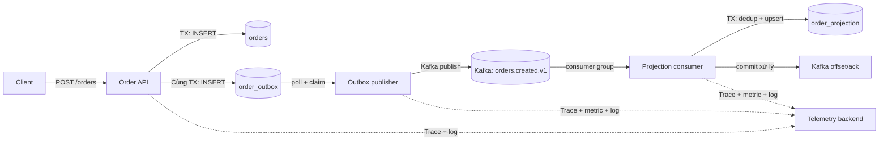
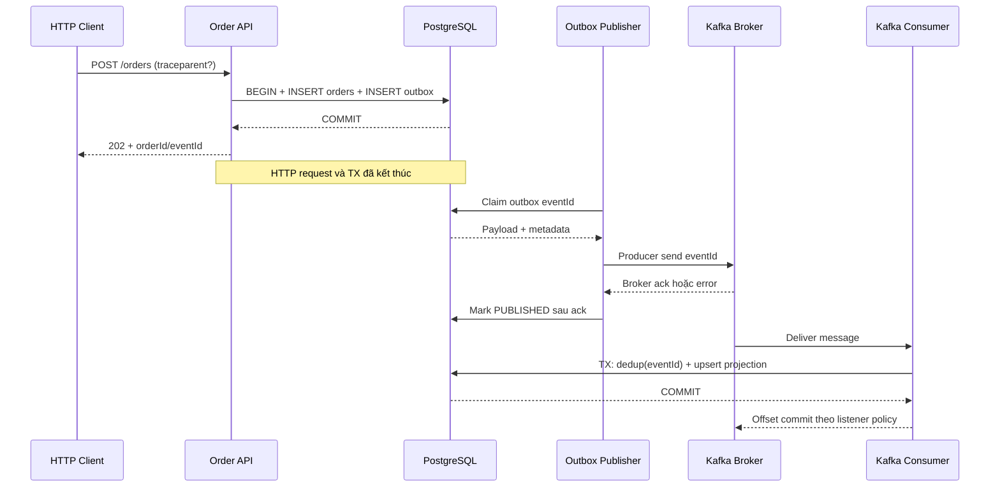

# Quan sát một thao tác xuyên HTTP, cơ sở dữ liệu và broker

Trong một hệ thống Spring Boot có tích hợp HTTP, SQL và message broker, một yêu cầu có thể nhận phản hồi thành công ở API nhưng lại không tạo được sự kiện trên broker; hoặc broker đã nhận sự kiện nhưng consumer xử lý thất bại. Nếu chỉ nhìn HTTP status, log của một service hay biểu đồ CPU, người vận hành khó xác định công việc đã đi đến đâu, có cần retry không và liệu retry có gây ra tác dụng phụ trùng lặp.

Bài thực hành thuộc chương **Thực hành tổng hợp** của mô-đun **SPRING_BOOT_INTEGRATION**. Phạm vi mô-đun là tổ chức tích hợp Spring Boot qua HTTP client, cơ sở dữ liệu, cache, broker thông điệp và các adapter Spring Integration, đặc biệt chú ý cấu hình, hợp đồng dữ liệu, giao dịch, lỗi, idempotency, kiểm thử và quan sát luồng thực tế. Ở đây, chúng ta nối **một thao tác nghiệp vụ** từ HTTP qua PostgreSQL và Kafka, rồi thiết kế cách nhìn thấy từng ranh giới bằng trace, metric, log và trạng thái bền vững.

**Tình huống xuyên suốt:** client gửi `POST /orders`. Ứng dụng ghi đơn hàng và một sự kiện `OrderCreated` vào bảng outbox trong **cùng transaction SQL**. Một publisher đọc outbox và gửi sự kiện tới Kafka. Consumer nhận sự kiện, cập nhật bảng read model. Người vận hành muốn tra cứu từ `orderId`, `eventId` hoặc một `traceId` để biết thao tác hiện ở đâu và lỗi tại bước nào.

Sau bài học, bạn có thể:

- Vẽ rõ đường đi HTTP → service → SQL transaction → outbox → Kafka producer → consumer → SQL read model.
- Phân biệt trace/span, log có cấu trúc, metric và business state; chọn tín hiệu để quan sát đúng thời điểm.
- Bật Micrometer Observation/Tracing, ghi span nghiệp vụ và truyền ngữ cảnh qua HTTP/Kafka khi framework và exporter được cấu hình.
- Nhận ra đoạn **đứt mạch trace** khi publisher lấy công việc từ outbox ở thời điểm khác; dùng `eventId`, correlation hoặc context propagation có chủ đích để nối mạch.
- Chứng minh rằng rollback SQL không tạo sự kiện, Kafka publish chỉ được đánh dấu sau xác nhận, consumer redelivery không tạo dữ liệu trùng, và lỗi của backend telemetry không làm sai dữ liệu nghiệp vụ.
- Kiểm thử hành vi đầu-cuối trong môi trường cô lập, đọc dashboard và viết runbook chẩn đoán.

> **Giả định:** ví dụ dùng Java 17+, Spring Boot 3.x, Spring JDBC, Spring Kafka, PostgreSQL, Micrometer Observation/Tracing và một backend nhận OpenTelemetry (ví dụ OpenTelemetry Collector + Jaeger/Tempo). API cụ thể, tên metric và auto-instrumentation thay đổi theo phiên bản; đối chiếu với dependency thực tế. Mã cho các thành phần `OutboxRepository`, event contract và test được chia thành những đoạn có mục đích rõ ràng; đây là bài thực hành kiến trúc, chưa phải một ứng dụng production có đầy đủ mọi lớp.

## 1. Định nghĩa “thấy được một thao tác” trước khi viết code

### 1.1. Chọn một câu hỏi có thể trả lời bằng chứng

Với `orderId=ORD-1042`, người trực hệ thống cần trả lời được:

1. HTTP request đã vào instance nào, trả status nào và mất bao lâu?
2. Transaction tạo order đã **commit** hay **rollback**?
3. Sự kiện `OrderCreated` có được lưu bền vững trong outbox không?
4. Publisher đã thử gửi bao nhiêu lần, broker đã xác nhận ghi nhận bản tin chưa?
5. Consumer đã nhận bản tin nào, xử lý đến bước nào, có retry hoặc dead-letter không?
6. Read model đã có dữ liệu tương ứng chưa, và có thể giải thích sự chậm trễ bằng span/log/metric nào?
7. Nếu yêu cầu được gửi lại, thao tác có tạo order hoặc side effect trùng ngoài chủ đích không?

Không phải tất cả câu hỏi đều được giải đáp bằng cùng một công cụ. Trace giúp xem **đường đi và thời lượng các công đoạn**; metric cho biết **xu hướng của nhiều thao tác**; log có cấu trúc cung cấp **sự kiện chẩn đoán cụ thể**; bảng trạng thái và dữ liệu nghiệp vụ là **bằng chứng bền vững** khi trace bị lấy mẫu hoặc đã hết retention.

### 1.2. Tiêu chí chấp nhận của bài thực hành

| Tiêu chí | Bằng chứng cần thu được |
|---|---|
| HTTP được theo dõi | Một server span có tên endpoint, status và duration; không chứa payload nhạy cảm |
| SQL được theo dõi | Span nghiệp vụ bao thao tác lưu, hoặc span JDBC khi instrumentation thật sự hỗ trợ |
| Transaction đúng | Order và outbox cùng tồn tại sau commit, cùng không tồn tại khi rollback |
| Broker được theo dõi | Biết mỗi lần publish, kết quả broker ack/error, thời điểm và số lần thử |
| Consumer được theo dõi | Có log/span theo `eventId`, kết quả xử lý và số lần redelivery |
| Có thể ghép các đoạn | Từ `orderId` hoặc `eventId` tìm được HTTP request, outbox, Kafka record và consumer result |
| Có thể chẩn đoán khi trace thiếu | Vẫn tra cứu được trạng thái nghiệp vụ qua database/log ngay khi telemetry exporter bị lỗi |
| Không xử lý trùng | Redelivery của một `eventId` không thêm hiệu ứng read model lần hai |

Một biểu đồ đẹp nhưng không trả lời được các câu hỏi trên chưa đủ để chứng minh tính quan sát của luồng.

## 2. Sơ đồ luồng và các ranh giới bền vững

### 2.1. Đường đi đề xuất



Hai nhánh chấm là đường telemetry, **không tham gia commit SQL hoặc Kafka**. Nếu backend telemetry tạm thời không nhận dữ liệu, ứng dụng vẫn phải tuân thủ ranh giới nghiệp vụ, trừ khi tổ chức có chính sách kiểm toán chặt hơn được thiết kế riêng.

Một cách nói chính xác về luồng:

- HTTP `202 Accepted`: API đã lưu yêu cầu/đơn hàng và nghĩa vụ phát sự kiện **bền vững** vào database; downstream có thể chưa nhận.
- SQL `COMMIT`: order và outbox row đã được commit.
- Kafka send thành công theo producer acknowledgment: broker đã xác nhận theo mức `acks`/độ bền cấu hình; **không có nghĩa consumer đã xử lý**.
- Consumer đã commit transaction read model: dữ liệu phía consumer được ghi; Kafka offset commit có thể đến sau.
- Consumer offset commit thành công: group ghi nhận tiến độ đọc; **không làm transaction SQL trở thành một transaction nguyên tử với broker**.

### 2.2. Dòng thời gian của một thao tác



Sơ đồ này thể hiện **luồng logic bình thường**, không ngầm bảo đảm rằng trạng thái giữa các hệ thống cập nhật tức thì. Một publisher có thể chết sau khi Kafka nhận bản tin nhưng trước khi đánh dấu `PUBLISHED`; lúc phục hồi nó sẽ gửi lại. Consumer phải có cơ chế idempotency riêng.

### 2.3. Ba danh tính không được nhầm lẫn

| Định danh | Tạo ở đâu | Dùng để làm gì? | Có ổn định sau retry? |
|---|---|---|---|
| `traceId` | Tracing context từ HTTP, hoặc span gốc được tạo mới | Tìm đường thực thi trong hệ thống tracing | Không bảo đảm; outbox poll/consumer có thể bắt đầu trace mới |
| `orderId` | Ứng dụng nghiệp vụ | Truy vấn bản ghi order/read model | Có, theo hợp đồng nghiệp vụ |
| `eventId` | Khi tạo sự kiện outbox | Dedup, join publisher/consumer, xử lý redelivery | **Phải ổn định** cho cùng một sự kiện logic |
| `requestId/idempotencyKey` | Client hoặc HTTP ingress theo hợp đồng | Chống tạo hai order khi client retry | Chỉ có nếu ứng dụng quản lý và lưu bền vững |
| `spanId` | Mỗi span được instrument | Phân biệt từng công đoạn trong trace | Không; tạo mới cho từng span |

Để truy vết dài hạn, lưu `orderId`/`eventId` cùng trạng thái nghiệp vụ trong database. `traceId` hữu ích cho chẩn đoán nhưng có thể bị sampling, đứt qua async boundary hoặc hết retention.

## 3. Trace, span, log và metric đang đo điều gì?

### 3.1. Trace và span

Một **trace** biểu diễn các hoạt động có quan hệ nhân quả, qua nhiều dịch vụ. Một **span** là một công đoạn có thời điểm bắt đầu/kết thúc, ngữ cảnh cha–con hoặc liên kết, thuộc tính và trạng thái lỗi. Khi HTTP server instrumented, có thể có span cho `POST /orders`; khi code tạo một `Observation` riêng, backend tracing có thể sinh span như `orders.persist`.

Một lần thực hiện thành công có thể được nhìn như sau:

```text
Trace A (khi request HTTP đang hoạt động)
└── HTTP POST /orders                   34 ms
    ├── orders.persist                  21 ms
    │   ├── SQL INSERT orders            6 ms  [nếu JDBC được instrument]
    │   └── SQL INSERT outbox            4 ms  [nếu JDBC được instrument]
    └── HTTP response (202)              2 ms

Trace B (publisher poll ở thời điểm khác)
└── outbox.publish                       18 ms
    └── Kafka send orders.created.v1      9 ms

Trace C (Kafka consumer)
└── Kafka receive/process                27 ms
    └── orders.projection.apply           8 ms
```

**Đây là hình minh họa cấu trúc**, không phải tên span hoặc con số được Spring Boot bảo đảm sinh ra tự động. Tracing HTTP thường có instrumentation sẵn khi đã cấu hình đúng. **JDBC span không mặc định có trong mọi ứng dụng Spring Boot**; muốn thấy từng câu SQL có thể cần instrumentation thư viện tương thích, OpenTelemetry Java agent hoặc custom observation. Không gắn nhãn “SQL span” trên dashboard khi thực tế chỉ có span bao service method.

Với mô hình outbox, Trace A đã kết thúc trước khi publisher chạy. Không tự giả định Kafka instrumentation sẽ tự nối Trace B vào Trace A khi publisher lấy outbox từ database.

### 3.2. Cách dùng từng tín hiệu

| Tín hiệu | Câu hỏi giải đáp tốt | Điểm cần tránh |
|---|---|---|
| Distributed tracing | Công đoạn nào chậm/lỗi trong một lần thực hiện? | Dùng trace làm nguồn sự thật duy nhất cho kết quả nghiệp vụ |
| Structured logging | Sự kiện cụ thể nào xảy ra, với `eventId` nào? | Ghi full payload, secret, token, thông tin khách hàng |
| Metrics | Bao nhiêu request/s, tỷ lệ lỗi, p95 latency, backlog? | Đưa `orderId`/`eventId` làm tag gây cardinality cực cao |
| DB state / Job state | Order đã commit, outbox đang ở trạng thái gì? | Suy trạng thái từ log “đã chuẩn bị gửi” |
| Broker/client telemetry | Publish ack/error, consumer lag/retry/DLT? | Coi producer ack bằng consumer success |

**Một span hoàn tất không đồng nghĩa một giao dịch nghiệp vụ commit.** Span chỉ kết thúc công đoạn mà code định nghĩa; cần đặt đúng tên và thời điểm ghi kết quả.

## 4. Thiết lập môi trường thực hành

### 4.1. Thành phần cần chạy

Tối thiểu có:

1. Spring Boot application chứa HTTP controller, service transaction, outbox publisher và Kafka consumer. Khi học observability có thể tách consumer sang ứng dụng thứ hai để thấy tracing qua tiến trình; không cần làm ngay từ bước đầu.
2. PostgreSQL riêng cho thực hành, dùng migration tạo `orders`, `order_outbox` và `processed_event`/`order_projection`.
3. Kafka broker riêng, topic `orders.created.v1` và consumer group `orders-read-model`; cấu hình endpoint/tên group rõ ràng.
4. Collector hoặc backend có thể nhận OTLP/trace; tùy nhu cầu dùng Jaeger, Tempo hoặc hệ thống tracing có sẵn.
5. HTTP client như `curl`/Postman và công cụ xem database/broker trong môi trường thử.

Có thể dùng Docker Compose hoặc Testcontainers để khởi động các dịch vụ test; kiểm tra broker listeners, port mapping và hostname từ **bên trong container lẫn từ host**. Cấu hình `localhost` của ứng dụng chạy trên host không đồng nghĩa `localhost` trong một container khác.

### 4.2. Dependency cho Spring Boot 3.x

Ví dụ `build.gradle.kts` dùng BOM do Spring Boot plugin quản lý:

```kotlin
dependencies {
    implementation("org.springframework.boot:spring-boot-starter-web")
    implementation("org.springframework.boot:spring-boot-starter-jdbc")
    implementation("org.springframework.boot:spring-boot-starter-actuator")
    implementation("org.springframework.kafka:spring-kafka")

    implementation("io.micrometer:micrometer-tracing-bridge-otel")
    runtimeOnly("io.opentelemetry:opentelemetry-exporter-otlp")
    runtimeOnly("io.micrometer:micrometer-registry-prometheus")
    runtimeOnly("org.postgresql:postgresql")

    testImplementation("org.springframework.boot:spring-boot-starter-test")
    testImplementation("org.springframework.kafka:spring-kafka-test")
    testImplementation("org.testcontainers:junit-jupiter")
    testImplementation("org.testcontainers:postgresql")
    testImplementation("org.testcontainers:kafka")
}
```

BOM và version có thể khác trong Spring Boot 4.x; nếu dùng phiên bản khác, đối chiếu dependency và auto-configuration tương ứng trước khi sao chép. Backend tracing không tự xuất hiện chỉ vì thêm bridge; cần exporter và endpoint hoạt động.

### 4.3. Cấu hình tham khảo

```yaml
spring:
  application:
    name: orders-integration
  datasource:
    url: jdbc:postgresql://postgres:5432/orders
    username: ${DB_USERNAME}
    password: ${DB_PASSWORD}

  kafka:
    bootstrap-servers: kafka:9092
    producer:
      key-serializer: org.apache.kafka.common.serialization.StringSerializer
      value-serializer: org.apache.kafka.common.serialization.StringSerializer
      acks: all
    consumer:
      group-id: orders-read-model
      key-deserializer: org.apache.kafka.common.serialization.StringDeserializer
      value-deserializer: org.apache.kafka.common.serialization.StringDeserializer
      auto-offset-reset: earliest
    listener:
      ack-mode: record

management:
  tracing:
    sampling:
      probability: 1.0 # Chỉ khi học/test; production phải dựa vào ngân sách trace
  otlp:
    tracing:
      endpoint: http://otel-collector:4318/v1/traces
  endpoints:
    web:
      exposure:
        include: health,info,metrics,prometheus
```

Cấu hình này là ví dụ cho ứng dụng chạy **trong cùng mạng container** với hostnames `postgres`, `kafka` và `otel-collector`. Nếu ứng dụng chạy trên host, thay địa chỉ bằng host/port đúng. `sampling.probability=1.0` phục vụ thấy tất cả trace trong bài lab; sản xuất thường dùng sampling thấp hơn và chính sách giữ các trace lỗi/chậm khi hệ thống hỗ trợ.

`acks=all` yêu cầu producer nhận ack từ broker theo cơ chế replicas/in-sync replicas đang cấu hình; **không biến một cluster thử nghiệm chỉ có một broker thành hạ tầng chịu lỗi production**. Cũng không biến Kafka và SQL thành một distributed transaction nguyên tử.

Bật endpoint metrics để test cần kiểm soát bảo mật ở môi trường thật. Không phơi `/actuator/prometheus` hay endpoint admin ra Internet.

### 4.4. Bật observation của Kafka

Micrometer tracing cho HTTP và Kafka có đường instrument riêng. Với Spring Kafka hỗ trợ observation, producer và listener container cần bật observation theo **API/cấu hình phiên bản đang dùng**. Khi tùy biến factory, cần giữ các thiết lập khác từ Spring Boot auto-configuration.

Ví dụ minh họa cấu hình trực tiếp trong code cho các bean tự tạo:

```java
@Bean
KafkaTemplate<String, String> observedKafkaTemplate(
        ProducerFactory<String, String> producerFactory) {

    KafkaTemplate<String, String> template =
            new KafkaTemplate<>(producerFactory);
    template.setObservationEnabled(true);
    return template;
}

@Bean
ConcurrentKafkaListenerContainerFactory<String, String>
kafkaListenerContainerFactory(
        ConsumerFactory<String, String> consumerFactory) {

    var factory =
            new ConcurrentKafkaListenerContainerFactory<String, String>();
    factory.setConsumerFactory(consumerFactory);
    factory.getContainerProperties().setObservationEnabled(true);
    return factory;
}
```

Các import chính là `KafkaTemplate`, `ProducerFactory`, `ConsumerFactory` và `ConcurrentKafkaListenerContainerFactory` của Spring Kafka. Đây là **một phương án** khi dự án chủ động sở hữu cấu hình factory/template; không khai báo thêm bean trùng tên nếu Boot đã cấu hình cùng chức năng. Kiểm tra bean đang thực sự được ứng dụng sử dụng và các đặc tính cần thiết như serializers, error handler, concurrency, transactions, retry/DLT, acknowledgment. Một số phiên bản Boot cung cấp properties để bật observation; ưu tiên cách cấu hình nhất quán với phiên bản dự án.

Khi tracing/observation phù hợp, Spring Kafka có thể sử dụng propagation để đưa context từ producer sang record headers rồi khôi phục ở consumer. Với **outbox relay**, context hiện hành tại lúc producer gửi thường thuộc publisher, không tự là context của request HTTP ban đầu. Phần 8 xử lý giới hạn này.

## 5. Thiết kế hợp đồng dữ liệu và database

### 5.1. Một event rõ nghĩa, có ID ổn định

Ví dụ JSON của `OrderCreated`:

```json
{
  "eventId": "123e4567-e89b-12d3-a456-426614174001",
  "eventType": "OrderCreated",
  "schemaVersion": 1,
  "orderId": "123e4567-e89b-12d3-a456-426614174000",
  "occurredAt": "2026-11-21T08:00:00Z",
  "totalAmount": 125000,
  "currency": "VND"
}
```

`eventId` và `orderId` được tạo **một lần** trước khi ghi DB. Nếu publisher retry, phải gửi lại **chính eventId/payload đã lưu**. Không phát sinh eventId mới cho mỗi lần Kafka send. Nếu hợp đồng event thay đổi, quản lý `schemaVersion` và tương thích consumer; tránh dùng serialize trực tiếp entity JPA làm hợp đồng công khai.

Dữ liệu khách hàng, địa chỉ, số thẻ và token không cần nằm trong event/tracing. Những trường bắt buộc phải truyền cần tuân theo phân loại dữ liệu và chính sách truy cập, retention, mã hóa.

### 5.2. DDL PostgreSQL tối thiểu

```sql
CREATE TABLE orders (
    id           UUID PRIMARY KEY,
    total_amount BIGINT NOT NULL,
    currency     VARCHAR(3) NOT NULL,
    status       VARCHAR(24) NOT NULL,
    created_at   TIMESTAMPTZ NOT NULL DEFAULT now()
);

CREATE TABLE order_outbox (
    event_id      UUID PRIMARY KEY,
    order_id      UUID NOT NULL REFERENCES orders(id),
    event_type    VARCHAR(80) NOT NULL,
    payload       JSONB NOT NULL,
    status        VARCHAR(20) NOT NULL DEFAULT 'NEW',
    attempts      INTEGER NOT NULL DEFAULT 0,
    lease_owner   VARCHAR(120),
    lease_until   TIMESTAMPTZ,
    created_at    TIMESTAMPTZ NOT NULL DEFAULT now(),
    published_at  TIMESTAMPTZ
);
CREATE INDEX idx_outbox_dispatch
    ON order_outbox (status, created_at);

CREATE TABLE processed_event (
    consumer_name VARCHAR(80) NOT NULL,
    event_id      UUID NOT NULL,
    processed_at  TIMESTAMPTZ NOT NULL DEFAULT now(),
    PRIMARY KEY (consumer_name, event_id)
);

CREATE TABLE order_projection (
    order_id      UUID PRIMARY KEY,
    total_amount  BIGINT NOT NULL,
    currency      VARCHAR(3) NOT NULL,
    status        VARCHAR(24) NOT NULL,
    updated_at    TIMESTAMPTZ NOT NULL DEFAULT now()
);
```

`orders` và `order_outbox` phải được ghi trong **cùng một transaction JDBC** nếu muốn bảo đảm sự kiện phát sau mỗi thay đổi đã commit. `processed_event` giúp consumer dedup theo eventId riêng cho consumer group/đường xử lý. Trong production, bổ sung trạng thái/giới hạn retry, claim index, deadline, kiểm tra size, retention, dead-letter, migration/backup và phân quyền phù hợp.

**Không dùng một bảng trạng thái duy nhất làm bằng chứng cho tất cả chặng.** `status=PUBLISHED` trong outbox nghĩa là producer nhận ack theo chính sách và đã lưu trạng thái đó; consumer có thể chưa xử lý. `order_projection`/`processed_event` mô tả tiến độ phía consumer.

### 5.3. Transaction phải bao đúng hai thao tác

Ví dụ service tạo order và outbox cùng transaction:

```java
import java.time.Instant;
import java.util.UUID;

import com.fasterxml.jackson.databind.ObjectMapper;
import io.micrometer.observation.Observation;
import io.micrometer.observation.ObservationRegistry;
import org.springframework.jdbc.core.JdbcTemplate;
import org.springframework.stereotype.Service;
import org.springframework.transaction.annotation.Transactional;

@Service
public class CreateOrderService {

    public record CreateOrderRequest(long totalAmount, String currency) {}
    public record CreatedOrder(UUID orderId, UUID eventId) {}

    private final JdbcTemplate jdbc;
    private final ObjectMapper mapper;
    private final ObservationRegistry observations;

    public CreateOrderService(
            JdbcTemplate jdbc,
            ObjectMapper mapper,
            ObservationRegistry observations) {
        this.jdbc = jdbc;
        this.mapper = mapper;
        this.observations = observations;
    }

    @Transactional
    public CreatedOrder create(CreateOrderRequest request) {
        return Observation.createNotStarted("orders.persist", observations)
                .lowCardinalityKeyValue("operation", "create")
                .observe(() -> {
                    UUID orderId = UUID.randomUUID();
                    UUID eventId = UUID.randomUUID();
                    try {
                        String payload = mapper.writeValueAsString(
                                new OrderCreated(
                                        eventId, orderId, Instant.now(),
                                        request.totalAmount(),
                                        request.currency()));

                        jdbc.update("""
                            INSERT INTO orders(
                                id, total_amount, currency, status
                            ) VALUES (?, ?, ?, ?)
                            """,
                            orderId, request.totalAmount(),
                            request.currency(), "ACCEPTED");

                        jdbc.update("""
                            INSERT INTO order_outbox(
                                event_id, order_id, event_type, payload
                            ) VALUES (?, ?, ?, CAST(? AS jsonb))
                            """,
                            eventId, orderId, "OrderCreated", payload);

                        return new CreatedOrder(orderId, eventId);
                    } catch (com.fasterxml.jackson.core.JsonProcessingException e) {
                        throw new IllegalStateException(
                                "Cannot serialize OrderCreated", e);
                    }
                });
    }

    public record OrderCreated(
            UUID eventId,
            UUID orderId,
            Instant occurredAt,
            long totalAmount,
            String currency) {}
}
```

Cần ràng buộc hợp lệ `totalAmount`/`currency` ở DTO/validation và lưu schema event cố định trong ứng dụng thật. `@Transactional` phải được gọi **qua Spring proxy** từ bean khác; self-invocation trong cùng bean có thể không kích hoạt advice. Khi một trong hai `jdbc.update` lỗi, transaction bị rollback nếu exception được ném ra ngoài theo quy tắc transaction manager.

**Chi tiết về span và commit:** `orders.persist` ở code trên bao phần xử lý trong method; interceptor `@Transactional` của Spring có thể hoàn tất commit **sau khi method return**, tùy thứ tự advice. Vì vậy không được tự suy từ span này rằng COMMIT chắc chắn thành công. Bằng chứng đúng là dữ liệu đã commit/transaction outcome được instrument tại boundary phù hợp. Test rollback vẫn là phép kiểm chứng quan trọng.

Observation ở đây chỉ ghi **span ở cấp thao tác nghiệp vụ** khi có tracing handler; các câu SQL riêng lẻ chỉ có span nếu một instrumentation JDBC tương ứng được bật. Không ghi full payload vào tag.

### 5.4. API trả trạng thái đúng nghĩa

```java
import java.util.UUID;
import org.springframework.http.ResponseEntity;
import org.springframework.web.bind.annotation.*;

@RestController
@RequestMapping("/orders")
public class OrderController {

    private final CreateOrderService createOrders;

    public OrderController(CreateOrderService createOrders) {
        this.createOrders = createOrders;
    }

    @PostMapping
    public ResponseEntity<CreatedOrderResponse> create(
            @RequestBody CreateOrderService.CreateOrderRequest request) {

        var created = createOrders.create(request);

        return ResponseEntity.accepted().body(
                new CreatedOrderResponse(
                        created.orderId(),
                        created.eventId(),
                        "PENDING_DISPATCH"));
    }

    public record CreatedOrderResponse(
            UUID orderId, UUID eventId, String status) {}
}
```

HTTP `202 Accepted` là lựa chọn phù hợp vì API đã nhận bền vững và downstream còn bất đồng bộ. Trong ứng dụng có yêu cầu client retry, thêm `Idempotency-Key`, unique constraint và mapping `key → orderId/eventId` để tránh tạo hai order khi HTTP client gửi lại do mất phản hồi. Đây là một vấn đề **khác** với dedup `eventId` ở consumer.

Nếu không muốn public `eventId`, API có thể chỉ trả `orderId`/URL trạng thái; bên vận hành vẫn cần lưu quan hệ `orderId ↔ eventId` trong database. Không trả raw stack trace hoặc tên broker nội bộ cho client.

## 6. Outbox publisher: thời điểm broker xác nhận

### 6.1. Một polling loop có claim và lease

Trong môi trường nhiều replica, không cho hai publisher cùng lấy và gửi một outbox row liên tục. Ví dụ PostgreSQL dùng claim theo transaction ngắn:

```sql
WITH picked AS (
    SELECT event_id
    FROM order_outbox
    WHERE status = 'NEW'
       OR (status = 'CLAIMED' AND lease_until < now())
    ORDER BY created_at, event_id
    FOR UPDATE SKIP LOCKED
    LIMIT 20
)
UPDATE order_outbox o
SET status = 'CLAIMED',
    lease_owner = :worker_id,
    lease_until = now() + INTERVAL '60 seconds',
    attempts = attempts + 1
FROM picked
WHERE o.event_id = picked.event_id
RETURNING o.event_id, o.order_id, o.payload, o.attempts;
```

Tham số `:worker_id` phải được bind bằng `NamedParameterJdbcTemplate` hoặc API tương đương. Transaction claim commit ngay sau khi ghi lease, **không giữ lock SQL trong thời gian chờ Kafka send**. Khi gửi nhiều event/lease hết hạn, cần gia hạn hoặc chọn batch đủ nhỏ để tránh hai publisher gửi cùng event do lease expired.

`SKIP LOCKED` không cho phép suy ra exactly-once. Duplicates vẫn có thể xảy ra khi tiến trình chết, lease hết hạn, broker phản hồi chậm hoặc trạng thái outbox chưa kịp commit. Điều này là lý do consumer cần idempotency.

### 6.2. Publish, ghi nhận kết quả và tạo observation

Một đường xử lý minh họa:

```java
import java.time.Duration;
import java.util.concurrent.TimeUnit;

import io.micrometer.observation.Observation;
import io.micrometer.observation.ObservationRegistry;
import org.apache.kafka.clients.producer.ProducerRecord;
import org.springframework.kafka.core.KafkaTemplate;
import org.springframework.stereotype.Service;

@Service
public class OutboxPublishService {

    private final KafkaTemplate<String, String> kafka;
    private final OutboxRepository outbox;
    private final ObservationRegistry observations;

    public OutboxPublishService(
            KafkaTemplate<String, String> kafka,
            OutboxRepository outbox,
            ObservationRegistry observations) {
        this.kafka = kafka;
        this.outbox = outbox;
        this.observations = observations;
    }

    public void publish(OutboxRow event) {
        Observation observation =
                Observation.createNotStarted("outbox.publish", observations)
                        .lowCardinalityKeyValue("event.type", event.eventType())
                        .lowCardinalityKeyValue("destination", "orders.created.v1")
                        .start();

        try (Observation.Scope scope = observation.openScope()) {
            var record = new ProducerRecord<String, String>(
                    "orders.created.v1",
                    event.orderId().toString(),
                    event.payloadJson());

            // eventId là khóa để ghép kết quả/duplicate;
            // không dùng làm low-cardinality metric tag.
            record.headers().add(
                    "x-event-id",
                    event.eventId().toString()
                         .getBytes(java.nio.charset.StandardCharsets.UTF_8));

            // Chờ producer ack có timeout hữu hạn.
            // Khi sản lượng cao, dùng async callback/CompletableFuture
            // và kiểm soát concurrency thay cho blocking.
            kafka.send(record).get(5, TimeUnit.SECONDS);

            outbox.markPublished(event.eventId());
        } catch (Exception failure) {
            observation.error(failure);
            outbox.markRetryable(event.eventId(), failure);
            throw new OutboxPublishException("Kafka send failed", failure);
        } finally {
            observation.stop();
        }
    }

    public interface OutboxRepository {
        void markPublished(java.util.UUID eventId);
        void markRetryable(java.util.UUID eventId, Exception cause);
    }

    public record OutboxRow(
            java.util.UUID eventId,
            java.util.UUID orderId,
            String eventType,
            String payloadJson) {}

    public static class OutboxPublishException extends RuntimeException {
        public OutboxPublishException(String message, Throwable cause) {
            super(message, cause);
        }
    }
}
```

Đây là đoạn minh họa **trình tự và vị trí instrument**, không phải toàn bộ dispatcher (chưa có claim repository, @Scheduled, backoff, dead-letter). `markPublished` phải kiểm tra worker đang sở hữu lease nếu nhiều replica cùng chạy; `markRetryable` cần lưu attempt/retry-after và không được che mất ngoại lệ gốc. Nếu markPublished thất bại sau broker ack, hệ thống có thể publish lại khi phục hồi — consumer dedup là bắt buộc.

Việc gọi `kafka.send(...).get(5, TimeUnit.SECONDS)` chỉ đợi **Kafka producer acknowledgement**, không đợi consumer. Đừng gọi API blocking này trong HTTP request hoặc transaction giữ kết nối SQL lâu. Trong hệ thống throughput lớn, dùng pipeline async có giới hạn số in-flight, outcome callback, timeout và lease renewal; instrument theo completion thực tế.

### 6.3. Đặt span/metric tại đúng thời điểm

| Mốc | Tín hiệu nên ghi | Điều **chưa** được kết luận |
|---|---|---|
| Claim outbox row | `outbox.claimed`, attempts và lease owner trong log | Broker đã nhận message |
| Bắt đầu gửi Kafka | `outbox.publish.attempt`, eventId trong log | Publish đã thành công |
| Producer future thành công | `outbox.publish.acknowledged`, duration, partition/offset nếu có | Consumer đã xử lý |
| Mark `PUBLISHED` commit | `outbox.state=PUBLISHED` bền vững | Side effect consumer hoàn tất |
| Producer future lỗi/timeout | `outbox.publish.failed`, retryable status | Chắc chắn broker **không** nhận message |

Đặc biệt khi timeout, có thể **không biết chắc** broker đã nhận sự kiện chưa. Thiết kế retry dựa vào at-least-once + idempotency, không suy đoán “timeout nghĩa là chưa phát sinh gì”.

## 7. Consumer: quan sát message, dedup và transaction SQL

### 7.1. Đọc event qua Kafka listener

```java
import com.fasterxml.jackson.databind.ObjectMapper;
import org.apache.kafka.clients.consumer.ConsumerRecord;
import org.springframework.kafka.annotation.KafkaListener;
import org.springframework.stereotype.Component;

@Component
public class OrderProjectionListener {

    private final ObjectMapper mapper;
    private final OrderProjectionService projections;

    public OrderProjectionListener(
            ObjectMapper mapper,
            OrderProjectionService projections) {
        this.mapper = mapper;
        this.projections = projections;
    }

    @KafkaListener(
            topics = "orders.created.v1",
            groupId = "orders-read-model")
    public void handle(ConsumerRecord<String, String> record)
            throws com.fasterxml.jackson.core.JsonProcessingException {

        var event = mapper.readValue(
                record.value(), CreateOrderService.OrderCreated.class);

        projections.apply(event);
    }
}
```

Khi listener hoàn tất không có exception, listener container xử lý offset/ack **theo cấu hình**; nếu handler ném lỗi, error handler/retry/DLT policy quyết định việc phát lại. Không tự khẳng định “listener đã nhận” là “offset đã commit” nếu chưa quan sát trạng thái consumer group. Với `ack-mode: record`, việc ack/commit tiến độ được điều phối theo cơ chế container, không nhất thiết là một JDBC transaction.

### 7.2. Dedup và ghi projection trong cùng transaction

```java
import org.springframework.jdbc.core.JdbcTemplate;
import org.springframework.stereotype.Service;
import org.springframework.transaction.annotation.Transactional;

@Service
public class OrderProjectionService {

    private final JdbcTemplate jdbc;

    public OrderProjectionService(JdbcTemplate jdbc) {
        this.jdbc = jdbc;
    }

    @Transactional
    public void apply(CreateOrderService.OrderCreated event) {
        int claimed = jdbc.update("""
            INSERT INTO processed_event (consumer_name, event_id)
            VALUES (?, ?)
            ON CONFLICT DO NOTHING
            """,
            "orders-read-model",
            event.eventId());

        if (claimed == 0) {
            return; // event này đã được xử lý và commit trước đó
        }

        jdbc.update("""
            INSERT INTO order_projection(
                order_id, total_amount, currency, status
            ) VALUES (?, ?, ?, 'CREATED')
            ON CONFLICT (order_id)
            DO UPDATE SET
                total_amount = EXCLUDED.total_amount,
                currency = EXCLUDED.currency,
                status = EXCLUDED.status,
                updated_at = now()
            """,
            event.orderId(),
            event.totalAmount(),
            event.currency());
    }
}
```

**Điều kiện đúng:** `processed_event` và `order_projection` phải nằm trong **cùng transaction** trên cùng cơ sở dữ liệu/transaction manager. Nếu projection lỗi, insert dedup rollback, lần retry vẫn có thể chạy lại. Khi eventId đã commit, lần nhận trùng trở thành no-op nghiệp vụ. Unique constraint giải quyết cạnh tranh giữa hai consumer/process cùng xử lý eventId.

Nếu consumer còn gọi HTTP ra hệ thống khác hoặc publish broker khác, JDBC transaction **không rollback được side effect đó**. Cần outbox/idempotency hoặc quy trình bù trừ riêng. Nếu `OrderCreated` có nhiều phiên bản và event có thứ tự, upsert kiểu “last arrival wins” có thể sai nghiệp vụ; cần sequence/version guard để ngăn event cũ ghi đè trạng thái mới.

### 7.3. Nên log gì khi consumer bị redelivery?

Ví dụ log có cấu trúc (dữ liệu minh họa):

```json
{
  "service": "orders-integration",
  "stage": "order.projection.apply",
  "event_type": "OrderCreated",
  "event_id": "123e4567-e89b-12d3-a456-426614174001",
  "consumer_group": "orders-read-model",
  "result": "duplicate_ignored",
  "kafka_topic": "orders.created.v1",
  "kafka_partition": 2,
  "kafka_offset": 1349
}
```

`eventId`, partition/offset là trường log có thể tra cứu. Không gắn chúng làm **metric tag**. Nếu có traceId/spanId trong MDC qua Micrometer Tracing/Logging config, ghi chúng vào log để click từ trace sang log; với Kafka consumer chạy thread pool, xác nhận context được propagate trong môi trường thực tế.

Chỉ log `result=duplicate_ignored` sau khi đã xác định conflict dedup theo nghiệp vụ; không mặc định mọi lỗi unique key ở bảng khác đều là “duplicate hợp lệ”.

## 8. Liên kết ngữ cảnh tracing qua HTTP, outbox và Kafka

### 8.1. HTTP và W3C Trace Context

Một HTTP request có thể mang:

```text
traceparent: 00-4bf92f3577b34da6a3ce929d0e0e4736-00f067aa0ba902b7-01
tracestate: vendor=value
```

Đây là ví dụ định dạng W3C Trace Context. Tracing instrumentation phải đọc/kiểm tra header theo propagator; không tự nối một `traceparent` bất kỳ do client gửi thành dấu chứng thực hay định danh quyền hạn. `traceId` không phải secret và không được dùng làm idempotency key hay cơ chế xác thực.

Khi request đã được instrument, span HTTP hiện hành có thể làm cha cho observation trong service. Nếu `ObservationRegistry` và tracing bridge được cấu hình đúng, `Observation.createNotStarted(...).observe(...)` tạo thêm công đoạn trong trace.

**Điểm giới hạn:** Nếu trace sampling tắt ở ingress hoặc backend export không nhận, có thể không thấy span trong dashboard dù nghiệp vụ đã xử lý. Cần lưu order/event state và log không phụ thuộc việc trace được giữ lại.

### 8.2. Kafka headers có thể mang tracing context

Khi Spring Kafka observation được bật cho producer và listener container, cơ chế instrumentation có thể inject/extract context theo propagator đang dùng, thường qua Kafka record headers. Phần này phụ thuộc framework và cách tạo KafkaTemplate/factory.

Kiểm tra thực tế bằng test:

1. Tạo một `Observation` ở producer.
2. Gửi một event qua `KafkaTemplate` đã bật observation.
3. Kiểm tra consumer span xuất hiện và có quan hệ/trace context phù hợp, đồng thời kiểm tra record headers không bị serializer/adapter tùy biến loại bỏ.
4. Nếu dùng Spring Integration Kafka adapter hoặc gateway, kiểm tra đường instrument thực tế của adapter đó, không mặc định nó trùng với một `KafkaTemplate` khác.

Quan hệ parent/child của span consumer còn phụ thuộc semantic "receive" hay "process" và cách instrumentation biểu diễn messaging. Không áp đặt rằng mọi backend phải hiển thị consumer span là con trực tiếp của producer span.

### 8.3. Vì sao outbox thường tạo trace mới?

Trong bài, publisher chạy sau khi HTTP response đã trả. Nó đọc outbox row từ PostgreSQL bằng một thread scheduler khác. **ThreadLocal/MDC/active span của request đã không còn**. Nếu chỉ bật auto-instrumentation:

```text
HTTP span (trace A)
  └── orders.persist

Scheduler/publisher (trace B)
  └── Kafka send

Consumer (thường nối với context trace B nếu propagate thành công)
  └── orders.projection.apply
```

Điều này **không sai**. Đây là hai hoạt động ở hai thời điểm khác nhau, có quan hệ nghiệp vụ qua `eventId`. Người vận hành vẫn có thể ghép Trace A ↔ Trace B bằng `eventId` trong outbox và log, ngay cả khi distributed tracing hiển thị hai trace.

### 8.4. Ba cách nối các đoạn qua outbox

| Cách | Triển khai | Lợi ích | Giới hạn |
|---|---|---|---|
| **Join bằng eventId** | Lưu `eventId`/`orderId` bền vững, log chúng ở API/publisher/consumer | Đơn giản, không phụ thuộc sampling; dùng tốt cho điều tra | Dashboard trace có thể hiển thị nhiều trace riêng |
| **Lưu W3C context trong outbox** | Persist `traceparent/tracestate` được inject từ **active trusted context**; extract khi publish | Có thể biểu diễn quan hệ trace bắc qua async boundary | Cần mã propagation đúng, xử lý retention, context sai/missing, độ dài và security |
| **Span links** | Publisher/consumer tạo trace mới nhưng link span vào context tạo event | Diễn tả quan hệ không đồng bộ rõ ràng, tránh kéo dài span cha quá lâu | Cần hỗ trợ link trong tracing SDK/backend và kiểm tra visualization |

Với bài thực hành đầu tiên, **join bằng eventId** là chiến lược nền chắc chắn. Nếu mục tiêu là một trace xuyên qua outbox, phải **cố ý** lưu và phục hồi context, và test nó. Không giả vờ rằng thêm một header `x-event-id` sẽ tự tạo một parent-child trace.

Khi lưu context, dùng propagator của OpenTelemetry/Micrometer tương thích thay vì tự cắt/ghép chuỗi `traceparent` hoặc copy nguyên header HTTP chưa được kiểm tra. Hãy giới hạn whitelist các trường context, không đưa bearer token/cookie/baggage chứa PII vào outbox. Khi event được xử lý nhiều giờ sau, liên kết bằng trace có thể khó xem do retention/sampling; vẫn cần eventId.

### 8.5. MDC và log correlation

Ví dụ log có cấu trúc ở HTTP:

```json
{
  "stage": "orders.http.accepted",
  "order_id": "123e4567-e89b-12d3-a456-426614174000",
  "event_id": "123e4567-e89b-12d3-a456-426614174001",
  "trace_id": "4bf92f3577b34da6a3ce929d0e0e4736",
  "http_status": 202
}
```

Publisher có thể ghi cùng `event_id` nhưng `trace_id` khác; consumer lại có thể dùng trace nối với publisher qua Kafka. **Đó là kết quả hợp lệ nếu không có explicit outbox propagation.**

MDC là context theo thread. Nếu dùng `@Async`, executor, scheduler hoặc Reactor, cần kiểm tra tính năng context propagation tương ứng với phiên bản/framework; không kỳ vọng `MDC.put` ở thread HTTP tự động có mặt trong publisher/consumer thread. Cũng cần dọn scope/MDC để tránh traceId của yêu cầu trước rò sang thread được tái sử dụng.

## 9. Tạo metric có ý nghĩa nghiệp vụ và vận hành

### 9.1. Nhóm metric tối thiểu

| Tên logic (ví dụ) | Loại | Nhãn cardinality thấp | Ý nghĩa |
|---|---|---|---|
| `orders.accepted` | Counter | `result=accepted/rejected` | Đơn/API yêu cầu được nhận |
| `orders.persist.duration` | Timer | `operation=create` | Thời gian công đoạn lưu trong service |
| `outbox.backlog` | Gauge | `eventType=OrderCreated` | Số event chưa hoàn tất phát |
| `outbox.oldest.age` | Gauge | `eventType=OrderCreated` | Tuổi event chưa publish lâu nhất |
| `outbox.publish.attempts` | Counter | `result=ack/error/timeout` | Lần thử gửi và kết quả producer |
| `orders.consumer.events` | Counter | `result=applied/duplicate/error` | Số lần consumer nhận/áp dụng |
| `orders.projection.delay` | Timer/Histogram | `eventType=OrderCreated` | Trễ từ event tạo đến read model commit |

Những tên này là **đề xuất metric nghiệp vụ**, không phải metric có sẵn của Spring Boot. Phải cài đặt chúng bằng Micrometer `MeterRegistry` hoặc Observation convention phù hợp. Các metric framework như HTTP requests, Kafka client, JVM và datasource có thể được xuất tự động tùy classpath và cấu hình.

Không gắn `orderId`, `eventId`, `traceId`, email, đường dẫn tài liệu hoặc raw SQL làm tag metric. Dùng chúng trong log, exemplar hoặc trace nếu backend hỗ trợ và chính sách dữ liệu cho phép.

### 9.2. Ví dụ instrument với MeterRegistry

```java
import io.micrometer.core.instrument.MeterRegistry;
import org.springframework.stereotype.Component;

@Component
public class OrderIntegrationMetrics {
    private final MeterRegistry meters;

    public OrderIntegrationMetrics(MeterRegistry meters) {
        this.meters = meters;
    }

    public void recordPublish(String result) {
        // result là tập cố định do ứng dụng kiểm soát,
        // ví dụ: ack, timeout, error.
        meters.counter(
                "outbox.publish.attempts",
                "eventType", "OrderCreated",
                "result", result).increment();
    }

    public void recordConsumer(String result) {
        meters.counter(
                "orders.consumer.events",
                "eventType", "OrderCreated",
                "result", result).increment();
    }
}
```

Trong production, xác định tập giá trị `result` bằng enum/whitelist để không ai truyền raw exception message làm tag. MeterRegistry không tự biết khi nào Kafka ack hoặc khi nào SQL commit; phải gọi các phương thức ghi metric **tại đúng boundary**. Với `Timer`, đo thời lượng theo clock phù hợp; với backlog `Gauge`, nguồn số liệu có thể là query SQL hoặc snapshot được cập nhật định kỳ — không tạo query database tốn kém mỗi lần Prometheus scrape.

### 9.3. Ba biểu đồ cần đặt cạnh nhau

1. **HTTP:** request rate, p50/p95/p99 latency và tỷ lệ 4xx/5xx của `POST /orders`.
2. **Bàn giao:** số outbox `NEW/CLAIMED`, tuổi backlog lớn nhất, publish attempts và producer ack/error/timeout.
3. **Tiêu thụ:** Kafka consumer lag, retry/DLT, số event áp dụng/trùng và thời gian từ `occurredAt` tới projection commit.

Nếu HTTP vẫn trả 202 đều mà outbox backlog tăng, vấn đề sau commit có thể ở publisher/broker. Nếu backlog về 0 nhưng read model chậm, kiểm tra consumer lag/retry và SQL projection. Nếu HTTP 500 tăng nhưng không thấy outbox, điều tra validation/transaction/DB ở ingress.

Tránh diễn giải từ một biểu đồ đơn lẻ: consumer lag bằng 0 có thể có nghĩa topic không có message mới, không chứng minh mọi nghiệp vụ có kết quả đúng. Cần ghép log, trace và trạng thái dữ liệu theo eventId.

## 10. Thực hành lần 1: đường đi thành công

### 10.1. Chuẩn bị và gửi một yêu cầu

Khởi động PostgreSQL, Kafka, ứng dụng và telemetry backend trong cùng môi trường thử; kiểm tra Spring Boot health, DB migration, topic và collector endpoint. Mở trace UI và một cửa sổ xem outbox/read model.

Gửi request:

```bash
curl -i -X POST http://localhost:8080/orders \
  -H "Content-Type: application/json" \
  -H "Idempotency-Key: demo-order-1042" \
  -d '{"totalAmount":125000,"currency":"VND"}'
```

Ở đoạn controller mẫu, header `Idempotency-Key` **chưa được triển khai**; để chạy production cần bổ sung storage unique key và xử lý retry. Trong lab này, request minh họa việc client cung cấp key, không được tuyên bố đã chống trùng HTTP nếu mã chưa xử lý header.

Phản hồi mong đợi về ý nghĩa:

```json
{
  "orderId": "123e4567-e89b-12d3-a456-426614174000",
  "eventId": "123e4567-e89b-12d3-a456-426614174001",
  "status": "PENDING_DISPATCH"
}
```

ID chỉ minh họa; giá trị thật do app tạo. HTTP 202 không được thể hiện như `ORDER_DELIVERED`.

### 10.2. Xác minh transaction SQL

```sql
SELECT id, status, created_at
FROM orders
WHERE id = :order_id;

SELECT event_id, order_id, status, attempts, created_at, published_at
FROM order_outbox
WHERE order_id = :order_id
ORDER BY created_at;
```

Ngay sau HTTP 202, kỳ vọng order row có và outbox row có. Trạng thái outbox có thể đã chuyển nhanh từ `NEW` sang `PUBLISHED` nếu publisher chạy trước lúc bạn query; đó không phải lỗi. Cần tra theo `eventId` để tránh bỏ sót khi có nhiều event cho cùng order.

Nếu thực hành trên PostgreSQL bằng client không hỗ trợ named parameters, thay `:order_id` bằng parameter placeholder/giá trị test đã kiểm soát; không nối dữ liệu người dùng trực tiếp vào SQL.

### 10.3. Xác minh broker và consumer

Tra log publisher theo `eventId`: thấy attempt → broker ack → mark published. Dùng công cụ Kafka test hoặc consumer độc lập để kiểm tra topic/key/header/value, nhưng tránh làm thay đổi offset consumer group production của ứng dụng. Sau đó:

```sql
SELECT order_id, status, total_amount, currency, updated_at
FROM order_projection
WHERE order_id = :order_id;

SELECT consumer_name, event_id, processed_at
FROM processed_event
WHERE event_id = :event_id;
```

Khi consumer đã commit, kỳ vọng projection row và processed_event row cùng xuất hiện. Không suy rằng topic có bản tin là read model đã có ngay; consumer có thể lag vài giây hoặc retry.

### 10.4. Đọc trace và log

Tìm `POST /orders` trong tracing UI theo service/name và khoảng thời gian request. Kiểm tra span `orders.persist`, status/error, thời gian mỗi công đoạn. Sau đó tìm log bằng `eventId`, lấy `traceId` của publisher, mở trace gửi Kafka. Nếu observation Kafka hoạt động, consumer span có quan hệ context từ record hoặc được instrument theo cách backend hiển thị.

Đánh dấu rõ trong báo cáo thực hành:

| Hành động | Evidence | Kết luận đúng |
|---|---|---|
| API trả 202 | HTTP span và response | Order được nhận, đã commit theo hợp đồng controller/service |
| Order + outbox có trong DB | SQL query | Transaction đã ghi cả hai |
| Producer log broker ack | Kafka send result + record metadata | Broker xác nhận nhận theo producer config |
| Outbox `PUBLISHED` | SQL state | Hệ thống đã lưu việc publish được xác nhận |
| Projection + processed event có trong DB | SQL query | Consumer đã áp dụng event và commit DB |
| Consumer lag/offset phù hợp | Kafka metrics/consumer group | Group đang theo kịp theo cách đo hiện tại |

**Tuyệt đối tránh** gắn một nhãn `SUCCESS` duy nhất cho toàn bộ đường đi khi chỉ mới có một số bằng chứng.

## 11. Thực hành lần 2: cố tình tạo lỗi và đọc tín hiệu

### 11.1. Database lỗi khi đang lưu

**Tạo lỗi:** trong môi trường test, thêm một validation/constraint khiến insert outbox thất bại sau insert order, hoặc làm datasource không kết nối được.

**Kỳ vọng:** HTTP trả lỗi phù hợp; transaction rollback cả order/outbox. Tracing có error span/log ở `orders.persist`; publisher không có event mới để gửi. Nếu order row vẫn tồn tại mà outbox row không có, kiểm tra `@Transactional` có thật sự được áp dụng, hai repository có dùng cùng datasource/transaction manager không, có swallow exception hay tách transaction sai không.

**Không** dùng lỗi này để suy “Kafka đã mất dữ liệu”; chưa có sự kiện commit vào outbox.

### 11.2. Kafka tạm thời không nhận message

**Tạo lỗi:** tắt broker test, đổi network route trong môi trường cô lập hoặc cho publisher bị timeout có kiểm soát.

**Kỳ vọng:** HTTP 202 vẫn có thể thành công, order/outbox đã commit. Outbox `NEW/CLAIMED/RETRY` tồn tại, attempts tăng theo policy, age/backlog tăng, producer error/timeout metric tăng. Không đánh dấu `PUBLISHED` khi chưa có ack. Khi broker phục hồi, dispatcher retry **cùng eventId**, backlog trở về mức ổn định.

**Diễn giải trace:** HTTP trace có thể thành công. Publisher trace có thể lỗi hoặc timeout. Chúng có thể là hai trace khác nhau; eventId mới là khóa nối đáng tin cậy.

### 11.3. Producer được broker ack rồi ứng dụng crash

**Tạo lỗi:** inject fault sau Kafka future success nhưng trước `markPublished` commit.

**Kỳ vọng:** outbox row chưa được ghi nhận hoàn tất; khi lease hết/recovery, nó có thể bị publish lại. Consumer xử lý eventId lần đầu, lần sau thấy `processed_event` tồn tại và no-op. Test phải xác nhận projection không cộng dồn/ghi side effect hai lần, không chỉ kiểm tra số Kafka messages.

Trường hợp này chứng minh vì sao một pipeline outbox thường mang ngữ nghĩa **at-least-once**, không phải exactly-once từ SQL tới toàn bộ downstream.

### 11.4. Consumer gặp lỗi trước commit

**Tạo lỗi:** tạm thời cho SQL projection fail, trong khi Kafka đã có record. 

**Kỳ vọng:** transaction consumer rollback cả `processed_event` và `order_projection`; listener báo lỗi; error handler quyết định retry/DLT. Khi DB phục hồi, event được xử lý lại cùng eventId và commit. Phải kiểm tra error handler/retry policy thực tế để tránh lặp vô hạn hoặc commit offset trước khi dữ liệu đã bền vững.

### 11.5. Consumer xử lý DB xong nhưng offset chưa commit

**Tạo lỗi:** dừng consumer ngay sau khi DB commit và trước offset commit, trong môi trường test có hook.

**Kỳ vọng:** khi restart, cùng record có thể được phân phối lại; unique `processed_event(consumer_name, event_id)` biến lần xử lý tiếp theo thành no-op. Không ghi duplicate projection hay gửi thêm side effect không được kiểm soát.

### 11.6. Telemetry backend không khả dụng

**Tạo lỗi:** tắt OpenTelemetry Collector hoặc chặn exporter trong môi trường kiểm thử.

**Kỳ vọng:** tùy exporter SDK, trace có thể bị buffer/drop sau timeout; ứng dụng vẫn tạo order/outbox và xử lý Kafka đúng theo giao dịch, nếu logging/exporter không bị cấu hình blocking vào request path. Có thể có cảnh báo exporter; không để exception telemetry làm rollback nghiệp vụ nếu chính sách không yêu cầu.

Không khẳng định mất trace là nghiệp vụ thất bại. Runbook phải dùng orderId/eventId và DB state làm nguồn đối soát khi tracing gián đoạn.

## 12. Kiểm thử tích hợp có thể tái lập

### 12.1. Các lớp kiểm thử

| Phạm vi | Công cụ phù hợp | Điều cần chứng minh |
|---|---|---|
| Domain/mapper | JUnit + mock | OrderCreated contract, validation, ID giữ nguyên |
| HTTP + DB transaction | SpringBootTest + Testcontainers PostgreSQL | HTTP status, order/outbox commit/rollback, idempotency key nếu có |
| Publisher + Kafka | Testcontainers Kafka + PostgreSQL | Broker ack rồi mark, retry khi fail, giữ nguyên eventId |
| Consumer + DB | Kafka test broker + PostgreSQL | Duplicate delivery không tạo side effect trùng |
| Tracing & log correlation | ObservationRegistry test handler hoặc OTel exporter test | Có span, tương quan eventId và context theo cấu hình |
| End-to-end | HTTP + DB + broker + consumer cùng chạy | Một order dẫn đến projection, với deadline hữu hạn |
| Fault injection | Hook test, proxy, broker/DB container cô lập | Crash windows và recovery đúng semantics |

**Không cần bắt đầu bằng test có tất cả container và nhiều thread**. Thường nên chứng minh transaction SQL và dedup trước, rồi mở rộng tới broker và tracing; các test nhỏ giúp xác định nguồn lỗi nhanh hơn.

### 12.2. SpringBootTest với Testcontainers

Ví dụ skeleton cho phiên bản Testcontainers có PostgreSQL/Kafka containers tương thích:

```java
@SpringBootTest(
    webEnvironment = SpringBootTest.WebEnvironment.RANDOM_PORT)
@Testcontainers
class OrderPipelineIT {

    @Container
    static final PostgreSQLContainer<?> postgres =
            new PostgreSQLContainer<>("postgres:16-alpine");

    // Chọn lớp KafkaContainer và image tương thích
    // với version Testcontainers/Broker của dự án.
    @Container
    static final KafkaContainer kafka =
            new KafkaContainer(
                    DockerImageName.parse(
                            "confluentinc/cp-kafka:7.6.1"));

    @DynamicPropertySource
    static void endpoints(DynamicPropertyRegistry properties) {
        properties.add(
                "spring.datasource.url", postgres::getJdbcUrl);
        properties.add(
                "spring.datasource.username", postgres::getUsername);
        properties.add(
                "spring.datasource.password", postgres::getPassword);
        properties.add(
                "spring.kafka.bootstrap-servers",
                kafka::getBootstrapServers);
    }

    // Trong test thật:
    // - gửi HTTP tới RANDOM_PORT
    // - assert status 202 và đọc orderId/eventId
    // - await cho đến khi outbox PUBLISHED + projection có row
    // - assert processed_event đúng 1 logical event
    // - đọc span/log qua test exporter hoặc in-memory observer
}
```

Các import minh họa: `org.springframework.boot.test.context.SpringBootTest`, `org.testcontainers.junit.jupiter.Testcontainers`, `org.testcontainers.junit.jupiter.Container`, `org.testcontainers.containers.PostgreSQLContainer`, `org.testcontainers.containers.KafkaContainer` và `org.springframework.test.context.DynamicPropertySource`. API KafkaContainer/image có thay đổi giữa các dòng Testcontainers; cần chọn lớp/package và image phù hợp phiên bản đang dùng. Skeleton minh họa **cách cấp endpoint động**, không thể chạy nguyên trạng nếu chưa thêm import, schema migration, test methods và service configuration.

Khi container trả bootstrap server cho ứng dụng chạy host, Kafka phải quảng bá listener truy cập được từ host. Nếu app/test đều chạy trong network container, chọn network alias/port phù hợp thay vì hardcode `localhost`.

### 12.3. Đợi kết quả bằng điều kiện, không bằng sleep

Ví dụ assert sau khi HTTP nhận 202:

```java
await().atMost(Duration.ofSeconds(30))
        .pollInterval(Duration.ofMillis(200))
        .untilAsserted(() -> {
            assertThat(outboxRepository.status(eventId))
                    .isEqualTo("PUBLISHED");

            assertThat(projectionRepository.exists(orderId))
                    .isTrue();

            assertThat(
                    processedEventRepository.countFor(
                            "orders-read-model", eventId))
                    .isEqualTo(1);
        });
```

Đây là skeleton assertion dùng Awaitility và repository test adapter minh họa. Thời gian chờ phải đủ cho môi trường CI mà vẫn hữu hạn; tránh `Thread.sleep(10000)` vì không chứng minh điều kiện đã đạt và làm test chậm/flaky.

Với test retry hoặc duplicate, không chỉ assert bảng có đúng một row; còn phải assert **không gọi downstream API hai lần** nếu nghiệp vụ yêu cầu, và kiểm tra rằng kết quả/error được ghi đúng khi crash window xuất hiện.

### 12.4. Test context propagation

Có thể dùng `TestObservationRegistry`, in-memory span exporter hoặc backend OTLP test để xác minh span/trace trong test. Một kế hoạch kiểm thử cụ thể:

1. Gửi HTTP request có `traceparent` hợp lệ; xác minh server span tiếp nhận hoặc tạo context theo policy.
2. Kiểm tra observation `orders.persist` thuộc đúng context khi tracing bật.
3. Chạy publisher có tạo riêng observation; ghi traceId của publisher trong log theo `eventId`.
4. Nếu bật propagation Spring Kafka, xác nhận message headers và consumer span có quan hệ đúng với producer.
5. Nếu có lưu W3C context trong outbox, xác nhận publisher extract context đã lưu khi có và fallback hợp lý khi thiếu/không hợp lệ.
6. Tắt sampling ở một số đường và xác nhận hệ thống vẫn tra được luồng qua orderId/eventId và database.

Không nên assert những ID ngẫu nhiên, thứ tự callback async hoặc số lượng span chính xác nếu instrumentation đang được nâng cấp. Tập trung vào **quan hệ/thuộc tính/điểm quan sát quan trọng** mà hệ thống cam kết.

## 13. Chẩn đoán bằng ma trận triệu chứng

| Triệu chứng khi trực hệ thống | Dữ liệu đối chiếu đầu tiên | Giả thuyết cần kiểm tra |
|---|---|---|
| HTTP 500, không có outbox | Trace HTTP, log transaction, SQL errors | Validation, DB lock, exception, rollback |
| HTTP 202, outbox `NEW` tăng | Age/backlog, publisher log, scheduler/lease | Publisher dừng, không claim, thiếu capacity |
| Outbox `CLAIMED` lâu | Lease owner/time, producer future, broker availability | Worker treo, timeout, lease renewal sai |
| Publish timeout tăng | Producer metrics, network, topic/broker status | Broker chậm/không sẵn sàng; kết quả có thể chưa xác định |
| Outbox `PUBLISHED`, projection không có | Consumer lag, listener error, DB projection | Consumer dừng, retry/DLT, schema mismatch |
| Nhiều Kafka record cùng eventId | Outbox attempts, crash giữa ack/mark | At-least-once replay; xác nhận dedup consumer |
| Projection bị ghi sai/trùng | `processed_event`, transaction boundary, event version | Dedup không cùng transaction, side effect ngoài DB |
| Không thấy trace publisher sau HTTP | Outbox async boundary, sampling/exporter | Context không được persist; trace bị lấy mẫu/đứt |
| Có trace nhưng không tìm thấy log | MDC propagation, structured logging config | ThreadLocal mất, sai correlation fields |
| Telemetry lỗi đồng thời latency tăng | Exporter queue/retry, resource sử dụng | Exporter hoặc logging blocking, quá nhiều span/log |
| HTTP p95 tăng còn SQL nhanh | Trace, thread pool, connection acquire | Chờ kết nối, lock, queue, client gọi ngoài DB |
| Kafka lag tăng | Consumer throughput, SQL query, retries | Consumer chậm, DB cạn pool, poison message |

Một runbook ngắn để điều tra `orderId`:

1. Từ `orderId` lấy `eventId` trong outbox và thời điểm tạo.
2. Tìm log HTTP/SQL cùng khoảng thời gian để biết request và transaction đã đạt tới đâu.
3. Xem trạng thái `NEW/CLAIMED/PUBLISHED`, `attempts` và lease; đối chiếu broker ack/error.
4. Tìm consumer logs theo `eventId`, partition/offset, retry/DLT và `processed_event`.
5. Đối chiếu projection/read model, không suy từ producer ack.
6. Mở trace tương ứng với các đoạn có sẵn; dùng eventId làm khóa nối khi trace bị tách.
7. Trước khi retry/replay, xác nhận side effect đã hoàn tất ở hệ thống đích để tránh thao tác trùng.

## 14. Chất lượng dữ liệu observability và giới hạn chi phí

### 14.1. Tránh bùng nổ cardinality và dữ liệu nhạy cảm

Đối với log và trace:

- Ghi các ID cần tra cứu nhưng giới hạn retention/quyền truy cập, đặc biệt với `orderId` có thể liên quan dữ liệu khách hàng.
- Không log bearer token, cookie, mật khẩu DB, full HTTP body hoặc toàn bộ Kafka payload theo mặc định.
- Chỉ gắn các thuộc tính có cardinality hữu hạn vào metric; `http.route=/orders` tốt hơn raw URI chứa ID.
- Với stack trace, giới hạn độ lớn và che secret; lỗi lặp cần có sampling/rate limit.
- Với trace attributes, cân nhắc bộ lọc dữ liệu nhạy cảm trước khi export; traceId không phải bằng chứng xác thực.

Nếu dùng OpenTelemetry baggage để truyền metadata qua nhiều dịch vụ, chỉ đưa dữ liệu nhỏ, an toàn, cần thiết. Baggage có thể được gửi qua nhiều boundary và bị quan sát bởi bên thứ ba trong chuỗi tích hợp; **không gửi thông tin cá nhân hoặc secret qua baggage**.

### 14.2. Kiểm soát sampling, retention và overhead

Không có lý do mặc định để lưu 100% trace trong production khi RPS cao. Cần xác định:

- Sampling rate theo traffic/SLO và khả năng điều tra.
- Ưu tiên giữ trace lỗi/chậm nếu backend hỗ trợ tail sampling hợp lý; hiểu rằng tail sampling cần giữ dữ liệu tạm thời và có chi phí.
- Retention của trace/log/metric khác nhau; eventId và business state phải có retention nghiệp vụ riêng.
- Giới hạn span attributes, kích thước message được log, queue của exporter và retry.
- Benchmark overhead khi tăng tracing/log volume, nhất là trên publisher/consumer throughput cao.

Khi sampling chưa thu được trace của một trường hợp, dashboard có thể vẫn có metric tổng, log sự kiện và DB state. Đây là lý do thực hành thiết kế **nhiều tín hiệu bổ sung nhau**.

### 14.3. Không nhầm đồng hồ với thứ tự nhân quả

Timestamp từ nhiều container/máy có thể lệch do đồng hồ chưa đồng bộ. Một event Kafka có thể mang `occurredAt` (lúc tạo event), `publishedAt` (lúc publisher ghi ack), `processedAt` (lúc consumer commit). Chênh lệch giữa hai timestamp chỉ có ý nghĩa nếu xác định đúng nguồn timestamp, timezone và độ lệch đồng hồ.

Để đo latency trong cùng process, timer dựa trên monotonic clock thường chính xác hơn việc trừ hai `Instant.now()`. Khi đo thời gian end-to-end từ event tạo tới projection commit, cần lưu ý clock skew và số lần retry. Với business SLA theo phút/giờ, DB timestamp từ các điểm commit cũng hữu ích để đối soát.

## 15. Bài tập mở rộng và câu hỏi tự kiểm tra

### 15.1. Bốn bài tập

**Bài A — Phát hiện outbox bị nghẽn.** Cho publisher dừng nhưng HTTP vẫn nhận. Tạo 20 order, đo `outbox.backlog` và `oldest.age`. Khởi động lại publisher và xác minh backlog giảm về 0, read model đủ 20 order. Hãy giải thích vì sao HTTP 202 không nói lên độ trễ consumer.

**Bài B — Redelivery có chủ đích.** Sau khi Kafka xác nhận message, giả lập crash trước cập nhật outbox `PUBLISHED`. Cho publisher gửi lại. Chứng minh `processed_event` giữ một event logic và projection không bị cập nhật hai lần ngoài ý muốn; ghi nhận số publish attempts lớn hơn số event unique.

**Bài C — Trace bị chia đoạn.** Gửi một request có tracing bật, nhưng không lưu trace context vào outbox. Mở trace HTTP và publisher/consumer, ghi lại cách tra cứu nối chúng bằng eventId. Bổ sung log correlation và so sánh mức dễ dàng điều tra trước/sau.

**Bài D — Thiếu span SQL.** Tạo `orders.persist` Observation, kiểm tra backend chỉ có span service hay có từng SQL statement. Nếu chưa có SQL span, mô tả rõ instrument cần bổ sung và kiểm chứng phần thay đổi bằng test. Không tự kết luận “Micrometer mặc định tạo span JDBC” nếu không thấy nó ở phiên bản đang dùng.

### 15.2. Câu hỏi tự kiểm tra

1. Vì sao `traceId` không nên dùng thay `eventId` để dedup?
2. Khi HTTP 202 và outbox row `NEW`, bước nào chắc chắn đã thành công?
3. Khi producer future timeout, có thể khẳng định broker chưa nhận message không?
4. Vì sao lưu `orders` và `order_outbox` trong hai transaction độc lập tạo rủi ro mất sự kiện?
5. Nếu Kafka redeliver sau khi consumer đã commit DB nhưng trước offset commit, điều gì khiến projection không bị áp dụng hai lần?
6. Khi publisher poll outbox bằng scheduler ở thread khác, điều gì xảy ra với active span HTTP?
7. Khi một metric có tag `eventId`, điều gì có thể xảy ra với hệ thống time-series?
8. Khi trace exporter ngừng nhận dữ liệu, nguồn nào còn dùng để đối soát kết quả nghiệp vụ?
9. Nếu consumer gửi thêm HTTP callback ngoài transaction SQL, dedup DB có tự bảo đảm callback exactly-once không?
10. Chỗ nào phù hợp để tính “thời gian từ nhận request đến read model sẵn sàng” và nguồn timestamp nào cần được xác minh?

## 16. Checklist triển khai và tài liệu tham khảo

Trước khi kết luận bài thực hành đạt yêu cầu, kiểm tra:

- [ ] HTTP endpoint trả trạng thái đúng nghĩa; request retry có idempotency nếu nghiệp vụ yêu cầu.
- [ ] `orders` và `order_outbox` commit/rollback cùng transaction.
- [ ] Event contract có `eventId` ổn định, `orderId`, version và dữ liệu được phép truyền.
- [ ] Dispatcher claim/lease có giới hạn, retry có backoff và không coi timeout producer là “chắc chắn chưa gửi”.
- [ ] Outbox chỉ mark `PUBLISHED` sau producer ack theo chính sách; có reconciliation sau crash.
- [ ] Consumer kiểm tra dedup và ghi projection trong cùng transaction SQL.
- [ ] Kafka observation/propagation được bật ở đúng bean/factory đang dùng và được kiểm chứng bằng test.
- [ ] Trace HTTP, publisher, consumer và log ghép được qua eventId; hiểu mạch trace có thể bị tách qua outbox.
- [ ] Metric có labels cardinality thấp; log/trace không chứa secret hoặc payload nhạy cảm.
- [ ] Có biểu đồ HTTP, backlog/publish, consumer lag/projection; có alert với runbook.
- [ ] Test rollback, Kafka unavailable, ack-before-mark crash, consumer redelivery và telemetry exporter failure đạt yêu cầu.
- [ ] Số liệu đo được diễn giải theo ranh giới thật: received, committed, published, consumed và applied.

**Điểm cốt lõi:** Quan sát xuyên HTTP, SQL và broker là khả năng **trả lời được từng công đoạn đã xảy ra gì bằng bằng chứng**, không phải chỉ gắn một `traceId` cho toàn bộ hệ thống. Trong kiến trúc outbox, trace có thể bị chia thành các đoạn không đồng thời; `eventId`, trạng thái bền vững và log có cấu trúc vẫn nối được câu chuyện. Khi đã xác định đúng transaction, acknowledgment, retry và idempotency, trace/metric mới phản ánh được hệ thống tích hợp thực sự đang hoạt động như thế nào.

Nguồn tài liệu để đối chiếu theo phiên bản:

- [Spring Boot — Tracing](https://docs.spring.io/spring-boot/reference/actuator/tracing.html).
- [Spring Boot — Metrics](https://docs.spring.io/spring-boot/reference/actuator/metrics.html).
- [Micrometer — Observation](https://docs.micrometer.io/micrometer/reference/observation.html).
- [Spring Kafka — Micrometer Observation](https://docs.spring.io/spring-kafka/reference/kafka/micrometer.html).
- [OpenTelemetry — Context Propagation](https://opentelemetry.io/docs/concepts/context-propagation/).
- [W3C Trace Context](https://www.w3.org/TR/trace-context/).
- [Spring Framework — Transaction Management](https://docs.spring.io/spring-framework/reference/data-access/transaction.html).
- [Transactional Outbox Pattern](https://microservices.io/patterns/data/transactional-outbox.html).

Khi đưa mô hình vào production, đối chiếu Spring Boot/Micrometer/Spring Kafka/OpenTelemetry đúng phiên bản, xác nhận span và metric **thực tế được xuất** trong môi trường chạy, và kiểm thử các cửa sổ lỗi qua database, broker cùng telemetry backend cô lập.
