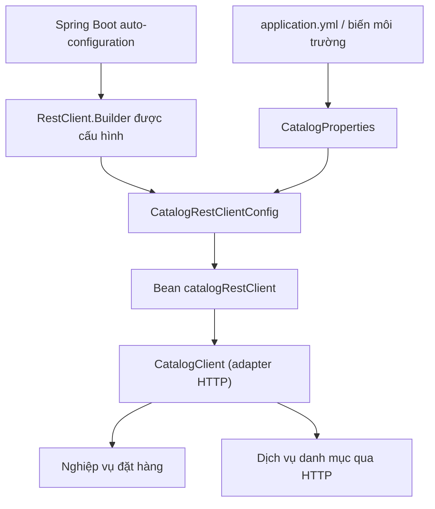

# Tạo `RestClient` từ `RestClient.Builder` được Spring Boot cấu hình

## 1. Bài toán tích hợp

Trong một ứng dụng Spring Boot, dịch vụ đặt hàng có thể cần gọi HTTP tới dịch vụ danh mục để lấy tên và trạng thái sản phẩm trước khi xác nhận đơn hàng. Đây là **tích hợp HTTP đồng bộ**: luồng xử lý gửi yêu cầu, chờ phản hồi, rồi mới đi tiếp. Một lần gọi chậm hoặc lỗi mạng có thể làm chậm chính luồng đang phục vụ người dùng.

Spring Framework cung cấp `RestClient` để viết HTTP client theo API fluent. Spring Boot bổ sung **`RestClient.Builder` được tự động cấu hình**, giúp ứng dụng sử dụng những thiết lập chung mà Boot đã chuẩn bị, sau đó tùy biến theo từng hệ thống đối tác.

Sau bài này, bạn có thể:

- Giải thích sự khác nhau giữa `RestClient.builder()` và việc **tiêm `RestClient.Builder` từ Spring container**.
- Tạo một bean `RestClient` dành riêng cho một hệ thống bên ngoài, có `baseUrl` và header mặc định.
- Tổ chức cấu hình URL bằng `@ConfigurationProperties`, tách HTTP client khỏi nghiệp vụ.
- Hiểu nơi cấu hình timeout, xử lý lỗi HTTP, kiểm thử request và quan sát cuộc gọi.
- Nhận diện những lỗi phổ biến khi có nhiều upstream, retry và dữ liệu nhạy cảm.

> **Phạm vi phiên bản:** `RestClient` xuất hiện trong Spring Framework 6.1 và được Spring Boot hỗ trợ tự động cấu hình `RestClient.Builder` từ Spring Boot 3.2. Ví dụ trong bài dùng Java 17+, Spring Boot 3.x có hỗ trợ `RestClient`, và phong cách cấu hình Spring hiện đại. Với phiên bản Boot khác, hãy kiểm tra tên API và thuộc tính cấu hình HTTP client tương ứng.

## 2. Vì sao sử dụng builder do Spring Boot cung cấp?

Có hai cách thường thấy để tạo HTTP client:

```java
// Tạo trực tiếp bằng Spring Framework:
RestClient directClient = RestClient.builder()
    .baseUrl("https://catalog.example")
    .build();
```

```java
// Nhận builder đã được Spring Boot cấu hình:
@Bean
RestClient catalogRestClient(RestClient.Builder builder) {
    return builder
        .baseUrl("https://catalog.example")
        .build();
}
```

Cả hai đều tạo một `RestClient` dùng được. Tuy nhiên, khi nhận builder từ Spring Boot, ứng dụng có thể kế thừa các tùy chỉnh mà Boot và các `RestClientCustomizer` đã áp dụng: lựa chọn cơ chế gửi HTTP theo môi trường, cấu hình các thành phần liên quan, hỗ trợ observation/metrics/tracing khi được bật, và các tùy chỉnh chung của ứng dụng. Những khả năng thực tế phụ thuộc phiên bản Boot, thư viện trên classpath và cấu hình đã bật.

Điểm phân biệt quan trọng:

| Thành phần | Trách nhiệm |
| --- | --- |
| `RestClient.Builder` | Đối tượng **có thể thay đổi** để đặt URL gốc, header, interceptor, bộ xử lý lỗi, request factory... rồi gọi `build()`. |
| `RestClient` | HTTP client được tạo từ builder; dùng để thực hiện các yêu cầu `GET`, `POST`, `PUT`, `DELETE`... |
| Spring Boot auto-configuration | Cung cấp builder và áp dụng những tùy chỉnh phù hợp với môi trường ứng dụng. |
| `RestClientCustomizer` | Điểm mở rộng để tùy chỉnh các builder do Boot quản lý một cách nhất quán. |
| Bean `RestClient` của ứng dụng | Client cụ thể của một upstream; thường được cấu hình URL gốc, xác thực và hành vi lỗi riêng. |

Với cấu hình thông thường của Spring Boot, bean `RestClient.Builder` có **scope prototype**: mỗi lần Spring giải quyết một yêu cầu tiêm bean sẽ nhận một builder riêng. Điều đó giúp cấu hình của client danh mục không vô tình lan sang client thanh toán. Nhưng **nếu tự giữ và dùng lại cùng một builder trong một phương thức**, các thay đổi vẫn tích lũy; hãy lấy builder mới hoặc `clone()` trước khi tạo client khác.

### Luồng tạo và sử dụng



## 3. Điều kiện để Boot cung cấp `RestClient.Builder`

Trong ứng dụng Spring MVC, starter thông dụng là:

```xml
<!-- pom.xml -->
<dependency>
    <groupId>org.springframework.boot</groupId>
    <artifactId>spring-boot-starter-web</artifactId>
</dependency>
```

Starter này đưa Spring Web vào classpath. Khi chạy bằng Spring Boot với auto-configuration phù hợp, bạn có thể tiêm `RestClient.Builder` vào constructor hoặc phương thức `@Bean` mà không cần tự khai báo bean builder. Nếu ứng dụng không cần máy chủ MVC, vẫn có thể dùng các dependency HTTP client phù hợp với Spring Web và cấu hình Boot; không nhất thiết phải xây dựng controller.

Đừng nhầm `RestClient` với `WebClient`:

- `RestClient` là **client đồng bộ**: lời gọi thông thường chặn luồng hiện tại cho tới khi nhận kết quả hoặc gặp lỗi.
- `WebClient` là HTTP client theo phong cách reactive; phù hợp khi ứng dụng chủ động dùng luồng xử lý bất đồng bộ/reactive.
- `RestTemplate` vẫn tồn tại trong nhiều ứng dụng cũ. Với code đồng bộ mới, `RestClient` mang lại API fluent; không cần đổi toàn bộ hệ thống chỉ vì một endpoint.

## 4. Ví dụ hoàn chỉnh: client gọi dịch vụ danh mục

Giả sử upstream cung cấp:

```http
GET /api/products/P-100 HTTP/1.1
Host: catalog.example
Accept: application/json
```

Phản hồi thành công:

```json
{
  "id": "P-100",
  "name": "Bàn phím cơ",
  "available": true
}
```

Ứng dụng của chúng ta đặt adapter HTTP trong package `example.integration.catalog`, gồm cấu hình, DTO và client. Đường dẫn trong ví dụ chỉ nhằm minh họa hợp đồng; khi chạy thật, phải thay bằng URL của upstream hoặc HTTP stub.

### Bước 1 — Đưa URL upstream ra ngoài mã nguồn

```yaml
# src/main/resources/application.yml
integration:
  catalog:
    base-url: http://localhost:8089/api
```

Đối với môi trường chạy thật, đổi giá trị `integration.catalog.base-url` bằng cấu hình triển khai hoặc biến môi trường `INTEGRATION_CATALOG_BASE_URL`. Không chèn URL của từng môi trường vào logic nghiệp vụ.

Khai báo lớp ánh xạ cấu hình:

```java
// CatalogProperties.java
package example.integration.catalog;

import org.springframework.boot.context.properties.ConfigurationProperties;

@ConfigurationProperties(prefix = "integration.catalog")
public record CatalogProperties(String baseUrl) {
}
```

Việc dùng `record` phù hợp với cấu hình chỉ đọc. Trong dự án thực tế, nên kiểm tra `baseUrl` không rỗng và đúng dạng URL ngay khi khởi động (chẳng hạn qua Bean Validation và `spring-boot-starter-validation`).

### Bước 2 — Tạo bean `RestClient` từ builder được tiêm

```java
// CatalogRestClientConfig.java
package example.integration.catalog;

import org.springframework.boot.context.properties.EnableConfigurationProperties;
import org.springframework.context.annotation.Bean;
import org.springframework.context.annotation.Configuration;
import org.springframework.http.HttpHeaders;
import org.springframework.http.MediaType;
import org.springframework.web.client.RestClient;

@Configuration(proxyBeanMethods = false)
@EnableConfigurationProperties(CatalogProperties.class)
public class CatalogRestClientConfig {

    @Bean
    RestClient catalogRestClient(
            RestClient.Builder builder,
            CatalogProperties properties) {

        return builder
                .baseUrl(properties.baseUrl())
                .defaultHeader(
                        HttpHeaders.ACCEPT,
                        MediaType.APPLICATION_JSON_VALUE)
                .build();
    }
}
```

Giải thích lần lượt:

1. Spring Boot cung cấp đối số `RestClient.Builder builder`; ta không gọi `RestClient.builder()` trong cấu hình này.
2. `CatalogProperties` lấy địa chỉ upstream từ cấu hình theo môi trường.
3. `baseUrl(...)` thiết lập phần URL chung; khi gọi API, adapter chỉ cần đường dẫn `/products/{id}`.
4. `defaultHeader(...)` khai báo `Accept: application/json` mặc định. Header riêng cho từng request vẫn có thể được thiết lập trên request đó.
5. `build()` tạo bean `RestClient` được các thành phần khác sử dụng lại.

Việc cấu hình một client riêng cho từng upstream giúp những thay đổi như host, timeout hoặc cơ chế xác thực nằm tập trung tại đúng ranh giới tích hợp.

### Bước 3 — Mô tả dữ liệu trả về

```java
// ProductDto.java
package example.integration.catalog;

public record ProductDto(
        String id,
        String name,
        boolean available) {
}
```

Tên field trong DTO cần khớp với hợp đồng JSON hoặc được ánh xạ tường minh bằng cấu hình Jackson. DTO là dữ liệu của **hợp đồng tích hợp**; nếu mô hình nghiệp vụ nội bộ khác với upstream, hãy chuyển đổi DTO sang mô hình nội bộ ở lớp adapter.

### Bước 4 — Viết adapter thực hiện cuộc gọi

```java
// CatalogClient.java
package example.integration.catalog;

import org.springframework.beans.factory.annotation.Qualifier;
import org.springframework.stereotype.Component;
import org.springframework.web.client.RestClient;

@Component
public class CatalogClient {

    private final RestClient restClient;

    public CatalogClient(
            @Qualifier("catalogRestClient") RestClient restClient) {
        this.restClient = restClient;
    }

    public ProductDto findProduct(String productId) {
        ProductDto result = restClient
                .get()
                .uri("/products/{id}", productId)
                .retrieve()
                .body(ProductDto.class);

        if (result == null) {
            throw new IllegalStateException(
                    "Catalog trả về body rỗng cho sản phẩm " + productId);
        }
        return result;
    }
}
```

Nếu `base-url` là `http://localhost:8089/api`, lời gọi `findProduct("P-100")` sẽ hướng tới `GET http://localhost:8089/api/products/P-100`. Giá trị `productId` được truyền qua cơ chế URI template thay vì nối chuỗi thủ công, giúp xử lý mã hóa ký tự trong tham số đường dẫn đúng cách.

Ở đây, `CatalogClient` là **adapter**: lớp nghiệp vụ chỉ cần yêu cầu `findProduct(id)`, không cần biết cách ghép URL, gửi header, đọc JSON hay phân loại lỗi HTTP.

### Bước 5 — Gọi adapter trong một use case

```java
// Trích đoạn trong lớp xử lý nghiệp vụ
private final CatalogClient catalogClient;

public void verifyProductIsAvailable(String productId) {
    ProductDto product = catalogClient.findProduct(productId);
    if (!product.available()) {
        throw new IllegalStateException("Sản phẩm chưa sẵn sàng");
    }
}
```

Lớp nghiệp vụ có thể chuyển đổi DTO thành đối tượng miền thay vì sử dụng trực tiếp `ProductDto`, tùy độ phức tạp và mức độ tách biệt cần có. Mỗi lần `findProduct` chạy là một cuộc gọi HTTP đồng bộ; cần đưa độ trễ đó vào ngân sách thời gian xử lý của endpoint gọi nó.

## 5. Ba cấp cấu hình và cách tránh ảnh hưởng giữa các upstream

Trong hệ thống thực tế, thường có nhiều HTTP client: danh mục, thanh toán, vận chuyển, thông báo. Cần phân biệt:

| Cấp | Áp dụng | Ví dụ |
| --- | --- | --- |
| Cấu hình do Spring Boot chuẩn bị | Điểm xuất phát cho các builder Boot quản lý | Request factory phù hợp, observation khi bật, các customizer |
| `RestClientCustomizer` | Chính sách chung cho các builder Boot quản lý | Header nhận diện ứng dụng, interceptor chung |
| Tùy biến ngay trong bean `RestClient` | Một upstream cụ thể | `baseUrl`, header riêng, xác thực, xử lý trạng thái |

Ví dụ về customizer **dùng chung**:

```java
import org.springframework.boot.web.client.RestClientCustomizer;
import org.springframework.context.annotation.Bean;
import org.springframework.http.HttpHeaders;

@Bean
RestClientCustomizer callerHeaderCustomizer() {
    return builder -> builder.defaultHeader(
            "X-Caller-Service", "order-service");
}
```

Bean này có thể đặt trong một lớp `@Configuration` của ứng dụng. Spring Boot sẽ áp dụng nó khi cấu hình builder do Boot quản lý. Chỉ đặt chính sách **thực sự dùng chung** tại đây; không đặt token hay URL của riêng dịch vụ danh mục vào customizer toàn cục.

**Điều cần tránh:** tạo hai client từ chính cùng một biến builder sau khi đã thay đổi `baseUrl` và interceptor. Builder có trạng thái cấu hình thay đổi được:

```java
// Cùng một builder được dùng liên tiếp: dễ làm cấu hình chồng lên nhau.
RestClient catalog = builder.baseUrl(catalogUrl).build();
RestClient billing = builder.baseUrl(billingUrl).build();
```

Khi cần tạo nhiều client trong cùng một phương thức, hãy lấy các builder độc lập thông qua `ObjectProvider<RestClient.Builder>.getObject()` hoặc dùng `builder.clone()` trước mỗi nhánh tùy biến. Trong các phương thức `@Bean` riêng, Spring Boot thông thường cung cấp builder prototype riêng qua dependency injection.

Một bean `RestClient` đã xây dựng có thể được sử dụng lại cho nhiều request đồng thời khi các interceptor và thành phần tùy chỉnh của bạn cũng an toàn với truy cập đồng thời. Không tạo lại client cho từng cuộc gọi nghiệp vụ nếu không có lý do cụ thể.

## 6. Timeout và quản lý tài nguyên khi gọi đồng bộ

HTTP đồng bộ sử dụng luồng đang xử lý cho tới khi yêu cầu hoàn thành. Vì vậy cần giới hạn thời gian chờ thay vì để upstream không phản hồi giữ luồng vô hạn.

Hai khái niệm quan trọng:

- **Connect timeout:** giới hạn thời gian tạo kết nối tới upstream.
- **Read/response timeout:** giới hạn thời gian chờ dữ liệu phản hồi theo semantics của HTTP client đang dùng; không nên tự coi nó là thời hạn tối đa tuyệt đối cho toàn bộ use case.

Spring Boot có cách cấu hình HTTP client qua thuộc tính và các API tùy theo **phiên bản**. Nếu cần timeout riêng cho một upstream, có thể gắn một `ClientHttpRequestFactory` vào builder. Ví dụ dưới đây cho thấy cách dùng JDK HTTP client trên Spring Framework 6.1+:

```java
// Trích đoạn thay thế cách xây dựng bean catalogRestClient.
// Imports bổ sung:
// java.net.http.HttpClient
// java.time.Duration
// org.springframework.http.client.JdkClientHttpRequestFactory

@Bean
RestClient catalogRestClient(
        RestClient.Builder builder,
        CatalogProperties properties) {

    HttpClient httpClient = HttpClient.newBuilder()
            .connectTimeout(Duration.ofSeconds(2))
            .build();

    JdkClientHttpRequestFactory requestFactory =
            new JdkClientHttpRequestFactory(httpClient);
    requestFactory.setReadTimeout(Duration.ofSeconds(5));

    return builder
            .requestFactory(requestFactory)
            .baseUrl(properties.baseUrl())
            .defaultHeader(HttpHeaders.ACCEPT,
                    MediaType.APPLICATION_JSON_VALUE)
            .build();
}
```

Đây là ví dụ cấu hình **riêng client danh mục**. Khi gọi `requestFactory(...)`, bạn chủ động thay request factory mà Boot có thể đã chọn dựa trên thư viện hiện diện; do đó cần cân nhắc connection pooling, proxy, TLS và các thiết lập HTTP chung trước khi thay. Nơi có sẵn thuộc tính timeout của Boot đáp ứng yêu cầu, ưu tiên cấu hình theo cơ chế được tài liệu hóa cho phiên bản đang dùng.

Trong vận hành, còn phải xem xét giới hạn số kết nối, thời gian chờ ở API gateway/reverse proxy và timeout của endpoint gọi ra. Nếu endpoint có ngân sách xử lý 3 giây, một HTTP client chờ 5 giây đã không phù hợp với ngân sách đó.

## 7. Lỗi HTTP, lỗi mạng và dữ liệu trả về

`retrieve()` cung cấp cách đọc body hoặc `ResponseEntity`:

```java
ProductDto product = restClient.get()
        .uri("/products/{id}", "P-100")
        .retrieve()
        .body(ProductDto.class);
```

```java
ResponseEntity<ProductDto> response = restClient.get()
        .uri("/products/{id}", "P-100")
        .retrieve()
        .toEntity(ProductDto.class);

int status = response.getStatusCode().value();
ProductDto body = response.getBody();
```

Khác biệt: `body(...)` phù hợp khi chủ yếu cần dữ liệu; `toEntity(...)` cho biết thêm HTTP status và response headers. Với phản hồi không có body (chẳng hạn 204), `body(...)` có thể trả về `null`; ví dụ adapter đã xử lý tình huống đó theo hợp đồng mong đợi.

Theo mặc định, với cách gọi `retrieve()`, phản hồi **4xx/5xx** dẫn đến ngoại lệ thuộc nhóm `RestClientResponseException` (ví dụ `HttpClientErrorException.NotFound`). Lỗi I/O như kết nối thất bại hoặc timeout thường xuất hiện dưới dạng `ResourceAccessException`. Không nên gộp tất cả thành thông báo “không tìm thấy sản phẩm”.

Ví dụ ánh xạ một lỗi cụ thể tại ranh giới adapter:

```java
public ProductDto findRequiredProduct(String productId) {
    try {
        ProductDto product = restClient.get()
                .uri("/products/{id}", productId)
                .retrieve()
                .body(ProductDto.class);

        if (product == null) {
            throw new IllegalStateException(
                    "Catalog trả về body rỗng");
        }
        return product;
    } catch (org.springframework.web.client.HttpClientErrorException.NotFound ex) {
        throw new IllegalArgumentException(
                "Không tồn tại sản phẩm " + productId, ex);
    }
}
```

Đây chỉ là ví dụ chuyển ngữ nghĩa lỗi. Trong hệ thống thật, nên có exception nghiệp vụ chuyên biệt như `ProductNotFoundException`. Có thể dùng `retrieve().onStatus(...)` hoặc `defaultStatusHandler(...)` để tập trung xử lý trạng thái; chọn cách nào dựa trên việc handler áp dụng cho một request hay toàn client.

| Tình huống | Cách xử lý nên cân nhắc |
| --- | --- |
| 200, JSON hợp lệ | Chuyển JSON thành DTO; kiểm tra các trường bắt buộc theo hợp đồng. |
| 204 hoặc body rỗng bất ngờ | Xử lý rõ ràng, tránh dùng đối tượng `null` như dữ liệu hợp lệ. |
| 400 | Kiểm tra lại request, schema và dữ liệu đầu vào; không retry mù quáng. |
| 401/403 | Kiểm tra credential, scope, quyền truy cập; tuyệt đối không log bí mật. |
| 404 | Tùy hợp đồng: không có thực thể, chưa đồng bộ dữ liệu, hoặc sai đường dẫn. |
| 429/503 | Có thể cân nhắc retry hữu hạn với backoff/jitter, tôn trọng `Retry-After` nếu phù hợp. |
| Timeout, mất kết nối | Phân biệt lỗi mạng với lỗi nghiệp vụ; đo tỷ lệ lỗi và độ trễ. |
| JSON sai schema | Coi là vi phạm hợp đồng giữa các hệ thống; phát hiện trong kiểm thử tích hợp. |

`RestClient` **không tự biến mọi lời gọi thành an toàn để retry**. Đặc biệt, `POST` tạo giao dịch hoặc `PUT` có tác dụng phụ cần xem xét idempotency và xử lý trùng lặp. Nếu gửi request thành công nhưng mất phản hồi, gọi lại có thể tạo tác động lần hai. Cần thiết kế idempotency key hoặc cơ chế khử trùng lặp ở phía nhận khi nghiệp vụ đòi hỏi.

Một giao dịch database nội bộ cũng không tự động rollback thao tác đã được thực hiện ở dịch vụ HTTP bên ngoài. Với chuỗi nhiều hệ thống, phải xác định ranh giới giao dịch, trạng thái trung gian và hành vi bù trừ (compensation) khi cần.

## 8. Xác thực và header theo từng request

Header không phải lúc nào cũng nên cố định trong bean `RestClient`. Ví dụ token người dùng phải gắn theo ngữ cảnh của **từng request**, trong khi API key của ứng dụng có thể lấy từ cấu hình bí mật của môi trường.

```java
ProductDto product = restClient.get()
        .uri("/products/{id}", productId)
        .headers(headers -> headers.setBearerAuth(accessToken))
        .retrieve()
        .body(ProductDto.class);
```

Mã trên minh họa cách gắn Bearer token theo lần gọi. `accessToken` phải đến từ thành phần cấp token phù hợp với kiến trúc bảo mật, không hardcode và không đưa nguyên giá trị vào log. Với auth dùng chung cho toàn client, có thể cân nhắc cấu hình `defaultRequest(...)` hoặc interceptor, nhưng phải bảo đảm token được cập nhật đúng hạn và không rò rỉ giữa các người dùng.

Cần thống nhất cách đặt correlation/request ID để lần theo luồng đi qua nhiều dịch vụ. Khi Spring Boot đã cấu hình observation/tracing, việc dùng builder do Boot quản lý giúp giữ nguyên cơ chế tích hợp đó, miễn là các thành phần cần thiết đã có mặt và được bật.

## 9. Kiểm thử HTTP client mà không gọi mạng thật

Kiểm thử adapter nên kiểm tra **URL, phương thức, header và ánh xạ body**, không phụ thuộc môi trường bên ngoài. Với Spring Boot 3.x hỗ trợ `RestClient`, test slice `@RestClientTest` và `MockRestServiceServer` giúp mô phỏng upstream.

Thêm dependency kiểm thử:

```xml
<dependency>
    <groupId>org.springframework.boot</groupId>
    <artifactId>spring-boot-starter-test</artifactId>
    <scope>test</scope>
</dependency>
```

Ví dụ dùng đúng các lớp `CatalogClient`, `CatalogRestClientConfig` và `CatalogProperties` đã khai báo:

```java
// CatalogClientTest.java
package example.integration.catalog;

import org.junit.jupiter.api.Test;
import org.springframework.beans.factory.annotation.Autowired;
import org.springframework.boot.test.autoconfigure.web.client.RestClientTest;
import org.springframework.context.annotation.Import;
import org.springframework.http.HttpMethod;
import org.springframework.http.MediaType;
import org.springframework.test.context.TestPropertySource;
import org.springframework.test.web.client.MockRestServiceServer;

import static org.assertj.core.api.Assertions.assertThat;
import static org.springframework.test.web.client.match.MockRestRequestMatchers.method;
import static org.springframework.test.web.client.match.MockRestRequestMatchers.requestTo;
import static org.springframework.test.web.client.response.MockRestResponseCreators.withSuccess;

@RestClientTest(CatalogClient.class)
@Import(CatalogRestClientConfig.class)
@TestPropertySource(properties =
        "integration.catalog.base-url=https://catalog.test/api")
class CatalogClientTest {

    @Autowired
    private CatalogClient catalogClient;

    @Autowired
    private MockRestServiceServer server;

    @Test
    void readsProductFromCatalog() {
        server.expect(requestTo(
                        "https://catalog.test/api/products/P-100"))
                .andExpect(method(HttpMethod.GET))
                .andRespond(withSuccess(
                        "{\"id\":\"P-100\",\"name\":\"Bàn phím cơ\",\"available\":true}",
                        MediaType.APPLICATION_JSON));

        ProductDto product = catalogClient.findProduct("P-100");

        assertThat(product)
                .isEqualTo(new ProductDto(
                        "P-100", "Bàn phím cơ", true));
        server.verify();
    }
}
```

Test này xác nhận adapter dùng đúng URL và đọc JSON thành DTO mà không khởi chạy dịch vụ danh mục thật. Nên bổ sung các trường hợp 404, 500, body rỗng, JSON không hợp lệ và hành vi xác thực. Khi cần kiểm tra connection timeout/TLS, DNS, proxy hay kết nối thực, dùng bài test tích hợp với HTTP stub server chạy trên cổng cục bộ; mock trong bộ nhớ không tái hiện những đặc điểm mạng đó.

**Lưu ý về test slice:** `@RestClientTest` chỉ tải một phần ứng dụng. Nếu cấu hình client của bạn có thêm bean phụ thuộc ngoài slice, cần import hoặc cung cấp test double cho đúng thành phần; không mặc định rằng mọi bean sản xuất đều có sẵn trong test.

## 10. Quan sát trong môi trường vận hành

Vì cuộc gọi đồng bộ có thể chiếm thời gian của request đầu vào, tối thiểu nên quan sát:

| Tín hiệu | Ý nghĩa |
| --- | --- |
| Số lần gọi và tỷ lệ thành công/lỗi theo upstream | Phân biệt sự cố riêng của dịch vụ danh mục với lỗi toàn hệ thống. |
| Độ trễ (p50, p95, p99) | Phát hiện tình trạng chậm đột biến dù tỷ lệ lỗi chưa tăng. |
| Loại lỗi (4xx, 5xx, timeout, lỗi giải mã) | Chọn phản ứng phù hợp, tránh retry làm sự cố nặng hơn. |
| Trace ID / correlation ID | Theo dõi một yêu cầu qua API, adapter HTTP và upstream. |
| Số request đồng thời/độ bão hòa tài nguyên | Đánh giá tác động của HTTP đồng bộ đến thread và connection pool. |

Với Spring Boot Actuator, Micrometer và cấu hình observation phù hợp, HTTP client có thể được ghi nhận qua các observation/metric của ứng dụng. Đặt tên hoặc tag theo **loại upstream, template đường dẫn, kết quả**, không theo ID sản phẩm hoặc giá trị token tùy ý vì có nguy cơ tạo cardinality rất lớn và làm lộ dữ liệu nhạy cảm.

Một bản ghi lỗi hữu ích bao gồm tên upstream, thao tác, mã trạng thái hoặc loại exception, thời lượng và trace ID. Không ghi toàn bộ body hoặc header chứa `Authorization`, cookie và dữ liệu cá nhân khi chưa có quy tắc che thông tin.

## 11. Những lỗi cấu hình hay gặp

| Dấu hiệu | Nguyên nhân thường gặp | Hướng kiểm tra |
| --- | --- | --- |
| Không tiêm được `RestClient.Builder` | Thiếu Spring Web, dùng Boot quá cũ, auto-configuration không hoạt động hoặc tự cấu hình lệch | Kiểm tra phiên bản Spring Boot/Framework, dependency và cấu hình ứng dụng. |
| Gọi sai host hoặc đường dẫn | `base-url` trỏ nhầm môi trường, phần path bị ghép sai | Kiểm tra URL cuối cùng bằng `MockRestServiceServer`; đặt URI template rõ ràng. |
| Header không có hiệu lực | Header của request thay thế mặc định hoặc customizer không áp dụng | Kiểm tra builder có được Spring Boot tiêm hay tạo trực tiếp; kiểm tra interceptor và header trên mock request. |
| Client A mang thông tin của client B | Tái sử dụng cùng builder có trạng thái | Dùng builder riêng, `ObjectProvider` hoặc `clone()`. |
| Endpoint thỉnh thoảng rất chậm | Timeout chưa phù hợp, cạn connection pool, upstream chậm | Đo p95/p99, kiểm tra timeout theo từng tầng, giới hạn tài nguyên và số request đồng thời. |
| Test gọi mạng thật | Test không bind mock vào đúng builder/client hoặc cấu hình slice không đúng | Kiểm tra `@RestClientTest`, `@Import`, URL override và server expectation. |
| 404 bị xem là lỗi mạng | Gom lỗi HTTP và lỗi I/O thành một loại | Tách phản hồi `RestClientResponseException` khỏi `ResourceAccessException`. |

## 12. Checklist khi đưa client vào dự án thực tế

1. **Hợp đồng:** Xác định chính xác endpoint, HTTP method, schema JSON, trường bắt buộc, mã lỗi và cách version API.
2. **Cấu hình:** Đưa URL và bí mật ra ngoài code; cấu hình riêng cho từng upstream; kiểm tra giá trị cấu hình lúc khởi động.
3. **Builder:** Tiêm `RestClient.Builder` từ Boot; chỉ tùy chỉnh mức cần thiết và giữ builder độc lập giữa các client.
4. **Bảo vệ tài nguyên:** Đặt timeout, cân nhắc giới hạn kết nối và ngân sách thời gian của luồng đồng bộ.
5. **Lỗi:** Phân biệt lỗi nghiệp vụ, lỗi HTTP và lỗi mạng; không retry không giới hạn; thiết kế idempotency nếu thao tác có tác dụng phụ.
6. **Bảo mật và quan sát:** Bảo vệ token, chuẩn hóa trace/log/metric và không log dữ liệu nhạy cảm.
7. **Kiểm thử:** Dùng mock HTTP để kiểm tra URL/header/body/status; có thêm test tích hợp thực cho những thuộc tính của mạng.

### Tự kiểm tra

**Câu 1.** Vì sao ứng dụng nên nhận `RestClient.Builder` do Spring Boot tiêm thay vì luôn gọi `RestClient.builder()`?  
*Gợi ý:* nghĩ tới customizer, lựa chọn request factory và observation do môi trường ứng dụng cung cấp.

**Câu 2.** Nếu cần gọi cả dịch vụ danh mục lẫn thanh toán, có nên dùng chung một biến builder rồi lần lượt đổi `baseUrl` không?  
*Gợi ý:* builder có trạng thái thay đổi được; bean builder của Boot thường là prototype.

**Câu 3.** Request đặt hàng gửi thành công tới upstream nhưng phía gọi bị timeout trước khi nhận phản hồi. Có nên retry POST ngay không?  
*Gợi ý:* trạng thái thực tế của tác vụ phía nhận có thể đã thay đổi; cần xác định tính idempotent và cách xử lý trùng lặp.

## Kết luận

`RestClient.Builder` được Spring Boot cấu hình là điểm khởi đầu thích hợp để tạo HTTP client đồng bộ trong ứng dụng Spring Boot. Hãy tạo bean `RestClient` theo từng upstream, truyền cấu hình qua `@ConfigurationProperties`, bao các thao tác HTTP trong adapter, kiểm soát timeout và trạng thái lỗi, rồi kiểm thử hợp đồng request/response. Cách tổ chức đó giúp tích hợp HTTP rõ ràng hơn, dễ vận hành hơn và giảm sự phụ thuộc của nghiệp vụ vào chi tiết giao tiếp với hệ thống bên ngoài.
