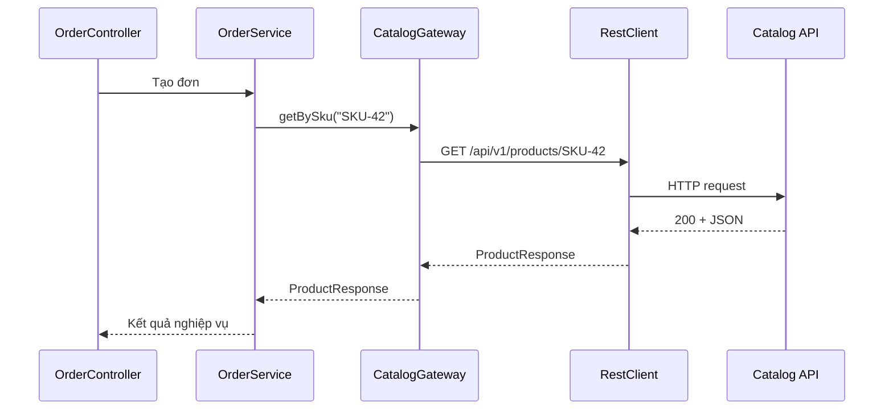
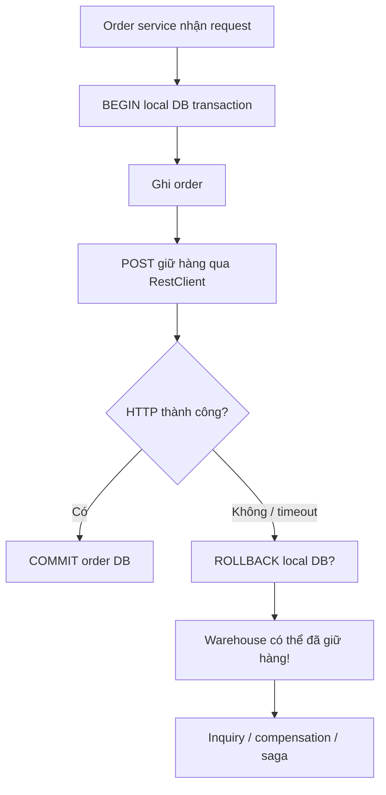

# Gọi GET, POST, PUT, PATCH và DELETE với `RestClient`

## 1. Bối cảnh và mục tiêu

Trong một ứng dụng Spring Boot, không phải mọi dữ liệu đều nằm trong cùng cơ sở dữ liệu. `order-service` có thể cần hỏi giá bán từ `catalog-service`, tạo giữ hàng ở `warehouse-service`, hoặc hủy một tài nguyên đã tạo ở API đối tác. Với những bước cần **gửi HTTP request và nhận kết quả ngay trong luồng gọi**, Spring Framework cung cấp `RestClient`: API HTTP client đồng bộ, có fluent interface để thiết lập method, URL, headers, request body và xử lý response.

Trong phạm vi **SPRING_BOOT_INTEGRATION**, bài học này nối HTTP client với các mối quan tâm của tích hợp hệ thống: cấu hình theo môi trường, hợp đồng dữ liệu, xử lý lỗi mạng và HTTP, transaction, retry an toàn, kiểm thử và quan sát. Các phương thức HTTP GET, POST, PUT, PATCH, DELETE chỉ là cách biểu đạt hành động; một luồng tích hợp đúng còn phải tuân thủ hợp đồng API phía nhận và quản lý tác động nghiệp vụ.

Sau bài này, bạn có thể:

1. Tạo `RestClient` trong Spring Boot và cấu hình URL gốc, timeout, media type.
2. Viết các lời gọi GET, POST, PUT, PATCH và DELETE theo đúng ngữ nghĩa HTTP.
3. Truyền path variable, query parameter, header, authentication và JSON body.
4. Đọc body hoặc `ResponseEntity<T>`, phân loại lỗi 4xx/5xx và lỗi kết nối.
5. Hiểu khi nào retry an toàn và cách phối hợp với idempotency key, ETag và database transaction.
6. Kiểm thử request thực tế được tạo bằng `MockRestServiceServer` mà không gọi API ngoài.

> **Phiên bản:** Ví dụ sử dụng **Java 17+, Spring Boot 3.2+ và Spring Framework 6.1+**, trong đó `RestClient` được giới thiệu từ Spring Framework 6.1. Spring Boot 4.x và Spring Framework 7.x tiếp tục hỗ trợ `RestClient` nhưng có thể thay đổi một số cách auto-configuration/HTTP request factory; cần đối chiếu phiên bản của dự án.

## 2. `RestClient` là gì và đặt ở đâu trong kiến trúc?

`RestClient` là HTTP client **đồng bộ** của Spring. Mỗi lần gọi terminal operation như `retrieve().body(...)` thường chặn luồng thực thi cho đến khi đọc xong phản hồi hoặc xảy ra lỗi/timeout. Nó dùng các HTTP message converter để chuyển đổi object Java sang JSON (và ngược lại) theo cấu hình.



| Thành phần | Trách nhiệm |
| --- | --- |
| `OrderService` | Thực hiện quy tắc nghiệp vụ và quyết định khi nào cần dữ liệu bên ngoài. |
| `CatalogGateway` | Che giấu chi tiết API ngoài: path, body, headers, status, lỗi. |
| `RestClient` | Xây dựng HTTP request, thực hiện kết nối qua request factory và chuyển đổi response. |
| `RestClient.Builder` | Cấu hình dùng chung: `baseUrl`, default headers, interceptor, message converters, request factory. |
| `ClientHttpRequestFactory` | Cung cấp HTTP transport, kết nối và timeout cụ thể. |
| DTO | Mô tả hợp đồng dữ liệu trên wire; không nên dùng trực tiếp JPA entity. |

### 2.1. So sánh các lựa chọn trong Spring

| Cách gọi HTTP | Đặc điểm | Nên dùng khi |
| --- | --- | --- |
| `RestClient` | Fluent API đồng bộ, Spring Framework 6.1+. | Ứng dụng Spring MVC, job hoặc service imperative cần HTTP client rõ ràng. |
| `RestTemplate` | API đồng bộ cũ, vẫn gặp ở nhiều hệ thống. | Dự án đang dùng; có thể chuyển dần sang `RestClient` khi phù hợp. |
| `WebClient` | API reactive, kết hợp `Mono`/`Flux` và non-blocking I/O khi dùng đúng end-to-end. | Luồng reactive/WebFlux hoặc nhu cầu xử lý I/O bất đồng bộ. |
| HTTP Interface | Khai báo các method HTTP bằng `@HttpExchange` và annotation chuyên biệt, tạo proxy dùng RestClient/WebClient. | Muốn tách hợp đồng gọi API thành interface. |

`RestClient` không tự biến cuộc gọi thành bất đồng bộ, không tự thêm retry/circuit breaker và không tự tham gia distributed transaction với dịch vụ khác. Những chính sách đó cần thiết kế ở tầng tích hợp.

## 3. Chuẩn bị dependency và cấu hình ứng dụng

Với Spring Boot 3.2+, ứng dụng có thể sử dụng `spring-boot-starter-web`, bao gồm Spring Web và `RestClient`. Nếu không cần dựng HTTP server thì có thể dùng `spring-web` trực tiếp cùng các module cấu hình cần thiết, nhưng ví dụ này chọn starter Web để dễ chạy với một Spring Boot application.

```xml
<!-- pom.xml, Spring Boot 3.2+ với parent hoặc BOM quản lý phiên bản -->
<dependency>
    <groupId>org.springframework.boot</groupId>
    <artifactId>spring-boot-starter-web</artifactId>
</dependency>

<dependency>
    <groupId>org.springframework.boot</groupId>
    <artifactId>spring-boot-starter-test</artifactId>
    <scope>test</scope>
</dependency>
```

Khi sử dụng Jackson JSON (được starter Web cấu hình trong dự án thông thường), Spring có thể serialize Java object thành JSON và deserialize response thành DTO. Nếu server trả XML, binary hay format tùy biến, cần converter và `Content-Type` tương ứng.

### 3.1. Externalize URL và timeout

```yaml
# application.yml
clients:
  catalog:
    base-url: ${CATALOG_BASE_URL:https://catalog.example.internal}
    connect-timeout: 2s
    read-timeout: 5s
```

`CATALOG_BASE_URL` có thể được cung cấp qua môi trường triển khai; không hard-code địa chỉ production vào các lời gọi nghiệp vụ. Hai loại timeout có ý nghĩa khác nhau:

- **Connect timeout:** giới hạn thời gian thiết lập kết nối (hành vi chính xác tùy HTTP transport).
- **Read timeout:** giới hạn chờ/đọc phản hồi theo request factory đang dùng; không mặc nhiên bằng tổng deadline của một luồng nghiệp vụ nhiều bước.

Đặt timeout quá cao có thể làm cạn thread xử lý request đồng bộ, nhưng đặt quá thấp lại gây nhiều retry, tăng tải cho upstream. Chọn giá trị dựa trên SLO, p95/p99 latency, ngân sách thời gian của toàn request và đặc tính API.

Bind cấu hình:

```java
// CatalogClientProperties.java
import java.net.URI;
import java.time.Duration;
import org.springframework.boot.context.properties.ConfigurationProperties;

@ConfigurationProperties(prefix = "clients.catalog")
public record CatalogClientProperties(
    URI baseUrl,
    Duration connectTimeout,
    Duration readTimeout
) {}
```

### 3.2. Tạo client và gateway bằng Spring bean

```java
// CatalogClientConfiguration.java
import java.net.http.HttpClient;

import org.springframework.boot.context.properties.EnableConfigurationProperties;
import org.springframework.context.annotation.Bean;
import org.springframework.context.annotation.Configuration;
import org.springframework.http.HttpHeaders;
import org.springframework.http.MediaType;
import org.springframework.http.client.JdkClientHttpRequestFactory;
import org.springframework.web.client.RestClient;

@Configuration(proxyBeanMethods = false)
@EnableConfigurationProperties(CatalogClientProperties.class)
public class CatalogClientConfiguration {

    @Bean
    CatalogGateway catalogGateway(
        RestClient.Builder restClientBuilder,
        CatalogClientProperties properties
    ) {
        HttpClient nativeClient = HttpClient.newBuilder()
            .connectTimeout(properties.connectTimeout())
            .build();

        JdkClientHttpRequestFactory requestFactory =
            new JdkClientHttpRequestFactory(nativeClient);
        requestFactory.setReadTimeout(properties.readTimeout());

        RestClient client = restClientBuilder
            .baseUrl(properties.baseUrl().toString())
            .requestFactory(requestFactory)
            .defaultHeader(
                HttpHeaders.ACCEPT,
                MediaType.APPLICATION_JSON_VALUE
            )
            .build();

        return new CatalogGateway(client);
    }
}
```

Ở đây:

- Spring Boot cung cấp `RestClient.Builder` có khả năng kế thừa những customizer/converter phù hợp với application context.
- `baseUrl` chứa **origin** của API; ví dụ sử dụng đường dẫn đầy đủ bắt đầu từ `/api/v1`, tránh ghép hai prefix khác nhau trong cấu hình.
- `JdkClientHttpRequestFactory` minh họa cấu hình dựa trên Java HTTP Client. Dự án có thể dùng Apache HttpComponents hoặc transport do Boot chọn; cần kiểm tra timeout/pool thực tế.
- Bean `CatalogGateway` sẽ được inject vào các service. Vì đã được tạo bằng `@Bean`, không cần gắn thêm `@Service` vào chính class gateway.

Với nhiều upstream, tạo các client/gateway riêng để tách base URL, authentication, timeout, error policy và metrics. Tránh biến một `RestClient` cấu hình chung thành đối tượng gửi request đến URI bất kỳ lấy từ input người dùng.

## 4. Hợp đồng API ví dụ: Catalog Service

Ta giả định một API nội bộ quản lý sản phẩm với các endpoint **do ví dụ tự định nghĩa**. Khi gọi một API thực, phải đọc tài liệu/OpenAPI của phía nhận: URL, media type, schema, HTTP status và behavior có thể khác.

| HTTP method | URL | Ý nghĩa hợp đồng mẫu | Response thành công |
| --- | --- | --- | --- |
| GET | `/api/v1/products/{sku}` | Lấy sản phẩm theo SKU. | `200` + JSON sản phẩm; `404` nếu không tồn tại. |
| GET | `/api/v1/products?category=...&page=...` | Tìm danh sách sản phẩm. | `200` + mảng JSON. |
| POST | `/api/v1/products` | Tạo sản phẩm mới. | `201 Created` + JSON/`Location`. |
| PUT | `/api/v1/products/{sku}` | Thay thế toàn bộ các trường có thể sửa của sản phẩm. | `200` + JSON mới. |
| PATCH | `/api/v1/products/{sku}` | Cập nhật riêng trường `active`. | `200` + JSON mới. |
| DELETE | `/api/v1/products/{sku}` | Xóa sản phẩm. | `204 No Content`. |

Ví dụ JSON cho một sản phẩm:

```json
{
  "sku": "SKU-42",
  "name": "Bình giữ nhiệt",
  "price": 125000.00,
  "active": true
}
```

### 4.1. DTO phía client

Không dùng entity database của `order-service` để biểu diễn hợp đồng JSON của `catalog-service`. Định nghĩa các record riêng; **mỗi public record đặt trong một file Java cùng tên**.

```java
// ProductResponse.java
import java.math.BigDecimal;

public record ProductResponse(
    String sku,
    String name,
    BigDecimal price,
    boolean active
) {}

// CreateProductRequest.java
import java.math.BigDecimal;

public record CreateProductRequest(
    String sku,
    String name,
    BigDecimal price,
    boolean active
) {}

// ReplaceProductRequest.java
import java.math.BigDecimal;

public record ReplaceProductRequest(
    String name,
    BigDecimal price,
    boolean active
) {}
```

Các DTO trên là kiểu ví dụ để học cách gọi API. Validation đầu vào (SKU không rỗng, giá không âm, độ dài tên, currency...) cần nằm ở tầng nghiệp vụ/DTO theo hợp đồng. Java record và HTTP message converter không tự bảo đảm dữ liệu upstream hợp lệ về mặt nghiệp vụ. Nếu schema JSON phía nhận đổi tên field, có thể dùng `@JsonProperty` hoặc mapping adapter phù hợp.

## 5. Viết đầy đủ năm HTTP method với `RestClient`

`RestClient` có cấu trúc fluent nhất quán:

```text
restClient
  .<get|post|put|patch|delete>()
  .uri(...)
  [.header(...) | .headers(...) | .accept(...) | .contentType(...)]
  [.body(...)]                 // Chỉ với method hỗ trợ body.
  .retrieve()
  .<body(Class) | toEntity(Class) | toBodilessEntity()>
```

Các nhánh `retrieve().body(...)`, `toEntity(...)` và `toBodilessEntity()` là **terminal operations**: chúng mới kích hoạt HTTP exchange và xử lý response. Kiểu return khác nhau tùy nhu cầu đọc body hay status/headers.

### 5.1. Gateway triển khai hoàn chỉnh

```java
// CatalogGateway.java
import java.util.List;
import java.util.Map;

import org.springframework.core.ParameterizedTypeReference;
import org.springframework.http.MediaType;
import org.springframework.http.ResponseEntity;
import org.springframework.web.client.RestClient;

public class CatalogGateway {
    private final RestClient client;

    public CatalogGateway(RestClient client) {
        this.client = client;
    }

    // GET: lấy một sản phẩm bằng path variable.
    public ProductResponse getBySku(String sku) {
        return client.get()
            .uri("/api/v1/products/{sku}", sku)
            .retrieve()
            .body(ProductResponse.class);
    }

    // GET: tạo query string an toàn bằng UriBuilder.
    public List<ProductResponse> search(String category, int page) {
        return client.get()
            .uri(uriBuilder -> uriBuilder
                .path("/api/v1/products")
                .queryParam("category", category)
                .queryParam("page", page)
                .build())
            .retrieve()
            .body(new ParameterizedTypeReference<List<ProductResponse>>() {});
    }

    // POST: tạo sản phẩm, lấy status + headers + body.
    public ResponseEntity<ProductResponse> create(
        CreateProductRequest request,
        String idempotencyKey
    ) {
        return client.post()
            .uri("/api/v1/products")
            .contentType(MediaType.APPLICATION_JSON)
            .header("Idempotency-Key", idempotencyKey)
            .body(request)
            .retrieve()
            .toEntity(ProductResponse.class);
    }

    // PUT: thay thế toàn bộ representation có thể sửa.
    public ProductResponse replace(
        String sku,
        ReplaceProductRequest request
    ) {
        return client.put()
            .uri("/api/v1/products/{sku}", sku)
            .contentType(MediaType.APPLICATION_JSON)
            .body(request)
            .retrieve()
            .body(ProductResponse.class);
    }

    // PATCH: ví dụ cập nhật một trường theo hợp đồng API này.
    public ProductResponse setActive(String sku, boolean active) {
        return client.patch()
            .uri("/api/v1/products/{sku}", sku)
            .contentType(MediaType.APPLICATION_JSON)
            .body(Map.of("active", active))
            .retrieve()
            .body(ProductResponse.class);
    }

    // DELETE: API trả 204, không cần parse JSON body.
    public ResponseEntity<Void> delete(String sku) {
        return client.delete()
            .uri("/api/v1/products/{sku}", sku)
            .retrieve()
            .toBodilessEntity();
    }
}
```

Phương thức `search` giả định response là **JSON array**; nếu API thực trả dạng phân trang `{"items":[...],"total":...}`, phải định nghĩa `PageResponse<ProductResponse>` hoặc DTO tương ứng. Không tự ý ép envelope thành `List<ProductResponse>`.

**Lưu ý về response body:** `body(ProductResponse.class)` có thể trả `null` với response không có body, dù kiểu Java khai báo là `ProductResponse`. Nếu hợp đồng yêu cầu body, gateway nên kiểm tra và báo lỗi contract thay vì chuyền `null` sâu vào domain. Không coi status `2xx` là bảo đảm response đúng schema.

## 6. GET: lấy một tài nguyên và truyền query parameter

GET được dùng để **đọc** tài nguyên; không được dùng cho hành động cố ý tạo đơn, trừ tiền hay xóa sản phẩm. Hai kiểu tham số:

```java
// Path variable: /api/v1/products/SKU-42
ProductResponse product = client.get()
    .uri("/api/v1/products/{sku}", "SKU-42")
    .retrieve()
    .body(ProductResponse.class);

// Query string: /api/v1/products?category=bottle&page=0
List<ProductResponse> products = client.get()
    .uri(builder -> builder
        .path("/api/v1/products")
        .queryParam("category", "bottle")
        .queryParam("page", 0)
        .build())
    .retrieve()
    .body(new ParameterizedTypeReference<List<ProductResponse>>() {});
```

Các biến `client` trong ví dụ này là `RestClient` đã cấu hình; trong thiết kế chính chúng nằm trong `CatalogGateway`. Dùng `uri(template, variable)` hoặc `UriBuilder` để giao framework mã hóa path/query. Tránh nối chuỗi thủ công như `"/products?category=" + userInput`: giá trị có dấu cách, dấu `&`, Unicode hoặc ký tự đặc biệt có thể làm URL sai hoặc thay đổi ý nghĩa query.

### 6.1. Kiểm soát not found và bộ nhớ

REST API thường trả `404 Not Found` khi không có sản phẩm. Với `retrieve()`, phản hồi 4xx mặc định được coi là lỗi, không tự chuyển thành `null`. Nếu “không tìm thấy” là một trường hợp nghiệp vụ hợp lệ, gateway có thể ánh xạ có chủ đích sang `Optional.empty()`:

```java
import java.util.Optional;
import org.springframework.web.client.HttpClientErrorException;

public Optional<ProductResponse> findBySku(String sku) {
    try {
        return Optional.ofNullable(getBySku(sku));
    } catch (HttpClientErrorException.NotFound notFound) {
        return Optional.empty();
    }
}
```

Đây là **method bổ sung đặt trong class `CatalogGateway`**, dùng `getBySku(...)` ở trên. Không bắt `RestClientException` chung và trả empty: làm vậy sẽ che lỗi xác thực, lỗi upstream 503 hay timeout thành “sản phẩm không tồn tại”.

Đối với endpoint danh sách, nếu server trả dữ liệu rất lớn, phân trang hoặc lọc ở API thay vì tải toàn bộ vào một `List`. `RestClient` đồng bộ không tự cung cấp streaming reactive/backpressure end-to-end như `WebClient`.

## 7. POST: tạo tài nguyên và truyền JSON body

`POST` thường dùng để **tạo tài nguyên** hoặc thực hiện một lệnh không thể biểu diễn thuần túy bằng thao tác thay thế.

```java
CreateProductRequest request = new CreateProductRequest(
    "SKU-42",
    "Bình giữ nhiệt",
    new BigDecimal("125000.00"),
    true
);

ResponseEntity<ProductResponse> response =
    gateway.create(request, "create-product-SKU-42-attempt-1");

int status = response.getStatusCode().value();
String location = response.getHeaders().getFirst("Location");
ProductResponse created = response.getBody();
```

`gateway` là bean `CatalogGateway`, còn `BigDecimal` cần import `java.math.BigDecimal`. HTTP request tương ứng, nếu converter JSON được cấu hình:

```http
POST /api/v1/products HTTP/1.1
Host: catalog.example.internal
Accept: application/json
Content-Type: application/json
Idempotency-Key: create-product-SKU-42-attempt-1

{"sku":"SKU-42","name":"Bình giữ nhiệt","price":125000.00,"active":true}
```

Phía server mẫu có thể trả:

```http
HTTP/1.1 201 Created
Location: /api/v1/products/SKU-42
Content-Type: application/json

{"sku":"SKU-42","name":"Bình giữ nhiệt","price":125000.00,"active":true}
```

### 7.1. Phân biệt `Accept` và `Content-Type`

| Header | Ý nghĩa | Đặt trong `RestClient` |
| --- | --- | --- |
| `Accept: application/json` | Client muốn **nhận** response ở dạng JSON. | `.accept(MediaType.APPLICATION_JSON)` hoặc `defaultHeader`. |
| `Content-Type: application/json` | Request **gửi** body được mã hóa thành JSON. | `.contentType(MediaType.APPLICATION_JSON)`. |
| `Authorization: Bearer ...` | Token truy cập khi upstream yêu cầu. | `.headers(h -> h.setBearerAuth(token))` hoặc interceptor. |
| `Idempotency-Key: ...` | Định danh thao tác tạo một lần nhưng có thể retry. | `.header("Idempotency-Key", key)`. |
| `X-Correlation-Id: ...` | Dùng để liên kết log/traces giữa dịch vụ nếu có thỏa thuận. | `.header("X-Correlation-Id", id)`. |

Header `Idempotency-Key` **chỉ có hiệu lực** khi server hỗ trợ idempotency: lưu trạng thái xử lý theo khóa, ràng buộc khóa với payload và trả lại kết quả cũ. Chỉ gắn header ở client không ngăn server tạo trùng.

Khi client không nhận được response, không có nghĩa POST thất bại: server có thể đã tạo sản phẩm. Hãy retry **cùng idempotency key** cho cùng lệnh hoặc tra trạng thái bằng một business key ổn định. Không tạo khóa mới mỗi lần retry.

## 8. PUT: thay thế toàn bộ representation có thể cập nhật

`PUT` mang ý nghĩa đặt tài nguyên tại URI xác định về trạng thái mục tiêu. Với API ví dụ, body chứa **đầy đủ những trường có thể chỉnh sửa**: tên, giá và trạng thái kích hoạt; SKU nằm trên path nên không bị cập nhật bởi PUT này.

```java
ReplaceProductRequest replacement = new ReplaceProductRequest(
    "Bình giữ nhiệt 750 ml",
    new BigDecimal("139000.00"),
    true
);

ProductResponse updated = gateway.replace("SKU-42", replacement);
```

Request gửi đi:

```http
PUT /api/v1/products/SKU-42 HTTP/1.1
Host: catalog.example.internal
Accept: application/json
Content-Type: application/json

{"name":"Bình giữ nhiệt 750 ml","price":139000.00,"active":true}
```

Theo ngữ nghĩa HTTP, PUT là **idempotent đối với tác động dự kiến**: gửi cùng representation thêm lần nữa không nên tiếp tục thay đổi tài nguyên theo mỗi lần thực thi. Tuy nhiên, server phải thực hiện đúng hợp đồng. Nếu server còn phát email hoặc trừ tiền mỗi lần xử lý PUT, các side effect ngoài resource đó vẫn cần cơ chế chống trùng riêng.

### 8.1. PUT không tương đương PATCH

- PUT: thay thế representation theo contract; bỏ thiếu trường có thể khiến server đặt về mặc định, xóa trường hoặc từ chối request.
- PATCH: mô tả một thay đổi một phần; server phải hiểu rõ patch document và cách áp dụng.
- Không dùng PUT chỉ để đổi `active` mà bỏ `name` và `price` trừ khi API chính thức quy định semantics đó.
- Một số API hỗ trợ **upsert** bằng PUT (tạo nếu chưa tồn tại), một số chỉ cho phép update; phải đọc hợp đồng, không đoán từ HTTP method.

## 9. PATCH: cập nhật một phần

Trong ví dụ, `PATCH /api/v1/products/{sku}` nhận JSON object với field có mặt được cập nhật:

```java
ProductResponse updated = gateway.setActive("SKU-42", false);
```

```http
PATCH /api/v1/products/SKU-42 HTTP/1.1
Host: catalog.example.internal
Accept: application/json
Content-Type: application/json

{"active":false}
```

Với **hợp đồng mẫu này**, gửi lại `{"active":false}` là lũy đẳng về giá trị `active` vì chỉ đặt cùng giá trị. Nhưng PATCH **không mặc nhiên lũy đẳng**: một patch kiểu “tăng giá thêm 10.000” sẽ tăng thêm mỗi lần lặp.

### 9.1. Không nhầm JSON thường, JSON Merge Patch và JSON Patch

| Dạng patch | Media type thường gặp | Ý nghĩa |
| --- | --- | --- |
| Partial JSON theo quy ước riêng của API | `application/json` | Server tự định nghĩa field có mặt/không có mặt được xử lý ra sao. |
| JSON Merge Patch (RFC 7396) | `application/merge-patch+json` | Giá trị `null` biểu thị xóa một member theo chuẩn merge patch; field vắng mặt được giữ nguyên. |
| JSON Patch (RFC 6902) | `application/json-patch+json` | Body là danh sách operation như `add`, `replace`, `remove`, `test`. |

Không đặt `application/merge-patch+json` hay `application/json-patch+json` chỉ vì dùng HTTP PATCH. Trong ví dụ, server **cụ thể** chấp nhận `application/json` với field `active` nên `Map.of("active", active)` phù hợp. Nếu server áp dụng Merge Patch, cần đặt media type đúng và phân biệt **field vắng mặt** với **field null**; dùng DTO có null được serialize mặc định có thể vô tình xóa dữ liệu.

Khi PATCH cập nhật nhiều trường phụ thuộc nhau, có thể dùng ETag/conditional request để ngăn ghi đè thay đổi của người khác.

## 10. DELETE: xóa tài nguyên và đọc response không có body

`DELETE` xóa hoặc làm cho tài nguyên không còn được nhìn thấy qua URI theo contract. Với API mẫu, server trả `204 No Content`:

```java
ResponseEntity<Void> result = gateway.delete("SKU-42");

if (result.getStatusCode().value() == 204) {
    // Catalog xác nhận đã xóa.
}
```

Nếu method không cần đọc body, `toBodilessEntity()` giúp lấy status/headers mà không yêu cầu deserialize `ProductResponse`. Những API khác có thể trả `200 OK`, `202 Accepted` (xóa bất đồng bộ) hoặc `404 Not Found` cho lần xóa thứ hai; **HTTP idempotency mô tả trạng thái tài nguyên sau hành động**, không bắt mọi lần gọi phải trả cùng status.

Ví dụ, nếu xóa `SKU-42` lần đầu trả 204 và lần hai trả 404, tài nguyên vẫn ở trạng thái “không tồn tại” sau mỗi lần. Client có thể chấp nhận 404 như kết quả tương đương **chỉ khi** contract nghiệp vụ cho phép (ví dụ thao tác dọn tài nguyên), chứ không tự nuốt mọi lỗi 404.

Không nhầm DELETE với việc xóa một sự kiện audit, xóa dữ liệu pháp lý phải lưu hoặc hủy một giao dịch tài chính: business workflow có thể yêu cầu soft delete, event bù trừ và kiểm soát quyền riêng.

## 11. Đọc response: `body`, `toEntity`, `toBodilessEntity` và `exchange`

### 11.1. Ba cách dùng phổ biến với `retrieve()`

| Terminal operation | Kết quả | Khi dùng |
| --- | --- | --- |
| `retrieve().body(ProductResponse.class)` | DTO hoặc `null` nếu không có body. | Chỉ cần payload dữ liệu. |
| `retrieve().body(new ParameterizedTypeReference<List<ProductResponse>>() {})` | Generic type có thể deserialise đúng phần tử. | Body JSON dạng danh sách hoặc kiểu generic. |
| `retrieve().toEntity(ProductResponse.class)` | `ResponseEntity<ProductResponse>` có status, headers, body. | Cần `Location`, `ETag` hoặc status 201/200. |
| `retrieve().toBodilessEntity()` | `ResponseEntity<Void>` có status/headers. | DELETE 204, một thao tác không trả payload. |

### 11.2. Khi cần xử lý status/body ở mức thấp

`exchange(...)` cung cấp quyền truy cập trực tiếp `ClientHttpRequest` và `ClientHttpResponse` để tự xử lý status:

```java
// Method minh họa đặt trong CatalogGateway:
public boolean exists(String sku) {
    return client.get()
        .uri("/api/v1/products/{sku}", sku)
        .exchange((request, response) -> {
            int code = response.getStatusCode().value();
            if (code == 200) {
                return true;
            }
            if (code == 404) {
                return false;
            }
            throw new IllegalStateException(
                "Catalog trả status không được dự kiến: " + code
            );
        });
}
```

Với `exchange(...)`, các default status handler và các `onStatus(...)` của `retrieve()` **không tự chạy**; callback chịu trách nhiệm phân loại status và đọc response body nếu cần. Không giữ `response.getBody()`/InputStream để dùng sau khi callback đã trả về; tài nguyên HTTP được quản lý theo vòng đời exchange. Nếu chỉ cần deserialize JSON bình thường, `retrieve()` ngắn gọn và dễ bảo trì hơn.

## 12. URI, headers, authentication và nội dung request

### 12.1. Path variable và query

```java
String sku = "SKU/42"; // Ví dụ chứa ký tự cần mã hóa.

ProductResponse item = client.get()
    .uri("/api/v1/products/{sku}", sku)
    .retrieve()
    .body(ProductResponse.class);

List<ProductResponse> matches = client.get()
    .uri(b -> b.path("/api/v1/products")
        .queryParam("category", "bình giữ nhiệt")
        .queryParam("page", 0)
        .build())
    .retrieve()
    .body(new ParameterizedTypeReference<List<ProductResponse>>() {});
```

Khi ID có dấu `/`, hãy kiểm chứng quy tắc URL encoding của thư viện và reverse proxy/server thực tế. Dù client mã hóa đúng, server có thể từ chối encoded slash hoặc giải mã khác dự kiến. Ưu tiên ID không chứa dấu phân cách path nếu hợp đồng có thể thiết kế như vậy. Không xây URL từ chuỗi do người dùng cung cấp làm host tùy ý; điều đó có thể dẫn đến SSRF.

### 12.2. Header động và Bearer token

```java
// token lấy từ cơ chế xác thực/server-side credential provider,
// correlationId lấy từ tracing context hoặc nguồn được chuẩn hóa.
ProductResponse item = client.get()
    .uri("/api/v1/products/{sku}", "SKU-42")
    .headers(headers -> {
        headers.setBearerAuth(token);
        headers.add("X-Correlation-Id", correlationId);
    })
    .retrieve()
    .body(ProductResponse.class);
```

Không đưa Bearer token thật vào ví dụ, annotation, source code, query string hoặc log. Khi nhiều request dùng chung OAuth2 token, có thể gắn interceptor hoặc integration với OAuth2 client để lấy token mới mỗi request/refresh đúng chính sách. Đừng tạo `RestClient` mới cho từng HTTP request chỉ để gắn header; tái sử dụng cấu hình client và connection pool.

### 12.3. Content negotiation và validation

- `.accept(MediaType.APPLICATION_JSON)` đặt response representation được chấp nhận.
- `.contentType(MediaType.APPLICATION_JSON).body(request)` cho phép converter mã hóa DTO ra JSON. Với XML, form-url-encoded, multipart hoặc file upload cần converter/body type phù hợp.
- Request DTO có thể hợp lệ ở phía Java nhưng không hợp lệ theo upstream contract; nên validation trước khi gửi và có contract test.
- Không gửi toàn bộ JPA entity ra upstream: dễ lộ field nhạy cảm, lazy collection và coupling schema.

## 13. Xử lý 4xx, 5xx, lỗi mạng và lỗi contract

Mặc định, `retrieve()` coi 4xx/5xx là HTTP error và phát sinh exception thay vì deserialize nó thành DTO thành công. Các lỗi thường gặp:

| Tình huống | Ý nghĩa | Chính sách tích hợp |
| --- | --- | --- |
| 400 Bad Request | Payload, format hoặc validation sai. | Sửa contract/mapping; không retry nguyên bản vô hạn. |
| 401/403 | Token thiếu/hết hạn hoặc thiếu quyền. | Xử lý authentication/authorization và alert. |
| 404 | Không có tài nguyên hoặc sai endpoint. | Ánh xạ sang not found **khi contract cho phép**. |
| 409 Conflict | Duplicate/business conflict/concurrency. | Phân biệt retry cùng key và conflict thực sự. |
| 412 Precondition Failed | `If-Match`/ETag không còn khớp. | Đọc lại phiên bản, xử lý optimistic concurrency. |
| 429 Too Many Requests | Upstream áp dụng rate limit. | Tôn trọng `Retry-After`, backoff có giới hạn. |
| 500/502/503/504 | Upstream hoặc gateway gặp lỗi. | Retry có điều kiện, circuit breaker và cảnh báo. |
| Connect/read timeout | Không có kết quả chắc chắn của request. | Phân biệt lệnh đọc/ghi, sử dụng idempotency/inquiry. |
| 200 nhưng JSON hỏng/không có body | Vi phạm hợp đồng response. | Lỗi tích hợp; không mặc định là dữ liệu hợp lệ. |

Các lớp exception Spring thường gặp:

- `HttpClientErrorException` cho phần lớn phản hồi 4xx; có lớp con như `HttpClientErrorException.NotFound`.
- `HttpServerErrorException` cho phần lớn phản hồi 5xx.
- `RestClientResponseException` là lớp cơ sở hữu ích để đọc status và response body của nhiều HTTP status exception.
- `ResourceAccessException` thường bao bọc lỗi I/O như mất kết nối, timeout ở transport đồng bộ.
- `RestClientException` rộng hơn, bao gồm một số lỗi chuyển đổi/đọc response và các lỗi client khác.

### 13.1. Ánh xạ lỗi trên một request bằng `onStatus`

```java
// Đoạn bên trong CatalogGateway; CatalogConflictException là exception
// do ứng dụng tự định nghĩa, không phải class có sẵn trong Spring.
ResponseEntity<ProductResponse> response = client.post()
    .uri("/api/v1/products")
    .contentType(MediaType.APPLICATION_JSON)
    .header("Idempotency-Key", idempotencyKey)
    .body(request)
    .retrieve()
    .onStatus(
        status -> status.value() == 409,
        (httpRequest, httpResponse) -> {
            throw new CatalogConflictException(
                "SKU đã tồn tại hoặc yêu cầu bị xung đột"
            );
        }
    )
    .toEntity(ProductResponse.class);
```

Handler được gọi khi predicate status khớp. Nếu muốn áp dụng chính sách lỗi chung cho mọi request của cùng client, có thể cấu hình `RestClient.Builder.defaultStatusHandler(...)`; các quy tắc cụ thể của từng request nên ở tầng gateway để không ảnh hưởng những endpoint khác.

**Không gọi `exchange(...)` và kỳ vọng `onStatus(...)` chạy tự động.** Hai cách này đưa quyền kiểm soát response cho các tầng khác nhau.

### 13.2. Timeout có thể tạo kết quả không chắc chắn

Ví dụ POST tạo sản phẩm:

1. Client gửi `POST /products`; server ghi sản phẩm và commit thành công.
2. Kết nối bị ngắt trước khi response về client.
3. Client nhận timeout và không biết server đã hoàn tất hay chưa.

Nếu client gửi lại POST với một idempotency key **mới**, có thể tạo thêm resource hoặc phát side effect thêm lần nữa. Nếu upstream hỗ trợ idempotency key, lần retry phải dùng **cùng khóa** cho cùng lệnh. Với API không hỗ trợ idempotency, có thể dùng business key/GET tra cứu trạng thái, đối soát, hoặc thiết kế compensation phù hợp.

Retry chỉ nên thực hiện khi lỗi có khả năng phục hồi, với backoff/jitter, giới hạn tổng số lần và ngân sách thời gian. Tránh mỗi tầng gateway, service, API caller cùng retry khiến tổng số request tăng theo cấp số nhân.

## 14. Điều kiện cập nhật: ETag và `If-Match`

Idempotency giải quyết **lặp cùng thao tác**; optimistic concurrency giải quyết **hai thao tác khác nhau cùng sửa một tài nguyên**. HTTP cung cấp cách phổ biến để hạn chế ghi đè khi hai người thay đổi một sản phẩm cùng lúc:

1. GET sản phẩm, upstream trả `ETag: "v17"`.
2. Client gửi PUT/PATCH kèm `If-Match: "v17"`.
3. Upstream chỉ cập nhật nếu phiên bản hiện tại vẫn khớp; nếu không, trả `412 Precondition Failed`.

```java
ResponseEntity<ProductResponse> current = client.get()
    .uri("/api/v1/products/{sku}", "SKU-42")
    .retrieve()
    .toEntity(ProductResponse.class);

String etag = current.getHeaders().getETag();
if (etag == null) {
    throw new IllegalStateException("Catalog không cung cấp ETag");
}

ReplaceProductRequest replacement = new ReplaceProductRequest(
    "Bình giữ nhiệt 750 ml",
    new BigDecimal("139000.00"),
    true
);

ProductResponse updated = client.put()
    .uri("/api/v1/products/{sku}", "SKU-42")
    .headers(headers -> headers.setIfMatch(etag))
    .contentType(MediaType.APPLICATION_JSON)
    .body(replacement)
    .retrieve()
    .body(ProductResponse.class);
```

Đoạn minh họa dùng `BigDecimal` đã import và giả định Catalog API thực sự hỗ trợ ETag/precondition. Không tự phát `If-Match` nếu upstream không công bố contract đó. Việc bật ETag không thay thế idempotency key của POST tạo lệnh.

## 15. HTTP đồng bộ và nhất quán dữ liệu giữa dịch vụ

Một lời gọi HTTP không thể tự tham gia cùng local database transaction của Spring Boot. Nếu service đang ở `@Transactional` rồi gọi một API bên ngoài, transaction của database nội bộ **không rollback được** tác động đã commit ở API đối tác.



Những rủi ro:

- Giữ database transaction mở trong lúc chờ HTTP làm tăng thời gian giữ lock và số connection DB đang bận.
- Nếu DB rollback sau khi warehouse đã giữ hàng, hệ thống cần thao tác bù trừ hoặc đối soát.
- Timeout không chứng minh rằng warehouse chưa thực hiện lệnh.
- Retry lệnh ghi thiếu idempotency key có thể gây ghi kép.

Với workflow dài, cân nhắc trạng thái nghiệp vụ (`PENDING_RESERVATION`, `RESERVED`, `FAILED`), saga hoặc cơ chế task/outbox. Giao dịch cục bộ, HTTP timeout, retry và quyền sở hữu idempotency phải được đặc tả riêng.

## 16. Vận hành an toàn cho `RestClient`

### 16.1. Các chính sách cần cấu hình

| Mục tiêu | Hành động | Rủi ro nếu bỏ qua |
| --- | --- | --- |
| Giới hạn độ trễ | Connect/read timeout và deadline cho toàn luồng. | Request treo, cạn servlet threads. |
| Kiểm soát tài nguyên | Reuse HTTP client và connection pool theo transport. | Tạo kết nối thừa, tăng TLS handshake và latency. |
| Auth đúng môi trường | Token provider, TLS/mTLS, secret manager. | Lộ credential hoặc lỗi 401 khi token hết hạn. |
| Kiểm soát lưu lượng | Rate limit, bulkhead, circuit breaker khi hợp đồng yêu cầu. | Một upstream chậm kéo sập nhiều tầng. |
| Retry có trách nhiệm | Chỉ retry lỗi/transient operation phù hợp, backoff và jitter. | Request storm, nhân đôi side effect. |
| Hợp đồng dữ liệu | JSON schema/DTO version, validation, consumer contract tests. | Decode lỗi hoặc diễn giải sai dữ liệu. |
| Bảo vệ URI | Chỉ dùng host/base URL được cấu hình tin cậy. | SSRF và gửi token đến host không mong muốn. |

### 16.2. Logging, metrics và traces

Khi dùng Spring Boot Actuator, Micrometer và các thành phần observation tương ứng, HTTP client có thể được theo dõi qua các metric/traces. Nên giám sát:

- Số lời gọi theo upstream/HTTP method/route template/status.
- Latency p50/p95/p99, lỗi 4xx/5xx, connect/read timeout.
- Retry count, circuit-breaker open rate và số request đang chờ.
- Correlation/trace ID nối request từ controller sang catalog/warehouse API.
- Số lần gặp lỗi JSON contract, 409/412 xung đột và kết quả không chắc chắn.

Không đặt SKU, orderId, email hay full URL có query cá nhân làm metric tag nhiều biến thể. Không log Authorization header, cookie, API key hay body nhạy cảm; khi cần debug, dùng structured log có lọc và quyền truy cập phù hợp.

## 17. Kiểm thử hợp đồng HTTP client với `MockRestServiceServer`

Chỉ mock `CatalogGateway` trong test `OrderService` sẽ không phát hiện việc gateway gửi nhầm method, URL hoặc content type. Để kiểm thử **request do `RestClient` thực sự tạo**, dùng `MockRestServiceServer` từ `spring-test` (được đưa vào qua `spring-boot-starter-test`).

### 17.1. Kiểm thử GET và deserialize response

```java
import static org.junit.jupiter.api.Assertions.assertEquals;
import static org.springframework.test.web.client.match.MockRestRequestMatchers.header;
import static org.springframework.test.web.client.match.MockRestRequestMatchers.method;
import static org.springframework.test.web.client.match.MockRestRequestMatchers.requestTo;
import static org.springframework.test.web.client.response.MockRestResponseCreators.withSuccess;

import org.junit.jupiter.api.Test;
import org.springframework.http.HttpHeaders;
import org.springframework.http.HttpMethod;
import org.springframework.http.MediaType;
import org.springframework.test.web.client.MockRestServiceServer;
import org.springframework.web.client.RestClient;

class CatalogGatewayTest {
    @Test
    void getBySkuSendsGetAndReadsProduct() {
        RestClient.Builder builder =
            RestClient.builder().baseUrl("https://catalog.test");

        MockRestServiceServer server =
            MockRestServiceServer.bindTo(builder).build();

        CatalogGateway gateway = new CatalogGateway(
            builder.defaultHeader(HttpHeaders.ACCEPT, "application/json")
                .build()
        );

        server.expect(
                requestTo("https://catalog.test/api/v1/products/SKU-42"))
            .andExpect(method(HttpMethod.GET))
            .andExpect(header(HttpHeaders.ACCEPT, "application/json"))
            .andRespond(withSuccess(
                """
                {
                  "sku": "SKU-42",
                  "name": "Bình giữ nhiệt",
                  "price": 125000.00,
                  "active": true
                }
                """,
                MediaType.APPLICATION_JSON
            ));

        ProductResponse response = gateway.getBySku("SKU-42");

        assertEquals("SKU-42", response.sku());
        assertEquals(0,
            new java.math.BigDecimal("125000.00")
                .compareTo(response.price()));
        server.verify();
    }
}
```

**Thứ tự cấu hình rất quan trọng:** `MockRestServiceServer.bindTo(builder)` phải thực hiện trước `builder.build()`. Nếu gateway dùng một `RestClient` khác, mock server sẽ không quan sát được request.

### 17.2. Kiểm thử POST, header và JSON body

Ví dụ method khác nằm trong cùng class test (có thể tạo builder/server riêng cho mỗi test):

```java
import static org.junit.jupiter.api.Assertions.assertEquals;
import static org.springframework.test.web.client.match.MockRestRequestMatchers.content;
import static org.springframework.test.web.client.match.MockRestRequestMatchers.header;
import static org.springframework.test.web.client.match.MockRestRequestMatchers.method;
import static org.springframework.test.web.client.match.MockRestRequestMatchers.requestTo;
import static org.springframework.test.web.client.response.MockRestResponseCreators.withStatus;

import java.math.BigDecimal;
import org.junit.jupiter.api.Test;
import org.springframework.http.HttpHeaders;
import org.springframework.http.HttpMethod;
import org.springframework.http.HttpStatus;
import org.springframework.http.MediaType;
import org.springframework.http.ResponseEntity;
import org.springframework.test.web.client.MockRestServiceServer;
import org.springframework.web.client.RestClient;

class CatalogGatewayCreateTest {
    @Test
    void createSendsPostWithJsonAndStableKey() {
        RestClient.Builder builder =
            RestClient.builder().baseUrl("https://catalog.test");
        MockRestServiceServer server =
            MockRestServiceServer.bindTo(builder).build();
        CatalogGateway gateway = new CatalogGateway(builder.build());

        server.expect(requestTo("https://catalog.test/api/v1/products"))
            .andExpect(method(HttpMethod.POST))
            .andExpect(header(
                HttpHeaders.CONTENT_TYPE,
                MediaType.APPLICATION_JSON_VALUE
            ))
            .andExpect(header("Idempotency-Key", "cmd-123"))
            .andExpect(content().json(
                """
                {
                  "sku": "SKU-42",
                  "name": "Bình giữ nhiệt",
                  "price": 125000.00,
                  "active": true
                }
                """
            ))
            .andRespond(withStatus(HttpStatus.CREATED)
                .contentType(MediaType.APPLICATION_JSON)
                .header(HttpHeaders.LOCATION, "/api/v1/products/SKU-42")
                .body(
                    """
                    {
                      "sku": "SKU-42",
                      "name": "Bình giữ nhiệt",
                      "price": 125000.00,
                      "active": true
                    }
                    """
                ));

        ResponseEntity<ProductResponse> result = gateway.create(
            new CreateProductRequest(
                "SKU-42",
                "Bình giữ nhiệt",
                new BigDecimal("125000.00"),
                true
            ),
            "cmd-123"
        );

        assertEquals(HttpStatus.CREATED, result.getStatusCode());
        assertEquals("SKU-42", result.getBody().sku());
        server.verify();
    }
}
```

Với các test khác, dùng `MockRestRequestMatchers` để xác nhận PUT/PATCH/DELETE, path variable, query, status 204 và cả request bị từ chối.

### 17.3. Kiểm thử lỗi HTTP

```java
import static org.junit.jupiter.api.Assertions.assertThrows;
import static org.springframework.test.web.client.match.MockRestRequestMatchers.requestTo;
import static org.springframework.test.web.client.response.MockRestResponseCreators.withStatus;

import org.junit.jupiter.api.Test;
import org.springframework.http.HttpStatus;
import org.springframework.test.web.client.MockRestServiceServer;
import org.springframework.web.client.HttpClientErrorException;
import org.springframework.web.client.RestClient;

class CatalogGatewayNotFoundTest {
    @Test
    void missingProductRaises404() {
        RestClient.Builder builder =
            RestClient.builder().baseUrl("https://catalog.test");
        MockRestServiceServer server =
            MockRestServiceServer.bindTo(builder).build();
        CatalogGateway gateway = new CatalogGateway(builder.build());

        server.expect(
                requestTo("https://catalog.test/api/v1/products/UNKNOWN"))
            .andRespond(withStatus(HttpStatus.NOT_FOUND));

        assertThrows(
            HttpClientErrorException.NotFound.class,
            () -> gateway.getBySku("UNKNOWN")
        );
        server.verify();
    }
}
```

Các test trên là contract tests **phía client**: kiểm tra request/response mapping tại lớp gateway. Chúng không chứng minh dịch vụ catalog ngoài đời có cùng contract. Cần thêm môi trường test/API contract của upstream để xác minh tính tương thích, đặc biệt sau khi nâng phiên bản.

### 17.4. Ma trận test cần có

| Hành vi | Test đại diện |
| --- | --- |
| GET path/query | Path biến SKU được encode đúng; category Unicode và query page chính xác. |
| POST JSON | Method, `Content-Type`, body, `Idempotency-Key`, response 201 và `Location`. |
| PUT | Body chứa toàn bộ trường update theo hợp đồng, đúng path và response 200. |
| PATCH | Chỉ field cần sửa, media type đúng; phân biệt missing field với null. |
| DELETE | Xử lý 204 body rỗng và 404 theo contract. |
| Lỗi 4xx/5xx | 400, 401, 404, 409, 412, 429, 503 được phân loại đúng. |
| Lỗi mạng/timeout | Không biến timeout thành 404; retry có giới hạn và cùng idempotency key cho thao tác ghi. |
| Concurrency | `If-Match` đúng tạo update, ETag cũ bị trả 412. |
| Bảo mật | Token không xuất hiện trong log/query; URL động bị giới hạn host. |
| Quan sát | Gắn trace ID, log/metric có route template và không tiết lộ dữ liệu nhạy cảm. |

Khi cần kiểm thử TLS, keep-alive, proxy, network timeout hoặc pooling thật, `MockRestServiceServer` không đủ vì nó không mở kết nối mạng. Dùng WireMock/MockWebServer/Testcontainers hoặc môi trường test có HTTP server thực để kiểm chứng phần transport.

## 18. Lỗi thường gặp và cách khắc phục

| Sai lầm | Hậu quả | Cách sửa |
| --- | --- | --- |
| Dùng `GET` để tạo hoặc thay đổi dữ liệu nghiệp vụ | Retry, prefetch hoặc crawler vô tình thực thi side effect. | Dùng method phù hợp và idempotency cho command. |
| Trộn PUT và PATCH | Gửi thiếu field rồi vô tình xóa/đặt mặc định dữ liệu. | Theo đúng API contract: replacement so với partial update. |
| Ghép URL bằng chuỗi với input người dùng | Query sai hoặc lỗi encoding. | Dùng `uri(template, vars)`/`UriBuilder` và kiểm tra URI. |
| Luôn gọi `body(T.class)` dù response là 204 | Nhận `null`/lỗi downstream. | Dùng `toBodilessEntity()` khi API không trả body. |
| Coi `404` là empty cho mọi API | Che sai endpoint, route hoặc sai phiên bản API. | Chỉ ánh xạ 404 thành not found khi contract phù hợp. |
| Bắt mọi exception của RestClient và trả dữ liệu rỗng | Che upstream outage/auth/timeout. | Phân loại status, I/O và lỗi schema. |
| Retry mọi POST/PATCH sau timeout | Có thể tạo đơn/thu tiền/trừ kho hai lần. | Stable idempotency key, inquiry, backoff. |
| Không đặt connect/read timeout | Cạn thread và kéo dài latency toàn hệ thống. | Cấu hình request factory và giám sát thực tế. |
| Nhầm `Accept` với `Content-Type` | HTTP 406/415 hoặc deserialize sai. | Accept cho response; Content-Type cho request body. |
| Gửi token trong URL hoặc log | Lộ credential. | Bearer auth header, secret provider, log redaction. |
| Dùng `@Transactional` bao quanh HTTP rồi tin sẽ rollback upstream | Hai hệ thống lệch trạng thái khi một bên lỗi. | Saga/outbox, idempotency, đối soát và ranh giới transaction rõ ràng. |
| Test chỉ mock gateway interface | Không phát hiện sai method/path/header/JSON. | Dùng MockRestServiceServer kiểm thử wire contract của client. |

## 19. Quy trình ứng dụng vào dự án thật

1. **Đọc hợp đồng API:** endpoint và HTTP method, request/response schema, auth, status codes, ETag, idempotency, rate limit.
2. **Tách adapter:** tạo DTO riêng cho wire contract, gateway riêng cho upstream; không để domain service tự lắp URL và HTTP headers.
3. **Cấu hình tập trung:** inject `RestClient.Builder`, externalize base URL/timeouts, chọn transport phù hợp môi trường.
4. **Triển khai method:** GET cho đọc, POST cho tạo/lệnh, PUT cho thay thế, PATCH cho thay đổi một phần, DELETE cho xóa; chọn đúng `body`, `toEntity` hoặc `toBodilessEntity`.
5. **Quản lý lỗi:** phân loại 4xx, 5xx, timeout, lỗi deserialize; không che lỗi upstream bằng giá trị giả.
6. **Thiết kế retry/consistency:** bảo đảm lũy đẳng cho thao tác ghi; dùng ETag khi có concurrent writes; xác định điều gì cần đối soát hoặc bù trừ.
7. **Kiểm thử:** khẳng định HTTP method/URL/headers/body/status trên mock server; xác minh thêm network/auth khi cần.
8. **Quan sát:** đo latency, status, error, timeout, retry; bảo vệ token, payload nhạy cảm và metric cardinality.

**Câu hỏi tự kiểm tra**

1. Khi nào nên dùng `retrieve().toEntity(ProductResponse.class)` thay cho `retrieve().body(ProductResponse.class)`?
2. Vì sao `DELETE` có thể mang ngữ nghĩa lũy đẳng dù gọi lần thứ hai trả `404`?
3. Hợp đồng nào khiến `PATCH {"active":false}` an toàn khi gửi lại? Vì sao PATCH tăng giá không an toàn tương tự?
4. Điều gì xảy ra nếu `POST` đã được server xử lý nhưng client bị read timeout?
5. `ETag`/`If-Match` giải quyết vấn đề gì khác với `Idempotency-Key`?
6. Vì sao `@Transactional` không tự hoàn tác một HTTP request gửi sang warehouse service?
7. `MockRestServiceServer` xác minh được gì và không kiểm thử được điều gì về HTTP transport?

## 20. Tài liệu tham khảo

- [Spring Framework — REST Clients](https://docs.spring.io/spring-framework/reference/integration/rest-clients.html): RestClient, builder, request/response, error handling và HTTP Service clients.
- [Spring Boot — Calling REST Services](https://docs.spring.io/spring-boot/reference/io/rest-client.html): auto-configuration và `RestClient.Builder`.
- [Spring Framework — RestClient Javadoc](https://docs.spring.io/spring-framework/docs/current/javadoc-api/org/springframework/web/client/RestClient.html): fluent API, `retrieve()`, `exchange()` và các HTTP method.
- [Spring Framework — MockRestServiceServer Javadoc](https://docs.spring.io/spring-framework/docs/current/javadoc-api/org/springframework/test/web/client/MockRestServiceServer.html): cách bind mock server với `RestClient.Builder`.
- [RFC 9110 — HTTP Semantics](https://www.rfc-editor.org/rfc/rfc9110.html): GET, POST, PUT, DELETE, HTTP status và điều kiện yêu cầu.
- [RFC 5789 — PATCH Method for HTTP](https://www.rfc-editor.org/rfc/rfc5789.html): ngữ nghĩa phương thức PATCH.
- [RFC 7396 — JSON Merge Patch](https://www.rfc-editor.org/rfc/rfc7396.html): cách biểu diễn partial update bằng merge patch.
- [RFC 6902 — JSON Patch](https://www.rfc-editor.org/rfc/rfc6902.html): danh sách thao tác patch trên JSON document.
