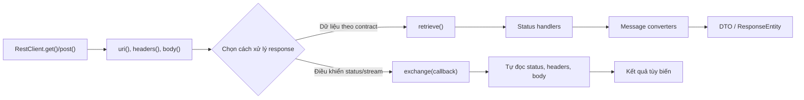
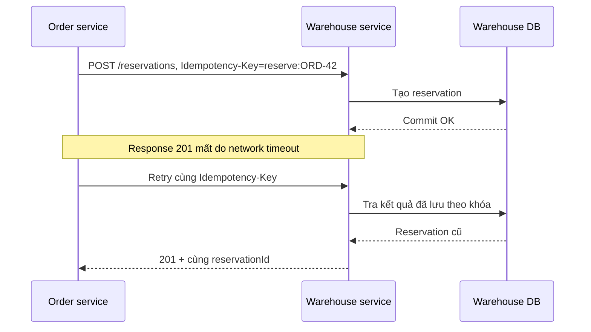
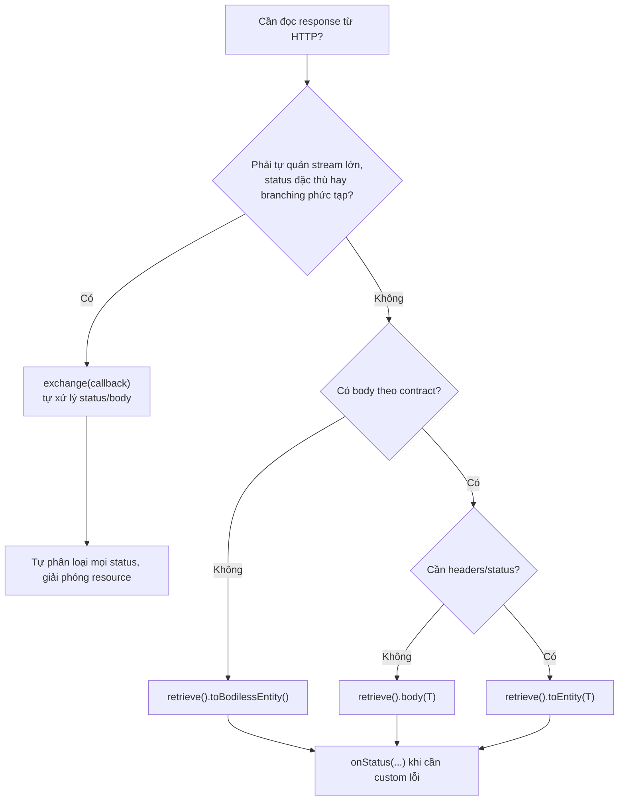

# `retrieve`, `exchange` và lựa chọn cách xử lý phản hồi

## 1. Bối cảnh: đọc HTTP response không chỉ là đọc JSON

Một dịch vụ Spring Boot gọi API bên ngoài có thể gặp nhiều kết quả khác nhau cho cùng một URL:

- `200 OK` kèm JSON là dữ liệu nghiệp vụ cần xử lý.
- `201 Created` có body và header `Location` để trỏ đến tài nguyên mới.
- `202 Accepted` cho biết lệnh đã được nhận, nhưng công việc còn đang chạy.
- `204 No Content` xác nhận hành động thành công mà không có response body.
- `304 Not Modified` yêu cầu client sử dụng bản dữ liệu đã cache, không có body mới.
- `400/404/409/412/429` mang ý nghĩa lỗi đầu vào, không tìm thấy, xung đột, điều kiện không thỏa hoặc giới hạn tốc độ.
- `500/502/503/504` phản ánh lỗi hoặc mất khả năng phục vụ ở upstream/gateway.
- Lỗi kết nối, timeout, JSON sai cấu trúc có thể xảy ra **mà không có một response HTTP hợp lệ**.

Spring Framework cung cấp `RestClient`, HTTP client **đồng bộ** có fluent API. Khi xây dựng client, hai cách xử lý response quan trọng nhất là:

1. **`retrieve()`:** lựa chọn cấp cao, áp dụng quy tắc xử lý HTTP status và các `HttpMessageConverter` của Spring để biến body thành Java object.
2. **`exchange(...)`:** lựa chọn cấp thấp, nhận request/response thực để **tự quyết định** status nào hợp lệ, đọc stream thế nào và trả về kết quả gì.

Trong module **SPRING_BOOT_INTEGRATION**, chủ đề này liên hệ trực tiếp đến hợp đồng HTTP, đồng bộ dữ liệu giữa các dịch vụ, xử lý lỗi, retry, idempotency, timeout, kiểm thử và observability. Chọn nhầm một kiểu đọc response có thể làm mất `Location`/`ETag`, nuốt lỗi `404` hoặc coi “lệnh đã được tiếp nhận” là “nghiệp vụ đã hoàn tất”.

**Sau bài học, bạn có thể:**

1. Giải thích điểm kích hoạt HTTP request trong fluent API của `RestClient`.
2. Chọn chính xác `body(...)`, `toEntity(...)`, `toBodilessEntity()` hoặc `exchange(...)` theo hợp đồng.
3. Xử lý generic JSON, response trống, status 4xx/5xx, `ETag` và conditional GET.
4. Phân biệt `onStatus(...)` với xử lý status thủ công trong `exchange(...)`.
5. Tải stream lớn và quản lý vòng đời response để không lộ tài nguyên.
6. Thiết kế kiểm thử HTTP client và hành vi retry an toàn trước các lỗi mạng.

> **Phiên bản:** Ví dụ dùng Java 17+, Spring Boot 3.2+ và Spring Framework 6.1+ (`RestClient` xuất hiện từ Spring Framework 6.1). Với Spring Boot 4.x/Spring Framework 7.x, cần đối chiếu API và auto-configuration của phiên bản cụ thể trước khi áp dụng nguyên mã. Nội dung tập trung vào `RestClient` đồng bộ, không phải `WebClient` reactive.

## 2. Luồng thực thi: request specification và terminal operation

Các lời gọi như `get()`, `uri(...)`, `header(...)`, `accept(...)` mới **mô tả request**. Việc trao đổi HTTP xảy ra khi thực thi thao tác cuối như `retrieve().body(...)` hoặc `exchange(...)`.

```java
// client là RestClient đã được cấu hình và tái sử dụng.
StockResponse stock = client.get()
    .uri("/api/v1/stocks/{sku}", "SKU-42")
    .accept(MediaType.APPLICATION_JSON)
    .retrieve()
    .body(StockResponse.class);
```

Với Java imperative, luồng hiện tại chờ kết quả đọc response hoặc lỗi/timeout. Không nên nhầm `RestClient` với cách lập trình reactive của `WebClient`; nếu gọi đồng bộ trong servlet thread, số lượng lời gọi chậm đồng thời có thể làm cạn thread và kết nối.



### 2.1. Bảng khác biệt ngắn gọn

| Tiêu chí | `retrieve()` | `exchange(...)` |
| --- | --- | --- |
| Mức trừu tượng | Cao, thuận tiện với API JSON thông thường. | Thấp, kiểm soát response trực tiếp. |
| Status 4xx/5xx | Mặc định phát sinh exception theo xử lý của Spring. | **Không tự động** áp dụng default status handlers; callback tự quyết định. |
| Custom status logic | `onStatus(...)`, builder `defaultStatusHandler(...)`. | `response.getStatusCode()`, viết logic tùy ý. |
| Deserialize JSON | Có `body(Class)`, `body(ParameterizedTypeReference)`. | Tự đọc stream rồi dùng converter/parser phù hợp. |
| Status/headers | Qua `toEntity(...)`, `toBodilessEntity()`. | Đọc trực tiếp `ClientHttpResponse`. |
| Dữ liệu stream lớn | Không phải lựa chọn thuận tiện nhất khi cần xử lý tuần tự stream. | Có thể đọc/ghi stream **bên trong callback**. |
| Điểm rủi ro | Lựa chọn sai DTO hoặc quên xử lý body null. | Quên kiểm tra status, không đóng/không đọc body đúng cách. |

**Nguyên tắc:** bắt đầu từ `retrieve()`. Chỉ chuyển sang `exchange(...)` khi cần tự điều khiển response theo cách `retrieve()` không diễn đạt rõ hoặc không phù hợp.

## 3. Chuẩn bị một Warehouse HTTP client

Giả định `order-service` gọi `warehouse-service` để tra cứu tồn kho và tạo yêu cầu giữ hàng. Các endpoint là **hợp đồng ví dụ**:

| Method/endpoint | Phản hồi | Ý nghĩa |
| --- | --- | --- |
| `GET /api/v1/stocks/{sku}` | `200` + JSON / `404` | Tra cứu tồn kho. |
| `GET /api/v1/stocks/{sku}` kèm `If-None-Match` | `200` + JSON + ETag / `304` | Đồng bộ dữ liệu cache có điều kiện. |
| `POST /api/v1/reservations` | `201` + JSON + Location / `409` | Tạo lệnh giữ hàng. |
| `POST /api/v1/reconciliations` | `202` + Location, không có body | Gửi một job đối soát bất đồng bộ. |
| `DELETE /api/v1/reservations/{id}` | `204` không body | Giải phóng reservation. |
| `GET /api/v1/reports/{id}/download` | `200` + octet stream | Tải báo cáo có thể lớn. |

### 3.1. Dependency và cấu hình

Trong Spring Boot 3.2+, ứng dụng Spring MVC thường có `spring-boot-starter-web` và `RestClient.Builder` được Boot cấu hình. Khi test, dùng thêm `spring-boot-starter-test`:

```xml
<!-- pom.xml dùng Spring Boot parent/BOM -->
<dependency>
    <groupId>org.springframework.boot</groupId>
    <artifactId>spring-boot-starter-web</artifactId>
</dependency>
<dependency>
    <groupId>org.springframework.boot</groupId>
    <artifactId>spring-boot-starter-test</artifactId>
    <scope>test</scope>
</dependency>
```

Không hard-code URL và timeout của production trong adapter:

```yaml
# application.yml
clients:
  warehouse:
    base-url: ${WAREHOUSE_URL:https://warehouse.example.internal}
    connect-timeout: 2s
    read-timeout: 5s
```

Ví dụ dùng cấu hình dạng record:

```java
// WarehouseClientProperties.java
import java.net.URI;
import java.time.Duration;
import org.springframework.boot.context.properties.ConfigurationProperties;

@ConfigurationProperties(prefix = "clients.warehouse")
public record WarehouseClientProperties(
    URI baseUrl,
    Duration connectTimeout,
    Duration readTimeout
) {}
```

Tạo một client dùng lại:

```java
// WarehouseClientConfig.java
import java.net.http.HttpClient;
import com.fasterxml.jackson.databind.ObjectMapper;
import org.springframework.boot.context.properties.EnableConfigurationProperties;
import org.springframework.context.annotation.Bean;
import org.springframework.context.annotation.Configuration;
import org.springframework.http.MediaType;
import org.springframework.http.client.JdkClientHttpRequestFactory;
import org.springframework.web.client.RestClient;

@Configuration(proxyBeanMethods = false)
@EnableConfigurationProperties(WarehouseClientProperties.class)
public class WarehouseClientConfig {

    @Bean
    WarehouseGateway warehouseGateway(
        RestClient.Builder builder,
        WarehouseClientProperties props,
        ObjectMapper objectMapper
    ) {
        HttpClient httpClient = HttpClient.newBuilder()
            .connectTimeout(props.connectTimeout())
            .build();

        JdkClientHttpRequestFactory requestFactory =
            new JdkClientHttpRequestFactory(httpClient);
        requestFactory.setReadTimeout(props.readTimeout());

        RestClient restClient = builder
            .baseUrl(props.baseUrl().toString())
            .requestFactory(requestFactory)
            .defaultHeader("Accept", MediaType.APPLICATION_JSON_VALUE)
            .build();

        return new WarehouseGateway(restClient, objectMapper);
    }
}
```

`JdkClientHttpRequestFactory` ở đây minh họa transport có connect/read timeout. Với Apache HttpComponents, proxy, TLS hay connection pool khác, cách đặt timeout và ý nghĩa của chúng phụ thuộc request factory thực tế. `RestClient` không tự retry chỉ vì đã thiết lập timeout.

### 3.2. DTO cho ví dụ

Định nghĩa các record Java riêng (mỗi `public record` ở một file tương ứng). Dùng `Integer` thay `int` để phân biệt “field số lượng thiếu” với “số lượng thực sự bằng 0” khi deserialize:

```java
// StockResponse.java
public record StockResponse(
    String sku,
    Integer available,
    String warehouseId
) {}

// ReservationRequest.java
public record ReservationRequest(
    String orderId,
    String sku,
    int quantity
) {}

// ReservationResponse.java
public record ReservationResponse(
    String reservationId,
    String status
) {}
```

Ở ví dụ nhỏ có thể dùng một gateway chứa các method; trong ứng dụng lớn, tách theo business capability và chính sách lỗi để tránh một class xử lý mọi API.

## 4. `retrieve().body(...)`: khi chỉ cần dữ liệu

Chọn `body(Class<T>)` khi:

- Response thành công luôn có JSON theo một DTO xác định.
- Business code không cần response status hoặc headers.
- Status 4xx/5xx nên được xử lý theo chính sách mặc định hoặc theo `onStatus(...)`.

Ví dụ:

```java
// Bên trong WarehouseGateway có field RestClient client.
public StockResponse getStock(String sku) {
    StockResponse result = client.get()
        .uri("/api/v1/stocks/{sku}", sku)
        .retrieve()
        .body(StockResponse.class);

    if (result == null
        || result.sku() == null
        || result.available() == null
        || result.available() < 0) {
        throw new IllegalStateException(
            "Warehouse trả body tồn kho không hợp lệ"
        );
    }
    return result;
}
```

**Lưu ý:** `body(StockResponse.class)` có thể trả `null` khi response không có body. Việc nhận `2xx` không đảm bảo nội dung đúng với hợp đồng nghiệp vụ; JSON có thể thiếu field, có giá trị không hợp lệ hoặc khác version. Cần validation ở ranh giới adapter.

### 4.1. Generic type: danh sách và envelope

Do type erasure của Java, `List.class` không cung cấp đủ thông tin rằng phần tử là `StockResponse`. Sử dụng `ParameterizedTypeReference<T>`:

```java
import java.util.List;
import org.springframework.core.ParameterizedTypeReference;

List<StockResponse> stocks = client.get()
    .uri(uriBuilder -> uriBuilder
        .path("/api/v1/stocks")
        .queryParam("warehouse", "HCM-01")
        .build())
    .retrieve()
    .body(new ParameterizedTypeReference<List<StockResponse>>() {});
```

Nếu API trả:

```json
{
  "items": [{"sku":"SKU-42","available":12,"warehouseId":"HCM-01"}],
  "nextCursor": null
}
```

thì phải định nghĩa envelope:

```java
public record PageResponse<T>(
    java.util.List<T> items,
    String nextCursor
) {}
```

và đọc bằng:

```java
PageResponse<StockResponse> page = client.get()
    .uri("/api/v1/stocks")
    .retrieve()
    .body(
        new ParameterizedTypeReference<PageResponse<StockResponse>>() {}
    );
```

Không “cast” một `List<Map>` sang `List<StockResponse>`: kiểu generic không được chuyển đổi an toàn theo cách đó. Các record `PageResponse`/DTO phải phù hợp naming, nullability và phiên bản JSON thực tế.

## 5. `retrieve().toEntity(...)`: lấy cả status, headers và body

Sử dụng `ResponseEntity<T>` khi business hoặc tầng integration cần metadata của phản hồi:

- `201 Created` và `Location` để lưu URL/ID tài nguyên mới.
- `200 OK` và `ETag` để tối ưu conditional request.
- Header `Retry-After`, correlation ID hoặc các header domain đã thống nhất.
- Cần phân biệt nhiều status **thành công**, chẳng hạn `200` và `202`.

```java
import org.springframework.http.ResponseEntity;
import org.springframework.http.MediaType;

public ResponseEntity<ReservationResponse> createReservation(
    ReservationRequest request,
    String idempotencyKey
) {
    return client.post()
        .uri("/api/v1/reservations")
        .contentType(MediaType.APPLICATION_JSON)
        .header("Idempotency-Key", idempotencyKey)
        .body(request)
        .retrieve()
        .toEntity(ReservationResponse.class);
}
```

Caller đọc metadata:

```java
ResponseEntity<ReservationResponse> response =
    gateway.createReservation(request, "reserve-order-42");

int status = response.getStatusCode().value();
var location = response.getHeaders().getLocation();
var etag = response.getHeaders().getETag();
ReservationResponse body = response.getBody();

if (status != 201 || body == null || body.reservationId() == null) {
    throw new IllegalStateException("Phản hồi tạo reservation sai contract");
}
```

`gateway` và `request` là biến ở tầng gọi. Hãy kiểm tra `Location` khi API cam kết header đó; không coi một `Location` vắng mặt là thành công trọn vẹn nếu downstream cần URI để truy vấn trạng thái.

### 5.1. So sánh `body(T)` và `toEntity(T)`

| Nhu cầu | Chọn | Vì sao |
| --- | --- | --- |
| Chỉ cần `sku` và `available` | `body(StockResponse.class)` | Ít mã, rõ ý nghĩa. |
| Cần `ETag` | `toEntity(StockResponse.class)` | Có headers. |
| Cần `201` khác `200` | `toEntity(...)` | Có status. |
| Response là list generic và cần headers | `toEntity(new ParameterizedTypeReference<List<StockResponse>>() {})` | Giữ kiểu generic và metadata. |
| Không có body (204) | `toBodilessEntity()` | Không yêu cầu converter đọc body. |

### 5.2. `ResponseEntity` không khiến HTTP request thành bất đồng bộ

Tên class `ResponseEntity` mô tả dữ liệu phản hồi, **không** biểu thị future/async task. `RestClient` vẫn là synchronous client. Nếu upstream trả `202 Accepted`, HTTP call đã hoàn tất nhưng **nghiệp vụ phía upstream có thể vẫn đang chạy**; đó là tính bất đồng bộ của contract nghiệp vụ, không phải bản thân HTTP client.

## 6. `retrieve().toBodilessEntity()`: đọc status và header, bỏ qua body

Khi endpoint thành công mà **không trả payload**, cách biểu đạt rõ ràng là:

```java
import org.springframework.http.ResponseEntity;

public ResponseEntity<Void> releaseReservation(String reservationId) {
    return client.delete()
        .uri("/api/v1/reservations/{id}", reservationId)
        .retrieve()
        .toBodilessEntity();
}
```

Ví dụ `DELETE` trả:

```http
HTTP/1.1 204 No Content
Date: Sat, 21 Nov 2026 02:00:00 GMT
```

`toBodilessEntity()` nhận status/headers và không đòi response DTO. Nhưng nó không “cấm” server trả body ở các status khác; cần dựa vào contract và đối chiếu status khi cần.

### 6.1. `202 Accepted` cũng có thể không có body

```java
ResponseEntity<Void> accepted = client.post()
    .uri("/api/v1/reconciliations")
    .header("Idempotency-Key", reconciliationCommandId)
    .retrieve()
    .toBodilessEntity();

if (accepted.getStatusCode().value() != 202) {
    throw new IllegalStateException("Provider không trả 202 như contract");
}
var statusUri = accepted.getHeaders().getLocation();
if (statusUri == null) {
    throw new IllegalStateException("Thiếu Location để theo dõi job");
}
```

Nếu trả 202, client có thể cần polling status URI, nhận callback hoặc chờ event hoàn tất theo hợp đồng. **Không đánh dấu job “đã hoàn tất” chỉ vì nhận 202.**

## 7. `retrieve()` xử lý 4xx/5xx theo mặc định

Nếu gọi:

```java
StockResponse result = client.get()
    .uri("/api/v1/stocks/UNKNOWN")
    .retrieve()
    .body(StockResponse.class);
```

và provider trả `404 Not Found`, Spring mặc định **phát sinh HTTP status exception**, thay vì deserialize body lỗi thành `StockResponse` hoặc trả `null`.

Nhóm exception thường gặp:

| Tình huống | Exception thường gặp | Ý nghĩa khi thiết kế |
| --- | --- | --- |
| HTTP 4xx | `HttpClientErrorException` | Có response nhưng request/auth/business conflict bị từ chối. |
| HTTP 5xx | `HttpServerErrorException` | Có response; upstream/server/gateway lỗi. |
| HTTP error khác hoặc status không điển hình | `RestClientResponseException` hoặc subtype phù hợp | Đọc status/headers/body cẩn trọng. |
| Connect timeout, read timeout, connection reset | `ResourceAccessException` | Không chắc server đã thực thi command hay chưa. |
| Deserialize/converter error | Exception thuộc họ `RestClientException` hoặc converter | Có response nhưng dữ liệu không đáp ứng schema hoặc converter thiếu. |
| URI/template/validation lỗi | Có thể phát sinh exception trước HTTP exchange | Không đánh đồng với “upstream unavailable”. |

`RestClientResponseException` có thể chứa status, headers và response body bytes của lỗi. Không log toàn bộ error body một cách mặc định: có thể chứa thông tin cá nhân, token hoặc stack trace do đối tác trả.

### 7.1. Phân loại lỗi phù hợp ngữ nghĩa

Một client thường cần trả lời các câu hỏi:

- `404` có nghĩa “SKU không tồn tại” và được coi là kết quả nghiệp vụ bình thường hay là cấu hình endpoint sai?
- `409` là “reservation đã tồn tại với cùng command ID” hay xung đột giữa hai lệnh khác nhau?
- `429` có header `Retry-After` và có thể retry theo ngân sách thời gian không?
- `503` chỉ là tạm thời hay có cơ chế circuit breaker đang mở?
- Khi timeout sau khi POST, lệnh có thể đã thành công ở provider không?

Một blanket catch `RestClientException` rồi trả danh sách rỗng che đi các lỗi quan trọng. Gateway nên ánh xạ lỗi sang kiểu lỗi domain/integration có chủ đích để các tầng phía trên ra quyết định đúng.

## 8. `onStatus(...)`: thay đổi cách `retrieve()` diễn giải HTTP status

Mỗi `retrieve()` có thể gắn một hay nhiều status handler. Ví dụ, `409 Conflict` của endpoint tạo reservation được chuyển thành exception nghiệp vụ rõ ràng:

```java
import org.springframework.http.MediaType;

public ReservationResponse reserve(
    ReservationRequest request,
    String idempotencyKey
) {
    ReservationResponse result = client.post()
        .uri("/api/v1/reservations")
        .contentType(MediaType.APPLICATION_JSON)
        .header("Idempotency-Key", idempotencyKey)
        .body(request)
        .retrieve()
        .onStatus(
            status -> status.value() == 409,
            (httpRequest, httpResponse) -> {
                throw new ReservationConflictException(
                    "Reservation bị xung đột với yêu cầu hiện tại"
                );
            }
        )
        .body(ReservationResponse.class);

    if (result == null) {
        throw new IllegalStateException("Thiếu reservation body");
    }
    return result;
}
```

Ở đây `ReservationConflictException` là class do ứng dụng định nghĩa, ví dụ `class ReservationConflictException extends RuntimeException`. `httpRequest`/`httpResponse` cho phép đọc thêm thông tin khi cần; nếu body lỗi chứa JSON có cấu trúc, phải parse an toàn và giới hạn kích thước trước khi dùng.

### 8.1. `onStatus` không phải một hàm chuyển response thành DTO mới

Một status handler dùng để **xử lý trạng thái/lỗi**; nó không có hợp đồng trả về `Optional<StockResponse>` hoặc `ResponseEntity<...>` thay thế cho terminal operation.

Ví dụ dễ gây hiểu nhầm:

```java
// KHÔNG KHUYẾN KHÍCH: handler rỗng chỉ chặn ngoại lệ mặc định
// cho status 404, nhưng không tự trả Optional.empty().
StockResponse response = client.get()
    .uri("/api/v1/stocks/UNKNOWN")
    .retrieve()
    .onStatus(status -> status.value() == 404,
        (request, rawResponse) -> { /* không throw */ })
    .body(StockResponse.class);
```

Handler không throw có thể làm Spring tiếp tục đọc body theo converter. Nếu body `404` là Problem Details JSON, việc deserialize sang `StockResponse` có thể sai hoặc cho object không hợp lệ; nếu response rỗng thì nhận `null`. Thay vì trộn success DTO và error DTO, dùng exception mapping có chủ đích hoặc `exchange(...)` cho nhánh “404 là kết quả bình thường”.

### 8.2. Status handler dùng chung với `defaultStatusHandler(...)`

Nếu muốn áp dụng quy tắc 5xx cho toàn bộ Warehouse client:

```java
RestClient warehouseClient = builder
    .baseUrl("https://warehouse.example.internal")
    .defaultStatusHandler(
        status -> status.is5xxServerError(),
        (request, response) -> {
            throw new WarehouseUnavailableException(
                "Warehouse trả status " + response.getStatusCode().value()
            );
        }
    )
    .build();
```

Trong ví dụ, `WarehouseUnavailableException` là exception custom. Các handler dành riêng cho request qua `onStatus(...)` được ưu tiên so với default status handler phù hợp; sau đó mới đến xử lý mặc định cho error status nếu không có handler nào xử lý.

**Điểm cần nhớ:** `defaultStatusHandler(...)` trên builder chỉ được áp dụng ở luồng `retrieve()`; không trông đợi nó chạy khi dùng `exchange(...)`.

### 8.3. Đừng gom tất cả 4xx/5xx thành một lỗi có thể retry

Ví dụ `401`/`403` thường cần sửa credential/permission; `400` cần sửa payload; `404` có thể hợp lệ; `409` có thể yêu cầu đối soát; `429` có thể retry theo `Retry-After`; `503` có thể tạm thời. Ánh xạ lỗi phải đi cùng **chính sách retry**, không chỉ thay tên exception.

## 9. `retrieve()` và `404 Not Found`: ba lựa chọn hợp lý

Khi API định nghĩa “không có SKU” là một khả năng bình thường:

### 9.1. Bắt chính xác `NotFound` và trả `Optional.empty()`

```java
import java.util.Optional;
import org.springframework.web.client.HttpClientErrorException;

public Optional<StockResponse> findStock(String sku) {
    try {
        return Optional.of(getStock(sku));
    } catch (HttpClientErrorException.NotFound e) {
        return Optional.empty();
    }
}
```

Cách này ngắn gọn, giữ mặc định cho lỗi 400/401/503. Nhưng nếu đã có `defaultStatusHandler` ánh xạ `404` thành exception custom, cần bắt đúng loại đó hoặc chọn cách xử lý khác. Không catch `Exception` và trả empty.

### 9.2. `exchange(...)` trả kết quả phân loại

Với yêu cầu không muốn dùng exception cho một nhánh bình thường:

```java
import java.util.Optional;

public Optional<StockResponse> findStockDirect(String sku) {
    return client.get()
        .uri("/api/v1/stocks/{sku}", sku)
        .exchange((request, response) -> {
            int status = response.getStatusCode().value();
            if (status == 404) {
                return Optional.<StockResponse>empty();
            }
            if (status != 200) {
                throw new IllegalStateException(
                    "Warehouse trả status không dự kiến: " + status
                );
            }
            StockResponse body = objectMapper.readValue(
                response.getBody(), StockResponse.class
            );
            if (body.sku() == null || body.available() == null) {
                throw new IllegalStateException("Body tồn kho thiếu field");
            }
            return Optional.of(body);
        });
}
```

Đoạn này nằm trong class có field `ObjectMapper objectMapper` được inject từ Spring context. Nó **tự kiểm tra cả status 503, 401 và JSON body**; không được trả empty cho mọi status khác 200. Ưu điểm là return type thể hiện “có/không có hàng” thay vì dùng exception làm điều khiển luồng. Nhược điểm là code dài hơn, tự chịu trách nhiệm với deserialization và các lỗi.

### 9.3. Dùng một DTO kết quả có status nghiệp vụ

Nếu API có nhiều nhánh hợp lệ hơn (200, 202, 304, 404), có thể định nghĩa sealed type hoặc enum/record kết quả thay vì trả `null` hay `Optional`. Đó là lựa chọn quan trọng cho client có cache, async job hoặc partial content.

## 10. `exchange(...)`: kiểm soát status, headers và body trực tiếp

Chữ ký tư duy:

```java
T value = client.get()
    .uri("/some/path")
    .exchange((request, response) -> {
        // Đọc response.getStatusCode(), response.getHeaders(),
        // response.getBody(), rồi trả về T.
        return ...;
    });
```

Trong callback:

- `request` là HTTP request đã được thực hiện, hữu ích khi cần context.
- `response` là `ClientHttpResponse`, bao gồm status, headers và body stream.
- Code của bạn **phải** xác định status nào hợp lệ và cách xử lý status còn lại.
- Những `onStatus(...)` và default status handlers của `retrieve()` **không áp dụng**.
- Response body stream cần được đọc trong vòng đời callback; sau khi callback trả về, `RestClient` quản lý việc đóng response. Không trả raw `InputStream` cho caller dùng sau đó.

### 10.1. Ví dụ đọc raw body và tự phân loại

```java
public byte[] downloadSmallDocument(String documentId) {
    return client.get()
        .uri("/api/v1/documents/{id}", documentId)
        .exchange((request, response) -> {
            int status = response.getStatusCode().value();
            if (status == 404) {
                throw new DocumentNotFoundException(documentId);
            }
            if (status != 200) {
                throw new IllegalStateException(
                    "Không tải được tài liệu, status=" + status
                );
            }
            long length = response.getHeaders().getContentLength();
            if (length > 5_000_000) {
                throw new IllegalStateException("Tài liệu quá lớn");
            }
            byte[] bytes = response.getBody().readNBytes(5_000_001);
            if (bytes.length > 5_000_000) {
                throw new IllegalStateException("Tài liệu quá lớn");
            }
            return bytes;
        });
}
```

`DocumentNotFoundException` là exception ứng dụng tự định nghĩa. Ví dụ minh họa giới hạn 5 MB, kiểm tra cả `Content-Length` lẫn số byte thực tế, vì server có thể không gửi length hoặc gửi giá trị sai. Với file lớn, không dùng `byte[]` như vậy; dùng streaming sang tệp ở mục tiếp theo.

### 10.2. Vì sao `exchange` không nhất thiết “tốt hơn”?

Nếu chỉ cần một response JSON `200` với body `StockResponse`, `retrieve().body(StockResponse.class)` ngắn hơn và tái sử dụng message converters/status handlers. Viết callback thủ công cho mọi endpoint dễ tạo lỗi không kiểm tra 4xx, charset, media type, body rỗng và resource lifecycle. Dùng `exchange` khi **độ linh hoạt mang lại lợi ích thật**.

## 11. Conditional GET với `ETag` và `304 Not Modified`

Đây là trường hợp điển hình cần kiểm soát status tốt. Giả sử client đã cache tồn kho cùng ETag `"v17"`. Khi cần làm mới:

```http
GET /api/v1/stocks/SKU-42 HTTP/1.1
Accept: application/json
If-None-Match: "v17"
```

Provider có thể:

- Trả `200 OK` + ETag mới + body JSON nếu nội dung thay đổi.
- Trả `304 Not Modified` không body nếu representation còn hợp lệ.
- Trả `404 Not Found` nếu SKU bị xóa.

### 11.1. Mô hình kết quả rõ ràng

```java
// StockFetch.java
public sealed interface StockFetch
    permits StockFound, StockNotModified, StockMissing {}

// StockFound.java
public record StockFound(
    StockResponse stock, String etag
) implements StockFetch {}

// StockNotModified.java
public record StockNotModified(
    String etag
) implements StockFetch {}

// StockMissing.java
public record StockMissing() implements StockFetch {}
```

Từng `public` type ở file Java tương ứng. Không nhất thiết mọi dự án đều cần sealed hierarchy, nhưng nó thể hiện rõ ba kết quả hợp lệ hơn một `StockResponse` có thể null.

### 11.2. `exchange` để xử lý `200/304/404`

```java
import org.springframework.http.HttpHeaders;
import org.springframework.http.MediaType;

public StockFetch refreshStock(String sku, String cachedEtag) {
    return client.get()
        .uri("/api/v1/stocks/{sku}", sku)
        .accept(MediaType.APPLICATION_JSON)
        .headers(headers -> {
            if (cachedEtag != null && !cachedEtag.isBlank()) {
                headers.set(HttpHeaders.IF_NONE_MATCH, cachedEtag);
            }
        })
        .exchange((request, response) -> {
            int status = response.getStatusCode().value();
            String etag = response.getHeaders().getETag();

            if (status == 304) {
                return new StockNotModified(etag);
            }
            if (status == 404) {
                return new StockMissing();
            }
            if (status != 200) {
                throw new IllegalStateException(
                    "Lỗi Warehouse status=" + status
                );
            }

            StockResponse stock = objectMapper.readValue(
                response.getBody(), StockResponse.class
            );
            if (stock == null || stock.sku() == null
                || stock.available() == null || stock.available() < 0) {
                throw new IllegalStateException("Warehouse body không hợp lệ");
            }
            return new StockFound(stock, etag);
        });
}
```

Với `304`, caller phải **đang có bản dữ liệu cache hợp lệ** theo cùng cache key/variant thì mới tái sử dụng; nếu không có cache, phải gửi lại request không điều kiện hoặc báo thiếu dữ liệu. `304` không có body mới để chuyển đổi thành DTO.

**Quan trọng:** ETag là opaque validator, có thể chứa dấu ngoặc kép và tiền tố weak `W/`. Không tùy tiện bỏ dấu ngoặc kép, không coi nó là timestamp hay version số nếu provider không quy định. ETag phục vụ kiểm tra representation; không thay thế business aggregate version khi cập nhật nhiều hệ thống.

### 11.3. `304` với `retrieve()` thì sao?

Mặc định `retrieve()` tập trung xử lý error status (4xx/5xx); `304` không phải 4xx/5xx. Nhưng `body(StockResponse.class)` với response 304 có thể trả `null` vì không có body. Nếu cần phân biệt 304 với 200 có body, có thể dùng `toEntity(...)` để đọc status/headers rồi tự xử lý, hoặc `exchange(...)` để trả một kiểu kết quả có nhánh rõ ràng như trên.

## 12. Stream file lớn bằng `exchange`

Giả sử Warehouse API trả báo cáo CSV dung lượng hàng trăm MB. Không nên giữ toàn bộ response vào `byte[]` hay `String`. Trong `exchange`, xử lý stream trước khi callback kết thúc.

```java
import java.io.IOException;
import java.nio.file.Files;
import java.nio.file.Path;
import java.nio.file.StandardCopyOption;
import org.springframework.http.MediaType;

public Path downloadReport(String reportId, Path outputDirectory) {
    if (!reportId.matches("[A-Za-z0-9_-]{1,80}")) {
        throw new IllegalArgumentException("reportId không hợp lệ");
    }

    Path target = outputDirectory
        .resolve("report-" + reportId + ".csv")
        .normalize();

    return client.get()
        .uri("/api/v1/reports/{id}/download", reportId)
        .accept(MediaType.APPLICATION_OCTET_STREAM)
        .exchange((request, response) -> {
            if (response.getStatusCode().value() != 200) {
                throw new IllegalStateException(
                    "Không tải được report, status="
                        + response.getStatusCode().value()
                );
            }

            // Tạo tệp tạm trong chính thư mục đích, không công bố file nửa chừng.
            Path temp = Files.createTempFile(
                outputDirectory, ".report-", ".part"
            );
            try {
                Files.copy(
                    response.getBody(),
                    temp,
                    StandardCopyOption.REPLACE_EXISTING
                );

                // ATOMIC_MOVE cần filesystem hỗ trợ; không bỏ qua lỗi
                // nếu hợp đồng yêu cầu công bố atomically.
                Files.move(
                    temp,
                    target,
                    StandardCopyOption.ATOMIC_MOVE
                );
                return target;
            } finally {
                Files.deleteIfExists(temp);
            }
        });
}
```

Ví dụ giả định `outputDirectory` đã tồn tại, thuộc vùng lưu trữ tin cậy và có quyền ghi; không để input người dùng điều khiển đường dẫn thư mục. `ATOMIC_MOVE` có thể không được hỗ trợ trên một số filesystem hoặc shared volume. Trong production còn cần giới hạn dung lượng, kiểm tra `Content-Type`, checksum, dung lượng còn lại và xử lý trùng tên/không ghi đè theo hợp đồng.

**Không trả** `response.getBody()` ra khỏi callback:

```java
// SAI: stream có thể không dùng được sau khi exchange kết thúc.
InputStream stream = client.get()
    .uri("/api/v1/reports/42/download")
    .exchange((req, response) -> response.getBody());
```

Với `exchange(...)`, vòng đời response do `RestClient` quản lý. Cần đọc stream khi callback còn thực thi và chỉ trả kết quả đã tách khỏi tài nguyên HTTP, chẳng hạn `Path`, số byte, hash hoặc đối tượng đã parse.

## 13. Các status dễ gây nhầm khi chọn cách xử lý

| Status | Body thông thường | Cách xử lý phù hợp |
| --- | --- | --- |
| `200 OK` | Có thể có JSON/bytes | `body(T)` nếu chỉ cần DTO; `toEntity(T)` nếu cần header/status; `exchange` nếu cần stream. |
| `201 Created` | Có thể có JSON | `toEntity(T)` để lấy `Location` khi hợp đồng dùng. |
| `202 Accepted` | Có thể không có body | `toBodilessEntity()` hoặc `toEntity(T)` theo contract; coi job chưa hoàn tất. |
| `204 No Content` | Không có body | `toBodilessEntity()`. |
| `206 Partial Content` | Chỉ một phần bytes | Nếu dùng Range request phải kiểm tra `Content-Range` và ghép dữ liệu đúng. |
| `301/302/307/308` | Redirect/metadata | HTTP transport có thể tự theo redirect theo cấu hình; lưu ý authentication và method. |
| `304 Not Modified` | Không có body mới | `toEntity(...)` kiểm tra status hoặc `exchange`; chỉ dùng cache hợp lệ. |
| `400/422` | Error body | Ánh xạ validation/contract lỗi; không retry nguyên request vô hạn. |
| `404` | Error body hoặc rỗng | Có thể là Optional.empty khi contract cho phép; không che endpoint sai. |
| `409/412` | Error body | Business conflict/precondition failure, cần xử lý rõ. |
| `429` | Có thể có `Retry-After` | Backoff giới hạn; không retry bừa. |
| `500/502/503/504` | Error body có thể không đáng tin | Retry có điều kiện, giám sát, circuit breaker/bulkhead. |

**Không suy luận chỉ từ status code rằng side effect không xảy ra.** Một request POST timeout hoặc 503 có thể đã được provider thực thi một phần hay hoàn tất nhưng không gửi được response.

### 13.1. Content-Type và status phải nhất quán với body

Nếu server trả `200` và `Content-Type: text/html` trong khi contract yêu cầu JSON, converter có thể không đọc được thành `StockResponse`; đây là lỗi tích hợp cần được báo, không nên gán một object rỗng. Với `exchange` bạn phải tự xác minh media type nếu cần; với `retrieve` dùng converter, nhưng vẫn nên có contract tests cho media type và schema.

### 13.2. Lỗi body parse khác với HTTP status error

Provider trả 200 nhưng JSON lỗi:

```http
HTTP/1.1 200 OK
Content-Type: application/json

{"sku":"SKU-42","available":}
```

HTTP exchange thành công ở mức mạng và status, nhưng deserialization thất bại. Retry có thể chỉ gây thêm tải nếu lỗi do phiên bản schema không tương thích. Theo dõi riêng **transport error**, **status error** và **contract/parse error**.

## 14. Xây gateway để business code không phụ thuộc chi tiết HTTP

Đặt `retrieve/exchange` trong adapter, trả kết quả nghiệp vụ hoặc integration result rõ ràng. Ví dụ:

```java
// StockLookupService.java
import org.springframework.stereotype.Service;

@Service
public class StockLookupService {
    private final WarehouseGateway gateway;

    public StockLookupService(WarehouseGateway gateway) {
        this.gateway = gateway;
    }

    public boolean canReserve(String sku, int quantity) {
        if (quantity <= 0) {
            throw new IllegalArgumentException("quantity phải dương");
        }
        StockResponse stock = gateway.getStock(sku);
        return stock.available() >= quantity;
    }
}
```

Tầng nghiệp vụ **không cần biết** `ResponseEntity` hoặc `HttpClientErrorException` nếu chúng đã được gateway ánh xạ thành kiểu kết quả/lỗi phù hợp. Giữ HTTP contract và business rule tách biệt giúp thay đổi upstream API, serializer, authentication và retry mà ít ảnh hưởng domain.

### 14.1. Khi nào không nên trả thẳng `ResponseEntity` lên tầng nghiệp vụ?

`ResponseEntity` hữu ích trong adapter vì giữ thông tin HTTP; nhưng nếu mọi application service đều nhận nó, logic nghiệp vụ sẽ phụ thuộc vào status code/headers của một API bên ngoài. Thông thường nên chuyển đổi ngay trong gateway:

| API ngoài trả | Gateway trả cho domain |
| --- | --- |
| 200 + tồn kho | `StockAvailability` hoặc `StockResponse` đã validate. |
| 404 SKU không tồn tại | `Optional.empty()` hoặc `StockNotFound` riêng. |
| 409 reservation conflict | `ReservationConflict` domain/integration exception. |
| 202 + Location | `PendingReconciliation(jobId, statusUri)`. |
| 503/timeout | Lỗi integration có phân loại retryable/unknown outcome. |

Không phải lúc nào cũng bắt buộc “ẩn toàn bộ HTTP”: nếu ứng dụng là API gateway/HTTP proxy, preserving status và headers có thể là **trách nhiệm chính**. Quyết định theo ranh giới kiến trúc.

## 15. Retry, idempotency và transaction

`RestClient.retrieve()` hay `exchange()` **không tự bảo đảm exactly-once**. Dù đọc JSON thành công, một thao tác ghi ở provider có thể thất bại, bị retry hoặc phát lặp:



Với lệnh POST/PATCH có side effect:

1. Chọn **idempotency key ổn định** cho cùng một lệnh logic; không cấp key mới mỗi lần retry.
2. Server/provider phải thực sự hỗ trợ hợp đồng chống trùng; chỉ gửi header không tạo ra bảo đảm.
3. Phân biệt timeout (không rõ kết quả) với 400/401/403 (request bị từ chối xác định).
4. Giới hạn retry/backoff/jitter và ngân sách thời gian qua tất cả tầng.
5. Với kết quả không chắc chắn, có thể gọi API tra cứu trạng thái bằng commandId/reservationId trước khi gửi thêm thao tác.

**Database transaction của Spring Boot không rollback được HTTP side effect đã commit ở dịch vụ khác.** Nếu một phương thức `@Transactional` trong Order service gọi Warehouse rồi DB Order rollback, reservation ở Warehouse vẫn có thể tồn tại. Cần saga/compensation, outbox/inbox, idempotency hoặc đối soát tùy luồng.

### 15.1. 404 và 409 không nên bị retry như 503

Một client retry wrapper chung quanh `RestClient` mà không phân loại lỗi có thể:

- Lặp lại validation error 400 vô ích.
- Tạo bão request khi thiếu token 401.
- Gây thêm xung đột 409 mà không giải quyết trạng thái.
- Truy vấn SKU không tồn tại 404 hàng chục lần.

Đặt retry policy dựa trên operation + status + loại lỗi I/O + idempotency support của provider. Không lặp vô hạn trong cùng servlet thread.

## 16. Bảo mật, tài nguyên và observability

### 16.1. Bảo mật response và request

- Chỉ gọi các base URL/host được cấu hình tin cậy; không biến `exchange()` thành công cụ gọi URL tùy ý từ input người dùng vì có nguy cơ SSRF.
- Không log `Authorization`, session cookie, API key, raw payment data hoặc thông tin cá nhân từ error body.
- Hạn chế dung lượng response trước khi đưa vào heap/ghi log; không dựa hoàn toàn vào `Content-Length`.
- Với download, kiểm tra content type, tên file, đường dẫn đích và quyền ghi; không lấy `Content-Disposition filename` từ đối tác làm path trực tiếp.
- Nếu đi qua proxy/TLS/mTLS, cấu hình request factory và secret provider theo từng upstream, không tái sử dụng token qua nhiều host.

### 16.2. Metrics và tracing

Giám sát từng loại kết quả:

| Chỉ số | Lợi ích |
| --- | --- |
| HTTP client request count theo method, route template, status | Phát hiện 4xx/5xx, thay đổi contract. |
| Latency p50/p95/p99 và timeout | Đánh giá SLO và kích thước thread/connection pool. |
| Retry count và retry exhausted | Phát hiện upstream bất ổn hoặc retry storm. |
| Response parse/schema failures | Phát hiện breaking change dù provider vẫn trả 200. |
| Cache hit/304 ratio | Đánh giá conditional GET và freshness. |
| Download bytes/time và incomplete files | Giám sát streaming/report delivery. |
| Unknown-outcome command và idempotency conflict | Theo dõi luồng cần đối soát. |

Spring Boot Actuator/Micrometer Observation có thể instrument các HTTP client được xây từ builder có cấu hình phù hợp. Với `exchange(...)`, tự xử lý response không có nghĩa bỏ qua metrics của HTTP client; nhưng cần kiểm tra instrumentation thực tế khi dùng request factory/builder custom. Không dùng SKU, order ID hoặc URL đầy đủ chứa query cá nhân làm metric tag có cardinality rất cao.

## 17. Kiểm thử `retrieve()` và `exchange()`

Unit test mock `WarehouseGateway` chỉ kiểm tra business code. Để kiểm tra request HTTP được `RestClient` tạo và response mapping, dùng `MockRestServiceServer` trong `spring-test`:

### 17.1. GET 200: kiểm tra `retrieve().body(...)`

```java
import static org.junit.jupiter.api.Assertions.assertEquals;
import static org.springframework.test.web.client.match.MockRestRequestMatchers.method;
import static org.springframework.test.web.client.match.MockRestRequestMatchers.requestTo;
import static org.springframework.test.web.client.response.MockRestResponseCreators.withSuccess;

import org.junit.jupiter.api.Test;
import org.springframework.http.HttpMethod;
import org.springframework.http.MediaType;
import org.springframework.test.web.client.MockRestServiceServer;
import org.springframework.web.client.RestClient;

class WarehouseRetrieveTest {
    @Test
    void retrieveReadsJsonBody() {
        RestClient.Builder builder =
            RestClient.builder().baseUrl("https://warehouse.test");
        MockRestServiceServer server =
            MockRestServiceServer.bindTo(builder).build();

        RestClient client = builder.build();
        server.expect(
                requestTo("https://warehouse.test/api/v1/stocks/SKU-42"))
            .andExpect(method(HttpMethod.GET))
            .andRespond(withSuccess(
                """
                {"sku":"SKU-42","available":12,"warehouseId":"HCM-01"}
                """,
                MediaType.APPLICATION_JSON
            ));

        StockResponse stock = client.get()
            .uri("/api/v1/stocks/{sku}", "SKU-42")
            .retrieve()
            .body(StockResponse.class);

        assertEquals("SKU-42", stock.sku());
        assertEquals(12, stock.available());
        server.verify();
    }
}
```

Lưu ý thứ tự `bindTo(builder).build()` phải trước `builder.build()` tạo client cần test.

### 17.2. GET 404: `retrieve()` ném exception

```java
import static org.junit.jupiter.api.Assertions.assertThrows;
import static org.springframework.test.web.client.match.MockRestRequestMatchers.requestTo;
import static org.springframework.test.web.client.response.MockRestResponseCreators.withStatus;

import org.junit.jupiter.api.Test;
import org.springframework.http.HttpStatus;
import org.springframework.test.web.client.MockRestServiceServer;
import org.springframework.web.client.HttpClientErrorException;
import org.springframework.web.client.RestClient;

class WarehouseRetrieveErrorTest {
    @Test
    void retrieveRaises404ByDefault() {
        RestClient.Builder builder =
            RestClient.builder().baseUrl("https://warehouse.test");
        MockRestServiceServer server =
            MockRestServiceServer.bindTo(builder).build();
        RestClient client = builder.build();

        server.expect(
                requestTo("https://warehouse.test/api/v1/stocks/UNKNOWN"))
            .andRespond(withStatus(HttpStatus.NOT_FOUND));

        assertThrows(HttpClientErrorException.NotFound.class, () ->
            client.get()
                .uri("/api/v1/stocks/UNKNOWN")
                .retrieve()
                .body(StockResponse.class)
        );
        server.verify();
    }
}
```

### 17.3. GET 404: `exchange()` có thể trả giá trị thường

```java
import static org.junit.jupiter.api.Assertions.assertTrue;
import static org.springframework.test.web.client.match.MockRestRequestMatchers.requestTo;
import static org.springframework.test.web.client.response.MockRestResponseCreators.withStatus;

import java.util.Optional;
import org.junit.jupiter.api.Test;
import org.springframework.http.HttpStatus;
import org.springframework.test.web.client.MockRestServiceServer;
import org.springframework.web.client.RestClient;

class WarehouseExchangeTest {
    @Test
    void exchangeMaps404ToEmpty() {
        RestClient.Builder builder =
            RestClient.builder().baseUrl("https://warehouse.test");
        MockRestServiceServer server =
            MockRestServiceServer.bindTo(builder).build();
        RestClient client = builder.build();

        server.expect(
                requestTo("https://warehouse.test/api/v1/stocks/UNKNOWN"))
            .andRespond(withStatus(HttpStatus.NOT_FOUND));

        Optional<String> result = client.get()
            .uri("/api/v1/stocks/UNKNOWN")
            .exchange((request, response) -> {
                if (response.getStatusCode().value() == 404) {
                    return Optional.<String>empty();
                }
                throw new IllegalStateException("Status không dự kiến");
            });

        assertTrue(result.isEmpty());
        server.verify();
    }
}
```

Test này xác minh rằng `exchange()` không tự ném `HttpClientErrorException.NotFound` theo default error handling của `retrieve()`. Callback phải xử lý 404 và cả các status còn lại.

### 17.4. Ma trận kiểm thử nên có

| Kịch bản | Điều cần khẳng định |
| --- | --- |
| 200 JSON hợp lệ | `body(T)` deserialize đúng; validation business passes. |
| 200 thiếu field | Gateway báo lỗi contract, không dùng `available=0` giả. |
| 200 JSON sai cú pháp | Parse error không bị coi là “không có hàng”. |
| 201 Created | `toEntity(T)` giữ `Location`, status và body. |
| 202 Accepted không body | `toBodilessEntity()` giữ status/Location; caller không đánh dấu công việc hoàn tất. |
| 204 No Content | Không parse JSON, không null dereference. |
| 304 Not Modified | Dùng cache tồn tại; không parse body rỗng. |
| 404 | `retrieve` ném exception mặc định; `exchange` có thể trả Optional. |
| 409/412 | Ánh xạ conflict/precondition theo hợp đồng. |
| 429 | Xử lý `Retry-After`, giới hạn retry. |
| 500/503 | Chính sách lỗi mặc định/custom hoạt động và có metrics. |
| Timeout/network reset | Không nhầm với HTTP status error; POST giữ key ổn định khi retry. |
| Large file | Stream bên trong callback, tệp tạm được dọn nếu fail. |

`MockRestServiceServer` không mở HTTP socket thật: nó không xác minh TLS, connection pooling, proxy, DNS, server redirect hoặc network timeout chính xác. Cần WireMock/MockWebServer/Testcontainers/HTTP server test thật cho các tình huống transport, và contract/provider verification để chứng minh API ngoài đời đáp ứng kỳ vọng.

## 18. Những sai lầm thường gặp

| Sai lầm | Hậu quả | Cách sửa |
| --- | --- | --- |
| Gọi `body(T)` với response 204/304 | Nhận null rồi truy cập field; hoặc hiểu nhầm cache status. | `toBodilessEntity()`/`toEntity(...)` hoặc `exchange(...)` có nhánh rõ. |
| Muốn đọc `Location` nhưng dùng `body(T)` | Mất thông tin resource URI. | `toEntity(T)`. |
| Đọc `List.class` rồi cast sang `List<StockResponse>` | Generic element là map hoặc cast lỗi runtime. | `ParameterizedTypeReference<List<StockResponse>>`. |
| Nghĩ `retrieve()` luôn trả DTO ngay cả với 404 | 4xx mặc định thành exception. | Ánh xạ `NotFound` hoặc dùng `exchange`. |
| Dùng `onStatus(404, handler rỗng)` như một `Optional.empty` | Body lỗi vẫn có thể bị parse sai. | Bắt 404 có chủ đích hoặc tự xử lý bằng `exchange`. |
| Nghĩ `exchange()` tự áp dụng `onStatus` | Bỏ qua 500 và parse thành “success”. | Kiểm tra tất cả status trong callback. |
| Trả `response.getBody()` từ callback | Truy cập stream sau khi response đã đóng. | Đọc/copy stream bên trong callback. |
| Đọc file lớn bằng `byte[]` | Cạn heap hoặc GC lớn. | Stream vào file tạm, giới hạn dung lượng. |
| Catch mọi `RestClientException` rồi trả empty | Che 401/503, lỗi JSON và timeout. | Phân loại theo status/transport/contract. |
| Tự retry POST với idempotency key mới | Tạo side effect trùng. | Giữ key ổn định và tra cứu trạng thái khi timeout. |
| Coi 202 là đã xử lý xong | Workflow mất đồng bộ trạng thái. | Theo dõi job/status/event hoàn tất. |
| Tin `@Transactional` rollback được HTTP side effect | Dữ liệu hai dịch vụ bị lệch. | Saga/compensation/outbox/idempotency. |
| Dùng raw HTTP body/error body trong log | Lộ dữ liệu nhạy cảm. | Redaction, giới hạn log và metadata tối thiểu. |

## 19. Checklist chọn API xử lý response



**Quy trình đưa vào production:**

1. Đọc API contract: status có thể trả, body schema, headers, response size, media type.
2. Chọn `body`, `toEntity`, `toBodilessEntity` hoặc `exchange` theo **thông tin cần dùng**, không theo độ dài code.
3. Gắn timeout, authentication, trace/correlation IDs và base URL theo cấu hình môi trường.
4. Định nghĩa mapping của 4xx/5xx, timeout, parse error và kết quả không chắc chắn.
5. Với lệnh có side effect, thiết kế idempotency key, retry/backoff và đối soát.
6. Kiểm thử 200/201/202/204/304, 404, 409, 429, 503, malformed JSON, body trống.
7. Quan sát độ trễ, lỗi, retries và callback streaming; không log nội dung nhạy cảm.

**Tự kiểm tra kiến thức**

1. Khi nào `body(StockResponse.class)` có thể trả `null` dù không ném HTTP status exception?
2. Nếu cần đọc ETag và Location, terminal operation nào phù hợp?
3. Vì sao `exchange(...)` không tự áp dụng `onStatus(...)` của `retrieve()`?
4. `404` là kết quả bình thường của tra cứu SKU; bạn chọn try/catch `NotFound` hay `exchange` vì sao?
5. Vì sao không nên trả `response.getBody()` ra khỏi callback `exchange`?
6. Trong conditional GET, khi server trả `304` client có thể đọc body mới không?
7. POST tạo reservation bị timeout sau khi server commit: vì sao retry phải dùng cùng idempotency key?
8. Khi provider trả 200 nhưng JSON sai schema, đó là loại lỗi gì và cần đo chỉ số nào?

## 20. Tài liệu tham khảo

- [Spring Framework — REST Clients](https://docs.spring.io/spring-framework/reference/integration/rest-clients.html): `RestClient`, `retrieve()`, `exchange()` và status handlers.
- [Spring Framework — RestClient Javadoc](https://docs.spring.io/spring-framework/docs/current/javadoc-api/org/springframework/web/client/RestClient.html): API fluent client.
- [Spring Framework — RestClient.ResponseSpec Javadoc](https://docs.spring.io/spring-framework/docs/current/javadoc-api/org/springframework/web/client/RestClient.ResponseSpec.html): `body`, `toEntity`, `toBodilessEntity` và `onStatus`.
- [Spring Framework — ClientHttpResponse Javadoc](https://docs.spring.io/spring-framework/docs/current/javadoc-api/org/springframework/http/client/ClientHttpResponse.html): status, headers và response body stream.
- [Spring Boot — Calling REST Services](https://docs.spring.io/spring-boot/reference/io/rest-client.html): `RestClient.Builder` auto-configuration và customizer.
- [Spring Framework — Testing REST Clients](https://docs.spring.io/spring-framework/reference/testing/spring-mvc-test-client.html): kiểm thử HTTP client với Spring Test.
- [RFC 9110 — HTTP Semantics](https://www.rfc-editor.org/rfc/rfc9110.html): HTTP status, conditional requests và idempotent methods.
- [RFC 9111 — HTTP Caching](https://www.rfc-editor.org/rfc/rfc9111.html): cache validation, freshness và phản hồi 304.
