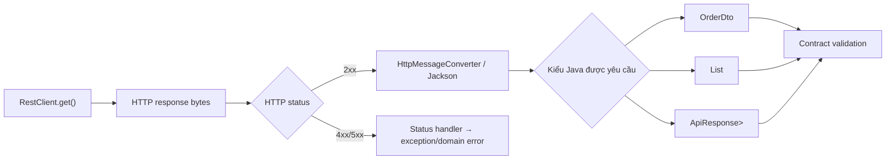
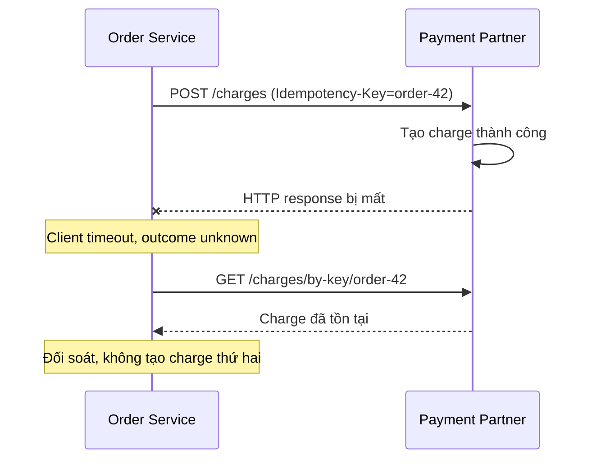
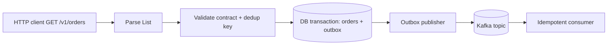
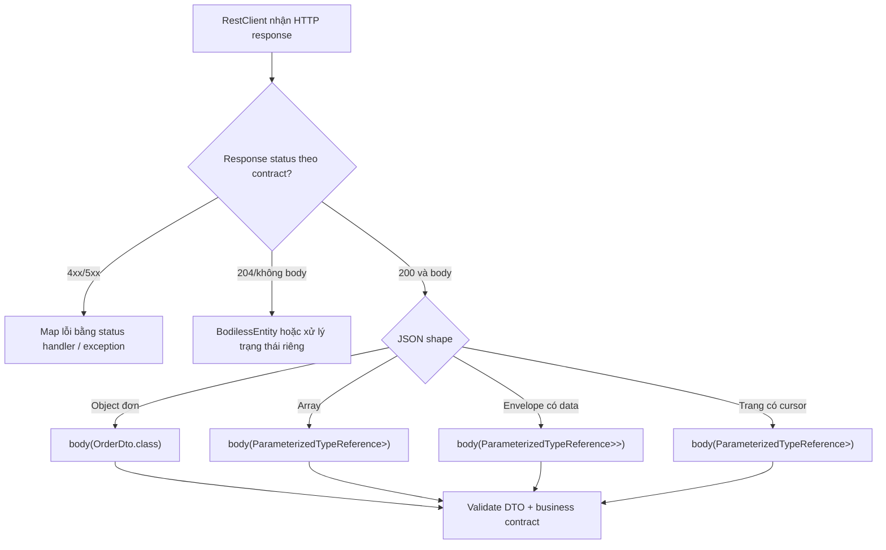

# Ánh xạ phản hồi đơn, danh sách và kiểu dữ liệu tổng quát

> **Chương:** HTTP đồng bộ  
> **Module:** SPRING_BOOT_INTEGRATION — tích hợp các hệ thống trong Spring Boot qua HTTP client, cơ sở dữ liệu, cache, broker thông điệp và adapter Spring Integration; chú trọng cấu hình, hợp đồng dữ liệu, giao dịch, lỗi, xử lý trùng lặp, kiểm thử và quan sát.

## 1. Bài toán: cùng là JSON nhưng kết quả Java không giống nhau

Một dịch vụ đặt hàng cần đồng bộ dữ liệu từ API đối tác:

- `GET /v1/orders/{id}` trả về **một đơn hàng** dạng JSON object.
- `GET /v1/orders?customerId=...` trả về **danh sách đơn hàng** dạng JSON array.
- `GET /v1/orders/lookup?customerId=...` trả về **envelope tổng quát** chứa metadata và `data` là danh sách đơn.
- `GET /v1/orders/page?cursor=...` trả về **trang kết quả có cursor**.

Nếu tất cả chỉ được deserialize bằng `Object.class` hoặc `List.class`, code nghiệp vụ có thể nhận `LinkedHashMap` thay vì `OrderDto`. Lỗi `ClassCastException` khi truy cập phần tử thường chỉ xuất hiện **sau khi HTTP call đã thành công**.

Trong Spring Boot, chọn đúng kiểu phản hồi không đơn thuần là chọn cú pháp `body(...)`: đó là một phần của **hợp đồng dữ liệu giữa các hệ thống**. Kiểu Java, JSON shape, mã trạng thái HTTP, header, charset, format số/ngày và chính sách lỗi phải nhất quán.

### 1.1. Mục tiêu học tập

Sau bài này, bạn có thể:

1. Hiểu cách `RestClient` kết hợp `HttpMessageConverter`/Jackson để đọc HTTP response.
2. Phân biệt `.body(OrderDto.class)`, `.body(OrderDto[].class)` và `.body(new ParameterizedTypeReference<List<OrderDto>>() {})`.
3. Đọc envelope `ApiResponse<List<OrderDto>>`, `Map<String, OrderDto>` và wrapper phân trang một cách type-safe.
4. Lấy status/headers qua `ResponseEntity<T>`, xử lý 204/404/202 và body rỗng đúng ngữ nghĩa.
5. Định nghĩa DTO, kiểm tra schema và chuyển lỗi HTTP/JSON thành tín hiệu nghiệp vụ phù hợp.
6. Viết kiểm thử outbound HTTP bằng `MockRestServiceServer`, quan sát latency và kiểm soát tài nguyên.

## 2. Response thực sự gồm những phần nào?

Một HTTP response chứa **status line**, **headers** và thường có **body**; không phải response nào cũng có body.

```http
HTTP/1.1 200 OK
Content-Type: application/json
ETag: "rev-17"
X-Request-Id: partner-95c

{
  "id": "ord-42",
  "customerId": "cus-7",
  "amount": 125.50,
  "status": "PAID",
  "createdAt": "2026-11-21T07:15:30Z"
}
```

| Phần phản hồi | Ví dụ | Trách nhiệm của adapter |
| --- | --- | --- |
| Status code | 200, 204, 404, 409, 429, 503 | Phân loại success, not-found, business conflict, throttling và lỗi tạm thời |
| Content-Type | `application/json` | Chọn converter phù hợp; không giả định body luôn là JSON |
| ETag/Last-Modified | `"rev-17"` | Có thể dùng cho cache và conditional request nếu contract hỗ trợ |
| Correlation header | `X-Request-Id` | Hỗ trợ tracing và điều tra, tránh rò rỉ thông tin nhạy cảm |
| Body JSON | Object/array/envelope | Deserialize đúng kiểu, validate thuộc tính quan trọng |
| Body rỗng | HTTP 204 hoặc lỗi contract | Phân biệt thành công không có nội dung với response sai hợp đồng |

### 2.1. Quy trình mapping trong RestClient



`RestClient` (Spring Framework 6.1+) cung cấp HTTP API **đồng bộ**; phương thức đọc body sẽ chặn luồng gọi cho tới khi có phản hồi hoặc lỗi. Nếu ứng dụng dùng Spring MVC, JDBC/JPA và nghiệp vụ imperative, cách này thường phù hợp hơn việc tạo một publisher rồi gọi `.block()` ở mỗi bước.

Trong ứng dụng Spring Boot 3.2–3.5, `RestClient.Builder` được auto-configure khi có dependency phù hợp; sử dụng builder được inject để kế thừa các customizer/codec/observability mà ứng dụng thiết lập. Dùng `RestClient.create()` tùy tiện có thể làm mất một số tùy biến đó.

### 2.2. Ba mức type information

| Java type được truyền | JSON phù hợp | Nhận xét |
| --- | --- | --- |
| `OrderDto.class` | Một JSON object | Type cụ thể có thể biểu diễn bằng `Class<T>` |
| `OrderDto[].class` | JSON array | Mảng giữ kiểu thành phần tại runtime |
| `new ParameterizedTypeReference<List<OrderDto>>() {}` | JSON array | Giữ generic element type khi Jackson tạo từng `OrderDto` |
| `new ParameterizedTypeReference<ApiResponse<List<OrderDto>>>() {}` | Object có trường `data` là array | Giữ generic type lồng nhiều tầng |
| `Map.class` / `List.class` | Object/array | Không giữ kiểu value/element cụ thể, thường tạo map/list thô |

**Nguyên nhân cần type token:** Java **type erasure** làm `List<OrderDto>` và `List<String>` cùng có raw runtime class là `List.class`. Vì vậy cần `ParameterizedTypeReference<T>` để mang thông tin `T` đầy đủ cho converter.

## 3. Thiết lập ứng dụng mẫu và hợp đồng dữ liệu

Các ví dụ dưới đây theo **Spring Boot 3.2–3.5, Spring Framework 6.1+, Java 17+**, sử dụng `RestClient` trong ứng dụng blocking. Nếu bạn chạy dòng lớn khác như Boot 4, hãy đối chiếu package, starter và API với BOM của dòng đó.

### 3.1. Dependency Spring Web và Test

```groovy
// build.gradle — dự án đã áp dụng Spring Boot plugin/BOM
dependencies {
    implementation 'org.springframework.boot:spring-boot-starter-web'
    testImplementation 'org.springframework.boot:spring-boot-starter-test'
}
```

Starter Web đưa Spring Web và JSON mapping cần thiết lên classpath ở cấu hình thông dụng. Để Spring Boot quản lý version Spring/Jackson; không tự trộn `spring-web` của một dòng Framework với Boot thuộc dòng khác.

### 3.2. Hợp đồng JSON

**Một đơn hàng**:

```json
{
  "id": "ord-42",
  "customerId": "cus-7",
  "amount": 125.50,
  "status": "PAID",
  "createdAt": "2026-11-21T07:15:30Z"
}
```

**Danh sách đơn hàng**:

```json
[
  {
    "id": "ord-42",
    "customerId": "cus-7",
    "amount": 125.50,
    "status": "PAID",
    "createdAt": "2026-11-21T07:15:30Z"
  },
  {
    "id": "ord-43",
    "customerId": "cus-7",
    "amount": 9.99,
    "status": "NEW",
    "createdAt": "2026-11-21T07:20:00Z"
  }
]
```

**Envelope tổng quát**:

```json
{
  "requestId": "partner-r-92",
  "status": "OK",
  "data": [
    {
      "id": "ord-42",
      "customerId": "cus-7",
      "amount": 125.50,
      "status": "PAID",
      "createdAt": "2026-11-21T07:15:30Z"
    }
  ]
}
```

Điểm thiết kế: endpoint trả array **không giống** endpoint trả object chứa trường `data`. `List<OrderDto>` chỉ deserialize trực tiếp được mảng JSON; nếu API trả envelope thì phải khai báo wrapper chứa `data`.

### 3.3. DTO dạng record

```java
// OrderDto.java
import java.math.BigDecimal;
import java.time.Instant;

public record OrderDto(
        String id,
        String customerId,
        BigDecimal amount,
        String status,
        Instant createdAt) {
}
```

Lựa chọn kiểu dữ liệu:

- `BigDecimal` cho số tiền để tránh sai số nhị phân khi cộng/trừ trong nghiệp vụ thanh toán.
- `Instant` cho timestamp UTC có hậu tố `Z`; converter JSON được cấu hình phù hợp sẽ chuyển chuỗi ISO-8601 thành thời điểm Java.
- `String` cho ID đối tác vì không nên tự suy rằng ID luôn là `UUID` hoặc số.
- `record` giúp DTO bất biến sau khi deserialize ở mức field, nhưng **không tự validate** `id`, `amount` hoặc business state.

Nếu đối tác trả `order_id` thay vì `id`, dùng `@JsonProperty("order_id")` hoặc naming strategy được thống nhất; không thay đổi tên JSON dựa trên cảm tính. Nếu có enum status, phải xác định hành vi khi đối tác thêm một giá trị mới thay vì để deserialize thất bại ngoài ý muốn.

### 3.4. Type wrapper cho generic response

```java
// ApiResponse.java
public record ApiResponse<T>(
        String requestId,
        String status,
        T data) {
}
```

```java
// CursorPage.java
import java.util.List;

public record CursorPage<T>(
        List<T> items,
        String nextCursor,
        Long totalCount) {
}
```

Hai DTO trên là **classes cụ thể có generic parameter**, không phải raw `Map<String, Object>`. Khi đọc `ApiResponse<List<OrderDto>>` hoặc `CursorPage<OrderDto>`, cần cung cấp đầy đủ kiểu generic cho RestClient.

### 3.5. Cấu hình base URL từ environment

```yaml
# application.yml — cấu hình không chứa credential thực
integration:
  orders:
    base-url: ${ORDERS_API_BASE_URL:https://orders.example.invalid/api}
```

```java
import org.springframework.beans.factory.annotation.Value;
import org.springframework.context.annotation.Bean;
import org.springframework.context.annotation.Configuration;
import org.springframework.web.client.RestClient;

@Configuration(proxyBeanMethods = false)
class OrdersHttpConfiguration {

    @Bean("ordersRestClient")
    RestClient ordersRestClient(
            RestClient.Builder builder,
            @Value("${integration.orders.base-url}") String baseUrl) {
        return builder.baseUrl(baseUrl).build();
    }
}
```

Tên miền `example.invalid` dành cho minh họa; không phải dịch vụ thật. Trong production, **phải** cấp URL đúng từ biến môi trường/config secret, không để fallback `example.invalid` thành endpoint thật. Chỉ dùng HTTPS và cơ chế xác thực theo hợp đồng đối tác, quản lý timeout/pool/tokens ngoài code nghiệp vụ.

## 4. Phản hồi đơn: body(OrderDto.class)

Đối với JSON object, `Class<T>` đủ để mô tả kiểu Java.

```java
import java.util.Objects;
import org.springframework.beans.factory.annotation.Qualifier;
import org.springframework.http.MediaType;
import org.springframework.stereotype.Component;
import org.springframework.web.client.RestClient;

@Component
public class OrdersHttpGateway {
    private final RestClient client;

    public OrdersHttpGateway(
            @Qualifier("ordersRestClient") RestClient client) {
        this.client = client;
    }

    public OrderDto findRequired(String id) {
        OrderDto order = client.get()
                .uri("/v1/orders/{id}", id)
                .accept(MediaType.APPLICATION_JSON)
                .retrieve()
                .body(OrderDto.class);

        return Objects.requireNonNull(
                order, "Orders API returned no body for required order");
    }
}
```

**Quy trình:** Spring build URL từ base + path variable, gửi GET, nhận status/body và dùng JSON converter đưa object vào `OrderDto`. Với HTTP 2xx mà body rỗng, `body(OrderDto.class)` có thể trả `null`; `Objects.requireNonNull` ở đây giúp phát hiện lỗi contract thay vì để `NullPointerException` xuất hiện ở tầng nghiệp vụ phía sau.

Một số lưu ý:

1. `.uri("/v1/orders/{id}", id)` cho Spring URI template expansion/encoding phù hợp hơn việc tự nối `"/orders/" + id` với dữ liệu chưa được kiểm soát.
2. `accept(application/json)` yêu cầu representation JSON qua HTTP content negotiation, **không bảo đảm** server chắc chắn trả JSON hợp lệ.
3. Khi `amount` thiếu trong JSON, Jackson có thể tạo `null` thay vì tự báo lỗi; cần kiểm tra hợp đồng sau deserialize.
4. `@JsonIgnoreProperties(ignoreUnknown = true)` hoặc cấu hình unknown property handling có thể cần thiết để tương thích field mới; chỉ dùng khi nghiệp vụ chấp nhận bỏ qua field bổ sung.
5. Chỉ nhận một `OrderDto` nếu endpoint được đặc tả trả **một object**, không phải object trong mảng hay một envelope.

### 4.1. Mapping tên trường khác nhau

Giả sử đối tác đổi schema thành `order_id` và `total_amount`. Ta có thể khai báo DTO riêng ở adapter:

```java
import java.math.BigDecimal;
import com.fasterxml.jackson.annotation.JsonIgnoreProperties;
import com.fasterxml.jackson.annotation.JsonProperty;

@JsonIgnoreProperties(ignoreUnknown = true)
public record PartnerOrderPayload(
        @JsonProperty("order_id") String id,
        @JsonProperty("total_amount") BigDecimal amount) {
}
```

Sau đó **chuyển PartnerOrderPayload thành domain DTO** theo quy tắc riêng. Không truyền nguyên dữ liệu bên ngoài vào entity JPA/MongoDB hoặc message Kafka nếu schema/vòng đời của chúng khác nhau.

### 4.2. Validate dữ liệu sau khi deserialize

Một ví dụ kiểm tra tại boundary:

```java
static OrderDto requireValid(OrderDto order) {
    if (order == null
            || order.id() == null || order.id().isBlank()
            || order.amount() == null
            || order.amount().signum() < 0
            || order.createdAt() == null) {
        throw new IllegalArgumentException(
                "Orders API returned a contract-invalid order");
    }
    return order;
}
```

Đây là fragment minh họa một method có thể đặt trong adapter validator. Với production nên dùng exception chuyên biệt cho **upstream contract violation**, giữ mã lỗi/trace hợp lý, tránh làm HTTP controller trả lỗi client 400 khi thực tế **downstream trả dữ liệu sai**. Có thể dùng Jakarta Bean Validation, nhưng đừng mặc định validation sẽ tự chạy chỉ vì `RestClient.body(OrderDto.class)` deserialize thành công.

## 5. Phản hồi danh sách: mảng hoặc ParameterizedTypeReference

Endpoint `GET /v1/orders?customerId=cus-7` trả JSON array. Có hai cách ánh xạ hợp lệ:

### 5.1. Dùng array Class token

```java
import java.util.Arrays;
import java.util.List;

OrderDto[] array = client.get()
        .uri(uri -> uri.path("/v1/orders")
                .queryParam("customerId", customerId)
                .build())
        .retrieve()
        .body(OrderDto[].class);

List<OrderDto> orders =
        array == null ? List.of() : Arrays.asList(array);
```

Code là fragment nằm trong method đã có `client`/`customerId`. Ưu điểm: `OrderDto[].class` giữ kiểu element ngay tại runtime và converter tạo đúng array. Nhưng **không gộp null thành danh sách rỗng tùy tiện** khi API contract yêu cầu HTTP 200 luôn trả JSON array; đoạn ternary chỉ nên dùng nếu đối tác **quy định rõ** body rỗng tương đương empty list. Nếu không, phải ném contract exception.

### 5.2. Dùng ParameterizedTypeReference cho List<OrderDto>

```java
import java.util.List;
import org.springframework.core.ParameterizedTypeReference;
import org.springframework.http.MediaType;

List<OrderDto> orders = client.get()
        .uri(uri -> uri.path("/v1/orders")
                .queryParam("customerId", customerId)
                .build())
        .accept(MediaType.APPLICATION_JSON)
        .retrieve()
        .body(new ParameterizedTypeReference<List<OrderDto>>() {});
```

`ParameterizedTypeReference` ghi nhận generic type ngay tại anonymous subclass. Spring truyền thông tin `List<OrderDto>` cho Jackson, nhờ đó từng phần tử có type `OrderDto` thay vì `Map`. Dữ liệu vẫn phải được validate theo contract: `orders == null`, phần tử null, ID rỗng và danh sách quá lớn là các trường hợp cần chính sách cụ thể.

### 5.3. Phản ví dụ: tại sao List.class gây lỗi?

```java
// SAI nếu code phía sau mong mỗi item là OrderDto.
List<?> rawItems = client.get()
        .uri("/v1/orders")
        .retrieve()
        .body(List.class);

// Khi body JSON chứa object, phần tử thường là LinkedHashMap,
// không phải OrderDto.
OrderDto wrong = (OrderDto) rawItems.get(0); // Có thể ClassCastException
```

Lời gọi HTTP có thể trả 200 và deserialize thành công, nhưng **runtime type của element sai** do `List.class` không giữ generic parameter. Một kiểu trả về chung `List<Object>` cũng không làm converter tự biết phần tử nào là `OrderDto`.

**Không giải quyết bằng** `(List<OrderDto>)(List<?>)rawItems`: cast unchecked chỉ che cảnh báo compiler; nó không biến `LinkedHashMap` thành `OrderDto`. Dùng `OrderDto[].class` hoặc `ParameterizedTypeReference<List<OrderDto>>` từ lúc đọc response.

### 5.4. 200 với [] khác 204 và 404

| Response | Ngữ nghĩa nên thỏa thuận | Giá trị Java |
| --- | --- | --- |
| `200 OK` + `[]` | Search/list thành công nhưng không có phần tử | `List.of()` hoặc list rỗng |
| `200 OK` + array có phần tử | Truy vấn thành công | `List<OrderDto>` |
| `200 OK` + body rỗng | Có thể là lỗi contract nếu API yêu cầu JSON array | Ném lỗi hợp đồng, trừ khi đối tác quy định khác |
| `204 No Content` | Thành công **không** có body | Chấp nhận theo contract riêng, không tự tạo list |
| `404 Not Found` | Endpoint/resource không tồn tại hoặc domain not found | Mapping theo API contract; không mặc định tương đương list rỗng |
| `503 Service Unavailable` | Downstream unavailable | Lỗi hạ tầng, không trả list rỗng để che lỗi |

Với collection API, trả `200 []` khi không có kết quả thường rõ ràng hơn 404, nhưng **bạn phải tuân theo hợp đồng đối tác**, không tự viết lại quy tắc của họ.

## 6. Kiểu dữ liệu tổng quát: ApiResponse<T>, List<T> và Map<K, V>

Ở hệ thống tích hợp, nhiều đối tác chuẩn hóa JSON thành một envelope:

```json
{
  "requestId": "partner-r-92",
  "status": "OK",
  "data": [
    {
      "id": "ord-42",
      "customerId": "cus-7",
      "amount": 125.50,
      "status": "PAID",
      "createdAt": "2026-11-21T07:15:30Z"
    }
  ]
}
```

Nếu Java dùng `ApiResponse.class`, phần `data` của `ApiResponse<T>` không còn biết `T` tại runtime. Khi `T` là danh sách object, Jackson thường biểu diễn bằng `List<Map<String,Object>>` chứ không phải `List<OrderDto>`.

### 6.1. Envelope chứa một OrderDto

```java
import org.springframework.core.ParameterizedTypeReference;

ApiResponse<OrderDto> response = client.get()
        .uri("/v1/orders/lookup/{id}", id)
        .retrieve()
        .body(new ParameterizedTypeReference<ApiResponse<OrderDto>>() {});
```

Không dùng `body(ApiResponse.class)` rồi ép `response.data()` về `OrderDto`; kiểu `T` sẽ bị mất. Việc dùng `ParameterizedTypeReference` giúp converter biết kiểu `data` là `OrderDto`.

### 6.2. Envelope chứa danh sách OrderDto

```java
import java.util.List;
import org.springframework.core.ParameterizedTypeReference;

ApiResponse<List<OrderDto>> response = client.get()
        .uri(uri -> uri.path("/v1/orders/lookup")
                .queryParam("customerId", customerId)
                .build())
        .retrieve()
        .body(new ParameterizedTypeReference<
                ApiResponse<List<OrderDto>>>() {});
```

Đây là ví dụ quan trọng nhất của **generic lồng nhiều tầng**:

```text
ApiResponse<T>
└── T = List<OrderDto>
    └── element = OrderDto
```

Type token giữ toàn bộ cấu trúc `ApiResponse<List<OrderDto>>`. Sau khi deserialize, cần kiểm tra:

1. Envelope không null và có `status` thuộc tập giá trị được chấp nhận.
2. `data` có giá trị nếu API quy định bắt buộc; danh sách rỗng khác body/envelope rỗng.
3. Các phần tử được validate theo domain: ID, amount, timestamp...
4. `requestId` dùng để correlation/log có kiểm soát; không đưa giá trị tự do vào metric tags.

**Lưu ý:** `status="OK"` ở body là **trạng thái nghiệp vụ do API đối tác quy định**, không phải HTTP status code. Một server có thể trả HTTP 200 nhưng body chứa `status="ERROR"`; adapter phải biết hợp đồng và chủ động chuyển thành lỗi domain/integration, không coi HTTP 2xx là thành công vô điều kiện.

### 6.3. Envelope chứa Map<String, OrderDto>

Một API khác có thể trả object mà mỗi property name là mã đơn:

```json
{
  "requestId": "partner-r-93",
  "status": "OK",
  "data": {
    "ord-42": {
      "id": "ord-42",
      "customerId": "cus-7",
      "amount": 125.50,
      "status": "PAID",
      "createdAt": "2026-11-21T07:15:30Z"
    }
  }
}
```

Đọc response bằng:

```java
import java.util.Map;
import org.springframework.core.ParameterizedTypeReference;

ApiResponse<Map<String, OrderDto>> response = client.get()
        .uri("/v1/orders/index")
        .retrieve()
        .body(new ParameterizedTypeReference<
                ApiResponse<Map<String, OrderDto>>>() {});
```

Không thay bằng `Map<String,Object>` nếu contract đã biết kiểu value cụ thể. Tuy nhiên **đừng đánh đồng object map với danh sách**: JSON map có key trùng không thể biểu diễn đầy đủ mọi dữ liệu như array, thứ tự key không nên được sử dụng làm thứ tự nghiệp vụ, và khi dùng ID làm property name cần kiểm soát kích thước/cardinality.

### 6.4. Định nghĩa type token dùng lại

Không cần tạo anonymous subclass trên mỗi lời gọi nếu response shape cố định. Có thể khai báo:

```java
import java.util.List;
import org.springframework.core.ParameterizedTypeReference;

public final class OrdersResponseTypes {
    private OrdersResponseTypes() {}

    public static final ParameterizedTypeReference<List<OrderDto>> ORDER_LIST =
            new ParameterizedTypeReference<List<OrderDto>>() {};

    public static final ParameterizedTypeReference<
            ApiResponse<List<OrderDto>>> ORDER_LIST_ENVELOPE =
            new ParameterizedTypeReference<
                    ApiResponse<List<OrderDto>>>() {};
}
```

Sau đó:

```java
ApiResponse<List<OrderDto>> result = client.get()
        .uri("/v1/orders/lookup")
        .retrieve()
        .body(OrdersResponseTypes.ORDER_LIST_ENVELOPE);
```

Type token có thể dùng lại giữa nhiều request cùng schema; nó không chứa response data. Dùng constants giúp tránh chỗ gọi này dùng `List.class` còn chỗ gọi khác dùng generic type đầy đủ.

### 6.5. Khi generic type chỉ được biết trong runtime

Việc khai báo `new ParameterizedTypeReference<ApiResponse<T>>() {}` **bên trong một generic method** không bảo đảm thu được kiểu cụ thể của `T`; lúc runtime `T` có thể vẫn chỉ là type variable. Nếu runtime biết `Class<T>` của phần tử, bạn có thể xây `Type` bằng `ResolvableType`:

```java
import java.util.List;
import org.springframework.core.ParameterizedTypeReference;
import org.springframework.core.ResolvableType;
import org.springframework.web.client.RestClient;

public final class GenericOrderLookup {
    private GenericOrderLookup() {}

    public static <T> ApiResponse<List<T>> fetchListEnvelope(
            RestClient client,
            String path,
            Class<T> elementType) {
        ResolvableType list = ResolvableType.forClassWithGenerics(
                List.class, elementType);
        ResolvableType envelope = ResolvableType.forClassWithGenerics(
                ApiResponse.class, list);

        ParameterizedTypeReference<ApiResponse<List<T>>> type =
                ParameterizedTypeReference.forType(envelope.getType());

        return client.get()
                .uri(path)
                .retrieve()
                .body(type);
    }
}
```

Đây là cách **tạo generic Type token khi `Class<T>` được truyền lúc chạy**. Trong thực tế, nếu endpoint/schemas đã biết, type token constant thường đơn giản hơn. `path` trong ví dụ **phải do code tin cậy quyết định**, không nhận URL/path tùy ý từ HTTP input vì có thể gây SSRF hoặc đọc nhầm endpoint có credential.

Nếu phần tử còn là type phức tạp như `Map<String, List<OrderDto>>`, dùng `ResolvableType` lồng nhau hoặc `Type` đã được xây đúng cấu trúc; đừng truyền `List.class` và mong framework suy từ tên field JSON.

## 7. Phân trang: wrapper tổng quát khác List<T>

Một endpoint trả trang dữ liệu thường có envelope:

```json
{
  "items": [
    {
      "id": "ord-42",
      "customerId": "cus-7",
      "amount": 125.50,
      "status": "PAID",
      "createdAt": "2026-11-21T07:15:30Z"
    }
  ],
  "nextCursor": "opaque-cursor-2",
  "totalCount": 235
}
```

Nếu DTO là `CursorPage<T>` đã định nghĩa:

```java
import org.springframework.core.ParameterizedTypeReference;

CursorPage<OrderDto> page = client.get()
        .uri(uri -> uri.path("/v1/orders/page")
                .queryParam("limit", 50)
                .queryParam("cursor", cursor)
                .build())
        .retrieve()
        .body(new ParameterizedTypeReference<CursorPage<OrderDto>>() {});
```

`cursor` ở đây là biến trong method của adapter. Nếu API quy định **không truyền tham số** khi cursor null, điều kiện xây URL cần thêm `queryParam("cursor", cursor)` **chỉ khi có giá trị**. Đừng giả định query parameter `cursor=` hoặc literal `null` luôn tương đương không truyền.

### 7.1. Hợp đồng phân trang cần được viết rõ

| Thuộc tính | Câu hỏi phải xác nhận |
| --- | --- |
| `items` | Luôn có array hay được phép null? Có cho phép phần tử null không? |
| `nextCursor` | null/blank nghĩa là hết trang, hay có cờ khác? |
| `totalCount` | Là số phần tử toàn tập, ước lượng hay chỉ count trong trang? |
| `limit` | Giới hạn tối đa server chấp nhận là bao nhiêu? |
| Ordering | Có thứ tự ổn định giữa các trang khi dữ liệu thay đổi không? |
| Cursor lifetime | Cursor có hết hạn hoặc gắn với phiên snapshot không? |
| Duplicate/missing | Làm sao xử lý nếu phần tử thay đổi giữa các trang? |

**Không tự deserialize API phân trang vào `Page<OrderDto>` (Spring Data)** nếu đối tác không công bố cùng schema/hợp đồng. `Page` là một interface có những yêu cầu riêng; JSON của đối tác có thể dùng `items`, `nextCursor` thay vì cấu trúc của Spring Data. Dùng DTO cụ thể của adapter, sau đó chuyển sang mô hình domain/response nội bộ khi cần.

### 7.2. Lặp trang có kiểm soát

Mỗi trang là một HTTP request; tổng số request phải được giới hạn theo deadline và chính sách của đối tác. Pseudocode:

```text
cursor = null
seenOrderIds = set()
for pageNumber from 1 to MAX_PAGES:
    page = fetch(cursor, limit=50)
    assert page/items satisfy contract
    for order in page.items:
        validate order and process with stable idempotency key
    if page.nextCursor is absent:
        stop successfully
    if page.nextCursor equals cursor:
        fail: cursor did not advance
    cursor = page.nextCursor
if MAX_PAGES exceeded:
    fail with an explicit pagination limit error
```

Không mặc định việc gọi đủ tất cả trang là một giao dịch đọc snapshot. Nếu đối tác cập nhật dữ liệu trong lúc đang phân trang, có thể bị trùng hoặc bỏ sót bản ghi. Với job import, dùng cursor/checkpoint và khóa nghiệp vụ/idempotency để phục hồi khi request HTTP hoặc database commit thất bại.

### 7.3. Danh sách rất lớn không nên gom hết vào một List

`RestClient.retrieve().body(List<OrderDto>)` thường deserialize toàn bộ body thành danh sách trong bộ nhớ; với hàng triệu record, thao tác này có thể tiêu tốn heap, tăng GC và kéo dài thời gian giữ kết nối. Chọn:

- Phân trang với page size giới hạn.
- Batch/chunk processing để ghi từng nhóm và lưu checkpoint.
- Nếu API hỗ trợ streaming/NDJSON, dùng reader/streaming protocol tương ứng và bảo đảm đóng response resource.
- Áp dụng backpressure/giới hạn bộ nhớ ở lớp xử lý; cân nhắc `WebClient`/streaming khi toàn kiến trúc phù hợp.

Trong Spring Batch, một reader gọi API phân trang phải ghi lại cursor/record ID tại checkpoint để restart an toàn. Một HTTP response đã parse thành công không có nghĩa PostgreSQL đã commit hoặc Kafka đã nhận sự kiện.

## 8. ResponseEntity<T>: khi cần HTTP status và headers

`body(...)` phù hợp nếu caller chỉ cần dữ liệu. Khi cần `ETag`, `X-Request-Id` hoặc status, dùng `toEntity(...)`:

```java
import org.springframework.http.HttpHeaders;
import org.springframework.http.MediaType;
import org.springframework.http.ResponseEntity;

ResponseEntity<OrderDto> response = client.get()
        .uri("/v1/orders/{id}", id)
        .accept(MediaType.APPLICATION_JSON)
        .retrieve()
        .toEntity(OrderDto.class);

int statusCode = response.getStatusCode().value();
String etag = response.getHeaders().getETag();
String partnerRequestId =
        response.getHeaders().getFirst("X-Request-Id");
OrderDto body = response.getBody();
```

`toEntity(OrderDto.class)` trả `ResponseEntity<OrderDto>` gồm status/headers/body. HTTP 4xx/5xx vẫn có thể bị xử lý thành exception bởi `retrieve()` trước khi có `ResponseEntity`, trừ khi ứng dụng khai báo status handler phù hợp. `toEntity(...)` **không phải cách để bỏ qua mọi status error**.

### 8.1. ResponseEntity chứa generic type

```java
import java.util.List;
import org.springframework.core.ParameterizedTypeReference;
import org.springframework.http.ResponseEntity;

ResponseEntity<List<OrderDto>> response = client.get()
        .uri("/v1/orders")
        .retrieve()
        .toEntity(new ParameterizedTypeReference<List<OrderDto>>() {});

List<OrderDto> orders = response.getBody();
```

`ResponseEntity<List<OrderDto>>` giữ phần HTTP metadata và dữ liệu đã deserialize; còn `ParameterizedTypeReference` bảo đảm kiểu phần tử. Hai lớp này giải quyết **hai vấn đề khác nhau**, không thể thay thế cho nhau.

Tương tự, nếu API trả envelope:

```java
ResponseEntity<ApiResponse<List<OrderDto>>> response = client.get()
        .uri("/v1/orders/lookup")
        .retrieve()
        .toEntity(OrdersResponseTypes.ORDER_LIST_ENVELOPE);
```

### 8.2. HTTP 204, HEAD và response không có body

Với endpoint có hợp đồng **không trả body**, chọn:

```java
import org.springframework.http.ResponseEntity;

ResponseEntity<Void> response = client.head()
        .uri("/v1/orders/{id}", id)
        .retrieve()
        .toBodilessEntity();
```

`HEAD` chỉ đọc metadata của resource, không có response body theo định nghĩa. Đối với `DELETE` hay `POST` trả 204 theo contract, cũng có thể dùng `toBodilessEntity()` để lấy status/headers mà không yêu cầu deserialization DTO.

**Không tự suy rằng HTTP 204 = không tìm thấy:** 204 là success không có nội dung. Ngược lại, `200 OK` mà body rỗng **có thể là vi phạm contract** nếu API đã hứa trả `OrderDto`.

### 8.3. 202 Accepted không đồng nghĩa xử lý nghiệp vụ hoàn tất

Một POST phát lệnh tạo báo cáo có thể trả `202 Accepted` + `Location: /v1/jobs/{id}`. Đây là **chấp nhận xử lý bất đồng bộ ở hệ thống đối tác**, không chứng minh job đã COMPLETED, dù `RestClient` đang dùng API đồng bộ.

Nếu luồng cần kết quả cuối, phải polling trạng thái qua endpoint tương ứng, nhận webhook, hoặc tiêu thụ sự kiện; dùng timeout/deadline và idempotency key cho hành động tạo job. Không coi HTTP 202 là một `OrderDto` đã hoàn thành.

### 8.4. Headers quan trọng đối với caching và lỗi

- `ETag`/`Last-Modified` cho phép conditional request, ví dụ `If-None-Match`; HTTP 304 thường không có body.
- `Retry-After` trên 429/503 có thể cho biết thời điểm nên gửi lại, nếu API contract có quy định.
- `Location` trên 201/202 có thể xác định resource/job mới tạo.
- `Content-Type` và `Content-Encoding` ảnh hưởng converter/giải nén; đừng parse JSON theo giả định bất chấp header.
- Correlation header giúp theo dấu request; không log token, cookie, Authorization hoặc body nhạy cảm.

## 9. Ánh xạ lỗi HTTP và lỗi hợp đồng dữ liệu

Chọn đúng `OrderDto` hay `List<OrderDto>` chưa đủ. Adapter còn phải chuyển lỗi transport/status/contract thành kết quả để application service hiểu, thay vì để lỗi 404, 503 hoặc JSON sai định dạng bị nuốt và trả thành dữ liệu rỗng.

### 9.1. Một bảng phân loại thường gặp

| Tín hiệu | Cách diễn giải mặc định cần xem xét | Có nên retry? |
| --- | --- | --- |
| HTTP 200, body hợp lệ | Thành công về HTTP và contract | Không |
| HTTP 200, body sai shape hoặc thiếu field bắt buộc | Lỗi contract/serialization của upstream | Không retry mù cùng schema |
| HTTP 204 | Thành công không có body | Không, trừ khi contract khác |
| HTTP 404 cho `GET /orders/{id}` | Đơn không tồn tại theo contract | Thường không |
| HTTP 404 cho một URL sai | Sai routing/cấu hình endpoint | Không retry trước khi sửa URL |
| HTTP 409/422 | Có thể là business conflict/validation | Xem mã domain trong error body |
| HTTP 429 + Retry-After | Bị throttling/rate limit | Có thể đợi/retry trong budget |
| HTTP 500/502/503/504 | Có thể là lỗi tạm thời hoặc hạ tầng | Retry giới hạn cho operation an toàn |
| DNS/TLS/connection failure | Mạng, xác thực TLS hoặc cấu hình | Phân loại; cert sai thường không tự hồi phục |
| Timeout sau POST có side effect | Chưa rõ server đã xử lý hay chưa | Chỉ retry theo idempotency/reconciliation |

**HTTP status không phải business status.** Một API trả 200 và `{"status":"REJECTED", "data":null}` có thể báo đơn bị từ chối. Ngược lại, 404 do proxy/ngateway cấu hình sai không có nghĩa một `orderId` không tồn tại trong database đích.

### 9.2. Hành vi mặc định của RestClient.retrieve()

Với `RestClient.retrieve()`, mặc định response HTTP thuộc nhóm 4xx/5xx được ánh xạ thành exception (các dạng `RestClientResponseException` phù hợp) nếu ứng dụng chưa khai báo status handler thay thế.

```java
import org.springframework.web.client.HttpClientErrorException;
import java.util.Optional;

public Optional<OrderDto> findOptional(String id) {
    try {
        return Optional.ofNullable(client.get()
                .uri("/v1/orders/{id}", id)
                .retrieve()
                .body(OrderDto.class));
    } catch (HttpClientErrorException.NotFound notFound) {
        return Optional.empty();
    }
}
```

Đoạn fragment giả định có `client` trong adapter. Việc map 404 thành `Optional.empty()` **chỉ đúng khi hợp đồng quy định HTTP 404 = đơn không tồn tại**. Nếu endpoint dùng 404 cho cấu hình/route sai hoặc body có mã lỗi khác, phải kiểm tra chi tiết. Hơn nữa, `Optional.ofNullable(...)` ở đây cũng biến body rỗng của HTTP 200 thành empty; nếu đối tác hứa bắt buộc có DTO thì nên **kiểm tra và báo contract violation**, không gộp hai trường hợp.

### 9.3. onStatus: ánh xạ 404 thành exception nghiệp vụ

```java
// OrderNotFoundException.java
public final class OrderNotFoundException extends RuntimeException {
    public OrderNotFoundException(String id) {
        super("Order not found: " + id);
    }
}
```

```java
OrderDto order = client.get()
        .uri("/v1/orders/{id}", id)
        .retrieve()
        .onStatus(
                status -> status.value() == 404,
                (request, response) -> {
                    throw new OrderNotFoundException(id);
                })
        .body(OrderDto.class);
```

`onStatus(...)` cho phép biến tín hiệu HTTP thành một exception với ý nghĩa rõ trong adapter. Đối với các status lỗi chưa có handler riêng, Spring có cơ chế lỗi mặc định. Nên giữ một sơ đồ mã lỗi thống nhất giữa HTTP client adapter, controller advice, retry policy, log và metric, không để mỗi service tự ánh xạ tùy tiện.

### 9.4. Đọc error body dạng JSON có hợp đồng

Giả sử phía đối tác trả lỗi:

```http
HTTP/1.1 422 Unprocessable Content
Content-Type: application/json

{"code":"ORDER_STATE_INVALID","message":"Order is already closed"}
```

Một DTO cho lỗi:

```java
public record PartnerError(String code, String message) {
}
```

Ví dụ một status handler đọc JSON error body **một lần** với Jackson:

```java
import com.fasterxml.jackson.databind.ObjectMapper;

OrderDto order = client.get()
        .uri("/v1/orders/{id}", id)
        .retrieve()
        .onStatus(
                status -> status.value() == 422,
                (request, response) -> {
                    PartnerError error = objectMapper.readValue(
                            response.getBody(), PartnerError.class);
                    throw new PartnerBusinessRejectionException(
                            error.code());
                })
        .body(OrderDto.class);
```

Fragment giả định `objectMapper` đã được inject từ Spring Boot và `PartnerBusinessRejectionException` là exception do adapter định nghĩa. Trong implementation thực, cần xử lý JSON error body rỗng/sai schema hoặc body quá lớn; `readValue(...)` có thể ném lỗi parse. **Không log nguyên error body** nếu có PII hoặc dữ liệu nhạy cảm.

Lưu ý việc đọc error body trong handler không tự làm request trở thành retry-safe. Chỉ phân loại mã domain thực sự do API đối tác công bố; đừng suy 422 luôn mang ý nghĩa giống nhau giữa mọi đối tác.

### 9.5. HTTP 429 và Retry-After

```java
import org.springframework.http.HttpHeaders;

OrderDto order = client.get()
        .uri("/v1/orders/{id}", id)
        .retrieve()
        .onStatus(
                status -> status.value() == 429,
                (request, response) -> {
                    String retryAfter = response
                            .getHeaders()
                            .getFirst(HttpHeaders.RETRY_AFTER);
                    throw new PartnerRateLimitedException(retryAfter);
                })
        .body(OrderDto.class);
```

Fragment giả định có class `PartnerRateLimitedException` nhận header để tầng retry xét. `Retry-After` có thể biểu diễn **số giây** hoặc **ngày HTTP**, không phải lúc nào cũng là một integer. Cần giới hạn thời gian chờ bởi total deadline và chính sách retry; không lập tức lặp lại 429 trên nhiều thread vì có thể tạo retry storm.

### 9.6. Timeout không chứng minh side effect chưa xảy ra



Endpoint tra cứu theo key là **giả định của hợp đồng minh họa**, không phải tính năng chuẩn của mọi payment API. Đối với POST/PUT/PATCH có side effect, xác định hỗ trợ idempotency key và cách đối soát **trước** khi lập trình retry. Việc response được deserialize thành `OrderDto` thành công cũng không có nghĩa PostgreSQL transaction hoặc Kafka event đã được commit.

## 10. Những bẫy mapping gây lỗi khó phát hiện

### 10.1. JSON object và array bị đảo

| API thực trả | Java yêu cầu | Kết quả |
| --- | --- | --- |
| `{ "id": "ord-42" }` | `OrderDto.class` | Có thể hợp lệ nếu các field khác phù hợp |
| `[{ "id": "ord-42" }]` | `OrderDto.class` | Không đúng JSON shape; lỗi deserialization |
| `{ "data": [...] }` | `List<OrderDto>` | Không đúng JSON shape |
| `{ "data": [...] }` | `ApiResponse<List<OrderDto>>` | Đúng với envelope phù hợp |
| `[]` | `List<OrderDto>` | Danh sách rỗng hợp lệ |
| `null` | `OrderDto.class` | Có thể ra null, cần chính sách contract |

**Không sử dụng `ObjectMapper.convertValue(raw, OrderDto.class)` như giải pháp mặc định cho raw response** nếu có thể truyền type đúng ngay khi HTTP body được parse. Chỉ chuyển đổi động ở một adapter thực sự xử lý schema linh hoạt và có validation.

### 10.2. Number mapping và tài chính

JSON `{"amount":125.50}` khi deserialize vào `double` có thể không biểu diễn chính xác giá trị thập phân. Dùng `BigDecimal` cùng currency/rounding policy rõ ràng; không suy rằng `125.50` và `125.5` phải khác nhau về **giá trị tiền** nhưng cũng đừng bỏ quy định scale khi lưu/truyền.

Khi JSON có `amount` dưới dạng chuỗi (ví dụ `"125.50"`), cần contract rõ liệu converter có được ép kiểu hay phải từ chối. Đặt kiểu DTO tương ứng với schema thực tế, không dựa vào coercion mặc định ngẫu nhiên.

### 10.3. Null, missing và primitive default

Nếu `CursorPage<T>` sử dụng primitive `long totalCount`, khi JSON thiếu `totalCount`, một số cấu hình Jackson có thể tạo giá trị Java mặc định `0`, làm khó phân biệt **không có field** với **tổng bằng 0**. Vì vậy DTO mẫu ở mục 3 dùng `Long totalCount` để có thể kiểm tra null và báo lỗi nếu contract bắt buộc, hoặc bật các ràng buộc deserialization nghiêm ngặt đã kiểm thử.

Tương tự, `boolean success` thiếu có thể thành `false` nếu không kiểm tra. Ở ranh giới tích hợp, kiểu boxed `Boolean`/`Long` cùng validation có thể đáng giá hơn primitive khi việc thiếu trường là lỗi.

### 10.4. Enum và thay đổi schema

Nếu status được ánh xạ trực tiếp vào Java enum `OrderStatus {NEW, PAID, CANCELLED}`, đối tác bổ sung `PARTIALLY_PAID` có thể làm parse fail. Ba chiến lược:

1. Fail fast vì hợp đồng strict, báo lỗi và nâng code.
2. Dùng chuỗi ở DTO bên ngoài rồi mapping qua enum domain với trạng thái `UNKNOWN` được xử lý có chủ đích.
3. Dùng custom Jackson deserializer với fallback, nhưng **không** mặc định coi UNKNOWN là PAID/COMPLETED.

Chọn theo mức độ rủi ro nghiệp vụ; không tắt lỗi deserialization rồi xử lý status không biết như success.

### 10.5. Date/time và timezone

Chuỗi `2026-11-21T07:15:30Z` là instant UTC. Nếu phía đối tác trả `2026-11-21T14:15:30+07:00`, đó có thể là **cùng mốc thời gian**. Dùng `Instant` hoặc `OffsetDateTime` khi contract có timezone; không tự parse chuỗi có múi giờ thành `LocalDateTime` rồi xem như UTC.

Đối với `LocalDate` (ngày nghiệp vụ), phải phân biệt ngày địa phương với instant. Timestamp “createdAt” và “businessDate” không nên dùng chung converter/ý nghĩa một cách tùy tiện.

### 10.6. Content-Type không phù hợp và lỗi từ gateway

Một lỗi phổ biến: phía HTTP proxy trả trang HTML 502 trong khi ứng dụng đang chờ JSON. Tùy status handler/converter, bạn có thể nhận exception HTTP 502 trước khi parse hoặc lỗi `Content-Type` không được hỗ trợ. **Không bắt mọi lỗi và trả DTO null**: cần ghi mã lỗi/status, upstream name, trace, nhưng không log body HTML chứa thông tin nhạy cảm hay credential.

Đối với dữ liệu cực lớn hoặc bị lỗi encoding, cần giới hạn body size và theo dõi memory; không dùng `String.class` để đọc toàn bộ JSON lớn rồi tự parse thêm lần nữa trừ khi có lý do cụ thể.

### 10.7. Hợp đồng DTO nên version hóa

Khi API đổi response từ `List<OrderDto>` sang `ApiResponse<List<OrderDto>>`, đó là **breaking change** về shape, dù object con không đổi. Nên version endpoint hoặc có negotiated media type/contract cho client cũ. Kiểm thử cả:

- Provider mới → consumer cũ.
- Provider cũ → consumer mới.
- Bản ghi có field mới, field thiếu và enum chưa biết.
- 200, 204, 404, 409, 429, 503 và timeout.

Khi response được chuyển tiếp vào event Kafka, không cho thay đổi schema HTTP lén lút làm thay đổi Kafka event schema mà chưa có versioning/compatibility review.

## 11. RestTemplate legacy và declarative HTTP interfaces

`RestClient` là lựa chọn HTTP đồng bộ hiện đại trong Spring Framework 6.1+. Với codebase cũ, `RestTemplate` vẫn có thể được sử dụng; hai API cùng giải quyết bài toán mapping thông qua HTTP message converters.

### 11.1. RestTemplate.getForObject cho object

```java
import org.springframework.web.client.RestTemplate;

RestTemplate restTemplate = new RestTemplate();

OrderDto order = restTemplate.getForObject(
        "https://orders.example.invalid/api/v1/orders/{id}",
        OrderDto.class,
        id);
```

Với danh sách generic, **không dùng** `getForObject(url, List.class)` nếu cần element kiểu `OrderDto`. Dùng `exchange(...)` và `ParameterizedTypeReference`:

```java
import java.util.List;
import org.springframework.core.ParameterizedTypeReference;
import org.springframework.http.HttpEntity;
import org.springframework.http.HttpMethod;
import org.springframework.http.ResponseEntity;

ResponseEntity<List<OrderDto>> response = restTemplate.exchange(
        "https://orders.example.invalid/api/v1/orders",
        HttpMethod.GET,
        HttpEntity.EMPTY,
        new ParameterizedTypeReference<List<OrderDto>>() {});

List<OrderDto> orders = response.getBody();
```

Đây là mẫu cú pháp cũ hợp lệ, nhưng với code Spring Boot mới và HTTP đồng bộ nên cân nhắc `RestClient` để thống nhất fluent API, status handling và customizers. **Không tự mở một RestTemplate riêng ở mọi request**; quản lý cấu hình client, authentication, timeout và instrumentation qua bean.

### 11.2. HttpServiceProxyFactory và interface có type generic

Spring Framework hỗ trợ declarative HTTP interface như sau:

```java
import java.util.List;
import org.springframework.http.ResponseEntity;
import org.springframework.web.bind.annotation.PathVariable;
import org.springframework.web.bind.annotation.RequestParam;
import org.springframework.web.service.annotation.GetExchange;
import org.springframework.web.service.annotation.HttpExchange;

@HttpExchange("/v1/orders")
public interface OrdersPartnerApi {

    @GetExchange("/{id}")
    OrderDto findOne(@PathVariable("id") String id);

    @GetExchange
    List<OrderDto> list(@RequestParam("customerId") String customerId);

    @GetExchange("/lookup")
    ApiResponse<List<OrderDto>> lookup(
            @RequestParam("customerId") String customerId);

    @GetExchange("/{id}")
    ResponseEntity<OrderDto> findWithHeaders(
            @PathVariable("id") String id);
}
```

Tạo proxy với `RestClient`:

```java
import org.springframework.web.client.support.RestClientAdapter;
import org.springframework.web.service.invoker.HttpServiceProxyFactory;

OrdersPartnerApi api = HttpServiceProxyFactory
        .builderFor(RestClientAdapter.create(ordersRestClient))
        .build()
        .createClient(OrdersPartnerApi.class);
```

Các biến `ordersRestClient` giả định đã được inject/cấu hình với base URL của đối tác. Trên interface, chữ ký `List<OrderDto>` và `ApiResponse<List<OrderDto>>` chứa thông tin generic để proxy/converter sử dụng, vì vậy không cần tự khai báo `ParameterizedTypeReference` trong từng method.

**Nhưng interface không tự bảo đảm an toàn:** cần cấu hình timeout, error status mapping, schema validation, idempotency, token và correlation headers như với RestClient thủ công. Nếu dùng backend `WebClientAdapter`, kiểu return `Mono<T>`/`Flux<T>` có ý nghĩa khác và không nên `.block()` bừa bãi trên event loop.

## 12. Kiểm thử mapping với MockRestServiceServer

Một test chỉ mock `OrdersHttpGateway` và trả sẵn `List<OrderDto>` không chứng minh rằng HTTP JSON array thực sự được parse đúng. Để kiểm thử boundary outbound, dùng `MockRestServiceServer` của `spring-test` kết hợp `RestClient.Builder`:

### 12.1. Thiết lập test không mở kết nối mạng

```java
import org.junit.jupiter.api.BeforeEach;
import org.springframework.http.MediaType;
import org.springframework.test.web.client.MockRestServiceServer;
import org.springframework.web.client.RestClient;

import static org.springframework.test.web.client.match.MockRestRequestMatchers.requestTo;
import static org.springframework.test.web.client.response.MockRestResponseCreators.withSuccess;

class OrdersHttpResponseMappingTest {
    private RestClient client;
    private MockRestServiceServer server;

    @BeforeEach
    void setUp() {
        RestClient.Builder builder = RestClient.builder()
                .baseUrl("https://orders.example.invalid/api");
        server = MockRestServiceServer.bindTo(builder).build();
        client = builder.build();
    }

    // Các @Test ở những đoạn dưới thuộc cùng class này.
}
```

`MockRestServiceServer` gắn vào builder **trước** khi build client và kiểm soát response trong tiến trình test. Nó kiểm tra request URI/status/body/headers mà không gọi network thật. Nếu code tạo một `RestClient` khác không dùng builder này, request có thể đi ra mạng thay vì qua mock server.

### 12.2. Test phản hồi đơn OrderDto

```java
import org.junit.jupiter.api.Test;

import static org.assertj.core.api.Assertions.assertThat;

@Test
void mapsOneOrderWithBigDecimalAndInstant() {
    server.expect(requestTo(
                    "https://orders.example.invalid/api/v1/orders/ord-42"))
            .andRespond(withSuccess(
                    """
                    {
                      "id":"ord-42",
                      "customerId":"cus-7",
                      "amount":125.50,
                      "status":"PAID",
                      "createdAt":"2026-11-21T07:15:30Z"
                    }
                    """,
                    MediaType.APPLICATION_JSON));

    OrderDto order = client.get()
            .uri("/v1/orders/{id}", "ord-42")
            .retrieve()
            .body(OrderDto.class);

    assertThat(order).isNotNull();
    assertThat(order.id()).isEqualTo("ord-42");
    assertThat(order.amount().toPlainString()).isEqualTo("125.50");
    assertThat(order.createdAt().toString())
            .isEqualTo("2026-11-21T07:15:30Z");
    server.verify();
}
```

Đây là method test được thêm **bên trong class setup ở mục 12.1**; import/static import cần được tập hợp ở đầu file Java thực. Test này chứng minh JSON → `BigDecimal`/`Instant`/record mapping với các converter trên classpath. Không chứng minh TLS, timeout TCP hoặc behavior của server thật.

### 12.3. Test danh sách đúng kiểu element

```java
import java.util.List;
import org.springframework.core.ParameterizedTypeReference;

@Test
void mapsJsonArrayToTypedList() {
    server.expect(requestTo(
                    "https://orders.example.invalid/api/v1/orders"))
            .andRespond(withSuccess(
                    """
                    [
                      {
                        "id":"ord-42",
                        "customerId":"cus-7",
                        "amount":125.50,
                        "status":"PAID",
                        "createdAt":"2026-11-21T07:15:30Z"
                      }
                    ]
                    """,
                    MediaType.APPLICATION_JSON));

    List<OrderDto> orders = client.get()
            .uri("/v1/orders")
            .retrieve()
            .body(new ParameterizedTypeReference<List<OrderDto>>() {});

    assertThat(orders).hasSize(1);
    assertThat(orders.get(0)).isInstanceOf(OrderDto.class);
    assertThat(orders.get(0).id()).isEqualTo("ord-42");
    server.verify();
}
```

Điểm then chốt là kiểm tra **kiểu phần tử và giá trị**, không chỉ `orders.size() == 1`. Nếu dùng `List.class`, size vẫn đúng nhưng phần tử có thể là `LinkedHashMap`.

### 12.4. Test envelope lồng generic và headers

```java
import java.util.List;
import org.springframework.http.ResponseEntity;

@Test
void mapsNestedEnvelopeAndPreservesHeaders() {
    server.expect(requestTo(
                    "https://orders.example.invalid/api/v1/orders/lookup"))
            .andRespond(withSuccess(
                    """
                    {
                      "requestId":"partner-r-92",
                      "status":"OK",
                      "data":[{
                        "id":"ord-42",
                        "customerId":"cus-7",
                        "amount":125.50,
                        "status":"PAID",
                        "createdAt":"2026-11-21T07:15:30Z"
                      }]
                    }
                    """,
                    MediaType.APPLICATION_JSON)
                    .header("ETag", "\"rev-17\"")
                    .header("X-Request-Id", "partner-r-92"));

    ResponseEntity<ApiResponse<List<OrderDto>>> response =
            client.get()
                    .uri("/v1/orders/lookup")
                    .retrieve()
                    .toEntity(OrdersResponseTypes.ORDER_LIST_ENVELOPE);

    assertThat(response.getStatusCode().value()).isEqualTo(200);
    assertThat(response.getHeaders().getETag()).isEqualTo("\"rev-17\"");
    assertThat(response.getBody()).isNotNull();
    assertThat(response.getBody().data()).hasSize(1);
    assertThat(response.getBody().data().get(0))
            .isInstanceOf(OrderDto.class);
    assertThat(response.getBody().requestId()).isEqualTo("partner-r-92");
    server.verify();
}
```

Ở ví dụ này, `toEntity(OrdersResponseTypes.ORDER_LIST_ENVELOPE)` đồng thời kiểm thử hai yêu cầu độc lập: **generic type của body** và **HTTP metadata**. Header `ETag` phải có dấu ngoặc kép theo cú pháp validator thường gặp. Nếu test chưa lấy được Jackson Java Time converter, kiểm tra dependency/configuration chứ không đổi DTO `Instant` thành chuỗi không có lý do.

### 12.5. Test trạng thái lỗi và body sai shape

```java
import org.junit.jupiter.api.Test;
import org.springframework.http.HttpStatus;
import org.springframework.web.client.HttpClientErrorException;
import org.springframework.web.client.RestClientException;

import static org.assertj.core.api.Assertions.assertThatThrownBy;
import static org.springframework.test.web.client.response.MockRestResponseCreators.withStatus;

@Test
void notFoundIsAnHttpErrorNotAnEmptyDto() {
    server.expect(requestTo(
                    "https://orders.example.invalid/api/v1/orders/missing"))
            .andRespond(withStatus(HttpStatus.NOT_FOUND));

    assertThatThrownBy(() -> client.get()
            .uri("/v1/orders/{id}", "missing")
            .retrieve()
            .body(OrderDto.class))
            .isInstanceOf(HttpClientErrorException.NotFound.class);
    server.verify();
}

@Test
void arrayCannotSilentlyBecomeSingleOrderDto() {
    server.expect(requestTo(
                    "https://orders.example.invalid/api/v1/orders/ord-42"))
            .andRespond(withSuccess(
                    "[{\"id\":\"ord-42\"}]",
                    MediaType.APPLICATION_JSON));

    assertThatThrownBy(() -> client.get()
            .uri("/v1/orders/{id}", "ord-42")
            .retrieve()
            .body(OrderDto.class))
            .isInstanceOf(RestClientException.class);
    server.verify();
}
```

Những test method này tiếp tục nằm trong class setup ở mục 12.1. Lỗi JSON shape nên gây thất bại có kiểm soát, không được tự trả DTO null rồi tiếp tục ghi PostgreSQL hoặc phát Kafka event. Tên exception có thể thay đổi theo converter/phiên bản; ở đây kiểm tra superclass `RestClientException` khi phù hợp.

### 12.6. Test 204 và hợp đồng null

Đối với endpoint đã xác định 204 là response hợp lệ:

```java
import org.springframework.http.ResponseEntity;
import static org.springframework.test.web.client.response.MockRestResponseCreators.withNoContent;

@Test
void noContentHasNoDtoBody() {
    server.expect(requestTo(
                    "https://orders.example.invalid/api/v1/orders/ord-42"))
            .andRespond(withNoContent());

    ResponseEntity<OrderDto> response = client.get()
            .uri("/v1/orders/{id}", "ord-42")
            .retrieve()
            .toEntity(OrderDto.class);

    assertThat(response.getStatusCode().value()).isEqualTo(204);
    assertThat(response.getBody()).isNull();
    server.verify();
}
```

Nếu cùng endpoint theo contract **bắt buộc 200 + DTO**, test 204 nên xác nhận adapter ném contract error thay vì coi là success, dù `RestClient` có thể tạo `ResponseEntity` không lỗi. Đây là quyết định của **adapter theo API contract**, không phải quy tắc chung của HTTP client.

### 12.7. Kiểm thử tích hợp khi cần network thật

`MockRestServiceServer` không đo được DNS, TLS handshake, TCP connection/read timeout, proxy, pool saturation hoặc HTTP compression thực. Khi cần:

- Dùng WireMock hoặc MockWebServer như một server HTTP thật chạy trên port động.
- Kiểm tra URL, TLS/truststore, auth headers, response lớn, timeout và lỗi connection reset.
- Dùng Testcontainers cho môi trường có reverse proxy/gateway khi đúng mục tiêu test.
- Tách endpoint/credential test khỏi production, không thử lỗi bằng cách đẩy dữ liệu giả lên đối tác thật.

Một test HTTP client mapping phải có **contract fixtures** từ đối tác hoặc OpenAPI/schema được version hóa. Không xây fixture khác hoàn toàn response thật rồi tin rằng integration đã tương thích.

## 13. Hiệu năng, bảo mật và sự nhất quán toàn luồng tích hợp

### 13.1. RestClient đồng bộ và giới hạn tài nguyên

Khi `body(List<OrderDto>)` chờ upstream, thread caller đang chờ HTTP. Cùng lúc, HTTP client quản lý connection pool/socket riêng. Cần giới hạn:

| Giới hạn | Vì sao cần? |
| --- | --- |
| Connect timeout | Không chờ vô hạn khi không thiết lập được TCP |
| Read/response timeout | Một upstream chậm không giữ thread/connection quá lâu |
| Pool acquisition timeout | Đợi connection rảnh cũng có thời gian tối đa |
| Max connections và concurrency | Bảo vệ downstream và chính ứng dụng khỏi overload |
| Total deadline | Gộp cả retries, backoff, parsing và xử lý downstream |
| Max response/page size | Tránh deserialize mảng khổng lồ, heap pressure |
| Retry budget + jitter | Không tạo retry storm khi nhiều request cùng lỗi |

Trong ứng dụng MVC với Java 21+, virtual threads có thể giảm chi phí giữ platform thread khi chờ I/O, nhưng không làm pool connection, server đích hay response JSON lớn trở thành vô hạn. **Mapping type đúng không thay thế khả năng quan sát/giới hạn tải**.

### 13.2. Transaction boundary: HTTP body không phải bản ghi đã commit

Một pipeline tích hợp:



HTTP GET 200 và parse thành công mới là **đã nhận representation**. Để đảm bảo việc đồng bộ dữ liệu:

1. Validate ID/version/amount/status trước khi ghi dữ liệu.
2. Ghi/upsert với unique business key để request hoặc batch restart không làm trùng.
3. Không giữ transaction DB mở lâu chỉ để chờ đối tác HTTP phản hồi.
4. Nếu cần phát Kafka event tương ứng với thay đổi DB, dùng transactional outbox/inbox theo yêu cầu nhất quán.
5. Consumer xử lý idempotent vì có thể nhận event trùng khi publisher retry hoặc broker redelivery.
6. Cấu hình retry HTTP ở một tầng sở hữu rõ ràng, không để cron/Spring Batch/HTTP client/broker mỗi tầng tự retry vô hạn.

**Không có “exactly once toàn hệ thống”** chỉ vì RestClient deserialize một `List<OrderDto>` chuẩn hoặc service dùng `@Transactional` ở PostgreSQL.

### 13.3. An toàn khi nhận và lưu JSON từ đối tác

- Dùng HTTPS, xác thực đúng API và không tắt certificate verification.
- Không để người dùng tùy ý truyền full URL/host vào client có token mặc định: tránh **SSRF/credential exfiltration**.
- Giới hạn response body size, số items/page và JSON nesting khi xử lý API không hoàn toàn tin cậy.
- Không ghi raw payload chứa PII, token, account number hoặc payment data vào log/debug/metrics.
- Dùng DTO dành riêng cho adapter, mapping vào domain entity/event đã kiểm chứng; đừng deserialize trực tiếp vào các entity có side effect.
- Cẩn thận với Jackson polymorphic/default typing khi nhận payload không đáng tin; không bật cơ chế deserialize arbitrary class type từ JSON ngoài.
- Với số tiền, đơn vị tiền tệ, timestamp và enum, validation không được bỏ qua khi JSON parse thành công.

### 13.4. Quan sát ở đúng tầng

Nên thu thập:

| Metric/log/trace | Giá trị |
| --- | --- |
| HTTP client request duration (p50/p95/p99) | Biết upstream nào gây tail latency |
| Status distribution (2xx/4xx/5xx, 429) | Phân biệt lỗi contract, rate limit và outage |
| Deserialization/contract violation count | Phát hiện API thay đổi JSON shape |
| Null-body/empty-list frequency | Phát hiện bất thường giữa 200, 204 và array rỗng |
| Response bytes/items per page | Phát hiện pagination quá lớn |
| Retry attempts và timeout budgets | Phát hiện retry amplification |
| DB write/upsert conflict | Theo dõi idempotent replay và duplicate data |
| Outbox/backlog và Kafka ACK | Biết dữ liệu đã đồng bộ đến broker/consumer chưa |
| Correlation IDs | Liên kết một HTTP request với DB transaction và event |

Spring Boot Actuator/Micrometer và cấu hình observation của RestClient có thể cung cấp instrumentation, nhưng **không giả định mọi metric tự bật** khi thêm `spring-boot-starter-web`. Kiểm chứng registry/exporter, URI templates và nhãn được thu thập. Không dùng full URI có ID hoặc query string tùy ý làm metric tags vì cardinality và rò rỉ dữ liệu.

### 13.5. Runbook cho một số sự cố thực tế

| Triệu chứng | Nguyên nhân hay gặp | Điều tra/khắc phục |
| --- | --- | --- |
| `ClassCastException: LinkedHashMap → OrderDto` | Đọc bằng `List.class`/`ApiResponse.class` | Dùng `ParameterizedTypeReference` giữ generic type |
| Lỗi không deserialize được array vào object | Sai JSON shape | Kiểm tra contract; dùng `List<OrderDto>` hoặc envelope đúng |
| HTTP 200 nhưng `body() == null` | Body thiếu/204/contract lỗi | Phân biệt status, không gộp null thành success |
| HTTP 200 và body status=ERROR | Envelope quy định mã lỗi nghiệp vụ | Validate `ApiResponse.status`, mapping lỗi domain |
| 200 nhưng sai số amount | Dùng `double`, format tiền không thống nhất | `BigDecimal`, scale/currency policy |
| Parse timestamp thất bại | Không đúng ISO/date pattern/timezone | Sửa converter/schema theo contract |
| RestClient trả lỗi 404 mặc định | `retrieve()` ném exception trên error status | `onStatus` hoặc catch NotFound khi đúng domain |
| Status handler xử lý sai 422 | Error body thiếu/sai schema | Mapping DTO lỗi riêng, fallback có mã trạng thái rõ |
| Lấy tất cả orders làm JVM thiếu heap | One-shot list không phân trang | Page size, bounded processing/streaming |
| Timeout sau POST làm tạo lệnh trùng | Không có idempotency key | Đối soát theo request ID, retry cùng key nếu được hỗ trợ |
| Mất event Kafka dù HTTP/DB đều thành công | Không có outbox hoặc không đợi ACK | Transactional outbox, durable retry, consumer dedup |

## 14. Cây quyết định, bài tập và checklist

### 14.1. Chọn kiểu mapping ngay khi xem JSON



Cây quyết định này áp dụng cho API trả JSON theo những shape đã thống nhất. Nếu API trả XML, text, file hoặc dữ liệu streaming, cần chọn `HttpMessageConverter`, content type và mô hình đọc tương ứng. **Không cố nhét mọi response vào generic JSON DTO**.

### 14.2. Bài tập: nhập danh sách đơn hàng từ API đối tác

**Bối cảnh:** ứng dụng Spring Boot chạy job đồng bộ lúc 02:00. Đối tác có ba endpoint:

```text
GET /api/v1/orders/{id}
  -> HTTP 200 + một OrderDto, hoặc 404 có mã ORDER_NOT_FOUND

GET /api/v1/orders/lookup?customerId={customerId}
  -> HTTP 200 + ApiResponse<List<OrderDto>>

GET /api/v1/orders/page?limit=50&cursor={cursor}
  -> HTTP 200 + CursorPage<OrderDto>
```

Yêu cầu triển khai:

1. Tạo `OrderDto` với `BigDecimal amount` và `Instant createdAt`, đối chiếu contract của JSON.
2. Tạo `RestClient` từ builder Boot với base URL do environment cấp, HTTPS, auth và timeout hợp lệ.
3. Với endpoint đơn, dùng `body(OrderDto.class)`; 404 chỉ trở thành not-found khi có mã domain đúng.
4. Với lookup, dùng `ParameterizedTypeReference<ApiResponse<List<OrderDto>>>`, validate envelope `status` và từng `OrderDto`.
5. Với endpoint page, dùng `CursorPage<OrderDto>`, đặt max pages, kiểm tra cursor tiến, xử lý null/empty theo contract.
6. Ghi dữ liệu vào database theo unique business ID để retry/restart không tạo đơn trùng.
7. Nếu cần công bố sự kiện Kafka sau khi ghi database, dùng outbox với event ID ổn định.
8. Test bằng `MockRestServiceServer`: single object, list, nested generic, empty list, 204, 404, 429, 503 và JSON sai shape.
9. Test bằng HTTP server thật ở staging cho TLS, timeout, authentication, response size và paging.
10. Theo dõi latency, HTTP errors, conversion failures, số items/page và backlog đồng bộ.

### 14.3. Checklist khi review code HTTP client

- [ ] Đã xác định JSON root là object, array, map hay envelope có generic type?
- [ ] `RestClient.Builder` được inject/cấu hình theo Boot, không tạo client tùy tiện trên mỗi request?
- [ ] `body(Class<T>)` chỉ dùng khi kiểu cụ thể không mất generic parameter?
- [ ] `List<T>` và wrapper lồng `ApiResponse<List<T>>` được đọc bằng `ParameterizedTypeReference`?
- [ ] Không có cast unchecked từ `List<Map>` sang `List<OrderDto>`?
- [ ] Có phân biệt HTTP 200 với `[]`, 200 body rỗng, 204 no content và 404?
- [ ] Có kiểm tra `ApiResponse.status`/business code ngoài HTTP status?
- [ ] DTO dùng kiểu dữ liệu chính xác: `BigDecimal` cho tiền, `Instant` cho timestamp có timezone?
- [ ] Response schema được validate, có chính sách field thiếu, null, unknown enum và thay đổi version?
- [ ] Headers/status quan trọng được đọc bằng `ResponseEntity<T>` khi cần?
- [ ] Error status/connection failures được phân loại; retry có budget, không lặp POST không an toàn?
- [ ] Có timeout connect/read/pool/total, giới hạn response size và phân trang?
- [ ] Authentication, TLS, URL trust boundary và logging PII đã được xử lý?
- [ ] Có test mapping JSON thực bằng mock HTTP server và integration test khi cần network thật?
- [ ] Luồng HTTP → database → broker có idempotency, transaction boundary và recovery rõ ràng?

### 14.4. Câu hỏi tự kiểm tra

1. Vì sao `OrderDto.class` đủ cho JSON object nhưng `List.class` không đủ cho `List<OrderDto>`?
2. Khi nào có thể dùng `OrderDto[].class` thay cho `ParameterizedTypeReference<List<OrderDto>>`?
3. Vì sao cast `(List<OrderDto>) rawList` không chuyển `LinkedHashMap` thành `OrderDto`?
4. `ApiResponse<List<OrderDto>>` khác `List<OrderDto>` về JSON root shape và type token thế nào?
5. `ResponseEntity<List<OrderDto>>` và `ParameterizedTypeReference<List<OrderDto>>` giải quyết hai vấn đề gì khác nhau?
6. Với HTTP 204, việc gọi `body(OrderDto.class)` trả null có phải luôn là lỗi không?
7. Tại sao không nên map HTTP 503 hoặc lỗi JSON parse thành `List.of()` để tiếp tục xử lý?
8. Một API trả 200 nhưng body `status="REJECTED"` có phải nghiệp vụ thành công không?
9. Vì sao dùng `long totalCount` có thể làm mất thông tin JSON thiếu field?
10. Khi API trả `nextCursor`, cần giới hạn nào để tránh vòng lặp vô hạn và duplicate trên các trang?
11. Khi nào cần dùng `RestTemplate.exchange(...)` thay vì `getForObject(..., List.class)` trong codebase cũ?
12. Tại sao HTTP GET đã parse thành DTO thành công không bảo đảm PostgreSQL và Kafka đã nhất quán?

**Ghi nhớ:** `Class<T>` cho phản hồi đơn, `ParameterizedTypeReference<T>` cho kiểu có generic parameter, `ResponseEntity<T>` cho status/headers/body, còn `ApiResponse<T>`/`CursorPage<T>` phản ánh **hợp đồng JSON thực tế** của đối tác. Ánh xạ đúng dữ liệu chỉ là bước đầu; một tích hợp Spring Boot đáng tin cậy phải xử lý **HTTP errors, 204/null, schema changes, timeout, retry/idempotency, transaction boundary, kiểm thử và quan sát**.

### Tài liệu tham khảo chính thức

- [Spring Framework — REST Clients: RestClient, RestTemplate và HTTP Interface](https://docs.spring.io/spring-framework/reference/integration/rest-clients.html)
- [Spring Framework — HTTP Message Conversion](https://docs.spring.io/spring-framework/reference/web/webmvc/message-converters.html)
- [Spring Framework — ParameterizedTypeReference Javadoc](https://docs.spring.io/spring-framework/docs/6.2.x/javadoc-api/org/springframework/core/ParameterizedTypeReference.html)
- [Spring Framework — RestClient Javadoc](https://docs.spring.io/spring-framework/docs/6.2.x/javadoc-api/org/springframework/web/client/RestClient.html)
- [Spring Framework — MockRestServiceServer Javadoc](https://docs.spring.io/spring-framework/docs/6.2.x/javadoc-api/org/springframework/test/web/client/MockRestServiceServer.html)
- [Spring Boot — Calling REST Services](https://docs.spring.io/spring-boot/3.5/reference/io/rest-client.html)
- [RFC 9110 — HTTP Semantics](https://www.rfc-editor.org/rfc/rfc9110)
