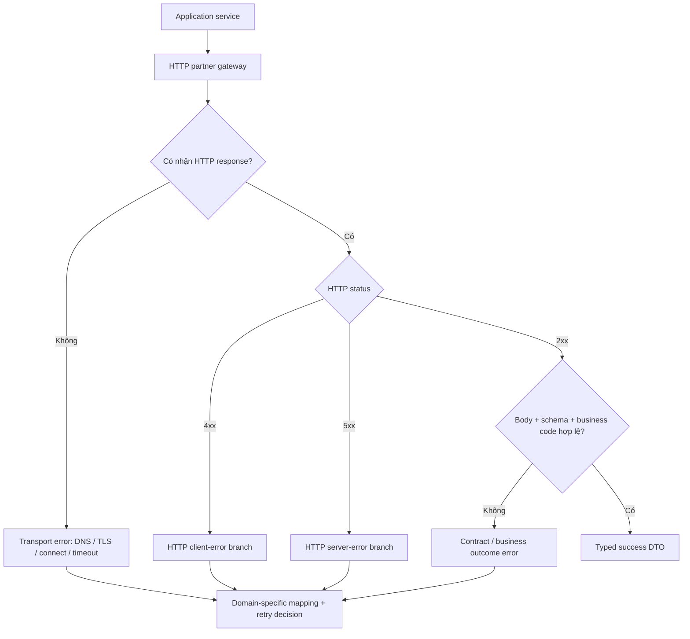
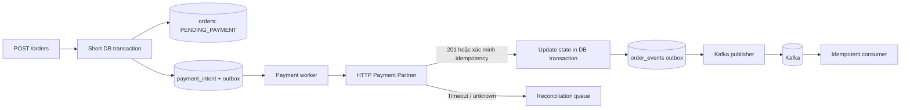
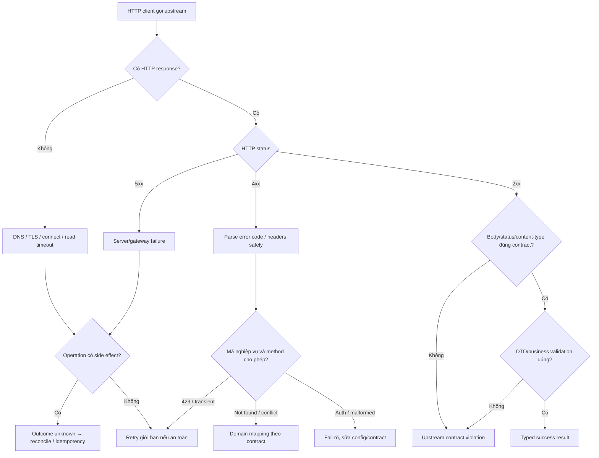

# Xử lý mã 4xx, 5xx và phản hồi không đúng hợp đồng

> **Chương:** HTTP đồng bộ  
> **Phạm vi:** SPRING_BOOT_INTEGRATION — tích hợp hệ thống Spring Boot qua HTTP client, cơ sở dữ liệu, cache, broker thông điệp và adapter Spring Integration; nhấn mạnh hợp đồng dữ liệu, cấu hình, giao dịch, phân loại lỗi, chống trùng, kiểm thử và quan sát.

## 1. Vấn đề thực tế: HTTP 200 chưa chắc thành công, HTTP 500 chưa chắc thất bại hoàn toàn

Một dịch vụ đặt hàng sử dụng `RestClient` để gọi hệ thống thanh toán:

```text
POST /v1/payments
Idempotency-Key: order-42-charge

{"orderId":"order-42","amount":"125.50","currency":"USD"}
```

Trong vận hành, cùng một lời gọi có thể cho các kết quả rất khác nhau:

- `201 Created` + JSON đúng schema: phía đối tác đã tạo payment theo hợp đồng.
- `400 Bad Request` + lỗi validation: request sai, gửi lại không sửa gì thường chỉ lặp lỗi.
- `401 Unauthorized`: token sai hoặc hết hạn; không phải bằng chứng order bị từ chối.
- `409 Conflict`: có thể payment đã tồn tại theo idempotency key hoặc trạng thái nghiệp vụ không cho phép.
- `429 Too Many Requests` + `Retry-After`: cần giới hạn lưu lượng và có thể retry có kiểm soát.
- `503 Service Unavailable`: dịch vụ tạm không sẵn sàng; kết quả lệnh ghi trước lỗi **có thể chưa rõ**.
- **Client timeout sau khi phía đối tác đã commit**: không thể coi “không nhận response” là “chưa thực hiện payment”.
- `200 OK` nhưng trả HTML, JSON sai trường hoặc body `{"status":"REJECTED"}`: HTTP transport thành công nhưng **hợp đồng phản hồi hoặc nghiệp vụ thất bại**.

Nếu code gom tất cả thành `catch (Exception e) { return null; }`, tầng nghiệp vụ mất khả năng phân biệt dữ liệu không tồn tại, lỗi xác thực, upstream outage, phản hồi sai schema và kết quả ghi chưa xác định. Điều này dẫn tới retry vô hạn, mất dữ liệu hoặc tạo lệnh trùng.

### 1.1. Mục tiêu học tập

Sau bài này, bạn có thể:

1. Phân biệt **HTTP status**, **business result**, **transport failure** và **response contract violation**.
2. Giải thích hành vi mặc định của `RestClient.retrieve()` với 4xx/5xx, cách dùng `onStatus(...)` và `exchange(...)`.
3. Chuẩn hóa error body (bao gồm `ProblemDetail`) thành lỗi ở ranh giới tích hợp, không rò rỉ thông tin nhạy cảm.
4. Nhận biết 2xx có body rỗng, JSON sai dạng, sai `Content-Type`, thiếu field, enum mới hoặc giá trị trái nghiệp vụ.
5. Thiết kế mapping 404/409/412/422/429/5xx theo **hợp đồng từng API**, không áp một quy tắc cứng cho mọi đối tác.
6. Lập retry có giới hạn cùng idempotency key và recovery khi write outcome không rõ.
7. Viết kiểm thử bằng `MockRestServiceServer` và theo dõi lỗi HTTP, lỗi parse, latency, retry, transaction và outbox.

### 1.2. Đặt lỗi ở đúng tầng



**Nguyên tắc:** exception type phải thể hiện *điều đã biết* và *điều chưa biết*, không chỉ mức độ nghiêm trọng. Đặc biệt, timeout sau POST không cho biết phía server đã commit hay chưa.

## 2. Bốn chiều kết quả của một cuộc gọi HTTP

| Chiều | Ví dụ | Được biết | Chưa được bảo đảm |
| --- | --- | --- | --- |
| **HTTP transport** | Đã nhận đủ status, headers, body | Có response trên kết nối | Dữ liệu/hoạt động nghiệp vụ đúng |
| **HTTP protocol** | 200, 404, 503 | Ý nghĩa status theo chuẩn và contract endpoint | Mã business bên trong body |
| **Response contract** | JSON có `paymentId`, `amount` đúng kiểu | Body ánh xạ được và thỏa schema | Downstream khác đã xử lý |
| **Business result** | `state=SETTLED` hoặc `state=REJECTED` | Kết quả theo contract đối tác | Giao dịch PostgreSQL/Kafka của ứng dụng đã commit |

Một HTTP 200 có thể đi kèm `{"success":false,"errorCode":"PAYMENT_DECLINED"}`. Một HTTP 202 có thể là job đã **được nhận để xử lý bất đồng bộ**, chưa hoàn tất. Một HTTP 409 có thể biểu thị request đã được thực hiện trước đó với cùng idempotency key, hoặc payload xung đột và cần người xử lý.

Không nên gán mọi 4xx thành “lỗi người dùng” trong ứng dụng của mình. Ví dụ `401` do token **của dịch vụ trung gian** hết hạn là lỗi cấu hình/tích hợp, không phải yêu cầu HTTP của khách hàng cuối.

### 2.1. Error taxonomy cho application service

| Loại lỗi nội bộ | Đặc điểm | Ví dụ |
| --- | --- | --- |
| `RESOURCE_NOT_FOUND` | Resource thật sự không tồn tại theo API contract | GET order trả 404 + error code hợp lệ |
| `BUSINESS_CONFLICT` | Yêu cầu trái trạng thái/phiên bản | 409/412 và mã nghiệp vụ đã được công bố |
| `UPSTREAM_AUTH_FAILURE` | Identity/credential của service không được chấp nhận | 401, 403 |
| `UPSTREAM_THROTTLED` | Quá giới hạn của đối tác | 429, có thể kèm Retry-After |
| `UPSTREAM_UNAVAILABLE` | Upstream tạm ngừng hoặc gateway lỗi | 502, 503, 504 |
| `UPSTREAM_CONTRACT_VIOLATION` | Thành công HTTP nhưng payload không hợp lệ | 200 + array thay vì object, missing required ID |
| `UPSTREAM_TRANSPORT_FAILURE` | DNS/TCP/TLS hoặc socket lỗi | Không nhận status HTTP |
| `UPSTREAM_OUTCOME_UNKNOWN` | Có khả năng side effect xảy ra dù mất response | POST timeout/connection reset sau khi gửi |

**Lưu ý:** đây là **taxonomy thiết kế cho ứng dụng**, không phải các exception class được Spring tạo tự động. Spring có exception HTTP và I/O riêng; gateway là nơi chuyển chúng thành loại lỗi nghiệp vụ/tích hợp có cấu trúc.

## 3. Thiết lập ví dụ RestClient và hợp đồng response

Các đoạn code nhắm **Java 17+, Spring Boot 3.2–3.5, Spring Framework 6.1+**, dùng `RestClient` theo mô hình **HTTP đồng bộ**. Với Boot 4.x/Spring Framework 7.x, cần đối chiếu starter, package và API theo dependency management của phiên bản đang dùng.

### 3.1. Dependency và cấu hình

```groovy
// build.gradle — ứng dụng đã áp dụng Spring Boot plugin/BOM.
dependencies {
    implementation 'org.springframework.boot:spring-boot-starter-web'
    implementation 'org.springframework.boot:spring-boot-starter-validation'
    testImplementation 'org.springframework.boot:spring-boot-starter-test'
}
```

```yaml
# application.yml; không lưu credential thực trong Git.
integration:
  payments:
    base-url: ${PAYMENTS_API_BASE_URL}
```

```java
import org.springframework.beans.factory.annotation.Value;
import org.springframework.context.annotation.Bean;
import org.springframework.context.annotation.Configuration;
import org.springframework.web.client.RestClient;

@Configuration(proxyBeanMethods = false)
class PaymentHttpConfiguration {
    @Bean("paymentRestClient")
    RestClient paymentRestClient(
            RestClient.Builder builder,
            @Value("${integration.payments.base-url}") String baseUrl) {
        return builder.baseUrl(baseUrl).build();
    }
}
```

**Tại sao inject builder của Boot?** Builder được Spring Boot cấu hình có thể mang theo message converters, request factory/customizers và observation đã đăng ký. Việc gọi `RestClient.create("...")` ở mọi request có thể bỏ qua các customizations này. Client nên là bean dùng lại, với connection pool, timeout, TLS và token được cấu hình theo chính sách hạ tầng.

Địa chỉ `PAYMENTS_API_BASE_URL` phải đến từ nguồn triển khai tin cậy. Không nhận URL host tùy ý từ user rồi gửi `Authorization` của đối tác vào đó — nguy cơ SSRF và rò rỉ credential.

### 3.2. DTO thành công và request

```java
import java.math.BigDecimal;
import java.time.Instant;

public record CreatePaymentRequest(
        String orderId,
        BigDecimal amount,
        String currency) {
}

public record PaymentReceipt(
        String paymentId,
        String orderId,
        String state,
        BigDecimal amount,
        Instant createdAt) {
}
```

Ví dụ hợp đồng thành công:

```http
HTTP/1.1 201 Created
Content-Type: application/json
Location: /v1/payments/pay-8b3
X-Request-Id: partner-4fd

{
  "paymentId": "pay-8b3",
  "orderId": "order-42",
  "state": "SETTLED",
  "amount": 125.50,
  "createdAt": "2026-11-21T08:30:00Z"
}
```

Giả định của ví dụ là endpoint **trả 201 + JSON receipt**. Đối tác khác có thể trả `202 ACCEPTED` để xử lý sau hoặc `201` chỉ có `Location`. Gateway phải tuân theo contract được version hóa của **chính endpoint đó**.

### 3.3. DTO lỗi không trùng với DTO thành công

```java
// PartnerError.java
public record PartnerError(
        String code,
        String message,
        String requestId) {
}
```

Một body lỗi có thể là:

```json
{
  "code": "ORDER_STATE_INVALID",
  "message": "Order cannot be charged in the current state",
  "requestId": "partner-4fd"
}
```

**Không** bắt lỗi HTTP rồi deserialize body lỗi thành `PaymentReceipt`. Với status 4xx/5xx, representation thường là một error schema hoàn toàn khác. Nếu nhận mã business error dưới HTTP 200, cần xác minh contract envelope riêng.

## 4. Mã 4xx: phân loại theo operation và contract

**4xx** báo request bị từ chối/xử lý không thể hoàn thành theo HTTP semantics, nhưng **không đồng nghĩa mọi lỗi là vĩnh viễn**. Một số 4xx liên quan đến authentication, concurrency hay rate limit và có cách xử lý riêng.

| Status | Bối cảnh thường gặp | Cách phản ứng của gateway |
| --- | --- | --- |
| **400 Bad Request** | JSON/query sai format, thiếu tham số | Sửa request mapping/validation; không retry payload y hệt vô hạn |
| **401 Unauthorized** | Thiếu hoặc sai credential/challenge | Kiểm tra token/scope và cơ chế refresh; không phản hồi nhầm thành “user không tồn tại” |
| **403 Forbidden** | Credential hợp lệ nhưng thiếu quyền/policy từ chối | Kiểm tra ACL/tenant/role; không retry mù |
| **404 Not Found** | Resource hoặc route không tồn tại | Map thành not-found **chỉ khi contract endpoint xác nhận** |
| **405 Method Not Allowed** | Sai HTTP method | Sửa client/API version, không retry y hệt |
| **408 Request Timeout** | Server không nhận đủ request kịp | Có thể retry có điều kiện; nếu lệnh ghi, vẫn cần idempotency |
| **409 Conflict** | Version/state conflict hoặc resource đã tồn tại | Phân biệt replay thành công với payload conflict |
| **412 Precondition Failed** | `If-Match`/ETag không còn hợp lệ | Đọc state mới, xử lý optimistic concurrency |
| **415 Unsupported Media Type** | `Content-Type` request không hỗ trợ | Chỉnh serialization/header, không retry payload y hệt |
| **422 Unprocessable Content** | Body đúng cú pháp nhưng trái quy tắc nghiệp vụ | Trả business validation/rejection theo error code |
| **429 Too Many Requests** | Rate limiting/quota | Đọc `Retry-After`, backoff, giảm concurrency và giới hạn retry |

### 4.1. 404 không phải lúc nào cũng Optional.empty()

Với `GET /v1/orders/{id}`, đối tác có thể quy định 404 + `{"code":"ORDER_NOT_FOUND"}` nghĩa là đơn không tồn tại. Khi đó adapter có thể trả `Optional.empty()`. Nhưng 404 cũng có thể do:

- Endpoint/path sai sau khi đối tác đổi phiên bản API.
- Reverse proxy chưa cấu hình route.
- Tenant không được phép nhìn resource và đối tác cố ý trả 404 thay vì 403.
- URL template bị escape sai.

Nếu biến **mọi 404** thành danh sách rỗng hoặc `Optional.empty()`, hệ thống có thể bỏ sót một outage cấu hình nghiêm trọng.

### 4.2. 409/412 là vấn đề concurrency hay idempotency?

Một `POST /payments` trả 409 có thể:

1. Báo request với cùng idempotency key đã được xử lý: cần **tra cứu kết quả cũ** và so khớp request.
2. Báo idempotency key đã được dùng cho payload **khác**: phải trả conflict, không lấy kết quả cũ làm thành công.
3. Báo order hiện đang ở trạng thái không cho charge: một business rejection.

`412 Precondition Failed` thường gắn với optimistic concurrency, ví dụ `If-Match: "revision-7"` nhưng tài nguyên đã ở revision 8. Không retry cùng revision cũ; đọc state mới và đánh giá lại business transition.

### 4.3. 401 và 403 thường là lỗi giữa các service

Nếu service-to-service token hết hạn, có thể refresh credential theo chính sách và thử lại **một lần có kiểm soát** khi request an toàn. Nếu bị 403 do thiếu quyền, thường cần sửa configuration/ACL chứ không phải retry.

Không log token hoặc response header chứa secret. Không coi 401 do credential của server **mình** sai là lỗi xác thực của **người gọi HTTP** rồi chuyển nguyên status 401 ra ngoài nếu người gọi vốn đã được xác thực với mình.

### 4.4. 429 cần chống retry storm

`Retry-After` có thể là số giây hoặc một **HTTP-date**. Nó là gợi ý về thời gian retry, **không miễn trừ** deadline tổng của request hoặc quota của hệ thống. Nếu nhiều workers đều lặp lại ngay khi hết thời gian chờ, có thể gây *thundering herd*; cần rate limiter, exponential backoff + jitter và giới hạn concurrent in-flight requests.

**Không biến 429 thành empty list hoặc 200** chỉ để tiếp tục batch import: đó là một lỗi năng lực phục vụ/điều tiết, cần được phản ánh vào trạng thái step, retry budget và lịch chạy tiếp.

## 5. Mã 5xx: server/gateway lỗi, nhưng retry có an toàn không?

**5xx** cho biết phía server, proxy hoặc gateway không hoàn thành request theo HTTP semantics. Với lệnh chỉ đọc, retry giới hạn thường có thể phù hợp. Với lệnh ghi, HTTP 500/502/503/504 **không chứng minh side effect chưa xảy ra**.

| Status | Tình huống thường gặp | Cách đánh giá |
| --- | --- | --- |
| **500 Internal Server Error** | Bug/exception phía đối tác hoặc lỗi nội bộ | Phân tích mã lỗi/trace; nếu là POST, outcome có thể chưa rõ |
| **501 Not Implemented** | Server không hỗ trợ khả năng/phương thức | Thường là sai version/contract; retry không sửa được |
| **502 Bad Gateway** | Proxy nhận phản hồi không hợp lệ từ upstream | Có thể tạm thời; yêu cầu đã được chuyển tiếp tới upstream chưa? |
| **503 Service Unavailable** | Bảo trì, quá tải, dịch vụ tạm không sẵn sàng | Có thể retry có budget; tôn trọng `Retry-After` nếu có |
| **504 Gateway Timeout** | Gateway không nhận kết quả kịp từ upstream | **Đặc biệt nguy hiểm cho POST**: upstream có thể đã commit |

### 5.1. Hai loại timeout khác nhau

- **Client-side timeout không nhận được status:** lỗi ở transport/client; không có HTTP 504 nào được server trả về.
- **HTTP 504 response:** một gateway/proxy đã trả **mã HTTP 504**, tức có status và có thể có body/header. Nó vẫn không khẳng định upstream chưa xử lý request.

Tương tự, `503` có thể kèm `Retry-After`, nhưng một response 503 từ gateway không phải lúc nào cũng đồng nghĩa backend payment chưa nhận lệnh. Đừng đồng nhất mã status với trạng thái commit ở database đối tác.

### 5.2. GET an toàn hơn POST trong chính sách retry, nhưng vẫn cần giới hạn

`GET` được HTTP đặc tả là safe method về mặt ý nghĩa. Nếu GET tới API tra cứu thất bại bởi 503, có thể retry có backoff trong deadline. Tuy vậy:

- Retry số lượng lớn GET có thể làm upstream quá tải hơn.
- Một endpoint gắn nhãn GET nhưng lại gây side effect ngoài chuẩn là một **vấn đề hợp đồng** phải xử lý với nhà cung cấp, không thể chỉ dựa vào tên method.
- `PUT`/`DELETE` được xem là idempotent ở mức HTTP semantics, nhưng implementation thực tế và các side effects (email, billing) vẫn cần xác minh.
- POST không được tự retry trừ khi có **idempotency key** hoặc cơ chế xác định kết quả, và đối tác cam kết hành vi đó.

### 5.3. Circuit breaker không thay hợp đồng dữ liệu

Circuit breaker, bulkhead, rate limiter và backoff giúp tránh đẩy tải vào upstream đang lỗi. Nhưng chúng **không**:

- Chuyển JSON sai schema thành đúng.
- Khôi phục một payment đã có kết quả chưa rõ mà không đối soát.
- Tạo transaction chung giữa HTTP, PostgreSQL và Kafka.
- Biến mọi 500 thành lỗi tạm thời có thể retry.

Khi breaker mở, tầng ứng dụng cần biết response đó là **dependency unavailable**, không ngầm diễn giải là “không có order” hoặc “thanh toán bị từ chối”.

## 6. RestClient.retrieve(): hành vi mặc định và tùy biến onStatus

Trong Spring Framework 6.1+, `RestClient` có hai hướng xử lý response quan trọng:

- `retrieve()`: đường thuận tiện để lấy `body(Class<T>)`, `body(ParameterizedTypeReference<T>)`, `toEntity(...)` và đăng ký `onStatus(...)`.
- `exchange(...)`: truy cập response mức thấp để ứng dụng tự xử lý status, headers và body. Với exchange, **status handlers của retrieve không tự áp dụng**; caller phải phân loại status.

### 6.1. Mặc định 4xx/5xx gây exception khi retrieve

```java
import org.springframework.web.client.RestClient;

PaymentReceipt receipt = client.get()
        .uri("/v1/payments/{id}", paymentId)
        .retrieve()
        .body(PaymentReceipt.class);
```

Khi response là 4xx/5xx, `retrieve()` mặc định ném các exception thích hợp thuộc họ `RestClientResponseException`, thường gặp:

| Exception | Ý nghĩa |
| --- | --- |
| `HttpClientErrorException` | HTTP client error status (4xx) |
| `HttpClientErrorException.NotFound` | HTTP 404 được Spring biểu diễn bằng subclass |
| `HttpClientErrorException.TooManyRequests` | HTTP 429 |
| `HttpServerErrorException` | HTTP server error status (5xx) |
| `RestClientResponseException` | Lớp cơ sở chứa status, headers, response body (khi có) |
| `ResourceAccessException` | Lỗi I/O khi truy cập resource, thường gặp timeout/kết nối |
| `RestClientException` | Lớp bao nhiều lỗi client, ví dụ conversion failure |

Exception HTTP không đồng nghĩa exception domain. Đối với `RestClientResponseException`, có thể đọc status/header/error payload **nếu phù hợp policy**, nhưng không tự log nguyên `getResponseBodyAsString()`: body có thể chứa PII, token, dữ liệu thanh toán hoặc HTML của proxy.

**Không dùng**:

```java
// Anti-pattern: nuốt mọi loại lỗi và trả dữ liệu giả.
try {
    return client.get().uri("/v1/orders").retrieve()
            .body(OrderDto[].class);
} catch (RestClientException ex) {
    return new OrderDto[0]; // 503, JSON lỗi, TLS lỗi đều thành "không có đơn".
}
```

Đây là **pseudocode nằm trong method có client**, cho thấy lỗi logic. Empty result phải đến từ hợp đồng dữ liệu hợp lệ (ví dụ 200 + `[]`), không phải mọi exception bị catch.

### 6.2. Chỉ ánh xạ 404 theo contract endpoint

Giả sử `GET /v1/orders/{id}` đặc tả `404 = ORDER_NOT_FOUND`. Một gateway có thể chuyển 404 thành exception domain:

```java
public final class PartnerOrderNotFoundException extends RuntimeException {
    public PartnerOrderNotFoundException(String id) {
        super("Partner order not found: " + id);
    }
}
```

```java
OrderDto order = client.get()
        .uri("/v1/orders/{id}", orderId)
        .retrieve()
        .onStatus(
                status -> status.value() == 404,
                (request, response) -> {
                    throw new PartnerOrderNotFoundException(orderId);
                })
        .body(OrderDto.class);
```

Đoạn thứ hai là fragment trong method đã có `client` và `orderId`. Nó thể hiện **một policy chỉ hợp lệ nếu mọi 404 trên endpoint này có đúng nghĩa not-found**. Nếu đối tác dùng body error code để phân biệt, handler phải đọc và validate mã đó trước khi quyết định.

### 6.3. Chuẩn hóa lỗi thành exception riêng của gateway

Để application service không phụ thuộc trực tiếp loại exception của HTTP library, khai báo lỗi giữ những thuộc tính an toàn để xử lý:

```java
// PartnerHttpFailure.java
public final class PartnerHttpFailure extends RuntimeException {
    private final int statusCode;
    private final String partnerCode;
    private final String retryAfter;

    public PartnerHttpFailure(
            int statusCode,
            String partnerCode,
            String retryAfter) {
        super("Payment partner HTTP " + statusCode
                + " (" + partnerCode + ")");
        this.statusCode = statusCode;
        this.partnerCode = partnerCode;
        this.retryAfter = retryAfter;
    }

    public int statusCode() { return statusCode; }
    public String partnerCode() { return partnerCode; }
    public String retryAfter() { return retryAfter; }
}
```

Không để message exception chứa nguyên response body, Authorization header hoặc customer/payment payload. Status HTTP, error code đã chuẩn hóa, correlation ID và Retry-After đã được kiểm tra thường đủ để phân loại và điều tra.

### 6.4. onStatus với JSON error body, giới hạn kích thước đọc

Một API đối tác có thể trả `application/json` hoặc `application/problem+json`. Nếu error contract của endpoint đúng theo `PartnerError` ở mục 3, có thể giải mã body một cách có giới hạn:

```java
import com.fasterxml.jackson.core.JsonProcessingException;
import com.fasterxml.jackson.databind.ObjectMapper;
import org.springframework.http.HttpHeaders;
import org.springframework.http.MediaType;
import org.springframework.web.client.RestClient;

public final class PaymentStatusHandlers {
    private static final int MAX_ERROR_BODY_BYTES = 4096;

    private PaymentStatusHandlers() {}

    public static RestClient.ResponseSpec withPartnerErrors(
            RestClient.ResponseSpec spec, ObjectMapper mapper) {

        return spec.onStatus(
                status -> status.is4xxClientError()
                        || status.is5xxServerError(),
                (request, response) -> {
                    int statusCode = response.getStatusCode().value();
                    String retryAfter = response.getHeaders()
                            .getFirst(HttpHeaders.RETRY_AFTER);
                    MediaType contentType = response.getHeaders()
                            .getContentType();

                    // Đọc tối đa MAX+1 để phát hiện payload quá giới hạn.
                    byte[] body;
                    boolean unreadableBody = false;
                    try {
                        body = response.getBody()
                                .readNBytes(MAX_ERROR_BODY_BYTES + 1);
                    } catch (java.io.IOException failedReadingErrorBody) {
                        // Có HTTP status nhưng body lỗi đọc không được.
                        // Không làm mất status gốc chỉ vì error body.
                        body = new byte[0];
                        unreadableBody = true;
                    }
                    String code = unreadableBody
                            ? "UNREADABLE_ERROR_BODY"
                            : "HTTP_" + statusCode;
                    boolean looksJson = contentType != null
                            && "application".equalsIgnoreCase(
                                    contentType.getType())
                            && ("json".equalsIgnoreCase(
                                    contentType.getSubtype())
                                || contentType.getSubtype()
                                    .toLowerCase(java.util.Locale.ROOT)
                                    .endsWith("+json"));

                    if (body.length <= MAX_ERROR_BODY_BYTES
                            && body.length > 0 && looksJson) {
                        try {
                            PartnerError error =
                                    mapper.readValue(body, PartnerError.class);
                            if (error != null
                                    && error.code() != null
                                    && error.code().matches(
                                            "[A-Z][A-Z0-9_]{0,63}")) {
                                code = error.code();
                            }
                        } catch (JsonProcessingException invalidErrorBody) {
                            code = "MALFORMED_ERROR_BODY";
                        }
                    } else if (body.length > MAX_ERROR_BODY_BYTES) {
                        code = "ERROR_BODY_TOO_LARGE";
                    }

                    throw new PartnerHttpFailure(
                            statusCode, code, retryAfter);
                });
    }
}
```

Sử dụng tại lời gọi `retrieve()`:

```java
PaymentReceipt receipt = PaymentStatusHandlers
        .withPartnerErrors(
                client.get()
                        .uri("/v1/payments/{id}", paymentId)
                        .retrieve(),
                objectMapper)
        .body(PaymentReceipt.class);
```

Đây là **adapter mẫu**, không phải parser phổ quát cho mọi lỗi. Error payload kiểu `application/problem+json` chuẩn có các field khác `PartnerError` và cần DTO/parser tương ứng. Nếu body không đúng content type, rỗng hoặc sai JSON, code vẫn **giữ HTTP status** để không làm mất nguyên nhân chính. Giới hạn 4 KiB chỉ giới hạn lượng bytes ứng dụng đọc trong handler; chống response quá lớn toàn diện còn cần giới hạn ở HTTP client/proxy/infrastructure.

Trong production, hãy thêm allowlist cho `partnerCode` trước khi đưa lên metrics; mã lỗi từ phía ngoài có thể là chuỗi tùy ý và gây high-cardinality. Kiểm tra content type trước khi parse, không tự trả error payload chưa kiểm soát cho HTTP client bên ngoài.

### 6.5. onStatus không đồng nghĩa request sẽ tự retry

`onStatus(...)` chỉ định **cách xử lý response**. Việc ném `PartnerHttpFailure(429,...)` không khiến Spring tự chờ `Retry-After` hoặc gửi lại request. Retry cần một policy độc lập, có deadline, max attempts, backoff, điều kiện an toàn và idempotency key khi side effect.

Nếu có nhiều status handlers, cần kiểm soát thứ tự/mức ưu tiên theo API; không tạo handler “mọi status” vô tình nuốt các status đặc thù rồi trả success.

## 7. RestClient.exchange(): toàn quyền xử lý status, tự chịu trách nhiệm

`retrieve()` thường đủ cho API trả JSON và cần status handler. `exchange(...)` phù hợp khi phải điều khiển việc đọc raw response, xử lý một số status không theo đường mặc định hoặc cần quyết định dựa đồng thời vào header và body.

**Điểm khác biệt then chốt:** khi gọi `exchange(...)`, các status handlers gắn với `retrieve()` hoặc builder **không tự được áp dụng**. Caller cần tự xử lý 4xx/5xx và đảm bảo mọi luồng kết thúc hợp lệ.

### 7.1. Đọc đơn, cho phép 404 theo hợp đồng, từ chối body sai

DTO minh họa của endpoint tra cứu (độc lập với DTO payment):

```java
import java.math.BigDecimal;

public record OrderDto(String id, BigDecimal amount) {
}
```

```java
import com.fasterxml.jackson.databind.ObjectMapper;
import java.io.IOException;
import java.util.Optional;
import org.springframework.http.HttpStatusCode;
import org.springframework.http.MediaType;
import org.springframework.web.client.RestClient;

public final class OrderExchangeGateway {
    private static final int MAX_SUCCESS_BODY_BYTES = 128 * 1024;

    private final RestClient client;
    private final ObjectMapper mapper;

    public OrderExchangeGateway(
            RestClient client, ObjectMapper mapper) {
        this.client = client;
        this.mapper = mapper;
    }

    public Optional<OrderDto> find(String id) {
        return client.get()
                .uri("/v1/orders/{id}", id)
                .exchange((request, response) -> {
                    HttpStatusCode status = response.getStatusCode();

                    if (status.value() == 404) {
                        // Chỉ khi endpoint cam kết 404 = ORDER_NOT_FOUND.
                        return Optional.empty();
                    }
                    if (!status.is2xxSuccessful()) {
                        throw new PartnerHttpFailure(
                                status.value(),
                                "UNEXPECTED_HTTP_STATUS",
                                null);
                    }
                    if (status.value() == 204) {
                        throw new PartnerContractViolation(
                                "Expected OrderDto but got 204");
                    }
                    MediaType contentType =
                            response.getHeaders().getContentType();
                    if (contentType == null
                            || !MediaType.APPLICATION_JSON
                                    .isCompatibleWith(contentType)) {
                        throw new PartnerContractViolation(
                                "Expected application/json");
                    }

                    byte[] body = response.getBody()
                            .readNBytes(MAX_SUCCESS_BODY_BYTES + 1);
                    if (body.length == 0
                            || body.length > MAX_SUCCESS_BODY_BYTES) {
                        throw new PartnerContractViolation(
                                "Required order body missing or too large");
                    }
                    try {
                        OrderDto order =
                                mapper.readValue(body, OrderDto.class);
                        if (order == null
                                || order.id() == null
                                || order.id().isBlank()
                                || order.amount() == null) {
                            throw new PartnerContractViolation(
                                    "Order missing required fields");
                        }
                        return Optional.of(order);
                    } catch (IOException invalidJson) {
                        throw new PartnerContractViolation(
                                "Invalid order JSON", invalidJson);
                    }
                });
    }
}
```

Exception đơn giản cho contract violation:

```java
public final class PartnerContractViolation
        extends RuntimeException {
    public PartnerContractViolation(String message) {
        super(message);
    }

    public PartnerContractViolation(
            String message, Throwable cause) {
        super(message, cause);
    }
}
```

**Lưu ý giới hạn ví dụ:** `OrderDto` phải được định nghĩa theo contract endpoint (ở mục này có thể dùng DTO riêng cho đơn), và mapper cần cấu hình các module Java Time như ứng dụng. Khi gọi `exchange(...)`, tránh đọc body nhiều lần hoặc trả `InputStream` của response ra ngoài callback: response resource được quản lý trong phạm vi exchange. Nếu API cho phép HTTP 304 với `If-None-Match`, phải thêm nhánh riêng để sử dụng dữ liệu cache đã xác thực; không map 304 thành 200 có body mới.

### 7.2. retrieve hay exchange?

| Tình huống | API nên dùng | Lý do |
| --- | --- | --- |
| 2xx + JSON object, 4xx/5xx theo handler | `retrieve().body(OrderDto.class)` | Tận dụng converters/default status behavior |
| Cần status + headers + typed body | `retrieve().toEntity(OrderDto.class)` | Có `ResponseEntity<T>` nhưng vẫn áp status handlers |
| JSON array hoặc envelope generic | `retrieve().body(ParameterizedTypeReference<T>)` | Giữ kiểu generic để converter map đúng |
| Cần quyết định đặc biệt theo raw status/headers/body | `exchange(...)` | Tự chịu trách nhiệm toàn bộ status và response stream |
| HTTP 204 và không mong body | `retrieve().toBodilessEntity()` | Hợp đồng no-content, không ép parse DTO |

**Không dùng exchange chỉ để bỏ mặc 500 rồi trả null**. Quyền kiểm soát thấp tầng đồng nghĩa gateway phải có error taxonomy và test cho tất cả nhánh.

## 8. Hợp đồng error body: JSON tùy biến và Problem Details

Không có một schema error body chung bắt buộc cho mọi HTTP API. Nhiều hệ thống dùng:

```json
{
  "code": "INSUFFICIENT_FUNDS",
  "message": "Account balance is too low",
  "requestId": "partner-8f2"
}
```

Các API hiện đại có thể dùng **Problem Details** theo RFC 9457 (kế thừa RFC 7807) với media type `application/problem+json`:

```http
HTTP/1.1 422 Unprocessable Content
Content-Type: application/problem+json

{
  "type": "https://api.example.invalid/problems/invalid-payment",
  "title": "Payment cannot be processed",
  "status": 422,
  "detail": "The requested order state is not chargeable",
  "instance": "/v1/payments/requests/partner-8f2",
  "code": "ORDER_STATE_INVALID"
}
```

`type`, `title`, `status`, `detail`, `instance` có ý nghĩa chuẩn; `code` là extension được provider định nghĩa. **Không coi `detail` là chuỗi ổn định để điều kiện hóa logic**: nó có thể đổi wording, locale hoặc chứa thông tin cần bảo vệ.

### 8.1. Spring ProblemDetail và DTO riêng

Spring Framework cung cấp `org.springframework.http.ProblemDetail`. Khi ứng dụng **phát** lỗi HTTP, có thể trả `ProblemDetail` trong controller advice. Khi ứng dụng **nhận** lỗi đối tác, bạn có thể deserialize về DTO Problem Details hoặc `ProblemDetail` nếu contract tương thích.

DTO riêng cho error provider với extension code:

```java
import com.fasterxml.jackson.annotation.JsonIgnoreProperties;
import java.net.URI;

@JsonIgnoreProperties(ignoreUnknown = true)
public record PartnerProblem(
        URI type,
        String title,
        Integer status,
        String detail,
        String instance,
        String code) {
}
```

`URI type` phù hợp cho problem identifier, nhưng **không tự mở URL trong field `type`**. URL này là dữ liệu từ upstream, có thể không đáng tin; tránh SSRF. Nếu dùng `ProblemDetail` của Spring, chú ý phần extension properties được hỗ trợ theo Jackson module/cấu hình cụ thể. Không suy rằng `ProblemDetail` có constructor/JSON shape giống mọi DTO custom.

### 8.2. Validate error body rồi mới quyết định business mapping

Ví dụ quy tắc của endpoint:

| HTTP status | Error body | Quyết định |
| --- | --- | --- |
| 404 | `code=ORDER_NOT_FOUND` | Có thể map thành domain not found |
| 404 | HTML page của proxy | Upstream routing/config failure; **không** map domain not found |
| 409 | `code=IDEMPOTENCY_REPLAY`, có resource ID | Tra cứu và xác minh payload/kết quả cũ |
| 409 | `code=IDEMPOTENCY_PAYLOAD_MISMATCH` | Conflict thật; không retry cùng key với payload khác |
| 422 | `code=ORDER_STATE_INVALID` | Business rejection cần hiển thị/lưu trạng thái |
| 429 | `Retry-After` hợp lệ | Throttle/retry có deadline |
| 503 | Error body không parse được | Vẫn là HTTP 503; giữ status và correlation, không bịa mã domain |

Nếu error body thiếu/khác schema thì **không được biến HTTP error thành success**. Một status handler có thể fallback về code `HTTP_503` và phát metric `malformed_error_body`; đồng thời giới hạn body để tránh tiêu tốn bộ nhớ.

### 8.3. Không giữ toàn bộ payload lỗi trong exception/log

Một HTTP 502 từ gateway có thể trả HTML chứa hostname, upstream paths hoặc debug thông tin nội bộ. Error body 400/422 có thể echo lại request chứa PII hoặc card/payment data. Thực hành tốt:

- Chỉ giữ **HTTP status**, **provider code thuộc allowlist**, **requestId/correlationId** đã kiểm tra và thông tin ngắn đã sanitize.
- Giới hạn số bytes của error body, không đưa raw body vào metric attributes hoặc exception message.
- Không log `Authorization`, `Cookie`, `Set-Cookie`, API key hoặc query string chứa token.
- Chỉ bật raw payload logging ngắn hạn trong môi trường cô lập và có quyền truy cập, tuân thủ retention/security policy.
- Phân biệt lỗi parse response thành công với lỗi parse **error body**: nếu response đã là HTTP 503, giữ bản chất unavailable dù phần body lỗi không hợp lệ.

### 8.4. API error contract thay đổi theo version

Khi provider chuyển từ:

```json
{"error":"not_found"}
```

sang:

```json
{"code":"ORDER_NOT_FOUND","message":"Order does not exist"}
```

adapter cũ có thể không nhận diện được mã lỗi. Cần contract tests, OpenAPI/schema versioning và rollout tương thích. Dùng error code được tài liệu hóa thay vì so sánh trực tiếp câu chữ từ `message`.

## 9. Phản hồi 2xx không đúng hợp đồng nguy hiểm thế nào?

`RestClient.retrieve().body(OrderDto.class)` có thể hoàn thành HTTP 2xx và vẫn nhận dữ liệu **không thể dùng**. Việc Jackson deserialize thành một Java object không đồng nghĩa document thỏa business contract.

### 9.1. Các kiểu vi phạm hay gặp

| HTTP response | Vì sao không đúng hợp đồng | Phản ứng |
| --- | --- | --- |
| 200 + JSON array nhưng cần một object | JSON root shape sai | Conversion error → contract violation |
| 200 + `{}` khi cần `id`/`status` | Missing required fields | Validate DTO sau deserialize |
| 200 + body rỗng khi API hứa trả Order | Thiếu body | Contract violation; không tự tạo `new OrderDto()` |
| 200 + `text/html` trang login | Authentication redirect/proxy response sai representation | Contract violation/auth diagnosis |
| 200 + `{"success":false}` | API dùng business envelope riêng | Business rejection, dù HTTP 200 |
| 201 + `Location` nhưng contract nói có receipt body | Body vắng mặt | Validate contract/version |
| 202 + ticket xử lý bất đồng bộ | Chưa có business result cuối | Lưu ticket, polling/webhook/event |
| 204 + body rỗng | Hợp lệ **nếu endpoint quy định no-content** | Dùng response không có body |
| 206 Partial Content khi client mong full JSON | Response chỉ là phần representation | Chỉ chấp nhận nếu API/range contract hỗ trợ |
| 200 + `application/json` nhưng JSON malformed | Content type đúng nhưng payload sai | Conversion/contract violation |
| 200 + JSON đúng cú pháp, `amount` âm | Sai business invariant | Validate và từ chối dùng dữ liệu |
| 200 + enum value mới | Không tương thích schema/consumer | Chính sách unknown enum hoặc fail rõ |

**Không đánh đồng** `204 No Content` với not-found. HTTP 204 báo thành công không có body; 404 là một error status với nghĩa phụ thuộc endpoint. Cũng không coi `200 []`, `200 null` và `204` giống nhau khi hợp đồng phân biệt chúng.

### 9.2. Vi phạm hợp đồng thuộc trách nhiệm của upstream

Khi service A gọi service B và B trả 200 với response sai schema, A có thể phải báo upstream contract failure/gateway error theo policy; **không nên biến thành HTTP 400 của client A** chỉ vì một field trong DTO bị thiếu. Người dùng cuối không thể sửa một JSON response từ B.

Trong hệ thống có retry, lỗi contract thường cần **fail-fast + alert** hoặc dead-letter/quarantine, chứ không tự gửi lại hàng trăm request giống nhau rồi hy vọng schema đổi. Nếu provider đang rollout nhiều versions, cần contract compatibility strategy và kiểm tra response thực tế.

## 10. JSON/Jackson và validation: deserialize được chưa đủ

### 10.1. Định nghĩa success DTO với ràng buộc rõ

Nếu partner hứa response phải có `paymentId`, `orderId`, `state`, `amount > 0` và timestamp, có thể dùng Jakarta Bean Validation ở ranh giới outbound HTTP.

```java
import jakarta.validation.constraints.DecimalMin;
import jakarta.validation.constraints.NotBlank;
import jakarta.validation.constraints.NotNull;
import java.math.BigDecimal;
import java.time.Instant;

public record ValidatedPaymentReceipt(
        @NotBlank String paymentId,
        @NotBlank String orderId,
        @NotBlank String state,
        @NotNull @DecimalMin("0.01") BigDecimal amount,
        @NotNull Instant createdAt) {
}
```

Spring Boot với `spring-boot-starter-validation` cung cấp Jakarta Validator khi được cấu hình đúng. Tuy nhiên **`RestClient.body(ValidatedPaymentReceipt.class)` không tự gọi `validator.validate(...)` cho mọi phản hồi**. Adapter phải validate tường minh:

```java
import jakarta.validation.Validator;
import java.util.Set;

public final class PaymentReceiptValidator {
    private final Validator validator;

    public PaymentReceiptValidator(Validator validator) {
        this.validator = validator;
    }

    public ValidatedPaymentReceipt requireValid(
            ValidatedPaymentReceipt receipt,
            CreatePaymentRequest expected) {
        if (receipt == null) {
            throw new PartnerContractViolation(
                    "Missing successful payment response");
        }
        Set<?> violations = validator.validate(receipt);
        if (!violations.isEmpty()) {
            throw new PartnerContractViolation(
                    "Payment response failed schema validation");
        }
        if (!receipt.orderId().equals(expected.orderId())
                || receipt.amount().compareTo(expected.amount()) != 0) {
            throw new PartnerContractViolation(
                    "Payment response does not match request identity");
        }
        if (!Set.of("SETTLED", "AUTHORIZED")
                .contains(receipt.state())) {
            throw new PartnerContractViolation(
                    "Unknown or unsupported payment state");
        }
        return receipt;
    }
}
```

`ValidatedPaymentReceipt` và `PaymentReceiptValidator` là một ví dụ **contract validation**, không thay quy tắc thanh toán thực. Trong production, phải xét currency, amount scale, refund/partial authorization, tolerance/rounding theo contract và trạng thái hợp lệ của từng endpoint. Không ghi `ConstraintViolation.toString()` chứa field nhạy cảm vào log.

### 10.2. Entity, DTO và “unknown properties”

Đối tác có thể thêm field `riskScore` vào JSON. Có hai chính sách thường gặp:

- **Tương thích mở rộng:** chấp nhận unknown fields nhưng **vẫn validate required fields** và business invariants. Phù hợp khi contract cho phép thêm trường.
- **Strict schema:** từ chối unknown fields và sai tên/kiểu. Phù hợp với những hợp đồng phải bảo đảm shape chính xác và rollout có quản lý.

`@JsonIgnoreProperties(ignoreUnknown = true)` chỉ giải quyết field bổ sung. Nó **không** bảo đảm thiếu `paymentId` sẽ lỗi, không kiểm tra `amount > 0` và không xác nhận `orderId` khớp request.

Tránh deserialize thẳng JSON từ bên ngoài vào JPA entity/MongoDB entity hoặc message event đã public schema. Nên dùng **partner DTO → validation → domain model → persistence/event DTO** để cô lập thay đổi ở hệ thống nguồn.

### 10.3. Trường thiếu, null và primitive default

```json
{"paymentId":"pay-8b3","amount":null,"state":"SETTLED"}
```

Với `record PaymentReceipt(...)`, Jackson có thể tạo object chứa những field null (tùy cấu hình creator/null handling). Nếu business code kiểm tra `receipt.state()` rồi bỏ qua `paymentId()`, một dữ liệu lỗi có thể lọt vào database.

Nếu DTO dùng primitive `long totalCount` hoặc `boolean success`, JSON thiếu field có thể cho giá trị Java mặc định 0/false; từ đó khó phân biệt “đối tác không gửi field” và “đối tác gửi 0/false”. Với field bắt buộc, cân nhắc `Long`/`Boolean`, annotation và validation phù hợp.

### 10.4. Số tiền, timestamp, enum và schema evolution

| Field | Lựa chọn nên cân nhắc | Pitfall |
| --- | --- | --- |
| `amount` | `BigDecimal` + currency/scale policy | `double` gây sai số thập phân, đơn vị tiền không rõ |
| `createdAt` | `Instant`/`OffsetDateTime` theo contract | Nhầm timezone/local time hoặc format |
| `state` | String ở partner DTO + mapping sang domain enum có policy | Enum mới gây lỗi parse hoặc bị coi sai là success |
| `id` | String/UUID theo contract thực, không tự suy | Leading zeros/format bị mất nếu ép số |
| `data` | Kiểu generic cụ thể | Dùng `Object.class` hoặc `List.class` tạo `Map` thô |
| `version` | Version/ETag token theo semantics provider | Bỏ qua optimistic concurrency, ghi đè state mới |

Một JSON có `"amount":"125.50"` thay vì số `125.50` có thể được Jackson coercion tùy cấu hình. Không dựa vào hành vi ép kiểu ngẫu nhiên để xác định hợp đồng; nếu provider chỉ cho phép JSON number thì test case gửi string phải được đánh giá đúng strictness của hệ thống.

### 10.5. Generic response, list và envelope

Nếu API trả:

```json
{
  "status": "OK",
  "data": [
    {"id":"ord-1","amount":10.00},
    {"id":"ord-2","amount":20.00}
  ]
}
```

Đừng đọc bằng `List.class` hoặc `ApiResponse.class` rồi ép kiểu tùy tiện. Khai báo type token:

```java
import java.math.BigDecimal;
import java.util.List;
import org.springframework.core.ParameterizedTypeReference;

public record OrderSummary(String id, BigDecimal amount) {}
public record ApiResponse<T>(String status, T data) {}

ParameterizedTypeReference<ApiResponse<List<OrderSummary>>> type =
        new ParameterizedTypeReference<
                ApiResponse<List<OrderSummary>>>() {};

ApiResponse<List<OrderSummary>> result =
        client.get()
                .uri("/v1/orders/lookup")
                .retrieve()
                .body(type);
```

Các `record` declarations là ví dụ DTO riêng; phần lời gọi nằm trong gateway đã có biến `client`. Type token giữ generic type xuyên qua Jackson, nhưng vẫn cần kiểm tra `result != null`, `result.status()=="OK"`, `data != null` và từng item hợp lệ.

**HTTP 200 với body `{"status":"ERROR","data":null}` là business-level failure** nếu envelope quy định như vậy. Không chỉ kiểm tra HTTP status rồi ghi mọi response vào PostgreSQL.

### 10.6. Content-Type và JSON không hợp lệ

| Phản hồi | Điều cần kiểm tra |
| --- | --- |
| `200 application/json` + JSON object | Schema và semantic validation |
| `200 text/html` + trang login | Session/token redirect, proxy, Content-Type sai |
| `200 application/json` + HTML text | Malformed JSON; có thể proxy gắn sai Content-Type |
| `200 application/json` + `[]` khi cần object | JSON root shape mismatch |
| `200 application/json` + dữ liệu quá lớn | Body size/heap limit, pagination, streaming |
| `200 application/json` + JSON nesting cực sâu | Giới hạn parser depth/complexity, không tin tưởng input ngoài |

Đối với dữ liệu nhạy cảm, không đọc response thành `String` rồi log toàn bộ khi gặp lỗi deserialize. Thay vào đó, log mã lỗi, endpoint template, status, content type, kích thước response và correlation ID đã sanitize.

## 11. Gateway hoàn chỉnh ở mức ứng dụng: validate status và payload

Một gateway tốt **không trả trực tiếp lỗi HTTP library cho domain service**. Nó ghi nhận kết quả đã biết, phát lỗi có kiểu và không tự retry mọi thao tác ghi.

Ví dụ service dưới đây dùng success DTO có validation và error status handler đã viết ở các mục trước:

```java
import com.fasterxml.jackson.databind.ObjectMapper;
import java.math.BigDecimal;
import java.util.Objects;
import org.springframework.beans.factory.annotation.Qualifier;
import org.springframework.http.HttpStatus;
import org.springframework.http.MediaType;
import org.springframework.http.ResponseEntity;
import org.springframework.stereotype.Component;
import org.springframework.web.client.RestClient;

@Component
public class PaymentPartnerGateway {
    private final RestClient client;
    private final ObjectMapper mapper;
    private final PaymentReceiptValidator validator;

    public PaymentPartnerGateway(
            @Qualifier("paymentRestClient") RestClient client,
            ObjectMapper mapper,
            PaymentReceiptValidator validator) {
        this.client = client;
        this.mapper = mapper;
        this.validator = validator;
    }

    public ValidatedPaymentReceipt create(
            CreatePaymentRequest request,
            String idempotencyKey) {
        if (request == null || request.orderId() == null
                || request.orderId().isBlank()
                || request.amount() == null
                || request.amount().compareTo(BigDecimal.ZERO) <= 0
                || idempotencyKey == null
                || idempotencyKey.isBlank()) {
            throw new IllegalArgumentException(
                    "Invalid payment request");
        }

        ResponseEntity<ValidatedPaymentReceipt> response =
                PaymentStatusHandlers.withPartnerErrors(
                        client.post()
                                .uri("/v1/payments")
                                .contentType(MediaType.APPLICATION_JSON)
                                .accept(MediaType.APPLICATION_JSON)
                                .header("Idempotency-Key", idempotencyKey)
                                .body(request)
                                .retrieve(),
                        mapper)
                        .toEntity(ValidatedPaymentReceipt.class);

        if (response.getStatusCode().value()
                != HttpStatus.CREATED.value()) {
            throw new PartnerContractViolation(
                    "Expected HTTP 201 for create payment");
        }

        return validator.requireValid(
                response.getBody(), request);
    }
}
```

Mẫu này giả định endpoint **chỉ thành công với 201 + JSON receipt**, `@Component PaymentReceiptValidator` hoặc `@Bean` đã được đăng ký vào Spring context, và partner có idempotency policy cho header được gửi. Vì lớp `PaymentReceiptValidator` ở mục 10 chỉ là Java class, cần một bean khai báo tường minh:

```java
import jakarta.validation.Validator;
import org.springframework.context.annotation.Bean;
import org.springframework.context.annotation.Configuration;

@Configuration(proxyBeanMethods = false)
class PartnerValidationConfiguration {
    @Bean
    PaymentReceiptValidator paymentReceiptValidator(Validator validator) {
        return new PaymentReceiptValidator(validator);
    }
}
```

**Ý nghĩa quan trọng:**

1. Lỗi 4xx/5xx đi qua `PaymentStatusHandlers`, giữ HTTP status và partner code.
2. Một response 2xx nhưng **không đúng status contract** được ném `PartnerContractViolation`.
3. Một response 201 nhưng body thiếu, sai field hoặc trái request identity cũng là lỗi contract.
4. Gateway **không tự retry POST**: tầng orchestration hoặc retry owner phải quyết định khi nào có thể retry với **cùng idempotency key**.
5. Header idempotency key phải gắn với **business request bất biến**, không tự tạo UUID mới mỗi lần retry mà không lưu key cũ.

Nếu đối tác dùng 202/200 làm kết quả hợp lệ hoặc trả receipt theo response header thay vì body, **phải sửa contract của gateway và tests**; không dùng mẫu 201 ở trên để đánh giá mọi API.

### 11.1. Domain mapping và HTTP response của chính ứng dụng

Không nhất thiết chuyển nguyên `PartnerHttpFailure(503)` thành HTTP 503 cho caller cuối. Adapter phát lỗi **upstream dependency unavailable**; controller advice quyết định status phù hợp theo API của **ứng dụng mình** (thường một lỗi gateway/dependency riêng), kèm correlation ID mà không làm lộ hostname, token hoặc raw error body của partner.

| Lỗi từ upstream | Business/domain interpretation | HTTP response của ứng dụng mình |
| --- | --- | --- |
| 404 + đúng `ORDER_NOT_FOUND` | Resource không tồn tại | Có thể 404, theo contract của API mình |
| 422 + `ORDER_STATE_INVALID` | Business rejection | Có thể 409/422 hoặc domain error response |
| 401 từ service credential | Lỗi authentication giữa services | Không tự chuyển thành 401 dành cho end-user |
| 429 | Upstream throttle | Có thể 503/429 theo gateway contract và quota policy |
| 503/504 | Dependency unavailable | Có thể 502/503/504 theo kiến trúc gateway |
| 200 malformed JSON | Upstream contract violation | Thường không phải HTTP 400 do end-user |
| POST timeout sau khi gửi | Outcome unknown | Trả trạng thái pending/đối soát theo contract, tránh tuyên bố thất bại chắc chắn |

Không có bảng mapping HTTP-to-HTTP đúng cho mọi tổ chức. Quan trọng là **một quy tắc có tài liệu, test được và không đánh tráo trách nhiệm lỗi**.

### 11.2. Type-safe error result thay vì chỉ ném RuntimeException

Một số ứng dụng chọn mô hình kết quả typed như `Success<T>`, `NotFound`, `BusinessConflict`, `UpstreamUnavailable` và `OutcomeUnknown` (sealed interface/Result type). Hướng đó cũng hợp lệ, miễn là:

- Không có nhánh fallback `null`/empty làm mất thông tin.
- Người gọi buộc xử lý mọi biến thể quan trọng.
- Lỗi connection/timeout và kết quả chưa xác định không bị coi như business rejection.
- Dữ liệu business result chỉ được dùng sau validation.

Exception-based gateway trong bài chọn vì dễ tích hợp với Spring MVC/service imperative, **không phải chuẩn bắt buộc của mọi ứng dụng**.

## 12. Timeout, retry, Retry-After và kết quả chưa xác định

### 12.1. Một request có nhiều khoảng chờ

| Giới hạn | Phạm vi | Không thay thế được |
| --- | --- | --- |
| DNS/connect timeout | Thiết lập đường đi và TCP connection | Read timeout của response |
| TLS handshake timeout | Thiết lập kết nối mã hóa | Tổng deadline nghiệp vụ |
| Pool acquisition timeout | Đợi connection rảnh từ client pool | Database pool/HTTP server processing |
| Read/response timeout | Chờ dữ liệu phản hồi | Deadline tổng gồm nhiều attempts và backoff |
| Overall deadline | Toàn bộ lời gọi và retry trong một nghiệp vụ | Quy tắc idempotency của POST |
| Circuit breaker/bulkhead | Giới hạn đồng thời và trạng thái lỗi | Bảo đảm giao dịch phân tán |

Khi app gọi một API đồng bộ trong Spring MVC, thread đang chờ HTTP response. Không cấu hình timeout có thể giữ thread/connection quá lâu, kéo theo cạn thread pool, Hikari pool hoặc hàng đợi request khi upstream chậm.

### 12.2. Ví dụ cấu hình timeout ở request factory

Với một môi trường Spring Framework 6.1/6.2 sử dụng request factory đơn giản:

```java
import org.springframework.beans.factory.annotation.Value;
import org.springframework.context.annotation.Bean;
import org.springframework.context.annotation.Configuration;
import org.springframework.http.client.SimpleClientHttpRequestFactory;
import org.springframework.web.client.RestClient;

@Configuration(proxyBeanMethods = false)
class TimedPaymentHttpConfiguration {

    @Bean("timedPaymentRestClient")
    RestClient timedPaymentRestClient(
            RestClient.Builder builder,
            @Value("${integration.payments.base-url}") String baseUrl) {

        SimpleClientHttpRequestFactory factory =
                new SimpleClientHttpRequestFactory();
        factory.setConnectTimeout(2_000);
        factory.setReadTimeout(3_000);

        return builder
                .baseUrl(baseUrl)
                .requestFactory(factory)
                .build();
    }
}
```

**Đây là lựa chọn minh họa, không phải yêu cầu production phải dùng `SimpleClientHttpRequestFactory`.** Nếu dự án sử dụng Apache HttpComponents, JDK HttpClient, proxy, TLS bundles hoặc connection pooling từ Boot, hãy cấu hình timeout **trên request factory thực sự đang sử dụng**, không thay factory bằng bản đơn giản rồi vô tình làm mất pool/SSL/client settings. Không đăng ký đồng thời hai RestClient beans trên nếu ứng dụng mong một bean duy nhất mà không dùng `@Qualifier` rõ ràng.

Hai timeout trên **không tạo overall deadline**. Một lời gọi với 3 attempts có thể tiêu tốn nhiều lần read timeout cộng backoff, nên vẫn cần budget ở tầng workflow.

### 12.3. Retry-After có hai dạng

Ví dụ:

```http
HTTP/1.1 429 Too Many Requests
Retry-After: 12
```

hoặc:

```http
HTTP/1.1 503 Service Unavailable
Retry-After: Sat, 21 Nov 2026 09:00:00 GMT
```

`12` là số giây; dạng ngày sử dụng HTTP-date. Một helper parse được cả hai kiểu:

```java
import java.time.Clock;
import java.time.Duration;
import java.time.Instant;
import java.time.ZonedDateTime;
import java.time.format.DateTimeFormatter;
import java.time.format.DateTimeParseException;
import java.util.Optional;

public final class RetryAfterParser {
    private RetryAfterParser() {}

    public static Optional<Duration> parse(
            String header, Clock clock) {
        if (header == null || header.isBlank()) {
            return Optional.empty();
        }
        try {
            long seconds = Long.parseLong(header.trim());
            return seconds < 0
                    ? Optional.empty()
                    : Optional.of(Duration.ofSeconds(seconds));
        } catch (NumberFormatException invalidSeconds) {
            // Tiếp tục thử dạng HTTP-date.
        }
        try {
            Instant retryAt = ZonedDateTime.parse(
                    header, DateTimeFormatter.RFC_1123_DATE_TIME)
                    .toInstant();
            Duration remaining =
                    Duration.between(clock.instant(), retryAt);
            return Optional.of(
                    remaining.isNegative()
                            ? Duration.ZERO : remaining);
        } catch (DateTimeParseException invalidDate) {
            return Optional.empty();
        }
    }
}
```

Helper này chỉ **parse header**, chưa quyết định retry có an toàn. Caller cần cap delay theo deadline/max wait, xử lý clock skew, chọn thêm jitter khi phù hợp và bảo đảm scheduler không tạo một lượng lớn attempts cùng lúc.

### 12.4. Retry matrix theo operation và kết quả

| Operation và lỗi | Retry tự động? | Điều kiện bắt buộc |
| --- | --- | --- |
| GET idempotent, connection reset | Có thể | Max attempts, backoff, tổng deadline, giới hạn tải |
| GET, 503/504 | Có thể | Không làm 503 thành empty result; retry budget |
| GET, JSON schema sai | Thường không | Alert/contract fix; không retry mù |
| POST payment, 400/422 validation | Thường không | Sửa input/contract, không tạo side effect mới |
| POST payment, 401 | Chỉ theo auth policy | Refresh credential có kiểm soát; không đổi business ID |
| POST payment, 409 | Theo business code | Lookup/reconcile; không POST lại payload khác với cùng key |
| POST payment, 429/503 | Chỉ khi idempotency contract cho phép | Stable idempotency key, Retry-After, deadline |
| POST payment, timeout sau gửi | **Outcome unknown** | Tra cứu theo idempotency key, reconcile trước khi tạo lệnh mới |
| PUT/PATCH với ETag, 412 | Không retry y nguyên | Đọc state mới và đánh giá concurrency/business transition |
| Delete tài nguyên và mất ACK | Tùy API semantics | Idempotent operation/resource ID, đối soát state cuối |

**Một tầng sở hữu retry:** nếu RestClient retry ba lần, service retry ba lần và Spring Batch step retry ba lần, tổng có thể khuếch đại đến 27 attempts cho một business operation. Chọn rõ retry owner, chia sẻ max attempts và deadline, không tạo retry storm ở nhiều tầng.

### 12.5. Timeout sau khi POST: ví dụ hai kết quả không thể phân biệt chỉ từ client

```mermaid
sequenceDiagram
    participant Order as Order Service
    participant Pay as Payment Partner
    Order->>Pay: POST /payments (Idempotency-Key=order-42-charge)
    Pay->>Pay: Create payment, commit
    Pay--xOrder: 201 response lost in network
    Note over Order: Socket timeout / outcome unknown
    Order->>Pay: GET /payments/by-idempotency-key/order-42-charge
    Pay-->>Order: Existing payment pay-8b3
    Order->>Order: Reconcile; do not create new logical charge
```

Đường dẫn tra cứu ở đây là **API giả định**; mỗi nhà cung cấp có thể có endpoint tra cứu hoặc cách idempotency replay khác nhau. Điểm cần thiết kế là **khả năng xác định operation đã xảy ra chưa**. Khi provider không hỗ trợ idempotency và không có lookup, automation không thể biến timeout thành chắc chắn “chưa thanh toán”; cần state `RECONCILIATION_REQUIRED` và quy trình xử lý.

### 12.6. Tách retry khỏi DB transaction dài

Không giữ `@Transactional` của PostgreSQL mở trong nhiều giây/phút chờ HTTP retry hoặc `Retry-After`:

- Connection và locks bị giữ khi downstream chưa phản hồi.
- Nếu PostgreSQL rollback, payment đã tạo ở đối tác không tự rollback.
- Lần retry có thể tạo side effect thêm nếu key khác.
- Hàng đợi và pool của ứng dụng có thể nghẽn dây chuyền.

Thay vào đó, lưu **ý định và trạng thái nghiệp vụ** trong một transaction DB ngắn, commit, rồi thực thi HTTP qua worker có retry/deadline; hoặc dùng state machine + saga/compensation khi cần phối hợp nhiều hệ thống.

## 13. Ranh giới giao dịch: HTTP → database → Kafka

### 13.1. Chỉ có một local transaction chưa đủ

Một anti-pattern:

```java
// Pseudocode: không bảo đảm atomic commit qua PostgreSQL/HTTP/Kafka.
@Transactional
public void createAndCharge(CreateOrderRequest request) {
    orders.save(mapOrder(request));
    paymentPartner.createCharge(request);          // External HTTP.
    kafkaTemplate.send("orders.created", event);   // Async future.
}
```

Chú thích: `CreateOrderRequest`, `mapOrder`, `orders` và `event` là tên minh họa, không phải đoạn Java đầy đủ. Vấn đề không nằm ở thứ tự cú pháp: `@Transactional` chỉ quản lý resource của transaction manager được chọn. Nó không rollback được HTTP payment hoặc một Kafka record đã được broker ghi.

Nếu SQL commit thất bại sau khi payment thành công, dữ liệu business DB và đối tác lệch nhau. Nếu Kafka send thành công trước SQL commit, consumer có thể thấy event cho order chưa tồn tại. Nếu send future chưa hoàn tất khi method return, không có bằng chứng broker đã ACK.

### 13.2. Mô hình trạng thái và outbox/inbox



Một workflow thực tế:

1. Tạo order với **requestKey/business ID duy nhất** và lưu intent thanh toán trong PostgreSQL transaction ngắn.
2. Worker lấy intent đã commit, gọi HTTP với **idempotency key ổn định**; không giữ SQL transaction khi chờ mạng.
3. Với 201 + receipt hợp lệ, ghi payment ID và business state trong transaction mới; với timeout, chuyển sang trạng thái chờ đối soát.
4. Khi chuyển trạng thái cần phát event, ghi event vào **outbox trong cùng transaction SQL**.
5. Publisher phát Kafka sau commit, dùng eventId không đổi khi retry; consumer deduplicate qua inbox/unique eventId.
6. Giám sát intent quá hạn, outcome unknown, outbox pending và số lần retry.

**Không tuyên bố exactly-once end-to-end.** Transactional outbox đảm bảo *ý định phát event* nằm cùng commit DB, nhưng worker có thể phát trùng nếu crash sau Kafka ACK và trước khi đánh dấu đã gửi. Consumer cần idempotency.

### 13.3. Áp dụng cho Spring Batch và Spring Integration

Với một Spring Batch reader gọi REST API:

- HTTP 200 + JSON array rỗng có thể là kết thúc hợp lệ **khi API quy định**.
- HTTP 204 không nên tự coi là EOF nếu contract không quy định.
- HTTP 429/503 cần retry có giới hạn; nếu vượt ngân sách, step FAIL/STOP có thể restart, **không trả null từ ItemReader để giả vờ hết nguồn**.
- HTTP 200 trả schema lỗi phải là lỗi contract, không được skip thành success khi thiếu bản ghi quan trọng.
- Cursor/offset trong `ExecutionContext` phải gắn với nguồn snapshot ổn định; kiểm tra fail/restart.
- JDBC writer dùng unique business key/upsert semantics và outbox khi phát sự kiện Kafka.

Với Spring Integration, qua `ExecutorChannel`, `QueueChannel`, poller, Kafka/JMS gateway hoặc reactive adapter có thể đổi thread và transaction scope. Đừng giả định một luồng message liền mạch cũng là một giao dịch SQL liền mạch. Từng adapter cần quy tắc retry, error channel, ACK và chống trùng tương ứng.

### 13.4. Cache không được che lỗi nguồn sự thật

Nếu Redis được dùng làm cache cho dữ liệu hiển thị, khi upstream HTTP tạm unavailable có thể cung cấp **stale cache** theo hợp đồng, gắn timestamp và độ tin cậy rõ. Nhưng nếu HTTP là nguồn xác nhận payment hoặc Redis giữ idempotency key, không thể biến lỗi 503/timeout thành cache miss và tự cho phép tạo lệnh thanh toán thứ hai.

“Fail open hay fail closed” là quyết định theo **mức độ rủi ro của nghiệp vụ**:

| Luồng | Khi upstream lỗi | Lựa chọn thường hợp lý |
| --- | --- | --- |
| Tra cứu avatar/display name | Có cache cũ còn hợp lệ | Degrade rõ ràng, metrics và TTL |
| Tra cứu trạng thái payment trước fulfillment | Không có nguồn xác nhận | Không ship như đã thanh toán; đối soát |
| Kiểm tra quyền từ LDAP/identity provider | Không xác minh được quyền | Thường fail closed |
| Phát event bắt buộc sau order commit | Broker unavailable | Lưu outbox, retry bền vững, alert backlog |
| Nhập dữ liệu từ HTTP batch | API 429/503 | Retry trong budget, checkpoint, fail/stop thay vì nuốt lỗi |

## 14. Kiểm thử 4xx, 5xx và contract bằng MockRestServiceServer

Unit test chỉ mock method `paymentGateway.create(...)` không chứng minh `RestClient` đã deserialize đúng hay status handler đã hoạt động. Với Spring Web Test, `MockRestServiceServer` gắn vào `RestClient.Builder` để trả response giả trong JVM, cho phép kiểm tra **HTTP method, URL, headers, status và JSON body** mà không mở mạng.

### 14.1. Dựng HTTP client giả cho các bài test

```java
// PaymentPartnerGatewayTest.java — cùng class cho các @Test phía dưới.
import com.fasterxml.jackson.databind.ObjectMapper;
import jakarta.validation.Validation;
import jakarta.validation.ValidatorFactory;
import java.math.BigDecimal;
import org.junit.jupiter.api.AfterEach;
import org.junit.jupiter.api.BeforeEach;
import org.springframework.http.MediaType;
import org.springframework.test.web.client.MockRestServiceServer;
import org.springframework.web.client.RestClient;

class PaymentPartnerGatewayTest {
    private MockRestServiceServer server;
    private PaymentPartnerGateway gateway;
    private ValidatorFactory validatorFactory;

    @BeforeEach
    void setUp() {
        RestClient.Builder builder = RestClient.builder()
                .baseUrl("https://payments.example.invalid");

        server = MockRestServiceServer.bindTo(builder).build();
        RestClient client = builder.build();

        ObjectMapper mapper =
                new ObjectMapper().findAndRegisterModules();
        validatorFactory =
                Validation.buildDefaultValidatorFactory();
        gateway = new PaymentPartnerGateway(
                client,
                mapper,
                new PaymentReceiptValidator(
                        validatorFactory.getValidator()));
    }

    @AfterEach
    void tearDown() {
        server.verify();
        validatorFactory.close();
    }

    private CreatePaymentRequest request() {
        return new CreatePaymentRequest(
                "order-42", new BigDecimal("125.50"), "USD");
    }

    // Các @Test bên dưới đặt trong class này.
}
```

Đây là **test class khung**. Khi triển khai thật, tập hợp imports/static imports của các ví dụ tiếp theo vào đầu file và đặt các method test **bên trong** class trên. `ObjectMapper.findAndRegisterModules()` phục vụ test Java Time mapping khi module đã có; dự án Boot có thể inject ObjectMapper đã tùy biến từ context thay vì tự tạo. Tên miền `example.invalid` chỉ là mock target, không phải địa chỉ để kết nối thật.

### 14.2. Test thành công: 201 + receipt có dữ liệu hợp lệ

```java
import org.junit.jupiter.api.Test;
import org.springframework.http.HttpMethod;
import org.springframework.http.HttpStatus;

import static org.assertj.core.api.Assertions.assertThat;
import static org.springframework.test.web.client.match.MockRestRequestMatchers.*;
import static org.springframework.test.web.client.response.MockRestResponseCreators.withStatus;

@Test
void mapsSuccessfulPaymentReceipt() {
    server.expect(requestTo(
                    "https://payments.example.invalid/v1/payments"))
            .andExpect(method(HttpMethod.POST))
            .andExpect(header("Idempotency-Key", "order-42-charge"))
            .andRespond(withStatus(HttpStatus.CREATED)
                    .contentType(MediaType.APPLICATION_JSON)
                    .body("""
                            {
                              "paymentId":"pay-8b3",
                              "orderId":"order-42",
                              "state":"SETTLED",
                              "amount":125.50,
                              "createdAt":"2026-11-21T08:30:00Z"
                            }
                            """));

    ValidatedPaymentReceipt receipt =
            gateway.create(request(), "order-42-charge");

    assertThat(receipt.paymentId()).isEqualTo("pay-8b3");
    assertThat(receipt.amount())
            .isEqualByComparingTo("125.50");
}
```

Test này xác nhận cả HTTP status 201, Idempotency-Key, Jackson mapping và Bean Validation. Nó **không** chứng minh upstream thật bảo đảm idempotency hoặc TLS/certificates của production hoạt động.

### 14.3. Test 422 với error body đúng contract

```java
import static org.assertj.core.api.Assertions.assertThatThrownBy;

@Test
void mapsStructured422ToPartnerHttpFailure() {
    server.expect(requestTo(
                    "https://payments.example.invalid/v1/payments"))
            .andRespond(withStatus(HttpStatus.UNPROCESSABLE_ENTITY)
                    .contentType(MediaType.APPLICATION_JSON)
                    .body("""
                            {
                              "code":"ORDER_STATE_INVALID",
                              "message":"Cannot charge order",
                              "requestId":"partner-4fd"
                            }
                            """));

    assertThatThrownBy(() ->
            gateway.create(request(), "order-42-charge"))
            .isInstanceOf(PartnerHttpFailure.class)
            .satisfies(error -> {
                PartnerHttpFailure failure =
                        (PartnerHttpFailure) error;
                assertThat(failure.statusCode()).isEqualTo(422);
                assertThat(failure.partnerCode())
                        .isEqualTo("ORDER_STATE_INVALID");
            });
}
```

Không assert toàn bộ text của message mà provider có thể thay đổi theo locale; kiểm tra **mã lỗi đã công bố** và status. Đoạn này chưa tự map business rejection thành HTTP 422 của ứng dụng mình; đó là trách nhiệm của application/controller advice.

### 14.4. Test 503 HTML: không được biến lỗi body thành thành công

```java
@Test
void preservesHttp503EvenWhenErrorBodyIsHtml() {
    server.expect(requestTo(
                    "https://payments.example.invalid/v1/payments"))
            .andRespond(withStatus(HttpStatus.SERVICE_UNAVAILABLE)
                    .contentType(MediaType.TEXT_HTML)
                    .body("<html>maintenance</html>"));

    assertThatThrownBy(() ->
            gateway.create(request(), "order-42-charge"))
            .isInstanceOf(PartnerHttpFailure.class)
            .satisfies(error -> {
                PartnerHttpFailure failure =
                        (PartnerHttpFailure) error;
                assertThat(failure.statusCode()).isEqualTo(503);
                assertThat(failure.partnerCode())
                        .isEqualTo("HTTP_503");
            });
}
```

Error body là HTML không khiến HTTP 503 bị “mất” thành parsing success hoặc `null`. Handler giữ HTTP status, chỉ lấy mã provider khi content type/JSON phù hợp.

### 14.5. Test 429 và Retry-After

```java
import org.springframework.http.HttpHeaders;

@Test
void capturesRetryAfterFrom429() {
    server.expect(requestTo(
                    "https://payments.example.invalid/v1/payments"))
            .andRespond(withStatus(HttpStatus.TOO_MANY_REQUESTS)
                    .header(HttpHeaders.RETRY_AFTER, "7")
                    .contentType(MediaType.APPLICATION_JSON)
                    .body("""
                            {"code":"RATE_LIMITED","message":"Slow down"}
                            """));

    assertThatThrownBy(() ->
            gateway.create(request(), "order-42-charge"))
            .isInstanceOf(PartnerHttpFailure.class)
            .satisfies(error -> {
                PartnerHttpFailure failure =
                        (PartnerHttpFailure) error;
                assertThat(failure.statusCode()).isEqualTo(429);
                assertThat(failure.retryAfter()).isEqualTo("7");
            });
}
```

Test chỉ chứng minh **header được giữ**, không kiểm chứng retry scheduler hay deadline. Với production cần unit test riêng cho `RetryAfterParser`: số giây, HTTP-date, dữ liệu sai định dạng, ngày quá khứ, giá trị vượt max wait và clock skew.

### 14.6. Test 200 và 204 sai success contract

```java
@Test
void rejectsHttp200WhenEndpointRequires201() {
    server.expect(requestTo(
                    "https://payments.example.invalid/v1/payments"))
            .andRespond(withStatus(HttpStatus.OK)
                    .contentType(MediaType.APPLICATION_JSON)
                    .body("""
                            {
                              "paymentId":"pay-8b3",
                              "orderId":"order-42",
                              "state":"SETTLED",
                              "amount":125.50,
                              "createdAt":"2026-11-21T08:30:00Z"
                            }
                            """));

    assertThatThrownBy(() ->
            gateway.create(request(), "order-42-charge"))
            .isInstanceOf(PartnerContractViolation.class);
}

@Test
void rejects204WhenPaymentReceiptIsRequired() {
    server.expect(requestTo(
                    "https://payments.example.invalid/v1/payments"))
            .andRespond(withStatus(HttpStatus.NO_CONTENT));

    assertThatThrownBy(() ->
            gateway.create(request(), "order-42-charge"))
            .isInstanceOf(PartnerContractViolation.class);
}
```

Hai test này cố ý theo contract **201 + receipt** của ví dụ. Nếu API khác quy định 200 hoặc 204 là thành công, hãy thay gateway/tests để diễn giải đúng — không biến một kiểm thử theo một đối tác thành quy tắc chung.

### 14.7. Test 201 có schema thiếu trường

```java
@Test
void rejectsMissingPaymentIdEvenWith201() {
    server.expect(requestTo(
                    "https://payments.example.invalid/v1/payments"))
            .andRespond(withStatus(HttpStatus.CREATED)
                    .contentType(MediaType.APPLICATION_JSON)
                    .body("""
                            {
                              "orderId":"order-42",
                              "state":"SETTLED",
                              "amount":125.50,
                              "createdAt":"2026-11-21T08:30:00Z"
                            }
                            """));

    assertThatThrownBy(() ->
            gateway.create(request(), "order-42-charge"))
            .isInstanceOf(PartnerContractViolation.class);
}
```

Đoạn này chứng minh **Jackson tạo DTO thành công chưa đủ**. Bean Validation phát hiện `@NotBlank paymentId` bị thiếu và adapter không sử dụng receipt sai để cập nhật database.

### 14.8. Test JSON sai shape hoặc cú pháp

```java
import org.springframework.web.client.RestClientException;

@Test
void malformedSuccessJsonCannotBeUsedAsReceipt() {
    server.expect(requestTo(
                    "https://payments.example.invalid/v1/payments"))
            .andRespond(withStatus(HttpStatus.CREATED)
                    .contentType(MediaType.APPLICATION_JSON)
                    .body("[{\"paymentId\":\"pay-8b3\"}]"));

    assertThatThrownBy(() ->
            gateway.create(request(), "order-42-charge"))
            .isInstanceOf(RestClientException.class);
}
```

Đây là ví dụ JSON **array** khi API yêu cầu object. Một converter không map được array vào record có thể ném exception thuộc họ `RestClientException`; không nên assert class chi tiết khi nó thay đổi theo converter hoặc framework version. Với tổ chức cần taxonomy ổn định, thêm một **adapter-level conversion/contract exception mapper** và test qua đó.

### 14.9. Test transport exception không có HTTP status

```java
import java.net.SocketTimeoutException;
import org.springframework.web.client.ResourceAccessException;

import static org.springframework.test.web.client.response.MockRestResponseCreators.withException;

@Test
void transportTimeoutIsNotHttp503() {
    server.expect(requestTo(
                    "https://payments.example.invalid/v1/payments"))
            .andRespond(withException(
                    new SocketTimeoutException("synthetic timeout")));

    assertThatThrownBy(() ->
            gateway.create(request(), "order-42-charge"))
            .isInstanceOf(ResourceAccessException.class);
}
```

Test minh họa lỗi I/O **không có HTTP response**, khác 503/504. Tại tầng application, đây là `UPSTREAM_TRANSPORT_FAILURE`; với POST đã gửi, cần xét **outcome unknown**, không tự suy rằng chắc chắn chưa có payment.

### 14.10. Mock HTTP không thay thế integration test mạng thật

`MockRestServiceServer` kiểm tra semantics request/response ở ứng dụng, nhưng không kiểm chứng:

- DNS, TLS handshake, certificate trust, proxy redirects và HTTP version negotiation.
- TCP connect/read timeout thực, connection pool exhaustion, chunked/compressed response.
- Server thật có idempotency policy, rate limit, schema/version đúng hay không.
- Cửa sổ crash giữa DB commit, HTTP request commit ở partner và Kafka send.

Nếu cần những điều đó, dùng WireMock/MockWebServer hoặc dịch vụ staging có isolation, server port động và test TLS/auth/timeout có chủ đích. Với API thanh toán, không phát sinh giao dịch tài chính thật trong pipeline CI.

### 14.11. Bộ tình huống kiểm thử nên có trước khi release

| Test | Dữ liệu trả về | Điều cần assert |
| --- | --- | --- |
| Happy path | 201 + JSON receipt hợp lệ | Status, headers, DTO fields, business validation |
| 404 domain | 404 + error code đã công bố | Chỉ map not-found đúng endpoint |
| 401/403 auth | Credential/token bị từ chối | Không leak token; không coi như khách hàng không tồn tại |
| 409/412 concurrency | Conflict code/ETag | Không tự retry với dữ liệu cũ; có domain branch |
| 422 business | Error code hợp lệ | Business rejection, không nhầm transport failure |
| 429 rate limit | Retry-After seconds/date | Throttle, max delay, max attempts, deadline |
| 503 JSON lỗi | Body sai schema | Giữ HTTP 503 thay vì converter success |
| 503 HTML | Content type không mong đợi | Giữ HTTP status, không đọc/ghi body nhạy cảm |
| 200 JSON malformed | JSON không thể parse | Contract violation, không trả empty result |
| 200 body rỗng | Missing required body | Contract violation |
| 204 | No content | Đúng/lỗi theo contract endpoint |
| 201 thiếu ID | Missing non-null field | Bean Validation fail |
| 201 mismatched order ID | Receipt thuộc request khác | Không ghi trạng thái payment của order hiện tại |
| 201 amount âm/khác | Business invariant | Contract violation |
| TCP timeout | Không có status HTTP | Outcome unknown nếu là write |
| Retry sau ACK thất lạc | Cùng idempotency key | Không tạo second payment logic |
| Broker unavailable sau DB commit | Outbox pending | Worker retry, không mất event |

## 15. Quan sát: phân biệt outage với schema drift và lỗi nghiệp vụ

Một dashboard chỉ vẽ “tỷ lệ lỗi HTTP 5xx” là chưa đủ. Khi tích hợp vận hành, cần biết upstream đang lỗi transport, trả 429, trả JSON không đúng contract hay chủ động từ chối một payment theo business rule.

### 15.1. Những chỉ số quan trọng

| Signal | Mục đích | Ghi chú |
| --- | --- | --- |
| HTTP client request rate | Số request tới từng đối tác/operation | Dùng URI template, không dùng raw ID |
| HTTP status distribution | 2xx/3xx/4xx/5xx theo operation | Tách 401/403/404/409/429/503/504 |
| Request duration p50/p95/p99 | Phát hiện latency/tail latency | Đo cả retry overhead ở tầng workflow |
| Connect/read timeout rate | Phát hiện DNS, socket, pool hoặc server chậm | Phân biệt HTTP 504 với timeout không có status |
| Contract violation count | Sai content type, thiếu body/field, JSON malformed | Cảnh báo schema drift ngay cả khi HTTP 200 |
| Business rejection count | Provider code như `ORDER_STATE_INVALID` | Chỉ label code đã allowlist |
| Retry attempts/exhausted budget | Phát hiện retry amplification | Theo dõi từng retry owner |
| HTTP 429 và Retry-After distribution | Phát hiện quota/rate limiting | Dùng histogram hoặc bucket, tránh raw header làm label |
| Connection pool acquired/wait/errors | Biết client bị quá tải nội bộ | Cấu hình phụ thuộc request factory |
| Outbox pending/oldest age | DB đã commit nhưng broker chưa nhận | Theo dõi lag và worker failures |
| Outcome-unknown queue | Payment cần đối soát | Không tính như payment chắc chắn thất bại |
| Cache stale-response usage | Số lượt degrade có chủ đích | Gắn timestamp/TTL theo hợp đồng |

Micrometer/Actuator và instrumentation của Spring HTTP clients có thể cung cấp request metrics/traces **khi được bật và cấu hình đúng**. Đừng mặc định mọi metric trên tự xuất hiện chỉ vì có `spring-boot-starter-web`. Với error taxonomy tùy chỉnh, thêm counters/histograms ở gateway theo chuẩn cardinality và bảo mật.

### 15.2. Cardinality và dữ liệu cần che

**Có thể dùng làm label:** `partner=payments`, `operation=createPayment`, `status=503`, `errorCategory=UPSTREAM_UNAVAILABLE`.

**Không dùng làm label:** `orderId`, `paymentId`, idempotency key, `X-Request-Id`, raw URL với query params, token, customer email hoặc error message tùy ý. Chúng có thể chứa PII và tạo lượng series metrics không giới hạn.

Một trace có thể dùng correlation ID giữa các spans, nhưng trace ID và business ID **không phải database transaction ID**. Nếu một workflow gồm SQL commit, HTTP payment và Kafka send, đây là các resource boundaries khác nhau dù cùng trace.

### 15.3. Log lỗi có cấu trúc thay vì log nguyên response

Ví dụ log an toàn mang tính minh họa:

```text
timestamp=2026-11-21T08:31:02Z
traceId=4cb9...redacted
partner=payments
operation=createPayment
httpMethod=POST
httpStatus=503
errorCategory=UPSTREAM_UNAVAILABLE
providerCode=HTTP_503
attempt=2
retryBudgetExhausted=false
durationMs=2890
outcome=UNKNOWN
```

**Không log:** `Authorization: Bearer ...`, idempotency key raw, full card/payment request, response body, cookies hoặc giá trị exception message chưa sanitize. Khi cần kiểm tra payload sai schema, nên log **tên trường thiếu** hoặc mã quy tắc validation được whitelist, không log toàn bộ JSON.

### 15.4. Alerts nên gắn với hành động

| Alert | Ngưỡng/điều kiện ví dụ | Người vận hành làm gì? |
| --- | --- | --- |
| 503/504 spike | Tỷ lệ tăng mạnh trong một khoảng thời gian | Kiểm tra partner status, network, gateway, retry budget |
| 401/403 suddenly | Nhiều request liên tục bị từ chối | Kiểm tra secret rotation, scopes, policy, ACL |
| 429 sustained | Quota quá tải kéo dài | Giảm concurrency, kiểm tra rate limit và Retry-After |
| 200 contract violation | Bất kỳ mức tăng rõ rệt ở endpoint quan trọng | Dừng/quarantine ingestion, kiểm tra phiên bản response |
| Outcome unknown backlog | Payment pending đối soát vượt SLA | Tái kiểm tra theo key, liên hệ partner nếu cần |
| Outbox oldest age high | Event chưa publish sau ngưỡng SLA | Kiểm tra broker ACK, auth, DLT/retry worker |
| DB connection pool wait | p95 wait tăng bất thường | Tìm transaction giữ connection chờ HTTP |

Ví dụ ngưỡng trong dashboard phải được chọn theo SLA, load và baseline thực; không dùng những con số ngẫu nhiên làm cam kết production.

## 16. Chẩn đoán theo triệu chứng và runbook vận hành

### 16.1. Ma trận chẩn đoán nhanh

| Triệu chứng | Nguyên nhân có thể | Việc cần xác minh |
| --- | --- | --- |
| `HttpClientErrorException.NotFound` | Resource không có, route sai, version API đổi | URL template, 404 error code, proxy route |
| 401 lặp sau refresh token | Credential/service account/scope sai | Auth provider, clock skew, token audience, secret rotation |
| 403 khi staging gọi production | Quyền/tenant isolation | Credentials môi trường, ACL và network policy |
| 409 sau timeout POST | Idempotency replay hoặc payload conflict | So khớp key, payload hash, lookup result |
| 412 với ETag | Version tài nguyên đã đổi | `If-Match`, optimistic concurrency, business transition |
| 429 dù đã retry | Tạo retry storm hoặc quota thấp | Retry-After, backoff/jitter, max concurrency |
| 500 liên tục | Bug phía partner hoặc request không tương thích | Partner code, status page, schema, contract tests |
| 502/503 khi health probe healthy | Gateway/route/particular backend lỗi | Host, DNS, proxy, mTLS, load balancer, dependency |
| 504 sau POST | Gateway timeout nhưng upstream có thể commit | Lookup/reconcile theo idempotency key |
| `ResourceAccessException` | Connect/read timeout, TLS/socket, DNS | Có HTTP response không? Network logs, certificate |
| 200 + HTML login | Redirect/session/auth/gateway rewrite | Redirect policy, cookies, Content-Type |
| 200 + `LinkedHashMap` thay vì DTO | Deserialize bằng raw `List.class`/`Map.class` | `ParameterizedTypeReference<T>` |
| 200 + JSON parse error | Body malformed hoặc schema thay đổi | Safe fixture, response Content-Type, Jackson config |
| 200 + null DTO | Body rỗng hoặc JSON null | Hợp đồng 200, 204, schema validation |
| 200 + amount sai | `double`, currency/scale, contract mismatch | `BigDecimal`, field type, rounding policy |
| Job Batch COMPLETED nhưng thiếu records | Client nuốt 429/503 trả empty list | Reader phải fail/retry đúng; checkpoint |
| DB commit nhưng Kafka thiếu event | Không có outbox hoặc publisher lỗi | Outbox backlog, ACK, eventId, consumer lag |
| Duplicate payment sau retry | Mỗi attempt sinh idempotency key mới | Stable business key, provider replay semantics |

### 16.2. Các bước điều tra một sự cố thật

1. **Khoanh vùng operation:** partner, endpoint template, HTTP method, thời điểm, trace ID; không lấy URL raw chứa token.
2. **Xác định có status hay không:** lỗi transport (không có HTTP response) khác 408/504 do server/gateway trả.
3. **Đọc status và headers có chọn lọc:** 429/503 có `Retry-After`, 401 có auth challenge, 412 có ETag concurrency; không log secrets.
4. **Kiểm tra response contract:** Content-Type, body presence, JSON shape, required fields, enum/status và provider error code.
5. **Xác định outcome side effect:** đối với GET không có business mutation; đối với POST payment xác minh đã commit theo idempotency key.
6. **Kiểm tra retry owner và budget:** số attempts ở client/service/worker/scheduler, tổng deadline, concurrency.
7. **Đối chiếu DB/outbox/Kafka:** transaction nào commit, eventId nào đã ACK, pending/unknown nào phải replay hoặc reconcile.
8. **Đặt hành động khắc phục:** sửa auth/config/schema, giảm tải, fail-fast/quarantine, retry bền vững hoặc liên hệ partner.
9. **Tạo regression test:** dựng lại đúng status, error body và response shape đã gây lỗi.

Không chạy lại hàng loạt POST financial operations khi chưa biết outcome. Nếu kết quả chưa rõ, chỉ retry **cùng key theo hợp đồng idempotency** hoặc chuyển sang reconciliation thủ công/điều phối an toàn.

### 16.3. Khi nào dừng retry để nhường cho điều phối bền vững?

Trong HTTP request đồng bộ, ngân sách thời gian thường hữu hạn. Khi hết deadline mà chưa thể xác định kết quả side effect:

- Ghi trạng thái operation `PENDING_RECONCILIATION` hoặc `UNKNOWN` trong database theo workflow.
- Trả response API của ứng dụng mình có nghĩa rõ (ví dụ accepted/pending với operation ID), **không tuyên bố thất bại chắc chắn**.
- Để background worker bền vững/automation được thiết kế của ứng dụng kiểm tra lại theo key/operation ID.
- Sử dụng idempotency constraints, retention và audit để tránh payment/fulfillment trùng.
- Cảnh báo nếu reconciliation pending vượt SLA; không để “unknown” tồn tại mãi mà không có owner.

Đây là thiết kế workflow phần mềm, không phải lời hứa ChatGPT tự thực hiện background work. Việc triển khai worker/scheduler thuộc ứng dụng.

## 17. Cây quyết định, checklist và bài tập thực hành

### 17.1. Ra quyết định khi nhận response



Lưu ý sơ đồ cố ý không vẽ 3xx/304: redirect, cache validation và follow-redirect policy cần **nhánh riêng**. Không tự đi theo redirect tới một hostname không tin cậy kèm token/Authorization; kiểm soát redirect host/method/credential theo cấu hình HTTP client và chính sách bảo mật.

### 17.2. Bài tập: xây gateway thanh toán có khả năng phục hồi

**Bối cảnh:** hệ thống nhận `POST /orders`, lưu order ở PostgreSQL, yêu cầu đối tác tạo payment và công bố event `PaymentSettled` qua Kafka. API partner giả định:

```text
POST /v1/payments
  Header: Idempotency-Key
  Request: {orderId, amount, currency}

201 + {paymentId, orderId, state, amount, createdAt}
400 + {code, message, requestId}
401/403 + auth/permission error
409 + {code: IDEMPOTENCY_REPLAY | IDEMPOTENCY_PAYLOAD_MISMATCH}
422 + {code: ORDER_STATE_INVALID}
429 + Retry-After
502/503/504 + error body JSON hoặc HTML
Network timeout + unknown outcome
```

Các bước thực hành:

1. Khai báo `RestClient` từ Boot-managed builder, URL từ environment và xác thực/TLS riêng của đối tác.
2. Định nghĩa request DTO, success receipt DTO, error DTO và `ProblemDetail`/Problem Details mapping nếu API hỗ trợ.
3. Tạo `PaymentPartnerGateway` có method `create(...)`, gửi idempotency key **ổn định theo business operation**.
4. Dùng `retrieve().onStatus(...)` phân loại 4xx/5xx; không parse error body thành success receipt.
5. Giới hạn error body, sanitize provider code, ghi correlation ID và không log token/PII.
6. Sau 201, validate required fields, `BigDecimal amount`, `Instant createdAt` và receipt identity khớp order.
7. Mô phỏng 409 với `IDEMPOTENCY_REPLAY`: tra cứu kết quả cũ theo policy của partner trước khi quyết định nghiệp vụ hoàn tất; 409 mismatch phải fail.
8. Mô phỏng 429, parse `Retry-After` cả số giây và HTTP-date; thực hiện retry chỉ khi còn tổng deadline.
9. Mô phỏng 503/504 hoặc socket timeout sau khi partner **đã lưu payment**; xác minh workflow chuyển sang reconciliation, không tạo payment thứ hai.
10. Ghi trạng thái order/payment và outbox event trong transaction PostgreSQL ngắn, publisher Kafka chạy sau commit.
11. Mô phỏng Kafka ACK thất lạc; publish lại cùng eventId, consumer chống trùng bằng inbox key.
12. Viết ít nhất mười test HTTP response bằng `MockRestServiceServer` và một test integration thật cho TLS/timeout/connection pool.
13. Thêm metrics 4xx/5xx, contract violation, retry attempts, outcome unknown age và outbox pending age.
14. Kiểm tra việc thêm field JSON mới hoặc status enum mới không làm service âm thầm ghi dữ liệu sai.

**Tiêu chí nghiệm thu:** không có mã HTTP error hay response malformed nào bị biến thành “đã thanh toán”; mọi kết quả không chắc chắn có đường đối soát; cùng business request không tạo hai payment logic khi lặp; event có thể phát lại mà consumer không tạo side effect thứ hai.

### 17.3. Checklist trước khi đưa HTTP integration lên production

- [ ] Đã xác định cụ thể response contract cho từng endpoint: status hợp lệ, header bắt buộc, JSON schema, error codes?
- [ ] Có phân biệt **HTTP 4xx/5xx** với **transport failure không nhận status**?
- [ ] 400/401/403/404/409/412/422/429 được xử lý theo đúng operation, không gộp tất cả vào một nhánh?
- [ ] 500/502/503/504 không bị xem là “chưa ghi dữ liệu” đối với POST/PUT/PATCH side effect?
- [ ] 404 chỉ được map not-found khi contract endpoint xác nhận (và kiểm tra code trong body nếu cần)?
- [ ] 429/503 có `Retry-After` được parse đúng, có cap và tổng deadline?
- [ ] Không trả empty list/null/default success khi xảy ra lỗi DNS/TLS/HTTP 503/JSON malformed?
- [ ] Có xử lý `204`, 200 body rỗng, 202 accepted, 304 và unexpected 2xx theo contract?
- [ ] Có validation sau Jackson deserialize: required fields, type, number precision, currency/timezone, business state?
- [ ] Các generic response dùng `ParameterizedTypeReference<T>` thay vì raw `List.class`/`ApiResponse.class`?
- [ ] Error body parser giới hạn bytes/content-type, giữ HTTP status khi body lỗi và không log raw payload?
- [ ] Provider error codes và request IDs không được đưa thẳng vào high-cardinality metric tags?
- [ ] HTTP client có timeout connect/read/pool/total, TLS validation, connection pool và giới hạn response size?
- [ ] Có một retry owner, max attempts, backoff/jitter, rate limit và phân loại permanent vs transient vs unknown outcome?
- [ ] POST side effect dùng idempotency key ổn định và có API/cơ chế reconciliation nếu mất ACK?
- [ ] Không gọi HTTP partner trong database transaction dài và tự tin rằng rollback SQL thu hồi side effect ngoài?
- [ ] Nếu cần phát Kafka sau SQL commit, có transactional outbox, idempotent publisher/consumer và giám sát backlog?
- [ ] Có test 4xx, 5xx, malformed 2xx, empty/204, timeout, 429, idempotency replay và schema evolution?
- [ ] Có runbook xác minh trạng thái thực của payment/order trước khi tái thực thi?

### 17.4. Câu hỏi tự kiểm tra

1. HTTP 200 có bảo đảm dữ liệu JSON đúng hợp đồng hoặc nghiệp vụ đã thành công không? Vì sao?
2. Khác biệt giữa HTTP 504 và `ResourceAccessException` do client read timeout là gì?
3. Vì sao HTTP 404 trên `GET /orders/{id}` không nên luôn bị biến thành `Optional.empty()`?
4. Tại sao 401 của service-to-service token không nhất thiết phải chuyển thành 401 của người dùng cuối?
5. Với 409 do idempotency key trùng, cần xác định thêm điều gì trước khi coi request lặp là thành công?
6. 412 liên quan `If-Match`/ETag khác 409 business conflict như thế nào?
7. Header `Retry-After` có những dạng nào? Vì sao không nhất thiết phải đợi toàn bộ giá trị nhận được?
8. `retrieve().onStatus(...)` khác `exchange(...)` ở việc áp dụng status handlers thế nào?
9. Nếu JSON của error body sai, gateway có nên bỏ qua HTTP 503 và xem lỗi parse là nguyên nhân duy nhất không?
10. `ProblemDetail` có phải schema tự động phù hợp với mọi API đối tác không?
11. Một success DTO tạo được nhưng thiếu `paymentId` có nên được ghi vào database không? Vì sao?
12. Tại sao dùng `double` cho amount và `List.class` cho danh sách DTO có thể gây lỗi tiềm ẩn?
13. Vì sao `204 No Content` và `200 OK` có body rỗng cần được xét riêng theo contract?
14. Một POST timeout sau khi server đã commit: retry với idempotency key mới có rủi ro gì?
15. `@Transactional` ở service có rollback được HTTP charge hoặc Kafka event đã ACK không?
16. Vì sao outbox thường vẫn cần consumer deduplication sau khi broker ACK?
17. Test dùng `MockRestServiceServer` chứng minh được những gì, và còn phải test mạng thật cho những yếu tố nào?

**Ghi nhớ:** nhận HTTP response chỉ là bước đầu. 4xx/5xx phải được diễn giải theo **method, endpoint contract, error code, headers và business context**; response 2xx vẫn cần kiểm tra **JSON shape, required fields và invariants**. Timeout sau thao tác ghi là **kết quả chưa xác định**, không phải bằng chứng thất bại. Một HTTP integration Spring Boot đáng tin cậy cần **exception taxonomy, validation, bounded parsing, timeout/retry budget, idempotency, reconciliation, transaction boundary, outbox/inbox, contract tests và observability**.

### Tài liệu tham khảo chính thức

- [Spring Framework — REST Clients: RestClient and RestTemplate](https://docs.spring.io/spring-framework/reference/integration/rest-clients.html)
- [Spring Framework 6.2 — RestClient Javadoc](https://docs.spring.io/spring-framework/docs/6.2.x/javadoc-api/org/springframework/web/client/RestClient.html)
- [Spring Framework 6.2 — RestClient.ResponseSpec Javadoc](https://docs.spring.io/spring-framework/docs/6.2.x/javadoc-api/org/springframework/web/client/RestClient.ResponseSpec.html)
- [Spring Framework — HTTP Message Conversion](https://docs.spring.io/spring-framework/reference/web/webmvc/message-converters.html)
- [Spring Framework — Error Responses and ProblemDetail](https://docs.spring.io/spring-framework/reference/web/webmvc/mvc-ann-rest-exceptions.html)
- [Spring Framework — MockRestServiceServer](https://docs.spring.io/spring-framework/reference/testing/spring-mvc-test-client.html)
- [Spring Boot 3.5 — Calling REST Services](https://docs.spring.io/spring-boot/3.5/reference/io/rest-client.html)
- [Spring Boot 3.5 — Validation](https://docs.spring.io/spring-boot/3.5/reference/io/validation.html)
- [RFC 9110 — HTTP Semantics](https://www.rfc-editor.org/rfc/rfc9110)
- [RFC 9457 — Problem Details for HTTP APIs](https://www.rfc-editor.org/rfc/rfc9457)
- [RFC 6585 — Additional HTTP Status Codes (429)](https://www.rfc-editor.org/rfc/rfc6585)
