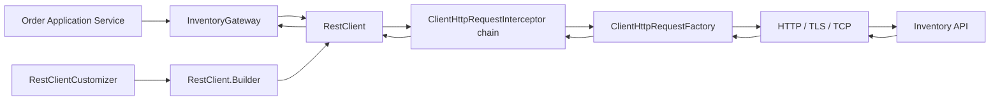
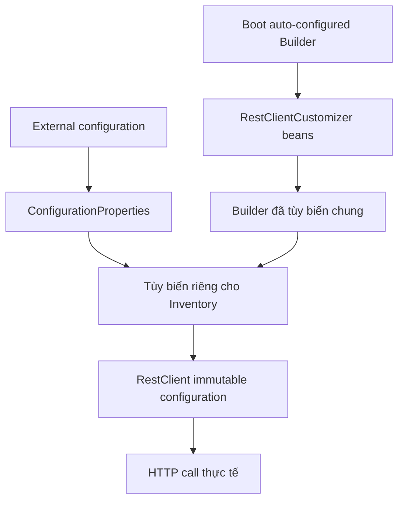
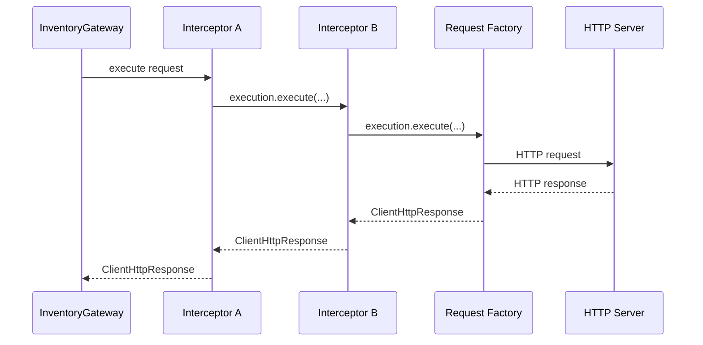

# RestClientCustomizer, interceptor và ClientHttpRequestFactory

## 1. Mục tiêu và bài toán trong tích hợp HTTP đồng bộ

Một ứng dụng Spring Boot có thể gọi đồng thời nhiều HTTP API bên ngoài: Inventory Service kiểm tra tồn kho, Pricing Service lấy báo giá và Payment Gateway tra cứu kết quả thanh toán. Những lời gọi này đều cần **timeout, TLS, định danh client, quan sát, xử lý lỗi và kiểm thử**, nhưng không nhất thiết có cùng base URL, token, retry policy hoặc thời gian chờ.

Trong Spring Framework 6.1+, `RestClient` là HTTP client **đồng bộ** với fluent API. Trong Spring Boot 3.2+, một `RestClient.Builder` được auto-configure giúp áp dụng các tích hợp chung của Boot; developer có thể bổ sung cấu hình ở ba lớp:

1. **`RestClientCustomizer`**: tùy biến các builder do Spring Boot cấu hình, thường dành cho chính sách chung của ứng dụng.
2. **`ClientHttpRequestInterceptor`**: chặn từng request/response ở tầng HTTP thực thi, phù hợp với metadata/header, chính sách nhỏ và instrumentation có kiểm soát.
3. **`ClientHttpRequestFactory`**: quyết định cơ chế transport thực tế, ví dụ `HttpURLConnection`, Java `HttpClient` hoặc Apache HttpClient 5; đây là nơi đặc biệt quan trọng đối với kết nối, timeout, TLS, proxy và pooling.

Không được nhầm ba lớp này: customizer **chỉnh builder**, interceptor **tham gia lúc mỗi request được thực thi**, còn request factory **tạo request dựa trên transport**.

Bài thuộc chương **HTTP đồng bộ** của module **SPRING_BOOT_INTEGRATION**. Module tổ chức tích hợp hệ thống Spring Boot qua HTTP client, cơ sở dữ liệu, cache, broker thông điệp và các adapter của Spring Integration, chú trọng **quản lý cấu hình, hợp đồng dữ liệu, lỗi, xử lý trùng lặp, kiểm thử và quan sát**. Vì vậy, ta sẽ dùng một HTTP client Inventory làm ví dụ xuyên suốt, đặc biệt quan tâm timeout và ranh giới retry khi request có thể đã được xử lý ở server dù client mất phản hồi.

### 1.1. Sau bài học bạn có thể

- Phân biệt `RestClient.create()`, `RestClient.builder()` và `RestClient.Builder` được Spring Boot inject.
- Giải thích một `RestClientCustomizer` áp dụng ở đâu, khi nào không được gọi và vì sao nên tránh cấu hình token của một đối tác cho tất cả clients.
- Xây dựng interceptor tuân thủ `ClientHttpRequestInterceptor.intercept(...)`, gọi `execution.execute(...)` đúng cách và không làm rò rỉ dữ liệu nhạy cảm.
- Lựa chọn `ClientHttpRequestFactory` và đặt connect/read/response timeout, quản lý connection pool, proxy/TLS và vòng đời tài nguyên.
- Dùng `@ConfigurationProperties` để cấu hình riêng từng đối tác, tránh hardcode base URL hoặc token trong application logic.
- Phân loại lỗi HTTP `4xx`/`5xx`, lỗi kết nối/timeout, xử lý replay/idempotency và đóng response stream đúng chỗ.
- Kiểm thử interceptor/customizer với `MockRestServiceServer` và kiểm thử transport thật bằng HTTP server giả trên socket; xác minh cả HTTP contract lẫn timeout.
- Chẩn đoán thay đổi classpath/factory, thứ tự interceptor, observation/tracing và custom bean gây lệch hành vi.

> **Ngữ cảnh phiên bản:** Ví dụ hướng đến Java 17+, Spring Boot 3.2+ và Spring Framework 6.1+, sử dụng `org.springframework.web.client.RestClient` và `org.springframework.boot.web.client.RestClientCustomizer`. REST client blocking khác `WebClient` reactive. Các lựa chọn request factory mặc định và một số API cấu hình timeout có thể thay đổi theo minor version; không sao chép code Spring Boot 2.x hoặc client library thế hệ cũ mà bỏ qua BOM/version.

### 1.2. Luồng tích hợp xuyên suốt



Trong sơ đồ, builder/customizer tham gia **lúc tạo client**, còn interceptor/factory tham gia khi `InventoryGateway` thực hiện HTTP call. Khi request trả về `5xx` hoặc timeout, gateway phải phân loại tình huống và trả lỗi có ý nghĩa cho application service; không biến mọi lỗi thành “hết hàng” hoặc tự động gửi lại lệnh có side effect.

## 2. RestClient cơ bản và chuỗi cấu hình

### 2.1. RestClient là HTTP client đồng bộ

Một lời gọi thông thường:

```java
RestClient client = RestClient.create(
        "https://inventory.example.org");

StockSnapshot snapshot = client.get()
        .uri("/api/v1/stock/{sku}", "SKU-42")
        .retrieve()
        .body(StockSnapshot.class);
```

`retrieve()` xử lý status theo các status handler/default behavior đã cấu hình, và `body(...)` chuyển payload sang kiểu Java qua `HttpMessageConverter`. Đây là synchronous/blocking API: thread gọi chờ I/O hoàn tất. Nếu ứng dụng chạy trên WebFlux/Netty event-loop, không gọi blocking RestClient trực tiếp trên event-loop; chọn reactive HTTP client hoặc đưa blocking operation sang bounded executor phù hợp.

### 2.2. Không phải builder nào cũng nhận cấu hình từ Boot

| Cách tạo | Ý nghĩa | Điều phải biết |
|---|---|---|
| `RestClient.create()` | Tạo client tiện lợi theo mặc định của Framework | Không mặc định nhận mọi `RestClientCustomizer` bean của Boot |
| `RestClient.builder()` | Tự tạo builder ở mức Framework | Không mặc định đi qua auto-configured builder của Boot |
| Inject `RestClient.Builder` do Boot cung cấp | Builder đã được Boot cấu hình theo context | Có thể được áp dụng message converters, observation và `RestClientCustomizer` tương thích |
| Inject một `RestClient` bean ứng dụng | Client đã build, dùng lại | Chính sách phụ thuộc nơi bean đó được tạo |
| `existingClient.mutate()` | Tạo builder từ cấu hình client đang có | Hữu ích khi muốn một biến thể có chủ đích; tránh chia sẻ nhầm config nhạy cảm |

Trong một Spring Boot application với auto-configuration phù hợp, nên **inject `RestClient.Builder`** để cấu hình client đối tác. Nếu bạn gọi `RestClient.builder()` trong mỗi service, các `RestClientCustomizer` được đăng ký với Boot có thể không được áp dụng, khiến logging, request factory và observation khác giữa các clients.

### 2.3. Builder được cấu hình tại thời điểm nào?



RestClient sau `build()` được thiết kế để sử dụng lại cho nhiều request. Builder là **đối tượng mutable**: gọi `baseUrl(...)`, `defaultHeader(...)`, `requestFactory(...)` hoặc `requestInterceptor(...)` sẽ sửa cách client được build. Không giữ một builder singleton dùng chung rồi đổi base URL/token theo mỗi request; điều đó dễ lẫn cấu hình giữa đối tác hoặc người dùng khi có concurrency.

### 2.4. Dependency tối thiểu

Với Maven dùng Spring Boot parent/BOM:

```xml
<dependencies>
    <dependency>
        <groupId>org.springframework.boot</groupId>
        <artifactId>spring-boot-starter-web</artifactId>
    </dependency>
    <dependency>
        <groupId>org.springframework.boot</groupId>
        <artifactId>spring-boot-starter-test</artifactId>
        <scope>test</scope>
    </dependency>
</dependencies>
```

`spring-boot-starter-web` cung cấp Spring MVC và những dependency thường dùng cho `RestClient`; nếu ứng dụng không chạy HTTP server, có thể tổ chức dependency nhẹ hơn theo module thực tế. Không cần thêm WebFlux chỉ để dùng RestClient đồng bộ. Nếu muốn Apache HttpClient 5 connection pool, cần có dependency Apache HttpClient 5 phù hợp và transport configuration tương ứng:

```xml
<dependency>
    <groupId>org.apache.httpcomponents.client5</groupId>
    <artifactId>httpclient5</artifactId>
</dependency>
```

Đừng ghi đè version thủ công khi BOM đã quản lý, trừ khi có lý do tương thích/bảo mật được kiểm thử.

## 3. RestClientCustomizer: tùy biến builder cấp ứng dụng

### 3.1. Contract của customizer

`RestClientCustomizer` là functional interface của Spring Boot có một phương thức:

```java
void customize(RestClient.Builder builder);
```

Một customizer bean có thể:

- Đăng ký interceptor/header/user-agent chung cho những client có dùng auto-configured builder.
- Đặt default request customization chung, status handler hoặc observation policy có kiểm soát.
- Gắn custom request factory cho **tất cả** clients nếu đó là chủ đích.
- Giúp tránh copy cùng logic giữa nhiều client configurations.

Nó **không phải servlet Filter**, không intercept inbound MVC request, và không được gọi mỗi khi một HTTP response tới. Nó chạy **khi builder được Boot cấu hình**, còn các callbacks/interceptors do nó đăng ký có thể chạy ở mỗi request.

### 3.2. Một global customizer an toàn

```java
// ClientIdentityRestClientCustomizer.java — imports rút gọn
@Component
public class ClientIdentityRestClientCustomizer
        implements RestClientCustomizer {

    @Override
    public void customize(RestClient.Builder builder) {
        builder.requestInterceptor(
                new ClientIdentityInterceptor("order-service"));
    }
}

// ClientIdentityInterceptor.java
public final class ClientIdentityInterceptor
        implements ClientHttpRequestInterceptor {
    private final String clientName;

    public ClientIdentityInterceptor(String clientName) {
        this.clientName = clientName;
    }

    @Override
    public ClientHttpResponse intercept(
            HttpRequest request,
            byte[] body,
            ClientHttpRequestExecution execution
    ) throws IOException {
        request.getHeaders().set("X-Client-Name", clientName);
        return execution.execute(request, body);
    }
}
```

Khi bean trên nằm trong Spring context, những `RestClient.Builder` do Boot auto-configure thường nhận interceptor đó; một `RestClient.builder()` tự tạo ngoài Boot **không tự thấy** bean. `ClientIdentityInterceptor` chỉ thêm một header tĩnh không nhạy cảm và truyền tiếp request đúng một lần.

**Không dùng global customizer để gắn token riêng của Inventory vào Payment client.** Một customizer áp dụng rộng có thể làm rò rỉ `Authorization` sang nhiều domain. Token hoặc credential đặc thù phải được gắn vào **đúng client bean** hoặc transport/auth adapter có giới hạn scope.

### 3.3. Đăng ký bằng `@Bean` và điều phối thứ tự

```java
@Configuration(proxyBeanMethods = false)
public class RestClientCommonConfiguration {

    @Bean
    @Order(Ordered.LOWEST_PRECEDENCE)
    RestClientCustomizer identifyApplication() {
        return builder -> builder.requestInterceptor(
                new ClientIdentityInterceptor("order-service"));
    }
}
```

Nếu nhiều customizers cùng chỉnh builder, thứ tự gọi có thể tạo khác biệt, nhất là khi một customizer **thay thế** request factory và customizer khác **thêm** interceptor. Spring Boot dùng cơ chế sắp thứ tự customizers trong những đường auto-configuration hỗ trợ, nhưng thứ tự trên code phải được kiểm chứng khi nâng version hoặc ứng dụng có custom `RestClient.Builder` bean.

`@Component` ở mục 3.2 và `@Bean` ở mục 3.3 là **hai cách đăng ký customizer thay thế nhau**, không cần bật cả hai cho cùng chính sách. `@Order` biểu thị thứ tự tương đối giữa các customizer beans, **không** tự bảo đảm thứ tự các request interceptors nếu nơi khác còn dùng `requestInterceptors(list -> ...)` để sắp lại hoặc xóa chúng. Viết integration test xác nhận thứ tự khi hành vi có phụ thuộc.

### 3.4. Global vs per-client: ma trận lựa chọn

| Chính sách | Nơi thường nên đặt | Vì sao |
|---|---|---|
| Correlation/tracing/observation do toàn ứng dụng dùng | Boot instrumentation hoặc common customizer có kiểm soát | Có tính nhất quán across clients |
| Header định danh ứng dụng không nhạy cảm | Common customizer | Không phụ thuộc đối tác |
| Inventory base URL, timeout | Inventory-specific builder/factory config | Mỗi API có SLA khác nhau |
| API token riêng của Inventory | Inventory client/interceptor riêng | Không rò sang Payment/Shipping |
| Truststore mTLS của ngân hàng | Transport riêng cho Payment client | Không ảnh hưởng trust policy client khác |
| Retry cho một POST có idempotency key | Gateway/application service hoặc policy gắn riêng | Cần hiểu semantics nghiệp vụ |
| JSON mapper chung | Boot message converter auto-config hoặc config có chủ đích | Không tạo ObjectMapper khác kỳ vọng |
| Proxy doanh nghiệp áp cho một số destinations | Request factory/client-specific transport | Tránh route tất cả requests qua một proxy không đúng |

Một quy tắc thực tế: **Customizer dành cho default của builder**, còn **client-specific configuration** gắn với service contract, timeout và credential riêng. Nếu cần thêm một interceptor vào tất cả clients, hãy xác định ảnh hưởng tới test, metrics/tracing và outbound HTTP đang có.

### 3.5. Vì sao sửa global customizer mà một số client không đổi?

Các trường hợp điển hình:

1. Client đó được tạo bằng `RestClient.create()` hoặc `RestClient.builder()`, bỏ qua Boot builder.
2. Ứng dụng tự khai báo một `RestClient.Builder` bean, khiến một phần auto-configuration mặc định của Boot không áp dụng như tưởng tượng.
3. Một client có builder riêng được `clone/mutate` trước hoặc sau customizer theo thứ tự khác.
4. Client bean đã được build từ lúc startup; thay một property/mutable singleton sau đó không nhất thiết rebuild client.
5. Một cấu hình client gọi `requestFactory(...)` sau common customizer, thay thế factory chung.
6. Có nhiều `RestClient` beans, caller inject nhầm bean qua `@Primary`/`@Qualifier`.
7. Test dùng `MockRestServiceServer` đã thay transport nên không còn bài kiểm tra socket/factory thật.

Để tìm nguyên nhân, kiểm tra **cách tạo client đang được inject**, không chỉ liệt kê customizer bean.

## 4. ClientHttpRequestInterceptor: chuỗi xử lý request và response

### 4.1. Contract chính xác

Interceptor của RestClient dựa trên interface Spring HTTP client:

```java
public interface ClientHttpRequestInterceptor {
    ClientHttpResponse intercept(
            HttpRequest request,
            byte[] body,
            ClientHttpRequestExecution execution
    ) throws IOException;
}
```

Ý nghĩa của các tham số:

| Đối tượng | Nội dung | Điều cần tránh |
|---|---|---|
| `HttpRequest request` | HTTP method, URI, headers | Sửa URI/token tùy tiện, header injection |
| `byte[] body` | Request body bytes đã được chuẩn bị cho lần thực thi | Log toàn bộ payload nhạy cảm hoặc sao chép nhiều lần |
| `ClientHttpRequestExecution execution` | Mắt xích tiếp theo trong interceptor chain, cuối cùng dẫn tới transport | Bỏ quên `execute`, gọi lặp khi request không replay-safe |
| `ClientHttpResponse` | Status, headers và response body stream | Đọc body rồi không hoàn trả được, quên close ở nhánh lỗi |

Một interceptor thông thường gọi `execution.execute(request, body)` **đúng một lần**, sau đó trả response cho RestClient đọc. Nếu interceptor quyết định không truyền tiếp (ví dụ chặn vì chính sách an ninh), nó phải ném lỗi hoặc tạo một response có semantics được xác định; không chỉ trả `null`.

### 4.2. Thứ tự interceptor và luồng trả về

Khi có ba interceptors được áp theo thứ tự `A, B, C`:

```text
Request:
  A.before -> B.before -> C.before -> ClientHttpRequestFactory -> Network

Response:
  Network -> C.after -> B.after -> A.after -> RestClient response handling
```



Nếu interceptor B ném exception trước khi gọi `execution.execute`, C/factory/server sẽ không nhận request. Nếu B gọi `execute` hai lần để retry, một POST có thể bị gửi hai lần. Vì vậy **thứ tự và tác động phụ của mỗi interceptor** phải được ghi rõ trong test.

### 4.3. Interceptor đo latency và đếm trạng thái

Ví dụ đo thời gian ở mức HTTP attempt, chỉ ghi **nhóm status** và tên service được cấu hình (không log full URL/query):

```java
// HttpAttemptMetricsInterceptor.java — imports rút gọn
public final class HttpAttemptMetricsInterceptor
        implements ClientHttpRequestInterceptor {
    private final String serviceName;
    private final MeterRegistry metrics;

    public HttpAttemptMetricsInterceptor(
            String serviceName,
            MeterRegistry metrics) {
        this.serviceName = serviceName;
        this.metrics = metrics;
    }

    @Override
    public ClientHttpResponse intercept(
            HttpRequest request,
            byte[] body,
            ClientHttpRequestExecution execution
    ) throws IOException {
        long started = System.nanoTime();
        String outcome = "io_error";
        try {
            ClientHttpResponse response =
                    execution.execute(request, body);
            int code = response.getStatusCode().value();
            outcome = (code / 100) + "xx";
            return response;
        } finally {
            long elapsedNanos = System.nanoTime() - started;
            Timer.builder("outbound.http.attempt")
                    .tag("service", serviceName)
                    .tag("method", request.getMethod().name())
                    .tag("outcome", outcome)
                    .register(metrics)
                    .record(elapsedNanos, TimeUnit.NANOSECONDS);
        }
    }
}
```

Ví dụ này cần Micrometer `MeterRegistry` dependency/starter tương ứng và được hiểu là instrumentation bổ sung. Spring Boot/`RestClient` có khả năng observation/tracing riêng khi được cấu hình; nếu vừa bật observation mặc định vừa tự đếm đồng dạng, có thể **đếm trùng** hoặc sinh hai span/metric cho cùng một request. Trước khi thêm custom interceptor, kiểm tra instrumentation hiện có và xác định metric mới đang đo **HTTP attempt** hay **toàn application operation**, vì hai khái niệm không giống nhau.

Đoạn trên không đọc response body và không đóng response khi trả cho caller: RestClient cần tiếp tục sử dụng nó. Nếu `response.getStatusCode()` ném IOException trong một nhánh đặc biệt, cần có chính sách close response khi không trả nó về; khi đưa code production, kiểm tra lifecycle/exception path và dùng try/finally phù hợp để không rò connection.

### 4.4. Không đọc response body trong interceptor rồi quên dựng lại stream

Anti-pattern:

```java
// Sai: đã đọc hết response stream trước khi RestClient chuyển JSON.
ClientHttpResponse response =
        execution.execute(request, body);
String logged = new String(
        response.getBody().readAllBytes(),
        StandardCharsets.UTF_8);
return response;
```

`response.getBody()` thường là stream **chỉ đọc một lượt**. Khi interceptor đọc hết, converter ở `retrieve().body(StockSnapshot.class)` có thể thấy stream rỗng và fail. Để inspect body có kiểm soát, có thể dùng cơ chế **buffering response**/wrapper và giới hạn số bytes, nhưng việc giữ payload trong bộ nhớ làm tăng chi phí và có thể lộ token, thông tin cá nhân hoặc dữ liệu thanh toán. Production thường chỉ cần **status, duration, service name và một error code đã được chuẩn hóa**, không phải full body.

`BufferingClientHttpRequestFactory` là một cách của Spring để cho phép đọc lại nội dung khi cần, nhưng cần đánh giá tương thích phiên bản và chi phí: request/response lớn hoặc stream download có thể không thích hợp. Không bật buffering toàn cục cho mọi client chỉ vì một endpoint cần debug.

### 4.5. Khi nào phải đóng ClientHttpResponse?

Nếu interceptor **trả response** lên RestClient để caller/response converter xử lý, không tự gọi `response.close()` ngay trước `return`. Nếu interceptor thực hiện một policy **ngừng xử lý sau khi đã nhận response** và không trả response về nữa, nó phải đóng response để giải phóng connection:

```java
ClientHttpResponse response =
        execution.execute(request, body);

if (violatesTransportPolicy(response)) {
    try {
        throw new IOException("HTTP response không thỏa chính sách");
    } finally {
        response.close();
    }
}

return response;
```

`violatesTransportPolicy` là một helper **giả định** cần định nghĩa; nếu chỉ muốn xử lý HTTP status như 404/429/503, thông thường nên dùng status handler ở `RestClient`/gateway, thay vì tạo rule rời rạc bên trong interceptor.

### 4.6. Header định danh, correlation và authentication

Một interceptor chung có thể thêm `X-Client-Name` hoặc propagate một tracing header từ instrumentation được hỗ trợ. Tuy nhiên:

- Không lấy thẳng header từ request bên ngoài rồi phát tới mọi domain chưa được phép.
- Không dùng raw `MDC`/`ThreadLocal` làm cơ chế duy nhất khi công việc chuyển qua thread pool/`@Async`; context có thể mất hoặc bị nhiễm nếu không cleanup.
- Không đặt bearer token của Inventory vào global interceptor vì Payment/GitHub/webhook clients cũng có thể nhận.
- Không tạo `Idempotency-Key` mới cho mỗi **retry attempt** của cùng một operation. Idempotency key phải ổn định theo **logical command**.
- Không ghi `Authorization`, cookies, client certificate, PII trong URL/query hoặc raw request/response body vào log.

Nếu `RestClient` chỉ gọi một đối tác, có thể tạo interceptor scoped cho bean client đó; nhưng trong nhiều trường hợp gắn authentication qua cấu hình auth client chuyên dụng hoặc request builder là rõ ràng hơn.

### 4.7. Vì sao retry interceptor là lựa chọn rủi ro?

Code đơn giản:

```java
// Anti-pattern: lặp HTTP bất kể method và kết quả.
try {
    return execution.execute(request, body);
} catch (IOException ex) {
    return execution.execute(request, body);
}
```

có thể gửi **hai POST payment/reservation** khi server đã thực hiện lần đầu nhưng response bị mất. Một số transport hoặc body streaming cũng không bảo đảm bytes có thể replay vô điều kiện. Dù method GET được coi là safe, retry vô hạn vẫn gây bão request khi downstream outage.

Chính sách retry nên được đặt ở application gateway/use case hoặc một retry layer có hiểu contract: chỉ retry lỗi được phân loại, giới hạn attempt/overall deadline, exponential backoff + jitter, phối hợp circuit breaker/rate limit, giữ nguyên idempotency key và có cơ chế **đối soát kết quả UNKNOWN**.

## 5. ClientHttpRequestFactory: transport, timeout và connection pool

### 5.1. Factory quyết định điều gì?

`ClientHttpRequestFactory` thuộc `org.springframework.http.client`, có nhiệm vụ tạo client request cho URI/method:

```java
ClientHttpRequest createRequest(
        URI uri, HttpMethod httpMethod) throws IOException;
```

Factory ảnh hưởng cách request đi ra mạng, connection establishment, TLS handshake, proxy, redirect behavior, pooling/keep-alive, timeout, streaming và network resource lifecycle. Nó **không** tự quyết định hợp đồng JSON, status mapping, idempotency hoặc authorization nghiệp vụ.

### 5.2. Một số implementation thường gặp

| Factory | Transport nền | Điểm cần cân nhắc |
|---|---|---|
| `SimpleClientHttpRequestFactory` | JDK `HttpURLConnection` | Dễ cấu hình connect/read timeout cho demo; không có bộ quản lý pool chuyên dụng như Apache |
| `JdkClientHttpRequestFactory` | Java 11+ `java.net.http.HttpClient` | Có JDK HttpClient với connect timeout, redirect policy, TLS/client lifecycle |
| `HttpComponentsClientHttpRequestFactory` | Apache HttpClient 5 | Phù hợp khi cần connection pooling có cấu hình, pool lease timeout và TLS/proxy options |
| `JettyClientHttpRequestFactory` | Jetty HTTP client | Thích hợp khi ứng dụng đã chọn Jetty transport và cần cấu hình riêng |
| `ReactorClientHttpRequestFactory` | Reactor Netty | Có thể sử dụng làm transport bên dưới client blocking, cần hiểu resource/connection management |
| `BufferingClientHttpRequestFactory` | Decorator bọc một factory khác | Cho phép đọc lại request/response ở mức buffering, có chi phí memory |

**Không mặc định thứ tự tự chọn factory là cố định cho mọi Boot/Framework version.** Việc có Apache HttpClient/Jetty/Reactor Netty trên classpath có thể ảnh hưởng transport được chọn nếu không cấu hình tường minh. Nếu timeout/pooling/TLS là yêu cầu quan trọng, đặt factory rõ trong client bean và viết socket-level test.

### 5.3. Dùng SimpleClientHttpRequestFactory cho client nhỏ

```java
SimpleClientHttpRequestFactory factory =
        new SimpleClientHttpRequestFactory();
factory.setConnectTimeout(2_000); // millisecond
factory.setReadTimeout(4_000);    // millisecond

RestClient client = RestClient.builder()
        .baseUrl("http://localhost:18080")
        .requestFactory(factory)
        .build();
```

`connectTimeout` giới hạn việc thiết lập kết nối theo transport; `readTimeout` giới hạn chờ đọc, **không nhất thiết là overall deadline 4 giây cho toàn bộ request và response**. Với multi-address DNS, redirect, nhiều lần retry hoặc server stream body chậm, tổng thời gian có thể lớn hơn một timeout riêng lẻ.

**Giá trị zero/negative có thể có semantics đặc biệt theo factory/JDK:** không đặt timeout bằng `0` khi chưa kiểm tra tài liệu chính xác, vì có cấu hình coi đó là **không giới hạn**. Luôn validate `Duration` trong phạm vi dương hợp lệ trước khi chuyển sang milliseconds.

### 5.4. JDK HttpClient request factory

Khi chọn JDK HTTP client tường minh:

```java
HttpClient jdkHttpClient = HttpClient.newBuilder()
        .connectTimeout(Duration.ofSeconds(2))
        .followRedirects(HttpClient.Redirect.NEVER)
        .build();

ClientHttpRequestFactory factory =
        new JdkClientHttpRequestFactory(jdkHttpClient);

RestClient client = RestClient.builder()
        .requestFactory(factory)
        .build();
```

`java.net.http.HttpClient` cấu hình một số chính sách transport như connect timeout và redirects. Response/read timeout cho `JdkClientHttpRequestFactory` được cấu hình bằng API tương ứng của Spring Framework version đang dùng; không nhầm connect timeout của JDK với deadline toàn call. Việc tắt redirects ở ví dụ giúp tránh gửi headers/credentials sang host khác do redirect ngoài mong đợi.

### 5.5. Apache HttpClient 5: pooling có giới hạn

Với traffic cao, dùng một pooled client chia sẻ cho nhiều request của **cùng một policy domain** thường hiệu quả hơn tạo transport/client mới cho mỗi HTTP call:

```java
// InventoryApacheTransportConfiguration.java
@Configuration(proxyBeanMethods = false)
public class InventoryApacheTransportConfiguration {

    @Bean(value = "inventoryApacheHttpClient",
          destroyMethod = "close")
    CloseableHttpClient inventoryApacheHttpClient() {
        PoolingHttpClientConnectionManager manager =
                PoolingHttpClientConnectionManagerBuilder
                        .create()
                        .setMaxConnTotal(100)
                        .setMaxConnPerRoute(30)
                        .build();

        RequestConfig requestConfig = RequestConfig.custom()
                .setConnectionRequestTimeout(
                        Timeout.ofSeconds(1))
                .setResponseTimeout(
                        Timeout.ofSeconds(4))
                .build();

        return HttpClients.custom()
                .setConnectionManager(manager)
                .setDefaultRequestConfig(requestConfig)
                .build();
    }

    @Bean("inventoryRequestFactory")
    ClientHttpRequestFactory inventoryRequestFactory(
            @Qualifier("inventoryApacheHttpClient")
            CloseableHttpClient httpClient) {
        return new HttpComponentsClientHttpRequestFactory(
                httpClient);
    }
}
```

Đoạn trên dùng Apache HttpClient 5: `PoolingHttpClientConnectionManagerBuilder` từ `org.apache.hc.client5.http.impl.io`, `RequestConfig` từ `org.apache.hc.client5.http.config` và `Timeout` từ `org.apache.hc.core5.util`. Nó minh họa **giới hạn số connection**, **thời gian chờ lấy connection từ pool** và **response timeout**. **Connect timeout** khi dùng Apache 5 đời mới thường cần cấu hình qua connection config/socket/TLS tương ứng của phiên bản Apache; đoạn mã này **chưa coi là cấu hình timeout toàn diện**, cần bổ sung theo thư viện đang sử dụng.

`setMaxConnTotal(100)` và `setMaxConnPerRoute(30)` chỉ là số ví dụ, không phải tuning universal. Với 10 replicas và 100 connection mỗi replica, downstream có thể thấy tối đa khoảng 1.000 connections từ toàn cụm trong tình huống tải lớn. Chọn pool size từ concurrency, SLA và quota phía server; đặt pool lease timeout để request không chờ vô thời hạn khi pool cạn.

### 5.6. Mỗi loại timeout xử lý một điểm nghẽn khác nhau

| Timeout | Giai đoạn | Rủi ro khi thiếu |
|---|---|---|
| Connection pool lease timeout | Chờ lấy connection đang rảnh từ pool | Một request chờ vô hạn dù server khỏe |
| DNS resolution budget | Phân giải hostname (phụ thuộc OS/transport) | Không nhất thiết chịu cùng connect timeout |
| Connect timeout | TCP connection establishment | Request treo khi host unreachable |
| TLS handshake timeout | Thiết lập TLS khi dùng HTTPS | SSL handshake treo hoặc fail chậm |
| Response/read timeout | Đợi response/đọc từng giai đoạn theo transport | Server chậm làm giữ thread quá lâu |
| Overall operation deadline | Toàn bộ connect + retry + body + xử lý | Nhiều timeout/attempt cộng lại vượt SLA |

Số timeout hữu hạn trong client **không tự bảo đảm** một deadline tổng. Ví dụ ba retry attempts, mỗi attempt có connect/read timeout riêng cùng backoff, có thể vượt thời gian HTTP request ở frontend. Định nghĩa overall budget ở gateway/application layer và truyền deadline/cancellation nếu transport/policy hỗ trợ.

### 5.7. RequestFactory và TLS, proxy, redirects

Một deployment sử dụng HTTPS cần:

- Xác minh CA chain, hostname trong certificate, TLS protocol/cipher theo chính sách.
- mTLS nếu đối tác yêu cầu client certificate; cấu hình riêng cho đúng client, không dùng một keypair cho mọi domain.
- Proxy allowlist/auth và `NO_PROXY` hoặc routing cụ thể nếu môi trường yêu cầu.
- Redirect policy có kiểm soát; đặc biệt tránh chuyển `Authorization`/cookies sang domain khác.
- Hỗ trợ DNS refresh/failover, connection lifetime/idle eviction theo transport.

**Không khắc phục lỗi certificate bằng cách tạo trust-all SSLContext hoặc tắt hostname verification.** Việc “test được trên localhost” không chứng minh kết nối production đã được bảo vệ.

### 5.8. Vòng đời HTTP client và connection manager

`RestClient` có thể dùng chung giữa nhiều requests và thường nên là singleton bean theo đối tác. Nếu transport dưới nó có một `CloseableHttpClient` hoặc connection manager sở hữu thread/pool, phải đóng lúc ứng dụng shutdown. `@Bean(destroyMethod="close")` trong ví dụ Apache giúp Spring gọi close trên bean client được quản lý.

Không tạo một `CloseableHttpClient` mới bên trong method `getStock` mỗi request, và không đóng shared client ngay sau một call. Khi chuyển sang một request factory khác, kiểm tra cơ chế cleanup của factory, client và thread resources; mỗi implementation có API khác nhau.

## 6. Xây một Inventory RestClient riêng có timeout và interceptor

### 6.1. Phân tách cấu hình ứng dụng theo đối tác

Không để ba đối tác Inventory, Pricing, Payment dùng chung một property `remote.base-url` và một token. Chúng có SLA, giới hạn rate và trust boundary khác nhau.

Ví dụ:

```yaml
# application-local.yml
integration:
  inventory:
    base-url: http://127.0.0.1:18080
    connect-timeout: 2s
    read-timeout: 4s
  pricing:
    base-url: http://127.0.0.1:18081
    connect-timeout: 2s
    read-timeout: 3s
```

Trong production, `base-url` phải đến từ trusted deployment config/secret management và thường là HTTPS. Nếu người dùng cuối được phép nhập một URL để service gọi trực tiếp, phải kiểm soát SSRF bằng allowlist, kiểm tra DNS/IP resolution, redirect và egress policy; không chỉ kiểm tra tên property.

### 6.2. Record `@ConfigurationProperties` có validation

```java
// InventoryHttpProperties.java — imports rút gọn
@ConfigurationProperties(prefix = "integration.inventory")
public record InventoryHttpProperties(
        URI baseUrl,
        Duration connectTimeout,
        Duration readTimeout
) {
    public InventoryHttpProperties {
        if (baseUrl == null || baseUrl.getScheme() == null
                || baseUrl.getHost() == null
                || baseUrl.getUserInfo() != null) {
            throw new IllegalArgumentException(
                    "Inventory base URL không hợp lệ");
        }

        String scheme = baseUrl.getScheme()
                .toLowerCase(Locale.ROOT);
        if (!"http".equals(scheme)
                && !"https".equals(scheme)) {
            throw new IllegalArgumentException(
                    "Inventory phải dùng http/https");
        }
        requireSupportedMillis(
                connectTimeout, "connect-timeout");
        requireSupportedMillis(
                readTimeout, "read-timeout");
    }

    private static void requireSupportedMillis(
            Duration value, String name) {
        if (value == null || value.isNegative()
                || value.isZero()
                || value.toMillis() < 1
                || value.toMillis() > Integer.MAX_VALUE) {
            throw new IllegalArgumentException(
                    name + " phải nằm trong phạm vi 1ms..int-max");
        }
    }
}
```

Ví dụ cho phép HTTP ở local; production cần policy tường minh buộc HTTPS/truststore phù hợp. Nếu `Duration` quá lớn đến mức `toMillis()` overflow, code validation trên sẽ ném `ArithmeticException`; production có thể bắt và chuyển thành startup configuration error rõ hơn. Mục tiêu là **fail fast khi cấu hình sai**, thay vì lặng lẽ đặt 0 millisecond gây semantics timeout không mong muốn.

### 6.3. Factory bean riêng cho Inventory

```java
// InventoryHttpConfiguration.java — imports rút gọn
@Configuration(proxyBeanMethods = false)
@EnableConfigurationProperties(InventoryHttpProperties.class)
public class InventoryHttpConfiguration {

    @Bean("inventoryRequestFactory")
    ClientHttpRequestFactory inventoryRequestFactory(
            InventoryHttpProperties props) {
        SimpleClientHttpRequestFactory factory =
                new SimpleClientHttpRequestFactory();
        factory.setConnectTimeout(
                Math.toIntExact(
                    props.connectTimeout().toMillis()));
        factory.setReadTimeout(
                Math.toIntExact(
                    props.readTimeout().toMillis()));
        return factory;
    }

    @Bean("inventoryRestClient")
    RestClient inventoryRestClient(
            RestClient.Builder bootBuilder,
            InventoryHttpProperties props,
            @Qualifier("inventoryRequestFactory")
            ClientHttpRequestFactory requestFactory) {

        return bootBuilder
                .baseUrl(props.baseUrl().toString())
                .requestFactory(requestFactory)
                .defaultHeader(
                        HttpHeaders.ACCEPT,
                        MediaType.APPLICATION_JSON_VALUE)
                .requestInterceptor(
                        new InventoryTargetInterceptor())
                .build();
    }
}

// InventoryTargetInterceptor.java
public final class InventoryTargetInterceptor
        implements ClientHttpRequestInterceptor {
    @Override
    public ClientHttpResponse intercept(
            HttpRequest request,
            byte[] body,
            ClientHttpRequestExecution execution
    ) throws IOException {
        request.getHeaders().set(
                "X-Downstream-Client", "inventory");
        return execution.execute(request, body);
    }
}
```

**Điểm quan trọng:**

- `RestClient.Builder bootBuilder` được inject từ Spring Boot nên các global customizers, converter/observation configuration tương ứng có cơ hội được áp dụng.
- `requestFactory(requestFactory)` đặt transport **riêng cho Inventory**, có thể thay request factory được customizer chung đặt trước đó. Những cấu hình khác của builder như interceptors thường vẫn được giữ nếu không bị thay đổi.
- `InventoryTargetInterceptor` chỉ được thêm cho Inventory bean, không gắn header đó lên Payment/Pricing client.
- `defaultHeader(HttpHeaders.ACCEPT, ...)` đặt mặc định; request cụ thể có thể chỉ định header khác theo RestClient semantics, nên cần test nếu downstream yêu cầu chính xác.
- `RestClient` đã build dùng lại giữa các threads theo thiết kế; không mutate builder singleton theo tenant hoặc request.

Nếu dự án dùng một pool Apache thay cho `SimpleClientHttpRequestFactory`, đặt bean `inventoryRequestFactory` từ Apache config ở mục 5 và **không** đăng ký hai bean cùng tên trong cùng profile; chọn factory bằng profile/conditional phù hợp.

### 6.4. Định nghĩa DTO và hợp đồng Inventory

```java
// StockSnapshot.java
public record StockSnapshot(
        String sku,
        long available,
        long revision
) {}

// InventoryGateway.java
@Component
public class InventoryGateway {
    private final RestClient client;

    public InventoryGateway(
            @Qualifier("inventoryRestClient") RestClient client) {
        this.client = client;
    }

    public StockSnapshot getStock(String sku) {
        if (sku == null
                || !sku.matches("[A-Za-z0-9_-]{1,80}")) {
            throw new IllegalArgumentException("SKU không hợp lệ");
        }

        StockSnapshot stock = client.get()
                .uri("/api/v1/stock/{sku}", sku)
                .retrieve()
                .body(StockSnapshot.class);

        if (stock == null
                || !sku.equals(stock.sku())
                || stock.available() < 0
                || stock.revision() < 0) {
            throw new IllegalStateException(
                    "Inventory trả contract không hợp lệ");
        }
        return stock;
    }
}
```

Ví dụ xử lý `GET` tra cứu, không phải lệnh **giữ hàng**. Nếu nghiệp vụ cần reserve stock, endpoint thường là `POST`/`PUT` với `operationId` idempotent và không được retry theo policy GET một cách mù quáng.

Đừng dùng `StockSnapshot.available` từ một cache để xác nhận bán hàng khi Inventory có thể thay đổi đồng thời; kiểm tra consistency/atomic reservation ở đúng service có quyền quyết định tồn kho. HTTP client hoạt động chuẩn chỉ bảo đảm truyền contract, không bảo đảm business invariant của nguồn dữ liệu.

### 6.5. Có nhiều clients: sử dụng hai builder độc lập

```java
@Configuration(proxyBeanMethods = false)
class RemoteClientConfiguration {

    @Bean("pricingRestClient")
    RestClient pricingRestClient(
            RestClient.Builder builder,
            PricingHttpProperties props) {
        return builder
                .baseUrl(props.baseUrl().toString())
                .build();
    }

    @Bean("paymentRestClient")
    RestClient paymentRestClient(
            RestClient.Builder builder,
            PaymentHttpProperties props) {
        return builder
                .baseUrl(props.baseUrl().toString())
                .build();
    }
}
```

`PricingHttpProperties` và `PaymentHttpProperties` là những class **cần định nghĩa riêng** cùng `@ConfigurationProperties`/registration, tương tự Inventory. Với auto-configured builder **prototype** của Boot trong những phiên bản hỗ trợ, các điểm injection riêng thường có builder instance riêng. Kiểm tra cấu hình bean nếu dự án đã override `RestClient.Builder` với singleton.

Không lấy một builder mutable duy nhất rồi tạo Pricing, sau đó gắn Payment token vào builder ấy và tiếp tục build các clients mà không kiểm soát builder state. Khi custom shared helper, có thể tạo builder bản sao theo API `clone()`/`mutate()` được version hỗ trợ, nhưng phải kiểm tra các interceptors/default headers đã được sao chép và scope credential.

### 6.6. Per-request metadata và idempotency key

Nếu một lệnh reserve inventory cần idempotency:

```java
// Minh họa đoạn gửi lệnh ghi có operation ID ổn định
client.post()
        .uri("/api/v1/reservations")
        .header("Idempotency-Key", operationId)
        .body(reservationCommand)
        .retrieve()
        .toBodilessEntity();
```

`operationId` phải được validate ở application boundary, gắn với payload/caller và tái sử dụng qua retry/redelivery **của cùng logical operation**. Đây là metadata nghiệp vụ theo request; không nên dùng customizer global để tạo UUID mới cho mỗi attempt rồi coi đó là deduplication.

### 6.7. Cấu hình authentication cho đúng trust boundary

Trường hợp đối tác yêu cầu bearer token, mỗi Inventory client nên có authentication provider **riêng**:

```java
// Minh họa per-request, tokenProvider cần được định nghĩa riêng.
String token = tokenProvider.tokenForInventory();

StockSnapshot stock = inventoryRestClient.get()
        .uri("/api/v1/stock/{sku}", sku)
        .headers(headers -> headers.setBearerAuth(token))
        .retrieve()
        .body(StockSnapshot.class);
```

Không lưu bearer token như global default header trên tất cả outbound clients, không log token và không build `RestClient` mới mỗi khi token rotate nếu có cơ chế provider/token refresh phù hợp. Nếu muốn token được gắn tự động ở per-client interceptor, interceptor phải dùng **trusted token provider**, có xử lý hết hạn đồng bộ và đảm bảo không gửi sang redirect host không tin cậy.

## 7. HTTP response và lỗi: interception không thay thế domain contract

### 7.1. Các lớp lỗi phải phân biệt

| Sự kiện | Có HTTP response? | Ý nghĩa |
|---|---|---|
| `200` + JSON đúng schema | Có | Có dữ liệu hợp lệ, vẫn cần validate business fields |
| `204` | Có | Không có body; nếu API hứa JSON bắt buộc thì contract violation |
| `400` | Có | Request sai; thường không retry nguyên payload |
| `401/403` | Có | Authentication/authorization; cần sửa credential/policy |
| `404` | Có | Tùy contract: resource không tồn tại hay lỗi route/base URL |
| `409` | Có | Conflict; có thể đối soát operation ID/state |
| `429` | Có | Rate limit; cân nhắc `Retry-After`, retry budget |
| `500/502/503/504` | Có | Downstream gặp lỗi; có thể transient nhưng cần policy |
| DNS/connect/TLS/read timeout | Có thể không có HTTP status | Kết quả của lệnh side-effecting có thể **không rõ** |
| JSON parse/schema failure | Có HTTP response | Không được coi là thành công dù status 2xx |

Một `ClientHttpRequestInterceptor` nhìn thấy status ở tầng transport nhưng **không biết chắc** một HTTP `409` trong API đó là conflict cần trả về client hay đã reserve thành công trước đó. Việc ánh xạ lỗi từ HTTP sang domain exception thường nên nằm ở **adapter/gateway** hoặc một status handler scoped cho client.

### 7.2. Mặc định của RestClient và status handler

Với `retrieve()`, RestClient có cơ chế lỗi status mặc định cho các response dạng `4xx`/`5xx` nếu không có handler khác xử lý; thường kết thúc bằng các subtype `RestClientResponseException`. Có thể cấu hình thêm default status handler theo API của builder:

```java
RestClient client = builder
        .baseUrl(props.baseUrl().toString())
        .defaultStatusHandler(
                HttpStatusCode::isError,
                (request, response) -> {
                    HttpStatusCode status =
                            response.getStatusCode();

                    if (status.value() == 429
                            || status.is5xxServerError()) {
                        throw new InventoryUnavailableException(
                                "Inventory tạm không khả dụng: HTTP "
                                + status.value());
                    }
                    throw new InventoryRejectedException(
                            "Inventory từ chối request: HTTP "
                            + status.value());
                })
        .build();
```

`InventoryUnavailableException`/`InventoryRejectedException` trong ví dụ là các unchecked domain exceptions **cần định nghĩa trong dự án** (ví dụ kế thừa `RuntimeException`). Không đưa raw response body, API key, full URL/query hoặc header nhạy cảm vào exception message. Dù có handler chung, business method có thể cần mapping riêng cho `404` hoặc `409` theo contract; một global handler áp cho tất cả services dễ làm mất khác biệt đó.

**Thứ tự handlers:** nếu có nhiều default status handlers hoặc per-response `onStatus(...)`, hãy kiểm tra precedence của API RestClient/Framework version và viết test cho từng HTTP code quan trọng. Không dùng một handler bắt tất cả rồi trả về bình thường khiến `retrieve().body(...)` tiếp tục parse một error payload như thành công.

### 7.3. Network exception khác HTTP status exception

Ví dụ một adapter có thể phân loại:

```java
try {
    return inventoryRestClient.get()
            .uri("/api/v1/stock/{sku}", sku)
            .retrieve()
            .body(StockSnapshot.class);
} catch (RestClientResponseException ex) {
    // Server trả HTTP status lỗi có cấu trúc.
    // Phân loại ex.getStatusCode() theo hợp đồng Inventory.
    throw mapHttpStatus(ex);
} catch (ResourceAccessException ex) {
    // DNS/connect/read timeout hoặc lỗi I/O.
    // Với POST có side effect, kết quả có thể UNKNOWN.
    throw new InventoryUnavailableException(
            "Không truy cập được Inventory", ex);
}
```

`mapHttpStatus(ex)` là helper giả định cần triển khai; không phải Spring API. Nếu client đã có `defaultStatusHandler` chuyển lỗi thành custom exception, cấu trúc `catch` phải thay đổi tương ứng; **không đồng thời viết hai chiến lược mapping trùng nhau mà không xác định precedence**.

### 7.4. Status 2xx vẫn có thể không thỏa hợp đồng

`200 OK` kèm JSON `{"available": -10}` là HTTP success nhưng business contract sai. `200 OK` kèm HTML của proxy thay vì JSON cũng là lỗi decode/content-type. Do đó ngoài status handler:

- Validate `Content-Type` và schema version khi cần.
- Kiểm tra ID của response khớp request/tenant.
- Validate giá trị/enum/range, không dùng `null` như một default nghiệp vụ im lặng.
- Đặt giới hạn kích thước response và cấp timeout khi body streaming.
- Xử lý trường hợp payload bị cắt/truncated hoặc server ngắt connection.
- Không đưa response độc hại vào SQL/log/HTML mà không sanitize/escape.

### 7.5. ResponseErrorHandler khác ClientHttpRequestInterceptor

Đôi khi code cũ dùng `RestTemplate` và `ResponseErrorHandler`. Trong `RestClient`, có các API status handler để map HTTP error ngay trong fluent client. `ClientHttpRequestInterceptor` ở tầng thấp hơn, tập trung vào việc chạy request/response pipeline, header, logging/metrics hoặc policy transport.

Khi migrate từ RestTemplate sang RestClient, không tự thay toàn bộ `ResponseErrorHandler` bằng một interceptor đọc raw body: cần chuyển từng rule về đúng tầng, bảo đảm response stream/connection được quản lý và giữ business semantics của lỗi.

## 8. Kiểm thử customizer và interceptor bằng MockRestServiceServer

### 8.1. Test hai cấp: builder behavior và network behavior

Có hai câu hỏi độc lập:

1. **Client có tạo request đúng không?** URI, method, headers, JSON mapping, status handling, interceptor order. `MockRestServiceServer` phù hợp vì thay HTTP transport bằng response giả, không cần mạng.
2. **Transport có hoạt động đúng không?** Connect/read timeout, TLS, hostname verification, redirects, pooling, proxy, socket reuse. Phải dùng **HTTP/HTTPS test server thật trên network** hoặc một integration environment; mock transport không chứng minh các thuộc tính đó.

| Mục tiêu kiểm thử | `MockRestServiceServer` | Real socket test |
|---|---|---|
| `RestClientCustomizer` thêm interceptor | Có | Có |
| Header `X-Client-Name` hiện diện | Có | Có |
| URI expansion và JSON contract | Có | Có |
| Mapping `404/429/503` | Có | Có |
| Thứ tự interceptor callbacks | Có | Có |
| `SimpleClientHttpRequestFactory` connect timeout | **Không** | Có |
| Apache pool lease timeout | **Không** | Có, cần concurrency setup |
| TLS certificate/hostname validation | **Không** | Có, HTTPS fixture |
| Proxy/redirect behavior | Không đầy đủ | Có |
| Thực sự tới đúng server endpoint | Không, chỉ chứng minh mock nhận | Có |

### 8.2. Test một customizer thuần, không boot full context

```java
// ClientIdentityCustomizerTest.java — imports/static imports rút gọn
class ClientIdentityCustomizerTest {

    @Test
    void addsClientIdentityHeaderWithoutRealNetwork() {
        RestClient.Builder builder = RestClient.builder();
        new ClientIdentityRestClientCustomizer()
                .customize(builder);

        // bindTo() phải được gọi trước khi build client.
        MockRestServiceServer server =
                MockRestServiceServer.bindTo(builder).build();

        RestClient client = builder
                .baseUrl("https://inventory.example.test")
                .build();

        server.expect(requestTo(
                    "https://inventory.example.test/api/v1/stock/SKU-42"))
                .andExpect(method(HttpMethod.GET))
                .andExpect(header(
                        "X-Client-Name", "order-service"))
                .andRespond(withSuccess(
                        """
                        {"sku":"SKU-42","available":8,"revision":17}
                        """,
                        MediaType.APPLICATION_JSON));

        StockSnapshot snapshot = client.get()
                .uri("/api/v1/stock/{sku}", "SKU-42")
                .retrieve()
                .body(StockSnapshot.class);

        assertNotNull(snapshot);
        assertEquals(8, snapshot.available());
        server.verify();
    }
}
```

Ví dụ kiểm tra **logic của một customizer khi được gọi tường minh**. Nó **chưa chứng minh Spring Boot auto-discovery** áp customizer bean cho mọi injected `RestClient.Builder`; muốn chứng minh lớp đó cần một Spring context test ở mục tiếp theo.

Ở đây `MockRestServiceServer.bindTo(builder)` thay request factory của builder bằng factory mock. Nếu sau `bindTo` bạn lại gọi `builder.requestFactory(realFactory)`, request có thể đi ra mạng thật và mock không thấy nó. Đây là một lỗi test ordering điển hình.

### 8.3. Test rằng Spring Boot thực sự áp dụng customizer bean

```java
// RestClientBootCustomizationIT.java
@SpringBootTest(
        webEnvironment = SpringBootTest.WebEnvironment.NONE
)
class RestClientBootCustomizationIT {
    @Autowired
    RestClient.Builder bootBuilder;

    @Test
    void autoConfiguredBuilderHasClientIdentityCustomizer() {
        MockRestServiceServer server =
                MockRestServiceServer.bindTo(
                        bootBuilder).build();

        RestClient client = bootBuilder
                .baseUrl("https://inventory.example.test")
                .build();

        server.expect(requestTo(
                        "https://inventory.example.test/health"))
                .andExpect(header(
                        "X-Client-Name", "order-service"))
                .andRespond(withSuccess("OK", MediaType.TEXT_PLAIN));

        assertEquals("OK", client.get()
                .uri("/health")
                .retrieve()
                .body(String.class));
        server.verify();
    }
}
```

Test này giả định `ClientIdentityRestClientCustomizer` là Spring bean được component scan/import và ứng dụng có một `@SpringBootApplication` hợp lệ. Vì `bootBuilder` là mutable và được inject một lần vào test instance, nên không tái sử dụng/cấu hình thêm nó trong nhiều test methods mà không reset/clone; ví dụ giữ một test method để minh họa. Trong production, Boot builder có thể là prototype, nhưng một injection point cụ thể vẫn nhận một object để bạn tùy biến.

Nếu app có custom `RestClient.Builder` bean, test trên có thể phát hiện behavior khác. Khi không thấy header, kiểm tra bean scan, cách Boot tạo builder, customizer order và việc test có sử dụng một builder tự tạo thay thế không.

### 8.4. Test thứ tự interceptors bằng một event list

```java
// Một interceptor test-only để ghi trước/sau request.
static ClientHttpRequestInterceptor recording(
        String id, List<String> calls) {
    return (request, body, execution) -> {
        calls.add(id + ".before");
        try {
            return execution.execute(request, body);
        } finally {
            calls.add(id + ".after");
        }
    };
}

@Test
void interceptorOrderIsNested() {
    List<String> calls = new ArrayList<>();

    RestClient.Builder builder = RestClient.builder()
            .requestInterceptor(recording("A", calls))
            .requestInterceptor(recording("B", calls));
    MockRestServiceServer server =
            MockRestServiceServer.bindTo(builder).build();
    RestClient client = builder
            .baseUrl("https://inventory.example.test")
            .build();

    server.expect(requestTo(
                    "https://inventory.example.test/ping"))
            .andRespond(withSuccess("ok", MediaType.TEXT_PLAIN));

    assertEquals("ok", client.get().uri("/ping")
            .retrieve().body(String.class));
    server.verify();

    assertEquals(List.of(
            "A.before",
            "B.before",
            "B.after",
            "A.after"), calls);
}
```

Đoạn minh họa sử dụng `List` trong một test đồng bộ chạy cùng thread. Nếu bạn dùng asynchronous channel hoặc interceptors chạy đa luồng, cần collection đồng bộ và kiểm tra causal order thay vì thứ tự thread scheduling. Mục tiêu là hiểu rằng interceptor là các wrapper lồng nhau, không phải một danh sách callback đều chạy trước network.

### 8.5. Test interceptor không được đọc mất body

Một test hữu ích:

1. Fake server trả JSON hợp lệ có tiếng Việt/Unicode.
2. Cấu hình interceptor logging **chỉ đọc status/headers an toàn**, không đọc body.
3. `retrieve().body(StockSnapshot.class)` phải deserialize thành công.
4. Thêm một interceptor anti-pattern cố tình `readAllBytes()` mà không wrap, quan sát test JSON parse fail.
5. Nếu tổ chức cần body logging, triển khai wrapper/buffering có giới hạn và test JSON vẫn được đọc đầy đủ.

Không dùng HTTP mock làm bằng chứng memory overhead/capacity của buffering khi tải lớn; thử response payload lớn, concurrent requests và heap metrics riêng nếu logging body thực sự cần thiết.

### 8.6. Test status handler của gateway

Cho từng response:

```text
HTTP 200 + valid JSON       -> StockSnapshot đúng dữ liệu
HTTP 200 + invalid JSON     -> lỗi contract/decoding
HTTP 204 + empty body       -> không tự coi là available=0
HTTP 400                    -> lỗi request, không retry mù
HTTP 401/403                -> lỗi credential/authorization
HTTP 404                    -> theo contract SKU vắng mặt/endpoint sai
HTTP 409                    -> đối soát trạng thái nghiệp vụ
HTTP 429                    -> rate limit, retry có budget
HTTP 503                    -> downstream tạm lỗi
EOF/timeout                 -> kết quả có thể không rõ
```

Với `MockRestServiceServer`, dùng `withStatus(HttpStatus.SERVICE_UNAVAILABLE)` hoặc helper mock responses để test adapter mapping; với socket test, kiểm tra exception thực từ request factory. Không nên có một catch-all `catch (Exception) { return new StockSnapshot(sku, 0, 0); }` vì sẽ che lỗi TLS/JSON/API thành “hết hàng”.

## 9. Kiểm thử request factory với HTTP server thật

### 9.1. Tại sao mock không kiểm tra được timeout?

`MockRestServiceServer` thường cài một mock `ClientHttpRequestFactory` vào builder. Khi request được thực thi, không có TCP connect, không có TLS handshake và không đi qua pooling thật. Do đó một test sau:

```java
MockRestServiceServer.bindTo(builder).build();
// ...
assertEquals("OK", client.get().uri("/ping")
        .retrieve().body(String.class));
```

**không chứng minh** `SimpleClientHttpRequestFactory#setConnectTimeout` hoặc Apache pool config đang hoạt động. Cần một HTTP server giả thật (JDK `HttpServer`, WireMock, MockWebServer hoặc container) để kiểm tra transport.

### 9.2. JDK HttpServer để thử read timeout

Ví dụ integration test socket tự chứa với JDK `com.sun.net.httpserver.HttpServer`:

```java
@Test
void readTimeoutFailsInsteadOfWaitingIndefinitely()
        throws IOException {
    HttpServer server = HttpServer.create(
            new InetSocketAddress("127.0.0.1", 0), 0);

    server.createContext("/slow", exchange -> {
        try {
            try {
                Thread.sleep(2_000);
            } catch (InterruptedException interrupted) {
                Thread.currentThread().interrupt();
            }
            byte[] body = "late"
                    .getBytes(StandardCharsets.UTF_8);
            exchange.sendResponseHeaders(200, body.length);
            exchange.getResponseBody().write(body);
        } finally {
            exchange.close();
        }
    });

    server.start();
    try {
        SimpleClientHttpRequestFactory factory =
                new SimpleClientHttpRequestFactory();
        factory.setConnectTimeout(1_000);
        factory.setReadTimeout(150);

        RestClient client = RestClient.builder()
                .requestFactory(factory)
                .build();

        String url = "http://127.0.0.1:"
                + server.getAddress().getPort()
                + "/slow";

        assertThrows(ResourceAccessException.class, () ->
                client.get().uri(url)
                        .retrieve().body(String.class));
    } finally {
        server.stop(0);
    }
}
```

Vì server đợi khoảng 2 giây trước khi gửi status/headers, client có read timeout 150 ms thường ném `ResourceAccessException` với cause I/O timeout. Test không assert chính xác millisecond thực vì hệ điều hành/CI scheduling có jitter. Trong thực tế, cần chọn các ngưỡng đủ xa để tránh flaky test, dọn thread/socket và kiểm tra server thực sự đã ready trước request.

JDK HttpServer không có TLS theo ví dụ. Để test HTTPS, dựng `HttpsServer` với certificate test đáng tin cậy hoặc dùng một test server/container TLS được kiểm soát; khẳng định hostname verification và truststore hoạt động, không dùng trust-all SSLContext.

### 9.3. Test connect timeout khác read timeout

Read timeout là server **đã có connection** nhưng chưa trả dữ liệu. Connect timeout là TCP handshake tới endpoint không thể thiết lập. Dùng một địa chỉ ngẫu nhiên “không tồn tại” làm test connect timeout thường **không ổn định**: OS có thể trả `Connection refused` ngay, firewall có thể drop packet và CI khác network topology.

Với connect timeout, tốt hơn là dùng một controlled network fixture có blackhole/drop packets, namespace container hoặc proxy test để tạo tình huống xác định. Đừng assert “mất đúng 2 giây” từ một địa chỉ Internet công cộng, vì DNS/routing/firewall sẽ làm test flaky hoặc gây traffic không mong muốn.

### 9.4. Test pool exhaustion với Apache HttpClient

Khi dùng Apache pool, một kịch bản được kiểm soát:

1. Giới hạn pool `maxConnTotal=2`, `maxConnPerRoute=2`.
2. Test server giữ hai HTTP responses mở trong một thời gian xác định.
3. Tạo request thứ ba và assert nó gặp **pool lease timeout** chứ không chờ vô hạn.
4. Kết thúc/cancel các requests đúng cách; kiểm tra connection được trả về pool.
5. Đo active/leased/pending connections và xác minh pool có thể phục hồi.

Đây là kiểm thử **transport** chứ không phải test `RestClientCustomizer`. Dùng concurrency synchronization/latch thay `Thread.sleep` ngẫu nhiên và luôn có cleanup trong `finally`; không chạy trực tiếp lên Inventory API production để làm cạn pool của đối tác.

### 9.5. Test TLS, redirects và credentials

| Test | Thiết lập | Kỳ vọng |
|---|---|---|
| Valid HTTPS | Server test có certificate hostname hợp lệ và CA tin cậy | Client kết nối thành công |
| Unknown CA | Certificate test chưa được trust | TLS fail, không tự downgrade |
| Wrong hostname | Certificate cho host khác | Hostname verification chặn |
| mTLS required | Server test yêu cầu client certificate | Chỉ client có keypair hợp lệ thành công |
| Redirect cross-host | Server A redirect sang B | Client theo policy, không rò `Authorization` |
| Proxy auth | Proxy giả lập có policy | Chỉ credentials/proxy được phép được dùng |
| Large response | Server stream dữ liệu vượt giới hạn | Client có chiến lược giới hạn/stream phù hợp |

Tự cấu hình một trust-all HTTP client chỉ làm test “xanh” giả, không phản ánh bảo mật. Với Payment/Banking API, TLS/hostname/mTLS là ranh giới bắt buộc cần test riêng bằng real handshake.

## 10. Tương tác với transaction, retry, cache và Spring Integration

### 10.1. RestClient đồng bộ có thể kéo dài database transaction

Anti-pattern:

```java
@Transactional
public void confirmOrderBad(String orderId) {
    Order order = repository.findById(orderId).orElseThrow();
    StockSnapshot stock = inventoryGateway.getStock(order.sku());
    order.confirmBasedOn(stock.available());
}
```

Nếu Inventory response mất 4 giây, JPA transaction có thể giữ connection/lock/persistence context trong suốt thời gian ấy. HTTP I/O nằm **ngoài khả năng rollback của database transaction manager**. Nếu Inventory API chỉ là GET, có thể query ngoài transaction ghi rồi mở transaction ngắn để **kiểm tra lại invariant/version** trước commit. Nếu HTTP là POST giữ hàng, cần state machine và idempotency/compensation thay vì trông chờ `@Transactional` rollback downstream.

### 10.2. Timeout sau POST có thể là kết quả UNKNOWN

```mermaid
sequenceDiagram
    participant O as Order Service
    participant I as Inventory Service
    O->>I: POST /reservations (operationId=R-1001)
    I->>I: Commit reservation
    I--xO: Response mất do network timeout
    Note over O,I: Client thấy timeout; server có thể đã commit
    O->>I: GET /reservations/by-operation/R-1001
    I-->>O: RESERVED
```

Nếu client gửi lại POST bằng idempotency key **khác**, server có thể giữ hàng hai lần. Retry phải tái sử dụng `operationId`, downstream phải đảm bảo unique/idempotent semantics và nếu kết quả chưa rõ thì tra cứu trạng thái trước khi tạo operation mới.

Không đưa logic “retry mọi IOException tối đa 3 lần” vào global HTTP interceptor: các client khác nhau có safe/idempotent operation khác nhau, và một response timeout không tiết lộ server đã hoàn tất xử lý hay chưa.

### 10.3. Circuit breaker, rate limiter và bulkhead

Một HTTP client đồng bộ có thể làm nghẽn thread pool nếu downstream chậm. Ngoài factory timeout, gateway có thể dùng:

- **Circuit breaker** để chặn nhanh các attempts khi nguồn lỗi kéo dài; cần phân loại lỗi chuẩn.
- **Rate limiter** để tuân quota/`429 Retry-After`.
- **Bulkhead/concurrency limit** để một đối tác không chiếm toàn bộ worker threads.
- **Retry budget** hữu hạn với exponential backoff và jitter.
- **Overall deadline** để tổng thời gian chờ không vượt SLA của caller.

Các cơ chế này không được Boot tạo đầy đủ chỉ vì khai báo `RestClientCustomizer` hoặc request factory. Nếu dùng Resilience4j/Spring Retry hay thư viện khác, cần dependency/observability và cấu hình cụ thể; không xếp retry cả ở interceptor, gateway và message consumer mà không tính tổng số attempts.

### 10.4. Kết hợp cache Redis

Một gateway có thể đọc Redis cache cho GET stock snapshot và gọi HTTP khi cache miss. Cần phân biệt:

- Redis có TTL và serializer, không phải nguồn sự thật cho số lượng tồn kho có thể bán.
- Cache hit có thể làm interceptor/HTTP metrics **không tăng** vì không có HTTP call.
- Lỗi Redis cache không nên bị chuyển thành “Inventory hết hàng”.
- Khi Inventory cập nhật revision mới, cache invalidation/TTL phải theo chính sách nhất quán.
- Không cache tất cả `4xx/5xx` hoặc `null` như kết quả tồn kho hợp lệ nếu hợp đồng không cho phép.

Nếu đánh giá hiệu suất, phân biệt `cache_hit`, `http_attempt`, `http_success` và `business_decision`; một request nghiệp vụ có thể không có HTTP attempts hoặc nhiều attempts do retry.

### 10.5. Spring Integration HTTP outbound adapter/gateway

Spring Integration có các HTTP outbound adapter/gateway và message flows riêng. Dù một flow có:

```text
Inbound Message
  -> transform command
  -> HTTP outbound gateway
  -> route reply
  -> broker/output
```

điều đó **không** bảo đảm adapter dùng `RestClient` bean do bạn cấu hình: một số Spring Integration HTTP endpoints sử dụng `RestTemplate` hoặc HTTP client infrastructure riêng tùy adapter/phiên bản. Đừng kết luận global `RestClientCustomizer` sẽ tác động mọi HTTP call của Spring Integration. Kiểm tra **loại adapter và HTTP client thực** rồi cấu hình đúng bean/request factory/interceptor của nó.

Với gateway tự viết gọi `InventoryGateway` từ service activator, bạn có thể kiểm soát `RestClient` cụ thể. Với các outbound adapters có API riêng, cần kiểm tra tài liệu phiên bản, timeout, error channel, retry và message ack. Không dùng một RestClient interceptor thay thế toàn bộ message flow retry/DLQ.

## 11. Quan sát HTTP đồng bộ mà không làm lộ dữ liệu

### 11.1. Boot observation khác custom interceptor logging

Với Micrometer/Actuator/tracing dependencies và auto-configuration phù hợp, Spring Boot có thể gắn observation vào `RestClient.Builder` được inject. Observation/tracing thường đo client request và giúp liên kết caller với downstream; một customizer hoặc interceptor bổ sung có thể phục vụ nhu cầu đặc thù nhưng không nên tự tái tạo toàn bộ instrumentation mà Boot đã cung cấp.

Mô hình quan sát:

```text
Application operation:
  confirmOrder(operationId)    -> 1 logical operation
    Inventory.getStock()       -> 1 downstream call
      GET attempt #1          -> timeout
      GET attempt #2          -> HTTP 200

Metrics:
  business operation count    = 1
  HTTP request attempts       = 2
  retry count                 = 1
```

Nếu custom interceptor đặt **bên trong một retry wrapper**, nó có thể được chạy mỗi attempt; nếu retry được thực hiện ngoài RestClient bằng cách gọi lại gateway, behavior cũng khác. Cần định nghĩa rõ tên metric/span và điểm quan sát.

### 11.2. Các metric hữu ích

| Nhóm | Metric/thuộc tính | Mục đích |
|---|---|---|
| HTTP attempt | Request count theo service/method/outcome | Tỷ lệ thành công/thất bại ở transport |
| Latency | p50/p95/p99 theo service và operation template | Phát hiện downstream chậm |
| Error | HTTP `4xx`/`5xx`, timeout, TLS, DNS, connection refused | Phân biệt protocol với I/O |
| Retry | Attempt count, retries exhausted, backoff | Phát hiện retry storm |
| Pool | Leased/available/pending connections | Phát hiện thiếu connection hay leak |
| Business | Inventory lookup succeeded, unknown reservation status | Phân biệt HTTP success với quyết định nghiệp vụ |
| Dependency | HTTP server health/quota/circuit breaker state | Liên kết sự cố với downstream |

Không phải mọi metric trong bảng tự động có sẵn qua Spring Boot starter; pool Apache, circuit breaker hoặc gateway domain error cần instrumentation riêng theo library đang sử dụng. Khi cập nhật Boot, kiểm tra metric names/tags và ObservationRegistry wiring thay vì giả định dashboard cũ luôn tương thích.

### 11.3. URL template khác URI thực

Một URL có thể chứa:

```text
GET /api/v1/stock/SKU-42?access_token=secret
GET /api/v1/stock/SKU-43?access_token=secret
```

Không đưa đường dẫn đầy đủ, token, email, order ID hoặc SKU vào metric labels: cardinality tăng theo request và có thể rò dữ liệu. Khi framework cung cấp **URI template** (`/api/v1/stock/{sku}`) an toàn cho instrumentation, ưu tiên template thay vì raw resolved URI. Với custom metrics, dùng `service=inventory`, `operation=getStock`, `method=GET`, `outcome=2xx/5xx/timeout`.

Nếu cần correlation cho một request cụ thể, dùng trace/span ID trong log được bảo vệ và redaction, không dùng giá trị unique làm tag cho mỗi time series.

### 11.4. Lỗi instrumentation thường gặp

- Tạo RestClient bằng `RestClient.builder()` trong một bean thay vì inject Boot builder → observation/configurer từ Boot có thể không áp dụng.
- Tự thêm interceptor metrics nhưng Actuator đã đo HTTP client → hai bộ metric có số liệu lệch hoặc double-count.
- Dùng full URL làm metric label → metric storage tăng không giới hạn.
- Log `Authorization`, Cookies, JSON body và query secrets trong interceptor → vi phạm bảo mật.
- Đọc raw response body để “log lỗi” rồi converter không còn dữ liệu.
- Khi chuyển sang `@Async`/executor, tracing context không được propagate đúng theo công cụ đã dùng.
- Đặt request ID bằng `UUID.randomUUID()` ở mỗi retry attempt rồi dùng nó làm **business idempotency key** → downstream không deduplicate được.

### 11.5. Tracing, thread và HTTP client blocking

Với synchronous RestClient, interceptor chạy trong thread thực thi call (trừ trường hợp nội bộ factory/library dùng threads để xử lý I/O). Tracing context có thể được instrumented transport/Observation truyền qua headers; không cần tự viết bộ phát trace ID mới trong mỗi interceptor nếu infrastructure đã làm việc đó.

Ở Spring MVC, một request HTTP inbound có thể gọi nhiều downstream clients tuần tự; tổng latency là kết quả của nhiều lời gọi blocking. Ở một ứng dụng dùng virtual threads hoặc executor pool, chi phí thread khác nhưng timeout, pool saturation và downstream quota vẫn cần được quản lý. Virtual threads **không** làm HTTP side-effect có thể rollback hoặc xóa nguy cơ retry trùng.

## 12. Lỗi thường gặp: tìm đúng tầng trước khi sửa

### 12.1. Bảng triệu chứng và cách kiểm tra

| Triệu chứng | Nguyên nhân thường gặp | Cách kiểm chứng/sửa |
|---|---|---|
| `RestClientCustomizer` bean tồn tại nhưng header không có | Client tạo qua `RestClient.create/builder` ngoài Boot; customizer chưa được gọi | Dùng injected Boot builder; test mock header |
| Interceptor chạy với Inventory nhưng không với Pricing | Hai clients được tạo theo đường khác nhau hoặc cố tình scoped | Kiểm tra bean construction, customizer registration |
| Payment nhận `Authorization` của Inventory | Global customizer/headers dùng sai scope | Tách auth per-client, test chống credential leak |
| Thêm timeout vào YAML nhưng không thay đổi latency | Bean không bind property, factory khác được dùng, overall deadline khác | Inspect `@ConfigurationProperties`, factory bean, socket test |
| Test mock pass nhưng production vẫn treo | Mock không đi qua socket/factory thật | Integration test timeout/pool/TLS trên fake server |
| JSON deserialization thấy body rỗng | Interceptor đọc hết response stream | Không đọc raw body hoặc dùng buffering/wrapper đúng |
| Header có giá trị bị lặp | Hai customizers/interceptors cùng thêm header | Kiểm tra order và `set` vs `add` |
| `404` bị coi thành `200` hoặc mất error body | Status handler trả bình thường, wrapper nuốt exception | Rà soát handler order và test từng code |
| `429` làm request storm | Retry không có quota/backoff/Retry-After | Retry budget, limiter và circuit breaker |
| Timeout POST rồi downstream có hai reservations | Retry tạo operation ID mới/không idempotent | Giữ idempotency key, query trạng thái |
| Apache pool cạn | Response không được close, concurrency cao, max-per-route thấp | Pool metrics, lifecycle, lease timeout |
| TLS fail ở staging | Local dùng HTTP, cert/truststore/SAN khác | HTTPS test fixture, CA/hostname verification |
| Đổi Apache dependency xong behavior khác | Request factory mặc định được chọn lại từ classpath | Chọn factory tường minh, regression test |
| Global logging thiếu traces | Builder bị tạo thủ công hoặc ObservationRegistry không được áp | Inspect Boot builder/observation dependencies |
| Test mock bỗng gọi mạng thật | `requestFactory(realFactory)` sau `MockRestServiceServer.bindTo` | Bind mock cuối trước `build()` |
| RestClient call từ Spring Integration không chịu customizer | Adapter dùng `RestTemplate`/client riêng | Inspect adapter, cấu hình đúng HTTP transport |
| Ứng dụng dùng sai Inventory base URL | Environment override, bean hardcode URL, wrong qualifier | Compare effective property, bean wiring, mock request |

### 12.2. Runbook gỡ lỗi theo bảy bước

**Bước 1 — Chốt operation/contract.** Ghi rõ URL template, HTTP method, thời gian chờ tối đa, HTTP status mong đợi, JSON schema và idempotency key. Không log raw tokens hoặc dữ liệu cá nhân.

**Bước 2 — Xem client được tạo ở đâu.** Tìm `@Bean RestClient`/`RestClient.Builder` và đường gọi từ gateway; nếu RestClient được tạo bằng `create/builder` thủ công, Boot customizers có thể bị bỏ qua.

**Bước 3 — Xem thứ tự tùy biến.** Global `RestClientCustomizer`, per-client `requestInterceptor`, `requestInterceptors(...)`, `requestFactory(...)` và default status handlers; xác định thao tác nào **thêm** và thao tác nào **thay thế** cấu hình trước.

**Bước 4 — Xem effective configuration.** Active profile, `@ConfigurationProperties` binding, environment variables, command-line/test properties; kiểm tra bean `InventoryHttpProperties` thật, không chỉ file YAML. Nếu được phép dùng Actuator, kiểm tra `/actuator/env`/`configprops` có bảo vệ, không expose secrets.

**Bước 5 — Xem transport thật.** Loại `ClientHttpRequestFactory`, Apache pool settings, connect/read/lease timeouts, TLS/proxy/redirect configuration. Kiểm chứng bằng fake server network, không bằng mock factory.

**Bước 6 — Xem kết quả và retry.** HTTP status vs network exception, status handler mapping, JSON validation, number of attempts, timeout sau POST và khả năng trạng thái UNKNOWN. Kiểm tra downstream event/operation ID nếu hành vi có side effect.

**Bước 7 — Thêm regression test.** Một test mock cho headers/JSON/status, một socket-level test cho timeout/TLS/pool cần thiết, và một test nghiệp vụ idempotency/reconciliation khi command được gửi lại.

### 12.3. Phân biệt lỗi “property bị bỏ qua” với “factory bị thay”

Ví dụ:

```yaml
integration:
  inventory:
    connect-timeout: 1s
    read-timeout: 3s
```

Nếu bean `InventoryHttpProperties` đã bind `readTimeout=3s` nhưng RestClient lại dùng Apache factory do global customizer thay, property có thể **được đọc đúng nhưng không được áp lên factory thực**. Ngược lại, nếu bean props bind thành 5s từ environment variable ưu tiên cao hơn YAML, đây là lỗi **PropertySource precedence**.

Đừng sửa một loạt file YAML rồi chờ kết quả. Kiểm tra:

```text
1. Effective InventoryHttpProperties.readTimeout = ?
2. Factory instance/type gắn vào RestClient = ?
3. Factory thực có timeout nào = ?
4. Socket test cho timeout phát sinh khi nào = ?
```

`RestClient` không cung cấp API phổ quát để in ra mọi internal transport configuration ở mọi implementation; đôi khi phải inspect bean được inject và viết test behavior để chứng minh.

### 12.4. Interceptor nhìn thấy trạng thái đúng nhưng client vẫn fail

Một interceptor có thể log `HTTP 200`, nhưng `retrieve().body(StockSnapshot.class)` vẫn ném lỗi do:

- Body là HTML/text thay vì JSON.
- JSON thiếu field bắt buộc (với primitive default có thể thành 0 nếu không validate).
- Content-Type/schema mismatch.
- Body đã bị một interceptor khác đọc mất.
- Response stream bị đóng hoặc socket bị cắt sớm.
- Validation nghiệp vụ thấy `sku` khác request.

Vì vậy metric `http.status=200` không thể thay cho metric `inventory.lookup.success`. Đặt validation và error mapping ở adapter sau khi converter trả DTO, và test cả malformed body.

### 12.5. Chẩn đoán order của interceptors

Giả sử A thêm `Authorization`, B log headers và C thực hiện tracing. Nếu B chạy **sau A**, nó có thể vô tình log token. Không “sửa” chỉ bằng cách đảo thứ tự rồi tiếp tục log tất cả: interceptor logging phải **redact theo allowlist**, độc lập thứ tự.

Nếu A và B đều gọi `request.getHeaders().add("X-Client-Name", ...)`, server có thể nhận hai giá trị. Khi header có một giá trị mong đợi, dùng `set(...)` và bảo đảm global/per-client không ghi xung đột. Một số headers (Authorization/Host/Content-Length) còn chịu policy của underlying transport; không tự sửa tùy ý.

### 12.6. Lỗi timeout nhưng retry không dừng

Giả sử retry ba lần, mỗi lần có read timeout 4 giây, connect timeout 2 giây và backoff tăng; HTTP caller có SLA 5 giây. Dù mỗi timeout riêng hợp lệ, tổng có thể vượt SLA. Hãy lập **retry budget** từ request deadline:

```text
caller deadline = 5s
attempt #1 ~ 2s
backoff #1  = 200ms
attempt #2 ~ 2s
remaining budget ~ 800ms
=> attempt #3 không nên bắt đầu nếu không thể đáp ứng deadline
```

Đây là mô hình ước lượng đơn giản; thực tế còn pool wait, DNS, TLS và deserialization. Retry phải xét idempotency và trạng thái UNKNOWN, không chỉ lấy tổng connect+read timeout làm deadline tuyệt đối.

### 12.7. Khi cần đọc một lỗi production, nên ghi gì?

Ví dụ log tốt hơn một raw dump:

```text
event=outbound_http_failure
service=inventory
operation=getStock
method=GET
uri_template=/api/v1/stock/{sku}
outcome=timeout
attempt=2
elapsed_ms=3110
trace_id=<redacted-or-allowed-trace-id>
```

Không ghi bearer token, body thanh toán, đầy đủ URI/query hoặc credential trong exception. Với HTTP response error, lưu mã lỗi đã chuẩn hóa, không log nguyên HTML/body từ nguồn không đáng tin vào structured log mà không sanitize/limit.

## 13. Nâng cấp RestTemplate và thay đổi HTTP transport

### 13.1. RestClient không tự thay mọi bean RestTemplate

`RestTemplate` và `RestClient` đều có thể sử dụng abstraction `ClientHttpRequestFactory` và `ClientHttpRequestInterceptor`, nhưng API gọi và builder customization khác:

| Khía cạnh | RestTemplate | RestClient |
|---|---|---|
| API chính | `getForObject`, `exchange`, `execute`... | `get/post/put/delete` fluent API, `retrieve`, `exchange` |
| Builder Boot | `RestTemplateBuilder` | `RestClient.Builder` |
| Customizer Boot | `RestTemplateCustomizer` | `RestClientCustomizer` |
| HTTP interceptor | `ClientHttpRequestInterceptor` | Cũng dùng `ClientHttpRequestInterceptor` |
| Transport | `ClientHttpRequestFactory` | Cũng dùng `ClientHttpRequestFactory` |
| Error mapping | `ResponseErrorHandler` | Status handler trên `RestClient`, ví dụ `defaultStatusHandler` |
| Observability | Tùy builder/Boot instrumentation | Tùy builder/Boot instrumentation |

**Không suy rằng một `RestTemplateCustomizer` sẽ tự áp vào `RestClient.Builder`** chỉ vì cùng interface interceptor/factory. Khi migrate, cần chuyển từng customizer/status handler và kiểm tra observation/timeouts riêng.

### 13.2. Ví dụ đổi một HTTP GET sang RestClient

Mã cũ:

```java
StockSnapshot stock = restTemplate.getForObject(
        baseUrl + "/api/v1/stock/{sku}",
        StockSnapshot.class,
        sku);
```

Mã mới:

```java
StockSnapshot stock = restClient.get()
        .uri("/api/v1/stock/{sku}", sku)
        .retrieve()
        .body(StockSnapshot.class);
```

Đừng chỉ thay method rồi coi migration hoàn tất. Kiểm tra các điểm:

1. `RestTemplate` cũ có interceptor authentication/tracing nào?
2. Có `ResponseErrorHandler` ánh xạ 404/409/429 sang domain exceptions không?
3. Có custom `ClientHttpRequestFactory` cho TLS/proxy/pool/read timeout không?
4. Có configured message converters/JSON mapper khác Boot default không?
5. Có request callback/body streaming đặc biệt không?
6. `RestTemplateBuilder` được Boot auto-configure; `RestClient.Builder` mới có nhận cùng configuration semantics không?
7. `RestClient.retrieve().body(...)` trả `null` trong trường hợp không có body, adapter xử lý thế nào?
8. Một đường gọi cũ được Spring Integration adapter sử dụng có thật sự chuyển sang RestClient hay vẫn dùng RestTemplate khác?

### 13.3. Thay đổi classpath có thể đổi request factory

Khi thêm dependency Apache HttpClient 5 để xử lý một đối tác, một số auto-detection mechanism có thể chọn transport khác cho những clients không chỉ rõ factory. Điều đó có thể làm thay đổi pooling, redirect behavior, TLS/proxy hoặc timeout. Tương tự, khi nâng Spring Boot/Framework, các APIs chọn HTTP client factory/timeout configuration có thể được bổ sung hoặc sắp xếp lại.

**Hướng kiểm soát:** với các tích hợp quan trọng, **chọn factory tường minh trên client bean** và kiểm thử TLS/timeout/redirect ở mức socket. Không dựa vào một danh sách ưu tiên transport của phiên bản cũ mà không kiểm tra release notes/version đang dùng.

### 13.4. Những thay đổi API giữa các phiên bản

RestClient được đưa vào Spring Framework 6.1 và được Spring Boot 3.2 hỗ trợ; một dự án Spring Boot 3.1 trở về trước không nên copy nguyên code `RestClientCustomizer` mà không nâng version/thêm thư viện tương thích. Ngoài ra:

- Đặt timeout cho `JdkClientHttpRequestFactory`/`HttpComponentsClientHttpRequestFactory` cần kiểm tra overload và semantics của **Spring Framework minor version**.
- Apache HttpClient 5 dùng các package `org.apache.hc.*` khác HttpClient 4 `org.apache.http.*`; đừng trộn `HttpComponentsClientHttpRequestFactory` hiện đại với client 4.x.
- Các helper builder/factory của Spring Boot có thể thay đổi giữa các minor releases; dùng configuration API được version hiện tại hỗ trợ, không nhập class tùy tiện từ hướng dẫn version mới hơn.
- Auto-configuration observation, metrics và request factory selection phụ thuộc dependencies có mặt trong classpath.
- Cấu hình `@ConfigurationProperties` có relaxed binding nhưng không tự động cập nhật client singleton sau runtime config change nếu không có cơ chế refresh/rebuild riêng.

Khi nâng cấp, chạy cả unit tests mock và integration tests real network. Chỉ test `@SpringBootTest contextLoads()` không chứng minh status/timeout/transport behavior đã giữ nguyên.

### 13.5. Cách chuyển đổi theo từng bước an toàn

```text
Step 1: Liệt kê các RestTemplate beans/HTTP integrations hiện có
Step 2: Chốt contract, auth, timeout, retry, logging/metrics
Step 3: Tạo RestClient bean mới từ Boot-injected Builder
Step 4: Chuyển interceptor/status handler/client factory tương ứng
Step 5: Dùng MockRestServiceServer để test URL/method/body/status
Step 6: Dùng socket fixture test TLS/redirect/timeouts/pool
Step 7: Kiểm tra traces/metrics, idempotency và error budgets
Step 8: Cutover từng adapter; không đổi toàn bộ một lần
Step 9: Xóa cấu hình RestTemplate thừa sau khi đối chiếu kết quả
```

Nếu hệ thống có feature flag để chuyển Inventory từ RestTemplate sang RestClient, phải đảm bảo không tạo **hai HTTP POST có side effect** đồng thời chỉ để “so sánh hai implementations”. Shadow traffic chỉ phù hợp với GET safe hoặc test endpoint được đối tác cho phép; với POST/PUT cần sandbox/operation ID và chính sách không thực thi hai lần.

## 14. Chọn đúng điểm mở rộng: decision guide

### 14.1. Một bảng quyết định ngắn

| Nhu cầu | Điểm mở rộng ưu tiên | Ví dụ |
|---|---|---|
| Toàn bộ RestClients có header định danh không nhạy cảm | `RestClientCustomizer` | `X-Client-Name` |
| Một client cụ thể có API key/token | Client-specific configuration/interceptor | Inventory bearer token |
| Chèn header động theo từng operation | Request builder/application gateway | `Idempotency-Key` |
| Quan sát request/status/latency | Boot observation hoặc interceptor có kiểm soát | HTTP attempt metrics |
| Đổi JSON converter/mapping chung | Boot message converters/builder customization | Jackson settings |
| Timeout TCP/read | `ClientHttpRequestFactory` của client | Simple/JDK/Apache timeout |
| Connection pooling | Transport/client manager | Apache max connections/per-route |
| TLS/mTLS, proxy, redirect | Transport/factory-specific config | Payment client truststore |
| Xử lý HTTP 404/409/429 | RestClient status handler / gateway | Map domain exceptions |
| Retry có idempotency và deadline | Gateway/application workflow | POST reservation reconciliation |
| Circuit breaker/rate limit | Resilience layer cạnh gateway | Downstream outage policy |
| Fake HTTP response trong unit integration | `MockRestServiceServer` | Assert headers/JSON |
| Timeout/TLS/pool thật | Socket-level test server | Verify read timeout |
| External message flow trong Spring Integration | Cấu hình HTTP adapter/gateway thực | Không mặc định dùng RestClientCustomizer |

### 14.2. Một pattern tổ chức code có khả năng bảo trì

```text
integration/inventory/
  InventoryHttpProperties
  InventoryHttpConfiguration
  InventoryGateway
  StockSnapshot
  InventoryErrorMapper

integration/pricing/
  PricingHttpProperties
  PricingHttpConfiguration
  PricingGateway

integration/common/
  ClientIdentityRestClientCustomizer
  ClientIdentityInterceptor

tests/
  InventoryGatewayMockHttpTest
  InventoryTransportSocketIT
  InventoryIdempotencyIT
```

Đây là sơ đồ tổ chức minh họa, **không yêu cầu tạo các file Java ở STEP 4 này**. Mục tiêu là tách **chính sách chung** khỏi **hợp đồng đối tác** và **transport infrastructure**; một customizer toàn cục khổng lồ không nên ôm mọi token, timeout, retry và JSON mapping của toàn hệ thống.

### 14.3. Khi nào không nên dùng global RestClientCustomizer?

Nếu thay đổi chỉ dành cho một partner:

- Payment sử dụng mTLS và ký request với private key.
- Inventory có API token refresh và rate limit khác Pricing.
- Một service phải đi qua outbound proxy, các service khác đi direct.
- Một integration cần đọc response body qua buffering để xử lý ký số.
- Một partner cần legacy TLS protocol hoặc request factory chuyên biệt (sau đánh giá bảo mật).

Khi ấy global customizer có thể gây tác dụng phụ và rò rỉ credential. Dùng **per-client bean** với factory/interceptor/status handler riêng; customizer chung chỉ đặt những default thật sự an toàn cho mọi outbound client.

### 14.4. Khi nào không nên viết custom ClientHttpRequestInterceptor?

Nếu yêu cầu đã được framework đáp ứng tốt:

- HTTP tracing/propagation do Micrometer Observation thực hiện.
- Error mapping ở `RestClient.retrieve().onStatus(...)` hoặc `defaultStatusHandler`.
- Hợp đồng nghiệp vụ như “đơn đã được giữ hàng” ở application service.
- Retry/redelivery ở message consumer có idempotency và DLQ.
- Client authentication bằng OAuth2 client infrastructure phù hợp.
- Download/streaming tệp lớn cần streaming handler thay vì buffer/log entire body.

Một interceptor đơn giản có ích khi nó thực sự tham gia **từng HTTP attempt** với một trách nhiệm nhỏ, kiểm thử độc lập và không phá stream/response lifecycle.

## 15. Bài thực hành, câu hỏi và checklist

### 15.1. Bài tập A — Global customizer và per-client policy

Tạo `ClientIdentityRestClientCustomizer` gắn `X-Client-Name=order-service`. Tạo hai RestClient beans `inventoryRestClient` và `paymentRestClient` từ injected Boot `RestClient.Builder`. Chỉ Inventory được gắn `X-Downstream-Client=inventory`; chỉ Payment có authentication riêng.

Viết hai `MockRestServiceServer` tests chứng minh:

- Cả hai có header `X-Client-Name`.
- Inventory có header riêng nhưng **không có** Payment token.
- Payment có authentication phù hợp, không có Inventory-specific header.
- Một client tạo bằng `RestClient.builder()` thủ công **không tự** nhận customizer nếu không gọi `customize`.

**Tiêu chí hoàn thành:** không leak secrets sang domain khác; assertion chạy trên request thật của mock layer, không chỉ inspect bean definitions.

### 15.2. Bài tập B — Interceptor order và body consumption

Tạo hai interceptors A/B ghi `before/after` vào một list. Xác minh thứ tự `A.before, B.before, B.after, A.after`. Sau đó tạo một interceptor đọc response body stream và trả response nguyên trạng; test JSON parsing thất bại. Sửa bằng cách **không đọc body** hoặc wrapper/buffering có giới hạn và test converter nhận payload như cũ.

**Tiêu chí hoàn thành:** trả response hợp lệ, không đóng stream sớm, không log JSON nhạy cảm.

### 15.3. Bài tập C — Request factory và timeout

Tạo `inventoryRestClient` bằng `SimpleClientHttpRequestFactory` với connect timeout 500 ms, read timeout 1 giây. Dựng JDK `HttpServer` hoặc WireMock thật trả response sau 3 giây. Assert lỗi read timeout và giải phóng socket. Làm lại bằng Apache HttpClient 5 có pool size nhỏ và test pool lease timeout dưới concurrency.

**Tiêu chí hoàn thành:** test chạy ở mức socket, không dùng `MockRestServiceServer` để giả rằng timeout đã được kiểm tra; cleanup server/connection pool đầy đủ.

### 15.4. Bài tập D — Status mapping và retry budget

Fake Inventory server lần lượt trả `429`, `503`, `200`. Xây policy retry chỉ cho GET khi còn overall deadline; có backoff/jitter và xử lý `Retry-After` theo contract. Thử thêm `400`/`401`: không retry nguyên payload hoặc gửi credential lỗi liên tục. Test metric attempt count đúng ba lần khi kịch bản cho phép.

**Tiêu chí hoàn thành:** không retry vô hạn, không làm tăng traffic ngoài quota, không đánh đồng HTTP status error với I/O timeout.

### 15.5. Bài tập E — POST reservation và UNKNOWN outcome

Giả lập Inventory API đã commit `operationId=RES-1001` nhưng client timeout trước khi nhận response. Trước khi retry, gateway phải tra cứu trạng thái bằng operation ID hoặc gửi lại theo contract idempotency của downstream. Test hai request với cùng idempotency key không tạo hai reservations.

**Tiêu chí hoàn thành:** việc mất response không gây duplicate effect; test có kiểm tra trạng thái ở server/database fixture.

### 15.6. Bài tập F — Migrate từ RestTemplate sang RestClient

Lập danh sách các interceptors, `ResponseErrorHandler`, `ClientHttpRequestFactory`, message converters và observation config đang dùng cho RestTemplate. Chuyển một Inventory GET sang RestClient, so sánh kết quả từ cùng fake server cho `200`, `404`, `503`, invalid JSON và timeout.

**Tiêu chí hoàn thành:** không mất auth, TLS validation, timeout hay error mapping; source code đã chuyển không còn cần một custom RestTemplate bean đặc thù.

### 15.7. Câu hỏi tự kiểm tra

1. `RestClientCustomizer`, `ClientHttpRequestInterceptor` và `ClientHttpRequestFactory` khác nhau ở **thời điểm** và **trách nhiệm** nào?
2. Vì sao `RestClient.builder()` có thể bỏ qua những customizer bean do Spring Boot quản lý?
3. Khi Spring Boot inject một `RestClient.Builder`, tại sao không nên mutate nó theo từng request?
4. `@Order` của customizer có bảo đảm mọi interceptor luôn chạy theo đúng thứ tự mong đợi không?
5. `ClientHttpRequestExecution.execute(...)` nên được gọi bao nhiêu lần trong interceptor thông thường? Vì sao?
6. Vì sao interceptor đọc `ClientHttpResponse.getBody().readAllBytes()` có thể phá JSON decoding?
7. Khi interceptor đã nhận response rồi quyết định ném exception, vì sao phải quan tâm `response.close()`?
8. Tại sao không gắn Inventory bearer token vào global RestClientCustomizer?
9. `connectTimeout`, `readTimeout`, `pool lease timeout` và overall deadline khác nhau thế nào?
10. Factory nào phù hợp khi cần Apache connection pool có cấu hình, và vì sao phải quản lý vòng đời client?
11. Vì sao việc thêm dependency Apache HttpClient có thể thay đổi behavior của client nếu không chọn factory tường minh?
12. `MockRestServiceServer` kiểm tra được những gì, và **không** chứng minh được điều gì về TLS/timeout?
13. Với HTTP POST timeout, tại sao client không thể chắc server chưa thực hiện side effect?
14. Khi nào nên dùng `defaultStatusHandler` hoặc gateway mapper thay vì interceptor để xử lý 404/429?
15. Vì sao HTTP 200 không đồng nghĩa payload đúng hợp đồng?
16. Nếu một flow Spring Integration gọi HTTP, tại sao không chắc `RestClientCustomizer` sẽ tác động?
17. Vì sao không dùng raw URI, SKU hay order ID làm metric labels?
18. Khi migrate RestTemplate, những cấu hình nào có nguy cơ bị bỏ sót dù GET/POST vẫn chạy?

### 15.8. Checklist trước production

- [ ] RestClient được build từ Boot-injected `RestClient.Builder` khi muốn hưởng auto-configuration của Boot.
- [ ] Global customizer chỉ đặt cấu hình an toàn cho **mọi** client; token/mTLS/URL đặc thù có scope riêng.
- [ ] Có test xác nhận customizer bean được áp, không chỉ test gọi `customize` bằng tay.
- [ ] Interceptors gọi `execution.execute` có chủ đích, không retry không kiểm soát hoặc đọc mất response body.
- [ ] Interceptor log/metrics không chứa `Authorization`, cookies, PII hoặc raw full URI.
- [ ] Client-specific `@ConfigurationProperties` được validate, URI từ trusted configuration và không gây SSRF.
- [ ] `ClientHttpRequestFactory` được chọn tường minh khi timeout/TLS/proxy/pool có yêu cầu.
- [ ] Connect/read/lease timeout và overall deadline có budget nhất quán với SLA.
- [ ] Apache/Jetty/JDK transport resources được đóng ở đúng application lifecycle.
- [ ] Có status/error mapping riêng cho 400/401/403/404/409/429/5xx và invalid JSON.
- [ ] Lệnh POST/PUT có side effect dùng operation ID/idempotency/reconciliation thích hợp.
- [ ] Test mock xác minh headers, URL, serialization, status và interceptor order.
- [ ] Test real socket xác minh timeout, TLS/hostname, redirects và pool ở mức cần thiết.
- [ ] Metrics/tracing được đo đúng **HTTP attempt** và **business operation**, tránh double-count và high-cardinality tags.
- [ ] Không gọi HTTP blocking trên Netty event-loop; không giữ database transaction dài trong lúc chờ downstream.
- [ ] Sau nâng cấp Spring Boot/Framework/Apache, đã chạy regression tests cho transport selection và error semantics.
- [ ] Nếu dùng Spring Integration HTTP adapter, đã xác nhận **loại client/factory thật** thay vì mặc định nó đọc RestClientCustomizer.

**Ghi nhớ:** `RestClientCustomizer` điều chỉnh **builder của Spring Boot**, `ClientHttpRequestInterceptor` xử lý **mỗi outbound HTTP attempt**, còn `ClientHttpRequestFactory` quyết định **transport, timeout, TLS/proxy và connection resources**. Ba lớp phối hợp nhưng không thay thế nhau. Một HTTP integration đáng tin cậy cần **cấu hình per-client rõ ràng, phân loại lỗi chính xác, không retry side effect mù quáng, kiểm thử mock và socket ở đúng ranh giới, bảo mật credentials và quan sát được từ HTTP attempt đến kết quả nghiệp vụ**.
