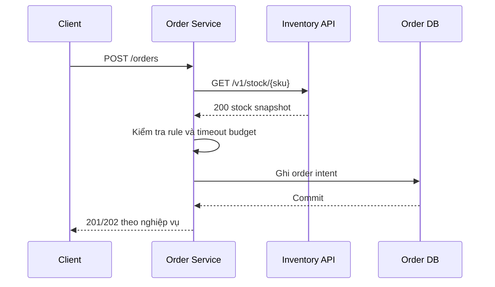
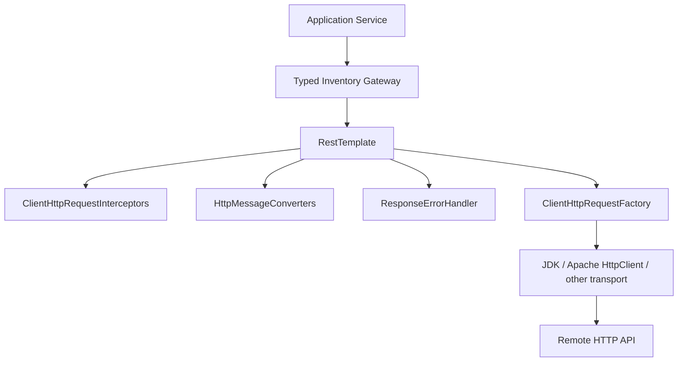
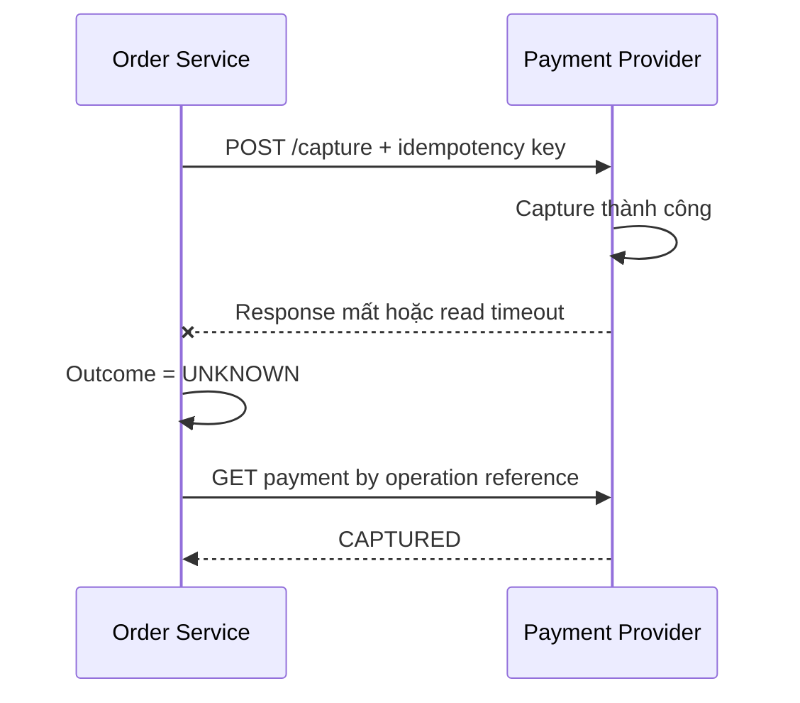
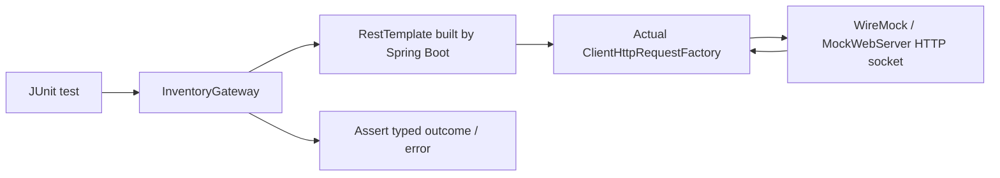
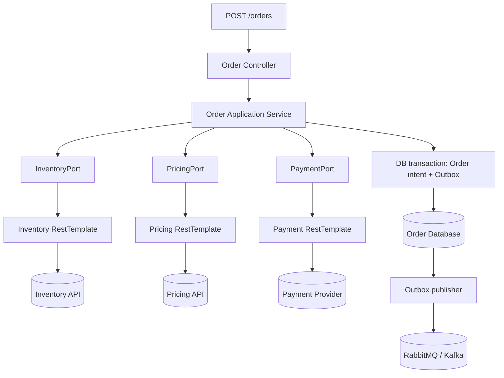

# Tạo RestTemplate từ RestTemplateBuilder

## 1. Bối cảnh: RestTemplate là HTTP client đồng bộ ở ranh giới tích hợp

Trong mô-đun **SPRING_BOOT_INTEGRATION**, Spring Boot kết nối các hệ thống thông qua HTTP client, cơ sở dữ liệu, cache, broker thông điệp và các adapter Spring Integration. Khi một service cần **gọi HTTP đồng bộ** đến ERP, Inventory, CRM hoặc một API nội bộ, `RestTemplate` là một lựa chọn quen thuộc, đặc biệt với hệ thống đang dùng Spring MVC hoặc mã tích hợp hiện hữu.

Giả sử Order Service phải hỏi tồn kho trước khi quyết định nhận đơn:



`RestTemplate` thực hiện **request–response theo kiểu blocking**: thread gọi thường chờ HTTP response hoặc lỗi. Nó không tự quản lý transaction xuyên Inventory/Order DB, không tự retry an toàn, không tự biến việc nhận HTTP 200 thành một business outcome hoàn tất.

Có ba cách tạo instance:

```java
// 1. Tạo trực tiếp: chỉ có cấu hình mặc định của RestTemplate.
RestTemplate direct = new RestTemplate();

// 2. Tự tạo builder: có thể thiếu customizers của Spring Boot.
RestTemplate manuallyBuilt =
    new RestTemplateBuilder().build();

// 3. Khuyến nghị trong ứng dụng Spring Boot:
//    Inject builder do Spring Boot cấu hình và gọi build().
RestTemplate bootConfigured =
    injectedRestTemplateBuilder.build();
```

**Trọng tâm bài học:** biết cách lấy `RestTemplateBuilder` **do Spring Boot quản lý**, cấu hình builder dành riêng cho từng dependency, tạo `RestTemplate` qua `build()`, dùng nó trong typed HTTP gateway, kiểm thử wire contract và tránh làm mất cấu hình của Spring Boot.

### 1.1. Phạm vi phiên bản

Các ví dụ chính dùng **Java 17+, Spring Boot 3.4–3.5 và Spring Framework 6.x**:

- `RestTemplateBuilder` ở package `org.springframework.boot.web.client`.
- `RestTemplate` ở package `org.springframework.web.client`.
- Từ Spring Boot **3.4**, builder có `connectTimeout(Duration)`, `readTimeout(Duration)`, `sslBundle(SslBundle)`.
- Ở Spring Boot **3.0–3.3**, API tương ứng thường là `setConnectTimeout(Duration)`, `setReadTimeout(Duration)`, và khi có SSL bundles là `setSslBundle(SslBundle)`.
- Từ Boot 3.4, các method `set*` nói trên đã deprecated, dự kiến loại bỏ ở Boot 4.
- **Spring Boot 4** chuyển package/tổ chức một số REST client builders; không sao chép nguyên imports của Boot 3 sang Boot 4 mà không tra đúng API phiên bản.

`RestClient` (Spring Framework 6.1+) thường thuận tiện hơn cho code đồng bộ mới; `WebClient` phù hợp với client non-blocking/reactive. Nhưng **RestTemplate vẫn được hỗ trợ trong Spring Framework 6.x** và là đối tượng của bài này. Không đồng nhất “RestTemplate cũ hơn” với “không thể dùng an toàn”: chất lượng tích hợp chủ yếu phụ thuộc cấu hình, contract và vận hành.

## 2. RestTemplate, RestTemplateBuilder và ClientHttpRequestFactory làm gì?

Một lời gọi HTTP bằng `RestTemplate` đi qua nhiều thành phần:



| Thành phần | Nhiệm vụ | Thứ không tự đảm bảo |
| --- | --- | --- |
| `RestTemplateBuilder` | Cấu hình và **tạo** `RestTemplate` | Không thực hiện HTTP call |
| `RestTemplate` | API đồng bộ `getForObject`, `exchange`, `postForEntity`… | Không tự non-blocking |
| `ClientHttpRequestFactory` | Tạo HTTP requests; lựa chọn client transport | Không tự bảo đảm SLA end-to-end |
| `HttpMessageConverter` | Chuyển Java object ↔ HTTP body | Không xác minh business semantics |
| `ResponseErrorHandler` | Quyết định HTTP status nào là lỗi | Không phân biệt mọi lỗi nghiệp vụ |
| `ClientHttpRequestInterceptor` | Bao quanh request/response, thêm headers/metrics | Không tự tạo idempotency |
| `RestTemplateCustomizer` | Áp cấu hình thêm vào instance lúc build | Không áp cho mọi `new RestTemplate()` |
| `UriTemplateHandler` | Mở rộng/encode URI template | Không tự kiểm soát SSRF và host allowlist |

### 2.1. Spring Boot có bean builder, không nhất thiết có bean RestTemplate

Trong Spring Boot với HTTP client auto-configuration phù hợp, `RestTemplateBuilder` có sẵn để inject:

```java
import org.springframework.boot.web.client.RestTemplateBuilder;
import org.springframework.stereotype.Service;

@Service
class DirectoryService {

    DirectoryService(RestTemplateBuilder builder) {
        // Chỉ minh họa: production nên dùng typed gateway/bean.
        RestTemplate template = builder.build();
    }
}
```

Spring Boot **không tự đăng ký một `RestTemplate` toàn cục** chỉ vì `spring-boot-starter-web` có trên classpath. Nếu inject `RestTemplate` trực tiếp mà chưa tạo `@Bean`, ứng dụng có thể báo `NoSuchBeanDefinitionException`.

Một builder được Spring Boot cấu hình có thể mang các `RestTemplateCustomizer` do ứng dụng hoặc auto-configuration đăng ký, chẳng hạn cho HTTP observations/tracing khi các điều kiện tương ứng thỏa. `new RestTemplate()` bỏ qua con đường builder này.

### 2.2. Builder tạo client, không thay đổi client đã build

`RestTemplateBuilder` dùng mô hình **immutable/fluent builder**: các method cấu hình trả một builder mới, thường không mutate builder gốc.

```java
RestTemplateBuilder base = injectedBuilder;

RestTemplateBuilder inventory = base
    .rootUri("https://inventory.example.test")
    .connectTimeout(Duration.ofMillis(500));

RestTemplateBuilder pricing = base
    .rootUri("https://pricing.example.test")
    .connectTimeout(Duration.ofSeconds(1));

RestTemplate inventoryClient = inventory.build();
RestTemplate pricingClient = pricing.build();
```

`base` vẫn là builder ban đầu. Điều này giúp tạo nhiều clients từ cùng **Boot-managed builder** mà không lan cấu hình root URL/auth của Inventory sang Pricing.

**Lưu ý về object đã tạo:** sau `build()`, đừng mutate `RestTemplate` liên tục khi nhiều threads đang dùng (ví dụ thay `setInterceptors` giữa requests). Hãy hoàn tất cấu hình khi khởi tạo bean rồi chia sẻ instance ổn định.

## 3. Bước đầu: dependencies và tạo bean qua builder

Với Spring Boot 3.4–3.5, dự án Spring MVC thường có:

```xml
<dependency>
    <groupId>org.springframework.boot</groupId>
    <artifactId>spring-boot-starter-web</artifactId>
</dependency>
```

`spring-web` cung cấp `RestTemplate`, còn Boot hỗ trợ `RestTemplateBuilder` và auto-configuration. Nếu là một ứng dụng background worker không cần web server, có thể dùng các dependencies nhỏ hơn theo kiến trúc; không phải muốn gọi HTTP thì bắt buộc expose controller.

Bean cơ bản:

```java
package example.integration.inventory;

import org.springframework.boot.web.client.RestTemplateBuilder;
import org.springframework.context.annotation.Bean;
import org.springframework.context.annotation.Configuration;
import org.springframework.web.client.RestTemplate;

@Configuration(proxyBeanMethods = false)
public class InventoryHttpConfiguration {

    @Bean("inventoryRestTemplate")
    RestTemplate inventoryRestTemplate(RestTemplateBuilder builder) {
        return builder
            .rootUri("https://inventory.example.test")
            .build();
    }
}
```

Một service nhận đúng client:

```java
package example.integration.inventory;

import org.springframework.beans.factory.annotation.Qualifier;
import org.springframework.stereotype.Component;
import org.springframework.web.client.RestTemplate;

@Component
public class InventoryGateway {

    private final RestTemplate restTemplate;

    public InventoryGateway(
            @Qualifier("inventoryRestTemplate")
            RestTemplate restTemplate) {
        this.restTemplate = restTemplate;
    }

    public StockResponse findStock(String sku) {
        return restTemplate.getForObject(
            "/v1/stock/{sku}",
            StockResponse.class,
            sku
        );
    }
}
```

Một response contract:

```java
package example.integration.inventory;

public record StockResponse(
    String sku,
    long availableQuantity,
    String status
) {}
```

Lời gọi `getForObject` ở đây là **blocking**. Nếu trả `null` (ví dụ response không có body), gateway cần có policy riêng thay vì vội coi `null` là “không còn hàng”.

### 3.1. Vì sao @Qualifier quan trọng?

Khi ứng dụng tạo:

```text
inventoryRestTemplate
pricingRestTemplate
paymentRestTemplate
```

inject `RestTemplate` không có qualifier có thể gây ambiguity hoặc chọn client không mong muốn. Đặt tên bean theo **downstream boundary**, dùng `@Qualifier` hoặc inject typed gateway thay vì đưa `RestTemplate` chung khắp domain.

### 3.2. Đừng tự đăng ký RestTemplateBuilder bean toàn cục nếu không cần

Sai mục đích:

```java
@Bean
RestTemplateBuilder restTemplateBuilder() {
    return new RestTemplateBuilder();
}
```

Bean trên có thể khiến auto-configured builder của Spring Boot **back off**, làm mất tập customizers/settings mà Boot hoặc integrations thêm. Nếu cần tùy biến mọi instances, ưu tiên `RestTemplateCustomizer` hoặc cơ chế builder customization do Boot cung cấp; nếu cần client riêng, **derive từ builder được inject**.

## 4. Dùng @ConfigurationProperties để không hard-code endpoint và timeout

Không nên đặt domain, timeout và credentials thật trong code. Ví dụ:

```yaml
integration:
  inventory:
    base-url: ${INVENTORY_URL:https://inventory.example.test}
    connect-timeout: 500ms
    read-timeout: 2s
```

Binding record:

```java
package example.integration.inventory;

import java.time.Duration;
import java.net.URI;

import org.springframework.boot.context.properties.ConfigurationProperties;

@ConfigurationProperties(prefix = "integration.inventory")
public record InventoryClientProperties(
    URI baseUrl,
    Duration connectTimeout,
    Duration readTimeout
) {
    public InventoryClientProperties {
        if (baseUrl == null
                || connectTimeout == null
                || readTimeout == null) {
            throw new IllegalArgumentException(
                "Missing inventory HTTP client properties"
            );
        }
        if (!"https".equalsIgnoreCase(baseUrl.getScheme())) {
            throw new IllegalArgumentException(
                "Inventory URL must use HTTPS"
            );
        }
        if (connectTimeout.isZero() || connectTimeout.isNegative()
                || readTimeout.isZero() || readTimeout.isNegative()) {
            throw new IllegalArgumentException(
                "HTTP timeouts must be positive"
            );
        }
    }
}
```

Config sử dụng:

```java
package example.integration.inventory;

import org.springframework.boot.context.properties.EnableConfigurationProperties;
import org.springframework.boot.web.client.RestTemplateBuilder;
import org.springframework.context.annotation.Bean;
import org.springframework.context.annotation.Configuration;
import org.springframework.web.client.RestTemplate;

@Configuration(proxyBeanMethods = false)
@EnableConfigurationProperties(InventoryClientProperties.class)
public class InventoryClientConfiguration {

    @Bean("inventoryRestTemplate")
    RestTemplate inventoryRestTemplate(
            RestTemplateBuilder builder,
            InventoryClientProperties properties) {

        return builder
            .rootUri(properties.baseUrl().toString())
            .connectTimeout(properties.connectTimeout())
            .readTimeout(properties.readTimeout())
            .build();
    }
}
```

**Chỉ chọn một cấu hình bean cùng tên:** đoạn `InventoryHttpConfiguration` ở mục 3 và `InventoryClientConfiguration` ở đây là hai **phương án thay thế**, không cùng đăng ký bean `inventoryRestTemplate` trong một ApplicationContext.

### 4.1. Phân biệt giá trị default và validation ở production

Giá trị `https://inventory.example.test` chỉ là endpoint minh họa, không được xem là production default thực. Production nên cấp endpoint từ configuration/secret management và **fail fast** nếu thiếu các tham số quan trọng.

Trong local integration tests, URL có thể là `http://localhost:<mappedPort>` của WireMock/MockWebServer. Validation ở trên cố ý buộc HTTPS; khi dùng HTTP local test, cần một **test-only override/policy rõ** (ví dụ test cấu hình mock server URL và validate riêng), không vô hiệu hóa TLS validation trong production.

Không cho HTTP caller truyền raw base URL vào một client có credentials sẵn, nếu không có thể tạo **SSRF** hoặc gửi Authorization tới host không mong muốn.

### 4.2. Nên dùng Duration thay cho magic numbers

`500ms` và `2s` được Spring Boot bind thành `Duration`. Dễ đọc hơn hai số nguyên `500` và `2000` mà không rõ đơn vị. Chọn timeout từ latency SLO và retry budget, không chỉ từ một giá trị “an toàn” copy trên mạng.

## 5. rootUri: base URL cho những lời gọi sử dụng String URI template

`RestTemplateBuilder.rootUri(String)` rất hữu ích khi client chỉ được phép gọi một provider cố định:

```java
RestTemplate template = builder
    .rootUri("https://inventory.example.test")
    .build();

StockResponse result = template.getForObject(
    "/v1/stock/{sku}",
    StockResponse.class,
    "sku-123"
);
```

Với string path bắt đầu bằng `/`, request đến:

```http
GET https://inventory.example.test/v1/stock/sku-123
Accept: application/json
```

**Giới hạn quan trọng của rootUri:** theo Javadoc Spring Boot, root URI chỉ áp dụng cho **String variants** của `RestTemplate` khi URL bắt đầu bằng `/`; không áp tự động cho mọi overload nhận `java.net.URI`.

```java
// Root URI áp dụng:
template.getForObject("/v1/stock/{sku}",
    StockResponse.class, sku);

// Không tự gắn rootUri vào một URI đã tạo:
URI uri = URI.create("https://other.example.test/v1/stock/x");
template.getForObject(uri, StockResponse.class);
```

### 5.1. Các bẫy của URI

| Trường hợp | Kết quả/rủi ro |
| --- | --- |
| `"/v1/stock/{sku}"` | Root URI có thể được áp |
| `"v1/stock/{sku}"` | Không mặc định áp như path bắt đầu `/` |
| `URI` đã được build | Root URI không áp |
| Absolute URL String | Root URI không phải một host allowlist |
| Path variable chứa `/` hoặc `%` | Encoding/double-encoding cần kiểm tra |
| Query param chứa dữ liệu nhạy cảm | Không log full URL/query bừa bãi |
| Client có Basic/Bearer header và gọi absolute URL ngoài | Có nguy cơ lộ token nếu không kiểm soát |

`rootUri` là **tiện ích build URL**, không phải policy bảo mật chặn mọi outbound host. Với credentials gắn trên client, gateway chỉ nên tạo paths theo allowlist và **không** nhận URL tùy ý từ caller.

### 5.2. Đừng tự nối URI bằng String

Sai:

```java
String url = baseUrl + "/v1/stock/" + sku;
```

Nếu `sku` chứa dấu cách, `/`, `?` hoặc `#`, URI có thể sai hoặc route khác dự kiến. Dùng URI templates/`UriComponentsBuilder` và kiểm thử encoding ở boundary; phân biệt unencoded URI variables với chuỗi đã encoded để tránh double encoding.

## 6. Kết nối và đọc: connectTimeout, readTimeout, tổng deadline

HTTP blocking client cần ít nhất các giới hạn thời gian rõ:

| Timeout/budget | Mục tiêu | Giới hạn |
| --- | --- | --- |
| Connect timeout | Thời gian thiết lập kết nối TCP/proxy theo request factory | Không bao trọn DNS/TLS mọi implementation |
| Read timeout | Thời gian chờ I/O/response theo transport | Thường không là deadline tổng tuyệt đối |
| Pool lease timeout | Chờ lấy connection từ pool | Phụ thuộc HTTP client/request factory |
| TLS handshake timeout | Chờ handshake | Phụ thuộc transport/config |
| Per-attempt deadline | Ngân sách một HTTP call | Có thể cần cơ chế ngoài connect/read |
| Total business deadline | Tất cả retries/backoff và operations | Không tự có khi set hai timeout |
| Async job timeout | Deadline workflow bất đồng bộ | Khác HTTP socket timeout |

Với Spring Boot 3.4–3.5:

```java
RestTemplate inventory = builder
    .rootUri("https://inventory.example.test")
    .connectTimeout(Duration.ofMillis(500))
    .readTimeout(Duration.ofSeconds(2))
    .build();
```

Với Spring Boot 3.0–3.3:

```java
RestTemplate inventory = builder
    .rootUri("https://inventory.example.test")
    .setConnectTimeout(Duration.ofMillis(500))
    .setReadTimeout(Duration.ofSeconds(2))
    .build();
```

Hai đoạn là **phiên bản thay thế**; đừng đưa method `connectTimeout` vào project Boot 3.2 nếu API đó chưa tồn tại. Với Boot 3.4+ nên tránh các `set*` deprecated.

### 6.1. Timeout không đồng nghĩa retry

`readTimeout=2s` không tự retry một request. Để retry an toàn cần phân loại lỗi, retry budget, exponential backoff, jitter và **idempotency**. Ví dụ không thể retry tự do `POST /payments` sau timeout vì provider có thể đã commit payment rồi mất response.

### 6.2. Timeout có thể không dừng đúng thời điểm kỳ vọng

Tùy request factory (JDK, Apache HttpClient, `SimpleClientHttpRequestFactory`…), semantics của connect/read/connection request timeout khác nhau. HTTP redirect, DNS, TLS và response streaming cũng có thể làm **total wall-clock duration** vượt tổng cộng đơn giản `connectTimeout + readTimeout`.

**Đừng tuyên bố** chỉ đặt `readTimeout(2s)` nghĩa là mọi HTTP request chắc chắn xong trong 2 giây. Nếu SLA 3 giây end-to-end, hãy đo p99, phân bổ budgets, giới hạn retries và xác minh client transport.

## 7. ClientHttpRequestFactory: builder quyết định transport bên dưới

`RestTemplate` không tự là một socket implementation. `ClientHttpRequestFactory` chịu trách nhiệm tạo request:

- `SimpleClientHttpRequestFactory`: dựa trên JDK `HttpURLConnection`.
- `HttpComponentsClientHttpRequestFactory`: Apache HttpClient 5, hỗ trợ những tính năng pool/proxy/TLS nâng cao.
- `JdkClientHttpRequestFactory`: dựa trên Java `java.net.http.HttpClient`.
- Các factory khác tùy classpath/Spring version.

Builder thường **tự chọn request factory phù hợp với classpath**. Khi classpath thay (ví dụ thêm Apache HTTP Client dependency), hành vi transport có thể đổi dù business code không đổi. Cần biết factory thực tế để cấu hình pooling, TLS, redirects và socket timeouts.

### 7.1. Chọn factory tường minh nếu cần deterministic behavior

Ví dụ đơn giản:

```java
import org.springframework.http.client.SimpleClientHttpRequestFactory;

RestTemplate client = builder
    .requestFactory(SimpleClientHttpRequestFactory.class)
    .connectTimeout(Duration.ofMillis(500))
    .readTimeout(Duration.ofSeconds(2))
    .build();
```

Chỉ chọn `SimpleClientHttpRequestFactory` khi nó đáp ứng workload. Với throughput cao, pooling, proxy hoặc TLS đặc thù, cần transport phù hợp và test tương ứng. Không dùng một request factory cố định chỉ để làm code “ngắn” nếu nhu cầu production khác.

### 7.2. detectRequestFactory(false) không phải cách tắt HTTP networking

`detectRequestFactory(false)` bảo builder không tự phát hiện factory tối ưu theo classpath theo policy của Boot. Nó không biến `RestTemplate` thành mock hoặc tránh network calls. Với tests, dùng `MockRestServiceServer` hoặc một mock HTTP server có kiểm soát.

### 7.3. Request factory và connection pooling

Một `RestTemplate` singleton có thể được nhiều threads sử dụng nếu đã cấu hình ổn định, nhưng **khả năng reuse/pooling thực sự phụ thuộc factory và underlying client**. Đừng tạo một `RestTemplate` mới ở mỗi request để “an toàn” nếu làm mất pooling và tạo nhiều transports/threads.

Nếu dùng Apache HttpClient:

- Thiết lập max total/per-route connections và pool lease timeout.
- Kiểm soát idle/expired connections và shutdown lifecycle.
- Bật TLS hostname verification và quản lý trust store.
- Theo dõi pool pending/acquired/available nếu có.
- Test nhiều requests đồng thời và upstream slow response.

Một factory/client có thể giữ sockets và pools; không tạo/hủy nó liên tục trong hot path. Bean lifecycle do Spring quản lý giúp xử lý tài nguyên theo cấu hình tốt hơn.

## 8. Một typed gateway: không để RestTemplate rò vào domain

`RestTemplate` là implementation detail của HTTP integration boundary. Hãy tách domain/application port khỏi HTTP DTO và exception.

Port:

```java
package example.integration.inventory;

public interface InventoryPort {
    StockSnapshot checkStock(String sku);
}

public record StockSnapshot(
    String sku,
    long availableQuantity,
    boolean reservable
) {}
```

DTO wire chính là `StockResponse(String sku, long availableQuantity, String status)` đã định nghĩa ở mục 3. Chỉ giữ **một** DTO đó trong package của gateway; không dùng persistence entity làm wire contract.

Gateway implementation:

```java
package example.integration.inventory;

import org.springframework.beans.factory.annotation.Qualifier;
import org.springframework.stereotype.Component;
import org.springframework.web.client.RestTemplate;

@Component
public class HttpInventoryGateway implements InventoryPort {

    private final RestTemplate http;

    public HttpInventoryGateway(
            @Qualifier("inventoryRestTemplate")
            RestTemplate http) {
        this.http = http;
    }

    @Override
    public StockSnapshot checkStock(String sku) {
        if (sku == null || sku.isBlank()) {
            throw new IllegalArgumentException("sku is required");
        }

        StockResponse response = http.getForObject(
            "/v1/stock/{sku}",
            StockResponse.class,
            sku
        );

        if (response == null
                || response.sku() == null
                || response.status() == null
                || response.availableQuantity() < 0) {
            throw new InvalidInventoryResponseException(
                "Inventory response invalid"
            );
        }

        boolean reservable =
            "AVAILABLE".equals(response.status());

        return new StockSnapshot(
            response.sku(),
            response.availableQuantity(),
            reservable
        );
    }
}
```

`InvalidInventoryResponseException` là **domain/integration exception do dự án định nghĩa** (ví dụ `extends RuntimeException`), không phải một Spring exception có sẵn.

**Điểm quan trọng:** HTTP 200 có thể chứa `status="UNKNOWN"`, `status="RESERVED"` hoặc enum chưa biết. Adapter phải có policy cho unknown values, thay vì mặc định mọi giá trị khác `AVAILABLE` là `OUT_OF_STOCK`. Code trên đang quy định `reservable=false` cho unknown để minh họa, nhưng production cần phân biệt rõ `UNAVAILABLE`, `OUT_OF_STOCK` và `UNKNOWN` khi kết quả ảnh hưởng giao dịch.

### 8.1. Vì sao không inject template vào mọi service?

Tách interface `InventoryPort` giúp test business policy bằng fake port, còn HTTP contract test dùng `HttpInventoryGateway` với `MockRestServiceServer`. Việc đổi API path/DTO/error mapping không kéo business services phải hiểu `HttpStatusCodeException` hay `ClientHttpRequestFactory`.

### 8.2. Blocking dependency trong thread pool

Trong Spring MVC, `RestTemplate` gọi đồng bộ trên request thread trừ khi có async dispatch. Trong Reactor/WebFlux event-loop, gọi `RestTemplate` trực tiếp có thể block event-loop, giảm throughput. Nếu ứng dụng được thiết kế non-blocking, cân nhắc `WebClient`; tạm offload blocking sang boundedElastic chỉ là giải pháp tích hợp có giới hạn capacity và **không biến RestTemplate thành reactive client**.

## 9. Gửi request có status, headers và generic response rõ ràng

`getForObject` tiện cho HTTP GET đơn giản, nhưng không trả trực tiếp response status/headers. Khi API có `ETag`, `Retry-After`, pagination headers hoặc `Location`, dùng `getForEntity`/`exchange`/`postForEntity`.

Ví dụ POST giữ hàng theo contract của Inventory:

```http
POST /v1/reservations HTTP/1.1
Host: inventory.example.test
Content-Type: application/json
Accept: application/json
Idempotency-Key: reserve:ord-1024:line-1

{
  "orderId": "ord-1024",
  "sku": "sku-123",
  "quantity": 2
}
```

DTOs:

```java
package example.integration.inventory;

public record ReserveStockRequest(
    String orderId,
    String sku,
    int quantity
) {}

public record ReserveStockResponse(
    String reservationId,
    String state
) {}
```

Gateway method:

```java
import org.springframework.http.HttpEntity;
import org.springframework.http.HttpHeaders;
import org.springframework.http.HttpMethod;
import org.springframework.http.MediaType;
import org.springframework.http.ResponseEntity;

public ReserveStockResponse reserveStock(
        String orderId, String lineId,
        String sku, int quantity) {

    if (quantity <= 0) {
        throw new IllegalArgumentException(
            "quantity must be positive"
        );
    }

    HttpHeaders headers = new HttpHeaders();
    headers.setContentType(MediaType.APPLICATION_JSON);
    headers.setAccept(
        java.util.List.of(MediaType.APPLICATION_JSON)
    );
    headers.set("Idempotency-Key",
        "reserve:" + orderId + ":" + lineId);

    HttpEntity<ReserveStockRequest> request =
        new HttpEntity<>(
            new ReserveStockRequest(orderId, sku, quantity),
            headers
        );

    ResponseEntity<ReserveStockResponse> response =
        restTemplate.exchange(
            "/v1/reservations",
            HttpMethod.POST,
            request,
            ReserveStockResponse.class
        );

    ReserveStockResponse body = response.getBody();

    if (body == null || body.reservationId() == null) {
        throw new InvalidInventoryResponseException(
            "Missing reservation ID"
        );
    }
    return body;
}
```

Đoạn method nằm trong gateway có field `restTemplate` đã inject. `lineId` được dùng trong idempotency key bởi vì một order có thể có nhiều lines cùng SKU; key chỉ theo order+SKU sẽ đụng các operations hợp lệ. Sự duy nhất/retention và semantics của `Idempotency-Key` vẫn phải được **Inventory provider** hỗ trợ.

### 9.1. ResponseEntity và trạng thái 202

Một HTTP 202 có thể nghĩa là request đã được chấp nhận **để xử lý sau**, không phải đã giữ hàng xong. Nếu provider trả:

```json
{
  "operationId": "rsv-job-991",
  "state": "PENDING"
}
```

thì gateway không thể trả `ReservationOutcome.RESERVED` chỉ vì `response.getStatusCode().is2xxSuccessful()`. Cần DTO/trạng thái và API poll/callback theo hợp đồng.

### 9.2. Trả về một List<DTO> qua ParameterizedTypeReference

Do Java type erasure, dùng generic type token thay vì raw `List.class`:

```java
import org.springframework.core.ParameterizedTypeReference;
import org.springframework.http.HttpMethod;
import org.springframework.http.ResponseEntity;

ResponseEntity<java.util.List<StockResponse>> response =
    restTemplate.exchange(
        "/v1/stock?warehouse={warehouse}",
        HttpMethod.GET,
        null,
        new ParameterizedTypeReference<
            java.util.List<StockResponse>>() {},
        "east"
    );

java.util.List<StockResponse> stocks =
    response.getBody() == null
        ? java.util.List.of()
        : response.getBody();
```

**Lưu ý:** map `null` body sang empty list chỉ hợp lệ khi API contract quy định empty response tương đương không có items. Với API bắt buộc body, nên phân biệt `invalid upstream response` thay vì che lỗi.

### 9.3. Không phải mọi HTTP method đều được mọi request factory hỗ trợ

Một số request factories/transport có giới hạn HTTP method, đặc biệt `PATCH` trong các cấu hình dựa trên `HttpURLConnection`. Nếu dùng PATCH, proxy hoặc streaming upload, chọn factory thực sự hỗ trợ và **kiểm thử trên socket thật**. Một unit test mock converter không thể chứng minh underlying JDK transport thực thi PATCH đúng.

## 10. HTTP error handling: status, response body và lỗi vận chuyển

Mặc định `RestTemplate` dùng `DefaultResponseErrorHandler` và thường biến các HTTP response 4xx/5xx thành subclass của `RestClientResponseException`. Ví dụ:

- `HttpClientErrorException.NotFound` cho HTTP 404.
- `HttpClientErrorException.Conflict` cho HTTP 409.
- `HttpClientErrorException.TooManyRequests` cho HTTP 429.
- `HttpServerErrorException.ServiceUnavailable` cho HTTP 503.
- `ResourceAccessException` cho I/O/network/timeout.
- `UnknownHttpStatusCodeException` cho status mà handler không phân loại/hiểu theo version; hành vi cụ thể tùy Spring Framework.

Một HTTP 200 cũng có thể mang `state="REJECTED"`. **Transport success** không đồng nghĩa **business success**.

### 10.1. Map các lỗi vào outcome của domain thay vì trả null

Ví dụ handler có policy rõ cho tra cứu:

```java
import org.springframework.web.client.HttpClientErrorException;
import org.springframework.web.client.ResourceAccessException;
import org.springframework.web.client.RestClientResponseException;

public StockLookupResult lookupStock(String sku) {
    try {
        StockResponse stock = restTemplate.getForObject(
            "/v1/stock/{sku}",
            StockResponse.class,
            sku
        );

        if (stock == null) {
            return StockLookupResult.invalidResponse();
        }
        return StockLookupResult.found(stock);

    } catch (HttpClientErrorException.NotFound ex) {
        return StockLookupResult.notFound();

    } catch (HttpClientErrorException.TooManyRequests ex) {
        return StockLookupResult.rateLimited(
            ex.getResponseHeaders() == null
                ? null
                : ex.getResponseHeaders().getFirst(
                    "Retry-After"
                )
        );

    } catch (ResourceAccessException ex) {
        return StockLookupResult.unavailable();

    } catch (RestClientResponseException ex) {
        return StockLookupResult.upstreamRejected(
            ex.getStatusCode().value()
        );
    }
}
```

`StockLookupResult` là **domain result type do ứng dụng định nghĩa** (sealed interface/record hoặc class); các factory methods `found`/`notFound`/... ở trên là pseudo-API ứng dụng, không phải Spring class có sẵn. Mục đích là cho thấy **phân loại lỗi** mà không rò exception HTTP lên toàn bộ business layer.

**Thứ tự catch quan trọng:** các HTTP client exceptions là subclass của `RestClientResponseException` nên catch cụ thể trước catch chung.

### 10.2. Không bắt mọi Exception rồi trả empty

Sai:

```java
try {
    return inventoryGateway.findStock(sku);
} catch (Exception ignored) {
    return null; // "Không có hàng"?
}
```

Network outage và HTTP 404 không đồng nghĩa nhau. Nếu Order Service dùng `null` để kết luận hết hàng, dependency outage có thể dẫn đến quyết định sai hoặc bỏ qua một thao tác quan trọng.

### 10.3. Custom ResponseErrorHandler khi nào cần?

`RestTemplateBuilder` cho phép:

```java
RestTemplate template = builder
    .errorHandler(customResponseErrorHandler)
    .build();
```

`customResponseErrorHandler` là bean implement `ResponseErrorHandler`. Chỉ override khi partner API có quy tắc riêng (ví dụ một số HTTP 4xx phải được đọc như business response). Nếu thay handler mặc định, phải xem các status/response codes sẽ **không còn tự ném** exception, và gateway phải tự check `ResponseEntity.getStatusCode()`.

Tránh viết một custom handler biến tất cả 4xx/5xx thành “bình thường” rồi không ai kiểm tra status. Ngược lại, đừng ném `new RuntimeException(responseBody)` với raw PII/card data hay token từ partner.

### 10.4. Body lỗi và charset

Một API có thể trả `application/problem+json` (RFC 9457) với `code` và `detail`. Lỗi payload cũng cần converter/charset và schema version. Khi exception chứa response body, không log nguyên body nếu có PII/secrets; chỉ lưu sanitized error code, status, operation ID, latency và correlation ID.

## 11. Header mặc định, Basic Authentication và credentials

`RestTemplateBuilder` có các methods:

```java
RestTemplate client = builder
    .rootUri("https://inventory.example.test")
    .defaultHeader("Accept", "application/json")
    .defaultHeader("X-Client", "order-service")
    .build();
```

`defaultHeader(name, values)` thiết lập một default nếu header chưa được đặt trên request. Nó **không** áp một authentication policy cho mọi outbound host; khi service gửi request đến URL bất kỳ, default header cũng có thể đi cùng request đó.

### 11.1. Basic Authentication

Ví dụ cho đối tác legacy thực sự dùng HTTP Basic:

```java
RestTemplate basicClient = builder
    .rootUri("https://legacy-erp.example.test")
    .basicAuthentication(username, password)
    .build();
```

`username`/`password` phải lấy từ secret manager/configuration bảo vệ đúng mức (không hard-code trong code). Builder sẽ thêm Basic Authorization cho requests **trừ khi một Authorization header khác đã được cung cấp trước** theo contract.

Lưu ý:

- Chỉ dùng HTTPS được xác minh certificate/hostname.
- Không reuse client Basic này để gọi nhiều hosts khác nhau.
- Không log `Authorization`, không đưa password vào exception/report hoặc URL.
- Không gửi Basic creds qua HTTP plaintext.
- Kiểm thử redirect/proxy: một số transports có behavior khác nhau khi chuyển host, nên đặt chính sách redirects và host allowlist rõ.

### 11.2. Bearer/OAuth2 token thường là per-request concern

Không nên dùng `defaultHeader("Authorization", "Bearer " + staticToken)` cho một access token ngắn hạn rồi giữ client singleton nhiều giờ. Token có thể hết hạn, hoặc thuộc audience/tenant khác.

Một hướng phù hợp:

```java
HttpHeaders headers = new HttpHeaders();
headers.setBearerAuth(tokenProvider.accessTokenForInventory());
HttpEntity<Void> entity = new HttpEntity<>(headers);

ResponseEntity<StockResponse> response = restTemplate.exchange(
    "/v1/stock/{sku}",
    HttpMethod.GET,
    entity,
    StockResponse.class,
    sku
);
```

`tokenProvider` là một thành phần của ứng dụng quản lý token với cache/refresh, audience và scopes. Nếu dùng OAuth2 Spring Security client infrastructure, ưu tiên cơ chế tích hợp chính thức và service identity thích hợp thay vì tự ghi token cache tùy tiện. **Không forward inbound user JWT nguyên vẹn** sang partner khác trừ khi audience/delegation policy cho phép.

### 11.3. Header propagation cần allowlist

Không copy tất cả inbound HTTP headers:

```java
// Không an toàn: có thể đẩy cookies/token/tenant giả ra ngoài.
outboundHeaders.addAll(inboundHeaders);
```

Chỉ chuyển correlation/tracing metadata và business headers được chấp thuận; tenant identity phải được server xác thực chứ không tin header tùy ý từ caller.

## 12. ClientHttpRequestInterceptor: gắn correlation, đo latency, kiểm soát log

`ClientHttpRequestInterceptor` có thể đọc/sửa `HttpRequest`, body bytes và chuyển tiếp bằng `ClientHttpRequestExecution.execute(...)`.

Ví dụ gắn một header cố định để Inventory dễ xác định caller:

```java
package example.integration.inventory;

import java.io.IOException;

import org.springframework.http.HttpRequest;
import org.springframework.http.client.ClientHttpRequestExecution;
import org.springframework.http.client.ClientHttpRequestInterceptor;
import org.springframework.http.client.ClientHttpResponse;

public final class ClientIdentityInterceptor
        implements ClientHttpRequestInterceptor {

    @Override
    public ClientHttpResponse intercept(
            HttpRequest request,
            byte[] body,
            ClientHttpRequestExecution execution)
            throws IOException {

        request.getHeaders().set("X-Client", "order-service");
        return execution.execute(request, body);
    }
}
```

Thêm interceptor cho **một client**:

```java
RestTemplate client = builder
    .rootUri("https://inventory.example.test")
    .additionalInterceptors(new ClientIdentityInterceptor())
    .build();
```

`additionalInterceptors(...)` giữ interceptors đã cấu hình trước đó; `interceptors(...)` **thay thế** danh sách trên builder. Dùng nhầm `interceptors(...)` có thể loại bỏ một interceptor quan trọng của ứng dụng. Với `RestTemplateCustomizer` hoạt động **sau** cấu hình builder, thứ tự cuối còn phụ thuộc customizers được áp.

### 12.1. Interceptor theo dõi request không nên log toàn bộ body

Một interceptor timing minh họa:

```java
public ClientHttpResponse intercept(
        HttpRequest request, byte[] body,
        ClientHttpRequestExecution execution)
        throws IOException {

    long startedAt = System.nanoTime();

    try {
        return execution.execute(request, body);
    } finally {
        long elapsedNanos = System.nanoTime() - startedAt;
        // Record elapsedNanos với URI pattern/op name cố định.
        // Không log body, query secrets hay Authorization.
    }
}
```

Chỉ minh họa phần method body; không phải một class hoàn chỉnh. Đo ở `finally` có thể dừng trước khi response body được đọc/deserialize tùy execution/transport, nên **không tuyên bố** đây là latency toàn bộ end-to-end. Sử dụng Micrometer Observation/tracing instrumentation phù hợp của Spring Boot để có số liệu nhất quán hơn.

### 12.2. Đừng dùng interceptor làm retry mà không kiểm soát

Một interceptor có thể gọi `execution.execute(...)` nhiều lần, nhưng retry request body không replayable, connection state/stream và idempotency rất dễ sai. Nếu cần retry, dùng policy ở gateway/service layer hoặc retry library thích hợp, phân loại lỗi và kiểm thử provider **commit rồi mất response**. Đặc biệt đừng retry POST payment chỉ vì nhận `IOException`.

## 13. Message converters: JSON, XML, text và điều gì xảy ra khi thay danh sách

`RestTemplate` dùng `HttpMessageConverter` để serialize request body và deserialize response theo `Content-Type`/`Accept`, target Java type và converter selection.

| Converter thường gặp | Dạng dữ liệu | Lưu ý |
| --- | --- | --- |
| `MappingJackson2HttpMessageConverter` | JSON ↔ Java DTO | Dựa trên Jackson/ObjectMapper |
| `StringHttpMessageConverter` | String/text | Charset/Content-Type |
| `ByteArrayHttpMessageConverter` | byte[] | Thích hợp binary nhỏ; xem memory |
| `ResourceHttpMessageConverter` | Resource/file | Streaming/large payload cần chú ý |
| Form/Multipart converters | form-urlencoded/multipart | Boundaries và content disposition |
| XML converter nếu dependency có | XML ↔ DTO | Schema, namespaces, XXE policy |

### 13.1. Không thay tất cả converters khi chỉ cần một format bổ sung

Builder có:

```java
RestTemplate client = builder
    .messageConverters(customConverter)
    .build();
```

**Cẩn trọng:** `messageConverters(...)` **thay thế** converters được cấu hình trước đó, và việc cấu hình converters trên builder có thể thay bộ mặc định của `RestTemplate`. Ngay cả `additionalMessageConverters(...)` có thể làm thay đổi điểm khởi tạo defaults theo Javadoc Boot 3.5; nó không bảo đảm tất cả converters trước đây vẫn còn như bạn nghĩ. Hãy test thực tế sau build.

Khi chỉ cần thay cách Jackson đọc/ghi `Instant`, `BigDecimal` hoặc JSON naming policy, ưu tiên cấu hình `ObjectMapper`/Jackson modules theo chuẩn của Spring Boot và đảm bảo HTTP client dùng converter tương thích thay vì đăng ký một danh sách thủ công thiếu `String`/`byte[]`/multipart.

### 13.2. Test serialization theo wire contract

Ví dụ JSON:

```json
{
  "sku": "sku-123",
  "availableQuantity": 17,
  "status": "AVAILABLE"
}
```

Một DTO record không bảo đảm naming/null/default handling hoàn toàn tương thích với producer. Kiểm tra:
- Field bắt buộc/nullable.
- Enum unknown values.
- Decimal precision, timezone và UTF-8.
- JSON property rename/backward compatibility.
- Content-Type có phải `application/json` và không phải HTML error page.
- Payload size; tránh đọc files lớn toàn bộ vào heap.

### 13.3. Khi partner trả 200 với HTML hoặc JSON sai

`RestTemplate` có thể ném `UnknownContentTypeException`, `HttpMessageNotReadableException` (được wrap tùy API) hoặc conversion exception; gateway phải phân biệt **invalid upstream response** với **not found** và **out of stock**. Đây thường là permanent contract error đến khi provider sửa, không phải lúc nào retry cũng hữu ích.

## 14. RestTemplateCustomizer, RestTemplateRequestCustomizer và thứ tự áp dụng

Spring Boot hỗ trợ hai phạm vi:

- `RestTemplateCustomizer`: cấu hình `RestTemplate` **mỗi khi builder tạo instance**; phù hợp logging/tracing, shared protocol policy và những điều chỉnh nhất quán.
- `RestTemplateRequestCustomizer<?>`: tác động lên **mỗi `ClientHttpRequest`**; phù hợp metadata/header/connection-specific request details.
- `ClientHttpRequestInterceptor`: bao quanh request execution, có thể xem/sửa headers, timing và response.

### 14.1. Global RestTemplateCustomizer (có chủ đích)

```java
package example.integration.http;

import java.util.ArrayList;

import org.springframework.boot.web.client.RestTemplateCustomizer;
import org.springframework.context.annotation.Bean;
import org.springframework.context.annotation.Configuration;
import org.springframework.http.client.ClientHttpRequestInterceptor;

@Configuration(proxyBeanMethods = false)
public class HttpClientCommonConfiguration {

    @Bean
    RestTemplateCustomizer commonClientCustomizer() {

        ClientHttpRequestInterceptor interceptor =
            (request, body, execution) -> {
                request.getHeaders()
                    .add("X-Platform-Client", "spring-boot-integration");
                return execution.execute(request, body);
            };

        return template -> {
            var existing =
                new ArrayList<>(template.getInterceptors());
            existing.add(interceptor);
            template.setInterceptors(existing);
        };
    }
}
```

Khi sử dụng **Boot-managed builder**, bean `RestTemplateCustomizer` sẽ được auto-configuration lấy vào pipeline theo điều kiện phù hợp. Không dùng global customizer cho tenant-specific auth hoặc headers của một downstream duy nhất; những thông tin đó phải gắn với client riêng.

### 14.2. Cấu hình customizer của một client

```java
RestTemplate client = builder
    .rootUri("https://inventory.example.test")
    .additionalCustomizers(template -> {
        template.setErrorHandler(
            new org.springframework.web.client.DefaultResponseErrorHandler()
        );
    })
    .build();
```

`additionalCustomizers(...)` thêm vào bộ customizers; `customizers(...)` **thay** danh sách hiện có trên builder. Theo Javadoc, customizers được áp **sau builder configuration**, theo thứ tự thêm. Vì thế một customizer gọi `setErrorHandler` có thể ghi đè handler đặt bằng `builder.errorHandler(...)`. Đừng cấu hình cùng một behavior ở nhiều tầng rồi trông chờ precedence ngầm.

### 14.3. Tại sao setRequestFactory trong customizer có thể phá timeout?

Nếu builder đã cấu hình `connectTimeout`/`readTimeout` rồi một customizer chạy sau:

```java
builder.additionalCustomizers(template ->
    template.setRequestFactory(
        new SimpleClientHttpRequestFactory()
    )
);
```

factory mới có thể không mang timeout/TLS/proxy/pool settings từ builder, dẫn tới behavior thực tế khác mong đợi. Muốn thay transport, cấu hình **trong builder qua requestFactory APIs** hoặc dùng factory supplier/builder được kiểm soát; test kết nối chậm để xác nhận timeout thật.

### 14.4. Khi nào phải xem thứ tự interceptor?

- Header auth interceptor có thể override `Authorization` do gateway set.
- Observation/tracing interceptor/customizer có thể cần bao quanh đúng phần request.
- Một logging interceptor đọc response body có thể khiến consumer không còn bytes để deserialize nếu không buffering/replaying đúng.
- Interceptor thay request URI cần cẩn trọng Host/TLS validation.

Không tự ghi/đọc toàn bộ response body từ interceptor để “debug nhanh” mà chưa có buffering semantics, size limit và redaction.

## 15. SSL bundles, TLS, proxy và outbound security

Với Spring Boot 3.4–3.5, `RestTemplateBuilder.sslBundle(SslBundle)` cho phép cấu hình TLS qua Spring Boot SSL bundles khi request factory hỗ trợ.

Ví dụ chọn một bundle đã khai báo:

```java
package example.integration.inventory;

import java.time.Duration;
import org.springframework.boot.ssl.SslBundles;
import org.springframework.boot.web.client.RestTemplateBuilder;
import org.springframework.context.annotation.Bean;
import org.springframework.context.annotation.Configuration;
import org.springframework.web.client.RestTemplate;

@Configuration(proxyBeanMethods = false)
class SecuredInventoryConfiguration {

    @Bean("securedInventoryRestTemplate")
    RestTemplate securedInventoryRestTemplate(
            RestTemplateBuilder builder,
            SslBundles sslBundles) {

        return builder
            .rootUri("https://inventory.example.test")
            .sslBundle(sslBundles.getBundle("inventory-client"))
            .connectTimeout(Duration.ofMillis(500))
            .readTimeout(Duration.ofSeconds(2))
            .build();
    }
}
```

Snippet không khai báo SSL bundle YAML chi tiết vì trust material/keystore paths và mTLS identity phụ thuộc hạ tầng. `SslBundles.getBundle("inventory-client")` chỉ hoạt động khi bundle tên đó đã cấu hình, và transport hỗ trợ áp SSL settings. Trong Boot 3.1–3.3 có API `setSslBundle(...)`; đối chiếu JavaDocs phiên bản.

### 15.1. TLS là trách nhiệm security, không phải “mở cho chạy”

- Bật hostname verification và kiểm tra CA/truststore.
- Nếu mTLS, keystore/client certificate có lifecycle/rotation rõ.
- Không đặt `trustAll` hoặc bỏ hostname verification để qua môi trường test.
- Với proxy doanh nghiệp, xác định CONNECT, authentication và no-proxy policy.
- Không log credentials hay keystore passwords.
- Không cho caller quyết định host và đưa default bearer credentials sang host khác.

### 15.2. Root URI khác outbound allowlist

`rootUri("https://inventory.example.test")` chỉ áp với String URLs bắt đầu bằng `/`. Nó không chặn:

```java
template.getForEntity(
    "https://untrusted.example.invalid/collect",
    String.class
);
```

Do đó một security-sensitive gateway phải không expose phương thức “fetch arbitrary URL” dùng cùng authenticated RestTemplate. Nếu partner API trả URL redirects/download links, phải validate host/scheme/IP range theo SSRF policy hoặc dùng một unauthenticated client riêng.

## 16. Retry, deadline và idempotency: builder không tự giải quyết business failure

Một client có timeout đúng vẫn có thể cần thử lại khi upstream báo `503 Service Unavailable`, `429 Too Many Requests` hoặc kết nối bị reset. Nhưng không nên đưa retry vào mọi lời gọi HTTP một cách mặc định.

| Operation | Retry thường an toàn đến đâu? | Điều kiện cần |
| --- | --- | --- |
| GET stock snapshot | Thường an toàn về side effect | Bounded attempts/deadline; staleness policy |
| GET price | Thường an toàn | TTL, pricing version, policy khi service down |
| PUT idempotent resource | Theo contract nếu thật sự idempotent | Idempotency và version/ETag |
| POST create reservation | **Không tự an toàn** | Provider hỗ trợ stable idempotency key hoặc lookup |
| POST capture payment | Rất nhạy cảm | Stable payment operation key + reconciliation |
| DELETE resource | Có thể an toàn nếu API định nghĩa idempotent | Business state/404 semantics |
| OAuth token refresh | Phụ thuộc client auth flow | Đồng bộ refresh và deadline |

### 16.1. Nhận response không được không có nghĩa upstream chưa xử lý



Nếu Order Service mù quáng retry bằng operation ID mới, có thể thu tiền hai lần. **Retry side-effecting HTTP requests chỉ nên thực hiện khi provider contract cho phép và key giữ nguyên qua các attempts.**

### 16.2. Phân bổ deadline

Một HTTP request có SLO 3 giây, đi qua Inventory GET, Payment POST và database commit. Nếu mỗi call có `readTimeout=2s` và retry 3 lần, tổng thời gian có thể vượt SLO xa. Cần ngân sách:

```text
End-to-end deadline: 3.0s
  Input validation            0.1s
  Inventory call, max attempts 0.8s
  Payment command             1.0s
  DB commit                   0.4s
  Reserve / network overhead  0.7s
```

Các số chỉ minh họa; đo thực tế rồi quyết định. Nếu workflow mất vài phút, dùng `202 Accepted` + durable job/status/outbox, không cố giữ HTTP synchronous request xuyên nhiều remote systems.

### 16.3. Bounded retry pattern (pseudo code)

```text
function queryInventory(command, operationId, deadline):
  for attempt from 1 to maxAttempts:
    if deadline expired:
      return UNAVAILABLE

    try:
      return inventoryGateway.call(command)

    catch validation/auth/contract error:
      fail permanently

    catch 429:
      honor Retry-After if within budget

    catch timeout/503:
      retry only if this operation is safe

    sleep with bounded exponential backoff + jitter
  return UNAVAILABLE
```

Đây là **pseudocode**, không phải Java API sẵn có. Có thể hiện thực bằng Spring Retry/Resilience4j/RetryTemplate hoặc policy có kiểm soát. Khi dùng `RestTemplate` blocking, retry/sleep có thể chiếm caller thread lâu hơn; dùng bulkhead, giới hạn concurrency và deadline.

### 16.4. Không đặt retry trong interceptor vô điều kiện

Nếu global interceptor retry mọi POST tới ERP/Payment, một lỗi socket sau khi upstream commit dễ tạo duplicate business state. Retry nên gắn với **operation semantics**, không chỉ HTTP status class. Với các hệ thống trao đổi event, sau khi local DB commit nên dùng outbox và worker retries thay vì giữ HTTP transaction mở.

## 17. Observability: builder, RestTemplate và Spring Boot metrics/tracing

Trong Spring Boot có Micrometer Observation/Actuator phù hợp, auto-configured RestTemplateBuilder có thể được bổ sung customizers hỗ trợ HTTP client observations. Khi tự tạo `new RestTemplate()` hoặc tự thay builder bean, instrumentation có thể mất.

### 17.1. Các tín hiệu nên quan sát

| Tín hiệu | Ý nghĩa | Cần tránh |
| --- | --- | --- |
| HTTP client duration (p50/p95/p99) | Độ trễ xuống Inventory/ERP | Nhầm với total workflow time |
| HTTP status families | 2xx/4xx/5xx | Gộp 404 và 503 cùng “không có hàng” |
| Connection errors / timeouts | Lỗi trước hoặc trong response | Log raw URL có token |
| Retry attempts/exhausted | Pressure lên dependency | Nhân retries nhiều tầng |
| HTTP client pool leased/pending | Saturation | Chỉ nhìn CPU mà bỏ pool queue |
| Circuit breaker open | Upstream degraded | Tự động coi circuit open là empty result |
| Order workflow completion | Business outcome cuối | Chỉ đo HTTP 200 |
| Outbox oldest pending age | Event publish bị chậm | Nghĩ đó là lỗi RestTemplate |
| Trace spans | Tương quan HTTP và DB/messaging | Gửi token/PII trong baggage |

### 17.2. Metric tags cần bounded cardinality

Sai:

```text
http.client.requests{sku="sku-123"}
http.client.requests{sku="sku-124"}
http.client.requests{requestId="req-8021"}
```

Vì mỗi SKU/request ID có thể khác nhau, meter cardinality sẽ tăng không giới hạn.

Tốt hơn dùng `uri="/v1/stock/{sku}"`, `client="inventory"`, `status="503"`, `outcome="timeout"`. Lưu request ID/trace ID trong structured logs/traces có retention và privacy policy phù hợp, không đặt làm Prometheus labels.

### 17.3. Phân biệt observation với business correlation

Một HTTP client span cho biết transport call đã xảy ra. Nó **không** tự tạo `OrderCreated` event ID hoặc idempotency key. Một retry có thể có spans khác trong cùng workflow. Dùng:

- `traceId`: chẩn đoán các spans.
- `correlationId`: nối logs giữa services theo operation.
- `idempotencyKey`: chống lặp business command.
- `eventId`: dedupe event trên broker.
- `orderId`: resource identity.

Không dùng `traceId` làm payment idempotency key, vì các retries ở thời điểm khác có thể mang trace mới.

### 17.4. Custom interceptors và observability

Thêm custom interceptor bằng `additionalInterceptors` hoặc một `RestTemplateCustomizer` không đồng nghĩa mất observations, nhưng **thay** interceptor list/factory/observation registry không cẩn thận có thể làm mất instrumentation. Test có thể assert expected spans/meters thông qua `TestObservationRegistry` hoặc Micrometer test tools, và đối chiếu hành vi với Boot version đang dùng.

## 18. Kiểm thử RestTemplateBuilder bằng @RestClientTest

Một REST client test nên xác minh **request được gửi ra wire thế nào**, response được giải mã ra sao và gateway phản ứng với HTTP errors thế nào.

Spring Boot 3.x cung cấp `@RestClientTest`, cấu hình các thành phần cần cho client test, trong đó có `RestTemplateBuilder` và `MockRestServiceServer`. Nó không tải mọi `@Component`/`@ConfigurationProperties` như một full `@SpringBootTest`; vì vậy phải import/enable dependencies một cách có chủ đích.

### 18.1. Ví dụ slice test hoàn chỉnh

Giả sử dùng `InventoryClientConfiguration` từ mục 4 và `HttpInventoryGateway` từ mục 8. Test:

```java
package example.integration.inventory;

import static org.assertj.core.api.Assertions.assertThat;
import static org.springframework.test.web.client.match.MockRestRequestMatchers.*;
import static org.springframework.test.web.client.response.MockRestResponseCreators.*;

import org.junit.jupiter.api.Test;
import org.springframework.beans.factory.annotation.Autowired;
import org.springframework.boot.test.autoconfigure.web.client.RestClientTest;
import org.springframework.context.annotation.Import;
import org.springframework.http.MediaType;
import org.springframework.test.context.TestPropertySource;
import org.springframework.test.web.client.MockRestServiceServer;

@RestClientTest(HttpInventoryGateway.class)
@Import(InventoryClientConfiguration.class)
@TestPropertySource(properties = {
    "integration.inventory.base-url=https://inventory.example.test",
    "integration.inventory.connect-timeout=500ms",
    "integration.inventory.read-timeout=2s"
})
class InventoryGatewayRestClientTest {

    @Autowired
    HttpInventoryGateway gateway;

    @Autowired
    MockRestServiceServer server;

    @Test
    void mapsJsonStockResponse() {
        server.expect(
            requestTo("/v1/stock/sku-123")
        )
        .andExpect(method(org.springframework.http.HttpMethod.GET))
        .andRespond(withSuccess(
            """
            {
              "sku": "sku-123",
              "availableQuantity": 17,
              "status": "AVAILABLE"
            }
            """,
            MediaType.APPLICATION_JSON
        ));

        StockSnapshot snapshot = gateway.checkStock("sku-123");

        assertThat(snapshot.sku()).isEqualTo("sku-123");
        assertThat(snapshot.availableQuantity()).isEqualTo(17);
        assertThat(snapshot.reservable()).isTrue();

        server.verify();
    }
}
```

**Đặc điểm cần nhớ:** với `@RestClientTest`/`MockRestServiceServer` khi client được xây từ `RestTemplateBuilder.rootUri(...)`, Spring Boot documentation hướng dẫn expectation `requestTo("/v1/stock/sku-123")` **bỏ phần root URI**. Nếu builder **không dùng rootUri**, hoặc bạn test `RestClient.Builder`/một mock server khác, expectation có thể cần **full URI**. Không dùng nguyên ví dụ này để kết luận server thực chỉ nhận relative URL.

### 18.2. Vì sao @Import cấu hình là cần thiết?

`@RestClientTest(HttpInventoryGateway.class)` chỉ nạp các beans được chọn và auto-configuration phù hợp. Nó **không tự scan** mọi `@ConfigurationProperties` hoặc configuration của ứng dụng. `@Import(InventoryClientConfiguration.class)` cùng `@EnableConfigurationProperties(InventoryClientProperties.class)` trong config giúp test có bean `inventoryRestTemplate` và properties đã bind.

Nếu test báo thiếu `InventoryClientProperties`, đừng chuyển ngay sang `@SpringBootTest` chỉ để nó pass. Xác định rõ những dependencies thuộc client slice và import/enable chúng.

### 18.3. Test sự kiện HTTP 404

Bổ sung một test:

```java
import static org.assertj.core.api.Assertions.assertThatThrownBy;
import static org.springframework.test.web.client.response.MockRestResponseCreators.withStatus;

import org.springframework.http.HttpStatus;
import org.springframework.web.client.HttpClientErrorException;

@Test
void propagatesNotFoundForGatewayPolicy() {
    server.expect(
        requestTo("/v1/stock/missing-sku")
    ).andRespond(
        withStatus(HttpStatus.NOT_FOUND)
    );

    assertThatThrownBy(
        () -> gateway.checkStock("missing-sku")
    ).isInstanceOf(
        HttpClientErrorException.NotFound.class
    );

    server.verify();
}
```

Test này phản ánh `HttpInventoryGateway` hiện tại **không bắt lỗi 404**; nếu adapter về sau map thành typed `NOT_FOUND`, assertion phải đổi theo contract. Test nên phản ánh một policy rõ, không buộc business code giữ mã exception Spring mãi.

### 18.4. Cảnh báo về global RestTemplateCustomizer

Nếu test context có nhiều RestTemplates hoặc cấu hình `MockRestServiceServer` không intercept template đã build, test có thể cố gọi network thật. Hãy xác minh template được tạo qua **builder đã được mock customizer bọc**. Khi dùng nhiều builders/templates, `MockServerRestTemplateCustomizer` có cách lấy server gắn với một `RestTemplate` cụ thể; đừng dùng một `MockRestServiceServer` tùy ý rồi nghĩ nó giám sát tất cả clients.

## 19. MockRestServiceServer thủ công và MockServerRestTemplateCustomizer

`@RestClientTest` là lựa chọn gọn khi dùng Spring Boot test slice. Nếu muốn kiểm thử một gateway không tải ApplicationContext hoặc cần tạo builder thủ công, `MockRestServiceServer` cũng hỗ trợ setup trực tiếp.

### 19.1. Bind server vào một RestTemplate có sẵn

```java
import org.springframework.test.web.client.MockRestServiceServer;
import org.springframework.boot.web.client.RestTemplateBuilder;
import org.springframework.web.client.RestTemplate;

RestTemplate restTemplate =
    new RestTemplateBuilder()
        .rootUri("https://inventory.example.test")
        .build();

MockRestServiceServer server =
    MockRestServiceServer.bindTo(restTemplate).build();

// Cấu hình request expectation, gọi gateway, rồi server.verify().
```

Điểm khác `@RestClientTest`: đây là một **unit-style test setup thủ công**, không tự dùng Boot-managed builder/customizers. Nó phù hợp kiểm tra một client đã tự cấu hình nhưng **không chứng minh Boot auto-configuration đã áp vào bean**. Với manual mock server, cần xác định expectation URI semantics của handler và mock setup thực tế.

### 19.2. MockServerRestTemplateCustomizer bọc builder trước build

```java
import org.springframework.boot.test.web.client.MockServerRestTemplateCustomizer;
import org.springframework.boot.web.client.RestTemplateBuilder;

MockServerRestTemplateCustomizer mockCustomizer =
    new MockServerRestTemplateCustomizer();

RestTemplateBuilder testingBuilder =
    new RestTemplateBuilder(mockCustomizer);

RestTemplate testedClient = testingBuilder
    .rootUri("https://inventory.example.test")
    .build();

MockRestServiceServer server =
    mockCustomizer.getServer(testedClient);
```

`MockServerRestTemplateCustomizer` được dùng trong Boot test infrastructure. Khi customizer tạo server cho **nhiều RestTemplates**, dùng `getServer(restTemplate)` hoặc map theo instance, không dùng `getServer()` rồi giả định nó luôn chỉ có một client. Nếu reuse server giữa tests, reset expectations có chủ đích.

### 19.3. Các assertion ngoài response body

```java
server.expect(requestTo("/v1/reservations"))
    .andExpect(method(HttpMethod.POST))
    .andExpect(header(
        "Idempotency-Key",
        "reserve:ord-1024:line-1"
    ))
    .andExpect(content().contentTypeCompatibleWith(
        MediaType.APPLICATION_JSON
    ))
    .andExpect(jsonPath("$.sku").value("sku-123"))
    .andExpect(jsonPath("$.quantity").value(2))
    .andRespond(withSuccess(
        """
        {"reservationId":"rsv-6701","state":"RESERVED"}
        """,
        MediaType.APPLICATION_JSON
    ));
```

Đoạn này nằm trong test đã có imports static `MockRestRequestMatchers.*`, `MockRestResponseCreators.*` và gateway được tạo từ builder tương thích. Test chứng minh method/path/headers/JSON/conversion, nhưng không chứng minh real socket connect/read timeout hay TLS.

## 20. Kiểm thử HTTP thực bằng WireMock hoặc MockWebServer

`MockRestServiceServer` thường thay request factory để trả mocked responses; nó **không** kiểm thử đầy đủ DNS, TLS, TCP pooling, socket read timeout hay proxy behaviors. Những mục ấy cần mock HTTP server chạy trên **port thật**, ví dụ WireMock/OkHttp MockWebServer, hoặc một integration test service container.

### 20.1. Mô hình end-to-end ở boundary



Các test nên có:

- 200 JSON hợp lệ và status/headers đúng.
- 404, 409, 422, 429, 503 với body theo contract.
- Server delay vượt `readTimeout`.
- Connection refused, abrupt close, slow streaming response.
- Invalid JSON hoặc Content-Type không đúng.
- Redirect sang host khác nếu client hỗ trợ redirect.
- Payload lớn và giới hạn body buffering.
- TLS truststore/mTLS khi service thực sự yêu cầu.
- Retry với stable idempotency key và bounded attempts.
- Nhiều concurrent requests để kiểm tra pool exhaustion.

### 20.2. Vì sao timeout test không chỉ assert sau 2 giây?

OS scheduling, CI load, DNS, TLS handshake, transport timeout semantics và JVM pause có thể làm timing hơi lệch. Dùng **reasonable bounds** và assert loại lỗi/behavior, không so nanoseconds tuyệt đối. Một test cũng nên xác minh request factory được chọn là loại dự kiến; classpath thay đổi có thể làm kết quả khác.

### 20.3. @SpringBootTest khác @RestClientTest

| Lựa chọn | Tốt nhất cho | Chi phí |
| --- | --- | --- |
| `@RestClientTest` + `MockRestServiceServer` | Gateway contract, JSON, headers, error mapping | Rất nhanh, không socket thật |
| Plain JUnit + manual mock server | Cấu hình client tối thiểu | Không kiểm Boot auto config nếu tự new builder |
| `@SpringBootTest` + WireMock/MockWebServer | Full wiring, socket/read timeout, interceptors | Chậm hơn |
| Testcontainers upstream service | Kết nối với server thực/protocol | Docker/resource setup |
| Staging contract test | TLS/auth/proxy/network/policies gần production | Không hoàn toàn isolated |

Không phải mọi HTTP client test đều cần Testcontainers. Chọn mức test đủ để kiểm chứng rủi ro của thay đổi.

## 21. Nhiều HTTP clients trong cùng ứng dụng: tạo từ cùng builder chuẩn

Một Spring Boot integration service có thể cần **Inventory**, **Pricing** và **Legacy ERP**, mỗi bên có endpoint, timeout, auth và error semantics riêng.

```text
Boot-managed RestTemplateBuilder
  |
  +--> Inventory RestTemplate
  |      rootUri inventory, 500ms connect, 2s read
  |
  +--> Pricing RestTemplate
  |      rootUri pricing, 300ms connect, 1s read
  |
  +--> ERP RestTemplate
         rootUri ERP, Basic/mTLS, timeout dài hơn
```

Config:

```java
package example.integration.http;

import java.time.Duration;

import org.springframework.beans.factory.annotation.Qualifier;
import org.springframework.boot.web.client.RestTemplateBuilder;
import org.springframework.context.annotation.Bean;
import org.springframework.context.annotation.Configuration;
import org.springframework.web.client.RestTemplate;

@Configuration(proxyBeanMethods = false)
public class DownstreamClientsConfiguration {

    @Bean("inventoryRestTemplate")
    RestTemplate inventory(RestTemplateBuilder builder) {
        return builder
            .rootUri("https://inventory.example.test")
            .connectTimeout(Duration.ofMillis(500))
            .readTimeout(Duration.ofSeconds(2))
            .build();
    }

    @Bean("pricingRestTemplate")
    RestTemplate pricing(RestTemplateBuilder builder) {
        return builder
            .rootUri("https://pricing.example.test")
            .connectTimeout(Duration.ofMillis(300))
            .readTimeout(Duration.ofSeconds(1))
            .build();
    }

    @Bean("erpRestTemplate")
    RestTemplate erp(RestTemplateBuilder builder) {
        return builder
            .rootUri("https://erp.example.test")
            .connectTimeout(Duration.ofSeconds(1))
            .readTimeout(Duration.ofSeconds(5))
            .build();
    }
}
```

Đây là cấu hình **minh họa cách derive nhiều instances**; không dùng đồng thời với các configuration ở mục 3/4/15 nếu bean names trùng nhau. URLs ở đây chỉ là test/example endpoints; production dùng `@ConfigurationProperties` và secret management, còn ERP auth/TLS phải bổ sung theo contract.

### 21.1. Tại sao nên tạo bean ở startup?

Nếu mỗi HTTP request code gọi `builder.rootUri(...).build()`, ứng dụng có thể tạo thêm factories/connections và lặp cấu hình, gây khó quan sát và kiểm soát lifecycle. `RestTemplate` được cấu hình ổn định thường có thể chia sẻ giữa threads; việc **mutate configuration khi đang chạy** mới là điều cần tránh.

### 21.2. Tách từng client giúp làm đúng authentication policy

Inventory có thể dùng service-to-service OAuth2, ERP có Basic hoặc mTLS, Payment có signature headers. Không gắn mọi credential vào một RestTemplate chung và cho phép business code gọi arbitrary hosts. Bean per dependency + typed gateway tạo boundary rõ và dễ test security.

### 21.3. Không đánh đồng @Primary với lựa chọn đúng

Đánh dấu một `@Primary RestTemplate` để giải quyết injection ambiguity có thể khiến gateway của Pricing vô tình dùng Inventory client. Với vài external dependencies, dùng `@Qualifier` hoặc ports đã đăng ký rõ ràng. `@Primary` chỉ hợp lý khi có ý nghĩa default được công bố.

## 22. RestTemplate và Spring Integration: đồng bộ ở đâu, lỗi đi về đâu?

Spring Integration giúp định tuyến, biến đổi và nối các nguồn HTTP, database, messaging. Một flow có thể gọi `InventoryPort` (được implement bằng `RestTemplate`) qua `@ServiceActivator` hoặc một HTTP outbound gateway của Spring Integration.

Ví dụ service activator đơn giản:

```java
package example.integration.inventory;

import org.springframework.integration.annotation.ServiceActivator;
import org.springframework.stereotype.Component;

@Component
public class InventoryLookupHandler {

    private final InventoryPort inventory;

    public InventoryLookupHandler(InventoryPort inventory) {
        this.inventory = inventory;
    }

    @ServiceActivator(inputChannel = "inventoryLookupRequests")
    public StockSnapshot lookup(StockLookupRequest request) {
        return inventory.checkStock(request.sku());
    }
}

record StockLookupRequest(String sku) {}
```

Ví dụ chỉ là handler; channel `inventoryLookupRequests` cần được đăng ký trong Spring Integration flow/context, cùng error-channel policy và bean `InventoryPort` phù hợp. Nếu caller yêu cầu reply, gateway/request–reply channel configuration cũng phải có.

### 22.1. DirectChannel và ExecutorChannel không có cùng failure visibility

| Mô hình | `RestTemplate` chạy ở đâu? | Caller thấy lỗi thế nào? |
| --- | --- | --- |
| DirectChannel + synchronous gateway | Thread gọi trực tiếp | Exception có thể propagate trở lại caller |
| ExecutorChannel | Executor worker thread | Lỗi có thể được gửi qua error channel; caller không tự nhận |
| QueueChannel/poller | Poller worker | Retry/transaction theo poller/endpoint |
| Broker inbound adapter | Message listener thread/container | ACK/NACK/retry/DLQ theo transport |
| HTTP controller gọi gateway | MVC request thread | Trả status/body theo exception mapping |

Khi `RestTemplate` block 2 giây, nó **giữ thread tương ứng** trong thời gian đó; một `ExecutorChannel` chỉ thay thread chịu tải, không biến network call thành non-blocking.

### 22.2. Nếu flow đã trả HTTP 202, không thể ném lỗi về request cũ

Ví dụ controller nhận request, ghi job intent rồi trả 202; một executor worker gọi ERP sau đó và thất bại. Lỗi phải được ghi vào **durable job status**, có retry bounded, alert và status API. Một `errorChannel` hữu ích để quan sát/chuyển hướng nhưng không tự là durable storage nếu channel chỉ in-memory.

### 22.3. @Transactional không rollback HTTP remote side effect

```java
@Transactional
public void confirmOrder() {
    paymentGateway.capture(...); // Remote HTTP side effect
    orderRepository.updateStatus(...); // Local DB
}
```

Nếu Payment đã capture thành công nhưng DB update thất bại, local Spring transaction **không rollback payment provider**. Với các tích hợp cần phục hồi, dùng workflow state/saga, idempotency key, compensation/reconciliation, outbox. Không giữ DB transaction và locks trong suốt remote HTTP call nếu không có lý do đã được đánh giá cẩn thận.

## 23. Bảng troubleshooting: vì sao RestTemplate tạo từ builder vẫn gọi sai?

| Triệu chứng | Nguyên nhân phổ biến | Cách xác minh/khắc phục |
| --- | --- | --- |
| `NoSuchBeanDefinitionException: RestTemplate` | Boot có builder nhưng không tạo RestTemplate bean tự động | Tạo `@Bean` bằng builder |
| Có 3 bean RestTemplate, injection ambiguous | Nhiều downstream clients | `@Qualifier` hoặc typed gateway |
| Không thấy tracing/metrics | Dùng `new RestTemplate()`/custom builder, thiếu auto customizers | Inject Boot-managed builder, kiểm Observation |
| Timeout không có tác dụng | Customizer thay request factory hoặc transport không hỗ trợ setting như nghĩ | Kiểm factory, test socket |
| Ứng dụng không build vì `connectTimeout` không tồn tại | Boot 3.0–3.3 | Dùng `setConnectTimeout` đúng version |
| Method `setReadTimeout` deprecated | Boot 3.4+ | Dùng `readTimeout` |
| Root URI không được gắn | Dùng `URI` overload hoặc String không bắt đầu `/` | Kiểm rootUri Javadoc và request URI |
| Authorization gửi sang host khác | Client có default auth và gọi URL tuyệt đối | Per-host typed gateway/allowlist |
| API trả HTML thay JSON | Error page/proxy/Content-Type sai | Test conversion và status |
| DTO response null | 204/no content hoặc response thiếu body | Typed invalid response policy |
| HTTP 404 bị biến thành “service down” | Catch exception quá rộng | Bắt đúng status/domain outcome |
| HTTP 500 bị coi empty list | Swallow exception | Tách UNAVAILABLE và EMPTY |
| `POST` tạo duplicate sau timeout | Retry thiếu idempotency | Stable operation key/reconciliation |
| Số connection quá nhiều | Build client/factory trong hot path | Reuse bean; pool config |
| Pool pending tăng, p99 cao | Nhiều requests blocking hoặc connection leak | Pool metrics, timeouts, concurrency caps |
| PATCH không chạy | Request factory không hỗ trợ method | Chọn transport hỗ trợ PATCH |
| MockRestServiceServer expectation sai URL | Root URI handler đặc biệt trong `@RestClientTest` | Relative path với Boot rootUri; full URI khi phù hợp |
| `@RestClientTest` thiếu properties/config | Test slice không scan đủ beans | `@Import`, `@EnableConfigurationProperties` |
| Tự đổi messageConverters khiến String không đọc được | Override mặc định | Xác minh converter set cuối cùng |
| Trace ID không xuất hiện trong logs | MDC/Observation propagation khác nhau | Cấu hình tracing theo runtime |
| TLS handshake lỗi | Truststore/hostname/client cert không đúng | SSL bundle, CA, certificate review |
| Test pass với mocks nhưng production timeout | Không test socket/pool/network | WireMock/MockWebServer/integration test |
| Partner thay enum/status nghĩa nghiệp vụ | Data/business contract drift | Consumer/provider contract tests |

### 23.1. Quy trình điều tra ngắn

1. **Kiểm tra instance:** gateway đang dùng `RestTemplate` bean nào? Được tạo bằng Boot-managed `RestTemplateBuilder` hay tự `new`?
2. **Kiểm tra URI:** rootUri có áp cho overload đang gọi không? Host, scheme, path encoding và proxy route có đúng?
3. **Kiểm tra request factory:** class nào được dùng sau build? Có customizer thay nó không?
4. **Kiểm tra timeout:** connect/read/pool lease và deadline có được áp vào underlying transport?
5. **Kiểm tra converter:** request/response Content-Type, Jackson modules và schema?
6. **Kiểm tra lỗi:** HTTP status, error handler, body, `ResourceAccessException`/DNS/TLS?
7. **Kiểm tra retry:** attempt count, idempotency key và provider outcome có chắc chắn không?
8. **Kiểm tra observability:** tracing/metrics qua builder, sanitized logs và operation ID.
9. **Kiểm tra doanh nghiệp:** payment/reservation có thể đã commit ngoài DB không? Có API reconcile chưa?

### 23.2. Những anti-pattern cần tránh

- `new RestTemplate()` trong mỗi method hot path.
- Inject chung một template có Basic credentials cho nhiều hosts.
- `getForObject("https://" + userInput, ...)` với host do caller điều khiển.
- Đặt timeout vài phút để “tránh lỗi” nhưng giữ request threads quá lâu.
- Catch mọi exception rồi return `null`/`List.of()`.
- Coi HTTP 200 luôn là success nghiệp vụ.
- Retry POST payment mà không dùng idempotency key.
- Thay message converter list rồi không test Content-Type.
- Thay request factory sau builder và làm mất SSL/timeout settings.
- Chạy `RestTemplate` blocking trực tiếp trên Reactor event-loop.
- Tin unit mock chứng minh TLS/pooling/socket timeout.
- Dùng metric tags là URL đầy đủ chứa customer ID, token hoặc request ID.

## 24. Case study: Order Service tích hợp Inventory, Pricing và Payment

Một Order Service có ba dependencies đồng bộ:

- Inventory API cho stock snapshot và reservation.
- Pricing API cho amount/currency/tax.
- Payment Provider cho authorize/capture.

Các dependencies có availability, trust, latency và idempotency khác nhau, nên không dùng một template duy nhất với một timeout và authentication header chung.



### 24.1. Thiết kế các clients

| Client | Request factory / timeout | Authorization | Retry policy |
| --- | --- | --- | --- |
| Inventory | Connection reuse, connect 500ms/read 2s | Service token | GET có thể retry bounded; reservation cần idempotency |
| Pricing | Connect 300ms/read 1s | Service token/mTLS | GET safe theo contract |
| Payment | Kết nối bảo mật, connect 1s/read 5s | Partner-specific OAuth/mTLS/signature | Không retry capture nếu chưa có provider idempotency/reconcile |
| Outbox publisher | Không dùng RestTemplate trừ khi partner API | Broker credentials | Retry event ID ổn định |

Các giá trị thời gian là **minh họa**, không phải SLA được đo. Hợp đồng Inventory có thể yêu cầu 100ms, Payment có thể cần async; điều chỉnh theo p99/quotas của provider.

### 24.2. Workflow có thể hồi phục

```text
RECEIVED
  -> VALIDATING
  -> STOCK_CHECKED
  -> RESERVATION_PENDING
  -> RESERVED
  -> PAYMENT_PENDING
  -> CONFIRMED
  -> FULFILLMENT_PENDING

Failure / unknown:
  INVENTORY_UNAVAILABLE
  PAYMENT_UNKNOWN
  RECONCILIATION_REQUIRED
  RESERVATION_RELEASE_PENDING
```

Một API `POST /orders` có thể trả `202 Accepted` và durable status ID trước các bước dài; tránh giữ request thread trong suốt 3 dependencies. Không mở một DB `@Transactional` rồi gọi Payment chậm và tin rằng provider sẽ rollback khi DB thất bại.

### 24.3. Các failure windows cần test

| Sự cố | Điều có thể đã xảy ra | Kết quả đúng |
| --- | --- | --- |
| Inventory 404 | SKU không tồn tại | Domain NOT_FOUND, không retry nóng |
| Inventory 429 | Rate limit | Bounded retry/Retry-After hoặc 503 upstream |
| Inventory GET timeout | Không có stock snapshot mới | UNAVAILABLE, không tự coi zero |
| Reservation POST timeout | Stock có thể đã được giữ | Query theo idempotency key |
| Pricing JSON sai | Amount không đáng tin | Contract error, không nhận giá mặc định |
| Payment 200 với state PENDING | Payment chưa hoàn tất | Giữ PAYMENT_PENDING |
| Payment capture response mất | Provider có thể đã thu tiền | PAYMENT_UNKNOWN + reconciliation |
| Local DB commit rồi broker down | Order có, event chưa publish | Outbox PENDING retry |
| Broker redeliver event | Consumer nhận trùng | Inbox/idempotent effect |
| Redis cache stale | Read model trễ | TTL/invalidation/version guard |
| Client nhận HTTP timeout sau DB commit | Order có nhưng response mất | Lookup operation ID, retry an toàn |

### 24.4. Tại sao mỗi dependency cần bean riêng?

Khi cấu hình per-client bằng `RestTemplateBuilder`:
- Credential của Payment không lộ sang Inventory.
- Timeouts bám đúng SLO từng đối tác.
- Root URI và TLS bundle được xác định rõ.
- Các interceptors và converters đặc thù không thay đổi những clients còn lại.
- `MockRestServiceServer`/WireMock test mỗi gateway theo contract cụ thể.
- Số liệu/alerts được gắn với dependency đúng, tránh một metric “http_outbound_error” không phân biệt nguồn.

### 24.5. Kết quả thành công là một business fact, không phải số HTTP calls

Order Service có thể gọi Inventory, Pricing và Payment đều HTTP 200 nhưng kết quả cuối là `REJECTED` nếu stock insufficient hoặc fraud/payment chưa approved. Ngược lại một số failures có thể được xử lý qua durable async workflow. Ghi lại **trạng thái nghiệp vụ và lý do**, không chỉ stack trace.

## 25. Checklist, bài tập và tài liệu đối chiếu

### 25.1. Checklist trước khi merge RestTemplate client mới

- [ ] Đã inject `RestTemplateBuilder` do Spring Boot quản lý, không tự thay global builder?
- [ ] Bean `RestTemplate` được tạo bằng `builder.build()` và tên/qualifier riêng cho downstream?
- [ ] Cấu hình endpoint, connect/read timeouts qua properties và secret manager?
- [ ] Đã xác nhận API builder đúng Spring Boot version (`connectTimeout` vs `setConnectTimeout`)?
- [ ] `rootUri` được dùng đúng với String paths bắt đầu `/`, không nhầm URI overload?
- [ ] URI/host đến từ trusted config, không cho user input quyết định arbitrary outbound host?
- [ ] Có timeout budget, concurrency/pool limits, không giữ thread vô hạn?
- [ ] Đã xác minh request factory thực tế và hỗ trợ PATCH/TLS/proxy nếu cần?
- [ ] HTTP Basic/Bearer/mTLS secrets không bị gửi sang host khác hoặc log?
- [ ] Headers được chuyển qua allowlist, token có audience/scope đúng?
- [ ] Không thay `interceptors`/`messageConverters`/`customizers` vô tình mất defaults?
- [ ] Request/response DTO tách khỏi JPA/Mongo entity và có contract tests?
- [ ] Null/empty/unknown enum/status và HTTP 404/409/429/5xx có policy riêng?
- [ ] Retry chỉ áp với operation an toàn, có idempotency key và tổng deadline?
- [ ] Không dùng `RestTemplate` blocking trên Reactor event-loop?
- [ ] Test bằng `@RestClientTest`/`MockRestServiceServer` đã kiểm headers/body/errors?
- [ ] Test socket thật với WireMock/MockWebServer khi cần verify timeout/TLS/pool?
- [ ] HTTP observations/tracing vẫn hoạt động sau khi áp builder customizers?
- [ ] Metrics không dùng raw URL/ID/PII làm tags?
- [ ] Integration qua database, Redis và broker có outbox/inbox/reconciliation khi cần?
- [ ] Runbook mô tả owner, escalation, credential rotation và failure recovery?

### 25.2. Bài tập thực hành

**Bài 1 — Bean từ builder:** tạo `InventoryClientProperties` và bean `inventoryRestTemplate` với root URI/timeouts. So sánh bean này với `new RestTemplate()` trong test để hiểu auto-configuration.

**Bài 2 — rootUri và URI overload:** gọi một path String `"/v1/stock/{sku}"` và một `URI` absolute; viết `MockRestServiceServer` assertions để chứng minh khi nào rootUri áp dụng.

**Bài 3 — Timeout:** dùng một server HTTP local cố tình delay response. Xác minh `readTimeout` được áp bởi request factory đang dùng, không chỉ đo thời gian tạo `Mono`/object.

**Bài 4 — Authorization:** cấu hình một client Basic cho Legacy ERP và một client Bearer cho Inventory. Kiểm tra headers không bị lẫn giữa hai hosts.

**Bài 5 — HTTP status:** với 404, 429, 503 và invalid JSON, map thành typed domain outcomes; không catch rồi return `null`.

**Bài 6 — Contract:** kiểm tra POST reserve có `Idempotency-Key` ổn định qua retry, đúng JSON/method và response 202 không bị coi là đã hoàn tất.

**Bài 7 — Observability:** thay `new RestTemplate()` bằng injected Boot builder và xác minh metrics/spans qua Observation test configuration.

**Bài 8 — Outbox:** mô phỏng Payment response bị mất sau provider commit; sử dụng stable operation ID và reconciliation thay vì retry capture bằng key mới.

### 25.3. Tài liệu chính thức

- [Spring Boot 3.5 — RestTemplateBuilder Javadoc](https://docs.spring.io/spring-boot/3.5/api/java/org/springframework/boot/web/client/RestTemplateBuilder.html)
- [Spring Boot 3.5 — Auto-configured REST Clients / @RestClientTest](https://docs.spring.io/spring-boot/3.5/reference/testing/spring-boot-applications.html#testing.spring-boot-applications.autoconfigured-rest-clients)
- [Spring Framework — RestTemplate Javadoc](https://docs.spring.io/spring-framework/docs/6.2.x/javadoc-api/org/springframework/web/client/RestTemplate.html)
- [Spring Framework — MockRestServiceServer](https://docs.spring.io/spring-framework/reference/testing/spring-mvc-test-client.html)
- [Spring Boot — SSL bundles](https://docs.spring.io/spring-boot/3.5/reference/features/ssl.html)
- [Spring Boot — Observability](https://docs.spring.io/spring-boot/3.5/reference/actuator/observability.html)
- [Spring Boot 3.5 — Deprecated API list](https://docs.spring.io/spring-boot/3.5/api/java/deprecated-list.html)

### 25.4. Kết luận

**`RestTemplateBuilder` là cách chuẩn để tạo và cấu hình `RestTemplate` trong Spring Boot**, giúp mỗi HTTP client dùng lại những customizations của ứng dụng/Boot, chọn request factory, kết nối bằng root URI, đặt timeout và bổ sung headers, interceptors, converters hoặc error handler theo nhu cầu.

Trong Spring Boot 3.4–3.5, nên dùng `connectTimeout(Duration)`/`readTimeout(Duration)` thay cho `setConnectTimeout`/`setReadTimeout` deprecated. Trong Boot 3.0–3.3, dùng API `set*` đúng phiên bản. Builder là **immutable**; tạo nhiều bean clients từ một builder được inject, không ghi đè global builder bằng `new RestTemplateBuilder()` nếu không cần.

Một RestTemplate client đáng tin cậy không chỉ là `builder.build()`: nó cần **typed gateway, HTTP/business contracts, authentication/TLS, timeout/deadline, retry có idempotency, mapping lỗi, kiểm thử wire và observability**. Khi client tham gia một luồng lớn hơn với database, cache hoặc message broker, hãy nhớ **HTTP đồng bộ không tạo distributed transaction**; outbox/inbox, workflow state và reconciliation mới giúp đảm bảo một business operation vẫn có thể phục hồi sau timeout, crash hoặc duplicate delivery.
