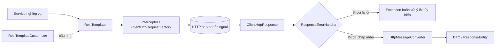
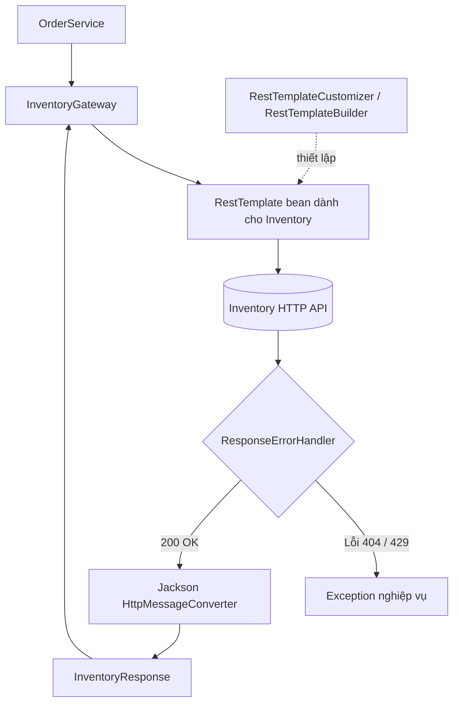

# RestTemplateCustomizer, ResponseErrorHandler và chuyển đổi dữ liệu

## 1. Ba điểm mở rộng của HTTP client đồng bộ

Trong module **SPRING_BOOT_INTEGRATION**, một ứng dụng Spring Boot thường gọi các dịch vụ bên ngoài để lấy tồn kho, tính phí vận chuyển, xác minh khách hàng hoặc gửi yêu cầu sang hệ thống thanh toán. Với HTTP đồng bộ, `RestTemplate` là một client phổ biến, đặc biệt trong hệ thống đã tồn tại từ trước; `RestClient` là API đồng bộ có kiểu viết fluent ở các phiên bản Spring Framework mới hơn.

Một lời gọi HTTP có ba nhóm công việc dễ bị trộn lẫn:

1. **Cấu hình client trước khi sử dụng:** endpoint gốc, timeout, interceptor, authentication, request factory và các thành phần dùng chung.
2. **Phân loại kết quả HTTP:** phản hồi nào là lỗi và lỗi đó được chuyển thành exception nào.
3. **Chuyển đổi dữ liệu:** Java object thành JSON/form khi gửi và JSON/text/bytes thành Java object khi nhận.

Spring Boot và Spring Framework hỗ trợ ba điểm mở rộng tương ứng:

| Thành phần | Vị trí tác động | Câu hỏi mà thành phần giải quyết |
| --- | --- | --- |
| `RestTemplateCustomizer` | Khi khởi tạo/cấu hình `RestTemplate` qua builder | Client có interceptor, error handler hoặc converter nào? |
| `ResponseErrorHandler` | Sau khi nhận HTTP status, trước khi trích xuất response thông thường | Phản hồi `404`, `429`, `500` cần được hiểu là lỗi gì? |
| `HttpMessageConverter<?>` | Khi ghi request body hoặc đọc response body | `application/json` được ánh xạ sang DTO nào, với charset/media type nào? |

Đây là những cơ chế ở **ranh giới HTTP**. Chúng không làm HTTP trở thành một phần của giao dịch database, cũng không tự đảm bảo retry, idempotency hay gửi thông điệp qua broker đúng một lần.



Một điểm quan trọng trong sơ đồ: `ResponseErrorHandler` **không** xử lý lỗi không nhận được phản hồi HTTP (DNS, kết nối bị từ chối, socket timeout). Những lỗi đó thường xuất hiện ở tầng vận chuyển dưới dạng `ResourceAccessException` hoặc exception liên quan. Chỉ khi có `ClientHttpResponse` mới có status để phân loại.

## 2. Cấu hình qua RestTemplateBuilder và RestTemplateCustomizer

### 2.1. Vì sao nên dùng builder của Spring Boot?

Thay vì tạo `new RestTemplate()` ở nhiều nơi, Spring Boot thường cung cấp bean `RestTemplateBuilder` để xây dựng client với cấu hình nhất quán. Builder có thể nhận các `RestTemplateCustomizer` bean được ứng dụng đăng ký, đồng thời duy trì các thành phần liên quan đến cấu hình HTTP.

Ví dụ Spring Boot 3.x / Spring Framework 6.x, Java 17+ (chú ý tên API có thể đổi ở các phiên bản major khác):

```java
import java.time.Duration;

import org.springframework.beans.factory.annotation.Qualifier;
import org.springframework.boot.web.client.RestTemplateBuilder;
import org.springframework.context.annotation.Bean;
import org.springframework.context.annotation.Configuration;
import org.springframework.web.client.RestTemplate;

@Configuration(proxyBeanMethods = false)
public class InventoryHttpConfiguration {

    @Bean("inventoryRestTemplate")
    RestTemplate inventoryRestTemplate(RestTemplateBuilder builder) {
        return builder
                .rootUri("https://inventory.example.test")
                .setConnectTimeout(Duration.ofSeconds(2))
                .setReadTimeout(Duration.ofSeconds(5))
                .build();
    }
}
```

Inject đúng instance vào client nghiệp vụ:

```java
import org.springframework.beans.factory.annotation.Qualifier;
import org.springframework.stereotype.Service;
import org.springframework.web.client.RestTemplate;

@Service
public class InventoryGateway {
    private final RestTemplate restTemplate;

    public InventoryGateway(
            @Qualifier("inventoryRestTemplate") RestTemplate restTemplate) {
        this.restTemplate = restTemplate;
    }

    public InventoryResponse getStock(String sku) {
        return restTemplate.getForObject(
                "/inventory/{sku}", InventoryResponse.class, sku);
    }
}
```

`rootUri(...)` có thể áp dụng cho các URL dạng chuỗi bắt đầu bằng `/` khi dùng những phương thức thích hợp của `RestTemplate`. Nếu truyền một `URI` tuyệt đối, hành vi thêm root URI có thể không được áp dụng; hãy kiểm tra URI cuối cùng trong test.

**Timeout cần phân biệt:** connect timeout giới hạn bước thiết lập kết nối; read timeout giới hạn chờ đọc dữ liệu theo request factory được chọn. Những timeout này không tự tạo ra một **deadline tổng** cho toàn bộ quy trình gồm DNS, retry, request, response và xử lý nghiệp vụ. Với pooling, có thể còn timeout chờ lấy connection. Khả năng hỗ trợ và tên phương thức cấu hình request factory thay đổi theo Spring Boot, Spring Framework và thư viện HTTP bên dưới; cần kiểm tra đúng stack đang chạy.

### 2.2. RestTemplateCustomizer tác động tới client nào?

Một bean `RestTemplateCustomizer` cho phép bổ sung cấu hình vào mỗi `RestTemplate` do **builder được Spring Boot cấu hình** tạo ra. Ví dụ thêm header định danh hệ thống gọi:

```java
import org.springframework.boot.web.client.RestTemplateCustomizer;
import org.springframework.context.annotation.Bean;
import org.springframework.context.annotation.Configuration;

@Configuration(proxyBeanMethods = false)
public class SharedHttpCustomization {

    @Bean
    RestTemplateCustomizer callerHeaderCustomizer() {
        return restTemplate -> restTemplate.getInterceptors().add(
                (request, body, execution) -> {
                    request.getHeaders().set(
                            "X-Caller-Service", "order-service");
                    return execution.execute(request, body);
                });
    }
}
```

Dùng `set` thay vì `add` khi header này chỉ được phép có một giá trị. Interceptor chạy mỗi khi request được gửi, không phải chỉ một lần lúc khởi tạo client. Cấu hình chỉ nên được thêm một lần; tránh tự thêm interceptor khác nhau cho cùng `RestTemplate` ở mỗi request.

**Phạm vi quan trọng:** `callerHeaderCustomizer` là bean dùng chung và có thể được Spring Boot áp dụng cho **mọi** `RestTemplate` xây dựng từ auto-configured `RestTemplateBuilder`. Đừng đặt secret, API key hoặc quy tắc chuyên biệt của một đối tác vào global customizer nếu ứng dụng kết nối nhiều đối tác khác nhau.

Nếu cấu hình chỉ dành cho inventory API, dùng customizer **riêng trên builder của client đó**:

```java
@Bean("inventoryRestTemplate")
RestTemplate inventoryRestTemplate(RestTemplateBuilder builder) {
    RestTemplateCustomizer inventoryCustomizer = template ->
            template.getInterceptors().add(
                    (request, body, execution) -> {
                        request.getHeaders().set(
                                "X-Partner-Application", "inventory-client");
                        return execution.execute(request, body);
                    });

    return builder
            .rootUri("https://inventory.example.test")
            .additionalCustomizers(inventoryCustomizer)
            .build();
}
```

Đoạn này là **biến thể** của phương thức tạo bean `inventoryRestTemplate` ở trên, không dùng cả hai phương thức cùng tên trong một cấu hình. `additionalCustomizers` bổ sung customizer vào những cấu hình builder đang có; còn những phương thức thay thế toàn bộ danh sách customizer có thể làm mất thiết lập khác của hệ thống.

### 2.3. Nên cấu hình gì ở đâu?

| Yêu cầu | Chỗ phù hợp | Lưu ý |
| --- | --- | --- |
| Base URL từng đối tác | `RestTemplateBuilder.rootUri(...)` hoặc properties đưa vào builder | Không tự ghép URL từ dữ liệu người dùng nếu chưa kiểm soát host/path |
| Timeout / request factory | Builder hoặc cấu hình factory tương ứng | Xác nhận hỗ trợ với thư viện HTTP đang dùng |
| Header gắn với mọi request của một client | `ClientHttpRequestInterceptor` trong customizer riêng | Không ghi token nhạy cảm vào log |
| Header thay đổi theo từng nghiệp vụ | `HttpEntity` / `RequestEntity` tại nơi gọi | Ví dụ idempotency key, correlation ID |
| Lỗi HTTP chung của một đối tác | `ResponseErrorHandler` gắn lên client riêng | Đừng áp dụng luật `404` cho mọi dịch vụ một cách mù quáng |
| JSON mapper / media type | `HttpMessageConverter`, Jackson mapper hoặc annotation DTO | Hạn chế thay tất cả converter mặc định |
| Quan sát trace/metrics | Observation/tracing config tương ứng với Boot version | Interceptor thủ công không tự thay thế hệ thống trace chuẩn |

`RestTemplate` có thể được dùng đồng thời khi **cấu hình đã ổn định**, nhưng đừng sửa danh sách interceptor, converter hoặc error handler giữa lúc nhiều thread đang gọi. Đặt việc cấu hình tại thời điểm khởi tạo bean.

## 3. ResponseErrorHandler: khi nào phản hồi là lỗi?

### 3.1. Hành vi mặc định

`RestTemplate` mặc định sử dụng `DefaultResponseErrorHandler`. Theo thông lệ, response thuộc nhóm **4xx và 5xx** được coi là lỗi; client sẽ ném exception phù hợp, chẳng hạn:

- `HttpClientErrorException.NotFound` cho `404 Not Found`;
- `HttpClientErrorException.TooManyRequests` cho `429 Too Many Requests` khi phiên bản hỗ trợ;
- `HttpServerErrorException.ServiceUnavailable` cho `503 Service Unavailable`;
- các exception tổng quát hơn khi status không có lớp con chuyên biệt.

Từ phía service gọi đối tác, HTTP `404` không nhất thiết có nghĩa toàn bộ quy trình đã thất bại: đôi khi nó là kết quả “chưa tồn tại sản phẩm”; ngược lại, `503` thường là sự cố tạm thời. Tuy nhiên **không nên thay `hasError` để toàn bộ `404` bị coi là thành công** nếu API không trả body theo schema thành công. Làm vậy có thể khiến `HttpMessageConverter` cố đọc HTML/error JSON vào DTO thành công và sinh lỗi khó hiểu.

Một `ResponseErrorHandler` có hai quyết định:

1. `hasError(ClientHttpResponse)`: response này cần đi vào nhánh xử lý lỗi không?
2. `handleError(...)`: khi là lỗi, phải ném hoặc xử lý theo chính sách nào?

Thông thường, tùy chỉnh **mapping của status cụ thể** trong `handleError(...)` và giữ hành vi mặc định cho các status khác.

### 3.2. Ví dụ error handler cho inventory API

Đối tác định nghĩa:
- `404`: SKU không tồn tại;
- `429`: quá hạn mức, có thể kèm `Retry-After`;
- các `4xx/5xx` khác: tiếp tục dùng exception HTTP mặc định, giữ nguyên khả năng chẩn đoán status/body.

Có thể kế thừa `DefaultResponseErrorHandler` để chỉ tùy chỉnh hai status trên:

```java
import java.io.IOException;
import java.net.URI;

import org.springframework.http.HttpHeaders;
import org.springframework.http.HttpMethod;
import org.springframework.http.client.ClientHttpResponse;
import org.springframework.web.client.DefaultResponseErrorHandler;

public final class InventoryResponseErrorHandler
        extends DefaultResponseErrorHandler {

    @Override
    public void handleError(
            URI url, HttpMethod method, ClientHttpResponse response)
            throws IOException {

        int status = response.getStatusCode().value();

        if (status == 404) {
            throw new InventoryNotFoundException(
                    "Không tìm thấy dữ liệu inventory tại " + url.getPath());
        }

        if (status == 429) {
            String retryAfter =
                    response.getHeaders().getFirst(HttpHeaders.RETRY_AFTER);
            throw new InventoryRateLimitedException(retryAfter);
        }

        // Giữ nguyên cách Spring phân loại các lỗi còn lại.
        super.handleError(url, method, response);
    }
}
```

Ví dụ exception nghiệp vụ:

```java
public final class InventoryNotFoundException extends RuntimeException {
    public InventoryNotFoundException(String message) {
        super(message);
    }
}

public final class InventoryRateLimitedException extends RuntimeException {
    private final String retryAfter;

    public InventoryRateLimitedException(String retryAfter) {
        super("Inventory API đang giới hạn yêu cầu");
        this.retryAfter = retryAfter;
    }

    public String retryAfter() {
        return retryAfter;
    }
}
```

Gắn handler **chỉ vào inventory RestTemplate** bằng builder:

```java
@Bean("inventoryRestTemplate")
RestTemplate inventoryRestTemplate(RestTemplateBuilder builder) {
    return builder
            .rootUri("https://inventory.example.test")
            .setConnectTimeout(Duration.ofSeconds(2))
            .setReadTimeout(Duration.ofSeconds(5))
            .errorHandler(new InventoryResponseErrorHandler())
            .build();
}
```

Đây cũng là một **phiên bản thay thế** cho bean cùng tên ở phần 2. Trong ứng dụng thật, hợp nhất cấu hình root URI, timeout, interceptor và error handler trong một nơi.

Nhờ gọi `super.handleError(...)`, cách xử lý các HTTP lỗi khác vẫn được Spring duy trì. Không nên tự ném một `RuntimeException("HTTP lỗi")` cho tất cả status, vì như vậy sẽ đánh mất các thông tin có ích như status code, response headers và response body mà exception mặc định thường bảo toàn.

**Quan trọng về hợp đồng:** ví dụ chỉ đúng nếu `404` có cùng ý nghĩa ở tất cả endpoint được dùng bởi `inventoryRestTemplate`. Nếu một endpoint trả `404` với ý nghĩa khác, hãy tách client/handler hoặc ánh xạ lỗi ở lớp gateway theo từng thao tác.

### 3.3. Lỗi nào error handler không nhìn thấy?

| Tình huống | Có `ClientHttpResponse`? | Nơi cần xử lý |
| --- | --- | --- |
| Server trả `404/429/500` | Có | `ResponseErrorHandler` và chính sách nghiệp vụ |
| Server trả `200` nhưng JSON sai schema | Có | `HttpMessageConverter` hoặc validation DTO |
| Kết nối DNS/TCP thất bại | Thường không | `ResourceAccessException`, timeout, retry/recovery |
| TLS handshake lỗi | Không có HTTP response hợp lệ | Cấu hình TLS, truststore/certificate, transport exception |
| Đọc response đang dở thì socket đóng | Không bảo đảm response hoàn chỉnh | Exception I/O, ghi nhận kết quả chưa xác định nếu là side effect |
| HTTP `202 Accepted` | Có, thường không bị coi là lỗi | Ứng dụng cần tự theo dõi tiến độ nghiệp vụ |

Khi nhận `429`, `Retry-After` có thể là số giây **hoặc HTTP-date**, không nhất thiết là số nguyên. Header có thể thiếu hoặc sai; phải kiểm tra, giới hạn thời gian chờ và kết hợp retry budget. Đừng áp dụng retry tự động cho POST có side effect nếu không có idempotency key và cơ chế đối soát.

### 3.4. Tránh đọc response body hai lần

`ClientHttpResponse.getBody()` thường cung cấp một stream chỉ đọc theo chiều tiến. Nếu custom error handler tự đọc hết body để log rồi chuyển tiếp cho default handler hoặc tầng khác, stream có thể đã bị tiêu thụ.

Hướng xử lý:
- Chỉ đọc nội dung lỗi khi thực sự cần; áp dụng giới hạn bytes, lọc thông tin nhạy cảm, chọn exception chứa dữ liệu cần thiết.
- Nếu cần đọc lặp, cân nhắc buffering request factory phù hợp và đánh giá chi phí bộ nhớ; không bật buffering vô điều kiện cho response lớn.
- Nếu body lỗi có schema riêng (chẳng hạn `{"code":"LIMIT_EXCEEDED"}`), chuyển đổi bằng Jackson trong error handler/gateway một cách có kiểm soát; **đừng giả định** các converter thành công sẽ tự deserialize body lỗi sau khi handler ném exception.
- Một gateway chuyên biệt đôi khi nên dùng `RestClient` và `onStatus(...)` theo request nếu nhu cầu phân loại lỗi khác nhau theo endpoint; với `RestTemplate`, ưu tiên handler/gateway rõ phạm vi.

## 4. HttpMessageConverter: Java object ↔ HTTP body

`RestTemplate` không tự dùng `ObjectMapper` cho mọi loại response. Nó duyệt các `HttpMessageConverter<?>` được cấu hình để tìm converter hỗ trợ **kiểu Java** và **media type** thích hợp.

Ví dụ một số converter phổ biến:

| Converter | Nhiệm vụ | Media type ví dụ |
| --- | --- | --- |
| `MappingJackson2HttpMessageConverter` | Java object ↔ JSON qua Jackson | `application/json`, các dạng `application/*+json` phù hợp |
| `StringHttpMessageConverter` | Chuỗi ↔ text | `text/plain` và các kiểu text được hỗ trợ |
| `ByteArrayHttpMessageConverter` | Byte array ↔ raw body | `application/octet-stream` và các media type cho phép |
| `ResourceHttpMessageConverter` | Đọc/ghi tài nguyên nhị phân phù hợp | File, resource stream |
| `FormHttpMessageConverter` | Xử lý form URL-encoded; có thể kết hợp multipart với thành phần phù hợp | `application/x-www-form-urlencoded`, `multipart/form-data` |

Converter có thể được chọn theo thứ tự đăng ký. Nếu thêm converter tùy biến hỗ trợ quá rộng và đặt lên đầu danh sách, nó có thể “chiếm” request mà converter mặc định xử lý đúng trước đây.

### 4.1. Accept khác Content-Type

- `Content-Type` của **request** nói body mà client đang **gửi** được mã hóa theo kiểu nào.
- `Accept` của **request** nói client mong muốn server **trả** những kiểu nội dung nào.
- `Content-Type` của **response** cho biết media type của body **nhận về**, giúp chọn converter đọc.
- `Accept` không buộc mọi server tuân thủ: client cần kiểm tra response thực tế, kể cả khi server trả HTML/error text thay vì JSON.

Ví dụ POST với JSON body và JSON response:

```java
import java.util.List;

import org.springframework.http.HttpEntity;
import org.springframework.http.HttpHeaders;
import org.springframework.http.HttpMethod;
import org.springframework.http.MediaType;
import org.springframework.http.ResponseEntity;

public ReservationResponse reserve(ReserveRequest request) {
    HttpHeaders headers = new HttpHeaders();
    headers.setContentType(MediaType.APPLICATION_JSON);
    headers.setAccept(List.of(MediaType.APPLICATION_JSON));
    headers.set("Idempotency-Key", request.orderId());

    HttpEntity<ReserveRequest> entity =
            new HttpEntity<>(request, headers);

    ResponseEntity<ReservationResponse> response = restTemplate.exchange(
            "/reservations", HttpMethod.POST, entity,
            ReservationResponse.class);

    return response.getBody();
}
```

DTO có thể dùng Java record:

```java
public record ReserveRequest(
        String orderId, String sku, int quantity) {}

public record ReservationResponse(
        String reservationId, String status) {}
```

Trong production, không nên mặc định body luôn khác `null`. Nếu endpoint cam kết trả body, kiểm tra null và chuyển thành lỗi hợp đồng rõ ràng. Nếu trả `204 No Content`, hãy dùng một contract không đòi hỏi DTO. Với idempotency key, cùng một thao tác retry phải dùng cùng khóa ổn định do nghiệp vụ quản lý; có header thôi chưa ngăn server tạo side effect lặp.

### 4.2. Đọc JSON thành DTO khi tên field khác Java

Giả sử upstream trả:

```json
{
  "product_code": "SKU-001",
  "available_quantity": 8,
  "warehouse": "HN"
}
```

DTO chỉ cần hai field đầu:

```java
import com.fasterxml.jackson.annotation.JsonIgnoreProperties;
import com.fasterxml.jackson.annotation.JsonProperty;

@JsonIgnoreProperties(ignoreUnknown = true)
public record InventoryResponse(
        @JsonProperty("product_code") String productCode,
        @JsonProperty("available_quantity") int availableQuantity) {}
```

Jackson converter sẽ dùng annotation để ánh xạ `product_code` → `productCode` và `available_quantity` → `availableQuantity`. `@JsonIgnoreProperties(ignoreUnknown = true)` cho phép một số field bổ sung như `warehouse` mà không làm hỏng hợp đồng client.

Hãy áp dụng chính sách này có chủ đích. Nếu hợp đồng yêu cầu phát hiện mọi thay đổi field, bỏ qua field lạ trên tất cả DTO có thể che giấu regression. Cũng cần validation khi server trả thiếu field bắt buộc: một kiểu nguyên thủy `int` có thể nhận giá trị mặc định `0`, gây nhầm **thiếu thông tin** với **hết hàng**. Dùng `Integer` kết hợp kiểm tra null, hoặc validation có cấu hình phù hợp khi cần phân biệt rõ.

### 4.3. Collection và generic type

Dùng `List.class` khi gọi API danh sách thường làm mất kiểu phần tử ở thời điểm deserialize. Với `RestTemplate`, dùng `ParameterizedTypeReference`:

```java
import java.util.List;

import org.springframework.core.ParameterizedTypeReference;
import org.springframework.http.HttpEntity;
import org.springframework.http.HttpMethod;
import org.springframework.http.ResponseEntity;

ParameterizedTypeReference<List<InventoryResponse>> responseType =
        new ParameterizedTypeReference<>() {};

ResponseEntity<List<InventoryResponse>> response =
        restTemplate.exchange(
                "/inventory",
                HttpMethod.GET,
                HttpEntity.EMPTY,
                responseType);

List<InventoryResponse> inventoryItems = response.getBody();
```

`ParameterizedTypeReference` lưu thông tin generic type để converter dựa trên Jackson biết rằng phần tử là `InventoryResponse`. Vẫn cần xử lý body rỗng/null theo hợp đồng của endpoint.

### 4.4. Thêm converter riêng mà không làm mất mặc định

Một số đối tác trả content type không chuẩn, ví dụ `application/vnd.vendor.inventory+json`, hoặc cần một Jackson `ObjectMapper` có module riêng. Nếu cấu hình mapper chung của ứng dụng đã phù hợp, ưu tiên tái sử dụng thay vì tạo mapper hoàn toàn độc lập.

Ví dụ cấu hình converter riêng cho một `RestTemplate`:

```java
import java.util.List;

import com.fasterxml.jackson.databind.ObjectMapper;
import org.springframework.http.MediaType;
import org.springframework.http.converter.json.MappingJackson2HttpMessageConverter;

MappingJackson2HttpMessageConverter inventoryJson =
        new MappingJackson2HttpMessageConverter(objectMapper);

inventoryJson.setSupportedMediaTypes(List.of(
        MediaType.APPLICATION_JSON,
        MediaType.valueOf("application/vnd.vendor.inventory+json")));

RestTemplate inventoryRestTemplate = builder
        .rootUri("https://inventory.example.test")
        .additionalMessageConverters(inventoryJson)
        .build();
```

Ở đây `objectMapper` là instance Jackson đã được cấu hình hoặc inject. Đoạn này **minh họa thêm converter**, không phải một bean hoàn chỉnh; trong thực tế hãy hợp nhất với timeout, error handler và các tùy chỉnh khác. Kiểm tra thứ tự converter sau khi xây dựng: nếu một converter JSON khác đứng trước và cũng hỗ trợ media type cùng kiểu Java, nó có thể được chọn trước converter mới. Khi thật sự cần ưu tiên hoặc thay thế converter, cấu hình danh sách theo chủ đích và kiểm thử media type tương ứng.

Đặc biệt phân biệt:
- `messageConverters(...)` trên `RestTemplateBuilder` dùng để **thiết lập danh sách converter**; cần hiểu ảnh hưởng thay thế các converter mặc định theo version đang dùng.
- `additionalMessageConverters(...)` dùng để **bổ sung** converter; tránh làm mất converter form, string hoặc binary đang hoạt động.
- Thay trực tiếp `restTemplate.setMessageConverters(...)` sau khi client đã dùng có thể gây thay đổi hành vi không mong đợi cho nhiều thread.

Nếu server trả `text/plain` nhưng body thực chất là JSON, sửa hợp đồng phía server là lựa chọn tốt nhất. Nếu không thể sửa, dùng một converter hỗ trợ chính xác kiểu nội dung đó hoặc đọc `String` rồi parse tại lớp adapter có test; không bật khả năng parse JSON từ tất cả media type một cách tùy tiện.

## 5. Một ví dụ thống nhất: endpoint tồn kho với xử lý dữ liệu và lỗi

Ta cần gọi `GET /inventory/{sku}` từ ứng dụng đặt hàng. Hợp đồng đối tác quy định:

- `200 + application/json`: trả `InventoryResponse`.
- `404`: sản phẩm không có trong hệ thống đối tác.
- `429`: bị giới hạn, có thể có `Retry-After`.
- `503`: dịch vụ tạm thời không sẵn sàng.
- Socket timeout: có thể chưa biết downstream đã xử lý gì nếu request tạo side effect; riêng GET ở ví dụ này có thể retry theo chính sách.

Tổ chức code:



Gateway chỉ giữ trách nhiệm chuyển đổi HTTP contract thành đối tượng/exception nghiệp vụ:

```java
import java.util.List;
import java.util.Objects;

import org.springframework.beans.factory.annotation.Qualifier;
import org.springframework.http.HttpEntity;
import org.springframework.http.HttpHeaders;
import org.springframework.http.HttpMethod;
import org.springframework.http.MediaType;
import org.springframework.stereotype.Component;
import org.springframework.web.client.RestTemplate;

@Component
public final class InventoryGateway {
    private final RestTemplate restTemplate;

    public InventoryGateway(
            @Qualifier("inventoryRestTemplate") RestTemplate restTemplate) {
        this.restTemplate = restTemplate;
    }

    public InventoryResponse loadAvailability(String sku) {
        HttpHeaders headers = new HttpHeaders();
        headers.setAccept(List.of(MediaType.APPLICATION_JSON));

        InventoryResponse body = restTemplate.exchange(
                "/inventory/{sku}",
                HttpMethod.GET,
                new HttpEntity<>(headers),
                InventoryResponse.class,
                sku).getBody();

        return Objects.requireNonNull(
                body, "Inventory API trả body rỗng cho SKU " + sku);
    }
}
```

Đây là một ví dụ **độc lập** thay thế phương thức `InventoryGateway.getStock` minh họa ở phần 2; khi triển khai thật nên giữ một gateway duy nhất cho mỗi nhóm endpoint. Tránh đưa mọi exception thành `null` vì sẽ làm lớp nghiệp vụ đánh đồng “không có SKU”, “server hỏng” và “schema sai”.

Với Spring Boot 3.x, có thể để Boot xây dựng `RestTemplateBuilder`, inject vào bean config và gắn `InventoryResponseErrorHandler` như phần 3. Thông tin base URL, timeout, xác thực nên đặt ở properties có type an toàn, chẳng hạn `@ConfigurationProperties`, rồi kiểm tra ở lúc khởi động.

## 6. Kiểm thử cả ba thành phần bằng MockRestServiceServer

`MockRestServiceServer` của `spring-test` phù hợp với `RestTemplate` vì nó nhận request do client tạo ra, so khớp method/URI/headers và trả response giả lập. Không cần gọi mạng thật, nhưng vẫn chạy đường đi từ `RestTemplate` qua error handler và converter.

Ví dụ kiểm thử handler `404` cùng việc deserialize response JSON:

```java
import static org.assertj.core.api.Assertions.assertThat;
import static org.assertj.core.api.Assertions.assertThatThrownBy;
import static org.springframework.test.web.client.match.MockRestRequestMatchers.*;
import static org.springframework.test.web.client.response.MockRestResponseCreators.*;

import org.junit.jupiter.api.BeforeEach;
import org.junit.jupiter.api.Test;
import org.springframework.boot.web.client.RestTemplateBuilder;
import org.springframework.http.HttpMethod;
import org.springframework.http.MediaType;
import org.springframework.test.web.client.MockRestServiceServer;
import org.springframework.web.client.RestTemplate;

class InventoryGatewayTest {

    private MockRestServiceServer mockServer;
    private InventoryGateway gateway;

    @BeforeEach
    void setUp() {
        RestTemplate template = new RestTemplateBuilder()
                .rootUri("https://inventory.example.test")
                .errorHandler(new InventoryResponseErrorHandler())
                .build();

        mockServer = MockRestServiceServer.bindTo(template).build();
        gateway = new InventoryGateway(template);
    }

    @Test
    void readsJsonIntoInventoryDto() {
        mockServer.expect(requestTo(
                    "https://inventory.example.test/inventory/SKU-001"))
                .andExpect(method(HttpMethod.GET))
                .andRespond(withSuccess(
                        """
                        {
                          "product_code": "SKU-001",
                          "available_quantity": 8,
                          "warehouse": "HN"
                        }
                        """,
                        MediaType.APPLICATION_JSON));

        InventoryResponse result =
                gateway.loadAvailability("SKU-001");

        assertThat(result.productCode()).isEqualTo("SKU-001");
        assertThat(result.availableQuantity()).isEqualTo(8);
        mockServer.verify();
    }

    @Test
    void maps404IntoDomainException() {
        mockServer.expect(requestTo(
                    "https://inventory.example.test/inventory/NO-SKU"))
                .andExpect(method(HttpMethod.GET))
                .andRespond(withResourceNotFound());

        assertThatThrownBy(() -> gateway.loadAvailability("NO-SKU"))
                .isInstanceOf(InventoryNotFoundException.class);

        mockServer.verify();
    }
}
```

Mục đích của hai test khác nhau:

- Test `200` chứng minh converter thực sự đọc JSON có tên trường snake_case vào record và bỏ qua một trường không cần thiết.
- Test `404` chứng minh error handler chặn response lỗi rồi phát exception nghiệp vụ.
- `mockServer.verify()` xác minh request đã được gọi đúng số lần. Nếu muốn bắt cả lỗi thiếu header, bổ sung `andExpect(header(...))`.
- `MockRestServiceServer` không tạo kết nối HTTP thật, nên các test này **không chứng minh** connect timeout, TLS, connection pool hoặc DNS hoạt động đúng. Để kiểm tra transport thực, dùng WireMock/MockWebServer hoặc server test trên loopback.

Có thể bổ sung case `429` với header `Retry-After` và case `503` để xác minh default handler không bị vô tình bỏ qua:

```java
@Test
void keepsDefault503Mapping() {
    mockServer.expect(requestTo(
                "https://inventory.example.test/inventory/SKU-503"))
            .andRespond(withServerError());

    assertThatThrownBy(() -> gateway.loadAvailability("SKU-503"))
            .isInstanceOf(
                    org.springframework.web.client.HttpServerErrorException.class);

    mockServer.verify();
}
```

Đoạn trên là **một test bổ sung** đặt trong cùng class test. Khi các test lệ thuộc cấu hình Boot của ứng dụng (customizer bean, converter tùy biến, authentication), cần kiểm thử builder/bean trong Spring context hoặc dùng `@RestClientTest` với cấu hình phù hợp, thay vì tạo client đơn giản từ `new RestTemplateBuilder()` rồi mặc định kết luận toàn bộ auto-configuration đã được kiểm tra.

## 7. Những sai sót thường gặp và cách nhận diện

| Sai sót | Biểu hiện | Cách khắc phục |
| --- | --- | --- |
| Đăng ký `RestTemplateCustomizer` nhưng tạo client bằng `new RestTemplate()` | Interceptor hoặc converter không có hiệu lực | Dùng builder của Spring Boot; test đúng bean được dùng |
| Đăng ký global customizer chứa header của một partner | Header đi sang partner khác, gây rò rỉ token | Scope customizer theo client; sử dụng cấu hình xác thực riêng |
| Ghi đè `setMessageConverters` bằng chỉ một JSON converter | Text/form/binary request đang chạy bị lỗi | Bổ sung converter có chủ đích và kiểm tra thứ tự |
| Custom error handler trả `hasError=false` cho toàn bộ `4xx` | HTML/error JSON bị parse như response thành công | Giữ status lỗi và map sang exception hoặc kết quả rõ ràng |
| Tự đọc error body rồi để default handler đọc lại | Body lỗi trống/mất thông tin | Đọc một lần, hạn chế buffering và ghi log có kiểm soát |
| Chỉ nhìn HTTP `200` để kết luận nghiệp vụ thành công | DTO thiếu field, lỗi nghiệp vụ nằm trong body | Validation DTO và kiểm tra mã trạng thái nghiệp vụ |
| Dùng `List.class` để đọc danh sách DTO | Phần tử bị deserialize thành map | Dùng `ParameterizedTypeReference<List<MyDto>>` |
| Đặt connect/read timeout nhưng vẫn chờ lâu | Retry, pool wait, DNS, xử lý dài ngoài phạm vi timeout | Xác định deadline tổng và nguồn chậm thực tế |
| Retry POST ngay sau socket timeout | Có thể tạo side effect trùng tại downstream | Dùng idempotency key và cơ chế tra cứu/đối soát |
| Giữ `@Transactional` DB trong suốt HTTP call | Transaction/connection/lock kéo dài | Tách giao dịch DB ngắn khỏi outbound HTTP |

Đặc biệt, `ResponseErrorHandler` chỉ nhìn **trạng thái HTTP**. Nếu đối tác trả `200 OK` với body kiểu `{"success":false,"errorCode":"OUT_OF_STOCK"}`, việc diễn giải `success=false` thuộc lớp gateway/service sau deserialize. Việc kiểm tra dữ liệu ràng buộc nghiệp vụ không được giao hoàn toàn cho error handler.

## 8. Vận hành: retry, timeout, quan sát và bảo mật

Khi đưa RestTemplate vào quy trình tích hợp thực tế, cần phối hợp các thành phần:

1. **Timeout được đo và thử đúng:** connect/read timeout, thời gian chờ pool nếu có, retry budget và giới hạn thời gian tổng phải nhất quán với SLA của API bên ngoài.
2. **Lỗi phân loại rõ:** `404`, `409`, `429`, `503` có thể mang ý nghĩa khác nhau theo endpoint; không coi mọi `5xx` là “chắc chắn chưa xử lý”.
3. **Retry có kiểm soát:** chỉ retry tự động khi thao tác idempotent hoặc downstream hỗ trợ idempotency. Với thanh toán, không đổi operation ID mỗi lần thử và cần trạng thái “chưa xác định” sau timeout.
4. **Log an toàn:** log endpoint/path đã lọc, status, thời lượng và correlation ID; hạn chế log headers chứa `Authorization`/`Cookie` và body chứa dữ liệu nhạy cảm.
5. **Chuyển đổi dữ liệu rõ hợp đồng:** validate content type, JSON schema/DTO, enum, ngày giờ, nullability và kích thước response; có giới hạn cho response lớn/stream.
6. **Ranh giới giao dịch:** không chờ hệ thống ngoài trong transaction DB đã giữ khóa hoặc connection. Nếu cần đảm bảo gửi message bền vững sau DB commit, cân nhắc outbox/worker độc lập.
7. **Quan sát theo đối tác:** theo dõi latency p95/p99, số response theo nhóm status, timeout, lỗi deserialize, số retry, tỷ lệ circuit breaker mở và trạng thái downstream.

Không cần thiết đặt `@Transactional` trên chính phương thức gateway HTTP chỉ để “đảm bảo an toàn” khi gọi đối tác. Spring transaction manager cho JDBC/JPA không biến request HTTP thành giao dịch ACID chung với database.

## 9. Checklist trước khi hoàn thành một HTTP adapter

- Dùng `RestTemplateBuilder` được cấu hình đúng và inject **một client có phạm vi rõ ràng** vào gateway.
- Xác định customizer nào áp dụng toàn ứng dụng, customizer nào áp dụng riêng cho endpoint/đối tác.
- Đảm bảo timeout phù hợp với request factory và đã có cách kiểm tra timeout thực.
- Ánh xạ những status cần thiết bằng `ResponseErrorHandler`, giữ thông tin mặc định cho những status còn lại.
- Phân biệt lỗi có HTTP response với lỗi transport chưa có response.
- Chọn converter theo `Content-Type`, `Accept` và kiểu DTO; dùng generic type token khi cần.
- Kiểm tra thiếu body, field bất ngờ, nullability, enum và lỗi parse ngoài happy path.
- Kiểm thử request, response, handler và converter bằng `MockRestServiceServer`; dùng HTTP test server cho những thuộc tính mạng thật.
- Bảo vệ dữ liệu nhạy cảm và thiết kế retry/idempotency ở lớp nghiệp vụ tương ứng.

**Điều cần nhớ:** `RestTemplateCustomizer` quyết định **client được thiết lập như thế nào**; `ResponseErrorHandler` quyết định **status HTTP nào là lỗi và lỗi đó được biểu diễn ra sao**; `HttpMessageConverter` quyết định **body được chuyển đổi thế nào**. Ba điểm mở rộng này nên được kiểm thử phối hợp trên cùng một `RestTemplate`, đồng thời giữ rõ ranh giới với transaction, retry và trạng thái nghiệp vụ.

### Tài liệu tham khảo

- [Spring Boot API — RestTemplateCustomizer](https://docs.spring.io/spring-boot/api/java/org/springframework/boot/web/client/RestTemplateCustomizer.html).
- [Spring Boot API — RestTemplateBuilder](https://docs.spring.io/spring-boot/api/java/org/springframework/boot/web/client/RestTemplateBuilder.html).
- [Spring Framework API — ResponseErrorHandler](https://docs.spring.io/spring-framework/docs/current/javadoc-api/org/springframework/web/client/ResponseErrorHandler.html).
- [Spring Framework Reference — REST Clients](https://docs.spring.io/spring-framework/reference/integration/rest-clients.html).
- [Spring Framework Reference — HTTP Message Conversion](https://docs.spring.io/spring-framework/reference/integration/rest-clients.html#rest-message-conversion).
