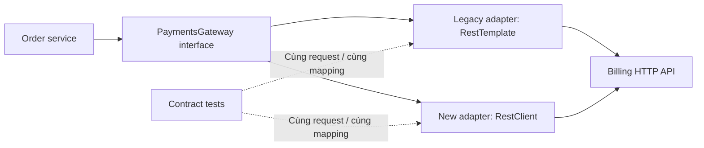
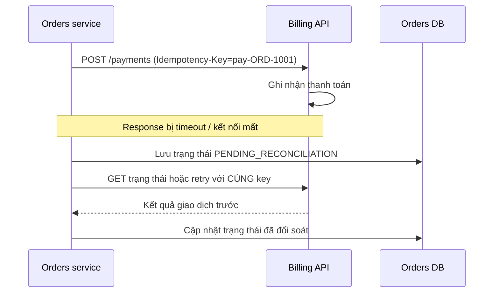

# Chuyển dần từ RestTemplate sang RestClient mà vẫn giữ hợp đồng

## 1. Bối cảnh: đổi HTTP client không được làm đổi hành vi tích hợp

Trong **Spring Boot Integration**, một service có thể đọc đơn hàng từ cơ sở dữ liệu, gọi HTTP API đối tác để thanh toán, ghi kết quả, phát sự kiện qua RabbitMQ/Kafka và cập nhật cache. Dù ứng dụng dùng `RestTemplate` hay `RestClient`, hệ thống đối tác vẫn quan tâm đến **HTTP request thực tế nhận được** và **cách ứng dụng phản ứng với HTTP response**, không quan tâm đoạn Java nào đã tạo request.

Giả sử service đang gửi:

```http
POST /api/v1/payments HTTP/1.1
Host: billing.example.org
Content-Type: application/json
Accept: application/json
Idempotency-Key: pay-ORD-1001
Authorization: Bearer <token>

{"orderId":"ORD-1001","amount":125000.00,"currency":"VND"}
```

Billing API trả `201 Created` cùng body và header `Location`, hoặc trả `409 Conflict` nếu một idempotency key được dùng với payload khác. Khi thay client, ứng dụng vẫn phải gửi **cùng method, URL, header quan trọng, body và quy tắc xử lý status**, không vô tình biến `409` thành “thử lại vô hạn” hay đánh rơi header `Location`.

**Mục tiêu bài học:** chuyển từng adapter từ `RestTemplate` sang `RestClient`, giữ hợp đồng HTTP và hợp đồng nghiệp vụ, kiểm thử hai triển khai bằng cùng bộ test, có phương án canary/rollback mà không phải thay tất cả luồng cùng lúc.



### 1.1. Phạm vi hỗ trợ và điều cần kiểm tra theo phiên bản

`RestClient` được giới thiệu từ **Spring Framework 6.1** (thường đi với các phiên bản Spring Boot từ **3.2**). Nó là client **đồng bộ** với API fluent; `RestTemplate` cũng là client đồng bộ và vẫn có thể được sử dụng trong ứng dụng cũ. Không cần chuyển sang WebFlux hoặc `WebClient` chỉ để dùng `RestClient`.

Trước khi sửa code, kiểm tra phiên bản Spring Framework/Spring Boot thực tế và cách ứng dụng cấu hình HTTP client. Một số API builder, request factory, cơ chế quan sát và timeout thay đổi theo phiên bản; không chép ví dụ dành cho một version sang mọi dự án mà không biên dịch/test lại.

**Đừng lẫn khái niệm:** `RestClient` (Spring synchronous) **không phải** `WebClient` (reactive). Lời gọi `retrieve().body(...)` hoặc `toEntity(...)` của `RestClient` thực hiện request theo mô hình đồng bộ và có thể chặn thread gọi trong thời gian I/O. Nó không trả `Mono`/`Flux` để chờ subscriber.

## 2. Xác định hợp đồng trước khi đụng tới client

Hợp đồng không chỉ gồm JSON DTO. Một bản kiểm kê thực tế nên xem xét:

| Lớp hợp đồng | Cần giữ nguyên hoặc đổi có phê duyệt | Sai lệch dễ gặp |
| --- | --- | --- |
| **Method + URI** | `GET/POST/PUT/PATCH/DELETE`, path, query, percent-encoding, slash | Hai client encode ký tự `/` hoặc dấu cách khác nhau |
| **Headers** | `Content-Type`, `Accept`, auth, tenant, correlation ID, idempotency key, conditional headers | Mất header hoặc gửi trùng `Authorization` |
| **Body** | Tên trường, null, enum, timezone, số tiền, charset, thứ tự xử lý serialization | Jackson/ObjectMapper hoặc message converter khác làm đổi JSON |
| **Success status** | `200/201/202/204`, body rỗng, `Location`, `ETag` | Chỉ lấy body nên làm mất status/header |
| **Error status** | `400/401/403/404/409/412/429/5xx`, error payload, exception mapping | Đổi cách xử lý `404` hoặc retry sai `409` |
| **Transport** | TLS/mTLS, proxy, redirect, cookies, connection pool, timeouts, compression | Chuyển thư viện HTTP nền và đổi handshake/timeout |
| **Resilience** | Retry, backoff, circuit breaker, rate limit và idempotency | Một request có side effect bị gửi lại nhiều lần |
| **Observability** | Tên metric, trace propagation, request ID, log redaction | Mất dấu vết hoặc lộ token qua log |
| **Transaction** | Ranh giới DB commit và thời điểm gọi API ngoài | Tưởng HTTP call và DB cùng transaction nguyên tử |

### 2.1. Định nghĩa “tương đương” ở hai mức

**Wire equivalence:** những gì gửi trên mạng và nhận về không đổi về mặt hợp đồng: HTTP method, target URI, auth, media type, body, status, các header được dùng.

**Behavioral equivalence:** cùng một tình huống có kết quả nghiệp vụ giống nhau: ví dụ `404` là “không tìm thấy”, `409` là xung đột không retry, `503` là lỗi tạm thời được xử lý có giới hạn và timeout không tạo thanh toán trùng.

Không nhất thiết phải giữ nguyên thứ tự key JSON, `User-Agent` mặc định hoặc loại exception nội bộ nếu hợp đồng không đòi hỏi chúng. Nhưng mọi khác biệt có thể ảnh hưởng server hoặc flow phía sau phải được **liệt kê, kiểm thử và phê duyệt**, không coi tự động là tương thích.

### 2.2. Chuẩn hóa hợp đồng tại tầng adapter

Đặt một interface làm ranh giới thay vì để service nghiệp vụ trực tiếp gọi hai API HTTP khác nhau:

```java
import java.math.BigDecimal;
import org.springframework.http.ResponseEntity;

record PaymentRequest(String orderId, BigDecimal amount, String currency) {}
record PaymentResponse(String paymentId, String status) {}

public interface PaymentsGateway {
    ResponseEntity<PaymentResponse> create(
            PaymentRequest request, String idempotencyKey);
}
```

Ví dụ chọn `ResponseEntity` vì nghiệp vụ cần cả body, status và `Location`. Nếu thực tế service chỉ cần một kết quả nghiệp vụ, có thể chuyển `ResponseEntity` thành domain result tại adapter và giấu chi tiết HTTP. Điều quan trọng là **cả hai triển khai tuân cùng một interface và cùng mapping contract**.

## 3. Baseline: RestTemplate đang hoạt động ra sao?

Ví dụ adapter cũ:

```java
import java.net.URI;
import org.springframework.http.HttpEntity;
import org.springframework.http.HttpHeaders;
import org.springframework.http.HttpMethod;
import org.springframework.http.MediaType;
import org.springframework.http.ResponseEntity;
import org.springframework.web.client.RestTemplate;

public final class RestTemplatePaymentsGateway implements PaymentsGateway {
    private final RestTemplate restTemplate;
    private final URI paymentsUri;

    public RestTemplatePaymentsGateway(
            RestTemplate restTemplate, URI paymentsUri) {
        this.restTemplate = restTemplate;
        this.paymentsUri = paymentsUri;
    }

    @Override
    public ResponseEntity<PaymentResponse> create(
            PaymentRequest request, String idempotencyKey) {
        HttpHeaders headers = new HttpHeaders();
        headers.setContentType(MediaType.APPLICATION_JSON);
        headers.setAccept(java.util.List.of(MediaType.APPLICATION_JSON));
        headers.set("Idempotency-Key", idempotencyKey);
        // Authentication/header chung được interceptor gắn vào request.

        HttpEntity<PaymentRequest> entity =
                new HttpEntity<>(request, headers);
        return restTemplate.exchange(
                paymentsUri,
                HttpMethod.POST,
                entity,
                PaymentResponse.class);
    }
}
```

`paymentsUri` phải là URI tuyệt đối được cấp từ cấu hình đáng tin cậy, ví dụ `https://billing.example.org/api/v1/payments`. Không ghép trực tiếp hostname từ payload người dùng hoặc cho phép URL tùy ý vì có nguy cơ SSRF. Trong dự án thực tế, URI có thể có thêm path/query động, cần tạo bằng URI builder đúng encoding.

Những đặc điểm cần **ghi lại trước khi chuyển**:

- `RestTemplate` được tạo từ `RestTemplateBuilder` hay tự `new RestTemplate()`?
- Đang dùng `ClientHttpRequestFactory` nào (JDK, Apache HttpClient, v.v.)?
- Có `ClientHttpRequestInterceptor` để gắn token, correlation ID hoặc log không?
- Có custom `ResponseErrorHandler` nhận `404` như một kết quả bình thường không?
- `HttpMessageConverter` dùng `ObjectMapper` nào, có module Java Time/format riêng không?
- Timeout, SSL trust/key material, proxy, redirect và connection pooling đang do ai cấu hình?

**Không chỉ so sánh code ở call site.** Việc đổi sang default builder có thể đồng thời thay transport, HTTP converter, error handler hoặc interceptor, làm phát sinh regression dù request DSL nhìn giống nhau.

## 4. Viết lại bằng RestClient: giữ cùng contract

Một `RestClient` có `baseUrl` và cơ chế cấu hình HTTP tương ứng:

```java
import org.springframework.http.MediaType;
import org.springframework.http.ResponseEntity;
import org.springframework.web.client.RestClient;

public final class RestClientPaymentsGateway implements PaymentsGateway {
    private final RestClient client;

    public RestClientPaymentsGateway(RestClient client) {
        this.client = client;
    }

    @Override
    public ResponseEntity<PaymentResponse> create(
            PaymentRequest request, String idempotencyKey) {
        return client.post()
                .uri("/api/v1/payments")
                .contentType(MediaType.APPLICATION_JSON)
                .accept(MediaType.APPLICATION_JSON)
                .header("Idempotency-Key", idempotencyKey)
                .body(request)
                .retrieve()
                .toEntity(PaymentResponse.class);
    }
}
```

Với `RestClient` cấu hình `baseUrl("https://billing.example.org")`, ví dụ tạo HTTP POST tương ứng adapter cũ. `retrieve().toEntity(...)` giữ lại HTTP status, response headers và body, phù hợp khi caller cần `201 Created` hay `Location`. Nếu chỉ dùng `retrieve().body(PaymentResponse.class)`, caller không còn trực tiếp nhận response status và headers.

### 4.1. Khởi tạo bằng RestClient.Builder của Spring Boot

Spring Boot có thể cung cấp `RestClient.Builder` đã được tùy biến bởi auto-configuration. Khi một ứng dụng có nhiều đối tác, nên tạo client **riêng theo từng integration** thay vì dùng một global base URL và auth:

```java
import org.springframework.beans.factory.annotation.Qualifier;
import org.springframework.context.annotation.Bean;
import org.springframework.context.annotation.Configuration;
import org.springframework.web.client.RestClient;

@Configuration
class PaymentsHttpConfiguration {
    @Bean("paymentsRestClient")
    RestClient paymentsRestClient(RestClient.Builder builder) {
        return builder.clone()
                .baseUrl("https://billing.example.org")
                .build();
    }

    @Bean
    RestClientPaymentsGateway paymentsRestClientGateway(
            @Qualifier("paymentsRestClient") RestClient client) {
        return new RestClientPaymentsGateway(client);
    }
}
```

`builder.clone()` giúp tránh ghi đè trạng thái của một builder có thể được dùng khi xây nhiều client. Trong project thật, base URL phải được bind từ `@ConfigurationProperties` hoặc nguồn cấu hình theo môi trường, được kiểm tra HTTPS/allowlist; giá trị literal ở đây chỉ phục vụ ví dụ.

**Lưu ý wiring:** nếu đồng thời khai báo hai bean cùng implement `PaymentsGateway`, injection không có qualifier sẽ mơ hồ. Bài toán chọn adapter cũ/mới nên được giải quyết bằng `@ConditionalOnProperty` hoặc một bean định tuyến rõ ràng (trình bày ở phần rollout), không chỉ thêm bean mới rồi hy vọng Spring chọn đúng.

## 5. Chuyển URI động mà không đổi percent-encoding

Đổi từ `RestTemplate.exchange(String, ...)` sang `RestClient.uri(...)` dễ làm khác URI nếu ID chứa khoảng trắng, dấu `/`, `?`, `#` hay Unicode.

```java
PaymentResponse findOrder(
        RestClient client, String remoteOrderId, String tenant) {
    return client.get()
            .uri(builder -> builder
                    .pathSegment("api", "v1", "orders", remoteOrderId)
                    .queryParam("tenant", tenant)
                    .build())
            .accept(MediaType.APPLICATION_JSON)
            .retrieve()
            .body(PaymentResponse.class);
}
```

Mã minh họa cách dùng `pathSegment` và `queryParam` thay vì nối chuỗi. **Không mặc nhiên coi mọi cách tạo URI đều encode giống nhau**: truyền URI đã encode vào client, truyền chuỗi template, truyền path segment động và dùng URI builder có thể khác. Tạo fixture contract cho `remoteOrderId` chứa dấu cách, slash, dấu cộng, dấu hỏi và ký tự tiếng Việt, rồi đối chiếu URI mà mock server thật sự nhận.

Một số điểm cần khóa rõ trong hợp đồng:

1. `/orders/A%2FB` và `/orders/A/B` có thể được server định tuyến khác nhau.
2. Query param `x=a+b` và `x=a%2Bb` không luôn có ý nghĩa giống nhau với mọi server.
3. `null`/empty query param: không gửi, gửi `?x=`, hay gửi chuỗi `null`?
4. Base URL có slash cuối và path có slash đầu có được kết hợp đúng không?
5. ID do người dùng cung cấp có được kiểm tra trước khi đưa vào path/host không?

Trong một migration an toàn, **lưu request mẫu từ adapter cũ bằng test** rồi dùng lại fixture cho adapter mới; tránh suy đoán từ hai đoạn code trông tương tự.

## 6. Hợp đồng JSON và HttpMessageConverter

`RestTemplate` và `RestClient` đều có thể sử dụng hệ thống `HttpMessageConverter` của Spring để serialize/deserialize. Nhưng chúng **không tự nhiên chia sẻ mọi cấu hình** nếu được tạo bằng các builder khác nhau.

Các thuộc tính dữ liệu đặc biệt cần test:

| Dữ liệu | Nguy cơ | Test cần có |
| --- | --- | --- |
| `BigDecimal` | Scale, cách biểu diễn số và rounding ngoài ý muốn | Số tiền chính xác; không chuyển qua `double` |
| `Instant`, `OffsetDateTime` | Timezone, ISO format hoặc timestamp epoch | Mốc có offset và ngày chuyển DST |
| Enum | Chữ hoa/thường, tên enum khác hợp đồng, unknown value | Giá trị đã có và giá trị chưa hỗ trợ |
| Field null/absent | Serialization `null` hay bỏ field | Server có phân biệt “không gửi” và “xóa giá trị” không? |
| Tên property | `camelCase`/`snake_case`, `@JsonProperty` | Golden JSON và DTO cũ |
| Charset và content type | `application/json`, `application/*+json`, UTF-8 | Tiếng Việt, emoji, ký tự escape |
| Generic collection | Deserialize list/map có type đúng không | Dùng `ParameterizedTypeReference<T>` nếu cần |

Ví dụ giữ định dạng JSON bằng annotation ở DTO:

```java
import com.fasterxml.jackson.annotation.JsonInclude;
import com.fasterxml.jackson.annotation.JsonProperty;
import java.math.BigDecimal;

@JsonInclude(JsonInclude.Include.NON_NULL)
record PartnerPayment(
        @JsonProperty("order_id") String orderId,
        @JsonProperty("amount") BigDecimal amount,
        @JsonProperty("currency") String currency,
        @JsonProperty("comment") String comment) {}
```

Đoạn trên biểu diễn hợp đồng `snake_case` và bỏ `null` do annotation. **Không tự thêm annotation để “sửa” payload trong khi chưa biết request cũ phát ra gì.** Khi ứng dụng đã cấu hình `ObjectMapper` hay converter riêng (Java Time, naming strategy, custom serializer), cần xác minh RestClient mới dùng **cùng chính sách**. Boot-managed builder có thể đã nhận customization, còn `RestClient.builder()` tự tạo có thể khác.

### 6.1. Tại sao không nên chỉ mock method ở tầng service?

Nếu test mock `PaymentsGateway.create()` và trả sẵn `PaymentResponse`, nó không kiểm tra JSON thật, headers, URI hay status mapping. Vì vậy ngoài unit test service cần **HTTP contract test ở ranh giới adapter** với mock HTTP server hoặc `MockRestServiceServer`.

## 7. Status code, response body và error mapping

Mặc định, `RestTemplate` thường dựa vào `ResponseErrorHandler` để xử lý status lỗi; `RestClient.retrieve()` có các default status handler và hỗ trợ `onStatus(...)`. Cả hai mặc định có thể ném exception cho `4xx`/`5xx`, nhưng **custom handler cũ không tự được bảo toàn khi xây RestClient mới từ đầu**.

### 7.1. Đừng biến 404 thành lỗi hạ tầng nếu hợp đồng xem đó là “không có”

Giả sử Billing API quy định `GET /payments/{id}` trả `404` khi payment chưa tồn tại, và service muốn trả `Optional.empty()`. Có thể xử lý tường minh với `exchange` của `RestClient`:

```java
import com.fasterxml.jackson.databind.ObjectMapper;
import java.util.Optional;
import org.springframework.web.client.RestClient;

record PaymentView(String paymentId, String status) {}

final class PaymentLookup {
    private final RestClient client;
    private final ObjectMapper mapper;

    PaymentLookup(RestClient client, ObjectMapper mapper) {
        this.client = client;
        this.mapper = mapper;
    }

    Optional<PaymentView> findById(String id) {
        return client.get()
                .uri(b -> b.pathSegment("api", "v1", "payments", id).build())
                .exchange((request, response) -> {
                    int code = response.getStatusCode().value();
                    if (code == 404 || code == 204) {
                        return Optional.empty();
                    }
                    if (response.getStatusCode().isError()) {
                        throw new PartnerStatusException(code);
                    }
                    return Optional.of(mapper.readValue(
                            response.getBody(), PaymentView.class));
                });
    }
}

final class PartnerStatusException extends RuntimeException {
    PartnerStatusException(int status) {
        super("Partner returned HTTP " + status);
    }
}
```

Ở đây các nhánh `404` và `204` được ánh xạ theo **hợp đồng riêng**. Với `exchange(...)`, ứng dụng chủ động xử lý response, và **status handlers dành cho `retrieve()` không tự được áp dụng**. Do đó phải tự quyết định cách xử lý `429`, `500`, body rỗng, trạng thái thành công khác dự kiến và size limit; ví dụ trên chỉ trình bày khung cơ bản.

Khi dùng `retrieve().onStatus(...)`, handler có thể ánh xạ lỗi theo response code:

```java
PaymentResponse response = client.post()
        .uri("/api/v1/payments")
        .contentType(MediaType.APPLICATION_JSON)
        .body(request)
        .retrieve()
        .onStatus(code -> code.value() == 409,
                (httpRequest, httpResponse) -> {
                    throw new PaymentConflictException();
                })
        .body(PaymentResponse.class);
```

`PaymentConflictException` là exception nghiệp vụ do ứng dụng định nghĩa. Đoạn ví dụ chỉ thể hiện **đường mapping 409**, không phải adapter đầy đủ. Lỗi 4xx/5xx còn lại sẽ theo status handler khác được cấu hình hoặc chính sách mặc định của `retrieve`.

### 7.2. Ma trận status cần kiểm chứng

| Response từ đối tác | Kỳ vọng có thể có theo contract | Lỗi migration dễ gặp |
| --- | --- | --- |
| `200 OK` | Parse body hợp lệ | Trả `null` do converter không đúng |
| `201 Created` | Lấy body và `Location` | Chỉ lấy body, bỏ mất header |
| `202 Accepted` | Xác nhận **đã nhận**, chưa phải xử lý xong | Coi là thành công hoàn tất tức thì |
| `204 No Content` | Không cố parse JSON | Lỗi EOF hoặc NPE |
| `400 Bad Request` | Lỗi hợp đồng/payload, không retry mù | Retry cùng payload sai |
| `401 Unauthorized` | Kiểm tra token/secret, cơ chế refresh hợp lệ | Retry vô hạn, che cấu hình sai |
| `403 Forbidden` | Thiếu quyền, không retry mù | Gắn lại token vô ích |
| `404 Not Found` | Theo API: optional hoặc lỗi nghiệp vụ | Đột ngột biến thành 5xx của service |
| `409 Conflict` | Xác minh idempotency/business conflict | Tạo thêm lệnh thanh toán khi retry |
| `412 Precondition Failed` | Xử lý ETag/version conflict | Bỏ qua kiểm soát cập nhật |
| `429 Too Many Requests` | Backoff theo `Retry-After` khi phù hợp | Retry tức thì, tạo request storm |
| `503 Service Unavailable` | Lỗi tạm thời, retry có giới hạn khi an toàn | Retry đồng thời ở nhiều tầng |

Quan trọng: **không dùng HTTP status một mình làm bằng chứng side effect chưa xảy ra**. Nếu client bị timeout trong khi server đã commit thanh toán, retry POST với key mới có thể tạo thanh toán trùng. Idempotency/reconciliation phải là một phần của contract.

### 7.3. Error body và giới hạn an toàn

Error response có thể có JSON cấu trúc riêng, ví dụ `{"code":"PAYMENT_DUPLICATE","message":"..."}`. Nếu trước đây `ResponseErrorHandler` parse `code` và tạo `BusinessException`, cần port chính sách tương đương sang `onStatus` hoặc adapter exception mapper.

Không log nguyên `Authorization`, cookie, response body chứa PII hoặc thông tin thẻ. Giới hạn kích thước response/error body, đặt timeout và phân biệt malformed JSON với HTTP status lỗi. **Một lỗi deserialize response thành công** không nên bị đánh đồng với `404` hay lỗi nghiệp vụ.

## 8. Transport parity: request factory, timeout, TLS và pool

Thay từ `RestTemplate` sang `RestClient` có thể làm đổi **HTTP client nền** nếu dự án không chỉ định `ClientHttpRequestFactory`. Những khác biệt có thể xuất hiện ở connection pooling, DNS, proxy, HTTPS/TLS, redirect, HTTP compression và cookie policy.

### 8.1. Ví dụ cấu hình request factory rõ ràng

```java
import org.springframework.context.annotation.Bean;
import org.springframework.context.annotation.Configuration;
import org.springframework.http.client.ClientHttpRequestFactory;
import org.springframework.http.client.SimpleClientHttpRequestFactory;
import org.springframework.web.client.RestClient;

@Configuration
class PartnerTransportConfiguration {
    @Bean("partnerRequestFactory")
    ClientHttpRequestFactory partnerRequestFactory() {
        SimpleClientHttpRequestFactory factory =
                new SimpleClientHttpRequestFactory();
        factory.setConnectTimeout(2_000); // millisecond
        factory.setReadTimeout(5_000);    // millisecond
        return factory;
    }
}
```

Đây là một ví dụ dễ hiểu về timeout, **không phải cấu hình tối ưu chung cho production**: `SimpleClientHttpRequestFactory` không có hành vi connection pool giống Apache HttpClient. Nếu hệ thống cũ dùng `HttpComponentsClientHttpRequestFactory` với proxy, pooling, mTLS hoặc connection request timeout, hãy đánh giá và giữ những thiết lập cần thiết thay vì thay transport vì cú pháp DSL mới.

Khi xây RestClient, có thể chỉ định request factory đã được cấu hình:

```java
@Bean("billingRestClient")
RestClient billingRestClient(
        RestClient.Builder builder,
        @Qualifier("partnerRequestFactory") ClientHttpRequestFactory factory) {
    return builder.clone()
            .baseUrl("https://billing.example.org")
            .requestFactory(factory)
            .build();
}
```

Ví dụ ở trên giả định các import Spring đã được khai báo trong lớp `@Configuration`. Trong hệ thống thực tế, nên bind base URL, timeout, proxy và thông tin TLS từ cấu hình theo đối tác, không dùng một timeout mặc định cho mọi integration.

### 8.2. Nhiều loại timeout không giống nhau

| Timeout | Khoảng thời gian | Nếu thiếu có thể gặp |
| --- | --- | --- |
| Connect timeout | Kết nối tới endpoint/TCP | Kẹt ở bước thiết lập kết nối |
| Connection-request / pool-acquire timeout | Chờ lấy connection có sẵn trong pool (nếu client hỗ trợ) | Thread chờ pool cạn |
| Read/response timeout | Chờ dữ liệu/response theo semantics của HTTP client | Thread bị giữ khi server chậm |
| Tổng deadline nghiệp vụ | Giới hạn tổng thời gian một yêu cầu (có thể qua retry) | Nhiều retry cộng dồn vượt SLA |

Sự tồn tại và ý nghĩa chính xác của từng timeout còn phụ thuộc HTTP implementation và phiên bản thư viện. Đo lại trên môi trường gần production, bao gồm TLS handshake, proxy, connection reuse và server trả dữ liệu chậm từng phần.

### 8.3. Không vô hiệu hóa TLS để hoàn thành migration

Nếu client cũ dùng truststore riêng, certificate pinning hoặc mTLS, client mới phải kiểm tra chain, hostname, private key và cách làm mới chứng thư đúng chính sách. Không bật trust-all, bỏ hostname verification hoặc chuyển HTTPS sang HTTP để “giữ request chạy được”. Nếu thay certificate, cần kiểm tra handshake **mới**, không chỉ kết nối keep-alive cũ còn sống.

## 9. Authentication, interceptors và header propagation

Một `RestTemplate` thường gắn token qua `ClientHttpRequestInterceptor`. `RestClient` cũng hỗ trợ interceptor và có thể được cấu hình với thành phần phù hợp. Tách logic xác thực khỏi business adapter để không gửi một lần bằng token v1 và lần khác bằng token thiếu scope.

Ví dụ RestClient gắn Bearer token ở thời điểm request:

```java
import org.springframework.context.annotation.Bean;
import org.springframework.context.annotation.Configuration;
import org.springframework.web.client.RestClient;

interface PartnerAccessTokenProvider {
    String currentToken();
}

@Configuration
class PartnerAuthConfiguration {
    @Bean("authenticatedBillingClient")
    RestClient authenticatedBillingClient(
            RestClient.Builder builder,
            PartnerAccessTokenProvider tokens) {
        return builder.clone()
                .baseUrl("https://billing.example.org")
                .requestInterceptor((request, body, execution) -> {
                    request.getHeaders().setBearerAuth(tokens.currentToken());
                    return execution.execute(request, body);
                })
                .build();
    }
}
```

`PartnerAccessTokenProvider` là interface minh họa, cần có implementation được quản lý như một bean, kiểm soát TTL, refresh, giới hạn gọi secret manager và xử lý `401`. Với OAuth client credentials, token và client secret có vòng đời khác nhau; không nên tự retry `invalid_client` như lỗi mạng.

**Kiểm tra thứ tự interceptor:** nếu thêm interceptor logging, tracing, signing và auth, thứ tự có thể tác động header/body và chữ ký. Ví dụ HMAC phải ký **đúng bytes thực tế** được gửi, bao gồm mã hóa, content type và canonicalization theo hợp đồng. Đừng giả định toàn bộ interceptor RestTemplate đã được áp dụng vào một RestClient mới chỉ vì cả hai dùng cùng application context.

### 9.1. Correlation và multi-tenant

Gửi correlation ID/trace context theo cơ chế đã được phê duyệt, tránh đưa PII làm metric tag. Nếu tenant xác định token, base URL hoặc header, phải lấy thông tin tenant từ ngữ cảnh **được xác thực**; không biến header không đáng tin cậy thành quyền truy cập. Mỗi partner/tenant có thể cần RestClient được phân biệt bằng qualifier hoặc registry có allowlist.

## 10. Retry, transaction và idempotency không được vô tình thay đổi

Với client HTTP đồng bộ, retry có thể tồn tại ở nhiều lớp:

- `Spring Retry`/`@Retryable` hoặc `RetryTemplate` bọc adapter.
- Circuit breaker/retry từ resilience library.
- HTTP client nền có chính sách retry cho một số lỗi I/O.
- Broker redelivery hoặc job scheduler chạy lại toàn bộ nghiệp vụ.

Trong migration, **đếm tổng số lần request có thể được gửi**, không chỉ số lần gọi Java tới `PaymentsGateway.create`. Nếu một tầng mới tự retry, POST có thể bị lặp ngoài dự kiến.

### 10.1. Timeout có thể tạo “unknown outcome”



Khi request bị timeout, phía server có thể đã commit. Đối với POST thanh toán, phải có **idempotency key ổn định**, quy tắc retry được Billing API hỗ trợ hoặc API tra cứu trạng thái. Không tự sinh idempotency key mới mỗi lần retry; đó có thể trở thành **lệnh nghiệp vụ mới**.

### 10.2. Không kéo dài DB transaction qua HTTP call tùy tiện

`@Transactional` ở service chỉ điều phối resource database tương ứng. HTTP API phía ngoài không nằm trong transaction DB thông thường. Gọi HTTP đồng bộ trong transaction dài có thể giữ connection/lock và gây deadlock hoặc throughput thấp. Có thể cân nhắc:

1. Ghi thay đổi nghiệp vụ và outbox trong cùng DB transaction.
2. Commit.
3. Một worker phát HTTP request qua adapter.
4. Khi thành công, đánh dấu hoàn tất; khi timeout, retry có kiểm soát/idempotency hoặc reconcile.

Thay từ RestTemplate sang RestClient **không tự thay đổi giới hạn transaction này**, nhưng sự khác biệt timeout/retry có thể làm lỗi xuất hiện rõ hơn. Regression test phải đo cả trạng thái DB/outbox và side effect ngoài mạng.

## 11. Chuyển dần từng adapter bằng feature flag hoặc cấu hình bean

Không cần thay đồng thời mọi lời gọi `RestTemplate` trong ứng dụng. Một cách tổ chức:

1. Thống kê tất cả call site HTTP và nhóm theo đối tác + operation.
2. Đặt `PaymentsGateway`/`InventoryGateway`/... làm interface nghiệp vụ ổn định.
3. Giữ adapter cũ chạy production; tạo adapter RestClient độc lập.
4. Cho cả hai adapter chạy **cùng suite hợp đồng**.
5. Bật RestClient cho **một luồng** hoặc nhóm instance canary; theo dõi kết quả.
6. Mở rộng dần sau khi số liệu đạt yêu cầu; giữ rollback trong cửa sổ định trước.
7. Chỉ loại RestTemplate sau khi không còn call site/bean nào phụ thuộc và đã chốt kết quả kiểm thử.

```yaml
integration:
  billing:
    http-client: rest-template  # hoặc rest-client
```

Ví dụ chọn duy nhất một adapter theo property:

```java
import java.net.URI;
import org.springframework.boot.autoconfigure.condition.ConditionalOnProperty;
import org.springframework.context.annotation.Bean;
import org.springframework.context.annotation.Configuration;
import org.springframework.web.client.RestClient;
import org.springframework.web.client.RestTemplate;

@Configuration
class PaymentsGatewaySelection {
    @Bean
    @ConditionalOnProperty(
            prefix = "integration.billing",
            name = "http-client",
            havingValue = "rest-template",
            matchIfMissing = true)
    PaymentsGateway legacyPaymentsGateway(RestTemplate legacyTemplate) {
        return new RestTemplatePaymentsGateway(
                legacyTemplate,
                URI.create("https://billing.example.org/api/v1/payments"));
    }

    @Bean
    @ConditionalOnProperty(
            prefix = "integration.billing",
            name = "http-client",
            havingValue = "rest-client")
    PaymentsGateway newPaymentsGateway(RestClient billingClient) {
        return new RestClientPaymentsGateway(billingClient);
    }
}
```

Đây là ví dụ mô hình lựa chọn, không phải toàn bộ cấu hình bean. Phải có bean `RestTemplate` và `RestClient` được tạo đúng cấu hình; nếu có nhiều `RestClient`, dùng `@Qualifier` để chọn đúng Billing. Một số dự án có thể dùng router động thay cho conditional bean; khi đó cần giới hạn feature flag/tenant routing rõ ràng và đảm bảo không thực thi cùng một lệnh side effect ở cả hai adapter.

### 11.1. Vì sao không “shadow” mọi POST để so sánh?

Shadow traffic có thể hữu ích với GET **không có side effect** và dữ liệu test được phép gửi. Nhưng phát cùng POST thanh toán tới Billing bằng hai client thật có thể tạo hai giao dịch nếu idempotency không được bảo đảm. Không sử dụng production shadow POST như phép test mặc định. Với thao tác ghi, ưu tiên mock server, sandbox partner, test canary có idempotency key đã được phê duyệt và đối soát kết quả.

## 12. Contract test dùng chung cho RestTemplate và RestClient

Spring Framework cung cấp `MockRestServiceServer` để xác minh HTTP request và mô phỏng response cho client đồng bộ. Với RestClient, server có thể được bind vào `RestClient.Builder` **trước khi build**.

```java
import static org.springframework.test.web.client.match.MockRestRequestMatchers.*;
import static org.springframework.test.web.client.response.MockRestResponseCreators.*;
import static org.junit.jupiter.api.Assertions.*;
import java.math.BigDecimal;
import org.junit.jupiter.api.Test;
import org.springframework.http.HttpMethod;
import org.springframework.http.MediaType;
import org.springframework.http.ResponseEntity;
import org.springframework.test.web.client.MockRestServiceServer;
import org.springframework.web.client.RestClient;

class RestClientPaymentsGatewayTest {
    @Test
    void sendsExpectedRequestAndPreservesCreatedStatus() {
        RestClient.Builder builder = RestClient.builder()
                .baseUrl("https://billing.example.org");
        MockRestServiceServer server =
                MockRestServiceServer.bindTo(builder).build();
        PaymentsGateway gateway =
                new RestClientPaymentsGateway(builder.build());

        server.expect(requestTo(
                    "https://billing.example.org/api/v1/payments"))
                .andExpect(method(HttpMethod.POST))
                .andExpect(header("Idempotency-Key", "pay-ORD-1001"))
                .andExpect(header("Content-Type",
                        org.hamcrest.Matchers.containsString("application/json")))
                .andExpect(content().json(
                    """
                    {"orderId":"ORD-1001","amount":125000.00,"currency":"VND"}
                    """))
                .andRespond(withCreatedEntity(
                        java.net.URI.create("/api/v1/payments/P-123"))
                    .body("""
                          {"paymentId":"P-123","status":"PENDING"}
                          """)
                    .contentType(MediaType.APPLICATION_JSON));

        ResponseEntity<PaymentResponse> result = gateway.create(
                new PaymentRequest("ORD-1001",
                        new BigDecimal("125000.00"), "VND"),
                "pay-ORD-1001");

        assertEquals(201, result.getStatusCode().value());
        assertNotNull(result.getBody());
        assertEquals("P-123", result.getBody().paymentId());
        assertEquals(java.net.URI.create("/api/v1/payments/P-123"),
                result.getHeaders().getLocation());
        server.verify();
    }
}
```

Đây là test minh họa cho **Spring Test và JUnit 5**, giả định có Jackson converter phù hợp và Java hỗ trợ text block. `MockRestServiceServer` kiểm tra request API được tạo và response được parse; nó **không tạo socket TCP thật**, nên không chứng minh TLS, proxy, connection pool hoặc DNS. Cần test transport khác ở môi trường tích hợp.

### 12.1. Cùng fixture cho adapter RestTemplate

Phần test RestTemplate có cấu trúc tương tự:

```java
RestTemplate legacy = new RestTemplate();
MockRestServiceServer server =
        MockRestServiceServer.bindTo(legacy).build();
PaymentsGateway gateway = new RestTemplatePaymentsGateway(
        legacy,
        java.net.URI.create(
                "https://billing.example.org/api/v1/payments"));

// Dùng cùng request matchers và response fixture với test RestClient.
// Sau gateway.create(...), assert cùng status, Location, body.
```

Trong thực tế, nên gom các fixture `request`, `response`, `status` và `error payload` vào hàm test chung hoặc bộ tham số. Mục tiêu không phải hai bài test có tên giống nhau, mà là **cùng input và cùng kỳ vọng quan sát được** cho hai adapter.

### 12.2. Ma trận regression tối thiểu

| Nhóm test | Fixture | Assertions |
| --- | --- | --- |
| Request URI | ID thường, dấu cách, slash, Unicode, query param rỗng | Raw path/query đã encode theo hợp đồng |
| Header | Bearer, tenant, correlation, idempotency | Đúng giá trị, không thiếu/trùng |
| JSON | BigDecimal, null, enum, timestamp, unknown field | Serialization/deserialization không đổi nghĩa |
| Success | `200, 201 + Location, 202, 204` | Status/header/body được map đúng |
| Error | `400, 401, 403, 404, 409, 412, 429, 503` | Exception/domain result và retry classification đúng |
| Transport | Connect timeout, read timeout, pool exhaustion, TLS failure | Không treo vô hạn, đúng metric và fallback |
| Retry | Timeout sau khi server commit, 503 tạm thời | Cùng idempotency key, không tạo side effect trùng |
| Lifecycle | Restart pod, token/cert rotation, rollback flag | Kết nối mới thành công, không mất message/outbox |
| Observability | Trace header, metrics, log redaction | Giữ correlation, không lộ credential |

Chạy contract test với server giả lập giúp phát hiện phần lớn khác biệt wire/behavior; chạy thêm test với **server HTTP thật** (ví dụ WireMock, MockWebServer hoặc sandbox partner) để kiểm tra transport và codec sát thực tế hơn.

## 13. Quy trình rollout và quan sát production

### 13.1. Những tín hiệu cần đối chiếu giữa hai client

| Tín hiệu | Câu hỏi |
| --- | --- |
| HTTP status distribution | `2xx/4xx/5xx` có thay đổi khi bật RestClient không? |
| Request latency p50/p95/p99 | Transport mới có chậm do DNS, pool hoặc timeout không? |
| Connection/timeout errors | Có tăng số lần chờ pool hay read timeout không? |
| Retry attempts / rate-limit | Có phát nhiều request hơn hoặc tăng `429` không? |
| Business success | Tỷ lệ thanh toán thành công, số đơn bị treo có đổi không? |
| Duplicate operation / conflict | Có tăng `409` hoặc idempotency conflict bất thường không? |
| Trace propagation | Có thể nối một order ID từ inbound tới outbound không? |
| TLS/auth failures | Có thiếu scope, sai truststore hoặc cert không? |

Theo dõi **cả bên phát và bên nhận** nếu được phép: metric của client chỉ thấy lỗi kết nối hoặc timeout, trong khi Billing có thể đã commit giao dịch. Không dùng `RestClient` như tên tag duy nhất để xác định một adapter; nên có logical integration name ổn định và nhãn version/implementation có cardinality giới hạn.

### 13.2. Các bước canary

1. Chụp baseline từ RestTemplate: request sample an toàn, status distribution, p95, throughput, tỷ lệ retry, lỗi JSON và số tác động nghiệp vụ.
2. Bật RestClient ở staging/sandbox, chạy contract suite và test timeout/TLS/connection pooling.
3. Đổi một nhóm pod hoặc một operation sang RestClient; không đổi đồng thời schema DB, token hoặc retry library nếu không bắt buộc.
4. Theo dõi metric theo adapter trong cùng khung traffic; kiểm tra lệnh ghi có idempotency key.
5. Nếu có regression, đưa flag/bean trở lại RestTemplate trong khi vẫn giữ dữ liệu/outbox/queue an toàn.
6. Khi ổn định, tăng phạm vi dần, rồi gỡ adapter cũ theo release có kiểm thử.

**Rollback client không rollback side effect**: những request đã thực hiện bởi RestClient vẫn tồn tại ở đối tác. Khi rollback, không replay tất cả request cũ mà không kiểm tra transaction ID/idempotency key.

## 14. Các sai lầm thường gặp

| Sai lầm | Hậu quả | Cách phòng tránh |
| --- | --- | --- |
| Đổi mọi RestTemplate thành RestClient trong một commit | Khó cô lập regression theo đối tác | Chuyển từng gateway, dùng feature flag |
| Nghĩ RestClient là reactive | Gọi blocking từ event-loop, lệch kiến trúc | Phân biệt RestClient sync với WebClient reactive |
| Dùng `body()` khi cần `Location`/`ETag` | Mất response header/status | Dùng `toEntity()` hoặc xử lý response tường minh |
| Bỏ custom `ResponseErrorHandler` | `404/409` được diễn giải khác | Viết lại mapping và test status matrix |
| Dùng `exchange` nhưng nghĩ `onStatus` vẫn chạy | Lỗi 4xx/5xx bị coi là success | Xử lý status đầy đủ trong `exchange` |
| Thay luôn HTTP request factory | Timeout, proxy, pool và TLS khác | Kiểm kê và kiểm thử transport parity |
| Xây client mới bằng ObjectMapper mặc định | JSON null/date/enum/BigDecimal khác | Chia sẻ/chốt converter config, golden JSON |
| Ghép đường dẫn thủ công | URI encoding sai | Dùng URI builder và test raw path/query |
| Copy header Authorization vào log | Lộ credential | Log redaction và access control |
| Retry POST bằng key mới sau timeout | Tạo side effect trùng | Giữ idempotency key, reconcile unknown outcome |
| Shadow cả hai client lên production POST | Hai lệnh thanh toán/đặt hàng | So sánh bằng mock/sandbox hoặc GET an toàn |
| Cùng lúc sửa transport, retry, JSON và migration | Không biết nguyên nhân regression | Tách thay đổi và đặt gate cho từng lớp |
| Chỉ test mock gateway | Không kiểm tra request/response thật | HTTP contract test ở adapter |
| Đóng request factory/pool dùng chung không đúng vòng đời | Client khác gặp lỗi kết nối | Quản lý ownership/lifecycle resource |

## 15. Checklist hoàn thành migration

1. Đã xác định phiên bản Spring Boot/Framework hỗ trợ `RestClient` và tất cả call site `RestTemplate` cần chuyển chưa?
2. Từng đối tác có interface gateway, config, contract và owner rõ ràng chưa?
3. Hai adapter có gửi cùng method, URI, percent-encoded path/query, Content-Type, Accept, auth, idempotency và correlation headers không?
4. JSON body có giữ đúng BigDecimal, null/absent, enum, Java Time và naming strategy không?
5. Với `200/201/202/204`, status, body rỗng, `Location` và `ETag` có được xử lý đúng không?
6. Với `400/401/403/404/409/412/429/5xx`, error mapping và retry classification có giữ nguyên contract không?
7. Request factory có bảo toàn proxy, TLS/mTLS, connection pool, redirect và timeout cần thiết không?
8. Interceptor auth/tracing/signing/logging có đúng thứ tự và không làm lộ secret không?
9. Retry có giới hạn tổng thời gian và giữ nguyên idempotency key khi gặp unknown outcome không?
10. Có test chung cho RestTemplate và RestClient trên cùng HTTP fixture, cộng với test transport thực tế chưa?
11. Có thể bật/rollback theo từng adapter hoặc nhóm pod mà không làm ảnh hưởng các luồng tích hợp khác không?
12. Đã quan sát request latency, error distribution, connection pool, retry, duplicate business operations và trace end-to-end khi canary chưa?
13. Sau rollout, các consumer, job Quartz, outbox và DB transaction vẫn giữ cơ chế xử lý trùng và khôi phục đúng chứ?
14. Có tiêu chí xóa mã RestTemplate cũ sau khi đã chứng minh không còn dependency, test cũ và nhu cầu rollback không?

**Điểm cần nhớ:** Chuyển từ `RestTemplate` sang `RestClient` là **thay công cụ gọi HTTP đồng bộ**, không phải thay hợp đồng tích hợp. Thành công chỉ được xác nhận khi request trên mạng, xử lý response/error, cấu hình transport và kết quả nghiệp vụ giữ nguyên trong những tình huống thành công lẫn lỗi. Dùng adapter interface, contract tests chung, canary và idempotency để chuyển dần mà không làm gián đoạn những luồng HTTP, database, cache và broker đang vận hành.
