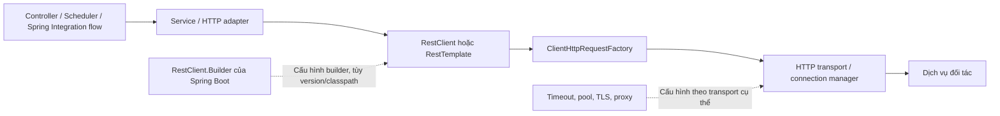
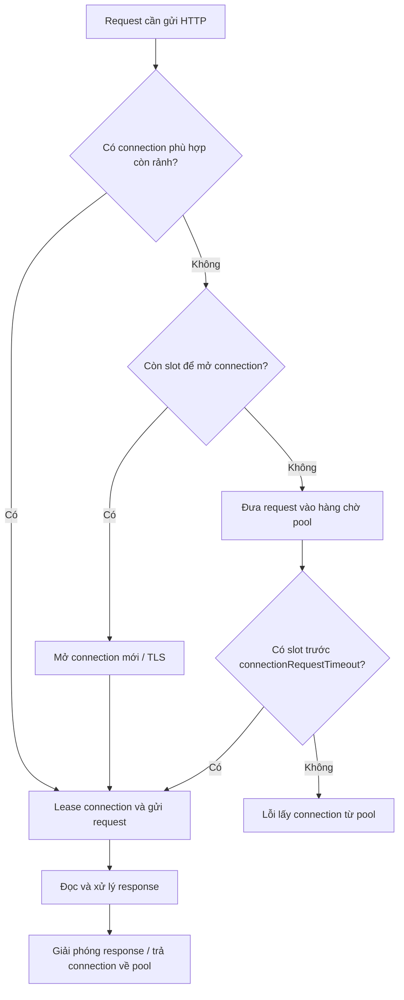

# Kiểm tra hành vi request factory và lỗi khi cạn connection pool

## 1. Bài toán trong tích hợp HTTP đồng bộ

Một ứng dụng **Spring Boot** gọi HTTP đến dịch vụ đối tác bằng `RestClient` hoặc `RestTemplate`. Khi số request tăng hoặc đối tác phản hồi chậm, ứng dụng bắt đầu báo lỗi timeout dù máy đích vẫn hoạt động. Một số request thậm chí **chưa hề được gửi đi**: chúng đang chờ lấy kết nối từ pool phía client.

Trong module **SPRING_BOOT_INTEGRATION**, HTTP client thường chỉ là một chặng của luồng tích hợp gồm API đầu vào, cơ sở dữ liệu, cache, broker và các adapter Spring Integration. Nếu không nhận diện được request factory và cơ chế pool đang dùng, việc tăng timeout hoặc số thread có thể làm trầm trọng hơn tình trạng tắc nghẽn, kéo theo lỗi xử lý giao dịch, phát thông điệp trùng, quá tải downstream và khó quan sát nguyên nhân gốc.

Sau bài này, người học có thể:

- Xác định `ClientHttpRequestFactory` mà client đồng bộ thực sự sử dụng và tính năng tái sử dụng kết nối của từng implementation.
- Phân biệt **chờ kết nối trong pool**, **thiết lập kết nối TCP**, **chờ phản hồi** và **deadline tổng thể**.
- Cấu hình một Apache HttpClient 5 connection pool có giới hạn tổng, giới hạn theo route và timeout lấy kết nối.
- Viết bài kiểm thử gây cạn pool có chủ đích, đối chiếu lỗi phía client với HTTP status phía server.
- Quan sát pool, điều chỉnh concurrency và áp dụng retry/idempotency phù hợp trong một luồng tích hợp.

## 2. Request factory nằm ở đâu trong chuỗi gọi HTTP?

Với các API HTTP **đồng bộ** của Spring, `ClientHttpRequestFactory` tạo request cấp thấp. Factory có thể dùng JDK HTTP stack, Apache HttpClient hoặc một HTTP engine khác; vì vậy **cùng một đoạn code gọi REST** có thể có cơ chế kết nối, timeout và pool khác nhau.



| Factory/transport thường gặp | Hành vi cần nhận diện | Hàm ý khi kiểm thử |
|---|---|---|
| `SimpleClientHttpRequestFactory` | Dùng `HttpURLConnection` của JDK. Hệ thống JDK có cơ chế keep-alive riêng nhưng không cung cấp bộ số liệu và API cấu hình pool kiểu Apache HttpClient 5. | Không giả định các thuộc tính `maxConnTotal`/`maxConnPerRoute` của Apache sẽ có tác dụng. |
| `JdkClientHttpRequestFactory` | Dựa trên `java.net.http.HttpClient`; JDK quản lý connection reuse và các chi tiết transport của nó. | Kiểm tra timeout, khả năng chia sẻ `HttpClient` và cách đo lường theo JDK; đừng suy ra JDK hoàn toàn không tái sử dụng kết nối. |
| `HttpComponentsClientHttpRequestFactory` | Sử dụng Apache HttpClient 5 trong Spring Framework 6.x; có thể dùng `PoolingHttpClientConnectionManager` với giới hạn tổng/theo route, số connection đang mượn và số đang chờ. | Phù hợp cho bài thử định lượng việc cạn pool và lấy các chỉ số `leased/available/pending`. |
| Các factory từ HTTP stack khác | Có thể dùng Jetty hoặc implementation do ứng dụng/thư viện cung cấp; quy tắc pool và timeout phụ thuộc transport. | Kiểm tra đúng implementation và tài liệu theo phiên bản thư viện. |

`WebClient` là API khác, thường dùng Reactor Netty với `ConnectionProvider` riêng. Việc gọi `WebClient.block()` không biến nó thành Apache `ClientHttpRequestFactory`. Bài này tập trung vào `RestClient`/`RestTemplate` và Apache HttpClient **classic** (HTTP/1.1), nơi một request đang sử dụng một kết nối leased trong giai đoạn xử lý.

**Spring Boot có thể tự cấu hình builder** và chọn factory mặc định theo classpath, cấu hình và phiên bản. Thứ tự ưu tiên tự phát hiện không nên được coi là hợp đồng cố định giữa các phiên bản. Muốn kiểm thử và vận hành có kết quả lặp lại, hãy chỉ định factory và xác minh cấu hình mà client thực tế nhận được.

## 3. Connection pool cạn như thế nào?

Một connection manager cho phép một số request đồng thời **mượn (lease)** kết nối. Khi request hoàn tất và response được tiêu thụ/đóng đúng cách, kết nối đủ điều kiện mới có thể được **trả về pool** để tái sử dụng.

Hai giới hạn quan trọng trong Apache HttpClient 5:

- **Maximum total:** tổng số kết nối pool được phép cấp phát trên mọi route.
- **Maximum per route:** số kết nối tối đa đến một route, thường gắn với scheme, host, port và các đặc điểm routing/proxy. Nhiều lời gọi đến một đối tác có thể chạm giới hạn theo route dù tổng pool vẫn còn chỗ.



Giả sử pool cấu hình `maxConnTotal=40` và `maxConnPerRoute=10`. Nếu 30 lời gọi cùng đến **một route** và mỗi lời gọi giữ kết nối vài giây, tối đa khoảng 10 lời gọi có connection leased tại thời điểm đó; các lời gọi còn lại phải chờ, dù tổng giới hạn là 40.

Không phải mọi request đang chờ đều biểu hiện thành lỗi: nếu connection được trả lại trước thời hạn lease, request tiếp tục bình thường. **Pool exhaustion** trở thành lỗi khi thời gian chờ vượt giới hạn, khi luồng bị hủy, hoặc khi client/pool đóng trong lúc chờ.

Các nguyên nhân phổ biến:

1. Downstream phản hồi chậm, giữ connection lâu hơn dự kiến.
2. Lưu lượng đến cùng một route cao hơn năng lực xử lý đồng thời của pool.
3. Response dạng stream không được tiêu thụ hoặc đóng đúng vòng đời; có thể gây **connection leak**.
4. Timeout chờ pool chưa cấu hình hoặc quá dài, làm thread gọi HTTP bị giữ trong hàng chờ.
5. Retries không giới hạn làm tăng request đồng thời và gây hiệu ứng khuếch đại tải.

Đừng kết luận cứ có `pending > 0` là leak; trước hết cần so sánh lưu lượng, độ trễ downstream và thời gian giữ connection.

## 4. Phân biệt bốn nhóm timeout

| Thời điểm | Khái niệm/thiết lập | Ý nghĩa | Dấu hiệu khi thất bại |
|---|---|---|---|
| Chờ slot từ pool | **Connection request / acquisition timeout**, ví dụ `RequestConfig.setConnectionRequestTimeout(...)` của Apache HttpClient 5 | Giới hạn thời gian request chờ mượn connection trước khi bắt đầu gửi. | Có thể hết hạn ngay trong ứng dụng; downstream **không nhận request**. |
| Mở kết nối mới | **Connect timeout**, ví dụ `ConnectionConfig.setConnectTimeout(...)` ở Apache HttpClient 5 | Giới hạn giai đoạn thiết lập kết nối TCP; các bước DNS/TLS có chi tiết riêng tùy transport. | Khó kết nối đến host/port, mất mạng, firewall hoặc server không tiếp nhận. |
| Chờ/đọc response | **Response timeout / socket read timeout** tùy transport và version | Giới hạn khâu nhận phản hồi hoặc hoạt động đọc mạng theo ngữ nghĩa của thư viện. | Request đã có thể tới downstream; client vẫn báo timeout khi không nhận dữ liệu kịp thời. |
| Toàn bộ nghiệp vụ | **End-to-end deadline** do ứng dụng/hệ thống quy định | Bao trùm queue, kết nối, trao đổi HTTP, deserialize và các chặng khác nếu được thiết kế nhất quán. | Chặng HTTP có thể chưa hết timeout riêng nhưng toàn luồng đã vượt SLO. |

Không cộng máy móc các giá trị timeout và xem đó là một deadline tổng thể. Chúng được áp dụng ở những giai đoạn khác nhau; một số có thể lặp lại khi redirect/retry. Cần tra lại ngữ nghĩa cấu hình của **đúng phiên bản Spring Framework và HTTP transport**.

Ví dụ: `connectionRequestTimeout=200 ms`, `connectTimeout=2 s` và `responseTimeout=3 s`. Nếu cả 10 connection theo route đều bị chiếm suốt 200 ms, request thứ 11 có thể thất bại **trước khi thực hiện bước connect**. Việc tăng `connectTimeout` từ 2 lên 10 giây sẽ không giải quyết lỗi lấy connection từ pool.

### Lỗi HTTP từ server khác với lỗi transport phía client

- Khi downstream trả `HTTP 429` hoặc `503`, đó là **HTTP response có status**. Với `RestClient.retrieve()`, Spring thường chuyển status 4xx/5xx thành exception tương ứng nếu không tùy chỉnh status handler.
- Khi client không lấy được connection từ pool, nó có thể báo `ResourceAccessException` bọc exception I/O của transport. Không có HTTP status từ downstream cho lần gửi đó.
- `ConnectException`, timeout đọc, lỗi DNS, TLS, reset connection hoặc hủy request cũng có thể được Spring bọc thành `ResourceAccessException`. Vì vậy **không được đồng nhất mọi `ResourceAccessException` với pool exhaustion**; phải phân loại theo nguyên nhân gốc và telemetry.

Tên exception tầng thấp và thông điệp lỗi có thể khác theo phiên bản Apache/JDK. Không viết logic nghiệp vụ chỉ dựa trên chuỗi của `getMessage()`.

## 5. Cấu hình Apache HttpClient 5 có pool rõ ràng

Ví dụ dành cho **Spring Boot 3.2+ / Spring Framework 6.1+**, Java 17+ và Apache HttpClient 5 phiên bản tương thích. Dependency cần có `spring-boot-starter-web` và `org.apache.httpcomponents.client5:httpclient5`; sử dụng dependency management/BOM của dự án để đồng bộ phiên bản.

```kotlin
dependencies {
    implementation("org.springframework.boot:spring-boot-starter-web")
    implementation("org.apache.httpcomponents.client5:httpclient5")
}
```

Ta cấu hình một HTTP client riêng cho đối tác thanh toán, để kích thước pool, timeout và metric của đối tác này không bị gộp nhầm với các client khác:

```java
import org.apache.hc.client5.http.config.ConnectionConfig;
import org.apache.hc.client5.http.config.RequestConfig;
import org.apache.hc.client5.http.impl.classic.CloseableHttpClient;
import org.apache.hc.client5.http.impl.classic.HttpClients;
import org.apache.hc.client5.http.impl.io.PoolingHttpClientConnectionManager;
import org.apache.hc.client5.http.impl.io.PoolingHttpClientConnectionManagerBuilder;
import org.apache.hc.core5.util.Timeout;
import org.springframework.beans.factory.annotation.Value;
import org.springframework.context.annotation.Bean;
import org.springframework.context.annotation.Configuration;
import org.springframework.http.client.HttpComponentsClientHttpRequestFactory;
import org.springframework.web.client.RestClient;

@Configuration(proxyBeanMethods = false)
class PartnerHttpConfiguration {

    @Bean
    PoolingHttpClientConnectionManager partnerConnectionManager() {
        return PoolingHttpClientConnectionManagerBuilder.create()
                .setMaxConnTotal(40)
                .setMaxConnPerRoute(10)
                .setDefaultConnectionConfig(ConnectionConfig.custom()
                        .setConnectTimeout(Timeout.ofSeconds(2))
                        .build())
                .build();
    }

    @Bean(destroyMethod = "close")
    CloseableHttpClient partnerApacheHttpClient(
            PoolingHttpClientConnectionManager partnerConnectionManager) {
        RequestConfig requestConfig = RequestConfig.custom()
                .setConnectionRequestTimeout(Timeout.ofMilliseconds(200))
                .setResponseTimeout(Timeout.ofSeconds(3))
                .build();

        return HttpClients.custom()
                .setConnectionManager(partnerConnectionManager)
                .setDefaultRequestConfig(requestConfig)
                .build();
    }

    @Bean
    RestClient partnerRestClient(
            RestClient.Builder builder,
            CloseableHttpClient partnerApacheHttpClient,
            @Value("${partner.api.base-url}") String baseUrl) {
        return builder
                .requestFactory(new HttpComponentsClientHttpRequestFactory(
                        partnerApacheHttpClient))
                .baseUrl(baseUrl)
                .build();
    }
}
```

```yaml
partner:
  api:
    base-url: https://api.partner.example
```

**Vai trò của từng phần:**

- `RestClient.Builder` do Spring Boot cung cấp khi có hỗ trợ; việc dùng builder này cho phép giữ các customizer/observation khác mà ứng dụng đã cấu hình. Việc gọi `requestFactory(...)` khiến transport dùng trong ví dụ trở nên tường minh.
- `PoolingHttpClientConnectionManager` cung cấp giới hạn kết nối và số liệu pool.
- `ConnectionConfig` quy định connect timeout cho kết nối mới, còn `RequestConfig` quy định thời gian **chờ slot** và **chờ phản hồi** theo Apache HttpClient 5.
- `CloseableHttpClient` là bean chia sẻ giữa các request, được đóng khi Spring context dừng; không tạo client/pool mới cho từng lời gọi.
- URL đối tác được tách thành property; trong triển khai thật cần quản lý thêm TLS/truststore, proxy và bí mật xác thực theo môi trường.

Đoạn cấu hình là ví dụ định hướng để thí nghiệm, **không phải bộ giá trị tối ưu cho mọi hệ thống**. Tùy phiên bản Apache, API cấu hình timeout khác nhau; hãy đối chiếu dependency được resolve. Với `RestTemplate`, factory tương tự có thể được truyền vào constructor:

```java
RestTemplate restTemplate = new RestTemplate(
        new HttpComponentsClientHttpRequestFactory(partnerApacheHttpClient));
```

Khi tích hợp qua adapter của Spring Integration, cần kiểm tra adapter có dùng đúng `RestTemplate`/`RestClient` đã cấu hình hay tự tạo một HTTP client khác.

## 6. Kiểm tra factory nào đang chạy

Các bước điều tra khi latency tăng hoặc lỗi timeout:

1. **Đọc cấu hình bean:** có `RestClient.Builder.requestFactory(...)`, `RestTemplate.setRequestFactory(...)`, interceptor/proxy wrapper, customizer hay bean builder khác không?
2. **Xem dependency tree:** xác định Apache HC5, JDK HTTP client hoặc engine khác thực sự có trên runtime classpath. Thêm dependency có thể thay đổi factory mặc định giữa các bản Spring Boot.
3. **Xác minh khi khởi động:** kiểm tra Spring auto-configuration report khi chạy `--debug` hoặc endpoint `/actuator/conditions` (nếu Actuator được cấu hình và bảo vệ phù hợp). Report giúp biết bean factory/builder nào được tạo; không thay thế kiểm tra transport cụ thể được truyền vào client.
4. **Đặt factory tường minh trong integration test:** cấu hình một pool nhỏ và đọc `getTotalStats()`. Việc chỉ dựa trên HTTP 200 hoặc tên class của `RestClient` không chứng minh client đang dùng pool nào.
5. **Kiểm tra hiệu ứng tái sử dụng:** chạy nhiều request đến cùng endpoint, theo dõi leased/available/pending và kết nối TCP thực; đối chiếu với keep-alive, trạng thái mạng, proxy và response consumption.

Tránh truy cập nội bộ bằng reflection chỉ để biết factory. Một bean cấu hình tường minh, một integration test gây áp lực đúng transport và các chỉ số connection manager thường dễ kiểm chứng và bền hơn.

## 7. Kiểm thử tái hiện cạn connection pool

Một bài kiểm thử có giá trị phải điều khiển được **khi nào request đầu tiên chiếm kết nối** và **khi nào request thứ hai tìm cách mượn kết nối**. Ngủ một khoảng thời gian cố định rồi hy vọng các thread trùng nhau sẽ khiến test dễ lỗi ngẫu nhiên.

### Thiết kế thí nghiệm

| Thành phần | Giá trị minh họa | Mục đích |
|---|---|---|
| Pool total / per route | `1 / 1` | Chỉ một request đồng thời được mượn connection tới test server. |
| Connection acquisition timeout | `150 ms` | Request thứ hai sớm thất bại nếu connection vẫn bị giữ. |
| Response timeout | `5 s` | Request đầu tiên có đủ thời gian nhận response bị trì hoãn. |
| Test server | Phản hồi đầu tiên trễ `2 s` ở phần body | Giữ connection đầu tiên đang leased sau khi server đã nhận request. |
| Đồng bộ test | Chờ server nhận request đầu tiên | Bảo đảm request thứ hai được gọi sau khi kết nối đầu tiên đã được sử dụng. |
| Kiểm chứng | Request thứ hai báo lỗi client, server chỉ nhận một request trước khi connection được trả | Phân biệt **pool wait** với HTTP 503 từ server. |

Ví dụ JUnit 5 dưới đây sử dụng **MockWebServer** của OkHttp làm server kiểm thử (chỉ thêm vào test scope; chọn phiên bản tương thích với dự án):

```java
import static org.junit.jupiter.api.Assertions.*;

import java.util.concurrent.ExecutorService;
import java.util.concurrent.Executors;
import java.util.concurrent.Future;
import java.util.concurrent.TimeUnit;

import okhttp3.mockwebserver.MockResponse;
import okhttp3.mockwebserver.MockWebServer;
import org.apache.hc.client5.http.config.RequestConfig;
import org.apache.hc.client5.http.impl.classic.CloseableHttpClient;
import org.apache.hc.client5.http.impl.classic.HttpClients;
import org.apache.hc.client5.http.impl.io.PoolingHttpClientConnectionManager;
import org.apache.hc.client5.http.impl.io.PoolingHttpClientConnectionManagerBuilder;
import org.apache.hc.core5.util.Timeout;
import org.junit.jupiter.api.Test;
import org.springframework.http.client.HttpComponentsClientHttpRequestFactory;
import org.springframework.web.client.ResourceAccessException;
import org.springframework.web.client.RestClient;

class PartnerPoolExhaustionTest {

    @Test
    void requestTimesOutWhileWaitingForPoolConnection() throws Exception {
        try (MockWebServer server = new MockWebServer()) {
            server.enqueue(new MockResponse()
                    .setBody("first-ok")
                    .setBodyDelay(2, TimeUnit.SECONDS));
            server.start();

            PoolingHttpClientConnectionManager manager =
                    PoolingHttpClientConnectionManagerBuilder.create()
                            .setMaxConnTotal(1)
                            .setMaxConnPerRoute(1)
                            .build();

            RequestConfig config = RequestConfig.custom()
                    .setConnectionRequestTimeout(Timeout.ofMilliseconds(150))
                    .setResponseTimeout(Timeout.ofSeconds(5))
                    .build();

            try (CloseableHttpClient httpClient = HttpClients.custom()
                    .setConnectionManager(manager)
                    .setDefaultRequestConfig(config)
                    .build()) {

                RestClient client = RestClient.builder()
                        .requestFactory(
                                new HttpComponentsClientHttpRequestFactory(httpClient))
                        .build();

                String url = server.url("/slow").toString();
                ExecutorService executor = Executors.newSingleThreadExecutor();
                try {
                    Future<String> first = executor.submit(() ->
                            client.get().uri(url).retrieve().body(String.class));

                    // Server đã nhận request đầu tiên; response body còn bị giữ.
                    assertNotNull(server.takeRequest(2, TimeUnit.SECONDS));

                    // Request thứ hai đến đúng route nhưng không còn slot trong pool.
                    assertThrows(ResourceAccessException.class, () ->
                            client.get().uri(url).retrieve().body(String.class));
                    assertEquals(1, server.getRequestCount());

                    // Khi body của request đầu tiên được nhận, nó hoàn tất bình thường.
                    assertEquals("first-ok", first.get(5, TimeUnit.SECONDS));
                } finally {
                    executor.shutdownNow();
                }
            }
        }
    }
}
```

Test trên kiểm tra **một triệu chứng điển hình**: `ResourceAccessException` của request thứ hai khi số lượng request thực tế tới server chưa tăng. Để khẳng định nguyên nhân là **connection lease timeout**, trong bài thử thực tế hãy đồng thời kiểm tra chuỗi cause của exception theo phiên bản HttpClient đang dùng và chỉ số `pending`/`leased` của manager. Nếu không ghi nhận được điều này, test chỉ chứng minh có lỗi I/O, chưa đủ để quy kết pool exhaustion.

Các mở rộng cần có cho bộ kiểm thử tích hợp:

1. **Control:** đặt pool bằng 2, cho cả hai lời gọi hoàn thành để chứng minh lỗi phụ thuộc giới hạn pool.
2. **Latency:** giảm độ trễ response xuống dưới acquisition timeout, xác minh request chờ pool vẫn có thể thành công.
3. **Per-route:** gọi hai host/route khác nhau để phân biệt giới hạn tổng và giới hạn từng route.
4. **Server error:** cho server thực sự trả `503`, kiểm tra loại exception/HTTP status khác với lỗi pool local.
5. **Connection behavior:** đóng kết nối từ server, phát sinh timeout khi connect hoặc đọc response; bảo đảm phân loại đúng.
6. **Resource lifetime:** đọc hết hoặc đóng response khi dùng streaming; xác minh `leased` giảm về 0 sau khi xử lý xong.

## 8. Quan sát leased, available, pending và max

Apache HttpClient 5 cung cấp `PoolingHttpClientConnectionManager.getTotalStats()` để đọc trạng thái pool. Ví dụ có thể ghi số liệu khi điều tra:

```java
import org.apache.hc.core5.pool.PoolStats;

PoolStats stats = partnerConnectionManager.getTotalStats();
log.info("partner_pool leased={} available={} pending={} max={}",
        stats.getLeased(),
        stats.getAvailable(),
        stats.getPending(),
        stats.getMax());
```

| Chỉ số | Ý nghĩa thực tế | Cách diễn giải |
|---|---|---|
| `leased` | Connection hiện đang được request sử dụng. | Tăng liên tục cần đối chiếu latency và thời gian giữ response. |
| `available` | Connection còn trong pool, có thể tái sử dụng nếu phù hợp route. | `available > 0` trên tổng pool không bảo đảm có connection rảnh cho **route đang bị nghẽn**. |
| `pending` | Request đang chờ lease connection. | Tăng cùng lỗi timeout là dấu hiệu đáng điều tra về bão hòa pool; có thể tạm thời trong burst. |
| `max` | Giới hạn kết nối của pool ở phạm vi thống kê. | So sánh với tải thực tế và giới hạn per-route; không chỉ nhìn tổng max. |

Với một đối tác cụ thể, nên đo số liệu **theo route** khi có thể, đồng thời đưa gauge qua Micrometer/Actuator với tên và nhãn có cardinality thấp (ví dụ `partner=billing`). Không thêm user ID, token hay URI chứa thông tin cá nhân vào nhãn metric.

Quan sát pool riêng là chưa đủ. Cần đo xuyên suốt các chặng:

- **Outbound HTTP:** số request bắt đầu, thành công, lỗi 4xx/5xx, lỗi transport, loại timeout, thời gian chờ connection và latency tổng.
- **Luồng nghiệp vụ:** thread đang bận, queue tại service/adapter, giới hạn concurrency, tỷ lệ retry, số lượt bị từ chối, thời gian hoàn thành nghiệp vụ.
- **Downstream:** throughput, latency p95/p99, số kết nối server đang xử lý, lỗi throttling/circuit breaker, rate limit và tình trạng broker/cache phụ thuộc.

Nếu `pending` tăng, `leased` ở ngưỡng per-route, latency downstream cũng tăng thì nghi ngờ **saturation do chậm**. Nếu `leased` không giảm sau khi request kết thúc, cần kiểm tra **response chưa đóng**, chứ không vội tăng pool.

## 9. Ước lượng kích thước pool và kiểm soát tải

Theo Little's Law, trong trạng thái tương đối ổn định:

\[
L \approx \lambda \times W
\]

Trong đó `L` là số request đang xử lý đồng thời, `\lambda` là tốc độ đến (request/giây) và `W` là thời gian mỗi request giữ nguồn lực (giây). Đây là công cụ **ước lượng mức đồng thời trung bình**, không phải công thức đủ để chọn pool theo p99 hoặc burst.

Ví dụ: dịch vụ gửi khoảng **50 request/giây** đến một route; thời gian giữ connection trung bình **200 ms** thì mức đồng thời trung bình khoảng `50 × 0,2 = 10`. Nếu phía đối tác chậm lên **2 giây** với cùng lưu lượng, nhu cầu trung bình thành khoảng `100` connection leased. Một pool per-route chỉ có 10 slot sẽ nhanh chóng hình thành hàng chờ và có thể timeout.

Khi thiết kế, cần tính thêm phân bố latency, đỉnh lưu lượng, số instance ứng dụng và giới hạn downstream:

- Nếu 5 instance đều mở tối đa 40 connection đến cùng đối tác, về lý thuyết có thể tạo tới khoảng 200 kết nối nếu không có giới hạn theo route thấp hơn; đối tác có thể không chịu được.
- Không tăng pool để che giấu dịch vụ downstream đang bị quá tải. Giới hạn concurrency/bulkhead và queue có giới hạn thường hiệu quả hơn khi downstream có năng lực cố định.
- Chọn acquisition timeout đủ ngắn để bảo vệ thread và SLO, nhưng không ngắn đến mức mọi burst hợp lệ đều bị loại bỏ.
- Thiết kế retry có backoff và jitter, giới hạn số lần; chỉ retry khi thao tác an toàn. Với HTTP POST có side effect, cần idempotency key và hợp đồng trả kết quả khi request trước đó có thể đã thành công.

**Lưu ý giao dịch:** timeout sau khi gửi request không chứng minh downstream đã từ chối xử lý. Luồng Spring Boot → HTTP đối tác → database/cache/broker phải có cách đối soát trạng thái, chống trùng và xử lý kết quả không chắc chắn; đặc biệt khi gọi hệ thống thanh toán, cập nhật đơn hàng hoặc phát sự kiện.

## 10. Quy trình chẩn đoán một sự cố thực tế

Giả sử service nhận 200 HTTP request đồng thời, mỗi request gọi API tính phí của đối tác. Sau khi đối tác chậm đi, log ghi “request timeout” và hàng chờ trong Spring Integration tăng mạnh.

| Bước | Việc kiểm tra | Dấu hiệu và quyết định |
|---|---|---|
| 1. Định vị client | Xác nhận adapter gọi đúng `RestClient`/`RestTemplate` bean và factory đang sử dụng. | Nếu client thực tế dùng JDK thì các chỉ số/tùy chọn của Apache pool không có giá trị cho chặng này. |
| 2. Phân loại lỗi | Tách HTTP 429/503, acquisition timeout, connect timeout, response timeout, TLS và DNS. | Không gộp mọi lỗi thành “server chết”. |
| 3. Đo pool | Ghi `leased/available/pending/max` và thông tin per-route. | `leased≈maxPerRoute`, `pending` tăng, server nhận ít request hơn số call khởi tạo → nghi pool wait. |
| 4. Đo downstream | So latency p50/p95/p99, RPS, rate limit, timeouts và connection reset. | Phân biệt lưu lượng tăng với downstream xử lý chậm. |
| 5. Kiểm tra response | Bảo đảm stream/response được đóng; tránh giữ response qua các tác vụ lâu dài. | `leased` cao bất thường sau khi caller đã kết thúc gợi ý leak. |
| 6. Giảm áp lực | Áp dụng bulkhead, queue hữu hạn, backpressure, timeout hợp lý; cân nhắc pool theo số instance và quota đối tác. | Cắt vòng xoáy retry và bảo vệ tài nguyên ứng dụng. |
| 7. Xác minh lại | Chạy load test ở mức tải mục tiêu và các tình huống downstream chậm/lỗi. | Kiểm tra error budget, latency SLO, pending và số request thực tới downstream. |

Khi xử lý sự cố, ưu tiên các số liệu xác thực về **request đến server**, **request đang chờ pool**, **số connection leased** và **độ trễ từng chặng**. Chỉ nhìn một exception hoặc một lần `curl` thành công không đủ để kết luận.

## 11. Lỗi triển khai thường gặp

| Cách làm sai | Vì sao gây vấn đề | Cách khắc phục |
|---|---|---|
| Tạo `RestClient`/Apache client trong từng method. | Không chia sẻ pool; tốn kết nối/TLS handshake và khó quản lý resource. | Tạo bean singleton cho mỗi downstream hoặc nhóm cấu hình tương đương. |
| Chỉ đặt response timeout, bỏ qua acquisition timeout. | Thread có thể chờ pool lâu trước khi gửi request. | Cấu hình riêng giới hạn chờ lease và áp dụng deadline theo luồng. |
| Tăng `maxConnTotal` nhưng giữ `maxConnPerRoute` thấp. | Một đối tác duy nhất vẫn nghẽn tại per-route. | Đo theo route và điều chỉnh có căn cứ. |
| Coi mọi `ResourceAccessException` là lỗi cạn pool. | Che giấu DNS, TLS, connect timeout, response timeout và lỗi mạng. | Phân loại bằng cause chain và metric transport. |
| Trả response stream ra ngoài callback nhưng không quản lý đóng. | Connection vẫn leased, dẫn đến suy giảm năng lực pool. | Đọc/đóng response đúng scope; dùng try-with-resources khi API yêu cầu. |
| Tăng retry đồng thời khi downstream chậm. | Phóng đại số request, hàng chờ và timeouts. | Retry có giới hạn, jitter, circuit breaker/bulkhead, idempotency. |
| Chỉ kiểm tra factory ở local với dependency khác production. | Môi trường thực có factory hoặc pooling semantics khác. | Cố định dependency, cấu hình factory rõ ràng và kiểm thử theo profile triển khai. |
| Đánh đồng cạn pool HTTP/1.1 với HTTP/2 multiplexing. | Suy luận sai quan hệ số request và connection. | Xác định giao thức, transport và cơ chế multiplexing thực tế. |

## 12. Checklist kiểm thử và vận hành

- [ ] Biết chính xác client nào gửi HTTP trong từng adapter và `ClientHttpRequestFactory`/transport nào được sử dụng.
- [ ] Đã kiểm tra classpath, phiên bản Spring Boot/Spring Framework/Apache HttpClient và các custom bean liên quan.
- [ ] Có giới hạn tổng và per-route phù hợp với lưu lượng theo instance và khả năng downstream.
- [ ] Có acquisition timeout, connect timeout, response/read timeout và deadline nghiệp vụ được giải thích rõ.
- [ ] Có test điều khiển được tình huống pool `1/1`, làm request đầu tiên giữ connection, request sau chờ quá timeout.
- [ ] Có test đối chứng tăng pool hoặc giảm độ trễ để chứng minh nguyên nhân.
- [ ] Phân biệt HTTP status từ server với exception I/O phía client, đặc biệt acquisition timeout so với connect/response timeout.
- [ ] Đã đảm bảo response streaming được đóng và pool được giải phóng khi ứng dụng dừng.
- [ ] Có metric `leased/available/pending/max`, p95/p99 latency, timeout từng loại, concurrency, retry và backlog của luồng tích hợp.
- [ ] Áp dụng retry/idempotency và backpressure phù hợp; đánh giá trạng thái không chắc chắn khi client timeout sau khi đã gửi request.

**Ghi nhớ:** Khi cạn connection pool, lỗi có thể xảy ra **trước khi request rời khỏi Spring Boot**. Muốn kết luận chính xác, cần biết request factory thực tế, đo thời gian chờ lease và trạng thái pool, rồi tái hiện bằng kiểm thử có kiểm soát. Cấu hình pool và timeout chỉ hữu ích khi đi kèm giới hạn tải, xử lý lỗi và quan sát xuyên suốt luồng tích hợp.
