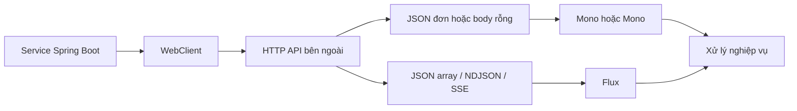
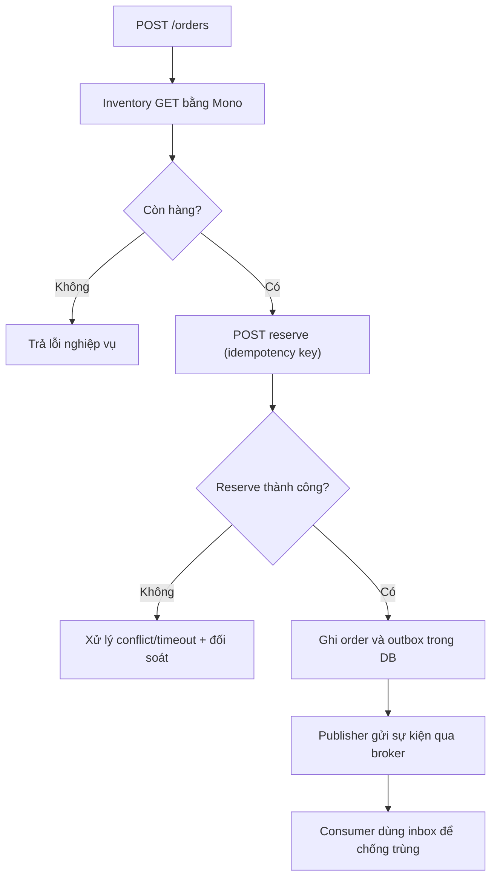

# Gửi và nhận dữ liệu với Mono hoặc Flux

## 1. WebClient và bài toán trao đổi dữ liệu bất đồng bộ

Trong mô-đun **SPRING_BOOT_INTEGRATION**, ứng dụng Spring Boot phải trao đổi dữ liệu với HTTP API, cơ sở dữ liệu, cache, message broker và các adapter của Spring Integration. Với giao tiếp HTTP ra ngoài, `WebClient` là HTTP client của Spring WebFlux có API khai báo và hỗ trợ xử lý bất đồng bộ dựa trên **Project Reactor**. Hai kiểu kết quả phổ biến nhất là `Mono<T>` và `Flux<T>`.

Hãy hình dung Order Service cần gọi Inventory API trước khi xác nhận đơn hàng:

- `GET /inventory/{sku}` trả về một bản ghi tồn kho → sử dụng `Mono<InventoryResponse>`.
- `GET /inventory/changes` liên tục phát các thay đổi tồn kho → sử dụng `Flux<InventoryChange>`.
- `POST /reservations` gửi một yêu cầu giữ hàng, trả về một kết quả → gửi một DTO và nhận `Mono<ReservationResponse>`.
- `POST /inventory/bulk` nhận một chuỗi sự kiện cập nhật → có thể gửi `Flux<InventoryUpdate>` **nếu phía server chấp nhận request streaming**.



Điều quan trọng là `WebClient` tạo ra **một pipeline mô tả công việc**. Với lời gọi thông thường, network I/O xảy ra khi có subscription vào pipeline đó; chỉ tạo đối tượng `Mono`/`Flux` chưa bảo đảm request đã gửi đi. WebClient mang lại khả năng tích hợp non-blocking khi sử dụng trong một luồng reactive đúng nghĩa, nhưng không tự khiến các thao tác JDBC hay thư viện blocking ở các bước khác trở thành non-blocking.

Bài này tập trung vào **gửi và nhận dữ liệu với `Mono` hoặc `Flux`**: chọn kiểu phản hồi, tạo request body, giải mã response, stream dữ liệu, tổ hợp thao tác, xử lý lỗi, timeout, retry, kiểm thử và quan sát luồng tích hợp thực tế. Ví dụ dùng Spring Boot 3.x/Spring Framework 6 và Reactor 3.x; khi dùng phiên bản khác cần đối chiếu API và dependency tương ứng.

## 2. Phân biệt Mono và Flux bằng số lượng phần tử

Trong Reactor, `Mono<T>` và `Flux<T>` triển khai Reactive Streams `Publisher<T>`. Chúng phát tín hiệu **onNext** (phần tử), **onComplete** (kết thúc) hoặc **onError** (lỗi).

| Khía cạnh | `Mono<T>` | `Flux<T>` |
| --- | --- | --- |
| Số phần tử `onNext` | 0 hoặc 1 | 0 đến nhiều |
| Ví dụ | Một sản phẩm, token, kết quả tạo đơn, response body rỗng | Danh sách, stream sự kiện, các bản ghi đang đẩy liên tục |
| Khi không có dữ liệu | `Mono.empty()` | `Flux.empty()` |
| Khi có lỗi | Phát `onError` | Phát `onError` |
| Kết thúc thành công | `onComplete` sau 0 hoặc 1 phần tử | `onComplete` sau các phần tử, hoặc không kết thúc với stream vô hạn |
| Xử lý từng phần tử | `map`, `flatMap` | `map`, `flatMap`, `concatMap`, `filter`, `buffer` |

`Mono<Void>` được dùng để thể hiện **hoàn tất hoặc thất bại mà không phát giá trị** (ví dụ lời gọi HTTP trả 204). `Flux<T>` không nhất thiết có nhiều phần tử; stream một phần tử vẫn có thể là Flux. Tiêu chí chọn kiểu là **hợp đồng của nguồn dữ liệu**, không phải số phần tử tình cờ nhận được hôm nay.

### 2.1. Kiểu Publisher không quyết định dữ liệu được truyền trên mạng ra sao

`Flux<Product>` có thể được tạo từ một **JSON array** trả về trong một HTTP response ngắn; nó cũng có thể đọc **NDJSON**, **Server-Sent Events (SSE)** hoặc luồng dữ liệu kéo dài. Chỉ viết `bodyToFlux(Product.class)` **không biến một API JSON array thành real-time event stream**.

Việc phần tử được giải mã và phát dần hay không phụ thuộc vào content type, encoder/decoder, cách server flush dữ liệu, buffering tại proxy và ngữ nghĩa endpoint. Với response lớn, cần kiểm tra giới hạn bộ nhớ codec và hành vi mạng thực tế.

### 2.2. Cold publisher và thời điểm request chạy

`WebClient` thường trả **cold publisher**: mỗi subscription mới có thể tạo **một HTTP exchange mới**.

```java
Mono<InventoryResponse> query =
    webClient.get()
        .uri("/inventory/{sku}", "sku-123")
        .retrieve()
        .bodyToMono(InventoryResponse.class);

// Chưa có terminal operation hoặc subscriber ở đây.
```

Trong WebFlux controller, Spring sẽ subscribe vào publisher được trả về. Trong bài test, `StepVerifier` subscribe. Trong một ứng dụng imperative, `block()` có thể subscribe và đợi kết quả, nhưng cần cân nhắc ranh giới blocking. Không gọi `subscribe()` tùy tiện trong service rồi trả thành công ngay, vì lỗi có thể bị tách khỏi luồng nghiệp vụ và khó theo dõi.

## 3. Dependency và cách cấu hình WebClient

Trong một ứng dụng Spring Boot 3.x có sử dụng WebClient, thêm:

```xml
<dependency>
    <groupId>org.springframework.boot</groupId>
    <artifactId>spring-boot-starter-webflux</artifactId>
</dependency>
```

Starter cung cấp API WebFlux/WebClient và các dependency cần thiết theo BOM; khi dùng Netty ở cấu hình thường gặp, client có thể hoạt động non-blocking. **Thêm `spring-boot-starter-webflux` vào ứng dụng Spring MVC không mặc nhiên chuyển toàn bộ server sang WebFlux**; ứng dụng vẫn có thể dùng WebClient làm HTTP client trong MVC.

Spring Boot thường auto-configure `WebClient.Builder` để ứng dụng khai báo client. Tạo một client riêng cho Inventory API với base URL và header thống nhất:

```yaml
inventory:
  api:
    base-url: ${INVENTORY_API_URL:http://localhost:8081}
```

```java
import org.springframework.beans.factory.annotation.Value;
import org.springframework.context.annotation.Bean;
import org.springframework.context.annotation.Configuration;
import org.springframework.http.HttpHeaders;
import org.springframework.http.MediaType;
import org.springframework.web.reactive.function.client.WebClient;

@Configuration
public class InventoryWebClientConfig {

    @Bean
    WebClient inventoryWebClient(
            WebClient.Builder builder,
            @Value("${inventory.api.base-url}") String baseUrl) {

        return builder
            .baseUrl(baseUrl)
            .defaultHeader(
                HttpHeaders.ACCEPT,
                MediaType.APPLICATION_JSON_VALUE
            )
            .build();
    }
}
```

`WebClient` đã được build là đối tượng phù hợp để dùng lại; không nên tạo `WebClient.create(...)` cho từng request. Nếu có nhiều upstream, đặt bean theo tên rõ ràng và cấu hình riêng hostname, timeout, authentication và quota; sử dụng `@Qualifier` khi inject.

Trong môi trường thật, cấu hình HTTPS, certificate validation, identity/credential và DNS/service discovery theo hạ tầng. Không đưa API key hoặc token thật vào source code hay log. Các ví dụ dùng endpoint nội bộ giả định để tập trung vào contract HTTP.

## 4. Nhận một response: GET và bodyToMono

Tạo DTO với những trường mà Inventory API cam kết trả về:

```java
public record InventoryResponse(
    String sku,
    Integer availableQuantity,
    java.time.OffsetDateTime updatedAt
) {}
```

Dùng `Integer` thay vì kiểu nguyên thủy `int` giúp ứng dụng **phân biệt field vắng/null với giá trị hợp lệ 0**; tuy vậy, phải validate tính đầy đủ và giới hạn của dữ liệu ở ranh giới tích hợp.

```java
import org.springframework.beans.factory.annotation.Qualifier;
import org.springframework.stereotype.Service;
import org.springframework.web.reactive.function.client.WebClient;
import reactor.core.publisher.Mono;

@Service
public class InventoryClient {

    private final WebClient webClient;

    public InventoryClient(
            @Qualifier("inventoryWebClient") WebClient webClient) {
        this.webClient = webClient;
    }

    public Mono<InventoryResponse> getInventory(String sku) {
        return webClient.get()
            .uri("/api/v1/inventory/{sku}", sku)
            .retrieve()
            .bodyToMono(InventoryResponse.class);
    }
}
```

Các bước có ý nghĩa:

1. `get()` chọn HTTP method.
2. `uri(...)` tạo URL theo template và mã hóa path variable phù hợp; tránh nối tùy tiện các chuỗi URL do người dùng cung cấp.
3. `retrieve()` nhận một `ResponseSpec` với cách xử lý response thông dụng.
4. `bodyToMono(InventoryResponse.class)` decode body bằng `HttpMessageReader`/codec phù hợp content type, rồi phát tối đa một DTO.

Với response JSON hợp lệ:

```json
{
  "sku": "sku-123",
  "availableQuantity": 18,
  "updatedAt": "2026-11-21T02:30:00Z"
}
```

Publisher phát DTO rồi hoàn tất. Nếu response thành công không có body (ví dụ 204), `bodyToMono(InventoryResponse.class)` có thể hoàn tất rỗng; nó **không tạo DTO có field null** thay cho body rỗng. Khi một response 200 bắt buộc phải có body, kiểm tra thiếu dữ liệu rõ ràng:

```java
return webClient.get()
    .uri("/api/v1/inventory/{sku}", sku)
    .retrieve()
    .bodyToMono(InventoryResponse.class)
    .switchIfEmpty(Mono.error(
        new IllegalStateException("Inventory API returned empty body")
    ));
```

`switchIfEmpty` xử lý **kết quả rỗng**, còn lỗi HTTP/JSON/network đi theo nhánh `onError`. Sau decode, có thể `map` và validate DTO trước khi chuyển cho nghiệp vụ.

## 5. Nhận nhiều phần tử: GET và bodyToFlux

Một API có thể trả về JSON array:

```json
[
  { "sku": "sku-123", "availableQuantity": 18 },
  { "sku": "sku-124", "availableQuantity": 0 }
]
```

Dùng `Flux` cho nhiều phần tử:

```java
public record StockSummary(String sku, Integer availableQuantity) {}

public Flux<StockSummary> listStock() {
    return webClient.get()
        .uri("/api/v1/inventory")
        .retrieve()
        .bodyToFlux(StockSummary.class);
}
```

Các phép toán thông dụng:

```java
Flux<StockSummary> available =
    listStock()
        .filter(item -> item.availableQuantity() != null)
        .filter(item -> item.availableQuantity() > 0)
        .map(item -> new StockSummary(
            item.sku(),
            item.availableQuantity()
        ));
```

Lưu ý `filter`/`map` ở client **không thay thế** lọc/phân trang phía server khi kết quả rất lớn; tải cả kho dữ liệu về client rồi lọc sẽ tăng bandwidth, CPU và memory. Nếu endpoint cung cấp cursor/page, hãy dùng hợp đồng pagination thay vì giả định một response chứa toàn bộ dữ liệu.

Một số toán tử chuyển kiểu cần hiểu:

| Toán tử | Kết quả | Trường hợp dùng |
| --- | --- | --- |
| `flux.collectList()` | `Mono<List<T>>` | Muốn giữ toàn bộ danh sách ở một bước tiếp theo |
| `flux.next()` | `Mono<T>` | Chỉ lấy phần tử đầu tiên; phần còn lại bị hủy theo cơ chế subscription |
| `flux.count()` | `Mono<Long>` | Đếm số phần tử mà publisher phát ra |
| `mono.flux()` | `Flux<T>` | Chuyển publisher 0–1 phần tử thành Flux |
| `flux.flatMap(fn)` | `Flux<R>` | Xử lý bất đồng bộ đồng thời, có thể thay đổi thứ tự hoàn tất |
| `flux.concatMap(fn)` | `Flux<R>` | Tuần tự hóa các inner publisher để giữ thứ tự xử lý |

`collectList()` phải giữ các phần tử trong bộ nhớ cho đến khi stream hoàn tất; không sử dụng với stream vô hạn hoặc tập dữ liệu quá lớn nếu chưa đặt giới hạn. `next()` có thể làm client không đọc toàn bộ response; cần xem hợp đồng của endpoint và khả năng xử lý cancellation ở upstream.

## 6. Gửi một DTO: POST với bodyValue hoặc body(Mono)

Giả sử phía Inventory hỗ trợ giữ hàng qua API:

```java
public record ReserveRequest(String orderId, String sku, int quantity) {}
public record ReserveResponse(String reservationId, String status) {}
```

### 6.1. DTO sẵn có: bodyValue

```java
public Mono<ReserveResponse> reserve(ReserveRequest request) {
    return webClient.post()
        .uri("/api/v1/reservations")
        .contentType(MediaType.APPLICATION_JSON)
        .accept(MediaType.APPLICATION_JSON)
        .bodyValue(request)
        .retrieve()
        .bodyToMono(ReserveResponse.class);
}
```

`bodyValue(request)` phù hợp khi đã có một DTO cụ thể, codec chịu trách nhiệm serialize sang JSON. `bodyValue` **không dùng để truyền một `Mono` hoặc `Flux` như nội dung body**; với publisher, dùng `body(Publisher, Class)` hoặc một `BodyInserter` tương ứng.

### 6.2. DTO được tạo bất đồng bộ: body(Mono, Class)

Nếu nguồn dữ liệu để tạo request là `Mono<ReserveRequest>`, có thể:

```java
public Mono<ReserveResponse> reserveLater(
        Mono<ReserveRequest> requestMono) {

    return webClient.post()
        .uri("/api/v1/reservations")
        .contentType(MediaType.APPLICATION_JSON)
        .body(requestMono, ReserveRequest.class)
        .retrieve()
        .bodyToMono(ReserveResponse.class);
}
```

WebClient sẽ subscribe vào publisher body trong quá trình thực thi request và encode dữ liệu qua codec. Khi nguồn request lỗi, tín hiệu lỗi được lan truyền theo pipeline; cần hiểu server đã nhận được phần nào của request hay chưa trước khi quyết định retry, đặc biệt với thao tác có side effect.

**Không làm như sau:**

```java
// Sai ý nghĩa: Mono là Publisher, không phải DTO JSON cần gửi.
// .bodyValue(Mono.just(request))
```

Dù client có nhận publisher, hợp đồng server vẫn quyết định body là JSON object đơn, JSON array, NDJSON hay loại content khác. `Mono` và `Flux` là mô hình stream ở Java, **không phải một định dạng HTTP**.

### 6.3. Khi POST không trả về body

Nếu provider trả `204 No Content`:

```java
public Mono<Void> notifyProcessed(String orderId) {
    return webClient.post()
        .uri("/api/v1/orders/{id}/processed", orderId)
        .retrieve()
        .bodyToMono(Void.class);
}
```

Kết quả thành công hoàn tất không phát giá trị. `Mono<Void>` không mang payload trạng thái; nếu phải kiểm tra `201` so với `204` hoặc đọc header `Location`, dùng `toEntity(...)` hoặc `exchangeToMono(...)` để xử lý status/header.

**Cảnh báo nghiệp vụ:** `POST` không mặc nhiên idempotent. Timeout của client không chứng minh server chưa tạo reservation. Nếu cần retry, thống nhất `Idempotency-Key` hoặc event/request ID và hành vi xử lý request trùng với provider.

## 7. Gửi nhiều phần tử với Flux: request streaming và batch

Khi phải gửi nhiều bản cập nhật, cần phân biệt hai hợp đồng HTTP:

1. **Batch JSON array**: API nhận một JSON array hoàn chỉnh. Có thể tạo `List<InventoryUpdate>` và dùng `bodyValue(list)`. Phù hợp với batch có giới hạn kích thước.
2. **Streaming request**: API chấp nhận nhiều bản ghi theo NDJSON hoặc một encoding stream khác. Dùng `Flux<InventoryUpdate>` làm request body với media type được **cả client và server** hỗ trợ.

Ví dụ client NDJSON:

```java
import org.springframework.http.MediaType;
import reactor.core.publisher.Flux;
import reactor.core.publisher.Mono;

public record InventoryUpdate(String sku, int delta) {}

public Mono<Void> sendUpdates(Flux<InventoryUpdate> updates) {
    return webClient.post()
        .uri("/api/v1/inventory/updates-stream")
        .contentType(MediaType.APPLICATION_NDJSON)
        .body(updates, InventoryUpdate.class)
        .retrieve()
        .bodyToMono(Void.class);
}
```

Giả định phía server đã công bố `application/x-ndjson`: mỗi record JSON nằm trên một dòng và được xử lý phù hợp với streaming. Không thể đổi một API chỉ nhận `List<InventoryUpdate>` thành streaming chỉ bằng cách truyền `Flux`.

**Backpressure:** Reactive Streams cho phép subscriber yêu cầu lượng dữ liệu cần nhận theo cơ chế demand. Tuy nhiên, khả năng hạn chế tải ở toàn bộ đường đi (client encoder → HTTP/TCP → gateway → server decoder → DB) còn tùy implement, giới hạn buffer, TCP và upstream. `Flux` không bảo đảm tự động chống quá tải của server hoặc broker. Với batch cần giới hạn số phần tử, kích thước payload và số request đồng thời.

Nếu cần đồng thời gửi nhiều **HTTP request độc lập**:

```java
Flux<ReserveResponse> responses =
    Flux.fromIterable(requests)
        .flatMap(this::reserve, 8); // tối đa 8 inner subscriptions đồng thời
```

`flatMap` có thể phát kết quả **khác thứ tự request**. Nếu yêu cầu tuần tự, dùng `concatMap(this::reserve)`. Một `Flux` chứa 100 DTO đưa vào `body(...)` là **một request có stream body**; một `Flux` với `flatMap(this::reserve)` là **nhiều HTTP requests**. Phải phân biệt rõ hai mô hình này khi tính quota và idempotency.

## 8. Nhận dữ liệu liên tục: NDJSON và Server-Sent Events

### 8.1. NDJSON – các JSON object nối tiếp

Endpoint có thể trả header:

```http
HTTP/1.1 200 OK
Content-Type: application/x-ndjson

{"sku":"sku-123","delta":3}
{"sku":"sku-124","delta":-1}
```

Client:

```java
public Flux<InventoryUpdate> watchUpdates() {
    return webClient.get()
        .uri("/api/v1/inventory/changes")
        .accept(MediaType.APPLICATION_NDJSON)
        .retrieve()
        .bodyToFlux(InventoryUpdate.class);
}
```

Với streaming, decoder có thể phát phần tử khi dữ liệu tới. Nếu server đệm toàn bộ response hoặc proxy chỉ flush sau một thời gian dài, latency quan sát được vẫn cao. Khi làm việc với stream không kết thúc, tránh `collectList()` và thiết kế khả năng hủy subscription.

### 8.2. Server-Sent Events – SSE

SSE là HTTP response có media type `text/event-stream`; mỗi event có thể mang `id`, `event`, `data` và các trường SSE khác. Với Spring WebClient, có thể đọc chỉ payload:

```java
public Flux<OrderEvent> streamOrderEvents() {
    return webClient.get()
        .uri("/api/v1/orders/events")
        .accept(MediaType.TEXT_EVENT_STREAM)
        .retrieve()
        .bodyToFlux(OrderEvent.class);
}
```

Nếu cần metadata SSE:

```java
import org.springframework.core.ParameterizedTypeReference;
import org.springframework.http.codec.ServerSentEvent;

public Flux<ServerSentEvent<OrderEvent>> streamWithMetadata() {
    return webClient.get()
        .uri("/api/v1/orders/events")
        .accept(MediaType.TEXT_EVENT_STREAM)
        .retrieve()
        .bodyToFlux(
            new ParameterizedTypeReference<ServerSentEvent<OrderEvent>>() {}
        );
}
```

`OrderEvent` là DTO do ứng dụng định nghĩa theo hợp đồng của server. Không giả định SSE luôn cung cấp resume/replay: `Last-Event-ID` và khả năng replay phụ thuộc server có hỗ trợ `id`, lưu sự kiện và xử lý reconnect hay không.

### 8.3. Điều hành vòng đời stream

Với stream lâu dài, phải xác định:

- Khi nào subscribe và ai sở hữu subscription (HTTP response của controller, service worker, job dài hạn).
- Khi nào hủy (client ngắt kết nối, application shutdown, consumer không còn quan tâm).
- Timeout nào áp dụng cho **thiết lập kết nối**, **thời gian chờ giữa các sự kiện** hay **toàn bộ vòng đời**. `timeout(Duration.ofSeconds(10))` trên stream có thể chủ động kết thúc khi không có tín hiệu trong khoảng đó.
- Retry reconnect có cần resume offset/last event ID, và dữ liệu có nguy cơ mất hoặc trùng khi kết nối lại không.
- Cách giới hạn buffer và số luồng stream đồng thời.

Nếu backend gửi vô hạn nhưng controller có người dùng truy cập từng phiên, việc tự gọi `subscribe()` bên trong service mà không quản lý lifecycle có thể làm rò rỉ connection.

## 9. Đọc JSON generic, header và status

`Class<T>` không giữ đầy đủ thông tin generic runtime. Khi response là wrapper, dùng `ParameterizedTypeReference`:

```java
import org.springframework.core.ParameterizedTypeReference;
import reactor.core.publisher.Mono;

public record PageResponse<T>(
    java.util.List<T> items,
    String nextCursor
) {}

public Mono<PageResponse<StockSummary>> getPage() {
    return webClient.get()
        .uri("/api/v1/inventory?pageSize=50")
        .retrieve()
        .bodyToMono(
            new ParameterizedTypeReference<PageResponse<StockSummary>>() {}
        );
}
```

Đối với API pagination, `nextCursor` phải được kiểm soát theo hợp đồng. Một trang `PageResponse<List<T>>` không phải stream vô hạn; nếu muốn lặp nhiều trang, cần đảm bảo cursor không bị lặp và đặt giới hạn số request phù hợp.

Nếu cần status/header bên cạnh body:

```java
Mono<org.springframework.http.ResponseEntity<InventoryResponse>> result =
    webClient.get()
        .uri("/api/v1/inventory/{sku}", "sku-123")
        .retrieve()
        .toEntity(InventoryResponse.class);
```

`toEntity(...)` hữu ích với `ETag`, `Retry-After`, `Location` hoặc trường hợp phải phân biệt `200` với `204`. Mặc định `retrieve()` biến HTTP 4xx/5xx thành tín hiệu lỗi; vì vậy code đọc body phải có chiến lược xử lý lỗi phù hợp.

### 9.1. Mapping 404 thành empty có chủ đích

Với một API quy định “không tìm thấy SKU” là kết quả không có dữ liệu, có thể dùng `exchangeToMono`:

```java
public Mono<InventoryResponse> findInventory(String sku) {
    return webClient.get()
        .uri("/api/v1/inventory/{sku}", sku)
        .exchangeToMono(response -> {
            if (response.statusCode().value() == 404) {
                return Mono.empty();
            }
            if (response.statusCode().is2xxSuccessful()) {
                return response.bodyToMono(InventoryResponse.class);
            }
            return response.createException()
                .flatMap(Mono::error);
        });
}
```

`exchangeToMono` cho phép xử lý phản hồi theo status; tránh suy đoán mọi non-2xx đều có cùng dạng body. Ở đây 404 được **cố tình** chuyển thành empty; nếu 404 thực tế nghĩa là lỗi cấu hình route thì không nên che giấu. Sau callback, WebClient quản lý giải phóng phần response body chưa tiêu thụ theo API được thiết kế; không giữ tham chiếu `ClientResponse` để sử dụng bên ngoài callback.

Tương tự, `exchangeToFlux` dùng khi cần đọc streaming body có nhánh status riêng. Không khuyến khích cách dùng `exchange()` cũ khi có thể dùng `retrieve()` hoặc `exchangeToMono/Flux`.

## 10. Xử lý lỗi: HTTP status, decode và mạng là các loại khác nhau

Một publisher có thể thất bại trước khi nhận response (DNS, TLS, connection refused), sau khi nhận status 4xx/5xx, hoặc trong khi decode body. Vì vậy `onErrorResume` quá rộng có thể che lấp lỗi cấu hình và dữ liệu sai.

### 10.1. Mặc định retrieve xử lý 4xx/5xx

`retrieve()` khi gặp HTTP 4xx/5xx mặc định phát `WebClientResponseException` (hoặc kiểu con), mang status và thông tin response liên quan. Dùng `onStatus` để ánh xạ một error body đặc thù của provider:

```java
public record ApiError(String code, String message) {}

public Mono<ReserveResponse> reserveWithError(ReserveRequest request) {
    return webClient.post()
        .uri("/api/v1/reservations")
        .bodyValue(request)
        .retrieve()
        .onStatus(
            status -> status.value() == 409,
            response -> response.bodyToMono(ApiError.class)
                .defaultIfEmpty(new ApiError(
                    "CONFLICT", "Reservation conflicts with current stock"
                ))
                .map(error -> new InventoryConflictException(error.code()))
        )
        .bodyToMono(ReserveResponse.class);
}
```

`InventoryConflictException` ở đây là application exception tự định nghĩa, ví dụ:

```java
public class InventoryConflictException extends RuntimeException {
    public InventoryConflictException(String code) {
        super("Inventory conflict: " + code);
    }
}
```

Chú ý `onStatus` nhận một hàm tạo **`Mono<? extends Throwable>`**, không phải xử lý status bằng cách throw ở nơi khác. Khi không map custom, mặc định non-2xx có thể phát `WebClientResponseException`. Phải xác định rõ lỗi nào được coi là retryable, lỗi nào là kết quả nghiệp vụ hợp lệ.

### 10.2. Phân loại lỗi trong thực tế

| Nhóm | Ví dụ | Quy tắc |
| --- | --- | --- |
| 400/422 | Request body sai schema hoặc tham số không hợp lệ | Sửa request/contract; thường không retry |
| 401/403 | Credential sai, token hết hạn, thiếu quyền | Kiểm tra auth/token refresh theo chính sách, tránh lặp vô hạn |
| 404 | Resource không tồn tại | Có thể `Mono.empty()` nếu contract quy định; không che mọi 404 |
| 409 | Xung đột trạng thái nghiệp vụ | Ánh xạ lỗi domain, cân nhắc đối soát trạng thái |
| 429 | Rate limit | Retry có backoff theo `Retry-After` nếu hợp đồng cho phép |
| 500/502/503/504 | Downstream tạm lỗi | Retry giới hạn khi thao tác idempotent |
| DNS/TLS/connection timeout | Lỗi network/transport | Log phân loại, kiểm tra hạ tầng; retry có kiểm soát |
| JSON decode/schema | Provider đổi field/kiểu bất ngờ | Báo contract mismatch; không fallback thành dữ liệu bịa |
| Client cancellation | Upstream không còn tiêu thụ | Dừng tài nguyên hợp lý; phân biệt với lỗi server |

### 10.3. Fallback có điều kiện

Ví dụ cho phép cache stale **chỉ khi lỗi từ Inventory service tạm thời**:

```java
public Mono<InventoryResponse> getWithFallback(String sku) {
    return getInventory(sku)
        .onErrorResume(
            ex -> ex instanceof org.springframework.web.reactive
                .function.client.WebClientRequestException,
            ex -> readStaleCache(sku)
        );
}
```

`readStaleCache` là một method minh họa do ứng dụng tự triển khai, trả `Mono<InventoryResponse>`. Đừng fallback cho mọi lỗi JSON, auth hoặc 409 nếu điều đó khiến hệ thống dùng dữ liệu sai. Với nghiệp vụ quan trọng như giữ hàng, việc trả stock stale mà không đối soát có thể dẫn đến overselling.

## 11. Timeout, retry và tính idempotent

### 11.1. Timeout trên publisher

Một cách áp deadline cho một lời gọi:

```java
public Mono<InventoryResponse> getWithDeadline(String sku) {
    return getInventory(sku)
        .timeout(java.time.Duration.ofSeconds(3));
}
```

`timeout` là giới hạn thời gian ở tầng reactive publisher, khác với connect timeout hoặc response timeout của HTTP client. Với stream `Flux`, `timeout` có thể được áp giữa các tín hiệu; một stream SSE ít sự kiện có thể bị hủy ngoài ý muốn. Khi thiết kế SLA cần xem cả thời gian DNS, thiết lập TCP/TLS, chờ connection pool, response/first byte, read idle và deadline tổng.

Có thể cấu hình reactor-netty `HttpClient` cùng `ReactorClientHttpConnector` khi cần kiểm soát transport:

```java
import java.time.Duration;

import io.netty.channel.ChannelOption;
import reactor.netty.http.client.HttpClient;
import org.springframework.http.client.reactive.ReactorClientHttpConnector;
import org.springframework.web.reactive.function.client.WebClient;

HttpClient httpClient = HttpClient.create()
    .option(ChannelOption.CONNECT_TIMEOUT_MILLIS, 2000)
    .responseTimeout(Duration.ofSeconds(5));

WebClient configured = WebClient.builder()
    .baseUrl("https://inventory.example.org")
    .clientConnector(new ReactorClientHttpConnector(httpClient))
    .build();
```

Đoạn này giả định project dùng Reactor Netty; khi tạo WebClient từ Boot auto-configured builder, cần cân nhắc giữ lại customizer, metrics/observations, codec và cấu hình SSL mà môi trường đã thiết lập. Không áp một response timeout quá ngắn cho endpoint SSE hoặc download lớn mà chưa phân biệt semantics streaming.

### 11.2. Retry chỉ khi an toàn

Ví dụ retry tối đa hai lần với một lệnh `GET` có thể lặp an toàn, khi gặp 503:

```java
import java.time.Duration;
import reactor.util.retry.Retry;
import org.springframework.web.reactive.function.client.WebClientResponseException;

public Mono<InventoryResponse> retryableRead(String sku) {
    return getInventory(sku)
        .retryWhen(
            Retry.backoff(2, Duration.ofMillis(200))
                .filter(ex ->
                    ex instanceof WebClientResponseException responseEx
                    && responseEx.getStatusCode().value() == 503
                )
        );
}
```

`Retry.backoff(2, ...)` nghĩa là tối đa **hai lần thử lại sau lần gọi đầu**, không phải tổng cộng hai lần gọi. Dùng backoff/jitter/circuit breaker/rate limiting có kiểm soát để tránh tạo cơn bão retry khi downstream gặp sự cố. Retry có thể phát lại request từ đầu; với `Flux` làm request body, publisher phải hỗ trợ replay hoặc tái tạo an toàn.

Với `POST /reservations`, retry sau timeout có thể tạo hai reservation nếu server đã xử lý lần đầu. Muốn retry an toàn, phải có hợp đồng idempotency rõ: idempotency key ổn định, cùng request body, thời hạn lưu kết quả và cách xử lý request đang thực thi.

## 12. Kết hợp Mono và Flux trong luồng nghiệp vụ

Reactive composition giúp giữ kết quả và lỗi đi xuyên suốt pipeline.

### 12.1. Đọc tồn kho rồi tạo reservation

```java
public Mono<ReserveResponse> reserveIfAvailable(
        String orderId, String sku, int quantity) {

    return getInventory(sku)
        .switchIfEmpty(Mono.error(
            new IllegalStateException("SKU not found")
        ))
        .flatMap(stock -> {
            if (stock.availableQuantity() == null
                    || stock.availableQuantity() < quantity) {
                return Mono.error(
                    new IllegalStateException("Insufficient stock")
                );
            }
            return reserve(new ReserveRequest(orderId, sku, quantity));
        });
}
```

Đây là **ví dụ orchestration**, không bảo đảm atomicity giữa bước đọc tồn kho và bước giữ hàng. Trong lúc hai request thực thi song song, lượng tồn có thể đã thay đổi. Chính Inventory Service phải xác minh và giữ hàng **atomically** trong endpoint reservation. Nếu bước này còn ghi database hoặc gửi message, cần thiết kế giao dịch/outbox và idempotency riêng.

### 12.2. Hai lời gọi độc lập: zip

Nếu cần cả tồn kho và giá sản phẩm:

```java
Mono<InventoryResponse> stockMono = getInventory("sku-123");
Mono<PriceResponse> priceMono = getPrice("sku-123");

Mono<OrderPreview> preview =
    Mono.zip(stockMono, priceMono)
        .map(tuple -> new OrderPreview(
            tuple.getT1(), tuple.getT2()
        ));
```

`PriceResponse`, `OrderPreview` và `getPrice` là các loại/method của ứng dụng giả định. `zip` chỉ phát kết quả khi mỗi publisher có **một giá trị**; nếu một nguồn `Mono.empty()`, zip có thể hoàn tất rỗng. Nếu một nguồn lỗi, lỗi lan truyền và nguồn kia có thể bị hủy. Với dữ liệu tùy chọn, phải định nghĩa default/switchIfEmpty rõ ràng.

### 12.3. Nhiều SKU với concurrency có giới hạn

```java
public Flux<InventoryResponse> loadInventory(
        java.util.List<String> skus) {

    return Flux.fromIterable(skus)
        .flatMap(this::getInventory, 8);
}
```

`flatMap(..., 8)` giới hạn số inner subscriptions đồng thời; vẫn cần xem connection pool, upstream rate limit và số request tổng. Nếu thứ tự SKU là một phần hợp đồng, dùng `flatMapSequential(...)` hoặc `concatMap(...)` tùy yêu cầu độ đồng thời/thứ tự. Đừng thực hiện tác vụ blocking dài trong `map`/`flatMap` trên event loop.

### 12.4. Bridging từ reactive sang blocking

Trong ứng dụng Spring MVC imperative, có thể phải lấy dữ liệu đồng bộ ở một lớp biên:

```java
InventoryResponse stock = getInventory("sku-123")
    .block(java.time.Duration.ofSeconds(3));
```

Đây là **blocking boundary** phải được định vị rõ, có timeout và không gọi từ Reactor Netty event-loop/WebFlux request handler. Nếu code WebFlux controller trả `Mono<InventoryResponse>` thì trả publisher trực tiếp, để Spring quản lý subscription và lifecycle. Trộn `block()` tùy tiện trong reactive chain có thể gây nghẽn thread và lỗi runtime.

## 13. Giao dịch, bảo mật và các rủi ro tích hợp

### 13.1. Giao dịch giữa HTTP và database

Gọi WebClient tới API bên ngoài không tham gia mặc định vào một `@Transactional` database local. Ví dụ Order Service commit order rồi gọi Inventory API thất bại: hai hệ thống có thể lệch trạng thái.

Những hướng xử lý cần chọn theo nghiệp vụ:

- Điều phối saga với hành động bù khi giữ hàng/đặt hàng thất bại.
- Transactional outbox nếu cần phát sự kiện có thể gửi lại sau khi DB commit.
- Idempotency key cho HTTP side effects và consumer inbox cho các message bất đồng bộ.
- Reconciliation job để đối soát khi timeout/retry chưa xác định kết quả.

**Không giả định WebClient hoặc Mono/Flux tự bảo đảm transaction phân tán hay exactly-once.** Việc client thấy timeout không đồng nghĩa server chưa thực hiện thao tác.

### 13.2. Hợp đồng dữ liệu và giới hạn payload

- Chốt `Content-Type`, `Accept`, status code, JSON schema, trường bắt buộc/null, timestamp, đơn vị tiền/số lượng và phiên bản hợp đồng.
- Giới hạn kích thước payload và số phần tử stream; quản lý bộ nhớ codec (`maxInMemorySize`) khi nhận JSON lớn.
- Không dùng `collectList()` cho stream vô hạn. Với file lớn, cân nhắc `DataBuffer`/download streaming và giải phóng buffer đúng API.
- Với query/path variable có dữ liệu người dùng, dùng URI builder/template để escape và validate, không nối chuỗi URL thủ công.
- Tránh để token/API key, cookie, PII hoặc raw body nhạy cảm trong logs và tracing tags.

### 13.3. Transport và xác thực

Khi WebClient gọi service bên ngoài, cần đảm bảo TLS, timeout, DNS, credential rotation, proxy nếu cần, và access control phù hợp. Với OAuth2 Bearer token hoặc mTLS, dùng filter/configuration quản lý tập trung. Đặt giới hạn request concurrency và có circuit-breaker/bulkhead nếu downstream dễ quá tải.

Nếu dùng filter `ExchangeFilterFunction` để log, không đọc response body rồi bỏ qua mà không tái tạo body cho subscriber; việc consume body trong filter sai cách có thể khiến handler không còn dữ liệu để decode. Ưu tiên metric/status/timing ở tầng client instrumentation, redact thông tin nhạy cảm.

## 14. Kiểm thử Mono/Flux và HTTP transport

### 14.1. Kiểm thử pipeline bằng StepVerifier

Thêm dependency kiểm thử `reactor-test` (thường qua cấu hình test của Spring Boot) và dùng `StepVerifier` để xác minh phần tử, completion/error:

```java
import static org.assertj.core.api.Assertions.assertThat;

import org.junit.jupiter.api.Test;
import reactor.core.publisher.Flux;
import reactor.test.StepVerifier;

class InventoryStreamTest {

    @Test
    void filtersAvailableItems() {
        Flux<StockSummary> result = Flux.just(
                new StockSummary("sku-1", 8),
                new StockSummary("sku-2", 0)
            )
            .filter(item -> item.availableQuantity() > 0);

        StepVerifier.create(result)
            .assertNext(item -> assertThat(item.sku()).isEqualTo("sku-1"))
            .verifyComplete();
    }
}
```

Test này chỉ xác minh transformation trên publisher, **không kiểm tra WebClient encode/decode hay network**. Với logic thời gian (`delayElements`, backoff), có thể dùng virtual time khi phù hợp để tránh test chậm; kiểm tra chính xác chain và scheduler trước khi giả định có thể mô phỏng thời gian.

### 14.2. Kiểm thử HTTP thực với mock server

Mock `ExchangeFunction` có thể giúp unit test nhanh, nhưng muốn xác minh đúng HTTP method, URL, status/header, JSON codec và request body, nên chạy một HTTP mock server. Ví dụ với **OkHttp MockWebServer** (dependency test cần cấu hình tương thích với Java/Boot của dự án):

```java
import static org.assertj.core.api.Assertions.assertThat;

import java.io.IOException;
import okhttp3.mockwebserver.MockResponse;
import okhttp3.mockwebserver.MockWebServer;
import okhttp3.mockwebserver.RecordedRequest;
import org.junit.jupiter.api.AfterEach;
import org.junit.jupiter.api.BeforeEach;
import org.junit.jupiter.api.Test;
import org.springframework.http.MediaType;
import org.springframework.web.reactive.function.client.WebClient;
import reactor.test.StepVerifier;

class InventoryWebClientHttpTest {

    private MockWebServer server;

    @BeforeEach
    void start() throws IOException {
        server = new MockWebServer();
        server.start();
    }

    @AfterEach
    void stop() throws IOException {
        server.shutdown();
    }

    @Test
    void decodesInventoryAndSendsExpectedPath()
            throws InterruptedException {

        server.enqueue(new MockResponse()
            .setHeader("Content-Type", MediaType.APPLICATION_JSON_VALUE)
            .setBody("""
                {
                  "sku": "sku-123",
                  "availableQuantity": 18,
                  "updatedAt": "2026-11-21T02:30:00Z"
                }
                """));

        WebClient client = WebClient.builder()
            .baseUrl(server.url("/").toString())
            .build();

        Mono<InventoryResponse> result = client.get()
            .uri("/api/v1/inventory/{sku}", "sku-123")
            .retrieve()
            .bodyToMono(InventoryResponse.class);

        StepVerifier.create(result)
            .assertNext(item -> {
                assertThat(item.sku()).isEqualTo("sku-123");
                assertThat(item.availableQuantity()).isEqualTo(18);
            })
            .verifyComplete();

        RecordedRequest request = server.takeRequest();
        assertThat(request.getMethod()).isEqualTo("GET");
        assertThat(request.getPath())
            .isEqualTo("/api/v1/inventory/sku-123");
    }
}
```

Đây là ví dụ cho nhóm kiểm thử dùng API của phiên bản MockWebServer phù hợp (ví dụ 4.x). Khi dùng MockWebServer major mới, package/API test server có thể khác; chọn version và import đúng. Cần có `reactor-test` và JSON codec Jackson/Java Time support ở runtime để deserialize `OffsetDateTime`. Nếu dự án có WebClient custom filters/auth, xây dựng client test bằng cùng cấu hình đó thay vì tạo client tối giản không có filter.

Với test POST, assert `RecordedRequest.getBody()` và header `Content-Type`, kể cả trường hợp JSON thiếu/null, 409, 429, 503 và timeout. Với stream NDJSON/SSE, dùng mock server hỗ trợ chunked response và kiểm tra cancellation, error giữa stream và reconnection.

### 14.3. Khi nào cần integration test với service thật?

Mock server có thể không phát hiện khác biệt do gateway, TLS, authentication, proxy buffering, schema thực tế hoặc rate limit provider. Cần ít nhất một nhóm integration/contract test trên Inventory API ở môi trường kiểm thử hoặc dùng consumer-driven contract verification với service cung cấp. Với luồng có database/cache/broker, test end-to-end phải kiểm tra idempotency và consistency, không chỉ status 200.

## 15. Quan sát và xử lý sự cố trong production

Khi một request WebClient thất bại, nên phân biệt:

| Triệu chứng | Điểm cần điều tra | Bước kiểm tra ban đầu |
| --- | --- | --- |
| Connection refused / DNS failure | Endpoint, DNS, service discovery, firewall | Xác thực route, hostname, network policy |
| TLS handshake failed | Trust store, certificate, SNI, TLS mode | Kiểm tra chứng chỉ và endpoint thật |
| `WebClientResponseException` 4xx | Credential, path, schema, validation, rate limit | Log status + error code được phép, so sánh contract |
| `WebClientResponseException` 5xx | Provider lỗi hoặc gateway hỏng | Theo dõi downstream latency/error và retry budget |
| JSON decode error | Schema drift, content-type sai, giá trị null | So sánh raw schema sample đã ẩn dữ liệu nhạy cảm |
| `TimeoutException` | Upstream chậm, pool/network nghẽn, streaming ít tín hiệu | Phân loại connect/response/publisher timeout |
| Memory tăng khi collect | Stream dài, JSON quá lớn, buffer không giới hạn | Đo in-flight, codec memory, giảm collectList |
| Kết quả bị nhân đôi | Publisher bị subscribe nhiều lần hoặc POST retry | Trace subscription, idempotency key và side effects |

Gợi ý các metric:

- Số HTTP request theo upstream/operation/status, p50/p95/p99 latency.
- Connect/pool acquisition time, request timeout, retry count và circuit-breaker state (nếu instrument).
- Response size và số phần tử stream được decode, số stream active và cancellation rate.
- Số lần JSON contract mismatch, fallback, duplicate business requests.
- Correlation/trace ID xuyên qua client, API và các bước message/database liên quan.

Nếu nhiều nơi cùng subscribe vào một cold `Mono` chứa POST, hệ thống có thể gửi request nhiều lần. Dùng `cache()` hoặc `share()` chỉ khi hiểu rõ vòng đời, memory và ý nghĩa cache kết quả; chúng không thay thế idempotency của server.

## 16. Tình huống tổng hợp: kiểm tra tồn kho trước khi đặt hàng

Giả sử Order Service (Spring Boot) nhận request tạo đơn và cần kiểm tra Inventory API, giữ hàng, ghi database và phát sự kiện `OrderCreated`. Một cách tổ chức:



Bước GET có thể trả `Mono<InventoryResponse>`, bước POST trả `Mono<ReserveResponse>`. Hai bước này **không atomic với nhau**; Inventory API phải xác nhận tồn kho và giữ hàng trong chính transaction hoặc điều kiện đồng bộ của nó. Cần chính sách hoàn tác reservation nếu bước ghi order thất bại. Outbox bảo vệ việc phát message sau DB commit, còn consumer idempotency giúp xử lý event redelivery.

Nếu inventory service có endpoint `/inventory/changes` dạng SSE/NDJSON, một worker khác có thể tiêu thụ `Flux<InventoryChange>` để cập nhật cache/đọc model. Stream cần resume/reconciliation khi reconnect vì không thể mặc nhiên xem HTTP stream là message broker có persistence.

**Checklist khi viết WebClient integration:**

1. Chọn `Mono` khi hợp đồng trả 0–1 giá trị, `Flux` khi trả nhiều giá trị hoặc stream; xác định JSON array, NDJSON hay SSE.
2. Tách cấu hình WebClient theo upstream, quản lý base URL, TLS, secret, timeout và quota.
3. Gửi DTO sẵn có bằng `bodyValue`, gửi publisher bằng `body(Publisher, Class)`; kiểm tra server có hỗ trợ streaming request.
4. Xử lý rõ 200/201/204/404/409/429/5xx, body rỗng, decode error, request cancellation.
5. Dùng `flatMap`/`concatMap`/`zip` đúng yêu cầu concurrency, ordering và empty/error semantics.
6. Chỉ retry thao tác có thể lặp an toàn; với POST cần idempotency key và cách xử lý timeout không rõ kết quả.
7. Tránh `block()` trong event-loop; không tự `subscribe()` và đánh mất quản lý lỗi/lifecycle.
8. Test pipeline bằng `StepVerifier`, test HTTP qua mock server, test contract với API provider và quan sát production.

**Điểm cốt lõi:** `Mono` và `Flux` là mô hình tín hiệu để mô tả dữ liệu và lỗi của một luồng bất đồng bộ; `WebClient` chuyển mô hình đó thành HTTP exchange khi publisher được subscribe. Sự đúng đắn của tích hợp còn phụ thuộc vào định dạng body, HTTP contract, timeout, retry/idempotency, giới hạn tài nguyên và khả năng quan sát, nhất là khi dữ liệu đi tiếp vào database, cache hoặc message broker.
