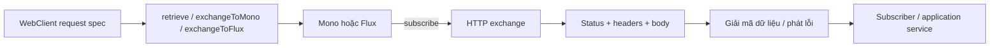
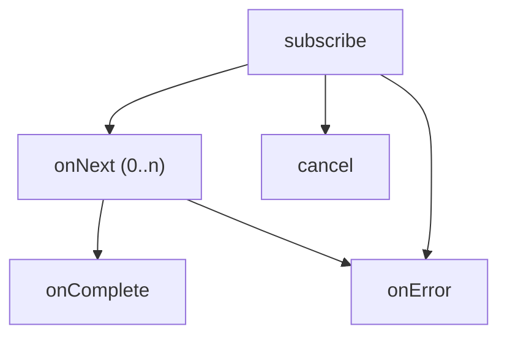
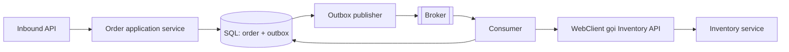

# retrieve, exchangeToMono và exchangeToFlux

Khi gọi API bên ngoài bằng **WebClient**, ứng dụng Spring Boot không chỉ cần gửi một HTTP request rồi nhận JSON. Những luồng tích hợp thực tế phải quyết định dựa trên mã phản hồi, đọc nội dung lỗi, xử lý trường hợp không có body, tiêu thụ dữ liệu dạng luồng, giới hạn thời gian chờ và phục hồi an toàn khi request thất bại.

Spring WebClient cung cấp ba lựa chọn thường gặp:

- **`retrieve()`**: cách ngắn gọn để lấy body hoặc response entity; mặc định chuyển HTTP 4xx/5xx thành lỗi.
- **`exchangeToMono(...)`**: xử lý **toàn bộ `ClientResponse`** theo nhánh logic tùy status, headers và body, rồi trả về một kết quả bất đồng bộ kiểu `Mono<T>`.
- **`exchangeToFlux(...)`**: tương tự nhưng trả về chuỗi kết quả `Flux<T>`; hữu ích khi cần quyết định cách tiêu thụ stream dựa trên response.

Bài thuộc chương **WebClient** trong module **SPRING_BOOT_INTEGRATION**, nơi Spring Boot được dùng để tích hợp qua HTTP client, SQL, cache, broker thông điệp và adapter của Spring Integration. Vì vậy, lựa chọn API không chỉ nhằm viết code ngắn mà còn liên quan **hợp đồng dữ liệu, giao dịch, lỗi, retry, idempotency, kiểm thử và observability** của toàn luồng.

> **Phiên bản minh họa:** Java 17+, Spring Boot 3.x/Spring Framework 6.x, Spring WebFlux và Project Reactor. Những nguyên tắc chung vẫn hữu ích ở các bản Spring mới, nhưng hãy kiểm tra API, dependency và cấu hình transport theo phiên bản của dự án. Không cần triển khai server WebFlux mới được sử dụng `WebClient`.

## 1. Mục tiêu học tập

Sau bài này, bạn có thể:

1. Phân biệt `retrieve`, `exchangeToMono` và `exchangeToFlux` theo quyền kiểm soát response.
2. Giải thích chuỗi thực thi `WebClient → request → ClientResponse → Mono/Flux`.
3. Dùng `retrieve().bodyToMono(...)` và `retrieve().bodyToFlux(...)` khi chỉ cần body.
4. Dùng `retrieve().onStatus(...)` để ánh xạ HTTP lỗi thành exception miền nghiệp vụ.
5. Dùng `exchangeToMono(...)` cho các trường hợp 200/204/404 hoặc body khác nhau theo status.
6. Dùng `exchangeToFlux(...)` cho NDJSON/SSE và kiểm soát luồng thất bại.
7. Hiểu vòng đời body/buffer và quy tắc không dùng lại `ClientResponse` sau khi callback kết thúc.
8. Thiết kế timeout, retry có giới hạn, idempotency, logging và integration test phù hợp.

## 2. Nền tảng: WebClient, Mono, Flux và ClientResponse

### 2.1. WebClient là HTTP client reactive

`WebClient` là API HTTP client không chặn theo mô hình reactive do Spring WebFlux cung cấp. Một lời gọi điển hình:

```java
Mono<ProductStock> stockMono = webClient.get()
        .uri("/api/v1/stocks/{sku}", "SKU-001")
        .retrieve()
        .bodyToMono(ProductStock.class);
```

Giá trị `stockMono` là **mô tả công việc bất đồng bộ**. Với các publisher HTTP thông thường của WebClient, request chỉ được thực hiện khi có subscription, ví dụ do WebFlux controller, một consumer trong pipeline hoặc subscriber trong test. Nếu không có subscription thì không được giả định request đã gửi.



### 2.2. Mono và Flux khác nhau thế nào?

| Kiểu Reactor | Ý nghĩa | Ví dụ |
| --- | --- | --- |
| `Mono<T>` | Phát **0 hoặc 1** giá trị rồi hoàn thành, hoặc kết thúc bằng lỗi | Một sản phẩm theo SKU, một kết quả đặt hàng |
| `Flux<T>` | Phát **0 đến nhiều** giá trị, rồi hoàn thành hoặc lỗi | Danh sách sản phẩm, NDJSON stream, SSE |
| `Mono<Void>` | Chỉ quan tâm hoàn thành/lỗi, không phát giá trị | HTTP 204 hoặc thao tác chỉ cần acknowledgment |
| `Mono<ResponseEntity<T>>` | Một response gồm status, headers và body đã giải mã | API cần đọc ETag hoặc status |

**Quan trọng:** `Flux<T>` không nhất thiết tương đương HTTP streaming vô hạn. Một JSON array trả trong một response cũng có thể được giải mã thành `Flux<T>`. Ngược lại, `retrieve().bodyToFlux(...)` **cũng có thể xử lý streaming**; không bắt buộc phải dùng `exchangeToFlux` chỉ vì dữ liệu có nhiều phần tử.

### 2.3. Status, headers và body

Phía HTTP phản hồi gồm:

```text
HTTP/1.1 200 OK
Content-Type: application/json
ETag: "v17"

{"sku":"SKU-001","availableQuantity":8}
```

- **Status**: thành công, tài nguyên không tồn tại, giới hạn tốc độ hoặc lỗi server.
- **Headers**: `Content-Type`, `ETag`, `Retry-After`, correlation ID, pagination/cursor...
- **Body**: JSON, văn bản, dữ liệu nhị phân, stream, hoặc không có dữ liệu.

`retrieve()` cung cấp `ResponseSpec` để giải mã body và tùy biến lỗi. `exchangeToMono/Flux` đưa `ClientResponse` trực tiếp vào hàm xử lý, cho phép quyết định dùng kiểu body nào **trước** khi giải mã.

## 3. Bảng so sánh ba API

| Tiêu chí | `retrieve()` | `exchangeToMono(...)` | `exchangeToFlux(...)` |
| --- | --- | --- | --- |
| Kiểu API trả ngay | `ResponseSpec` | `Mono<T>` | `Flux<T>` |
| Mức độ trừu tượng | Cao, ngắn gọn | Thấp hơn, thao tác trên `ClientResponse` | Thấp hơn, thao tác trên `ClientResponse` |
| HTTP 4xx/5xx mặc định | Tạo `WebClientResponseException` trừ khi có handler thay thế | **Do callback quyết định** | **Do callback quyết định** |
| Kiểm tra status/header trước khi chọn body | `onStatus` và `toEntity` hỗ trợ một phần | Thuận tiện, toàn quyền theo response | Thuận tiện, toàn quyền theo response |
| Trả một kết quả | `bodyToMono` | Tự trả `Mono<T>` | Có thể nhưng không tự nhiên |
| Trả nhiều kết quả | `bodyToFlux` | Có thể trả danh sách trong một Mono | Tự trả `Flux<T>` |
| Streaming NDJSON/SSE | **Có**, với `bodyToFlux` | Ít phù hợp nếu muốn phát từng phần tử | **Có**, với `bodyToFlux` trong callback |
| Mức độ code | Ít | Nhiều nhánh hơn | Nhiều nhánh hơn |
| Nên dùng khi | Success/body và lỗi thông thường | Quy tắc 200/202/204/404, nhiều schema | Stream và quyết định theo status/headers |

**Quy tắc thực hành:** Bắt đầu bằng `retrieve()`. Chỉ chuyển sang `exchangeToMono(...)` hoặc `exchangeToFlux(...)` nếu cần quyền kiểm soát mà `ResponseSpec` không diễn đạt rõ ràng. Không coi `exchangeToFlux` là “phiên bản mới hơn” hay “luôn nhanh hơn” của `retrieve().bodyToFlux`.

## 4. Chuẩn bị dự án Spring Boot

### 4.1. Dependency

Ví dụ Gradle (Groovy DSL):

```groovy
dependencies {
    implementation 'org.springframework.boot:spring-boot-starter-webflux'

    testImplementation 'org.springframework.boot:spring-boot-starter-test'
    testImplementation 'io.projectreactor:reactor-test'
    testImplementation 'com.squareup.okhttp3:mockwebserver:4.12.0'
}
```

- `spring-boot-starter-webflux` cung cấp WebClient, Reactor và HTTP client runtime phù hợp.
- `reactor-test` cung cấp `StepVerifier` để kiểm tra các tín hiệu `onNext`, `onComplete` và `onError`.
- MockWebServer là **HTTP test server** thực thi trên loopback, cho phép kiểm tra request thật ở tầng HTTP mà không gọi endpoint đối tác.
- Với các dependency bên ngoài Spring Boot BOM, cần xác định version được quản lý hay đặt version riêng phù hợp. Trong ví dụ, MockWebServer được chỉ rõ phiên bản.

Một ứng dụng Spring MVC vẫn có thể sử dụng `WebClient` cho outbound HTTP khi thêm dependency thích hợp. Đưa `spring-boot-starter-webflux` vào ứng dụng đã có starter MVC không đồng nghĩa toàn bộ server tự chuyển sang mô hình WebFlux; cần hiểu cấu hình web application type đang được chọn.

### 4.2. Config base URL và timeout

Ví dụ `application-local.yml`:

```yaml
integration:
  partner:
    base-url: ${PARTNER_BASE_URL}
    connect-timeout-ms: 2000
    response-timeout: 5s
```

`PARTNER_BASE_URL` cần lấy từ biến môi trường hoặc cấu hình triển khai được kiểm soát, chẳng hạn URL sandbox của đối tác. Không hardcode token hoặc secret vào source và log.

Ví dụ cấu hình Java với Reactor Netty:

```java
package com.example.integration.partner;

import java.time.Duration;

import io.netty.channel.ChannelOption;
import org.springframework.beans.factory.annotation.Value;
import org.springframework.context.annotation.Bean;
import org.springframework.context.annotation.Configuration;
import org.springframework.http.client.reactive.ReactorClientHttpConnector;
import org.springframework.web.reactive.function.client.WebClient;
import reactor.netty.http.client.HttpClient;

@Configuration
public class PartnerClientConfiguration {

    @Bean("partnerWebClient")
    WebClient partnerWebClient(
            WebClient.Builder builder,
            @Value("${integration.partner.base-url}") String baseUrl,
            @Value("${integration.partner.connect-timeout-ms}") int connectMs,
            @Value("${integration.partner.response-timeout}") Duration responseTimeout) {

        HttpClient httpClient = HttpClient.create()
                .option(ChannelOption.CONNECT_TIMEOUT_MILLIS, connectMs)
                .responseTimeout(responseTimeout);

        return builder
                .baseUrl(baseUrl)
                .clientConnector(new ReactorClientHttpConnector(httpClient))
                .build();
    }
}
```

Giải thích:

1. `WebClient.Builder` từ Spring Boot giúp client tham gia hệ sinh thái auto-configuration/customization khi tương ứng.
2. `baseUrl` gắn vào các đường dẫn tương đối như `/api/v1/stocks/{sku}`.
3. Connect timeout và response timeout giới hạn hai công đoạn khác nhau; chúng **không tự tạo một deadline chung** cho nhiều lần retry.
4. Client có thể dùng pool kết nối; giới hạn đồng thời, pool, DNS/TLS và proxy cần điều chỉnh theo tải và môi trường.
5. Nếu ứng dụng có nhiều outbound client, dùng bean riêng hoặc `@Qualifier` để tránh gọi nhầm endpoint/credential.

Cấu hình thật còn cần authentication (OAuth2/API key/mTLS), chứng chỉ CA tin cậy, chuẩn hóa log và chính sách retry. Thay transport hoặc request factory có thể làm semantics timeout khác đi; hãy kiểm thử với chính stack được triển khai.

## 5. DTO và API mẫu xuyên suốt bài

Giả sử một **Partner Inventory API** có các operation:

| API | Phản hồi | Ý nghĩa |
| --- | --- | --- |
| `GET /api/v1/stocks/{sku}` | 200 + JSON, 404, 503... | Truy vấn số lượng tồn |
| `GET /api/v1/stocks/{sku}/availability` | 200 + JSON, 204, 404 | Quy tắc status đặc thù của đối tác |
| `GET /api/v1/shipments/{id}/events` | 200 + NDJSON stream, 404, 429... | Phát nhiều sự kiện trạng thái |
| `POST /api/v1/reservations` | 201/202 hoặc lỗi | Tạo phiếu giữ hàng, có side effect |

Dữ liệu JSON trả về:

```json
{
  "sku": "SKU-001",
  "availableQuantity": 8,
  "updatedAt": "2026-11-21T02:15:40Z"
}
```

Record Java tương ứng:

**`ProductStock.java`**

```java
package com.example.integration.partner;

import java.time.Instant;

public record ProductStock(
        String sku,
        long availableQuantity,
        Instant updatedAt
) {}
```

**`TrackingEvent.java`**

```java
package com.example.integration.partner;

import java.time.Instant;

public record TrackingEvent(
        String eventId,
        String shipmentId,
        String state,
        Instant occurredAt
) {}
```

Đây là **DTO của đối tác**, không phải SQL entity hay contract miền nghiệp vụ bắt buộc dùng chung cho mọi hệ thống. Trong luồng thực tế cần validate trường bắt buộc, version schema, timezone, mã trạng thái và tenant. JSON parse thành công không tự chứng minh số lượng và mã trạng thái hợp lệ.

## 6. retrieve(): cách mặc định khi cần body

### 6.1. Một object với bodyToMono

**`PartnerInventoryClient.java`** (rút gọn):

```java
package com.example.integration.partner;

import org.springframework.beans.factory.annotation.Qualifier;
import org.springframework.http.MediaType;
import org.springframework.stereotype.Component;
import org.springframework.web.reactive.function.client.WebClient;

import reactor.core.publisher.Mono;

@Component
public class PartnerInventoryClient {
    private final WebClient client;

    public PartnerInventoryClient(
            @Qualifier("partnerWebClient") WebClient client) {
        this.client = client;
    }

    public Mono<ProductStock> getStock(String sku) {
        return client.get()
                .uri("/api/v1/stocks/{sku}", sku)
                .accept(MediaType.APPLICATION_JSON)
                .retrieve()
                .bodyToMono(ProductStock.class);
    }
}
```

Cách đọc:

1. `get()` xây request GET.
2. `uri(...)` bind SKU vào path template; không nối URL bằng dữ liệu raw.
3. `accept(...)` công bố định dạng response mong đợi.
4. `retrieve()` tạo `ResponseSpec`.
5. `bodyToMono(ProductStock.class)` giải mã JSON thành một `ProductStock` trong reactive publisher.

Nếu response là `200 OK` và body hợp lệ, subscriber nhận object rồi complete. Nếu response là `204 No Content`, kết quả `bodyToMono` thường hoàn thành **không phát giá trị**, không phải `new ProductStock(null,0,null)`. Không nên dùng `defaultIfEmpty(...)` để tạo một sản phẩm giả mà không có hợp đồng nghiệp vụ.

### 6.2. Giá trị trả về bất đồng bộ và subscription

```java
Mono<ProductStock> stockMono = inventoryClient.getStock("SKU-001");

// Đây mới là mô tả pipeline, chưa có dữ liệu trực tiếp.
Mono<Boolean> hasStock = stockMono
        .map(stock -> stock.availableQuantity() > 0);
```

Trong WebFlux controller, có thể trả thẳng `Mono<Boolean>` để framework subscribe và ghi HTTP response.

Trong một ứng dụng Spring MVC hoặc job blocking, `block()` có thể được dùng **ở biên đồng bộ đã kiểm soát** nếu thật sự cần, nhưng tránh `block()` trên thread event-loop/reactive request handling. Việc block sai chỗ dễ gây nghẽn hoặc lỗi. Không viết `subscribe()` tràn lan trong application service vì dễ mất kiểm soát lifecycle, lỗi, cancellation và transaction.

**Cold publisher:** mỗi lần subscribe vào một pipeline WebClient thông thường có thể thực hiện lại HTTP exchange. Nếu cùng một `Mono` được subscribe hai lần, **không được mặc định coi nó là một request duy nhất**. Điều này đặc biệt quan trọng với HTTP POST tạo side effect.

### 6.3. BodyToFlux với retrieve

`retrieve()` không chỉ dùng cho `Mono`:

```java
Flux<TrackingEvent> events = client.get()
        .uri("/api/v1/shipments/{id}/events", shipmentId)
        .accept(MediaType.APPLICATION_NDJSON)
        .retrieve()
        .bodyToFlux(TrackingEvent.class);
```

Ở đây `bodyToFlux` phát nhiều `TrackingEvent`. Nếu HTTP response sử dụng NDJSON thực sự, các document JSON được gửi thành từng dòng và client có thể giải mã lần lượt tùy codec và cách stream được truyền.

Nếu server trả một JSON array bình thường, `bodyToFlux` cũng có thể phát các phần tử nhưng không nhất thiết nhận từng phần tử ngay khi phía server bắt đầu gửi. Đặc điểm streaming thực tế phụ thuộc **Content-Type**, cách server flush và message decoder.

### 6.4. Cần status và header: toEntity

Không nhất thiết chuyển sang `exchangeToMono` chỉ để đọc header:

```java
Mono<ResponseEntity<ProductStock>> responseMono = client.get()
        .uri("/api/v1/stocks/{sku}", sku)
        .retrieve()
        .toEntity(ProductStock.class);
```

`ResponseEntity<ProductStock>` chứa status, headers và body đã được giải mã. Có thể đọc `ETag`, `Last-Modified` hoặc pagination headers nếu API sử dụng.

Với danh sách:

```java
Mono<ResponseEntity<List<ProductStock>>> responseMono = client.get()
        .uri("/api/v1/stocks")
        .retrieve()
        .toEntityList(ProductStock.class);
```

Nếu chỉ cần danh sách trong `Mono`:

```java
Mono<List<ProductStock>> result = client.get()
        .uri("/api/v1/stocks")
        .retrieve()
        .bodyToFlux(ProductStock.class)
        .collectList();
```

`collectList()` giữ toàn bộ phần tử trong bộ nhớ cho tới khi nguồn hoàn tất. Không dùng tùy tiện với stream vô hạn hoặc danh sách quá lớn.

## 7. retrieve().onStatus(): tùy biến nhánh lỗi

### 7.1. Hành vi mặc định

Khi sử dụng `retrieve()`:

- HTTP **2xx**: mặc định xử lý như response thành công và cho phép decode body.
- HTTP **4xx/5xx**: mặc định phát lỗi dạng `WebClientResponseException`, với subtype tương ứng những status phổ biến.
- Lỗi mạng, DNS, TLS hoặc timeout có thể phát ngoại lệ khác, thường bao gồm `WebClientRequestException` hoặc lỗi từ các tầng Reactor/Netty.
- HTTP **3xx**: hành vi redirect phụ thuộc HTTP client và cấu hình; `retrieve()` không mặc nhiên coi mọi 3xx là 4xx/5xx. Nếu redirect là phần quan trọng của hợp đồng, hãy kiểm tra rõ ràng.

Không phải mọi `404` đều có nghĩa “không tồn kho”, và không phải mọi `409` đều nên retry. Ý nghĩa business thuộc về **hợp đồng API đối tác**.

### 7.2. Ánh xạ 404 sang domain exception

Giả sử đối tác quy định `404` nghĩa là SKU không tồn tại. Có thể dùng:

```java
public Mono<ProductStock> getRequiredStock(String sku) {
    return client.get()
            .uri("/api/v1/stocks/{sku}", sku)
            .retrieve()
            .onStatus(
                    status -> status.value() == 404,
                    response -> response.releaseBody()
                            .thenReturn(new StockNotFoundException(sku))
            )
            .bodyToMono(ProductStock.class);
}
```

Với exception:

```java
public class StockNotFoundException extends RuntimeException {
    public StockNotFoundException(String sku) {
        super("Không tìm thấy SKU: " + sku);
    }
}
```

Trong ví dụ, `releaseBody()` cho phép giải phóng body nếu không cần nội dung lỗi. Callback của `onStatus` trả `Mono<? extends Throwable>`; Spring WebClient sử dụng ngoại lệ đó làm tín hiệu lỗi khi status khớp. Những status khác vẫn theo chính sách mặc định.

### 7.3. Khi cần đọc error body

Nếu đối tác gửi JSON lỗi:

```json
{
  "code": "STOCK_LOCKED",
  "message": "Sản phẩm tạm thời không được đặt giữ"
}
```

Ta có thể đọc nó trước khi tạo ngoại lệ nghiệp vụ:

```java
record PartnerError(String code, String message) {}

public Mono<ProductStock> getWithBusinessError(String sku) {
    return client.get()
            .uri("/api/v1/stocks/{sku}", sku)
            .retrieve()
            .onStatus(
                    status -> status.value() == 409,
                    response -> response
                            .bodyToMono(PartnerError.class)
                            .defaultIfEmpty(
                                    new PartnerError("UNKNOWN", "Không có body lỗi"))
                            .map(err -> new IllegalStateException(
                                    "Đối tác từ chối: " + err.code()))
            )
            .bodyToMono(ProductStock.class);
}
```

Lưu ý:

- `PartnerError` nên được khai báo thành type riêng, có visibility/constructor phù hợp với codec dự án khi triển khai thực tế.
- Nếu phía đối tác trả HTML/text thay vì JSON đã hứa, giải mã `PartnerError` có thể thất bại; cần chính sách xử lý body lỗi sai contract.
- Không log toàn bộ raw body nếu có PII, token hoặc dữ liệu nhạy cảm.
- `onStatus` với callback trả `Mono.empty()` sẽ **không tạo lỗi cho status đó**, để xử lý body tiếp tục. Điều này chỉ an toàn khi kiểu body và ý nghĩa response cho phép; nếu cần 404 → `Optional.empty()` hoặc 204 → một trạng thái riêng, `exchangeToMono` có thể rõ hơn.

## 8. exchangeToMono(): quyết định theo response đầy đủ

### 8.1. Khi nào cần exchangeToMono?

`retrieve()` phù hợp với đường đi thành công thông thường. Tuy nhiên, đối tác có thể định nghĩa:

- `200 OK`: có JSON tồn kho.
- `204 No Content`: chưa có snapshot tồn kho tại thời điểm truy vấn.
- `404 Not Found`: SKU không tồn tại.
- `429 Too Many Requests`: giới hạn tốc độ.
- `5xx`: lỗi tạm thời.

Nếu muốn trả về **một kiểu kết quả nội bộ phân biệt ba trường hợp đầu**, ta có thể dùng `exchangeToMono(...)`. Thay vì cố decode mọi response thành `ProductStock`, callback quyết định branch theo status.

### 8.2. Kiểu kết quả thể hiện ý nghĩa nghiệp vụ

**`StockLookup.java`**

```java
package com.example.integration.partner;

public sealed interface StockLookup
        permits StockLookup.Found, StockLookup.Pending, StockLookup.Missing {

    record Found(ProductStock stock) implements StockLookup {}

    record Pending(String sku) implements StockLookup {}

    record Missing(String sku) implements StockLookup {}
}
```

`Found`, `Pending` và `Missing` khác nhau rõ ràng. Không cần dùng giá trị `null` hoặc số lượng bằng 0 để mã hóa mọi tình huống.

### 8.3. Code exchangeToMono

**Một method bổ sung cho `PartnerInventoryClient`:**

```java
public Mono<StockLookup> lookup(String sku) {
    return client.get()
            .uri("/api/v1/stocks/{sku}/availability", sku)
            .accept(MediaType.APPLICATION_JSON)
            .exchangeToMono(response -> {
                int status = response.statusCode().value();

                if (status == 200) {
                    return response.bodyToMono(ProductStock.class)
                            .switchIfEmpty(Mono.error(
                                    new IllegalStateException(
                                            "200 OK nhưng thiếu body tồn kho")))
                            .map(stock -> (StockLookup)
                                    new StockLookup.Found(stock));
                }

                if (status == 204) {
                    return response.releaseBody()
                            .thenReturn((StockLookup)
                                    new StockLookup.Pending(sku));
                }

                if (status == 404) {
                    return response.releaseBody()
                            .thenReturn((StockLookup)
                                    new StockLookup.Missing(sku));
                }

                return response.createError();
            });
}
```

Cách đọc:

1. Callback `response -> { ... }` nhận `ClientResponse` chứa status, headers và body.
2. `200`: decode một `ProductStock`; nếu thiếu body so với contract thì báo lỗi.
3. `204`: trả `Pending` **không cần decode body**.
4. `404`: trả `Missing` theo **hợp đồng riêng của API ví dụ**.
5. Những status không được chấp nhận: dùng `response.createError()` để tạo publisher kết thúc bằng `WebClientResponseException`.

**Khác với `retrieve()`:** Khi gọi `exchangeToMono(...)`, **callback tự chịu trách nhiệm xác định status nào là thành công và status nào là lỗi**. Nếu chỉ trả `response.bodyToMono(ProductStock.class)` cho mọi status, HTTP 500 có thể bị diễn giải sai hoặc ném lỗi parse thay vì lỗi status. Phải viết nhánh rõ ràng.

### 8.4. Vì sao phải sử dụng body trong callback?

`exchangeToMono` nhận quyền kiểm soát `ClientResponse` trong phạm vi callback. Khi `Mono` do callback trả về kết thúc, WebClient kiểm tra và giải phóng phần body **chưa được tiêu thụ**, giúp tránh rò rỉ tài nguyên kết nối/buffer.

Vì vậy, đoạn sau là **sai về ý tưởng**:

```java
Mono<ClientResponse> unsafe = client.get()
        .uri("/api/v1/stocks/{sku}", sku)
        .exchangeToMono(response -> Mono.just(response));

// Sai: cố đọc response body sau khi callback exchangeToMono đã trả publisher.
Mono<ProductStock> later = unsafe.flatMap(
        response -> response.bodyToMono(ProductStock.class));
```

Không nên chuyển `ClientResponse` ra ngoài callback rồi decode downstream vì body có thể đã bị giải phóng sau khi publisher được trả từ callback hoàn thành. Hãy decode **bên trong**:

```java
Mono<ProductStock> safe = client.get()
        .uri("/api/v1/stocks/{sku}", sku)
        .exchangeToMono(response -> {
            if (response.statusCode().is2xxSuccessful()) {
                return response.bodyToMono(ProductStock.class);
            }
            return response.createError();
        });
```

Đây là một lý do quan trọng khiến `exchangeToMono`/`exchangeToFlux` thay thế mẫu `exchange()` cũ, vốn dễ khiến lập trình viên quên tiêu thụ/giải phóng body.

### 8.5. releaseBody và createError khác nhau thế nào?

| Thao tác | Sử dụng khi nào | Kết quả |
| --- | --- | --- |
| `response.bodyToMono(T.class)` | Cần decode body thành một đối tượng | `Mono<T>` |
| `response.bodyToFlux(T.class)` | Cần decode nhiều phần tử | `Flux<T>` |
| `response.releaseBody()` | Không cần body, muốn bỏ qua/giải phóng | `Mono<Void>` |
| `response.createException()` | Cần tạo đối tượng exception chứa status/headers/body | `Mono<WebClientResponseException>` |
| `response.createError()` | Cần trả một publisher **kết thúc bằng lỗi HTTP** | `Mono<T>` phát `WebClientResponseException` |

Không tạo lỗi bằng `Mono.error(response.createException())`: `createException()` trả một **Mono** chứa exception, không phải exception có sẵn. Nếu cần dùng `createException()`:

```java
return response.createException()
        .flatMap(Mono::error);
```

Trong phần lớn trường hợp chỉ cần phát lỗi HTTP, `response.createError()` ngắn và rõ hơn.

## 9. exchangeToFlux(): nhiều phần tử với quyền kiểm soát response

### 9.1. Dữ liệu nhiều phần tử không nhất thiết cần exchangeToFlux

Đoạn sau hoàn toàn hợp lệ khi mọi response thành công có cùng cấu trúc và muốn default 4xx/5xx:

```java
public Flux<TrackingEvent> readEvents(String shipmentId) {
    return client.get()
            .uri("/api/v1/shipments/{id}/events", shipmentId)
            .accept(MediaType.APPLICATION_NDJSON)
            .retrieve()
            .bodyToFlux(TrackingEvent.class);
}
```

Chỉ chuyển sang `exchangeToFlux(...)` nếu cần xử lý status/header riêng trước khi đọc stream, ví dụ `404` trả Flux rỗng còn `429`/`503` là lỗi có thể retry theo chính sách.

### 9.2. Ví dụ NDJSON streaming

Mỗi dòng là một JSON object độc lập:

```text
{"eventId":"e-1","shipmentId":"S-42","state":"PICKED_UP","occurredAt":"2026-11-21T01:00:00Z"}
{"eventId":"e-2","shipmentId":"S-42","state":"IN_TRANSIT","occurredAt":"2026-11-21T02:00:00Z"}
{"eventId":"e-3","shipmentId":"S-42","state":"DELIVERED","occurredAt":"2026-11-21T03:00:00Z"}
```

**Method với `exchangeToFlux(...)`:**

```java
public Flux<TrackingEvent> streamEvents(String shipmentId) {
    return client.get()
            .uri("/api/v1/shipments/{id}/events", shipmentId)
            .accept(MediaType.APPLICATION_NDJSON)
            .exchangeToFlux(response -> {
                int status = response.statusCode().value();

                if (status == 200) {
                    return response.bodyToFlux(TrackingEvent.class);
                }

                if (status == 404) {
                    // Chỉ nếu hợp đồng quy định 404 là "chưa có stream".
                    return response.releaseBody()
                            .thenMany(Flux.empty());
                }

                return response.createError().flux();
            });
}
```

Ý nghĩa:

- `200`: body được decode thành nhiều `TrackingEvent` trong `Flux`.
- `404`: ví dụ **có chủ đích** ánh xạ thành stream rỗng; trong một API khác, 404 có thể phải là lỗi.
- `createError().flux()` chuyển một `Mono` kết thúc bằng lỗi thành `Flux` kết thúc bằng lỗi, phù hợp kiểu trả về.
- Khi publisher do callback trả về kết thúc hoặc bị hủy theo lifecycle, WebClient quản lý giải phóng body/tài nguyên theo cơ chế client; tránh giữ `ClientResponse` bên ngoài callback.

### 9.3. SSE với Server-Sent Events

Nếu đối tác dùng `Content-Type: text/event-stream` thay vì NDJSON:

```java
import org.springframework.core.ParameterizedTypeReference;
import org.springframework.http.codec.ServerSentEvent;

public Flux<ServerSentEvent<TrackingEvent>> subscribeToSse(
        String shipmentId) {

    return client.get()
            .uri("/api/v1/shipments/{id}/events", shipmentId)
            .accept(MediaType.TEXT_EVENT_STREAM)
            .retrieve()
            .bodyToFlux(
                    new ParameterizedTypeReference<
                            ServerSentEvent<TrackingEvent>>() {});
}
```

SSE có thể chứa ID, event name, retry hint và data; nếu cần những metadata đó, dùng `ServerSentEvent<T>` thay vì chỉ decode data object. WebClient không tự bảo đảm replay đầy đủ, “exactly once” hay tự động tiếp tục từ `Last-Event-ID` theo contract riêng của đối tác. Khi reconnect phải xác định ID, cursor, retry và chống trùng.

### 9.4. Backpressure và stream dài

Một `Flux` hỗ trợ cơ chế **reactive demand**, nhưng điều đó **không chứng minh máy chủ HTTP ngoài luôn giảm tốc độ gửi** tương ứng. Với stream dài:

- Giới hạn số connection đồng thời, message size và kích thước buffer.
- Dùng `take(n)`, cancellation hoặc deadline khi nhiệm vụ chỉ cần một số bản ghi nhất định.
- Tránh `collectList()` với stream vô hạn, vì có thể giữ toàn bộ dữ liệu trong bộ nhớ mà không hoàn tất.
- Tránh `onBackpressureBuffer()` không giới hạn để “chữa” consumer chậm.
- Theo dõi tốc độ đầu vào, lag, cancellation và xử lý theo checkpoint/cursor nếu cần resume.

Không dùng `exchangeToFlux` để che vấn đề upstream phải phân trang hoặc cung cấp API batch có kiểm soát.

## 10. Vòng đời body, DataBuffer và giới hạn bộ nhớ

### 10.1. Tại sao giải phóng body quan trọng?

Ở WebFlux/Reactor Netty, response body có thể đi qua các buffer/tài nguyên được pool. Nếu code giữ `ClientResponse` rồi quên tiêu thụ hoặc giải phóng, tài nguyên có thể bị giữ lâu hơn cần thiết.

`retrieve()` che bớt việc quản lý response. `exchangeToMono` và `exchangeToFlux` cho bạn quyền xử lý status/body nhưng yêu cầu **quyết định rõ** body nào sẽ được decode hoặc bỏ qua.

Framework có cơ chế giải phóng body chưa tiêu thụ sau khi publisher do callback trả về kết thúc; tuy nhiên không nên:

- Đưa `ClientResponse` ra ngoài callback để dùng lại.
- Đọc cùng response body nhiều lần bằng hai `bodyToMono` độc lập.
- Tự quản lý `DataBuffer` mà không tuân thủ hợp đồng release.
- Chuyển raw buffer sang một pipeline khác khi chưa có chiến lược lifecycle rõ.
- Dùng response stream dài rồi bỏ quên cancellation.

### 10.2. Lỗi vượt giới hạn codec

Nếu response JSON quá lớn, quá trình gom/giải mã body có thể gặp lỗi như `DataBufferLimitException` khi vượt giới hạn buffer được cấu hình.

Ví dụ đặt giới hạn kích thước dữ liệu **được phép gom trong bộ nhớ**:

```java
WebClient limitedClient = WebClient.builder()
        .baseUrl("https://partner.example.test")
        .codecs(configurer -> configurer.defaultCodecs()
                .maxInMemorySize(512 * 1024))
        .build();
```

Domain trên chỉ là URL minh họa; không dùng để gọi trong test/production. Việc tăng `maxInMemorySize` không thay thế xử lý streaming đúng cách hoặc giới hạn body từ đối tác. Với payload lớn, cân nhắc batch/page/NDJSON, kiểm tra kích thước từ upstream và phân bổ memory có giới hạn.

### 10.3. Không decode body hai lần

Sai về ý tưởng:

```java
return client.get().uri("/resource")
        .exchangeToMono(response -> {
            Mono<String> raw = response.bodyToMono(String.class);
            Mono<MyDto> dto = response.bodyToMono(MyDto.class);
            // Hai attempt độc lập đọc cùng response stream: không an toàn.
            return Mono.zip(raw, dto);
        });
```

Nếu cần kiểm tra cả raw JSON và parse object, đọc **một lần** rồi chuyển trong pipeline, với giới hạn dữ liệu và an toàn log:

```java
return client.get().uri("/resource")
        .exchangeToMono(response ->
                response.bodyToMono(String.class)
                        .map(raw -> parseAndValidate(raw)));
```

`parseAndValidate(...)` ở đây là hàm giả định do ứng dụng cài đặt. Trong production, nên ưu tiên decoder đã cấu hình và chỉ đọc raw body nếu thật sự cần.

## 11. Reactive pipeline: lỗi, cancellation và subscribe nhiều lần

### 11.1. Ba tín hiệu chính

Một publisher Reactor có thể phát:



`onComplete` và `onError` là hai đường kết thúc khác nhau; cancellation dừng tiêu thụ mà không phải business success. Ví dụ `Flux.empty()` nghĩa là không có phần tử rồi complete, **không đồng nghĩa remote API đã trả 404** trừ khi code/hợp đồng mapping rõ ràng.

### 11.2. Có thể làm gì với lỗi?

Các toán tử hay dùng:

| Toán tử | Tác dụng | Lưu ý |
| --- | --- | --- |
| `onErrorMap` | Chuyển exception hạ tầng sang exception/domain result | Giữ nguyên cause; tránh che mọi loại lỗi |
| `onErrorResume` | Chọn fallback publisher | Không mặc định trả tồn kho bằng 0 khi upstream lỗi |
| `retryWhen` | Subscribe lại khi thỏa chính sách | Có thể gửi lại HTTP request; phải an toàn/idempotent |
| `timeout` | Phát lỗi khi quá thời gian chờ theo vị trí toán tử | Phân biệt deadline tổng và timeout từng attempt |
| `doOnError` | Ghi tín hiệu quan sát | Không để log side effect làm thay đổi business flow |
| `doFinally` | Quan sát kết thúc kể cả cancel | Phù hợp đo lifecycle, cleanup phụ trợ |

Các toán tử được đặt **ở đâu** trong pipeline sẽ ảnh hưởng ý nghĩa. `retryWhen` đặt ở một đoạn sau thao tác ghi SQL/HTTP có thể vô tình thực hiện lại nhiều side effect. Cần khoanh vùng retry chỉ quanh thao tác remote phù hợp.

### 11.3. Retry không biến POST thành an toàn

Ví dụ GET idempotent với giới hạn retry:

```java
import java.time.Duration;

import org.springframework.web.reactive.function.client.WebClientResponseException;
import reactor.util.retry.Retry;

public Mono<ProductStock> getStockWithRetry(String sku) {
    return client.get()
            .uri("/api/v1/stocks/{sku}", sku)
            .retrieve()
            .bodyToMono(ProductStock.class)
            .retryWhen(Retry.backoff(2, Duration.ofMillis(200))
                    .maxBackoff(Duration.ofSeconds(2))
                    .jitter(0.4)
                    .filter(error ->
                            error instanceof WebClientResponseException ex
                            && (ex.getStatusCode().value() == 429
                                || ex.getStatusCode().is5xxServerError())))
            .timeout(Duration.ofSeconds(5));
}
```

Trong ví dụ:

- Hai lần **retry tối đa** sau lần gọi ban đầu theo `Retry.backoff(2, ...)`.
- Chỉ retry `429` và `5xx` theo lựa chọn minh họa; không retry `400`/`404`.
- `timeout(5s)` đặt **sau** `retryWhen` giới hạn tổng thời gian của publisher gồm cả retry/backoff. Nếu đặt `timeout` **trước** `retryWhen`, timeout có thể áp dụng cho từng lần subscribe lại và tổng thời gian vượt ngưỡng 5 giây.
- Một API thực tế có thể dùng `Retry-After` của `429`, rate limiter, circuit breaker và retry budget chung. Ví dụ không tự xử lý `Retry-After`.
- GET có tính chất đọc trong hợp đồng ví dụ; nếu upstream định nghĩa side effect hoặc GET làm thay đổi trạng thái, phải kiểm tra lại chính sách.

Với HTTP POST tạo reservation, timeout có thể xảy ra **sau khi đối tác đã commit**. Retry POST cần operation ID/`Idempotency-Key` cố định và phía đối tác thực sự thực thi hợp đồng idempotency. Không sinh khóa mới ở mỗi lần retry.

### 11.4. Timeout cho Flux khác Mono

`Flux.timeout(Duration.ofSeconds(5))` thường giới hạn **thời gian chờ tín hiệu tiếp theo** trong stream. Với SSE có thể sống nhiều giờ và gửi sự kiện mỗi phút, timeout 5 giây sẽ khiến kết nối lỗi dù server đang hoạt động bình thường theo hợp đồng.

Hãy phân biệt:

- Timeout thiết lập kết nối.
- Timeout chờ byte/response.
- Timeout chờ phần tử tiếp theo trong reactive stream.
- Deadline cho toàn bộ operation.
- Quy tắc heartbeat và reconnect của SSE/NDJSON stream.

Không đặt mọi loại timeout cùng một giá trị chỉ vì config đơn giản.

## 12. Tích hợp WebClient với SQL, cache và broker

Trong **SPRING_BOOT_INTEGRATION**, HTTP request thường nằm trong một luồng có nhiều biên:



Những quyết định cần làm rõ:

1. **Transaction:** `@Transactional` trên SQL database không tự bao phủ HTTP call hoặc publish broker. Không thể rollback side effect HTTP chỉ vì SQL rollback.
2. **Error propagation:** `Mono.error(...)` hoặc `Flux.error(...)` phải được ứng dụng/consumer xử lý theo hợp đồng; log exception không tự tạo retry đúng.
3. **Idempotency:** broker có thể redeliver message; consumer có thể gọi lại HTTP. Giữ khóa operation ổn định, dùng inbox/outbox hoặc reconciliation khi cần.
4. **Cache:** đọc từ cache có thể giảm HTTP call nhưng phải định nghĩa TTL, invalidation và độ mới dữ liệu. Không ngầm coi cache hit là kết quả chính xác ở mọi nghiệp vụ.
5. **Header/correlation:** truyền correlation/trace ID qua các adapter để quan sát, đồng thời phân biệt ID của request với ID nghiệp vụ.
6. **Hợp đồng dữ liệu:** DTO HTTP ngoài cần mapper/validation trước khi dùng ở SQL hoặc gửi message. Không cho phép giá trị enum ngoài hợp đồng tự trở thành trạng thái thành công.

### 12.1. Một ví dụ về side effect không xác định

```text
Consumer nhận OrderCreated(order-17)
  -> POST /reservations với operationId=order-17:reserve
  -> Đối tác tạo reservation và commit
  -> Mạng ngắt trước khi client nhận HTTP 201
  -> WebClient phát timeout
  -> Consumer retry/redeliver message
```

Nếu phía đối tác hỗ trợ idempotency theo `operationId`, lần gọi sau có thể trả kết quả cũ hoặc xác nhận thao tác đã tồn tại. Nếu không, cần tra cứu, đối soát hoặc một quy trình thiết kế bù riêng. **Việc dùng `retrieve` hay `exchangeToMono` không giải quyết tự động duplicate.** Chúng chỉ quyết định cách phản hồi HTTP được đọc và xử lý.

## 13. Kiểm thử ba API bằng HTTP test server

Unit test với `WebClient` bị mock quá sâu có thể bỏ sót URI encoding, header, status handling và JSON codec. Một HTTP server giả chạy trên loopback cho phép kiểm tra **request/response thật ở tầng protocol**, nhưng không gọi đối tác production.

### 13.1. Dựng MockWebServer

Ví dụ JUnit 5 và MockWebServer:

```java
package com.example.integration.partner;

import static org.junit.jupiter.api.Assertions.assertEquals;

import java.io.IOException;

import okhttp3.mockwebserver.MockResponse;
import okhttp3.mockwebserver.MockWebServer;
import okhttp3.mockwebserver.RecordedRequest;

import org.junit.jupiter.api.AfterEach;
import org.junit.jupiter.api.BeforeEach;
import org.junit.jupiter.api.Test;
import org.springframework.web.reactive.function.client.WebClient;
import org.springframework.web.reactive.function.client.WebClientResponseException;

import reactor.test.StepVerifier;

class PartnerInventoryClientTest {

    private MockWebServer server;
    private PartnerInventoryClient inventory;

    @BeforeEach
    void setUp() throws IOException {
        server = new MockWebServer();
        server.start();

        WebClient webClient = WebClient.builder()
                .baseUrl(server.url("/").toString())
                .build();

        inventory = new PartnerInventoryClient(webClient);
    }

    @AfterEach
    void tearDown() throws IOException {
        server.shutdown();
    }

    @Test
    void retrieveDecodes200AndSendsCorrectPath() throws Exception {
        server.enqueue(new MockResponse()
                .setResponseCode(200)
                .addHeader("Content-Type", "application/json")
                .setBody("""
                        {
                          "sku": "SKU-001",
                          "availableQuantity": 8,
                          "updatedAt": "2026-11-21T02:15:40Z"
                        }
                        """));

        StepVerifier.create(inventory.getStock("SKU-001"))
                .expectNextMatches(stock ->
                        stock.sku().equals("SKU-001")
                                && stock.availableQuantity() == 8L)
                .verifyComplete();

        RecordedRequest request = server.takeRequest();
        assertEquals("GET", request.getMethod());
        assertEquals("/api/v1/stocks/SKU-001", request.getPath());
    }

    @Test
    void exchangeToMonoMaps404ToMissing() {
        server.enqueue(new MockResponse().setResponseCode(404));

        StepVerifier.create(inventory.lookup("SKU-404"))
                .expectNextMatches(result ->
                        result instanceof StockLookup.Missing missing
                                && missing.sku().equals("SKU-404"))
                .verifyComplete();
    }

    @Test
    void exchangeToFluxDecodesNdjson() {
        server.enqueue(new MockResponse()
                .setResponseCode(200)
                .addHeader("Content-Type", "application/x-ndjson")
                .setBody("""
                        {"eventId":"e1","shipmentId":"S-42","state":"PICKED_UP","occurredAt":"2026-11-21T01:00:00Z"}
                        {"eventId":"e2","shipmentId":"S-42","state":"DELIVERED","occurredAt":"2026-11-21T02:00:00Z"}
                        """));

        StepVerifier.create(inventory.streamEvents("S-42"))
                .expectNextMatches(e -> e.eventId().equals("e1"))
                .expectNextMatches(e -> e.eventId().equals("e2"))
                .verifyComplete();
    }

    @Test
    void retrieveDefaults503ToHttpError() {
        server.enqueue(new MockResponse()
                .setResponseCode(503)
                .setBody("service unavailable"));

        StepVerifier.create(inventory.getStock("SKU-001"))
                .expectError(WebClientResponseException.ServiceUnavailable.class)
                .verify();
    }
}
```

Để chạy test trên, đặt các record/interface và những method `getStock`, `lookup`, `streamEvents` như các đoạn trước vào source tương ứng. Ví dụ test là **kiểm tra contract HTTP**: server trả response đã định nghĩa, WebClient thực hiện request trên loopback và StepVerifier kiểm tra publisher.

### 13.2. Kiểm thử status và body một cách có chủ đích

| Kịch bản | `retrieve` | `exchangeToMono` | `exchangeToFlux` |
| --- | --- | --- | --- |
| 200 + JSON hợp lệ | Decode DTO | Nhánh 200 decode DTO | Có thể phát một phần tử |
| 200 + NDJSON | `bodyToFlux` đọc các phần tử | Không phù hợp nếu chỉ cần một Mono | `bodyToFlux` trong callback |
| 204 + empty body | Mono/Flux hoàn thành rỗng | Có thể ánh xạ thành `Pending` | Có thể trả Flux rỗng |
| 404 | Mặc định HTTP error | Ánh xạ domain result/error theo contract | Trả Flux rỗng hoặc error theo contract |
| 409 + JSON lỗi | `onStatus` decode lỗi | Callback decode error body | Callback có thể trả Flux.error |
| 429/503 | Mặc định HTTP error | Phải phát lỗi chủ động | Phải phát lỗi chủ động |
| Timeout/mất kết nối | Reactive error | Reactive error | Reactive error/stream cancel |
| Body JSON sai kiểu | Decoder error | Decoder error nếu nhánh decode | Decoder error khi stream decode |

### 13.3. Test lỗi nâng cao

Cần bổ sung test cho:

- HTTP 204 không có body, không tạo DTO “giả”.
- 404 chỉ bị chuyển thành `Missing` ở đúng endpoint theo hợp đồng.
- 429 có header `Retry-After` và chính sách giới hạn retry.
- Response 200 nhưng body rỗng/trường bắt buộc thiếu.
- Header `Content-Type` không đúng hoặc stream NDJSON bị cắt giữa chừng.
- Cùng một event ID xuất hiện hai lần khi SSE reconnect.
- Timeout kết nối, timeout chờ response và cancellation khi `take(n)`.
- Trường hợp hai subscriptions dẫn tới hai HTTP calls; với POST phải test side effect/idempotency.
- Lỗi phía downstream consumer sau khi nhận một phần stream: checkpoint/retry không xử lý trùng ngoài mong muốn.

Kiểm thử một HTTP server giả không thay thế được contract/sandbox test với phía đối tác, đặc biệt với auth/TLS, giới hạn tốc độ, schema evolution và hành vi retry/acknowledgment thật.

## 14. Observability và bảo mật cho WebClient

### 14.1. Quan sát outbound request

Trong Spring Boot có thể dùng Actuator/Micrometer/tracing khi dependency và instrumentation tương ứng được cấu hình. Nên đo:

| Tín hiệu | Vì sao cần |
| --- | --- |
| HTTP client request latency (p95/p99) | Phát hiện đối tác chậm |
| HTTP status và exception | Phân biệt 4xx, 5xx, lỗi DNS/TLS/timeout |
| Retry attempt / circuit breaker state | Phát hiện dependency bất ổn hoặc retry storm |
| Connection pool active/pending | Phát hiện nghẽn client/network |
| Stream duration / cancellation / elements | Theo dõi SSE/NDJSON dài |
| Consumer lag / DLQ / duplicate | Khi WebClient được gọi từ message consumer |
| Correlation/trace ID | Nối inbound HTTP, SQL, broker và outbound HTTP |

Nếu tự tạo WebClient bằng `WebClient.builder()` trong nhiều nơi, có thể bỏ qua customization quan sát mà Spring Boot đã cung cấp. Nên dùng builder do Spring Boot inject khi phù hợp và **xác minh telemetry thực tế** chứ không dựa vào giả định.

Một số trường hợp logs chứa URL đầy đủ, query string hoặc raw error body có thể lộ dữ liệu cá nhân. Dùng **route template**, operation name và error category với số giá trị hữu hạn để làm metric tags; không đưa `eventId`, `orderId` hay dữ liệu tìm kiếm tùy ý vào label cardinality cao.

### 14.2. Bảo mật

- Dùng TLS và xác thực certificate; không tắt hostname verification chỉ để kết nối “chạy được”.
- Cấu hình OAuth2 client credentials/API key/mTLS theo hợp đồng của từng đối tác; secret ở nơi an toàn.
- Giới hạn base URL hoặc whitelist host khi người dùng có thể cung cấp URL, tránh SSRF.
- Giới hạn request/response size và tổng số outbound connections.
- Không ghi log token, cookie, credential hoặc toàn bộ JSON có dữ liệu nhạy cảm.
- Không map `401`/`403` thành dữ liệu rỗng để che lỗi quyền truy cập.
- Thẩm định dữ liệu response ngoài biên trước khi ghi SQL hoặc publish broker.

## 15. Lỗi thường gặp và cách chẩn đoán

| Triệu chứng | Nguyên nhân có thể | Cách tiếp cận |
| --- | --- | --- |
| WebClient method không gửi request | Chưa subscribe vào publisher | Kiểm tra luồng subscribe/return Mono/Flux |
| Mỗi thao tác gọi HTTP hai lần | Subscribe lại/retry/share sai chỗ | Quan sát request count và vị trí retry |
| 404 bị parse như DTO | Dùng `exchangeToMono` nhưng không kiểm tra status | Viết nhánh status và `createError` |
| Exception 5xx mặc định | `retrieve()` xử lý 4xx/5xx như error | `onStatus` hoặc kiểm tra hợp đồng |
| `IllegalStateException` khi block | `block()` trên thread không cho phép blocking | Giữ non-blocking pipeline hoặc chuyển biên đúng cách |
| Kết nối/buffer bị giữ | Không tiêu thụ body hoặc giữ response sai lifecycle | Decode/release trong exchange callback |
| `DataBufferLimitException` | Gom response quá lớn trong bộ nhớ | Chặn size, dùng stream/page, xem codec limit |
| Flux không bao giờ complete | SSE/stream dài hoặc không có điểm dừng | Cancellation, heartbeat, deadline, checkpoint |
| 429 liên tục | Retry không có giới hạn/rate limit | Backoff, retry budget, `Retry-After` |
| POST tạo bản ghi hai lần | Retry sau timeout nhưng thiếu idempotency | Khóa operation ổn định và đối soát |
| Mất trace khi qua broker | Không truyền correlation/tracing context | Kiểm tra headers và instrumentation |
| Test pass nhưng API thật lỗi | Fixture/mock không theo contract thật | Contract test, sandbox và schema versioning |

Khi lỗi, kiểm tra theo thứ tự: **request có thực sự được subscribe → URI/method/header → network/TLS → status → body/decoder → retry/transaction → downstream side effect**. Cách tiếp cận này giúp phân biệt lỗi WebClient API với lỗi nghiệp vụ phân tán.

## 16. Câu hỏi tự kiểm tra

1. `retrieve()` trả đối tượng gì và tại sao phải gọi `bodyToMono`/`bodyToFlux` hoặc `toEntity` sau đó?
2. `exchangeToMono` khác `retrieve` thế nào trong việc phân loại 404 và 204?
3. Dùng `retrieve().bodyToFlux(...)` có đọc NDJSON stream được không? Khi nào `exchangeToFlux` mới cần thiết?
4. Trong `exchangeToMono`, ai chịu trách nhiệm phát lỗi khi HTTP status là 500?
5. Vì sao không nên trả `ClientResponse` ra khỏi callback rồi decode body ở downstream?
6. `response.releaseBody()` và `response.createError()` khác nhau ở mục đích gì?
7. Vì sao `Mono.empty()` không thể mặc định mang nghĩa 404 hoặc “không còn hàng”?
8. `Mono` của WebClient chưa được subscribe có bảo đảm request đã gửi không?
9. Nếu hai subscribers subscribe vào cùng một `Mono` tạo từ WebClient, điều gì có thể xảy ra?
10. Vì sao `Flux.timeout(Duration)` trên SSE có ý nghĩa khác deadline tổng cho một batch?
11. Khi HTTP POST timeout, có thể biết chắc đối tác chưa commit không? Điều gì giúp retry an toàn?
12. Đặt `retryWhen` trước hoặc sau `timeout` thay đổi ngân sách thời gian như thế nào?
13. Các test nào xác nhận WebClient gửi đúng URL, headers và xử lý body/status?
14. Khi một consumer nhận lại message, `exchangeToFlux` hoặc `retrieve` có tự xử lý duplicate không?
15. Những metric/log nào giúp phân biệt lỗi mạng, lỗi response và nghẽn consumer?

### Bài tập thực hành

Thiết kế một adapter Spring Boot gọi Inventory API với các yêu cầu:

1. `GET /stocks/{sku}` dùng `retrieve().bodyToMono`; ánh xạ 404 thành exception riêng.
2. `GET /stocks/{sku}/availability` dùng `exchangeToMono` để trả `Found`, `Pending` hoặc `Missing` theo 200/204/404.
3. `GET /shipments/{id}/events` dùng `exchangeToFlux` đọc NDJSON và xử lý 404 theo contract.
4. Thêm timeout, retry giới hạn chỉ cho GET khi HTTP 429/5xx; giải thích vì sao không áp dụng nguyên policy cho POST.
5. Viết test với MockWebServer và StepVerifier xác nhận path/query/header, JSON, lỗi, stream và cancellation.
6. Gắn correlation ID từ inbound request qua adapter và ghi số liệu latency/error theo operation.
7. Mô phỏng broker redelivery cùng `eventId` và kiểm tra thao tác SQL/outbound có idempotency thực sự.

**Tiêu chí hoàn thành:** Có thể giải thích tại sao chọn mỗi API trong từng endpoint, không nuốt lỗi hoặc đọc body sai lifecycle, retry không tạo side effect ngoài mong muốn, và có bộ kiểm thử đủ để xác nhận HTTP contract.

## 17. Ghi nhớ

- **`retrieve()` là lựa chọn mặc định** cho đa số request; mặc định phát lỗi với HTTP 4xx/5xx và có `onStatus` để tùy chỉnh.
- **`exchangeToMono(...)`** cho phép xử lý `ClientResponse` theo status/header/body rồi trả một kết quả hoặc lỗi.
- **`exchangeToFlux(...)`** dùng cùng ý tưởng để tạo nhiều giá trị; **`retrieve().bodyToFlux(...)` cũng hỗ trợ streaming** khi không cần nhánh đặc biệt.
- Trong exchange callback, phải chọn cách tiêu thụ hoặc bỏ qua response body; **không chuyển `ClientResponse` ra ngoài để đọc body về sau**.
- `Mono`/`Flux` là publisher: subscription, error, cancellation và retry là phần quan trọng của lifecycle.
- Cả ba API **không tự bảo đảm transaction, idempotency, retry hay bảo mật**. Đây là trách nhiệm của thiết kế tích hợp xuyên HTTP, SQL, cache và broker.

### Tài liệu tham khảo chính thức

1. [Spring Framework — WebClient: Retrieve](https://docs.spring.io/spring-framework/reference/web/webflux-webclient/client-retrieve.html)
2. [Spring Framework — WebClient: Exchange](https://docs.spring.io/spring-framework/reference/web/webflux-webclient/client-exchange.html)
3. [Spring Framework — WebClient](https://docs.spring.io/spring-framework/reference/web/webflux-webclient.html)
4. [Spring Framework — WebClient RequestHeadersSpec Javadoc](https://docs.spring.io/spring-framework/docs/6.2.0/javadoc-api/org/springframework/web/reactive/function/client/WebClient.RequestHeadersSpec.html)
5. [Spring Framework — ClientResponse Javadoc](https://docs.spring.io/spring-framework/docs/6.2.0/javadoc-api/org/springframework/web/reactive/function/client/ClientResponse.html)

**Kết luận:** Chọn giữa `retrieve`, `exchangeToMono` và `exchangeToFlux` dựa trên **hợp đồng HTTP** và **mức kiểm soát response** cần thiết, không dựa vào số dòng code hay nhận định “reactive hơn”. Khi kết hợp với Spring Boot, SQL, broker, cache và các adapter Spring Integration, cách xử lý response đúng là nền tảng cho một luồng tích hợp có thể kiểm thử, quan sát và phục hồi an toàn.
