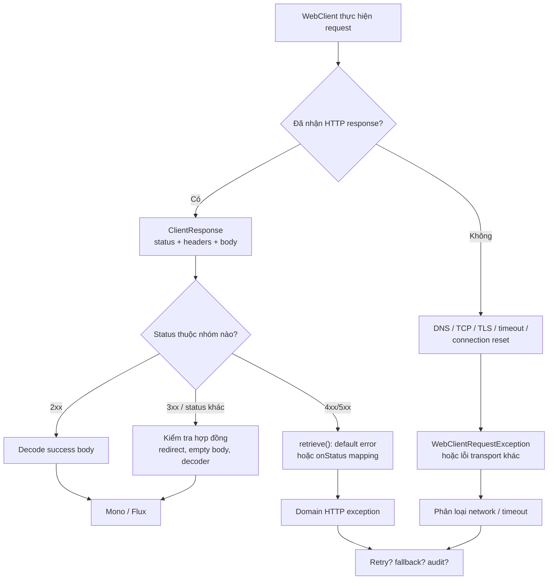
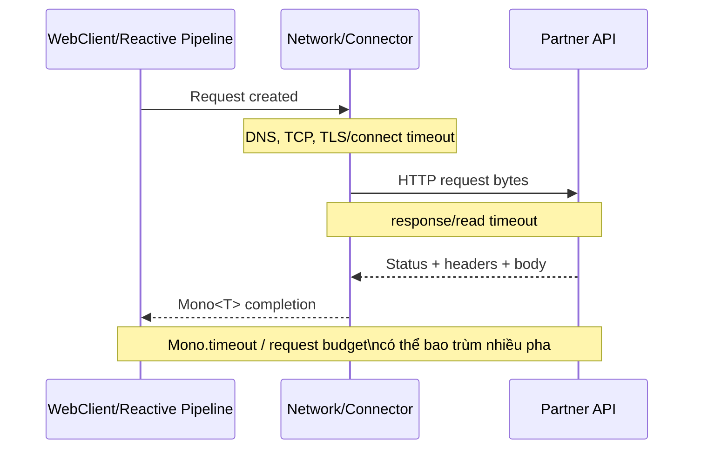
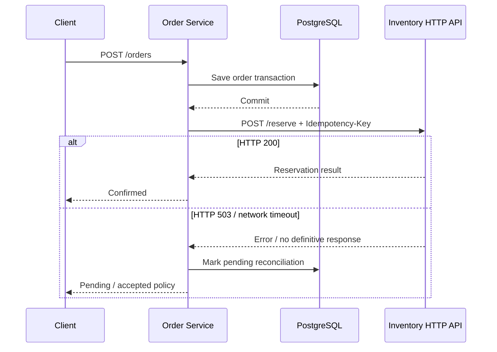
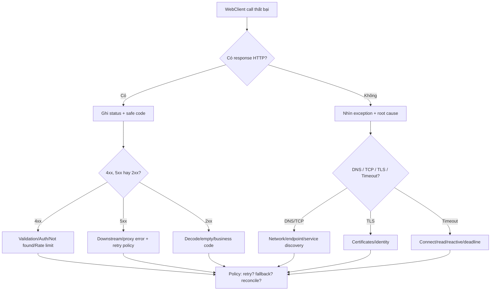

# onStatus, ánh xạ ngoại lệ và phân biệt lỗi HTTP với lỗi mạng

## 1. Vì sao xử lý lỗi WebClient là một phần của thiết kế tích hợp?

Trong module **SPRING_BOOT_INTEGRATION**, ứng dụng Spring Boot có thể gọi API đối tác bằng `WebClient`, ghi trạng thái vào database, lưu cache Redis, hoặc tiếp tục phát sự kiện qua RabbitMQ/Kafka. Một HTTP call thất bại không đơn thuần là “có exception”: cách phân loại lỗi ảnh hưởng tới **retry, transaction, idempotency, trạng thái outbox, giám sát và thông báo cho caller**.

Giả sử dịch vụ đơn hàng gọi API kho để giữ hàng:

- Kho trả **404**: có thể SKU không tồn tại; retry thường không giải quyết được nếu hợp đồng xác định 404 là lỗi cố định.
- Kho trả **409**: phiên bản tồn kho hoặc trạng thái đặt giữ bị xung đột; cần chính sách nghiệp vụ rõ ràng.
- Kho trả **429**: đối tác yêu cầu giảm tốc độ, đôi khi kèm `Retry-After`.
- Kho trả **503**: server đối tác đang không sẵn sàng; retry có giới hạn có thể phù hợp.
- DNS không phân giải được host, TCP connection bị từ chối hoặc TLS handshake thất bại: **không có HTTP response hợp lệ**.
- Client **timeout** sau khi gửi lệnh giữ hàng: không biết chắc đối tác đã commit hay chưa. Gửi lại không có idempotency key có thể tạo hai tác động.

Trong `WebClient` của Spring WebFlux, `retrieve().onStatus(...)` giúp chuyển **HTTP response có status cụ thể** thành exception của miền nghiệp vụ. Nó **không** phải nơi xử lý toàn bộ lỗi DNS, TCP, TLS, socket hay timeout xảy ra trước khi nhận response. Những lỗi đó đi qua luồng reactive dưới dạng exception của tầng request/transport.

Bài học giúp bạn:

1. Hiểu chính xác cơ chế mặc định của `retrieve()` và `WebClientResponseException`.
2. Sử dụng `onStatus` để ánh xạ lỗi HTTP thành exception có ngữ nghĩa.
3. Phân biệt `WebClientRequestException`, lỗi network, decoding và `TimeoutException`.
4. Quyết định khi nào dùng `exchangeToMono()`, `onErrorMap()`, `onErrorResume()` và `retryWhen()`.
5. Viết integration tests chứng minh đúng cả lỗi HTTP lẫn lỗi không nhận được HTTP response.
6. Giữ tính đúng đắn của luồng HTTP ↔ database ↔ broker qua retry/idempotency/outbox, logging và observability.

> Các ví dụ dùng Spring Boot 3.x, Spring Framework 6.x, Java 17+ và Reactor. API cụ thể có thể khác giữa các phiên bản Spring Boot lớn; cần kiểm tra BOM và Spring Framework Reference đúng phiên bản đang sử dụng. Các snippet có tên service/DTO giả định được giải thích trong bài.

## 2. Hai nhánh lỗi khác nhau: có HTTP response và không có response

Một request có thể thất bại trước hoặc sau khi đối tác tạo response:



| Phân loại | Có status HTTP? | Dạng lỗi thường gặp | Hướng xử lý |
| --- | --- | --- | --- |
| 404/409/422 từ server | Có | `WebClientResponseException` hoặc exception do `onStatus` tạo | Mapping theo hợp đồng và nghiệp vụ |
| 429/503/504 từ server | Có | `WebClientResponseException` hoặc exception miền tạm thời | Retry có giới hạn khi an toàn, tôn trọng rate limit |
| DNS, TCP refused, reset, TLS | Không có response đầy đủ | `WebClientRequestException` hoặc lỗi connection/connector tương ứng | Kiểm tra cause, retry chỉ khi tạm thời |
| Timeout do `Mono.timeout()` | Có thể đã/ chưa có response | `java.util.concurrent.TimeoutException` trong luồng Reactor | Biết rõ thời hạn đặt ở đâu và side effect có thể đã xảy ra |
| Body JSON không parse được | Có response | Codec/decoding exception | Contract/version/serialization, không phải network |
| Business error trong HTTP 200 | Có response 2xx | Không tự thành exception HTTP | Phải kiểm tra code/status **trong payload** theo hợp đồng |

**Quy tắc vàng:** một **HTTP 503** là *response được nhận từ phía bên kia hoặc proxy*; một **`ConnectException`** thường có nghĩa *không thiết lập được kết nối*. Cả hai có thể dẫn đến hành động retry giống nhau trong một tình huống cụ thể, nhưng **không phải cùng một loại lỗi** và không nên bị gộp thành một nhãn “server trả 503”.

## 3. Dependency, WebClient.Builder và cấu hình cơ bản

Để dùng `WebClient`, thêm WebFlux:

```xml
<dependency>
    <groupId>org.springframework.boot</groupId>
    <artifactId>spring-boot-starter-webflux</artifactId>
</dependency>
```

Với Gradle:

```groovy
dependencies {
    implementation 'org.springframework.boot:spring-boot-starter-webflux'
}
```

Ứng dụng Spring MVC có thể dùng `WebClient` làm HTTP client dù không xây toàn bộ server bằng WebFlux. Khi cần call đồng bộ ở service Spring MVC, `RestClient` cũng là lựa chọn đáng xem xét; trọng tâm ở đây là API reactive của WebClient.

Spring Boot thường auto-configures **`WebClient.Builder`** khi có thành phần phù hợp trên classpath. Có thể tạo client riêng cho API kho:

```yaml
integration:
  inventory:
    base-url: ${INVENTORY_BASE_URL:http://localhost:8089}
```

```java
import org.springframework.beans.factory.annotation.Value;
import org.springframework.stereotype.Component;
import org.springframework.web.reactive.function.client.WebClient;

@Component
public class InventoryWebClientFactory {

    private final WebClient client;

    public InventoryWebClientFactory(
            WebClient.Builder builder,
            @Value("${integration.inventory.base-url}") String baseUrl) {
        this.client = builder.baseUrl(baseUrl).build();
    }

    public WebClient client() {
        return client;
    }
}
```

Property `integration.inventory.base-url` là **cấu hình riêng của ứng dụng**, không phải một thuộc tính mặc định `spring.webclient.*` có thể tự tìm API kho.

Một `WebClient` đã build thường được **tái sử dụng**, không tạo lại cho từng request. Khi inject builder do Boot quản lý, bạn có thể thừa hưởng các customizer, connector, codec và quan sát do Boot áp dụng. Nếu tự gọi `WebClient.create()` ở mọi nơi, dễ làm lệch timeout, tracing, header, proxy và cấu hình TLS giữa các adapters.

## 4. retrieve() mặc định xử lý HTTP status như thế nào?

Đoạn gọi cơ bản:

```java
import reactor.core.publisher.Mono;

Mono<InventorySnapshot> result = webClient.get()
    .uri("/v1/inventory/{sku}", "SKU-001")
    .retrieve()
    .bodyToMono(InventorySnapshot.class);
```

Trong ví dụ, `webClient` đã có `baseUrl` và `InventorySnapshot` là DTO mà dự án tự định nghĩa. Khi có **subscription**, request được gửi đi.

Behavior mặc định của `retrieve()`:

- **2xx**: thường decode response body theo `bodyToMono`, `bodyToFlux` hoặc `toEntity`.
- **4xx/5xx**: nếu không có custom status handler phù hợp, WebClient tạo lỗi thuộc nhóm `WebClientResponseException` (dựa trên response, status, headers và body).
- **Không có HTTP response**: `onStatus` không chạy; lỗi đi ra ngoài từ HTTP connector/transport.
- **3xx**: không mặc nhiên trở thành WebClientResponseException chỉ vì status không phải 2xx. Việc follow redirect phụ thuộc HTTP connector/config; cần kiểm tra hợp đồng và status.
- **204 No Content**: `bodyToMono(T.class)` thường hoàn tất rỗng. `Mono.empty()` không tự biểu thị đối tượng có giá trị `null`.

### WebClientResponseException chứa gì?

`WebClientResponseException` thường cho phép truy cập:

```java
import org.springframework.web.reactive.function.client.WebClientResponseException;

try {
    // Ví dụ minh họa cho code đồng bộ ở test/boundary được phép blocking.
    call.block();
} catch (WebClientResponseException ex) {
    int status = ex.getStatusCode().value();
    String responseBody = ex.getResponseBodyAsString();
    // Chỉ dùng status/code để phân loại; không log body nguyên bản.
}
```

API này có thể chứa **response headers, request, body bytes, charset**; thông tin phản hồi có thể nhạy cảm. Không log toàn bộ exception/body mặc định trên môi trường chứa PII hoặc token. Nên chuyển lỗi thành một code/nhãn quan sát có cardinality thấp.

`WebClientResponseException.NotFound`, `TooManyRequests` hoặc `ServiceUnavailable` là các subclass tiện dụng cho một số status cụ thể, nhưng **không nên buộc domain layer phụ thuộc trực tiếp vào exception HTTP client** nếu muốn tách adapter.

## 5. onStatus: cú pháp và vị trí trong pipeline

`retrieve()` trả về `ResponseSpec`. Trên đối tượng này, `onStatus` cho phép khai báo:

```java
.onStatus(
    status -> status.value() == 404,
    response -> response.createException()
        .map(ex -> new InventoryNotFoundException(ex))
)
```

Hai đối số:

1. **Predicate** trên `HttpStatusCode` xác định HTTP response nào cần xử lý.
2. **Function** nhận `ClientResponse` và trả `Mono<? extends Throwable>` để biến status đó thành **lỗi** trong reactive stream.

Một phương thức `onStatus` không trả DTO, cũng không tự gọi lại request. Nó chỉ quyết định cách **phát lỗi** cho response có status tương ứng.

Các handler được đánh giá theo thứ tự được đăng ký; handler khớp trước có thể quyết định lỗi. Vì thế **đặt handler đặc biệt trước handler chung**:

```java
.retrieve()
.onStatus(s -> s.value() == 429, this::mapRateLimit)
.onStatus(s -> s.value() == 404, this::mapNotFound)
.onStatus(HttpStatusCode::is5xxServerError, this::mapServerFailure)
.bodyToMono(InventorySnapshot.class);
```

Đoạn này là **phác thảo cấu trúc**: `mapRateLimit`, `mapNotFound`, `mapServerFailure` phải được định nghĩa, và `HttpStatusCode` được import từ `org.springframework.http`.

### Cách dùng Mono.just, Mono.error và Mono.empty

Một status handler có thể:

- Trả `Mono.just(new MyException(...))` hoặc `response.createException().map(...)` để phát exception.
- Trả `Mono.empty()` để **không xử lý status ấy như lỗi** và tiếp tục decode body theo `bodyToMono`/`bodyToFlux`.
- Trả một publisher lỗi do quá trình parse body thất bại; khi đó lỗi parse có thể nổi lên thay vì exception miền dự kiến.

`Mono.empty()` **không** đồng nghĩa bỏ qua cả response và trả về kết quả rỗng. Nó chỉ tắt xử lý lỗi HTTP cho status đó; bước decode body vẫn xảy ra. Nếu muốn “404 = không có kết quả”, nên cân nhắc `exchangeToMono` hoặc `onErrorResume` có phạm vi thật cụ thể.

## 6. Định nghĩa exception miền nghiệp vụ thay vì ném mọi lỗi RuntimeException

Một service tích hợp cần truyền đủ ý nghĩa cho policy tầng trên mà không lộ URL hoặc payload đối tác. Thiết kế exception miền có thể giữ mã lỗi, HTTP status đã nhận và nguyên nhân.

Ví dụ một lớp đại diện lỗi HTTP từ inventory API:

```java
public final class InventoryHttpException extends RuntimeException {
    private final int downstreamStatus;
    private final String code;

    public InventoryHttpException(
            int downstreamStatus, String code, Throwable cause) {
        super("Inventory API HTTP error: " + code, cause);
        this.downstreamStatus = downstreamStatus;
        this.code = code;
    }

    public int downstreamStatus() {
        return downstreamStatus;
    }

    public String code() {
        return code;
    }
}
```

Dùng thêm các exception không có HTTP status:

```java
public final class InventoryTransportException
        extends RuntimeException {

    public InventoryTransportException(Throwable cause) {
        super("Inventory API transport failed", cause);
    }
}

public final class InventoryTimeoutException
        extends RuntimeException {

    public InventoryTimeoutException(Throwable cause) {
        super("Inventory API timed out", cause);
    }
}
```

Phân tách này giúp:

- **HTTP adapter** phân loại 404/429/5xx bằng dữ liệu response.
- **Transport adapter** phân loại request/network failure mà không dựng một HTTP status giả.
- **Application service** quyết định retry, fallback hoặc trạng thái cuối dựa trên exception type + code.
- **Controller** nếu cần có thể map thành HTTP response nội bộ (ví dụ 502/503/504) nhưng không trả nguyên error body của đối tác.
- **Metrics/logging** sử dụng code tổng quát thay vì ghi thông tin nhạy cảm.

Một exception có tên `InventoryHttpException` không chứng minh consumer hoặc database đã rollback. Exception chỉ là tín hiệu; transaction/side effect còn phụ thuộc nơi lỗi được quan sát và cách xử lý.

## 7. Ví dụ hoàn chỉnh: ánh xạ 404, 429, 5xx và lỗi network

Hợp đồng trả về thành công:

```java
public record InventorySnapshot(
    String sku,
    long available,
    String warehouse
) {}
```

Client dùng `WebClient.Builder` từ Spring Boot:

```java
import java.time.Duration;
import java.util.concurrent.TimeoutException;

import org.springframework.beans.factory.annotation.Value;
import org.springframework.http.HttpStatusCode;
import org.springframework.stereotype.Service;
import org.springframework.web.reactive.function.client.WebClient;
import org.springframework.web.reactive.function.client.WebClientRequestException;
import reactor.core.publisher.Mono;

@Service
public class InventoryApiClient {

    private final WebClient client;

    public InventoryApiClient(
            WebClient.Builder builder,
            @Value("${integration.inventory.base-url}") String baseUrl) {
        this.client = builder.baseUrl(baseUrl).build();
    }

    public Mono<InventorySnapshot> findSnapshot(String sku) {
        return client.get()
            .uri(uriBuilder -> uriBuilder
                .path("/v1/inventory/{sku}")
                .build(sku))
            .retrieve()
            .onStatus(
                status -> status.value() == 404,
                response -> response.createException()
                    .map(ex -> new InventoryHttpException(
                        404, "SKU_NOT_FOUND", ex))
            )
            .onStatus(
                status -> status.value() == 429,
                response -> response.createException()
                    .map(ex -> new InventoryHttpException(
                        429, "RATE_LIMITED", ex))
            )
            .onStatus(
                HttpStatusCode::is5xxServerError,
                response -> response.createException()
                    .map(ex -> new InventoryHttpException(
                        ex.getStatusCode().value(),
                        "DOWNSTREAM_UNAVAILABLE", ex))
            )
            .bodyToMono(InventorySnapshot.class)
            .timeout(Duration.ofSeconds(3))
            .onErrorMap(
                WebClientRequestException.class,
                InventoryTransportException::new
            )
            .onErrorMap(
                TimeoutException.class,
                InventoryTimeoutException::new
            );
    }
}
```

Phân tích:

1. Gửi GET tới một SKU đã được encode bằng URI builder.
2. Status **404** được chuyển thành `InventoryHttpException(404, SKU_NOT_FOUND)`.
3. Status **429** thành `RATE_LIMITED`, vẫn giữ HTTP status trong exception.
4. Status **5xx** thành `DOWNSTREAM_UNAVAILABLE`.
5. Các status 4xx khác **chưa** có handler tùy biến sẽ đi theo xử lý mặc định của `retrieve()`: thường `WebClientResponseException`.
6. `bodyToMono` chỉ decode dữ liệu thành `InventorySnapshot` nếu response không bị status handler chuyển thành error.
7. `timeout` có thể phát `TimeoutException` nếu không có tín hiệu hoàn tất/success trong thời hạn.
8. `onErrorMap(WebClientRequestException.class,...)` chỉ wrap lỗi request/network thuộc đúng type, **không thay** exception HTTP từ `onStatus`.
9. `onErrorMap(TimeoutException.class,...)` phân loại timeout reactive do operator phát ra.

`response.createException()` đọc response error thành exception có status/headers/body phù hợp với Spring WebClient. Nếu muốn giảm khả năng lưu body nhạy cảm, cần cân nhắc cách tiêu thụ body/giới hạn buffer và việc giữ reference tới cause ở domain exception.

**Chưa nên retry trực tiếp ở đây**: đây là adapter chịu trách nhiệm phân loại lỗi. Policy retry có thể được áp dụng ở tầng use case theo tính chất GET/POST và idempotency, như các mục sau.

## 8. Đọc error body có cấu trúc trước khi ánh xạ

Một số đối tác có hợp đồng lỗi JSON:

```json
{
  "code": "INVENTORY_CONFLICT",
  "message": "SKU was updated concurrently",
  "traceId": "remote-7f28"
}
```

DTO:

```java
public record PartnerError(
    String code,
    String message,
    String traceId
) {}
```

Khi hợp đồng đáng tin cậy, có thể đọc error body:

```java
.retrieve()
.onStatus(
    status -> status.value() == 409,
    response -> response.bodyToMono(PartnerError.class)
        .defaultIfEmpty(
            new PartnerError("UNKNOWN_CONFLICT", "", "")
        )
        .map(body -> new InventoryHttpException(
            409,
            body.code(),
            new IllegalStateException("Conflict reported by partner")
        ))
)
.bodyToMono(InventorySnapshot.class);
```

Đoạn mã chỉ minh họa ánh xạ lỗi; khi xây client production có thể dùng exception nhận `code` và `traceId` trực tiếp, **không** log raw `message` nếu message chứa dữ liệu nhạy cảm.

### Ba rủi ro của decode error body

1. **Error body không phải JSON:** một reverse proxy trả HTML/plain text 502, khiến `bodyToMono(PartnerError.class)` lỗi codec trước khi tạo domain exception.
2. **Body rỗng:** `bodyToMono` hoàn tất rỗng; dùng `defaultIfEmpty` nếu hợp đồng cho phép fallback.
3. **Body quá lớn hoặc độc hại:** WebClient codec có giới hạn memory; vượt giới hạn có thể tạo `DataBufferLimitException` hoặc lỗi decoding. Không tăng memory limit vô hạn để đọc lỗi.

Với downstream không đáng tin hoặc nhiều kiểu response lỗi, `response.createException()` là lựa chọn thực dụng để giữ status và bytes trong exception ở giới hạn được cấu hình; code bên ngoài có thể map bằng status. Nếu buộc parse JSON, cần có fallback rõ ràng khi content type/schema lỗi, và không cố đọc lại response body hai lần sau khi đã tiêu thụ.

## 9. 404 không phải lúc nào cũng là ngoại lệ nghiệp vụ

Một API `GET /inventory/{sku}` có thể định nghĩa **404 = không tìm thấy SKU**, thay vì lỗi hệ thống. Hai hợp đồng đều hợp lý:

- Bài toán A: 404 nghĩa là request không hợp lệ, caller cần hiển thị lỗi → `InventoryHttpException`.
- Bài toán B: 404 nghĩa là không có resource, caller có thể tiếp tục với `Mono.empty()` → xử lý như kết quả hợp lệ.

### Cách rõ ràng: exchangeToMono

```java
Mono<InventorySnapshot> findOptional(String sku) {
    return client.get()
        .uri("/v1/inventory/{sku}", sku)
        .exchangeToMono(response -> {
            if (response.statusCode().value() == 404) {
                return response.releaseBody()
                    .then(Mono.<InventorySnapshot>empty());
            }

            if (response.statusCode().is2xxSuccessful()) {
                return response.bodyToMono(InventorySnapshot.class);
            }

            return response.createException()
                .flatMap(ex -> Mono.error(ex));
        });
}
```

Ưu điểm: ta **tiêu thụ/giải phóng body** cho nhánh 404 và trả một `Mono.empty()` thật; không yêu cầu decoder thành công xử lý một error body JSON như thể nó là success DTO.

`exchangeToMono()` cho quyền điều khiển theo `ClientResponse`. Với các phiên bản WebClient hiện đại, body chưa dùng sẽ được release sau khi publisher trả từ callback hoàn tất, nhưng **nên xử lý body rõ ràng** và không cố decode response lần nữa bên ngoài callback.

### Cách khác: onErrorResume với type rất cụ thể

```java
return findSnapshot(sku)
    .onErrorResume(
        InventoryHttpException.class,
        ex -> ex.downstreamStatus() == 404
            ? Mono.empty()
            : Mono.error(ex)
    );
```

Cách này tái sử dụng adapter mapping ở mục 7 và không nuốt mọi lỗi. Không viết `onErrorResume(ex -> Mono.empty())` trên toàn bộ HTTP call: lỗi DNS, authentication, database downstream hay lỗi codec đều bị biến thành “không có dữ liệu”, gây mất tín hiệu sự cố.

### Vì sao onStatus(..., response -> Mono.empty()) dễ gây nhầm?

```java
.retrieve()
.onStatus(s -> s.value() == 404, response -> Mono.empty())
.bodyToMono(InventorySnapshot.class);
```

Đoạn trên **tắt việc biến 404 thành exception**, nhưng **không đảm bảo kết quả Mono rỗng**. Body của 404 vẫn được chuyển vào decoder `InventorySnapshot`. Nếu body chứa JSON error, decoder có thể tạo DTO sai ngữ nghĩa hoặc ném exception. Dùng `exchangeToMono` khi cần quyết định cả status lẫn cách đọc body.

## 10. 429 Too Many Requests và Retry-After

Status 429 là một **HTTP response**; không phải network exception. Nó thường báo đối tác đang rate-limit, nhưng cách xử lý chính xác phải theo hợp đồng.

Header `Retry-After` có thể là:

- Số giây tương đối: `Retry-After: 30`.
- HTTP-date: `Retry-After: Sat, 21 Nov 2026 05:00:00 GMT`.

Giá trị header có thể thiếu, sai định dạng hoặc vượt thời hạn cho phép. Khi thiết kế retry:

1. Nếu hợp đồng yêu cầu, đọc `response.headers().asHttpHeaders().getFirst(HttpHeaders.RETRY_AFTER)`.
2. Parse **delta seconds hoặc HTTP-date** theo chuẩn, không dùng `Long.parseLong` vô điều kiện.
3. Giới hạn thời gian chờ tối đa theo SLO và deadline của caller.
4. Tôn trọng rate limit chung của tenant/provider, không để 1.000 request retry đồng loạt sau 30 giây.
5. Dùng backoff/jitter hoặc queue/worker để trì hoãn, không giữ vô hạn tài nguyên HTTP request.
6. Không tự động retry request ghi dữ liệu nếu không có idempotency key/hợp đồng an toàn.

`retryWhen(Retry.backoff(...))` mặc định **không tự đọc Retry-After**. Nếu ứng dụng cần tuân thủ chính xác header này, hãy biểu diễn nó trong domain exception rồi sử dụng một retry scheduler/policy có giới hạn phù hợp.

**429 khác 403:** 403 thường là từ chối quyền, không thể sửa bằng retry. Một hệ thống bị quota cố định hoặc hết tiền trong tài khoản provider cũng có thể trả 429/403; cần xem code lỗi nghiệp vụ thay vì chỉ dựa vào status.

## 11. HTTP 5xx, 502/503/504 và lỗi proxy

Một số status hay gặp:

| Status | Nguồn phản hồi | Ý nghĩa thường gặp | Có nên retry? |
| --- | --- | --- | --- |
| **500** | Server hoặc proxy | Internal server error | Chỉ retry hạn chế nếu request an toàn và lỗi được xem là tạm thời |
| **502** | Gateway/reverse proxy | Bad Gateway | Có thể retry khi an toàn, kiểm tra upstream/proxy |
| **503** | Server/gateway | Service unavailable | Có thể retry với backoff và circuit breaker |
| **504** | Gateway/proxy | Gateway timeout | Kết quả side effect có thể chưa biết; kiểm tra idempotency |
| **408** | Server | Request timeout | Đây vẫn là một HTTP response; không phải `TimeoutException` của Reactor |
| **429** | Server/gateway | Rate limit | Theo `Retry-After` và quota policy |

`HTTP 504` **không giống** `Mono.timeout()`. 504 nghĩa là client đã nhận response có status 504 (thường do gateway tạo); `Mono.timeout()` nghĩa là phía client tự chấm dứt việc chờ theo thời gian giới hạn, có thể trước bất kỳ status nào.

Khi API đối tác tạo lỗi không chuẩn (HTML 502, plaintext 503), đừng bắt buộc mọi lỗi phải parse bằng DTO JSON. `response.createException()` giúp giữ HTTP status ngay cả khi body không hợp đồng.

Một số mạng/proxy có thể tự retry request hoặc thay status. Ở những lệnh tạo đơn, giữ hàng, trừ tiền hay phát hành hóa đơn, **end-to-end idempotency** phải được thiết kế cả khi proxy và client cùng retry.

## 12. Phân biệt lỗi network/transport: WebClientRequestException

Khi không nhận được HTTP response hoàn chỉnh, WebClient thường phát `WebClientRequestException` (tùy connector và tình huống) với nguyên nhân gốc như:

| Nguyên nhân | Ví dụ root cause | Ý nghĩa điều tra |
| --- | --- | --- |
| DNS | `UnknownHostException` | Sai hostname, DNS outage, service discovery |
| TCP connect | `ConnectException: Connection refused` | Không có service lắng nghe hoặc port/network sai |
| Connect timeout | Netty `ConnectTimeoutException` hoặc tương đương | Không mở được kết nối trong ngân sách |
| TCP reset/closed | `PrematureCloseException` hoặc lỗi I/O khác | Peer/proxy đóng kết nối giữa chừng |
| TLS handshake | `SSLException`, chứng chỉ/hostname sai | Trust store, cert rotation, mTLS, SNI |
| Read/response timeout | Netty timeout hoặc connector-specific exception | Server/proxy chậm, network stall |
| Request body lỗi khi encode/gửi | Codec/I/O exception | Không nhất thiết server trả 4xx |

Kiểu exception cụ thể phụ thuộc connector (Reactor Netty, Jetty, JDK...) và phiên bản. Đừng viết code phụ thuộc chặt vào **một loại nested cause** duy nhất rồi cho rằng mọi request failure đều được nhận diện.

### Ví dụ phân loại network ở reactive operator

```java
Mono<InventorySnapshot> result = client.get()
    .uri("/v1/inventory/{sku}", sku)
    .retrieve()
    .bodyToMono(InventorySnapshot.class)
    .onErrorMap(
        WebClientRequestException.class,
        InventoryTransportException::new
    );
```

`onErrorMap` này không chạy khi response 404 được chuyển thành `WebClientResponseException.NotFound` hoặc domain exception khác; chỉ nhận exception đúng type. Đây là sự phân biệt mà một retry policy và metrics đáng tin cậy cần giữ.

Một `WebClientRequestException` có thể mang HTTP method, URI và headers liên quan đến request; cẩn thận nếu log `ex.getMessage()` hoặc toàn bộ object vì URI có thể chứa query parameter nhạy cảm. Chỉ log host/service alias, method, category và correlation ID sau khi scrub.

## 13. Timeout: connect, response/read và reactive deadline

Có nhiều loại timeout cùng xuất hiện trong một API call:



| Timeout | Tầng | Điều nó giới hạn |
| --- | --- | --- |
| TCP connect timeout | HTTP connector | Thời gian mở TCP connection |
| Pool acquire timeout | Connection pool | Chờ lấy connection có sẵn |
| TLS handshake timeout | TLS layer/connector | Thời gian handshake |
| Response/read timeout | HTTP connector/Netty | Thời gian chờ phản hồi hoặc đọc theo semantics connector |
| `Mono.timeout(Duration)` | Reactor pipeline | Thời hạn nhận tín hiệu từ publisher đã áp dụng operator |
| Business deadline | Application/workflow | Tổng ngân sách gồm retry, queue, HTTP call và commit liên quan |

### Ví dụ connector timeout với Reactor Netty

```java
import java.time.Duration;

import io.netty.channel.ChannelOption;
import org.springframework.context.annotation.Bean;
import org.springframework.context.annotation.Configuration;
import org.springframework.http.client.reactive.ReactorClientHttpConnector;
import org.springframework.web.reactive.function.client.WebClient;
import reactor.netty.http.client.HttpClient;

@Configuration(proxyBeanMethods = false)
class InventoryHttpConfiguration {

    @Bean("inventoryWebClient")
    WebClient inventoryWebClient(WebClient.Builder builder) {
        HttpClient httpClient = HttpClient.create()
            .option(ChannelOption.CONNECT_TIMEOUT_MILLIS, 3000)
            .responseTimeout(Duration.ofSeconds(5));

        return builder
            .baseUrl("https://inventory.example.internal")
            .clientConnector(
                new ReactorClientHttpConnector(httpClient)
            )
            .build();
    }
}
```

**Đây là ví dụ chọn transport riêng, không phải template bắt buộc.** Nếu tự tạo `HttpClient.create()` bạn có thể bỏ qua cấu hình connector/resources/proxy/TLS/metrics mà môi trường Spring Boot đã tùy biến. Hãy tích hợp với cơ chế quản lý resources/customizer của Boot hoặc `ReactorResourceFactory` khi cần chia sẻ connection pools trong app thực.

Thời gian `responseTimeout` của Reactor Netty và `Mono.timeout` không đồng nhất. `Mono.timeout` ở cuối pipeline có thể tính thời gian từ subscription đến kết quả đầu tiên/kết thúc của `Mono`; với `Flux.timeout`, khoảng chờ có thể tính giữa các tín hiệu. Đặt timeout cần gắn với mô hình response.

### Timeout không xác định giao dịch remote đã commit hay chưa

Ví dụ POST giữ hàng: client timeout 3 giây, server hoàn tất trong 3,2 giây. Client đã dừng chờ nhưng server có thể vẫn commit. Retry với request ID mới làm nhân đôi giữ hàng. Đây là vấn đề **semantic idempotency**, không thể sửa chỉ bằng tăng timeout hoặc đổi exception.

## 14. Đặt timeout trước hay sau retry?

Xét hai cấu trúc:

```java
// Mỗi attempt bị giới hạn; tổng thời gian có thể dài hơn nhiều.
source
    .timeout(Duration.ofSeconds(2))
    .retryWhen(retrySpec);

// Giới hạn tổng thời gian gồm attempts + backoff ở phía dưới timeout.
source
    .retryWhen(retrySpec)
    .timeout(Duration.ofSeconds(5));
```

Trong Reactor, thứ tự operator quyết định phạm vi. Nếu `timeout` **trước** `retryWhen`, mỗi lần subscription/attempt có thể được cấp lại ngân sách. Nếu `timeout` **sau**, nó có thể giới hạn cả chuỗi retries và backoff.

Trong hệ thống thật thường cần cả hai:

- **Per-attempt timeout** ngăn một request treo quá lâu.
- **Overall deadline** giữ latency/SLO của workflow.
- **Retry count/backoff/jitter** giới hạn số lần thử.
- **Circuit breaker/bulkhead/rate limit** bảo vệ downstream không bị retry storm.

Ví dụ minh họa phối hợp:

```java
Mono<InventorySnapshot> guarded = source
    .timeout(Duration.ofSeconds(2))
    .retryWhen(retrySpec)
    .timeout(Duration.ofSeconds(6));
```

`source` và `retrySpec` ở đây được giả định đã khai báo đúng. Nếu dùng `Mono.defer(...)` hoặc `WebClient` publisher cold, mỗi subscription có thể phát **một request mới**. Với POST không idempotent, đây chính là rủi ro tạo side effect trùng.

## 15. onErrorMap, onErrorResume và doOnError khác nhau

Ba operator thường bị dùng lẫn:

| Operator | Ý định | Điều cần tránh |
| --- | --- | --- |
| `onErrorMap(...)` | Đổi một exception thành exception miền, giữ luồng lỗi | Map mọi loại lỗi thành cùng một exception làm mất nguyên nhân |
| `onErrorResume(...)` | Có chính sách fallback hoặc recovery khi lỗi xác định | Nuốt mọi lỗi rồi trả kết quả “thành công” giả |
| `doOnError(...)` | Thực hiện side effect quan sát như log/metric | Tưởng rằng doOnError đã xử lý lỗi hoặc bảo đảm retry |
| `retryWhen(...)` | Subscription lại source khi lỗi khớp policy | Retry HTTP POST không có idempotency |
| `onErrorComplete(...)` | Kết thúc rỗng khi lỗi | Che mất message/sự cố nếu dùng quá rộng |

### Ví dụ hợp lệ của fallback

Cache cũ có thể được dùng khi **dịch vụ tồn kho không sẵn sàng**, nhưng không được dùng khi đối tác xác nhận SKU không tồn tại hoặc trả lỗi quyền:

```java
return inventoryClient.findSnapshot(sku)
    .onErrorResume(
        InventoryTransportException.class,
        ex -> cachedInventory.findLastKnown(sku)
    );
```

`cachedInventory` là adapter do ứng dụng định nghĩa; dữ liệu trả về phải có metadata như `stale=true`/thời điểm snapshot để caller không nhầm thành tồn kho chính xác theo thời gian thực. Với thao tác **quyết định trừ tồn**, fallback từ cache cũ có thể không được chấp nhận.

### Anti-pattern

```java
return client.get()
    .uri("/v1/inventory/{sku}", sku)
    .retrieve()
    .bodyToMono(InventorySnapshot.class)
    .onErrorResume(ex ->
        Mono.just(new InventorySnapshot(sku, 0, "unknown"))
    );
```

Đoạn này biến **404, 401, 503, DNS fail, JSON decode fail** thành “available = 0”. Nghiệp vụ có thể đưa ra quyết định sai mà không ai thấy sự cố. Fallback phải theo exception type và hợp đồng rõ ràng, không phải một giá trị mặc định bất kể lỗi.

## 16. Thiết kế retry có điều kiện theo loại lỗi

Một retry policy cho **GET chỉ đọc** có thể chấp nhận lỗi 429, 5xx hoặc transport failure nhất định. Không retry 400/401/403/404/422 trừ khi hợp đồng có ngoại lệ rõ.

```java
import java.time.Duration;
import reactor.core.publisher.Mono;
import reactor.util.retry.Retry;

public Mono<InventorySnapshot> findWithRetry(String sku) {
    return inventoryApiClient.findSnapshot(sku)
        .retryWhen(
            Retry.backoff(2, Duration.ofMillis(200))
                .maxBackoff(Duration.ofSeconds(2))
                .jitter(0.5)
                .filter(error -> {
                    if (error instanceof InventoryTransportException) {
                        return true;
                    }
                    if (error instanceof InventoryTimeoutException) {
                        return true;
                    }
                    if (error instanceof InventoryHttpException http) {
                        return http.downstreamStatus() == 429
                            || http.downstreamStatus() == 502
                            || http.downstreamStatus() == 503
                            || http.downstreamStatus() == 504;
                    }
                    return false;
                })
                .onRetryExhaustedThrow(
                    (spec, signal) -> signal.failure()
                )
        );
}
```

Mẫu trên minh họa **hai retry bổ sung** sau lần đầu, có exponential backoff/jitter và giới hạn loại exception. `onRetryExhaustedThrow` giữ lỗi cuối theo domain; nếu không tùy biến, Reactor có thể phát một exception bọc tình trạng exhausted, ảnh hưởng mapping ở tầng trên.

**Chưa đủ cho production** nếu không có ngân sách tổng thời gian, circuit breaker, concurrency/rate limiter, monitoring và phân loại root cause sâu hơn. Ví dụ lỗi TLS certificate không hợp lệ có thể nằm dưới `InventoryTransportException`, nhưng retry 10 lần sẽ không tự sửa chứng chỉ. Khi triển khai, lọc transport errors theo khả năng phục hồi.

### Tại sao phải tránh retry storm?

Nếu một đối tác trả 503 cho 10.000 request/giây và mỗi request retry ba lần, lưu lượng có thể nhân lên rất nhanh. Hãy đặt backoff, jitter, giới hạn concurrency, circuit breaker và có thể chuyển công việc sang queue/outbox thay vì giữ hàng nghìn luồng yêu cầu HTTP mở.

## 17. Retry cho POST/PUT và idempotency key

Không thể đánh giá retry chỉ dựa trên HTTP method:

- GET thường được kỳ vọng không tạo side effect, nhưng API đối tác có thể vi phạm hợp đồng.
- PUT là idempotent theo định nghĩa HTTP **nếu server triển khai đúng**, nhưng một số side effect phụ như notification vẫn cần thiết kế.
- POST tạo đơn, giữ hàng, thanh toán hoặc lập vận đơn **có thể** tạo tác động mới mỗi lần.
- DELETE có thể có trạng thái lặp an toàn theo HTTP semantics, nhưng phải xét mã lỗi và side effect cụ thể.

Với POST giữ hàng, hợp đồng có thể yêu cầu header `Idempotency-Key`:

```java
public Mono<ReservationResult> reserve(
        String commandId, ReservationRequest request) {

    return client.post()
        .uri("/v1/reservations")
        .header("Idempotency-Key", commandId)
        .bodyValue(request)
        .retrieve()
        .bodyToMono(ReservationResult.class)
        .timeout(Duration.ofSeconds(5));
}
```

`ReservationRequest` và `ReservationResult` là DTO do ứng dụng định nghĩa. Quan trọng nhất là **dùng lại cùng `commandId` cho cùng một hành động nghiệp vụ ở mọi attempt**; không tạo UUID mới trong mỗi lần retry.

Tuy nhiên, header chỉ có ích nếu server **thực thi idempotency**: lưu kết quả theo key, xác định khi payload cùng key nhưng nội dung khác, giới hạn thời gian lưu, xử lý request đồng thời và trả lại kết quả nhất quán. Phía client không được giả định một hệ thống tự hiểu header do mình đặt.

Khi đối tác không có cơ chế idempotency, một timeout sau side effect phải được xử lý bằng bước **tra cứu trạng thái, đối soát hoặc workflow thủ công** thay vì retry mù.

## 18. HTTP, database và message broker: ranh giới transaction

Giả sử service Spring Boot nhận yêu cầu tạo đơn, ghi PostgreSQL rồi gọi API kho:



Lưu ý:

- Transaction database cục bộ **không** làm HTTP POST và SQL commit nguyên tử.
- Nếu HTTP POST thành công nhưng response mất, application vẫn có thể nhận `InventoryTransportException` hoặc timeout.
- Nếu sau đó tự rollback SQL, lệnh giữ hàng đã xảy ra ở đối tác có thể không rollback.
- Nếu app crash giữa DB commit và call HTTP, ý định gọi đối tác có thể bị mất nếu không lưu trạng thái bền vững.

Một thiết kế phục hồi hơn là **transactional outbox + worker**: ghi đơn hàng và command/outbox record trong một local transaction, worker gọi HTTP có idempotency key ổn định và lưu kết quả, retry/quarantine/reconciliation theo policy. Khi downstream hoàn tất, có thể phát event sang RabbitMQ/Kafka; consumer phía nhận cũng cần idempotency.

**onStatus là tầng ánh xạ lỗi**, không thay cho outbox, saga, transaction manager hay distributed consistency strategy.

## 19. Khi nào nên dùng exchangeToMono thay cho retrieve + onStatus?

`retrieve()` phù hợp nếu **2xx → body**, **4xx/5xx → lỗi**, chỉ cần một vài status handlers. Khi một status cần cấu trúc response khác (ví dụ 202 trả location, 204 không có body, 304 dùng cache, 404 rỗng) thì `exchangeToMono()` giúp quyết định cả **status và cách decode**.

Ví dụ API tra cứu có nhiều status hợp lệ:

```java
public Mono<InventorySnapshot> findOptional(String sku) {
    return client.get()
        .uri("/v1/inventory/{sku}", sku)
        .exchangeToMono(response -> {
            int status = response.statusCode().value();

            if (status == 200) {
                return response.bodyToMono(InventorySnapshot.class);
            }

            if (status == 204 || status == 404) {
                return response.releaseBody()
                    .then(Mono.<InventorySnapshot>empty());
            }

            return response.createException()
                .flatMap(ex -> Mono.error(
                    new InventoryHttpException(
                        ex.getStatusCode().value(),
                        "UNEXPECTED_HTTP_STATUS",
                        ex
                    )
                ));
        });
}
```

**Các điểm quan trọng:**

1. Trong callback, mỗi nhánh tiêu thụ/giải phóng body hợp lý.
2. `createException()` giữ status/headers/body (theo khả năng/giới hạn), nhưng exception domain có thể chỉ cần status và code.
3. Sau khi publisher mà callback trả về hoàn tất, response body chưa tiêu thụ có thể được release. Không giữ `ClientResponse` để đọc body ở nơi khác về sau.
4. Nếu cần streaming lớn, chọn `exchangeToFlux()` và quản lý vòng đời/cancellation của response tương ứng.
5. Đừng dùng API cũ `exchange()` chỉ để tùy biến lỗi: các phiên bản Spring hiện đại khuyến nghị `exchangeToMono`/`exchangeToFlux` để tránh quên release body và connection.

Một số code dùng `exchangeToMono` để **không ném error nào** bằng cách luôn trả `Mono.empty()`; đó có thể che lỗi quan trọng. Trừ khi hợp đồng thật sự cho phép, cần map các status không mong đợi sang exception.

## 20. Empty body, 202 Accepted, 204 No Content và JSON lỗi

HTTP status và body phải được xét **cùng nhau**.

| Kết quả từ đối tác | Hành vi nên xem xét |
| --- | --- |
| **200 + DTO hợp lệ** | Decode success |
| **200 + body rỗng** | Nếu hợp đồng yêu cầu DTO, coi là lỗi contract; đừng mặc nhiên dùng `null` |
| **202 Accepted** | Yêu cầu đã được nhận để xử lý sau; thường cần poll status hoặc callback |
| **204 No Content** | Response thành công không có body; dùng `Mono<Void>`/empty theo hợp đồng |
| **304 Not Modified** | Chỉ hợp lệ nếu có quy trình conditional request/cache validator |
| **404 + Problem JSON** | Map error hoặc empty theo semantic API; không decode thành success DTO |
| **422 + JSON error** | Validation/business error; cần parse error contract |
| **502 + HTML proxy error** | Không ép decoder JSON error; giữ HTTP status để xử lý |
| **200 + businessCode=FAILED** | Status HTTP 2xx; phải kiểm tra business code trong body |

Ví dụ xử lý 200 rỗng thành lỗi hợp đồng:

```java
return client.get()
    .uri("/v1/inventory/{sku}", sku)
    .retrieve()
    .bodyToMono(InventorySnapshot.class)
    .switchIfEmpty(
        Mono.error(
            new IllegalStateException(
                "Inventory API returned an empty successful response"
            )
        )
    );
```

Cần đảm bảo ngoại lệ hợp đồng này được phân loại riêng ở tầng trên, không bị retry vô hạn như lỗi mạng. Nếu business API cho phép empty hợp lệ, không dùng đoạn kiểm tra này.

## 21. Authentication, authorization và TLS không phải cùng loại lỗi

Một API có thể thất bại ở các thời điểm khác nhau:

| Tình huống | Có HTTP response? | Ý nghĩa |
| --- | --- | --- |
| Token sai/hết hạn, server trả 401 | Có | Lỗi authentication phía HTTP |
| Người dùng/service không đủ quyền, trả 403 | Có | Lỗi authorization |
| Proxy trả 407 | Có | Proxy authentication theo HTTP |
| TLS certificate không tin cậy | Không có response HTTP hợp lệ | TLS handshake/verification failure |
| mTLS client certificate bị từ chối ở handshake | Thường không có response HTTP | Lỗi SSL/TLS transport |
| DNS trỏ sai host hoặc SNI không khớp | Có thể không có response | Network/TLS routing issue |

Không map `SSLHandshakeException` thành `HTTP 401`. Không retry mãi HTTP 401 bằng cách gửi lại cùng token đã hết hạn. Nếu client có quy trình refresh access token, cần đồng bộ refresh, giới hạn số lần thử và không làm lộ refresh token trong log.

WebClient có thể cấu hình OAuth2 filter hoặc client credentials thông qua Spring Security khi các dependency và chính sách tương ứng được bật. **Không bỏ qua hostname verification** hoặc trust tất cả certificate để “khắc phục” lỗi kết nối; đó là thay đổi bảo mật nguy hiểm.

## 22. Mapping lỗi ra API của chính ứng dụng

Nếu service đang cung cấp HTTP API cho client khác, cần tránh trả nguyên status/message của đối tác một cách máy móc:

- Partner 404 có thể trở thành 404 nội bộ **nếu resource đó chính là resource người gọi đang tìm**; nếu không, có thể là lỗi tích hợp gây 502.
- Partner 429 có thể trở thành 503/429 tùy chính sách quota và ownership, nhưng không mặc định chuyển nguyên header `Retry-After` của một tenant cho mọi caller.
- Partner 503 thường được biểu diễn là downstream unavailable ở service của bạn; HTTP 502 hoặc 503 có thể phù hợp tùy semantics.
- Client timeout sau request có side effect có thể cần trạng thái **PENDING/UNKNOWN**, không đơn giản “failed”.
- Lỗi JSON contract hoặc TLS configuration thường là lỗi adapter cần alert, không phải validation error 400 từ người dùng.

Ví dụ với Spring Web MVC hoặc WebFlux controller advice:

```java
import org.springframework.http.HttpStatus;
import org.springframework.http.ProblemDetail;
import org.springframework.web.bind.annotation.ExceptionHandler;
import org.springframework.web.bind.annotation.RestControllerAdvice;

@RestControllerAdvice
public class InventoryIntegrationExceptionAdvice {

    @ExceptionHandler(InventoryTransportException.class)
    ProblemDetail transportFailure(InventoryTransportException ex) {
        ProblemDetail detail =
            ProblemDetail.forStatus(HttpStatus.BAD_GATEWAY);
        detail.setTitle("Inventory integration unavailable");
        detail.setDetail("Không thể kết nối dịch vụ tồn kho.");
        return detail;
    }

    @ExceptionHandler(InventoryTimeoutException.class)
    ProblemDetail timeout(InventoryTimeoutException ex) {
        ProblemDetail detail =
            ProblemDetail.forStatus(HttpStatus.GATEWAY_TIMEOUT);
        detail.setTitle("Inventory integration timed out");
        detail.setDetail("Chưa thể xác nhận kết quả từ dịch vụ tồn kho.");
        return detail;
    }
}
```

Đây là ví dụ map lỗi cấp API, **không** có nghĩa 502/504 là cách duy nhất đúng. Cần xác định hợp đồng API của ứng dụng và cách bảo vệ thông tin nhạy cảm. `ProblemDetail` trả thông điệp an toàn; log nội bộ có correlation ID và nguyên nhân được lọc phù hợp.

Không dùng HTTP 500 chung cho mọi lỗi rồi mất khả năng phân biệt lỗi user, lỗi downstream và lỗi contract. Cũng không để thông tin từ `WebClientResponseException.getResponseBodyAsString()` được đưa thẳng vào `ProblemDetail.detail` cho caller ngoài.

## 23. Ghi log và metrics đúng tầng, tránh nhân đôi

Một reactive pipeline có nhiều operator, mỗi tầng có thể quan sát lỗi:

```java
return inventoryApiClient.findSnapshot(sku)
    .doOnError(ex -> {
        // Ghi metric/log ngắn gọn một lần tại adapter hoặc boundary.
        // Không log nguyên body, token, query string, PII.
    });
```

`doOnError` **không xử lý, đổi loại hay nuốt exception**. Lỗi tiếp tục đi xuống subscriber trừ khi có `onErrorResume`/`onErrorMap` hoặc logic khác.

Những thông tin quan sát nên có:

| Nhóm | Ví dụ |
| --- | --- |
| Endpoint logic | `inventory.read`, `inventory.reserve` |
| HTTP status | 200, 404, 429, 503; gắn với response nếu có |
| Error category | `HTTP_4XX`, `HTTP_5XX`, `DNS`, `CONNECT`, `TLS`, `TIMEOUT`, `DECODE` |
| Latency | Connect time, response time, total latency, retry delay |
| Retry | Attempt count, exhausted, reason/branch |
| Business IDs | `eventId`, `commandId`, trace/correlation ID được kiểm soát |
| Reliability | Outbox pending, reconciliation needed, duplicate prevented |
| Resource | Connection pool active/pending, event-loop utilization, request concurrency |

Spring Boot Actuator/Micrometer/Tracing có thể tạo instrumentation HTTP client khi cấu hình dependency phù hợp. Khi tự dựng connector/filter hoặc chuyển giữa WebClient/RestClient, kiểm tra trace/metrics còn được ghi nhận đúng.

**Không dùng URI thực có ID ngẫu nhiên làm metric label** như `/v1/inventory/SKU-000123`, vì cardinality sẽ tăng vô hạn. Dùng URI template hoặc tên logical operation. Tránh ghi `Authorization`, cookie, password, access token và body chứa PII.

### Phân biệt lỗi phía client với lỗi phía server

Metrics `http.client.requests` hoặc nhãn exception thường phụ thuộc instrumentation. Đừng xây alert “bất cứ exception = HTTP 500” vì DNS failure không có status để phân nhóm. Có thể duy trì nhãn `outcome="NO_RESPONSE"` riêng và phân loại lỗi mạng.

## 24. Kiểm thử onStatus với HTTP mock server thật qua socket

Unit test mock một interface `InventoryApiClient` không chứng minh `WebClient` gửi đúng HTTP method, path, headers hoặc decode đúng response. Với `onStatus`, nên dùng **HTTP test server chạy qua socket** như WireMock, MockWebServer hoặc Reactor Netty server test.

Ví dụ dùng MockWebServer của OkHttp trong test (package minh họa theo dòng API MockWebServer 4.x; các phiên bản lớn có thể đổi artifact/package):

```java
import static org.assertj.core.api.Assertions.assertThat;

import java.time.Duration;

import okhttp3.mockwebserver.MockResponse;
import okhttp3.mockwebserver.MockWebServer;
import org.junit.jupiter.api.Test;
import org.springframework.web.reactive.function.client.WebClient;
import reactor.test.StepVerifier;

class InventoryApiClientIT {

    @Test
    void maps404ToDomainHttpError() throws Exception {
        try (MockWebServer server = new MockWebServer()) {
            server.enqueue(
                new MockResponse()
                    .setResponseCode(404)
                    .addHeader("Content-Type", "application/json")
                    .setBody("{\"code\":\"SKU_NOT_FOUND\"}")
            );
            server.start();

            WebClient.Builder builder = WebClient.builder();
            InventoryApiClient client = new InventoryApiClient(
                builder, server.url("/").toString()
            );

            StepVerifier.create(client.findSnapshot("SKU-404"))
                .expectErrorSatisfies(error -> {
                    assertThat(error)
                        .isInstanceOf(InventoryHttpException.class);
                    InventoryHttpException http =
                        (InventoryHttpException) error;
                    assertThat(http.downstreamStatus())
                        .isEqualTo(404);
                    assertThat(http.code())
                        .isEqualTo("SKU_NOT_FOUND");
                })
                .verify(Duration.ofSeconds(5));
        }
    }
}
```

Test này chứng minh **HTTP response 404 qua network** được `onStatus` map thành exception miền. Nó không gọi production API và không cần database/broker. Muốn chạy cần dependency Spring WebFlux, `reactor-test`, JUnit/AssertJ và MockWebServer test artifact theo BOM/version phù hợp.

Không tạo HTTP server test trùng cổng production hoặc dùng URL thật của đối tác trong test CI. Test nên tự cấp một ephemeral port và đóng server sau khi hoàn tất.

### Ma trận response status nên kiểm thử

| Input từ mock server | Assertion quan trọng |
| --- | --- |
| 200 JSON DTO hợp lệ | Trả `InventorySnapshot` đúng field và URI request |
| 404 Problem JSON | `InventoryHttpException`, status/code đúng |
| 409 business conflict | Có mapping hoặc default `WebClientResponseException` theo policy |
| 429 + Retry-After | Được phân loại rate limit; policy tôn trọng delay/limit nếu triển khai |
| 503 HTML error page | Không phụ thuộc decode JSON để giữ status 503 |
| 204 empty | `Mono.empty()` hoặc semantic thích hợp |
| 200 nhưng JSON lỗi | Phân loại `DecodingException`/contract failure, không gọi là network fail |
| 200 + body rỗng | Điều kiện hợp đồng được kiểm tra rõ |
| 302 redirect | Behavior do connector/hợp đồng quy định, không được hiểu là 200 |

Thêm test xác minh request path/headers bằng `RecordedRequest` hoặc tính năng tương tự của mock server. Một status test xanh nhưng URI sai có thể không đại diện cho cách client hoạt động trên endpoint thật.

## 25. Kiểm thử network failure và timeout: không giả làm HTTP 503

Để test **lỗi transport**, mock server không được trả response HTTP hợp lệ. Có thể thử:

1. Kết nối tới một địa chỉ local port đã biết không có listener → TCP connection refused (môi trường test phải đảm bảo port không có service).
2. Mock server nhận connection rồi đóng socket trước khi trả status line → premature close/reset.
3. Cấu hình server trì hoãn trả headers/body lâu hơn client timeout → Reactor/Netty timeout.
4. Cấu hình TLS test endpoint với certificate không tin cậy hoặc hostname sai → TLS handshake/verification failure.
5. Trong môi trường kiểm thử DNS được kiểm soát, dùng hostname không phân giải → DNS lookup error.

Không áp dụng cùng assert `WebClientRequestException` cho mọi trường hợp: exact exception/cause còn tùy connector. Với `Mono.timeout`, exception được tạo bởi **Reactor operator** có thể là `TimeoutException`, không phải `WebClientRequestException`. Test nên assert category/domain exception của adapter thay vì phụ thuộc quá nhiều vào Netty class nội bộ.

### Ví dụ kiểm thử timeout ở tầng Reactor

```java
import static org.assertj.core.api.Assertions.assertThat;

import java.time.Duration;
import org.junit.jupiter.api.Test;
import reactor.core.publisher.Mono;
import reactor.test.StepVerifier;

class TimeoutPolicyTest {

    @Test
    void classifiesReactiveTimeout() {
        Mono<String> delayed = Mono.<String>never()
            .timeout(Duration.ofMillis(50))
            .onErrorMap(
                java.util.concurrent.TimeoutException.class,
                InventoryTimeoutException::new
            );

        StepVerifier.create(delayed)
            .expectErrorSatisfies(error ->
                assertThat(error)
                    .isInstanceOf(InventoryTimeoutException.class)
            )
            .verify(Duration.ofSeconds(2));
    }
}
```

Test này kiểm tra **operator và exception mapping**, không kiểm tra HTTP connector thật. Muốn kiểm tra response timeout Netty hay TLS, dùng integration test có server/socket phù hợp.

Nếu test retry nhiều attempt, xác minh **số request thực tới mock server**, thời gian tổng, số lần retry và kết quả khi hết retry; đừng chỉ assert lỗi cuối. Với POST, assert mỗi attempt giữ nguyên idempotency key và server không tạo side effect trùng theo hợp đồng.

## 26. Test retry có điều kiện và bảo toàn ý nghĩa ngoại lệ

Bộ test nên đảm bảo:

| Tình huống | Retry? | Điều cần assert |
| --- | --- | --- |
| GET trả 200 | Không | Một request, DTO đúng |
| GET trả 404 | Không | Lỗi không tìm thấy, không request lần hai |
| GET trả 401/403 | Không mặc định | Không lặp credential sai |
| GET trả 422 | Không mặc định | Error code được chuyển tới caller |
| GET trả 429 rồi 200 | Có thể | Delay/backoff phù hợp, giới hạn attempt |
| GET trả 503 lặp nhiều lần | Có giới hạn | Dừng sau giới hạn; không mất exception gốc |
| TCP refused rồi kết nối được | Có thể | Transport error khác HTTP error, metrics đúng |
| POST timeout trước phản hồi | Chỉ khi an toàn | Idempotency key giữ nguyên, trạng thái chưa chắc chắn |
| JSON decode fail | Không mặc định | Báo contract/codec error, không retry request vô nghĩa |
| TLS certificate sai | Không mặc định | Báo security/config error, không retry vô hạn |

Một cách test retry với mock server là xếp trước các response `503, 503, 200` và assert số request cuối cùng bằng ba. Khi dùng `Retry.backoff`, cân nhắc virtual time test cho policy Reactor riêng để không làm CI chậm, nhưng integration test có HTTP server thật vẫn cần chạy một số trường hợp với timeout được giới hạn.

**Không chỉnh policy chỉ để làm một test xanh.** Nếu một 500 là lỗi nghiệp vụ không được phép retry, hãy viết exception/code policy rõ, thay vì đặt mọi 5xx vào nhóm retry không suy nghĩ.

## 27. Contract testing: HTTP 200 không đảm bảo payload hợp lệ

Phân loại status chỉ là một tầng. Đối tác có thể trả HTTP 200 với schema thay đổi:

```json
{
  "sku": "SKU-001",
  "quantityAvailable": "unknown",
  "warehouse": null
}
```

Nếu client mong `available` là `long`, đây là lỗi hợp đồng dữ liệu. Tùy Jackson configuration, exception có thể là lỗi decode/conversion. Không được đổi nó thành `InventoryTransportException` chỉ vì request không thành công.

Hợp đồng nên nêu:

- Status code nào là success, validation failure, rate limit và server outage.
- Success DTO: trường bắt buộc, nullable, loại dữ liệu, enum, schema version.
- Error DTO: `code`, `message`, `traceId`, nội dung an toàn.
- Header: `Retry-After`, `Request-Id`, idempotency key và token.
- Tính idempotent của từng route/method, quy tắc replay và thời gian lưu key.
- Quy tắc khi body rỗng, 202 Accepted hoặc server trả lỗi HTML bất thường.

Dùng OpenAPI, JSON Schema, consumer-driven contracts hoặc test với mock server theo lựa chọn dự án. Contract test **không thay** integration test về DNS, TLS, proxy, connection pool và luồng database/broker.

## 28. Phối hợp WebClient với Spring Integration adapters

Spring Integration có HTTP outbound gateway/adapter, và ứng dụng cũng có thể gọi WebClient trực tiếp trong service activator hoặc handler:

```text
AMQP inbound adapter
  -> MessageChannel
  -> Transform JSON to command
  -> Service Activator (WebClient call)
  -> Map HTTP status/transport failure
  -> Route success/failure
  -> PostgreSQL update / outbox
```

Cần chú ý:

1. Flow dùng **DirectChannel** đồng bộ có thể khiến thread nhận message bị chặn nếu bạn tự `block()` WebClient không phù hợp.
2. Reactive stream cần có **subscriber và chủ sở hữu vòng đời**; chỉ tạo `Mono` rồi bỏ qua thì network request có thể không chạy.
3. Error channel của Spring Integration và `onErrorResume` trong WebClient có vai trò khác nhau. Nếu lỗi được chuyển thành kết quả success giả trước khi vào flow, error channel không nhận được sự cố.
4. Nếu consume RabbitMQ và gọi HTTP, timeout sau remote side effect có thể dẫn tới redelivery/retry; cần request ID ổn định và deduplication.
5. Nếu chấp nhận xử lý bất đồng bộ, lưu trạng thái/outbox hoặc chuyển qua broker để tránh mất nhiệm vụ khi process crash.

Spring Integration không tự biến WebClient HTTP call thành distributed transaction; thiết kế retry và business confirmation vẫn thuộc ứng dụng.

## 29. Troubleshooting: chẩn đoán đúng loại lỗi trước khi sửa

| Triệu chứng | Lớp lỗi có thể | Điều kiểm tra đầu tiên |
| --- | --- | --- |
| `WebClientResponseException$NotFound` | HTTP 404 response | Path, routing, resource contract |
| Domain `InventoryHttpException(429)` | HTTP rate limit | Retry-After, quota, concurrency |
| HTTP 502/503/504 | Proxy/server đã trả status | Reverse proxy, upstream logs, retry policy |
| `Connection refused` | TCP connect failure | Host/port, service listening, network ACL |
| `UnknownHostException` | DNS/service discovery | DNS name, namespace, search domains |
| TLS handshake / cert error | SSL/TLS transport | Trust store, hostname, mTLS, proxy/SNI |
| `PrematureCloseException` | Connection đóng giữa chừng | Keepalive, LB idle timeout, server restarts |
| `TimeoutException` | Reactive timeout | Vị trí `timeout()`, total budget |
| `ReadTimeoutException` | Connector/network read timeout | Netty responseTimeout, proxy, server latency |
| `DecodingException` | JSON/schema/codec | Content-Type, DTO fields, server payload |
| `DataBufferLimitException` | Payload vượt codec buffer | Body size, codec configuration, streaming |
| Response 200 nhưng `Mono.empty()` | Success body rỗng | Contract 200 vs 204, conditional response |
| 404 bị chuyển thành DTO khác thường | `onStatus(...Mono.empty()) xử lý nhầm | Dùng `exchangeToMono` hoặc typed fallback |
| Retry nhân đôi đơn hàng/giữ hàng | POST side effect + timeout | Idempotency key, remote dedup, outbox |
| API latency cao dù downstream nhanh | Pool acquire, serialization, retry/backoff | Metrics theo stage và thread/event-loop |

### Sơ đồ quyết định điều tra



**Không chữa sai tầng:**

- Không đổi `onStatus` để sửa DNS.
- Không tăng connect timeout để sửa HTTP 401.
- Không tự bật `followRedirect` cho mọi API có 302 nếu redirect có thể đưa credential sang host khác.
- Không tăng `maxInMemorySize` vô hạn để xử lý một error body khổng lồ.
- Không bật retry cho mọi exception rồi vô tình lặp các lệnh ghi dữ liệu.

## 30. Những anti-pattern thường gặp

1. **Map mọi exception sang HTTP 503:** làm mất khác biệt 404, 401, TLS, decode và kết quả chưa chắc chắn.
2. **`onStatus` để bắt network exception:** onStatus chỉ nhận `ClientResponse` đã có status.
3. **Dùng `Mono.empty()` trong onStatus để biến 404 thành DTO rỗng:** body vẫn được decode theo success path.
4. **Lỗi nào cũng `onErrorResume(ex -> Mono.empty())`:** che outage, validation và lỗi schema.
5. **`retryWhen` không filter:** có thể retry 400/401/403/422 và tạo retry storm.
6. **Retry POST với UUID mới mỗi attempt:** có thể tạo side effect hai lần.
7. **Không có total deadline:** nhiều attempt + backoff khiến request vượt SLO.
8. **Chỉ đặt `Mono.timeout`, bỏ qua connector/network timeouts:** khó kiểm soát từng pha và xử lý connection.
9. **Block event loop bằng `block()`:** làm nghẽn reactive server và giảm throughput.
10. **Tạo WebClient/connection pool cho từng request:** lãng phí connection, khó quan sát và quản lý tài nguyên.
11. **Log nguyên `WebClientResponseException` body:** có thể lộ PII, token hoặc thông tin nội bộ.
12. **Tin error body luôn là JSON:** proxy có thể gửi HTML hoặc plaintext, làm mất exception HTTP mong muốn.
13. **Coi HTTP 504 giống TCP timeout:** một bên có HTTP status, bên kia có thể không nhận response.
14. **Coi response 200 là business success khi DTO có `errorCode`:** cần check semantic của payload.
15. **Dùng một fallback tồn kho=0 cho mọi lỗi:** dẫn tới quyết định sai và che sự cố.
16. **Chỉ test bằng mock WebClient method:** không kiểm chứng status, content type, path hoặc response codecs.
17. **Nuốt exception trong Spring Integration flow:** error channel hoặc worker có thể không còn biết cần retry.
18. **Không quan sát retry attempt và backlog:** hệ thống có thể âm thầm mất khả năng phục hồi.
19. **Chuyển nguyên lỗi đối tác cho HTTP caller:** vi phạm ranh giới dữ liệu và bảo mật.
20. **Không lưu trạng thái khi request có side effect timeout:** khó đối soát và dễ lặp hành động.

## 31. Tình huống áp dụng: giữ hàng ở đối tác và ghi đơn trong database

Một ứng dụng Spring Boot nhận `POST /orders`, ghi trạng thái đơn hàng ở PostgreSQL rồi gọi `POST /reservations` trên Inventory API. Trong tuần đầu triển khai, vận hành gặp:

- Một số SKU không tồn tại trả HTTP 404.
- Giờ cao điểm, đối tác trả HTTP 429 kèm `Retry-After: 10`.
- Khi proxy bảo trì, đôi lúc HTTP 502, đôi lúc kết nối TCP bị reset.
- Một số POST timeout nhưng phía kho vẫn tạo reservation.
- Developer đang dùng `onErrorResume(ex -> Mono.empty())`, nên API trả 200 cho nhiều đơn dù thực tế chưa giữ hàng.

### Phân tích và phương án

**Bước 1 — Phân loại HTTP status:** 404 là `SKU_NOT_FOUND` (nếu hợp đồng xác định vậy), 429 là rate limit có delay, 502 là lỗi gateway. Tất cả đều có response và nên đi qua `onStatus` hoặc `exchangeToMono`.

**Bước 2 — Phân loại transport:** TCP reset là network error, thường nằm dưới `WebClientRequestException` hoặc exception connector. `onStatus` không chạy vì không có response HTTP.

**Bước 3 — Kiểm soát timeout:** đặt connect/response timeout và business deadline. Khi POST timeout, lưu `UNKNOWN/PENDING_RECONCILIATION` thay vì kết luận chưa giữ hàng.

**Bước 4 — Idempotency:** tạo một `reservationCommandId` ổn định từ bản ghi đơn hàng; gửi cùng `Idempotency-Key` qua các attempt và yêu cầu đối tác có cơ chế lưu kết quả theo key. Nếu đối tác không hỗ trợ, tra cứu trạng thái theo order ID trước khi retry.

**Bước 5 — Transaction/outbox:** ghi đơn hàng cùng ý định giữ hàng trong transaction database; worker thực hiện HTTP call và cập nhật outcome. Không để một lời gọi HTTP blocking giữ DB transaction quá lâu.

**Bước 6 — Retry:** không retry 404/401/422, chỉ retry lỗi tạm thời có giới hạn; với 429, tôn trọng `Retry-After`, jitter và quota chung; tránh retry storm.

**Bước 7 — Không nuốt lỗi:** thay `onErrorResume(ex -> Mono.empty())` bằng exception mapping + workflow state rõ ràng. Caller có thể nhận trạng thái pending hoặc lỗi theo hợp đồng API nội bộ.

**Bước 8 — Kiểm thử:** mock server trả 404, 429, 502; đóng socket để tạo transport error; delay response để test timeout; test POST trùng key; kiểm tra PostgreSQL vẫn chứa ý định cần phục hồi sau crash.

**Bước 9 — Quan sát:** metric phân biệt `HTTP_4XX`, `HTTP_5XX`, `NO_RESPONSE`, `TIMEOUT`, outbox backlog và số reservation thực tế.

### Câu hỏi tự đánh giá

- **HTTP 503 có phải `WebClientRequestException`?** Không mặc định: đã có response 503 nên `retrieve()` thường tạo `WebClientResponseException` hoặc `onStatus` map lỗi.
- **`Mono.timeout` có bắt buộc là lỗi mạng?** Không; timeout là thời hạn do pipeline áp dụng, có thể xảy ra khi server vẫn đang xử lý.
- **`onStatus(..., Mono.empty())` có luôn trả `Mono.empty()` cho 404 không?** Không; còn bước decode body của `retrieve()`.
- **Lỗi parse JSON body 200 nên retry như 503 không?** Thông thường không; đó có thể là lỗi contract/schema cần cảnh báo và sửa tương thích.
- **Có thể retry POST vô điều kiện nếu dùng backoff không?** Không; backoff chỉ giảm áp lực tải, không bảo đảm idempotency.
- **Một test mock service trả `Mono.error(new InventoryTransportException(...))` có chứng minh TLS/network error thật không?** Không; phải dùng HTTP socket test hoặc môi trường phù hợp.

## 32. Checklist triển khai WebClient adapter đáng tin cậy

- [ ] Dùng `WebClient.Builder` từ Spring Boot và cấu hình base URL, connector, authentication, codec theo từng đối tác.
- [ ] Biết rõ status nào là success, business error, retryable error và trạng thái không xác định.
- [ ] Có `onStatus` cho lỗi HTTP cần chuyển thành exception miền; giữ xử lý mặc định của các status chưa tùy biến.
- [ ] Phân biệt response lỗi HTTP với `WebClientRequestException`, timeout reactive và decoding errors.
- [ ] Dùng `response.createException()` hoặc parse error body có kiểm soát; không giả định mọi lỗi là JSON.
- [ ] Với 404/204/202 đặc biệt, cân nhắc `exchangeToMono` để chọn cách đọc body đúng hợp đồng.
- [ ] Không nuốt mọi lỗi bằng fallback chung; retry có filter, backoff, jitter, max attempts và total deadline.
- [ ] HTTP POST có side effect phải có idempotency key/reconciliation hoặc không retry mù.
- [ ] Database transaction không được xem là atomic cùng HTTP/broker; dùng outbox/saga nếu cần phục hồi.
- [ ] Bảo vệ TLS, hostname verification, credentials, token refresh và SSRF boundaries.
- [ ] Không block Reactor event loop; kiểm soát connection pool và overload downstream.
- [ ] Kiểm thử thành công, status 4xx/5xx, body rỗng/sai schema, TCP/DNS/TLS, timeout và retry side effects.
- [ ] Có correlation ID, trace, metrics theo endpoint template, error category, retry attempts và business outcome.
- [ ] Không log payload/headers nhạy cảm, URL chứa secrets hoặc body lỗi đối tác.
- [ ] Với Spring Integration flow, nối rõ error handling, transaction boundary và lifecycle của reactive publisher.

**Ghi nhớ:** `retrieve().onStatus(...)` xử lý **HTTP response theo status**, còn các lỗi **DNS, TCP, TLS, socket và timeout** phải được phân loại ở tầng transport/reactive. `WebClientResponseException` và `WebClientRequestException` không hoán đổi cho nhau; `onErrorMap`, `onErrorResume`, `retryWhen` phải được dùng theo chính sách nghiệp vụ. Trong một luồng **SPRING_BOOT_INTEGRATION**, phân loại đúng lỗi chỉ là bước đầu; hệ thống còn cần hợp đồng dữ liệu, transaction boundary rõ, idempotency, test thực tế và observability.

## Tài liệu tham khảo

- [Spring Framework Reference – WebClient](https://docs.spring.io/spring-framework/reference/web/webflux-webclient.html): sử dụng WebClient, retrieve, exchangeToMono, error handling và body decoding.
- [Spring Framework Javadoc – WebClient.ResponseSpec](https://docs.spring.io/spring-framework/docs/current/javadoc-api/org/springframework/web/reactive/function/client/WebClient.ResponseSpec.html): chữ ký `onStatus`, status handler và response body API.
- [Spring Framework Javadoc – WebClientResponseException](https://docs.spring.io/spring-framework/docs/current/javadoc-api/org/springframework/web/reactive/function/client/WebClientResponseException.html): dữ liệu HTTP response error.
- [Spring Framework Javadoc – WebClientRequestException](https://docs.spring.io/spring-framework/docs/current/javadoc-api/org/springframework/web/reactive/function/client/WebClientRequestException.html): lỗi request/transport.
- [Project Reactor Reference – Error Handling](https://projectreactor.io/docs/core/release/reference/coreFeatures/error-handling.html): `onErrorMap`, `onErrorResume`, error operators.
- [Project Reactor Reference – Retry](https://projectreactor.io/docs/core/release/reference/coreFeatures/error-handling.html#_retrying): retry/backoff và handling lỗi.
- [Reactor Netty Reference](https://projectreactor.io/docs/netty/release/reference/index.html): HTTP client, connection pooling, TLS và timeout.

Các tài liệu tham khảo có thể dẫn đến bản mới hơn của thư viện. Khi triển khai, hãy đối chiếu đúng Spring Boot, Spring Framework, Reactor và HTTP connector đang chạy để xác minh chữ ký API, cấu hình timeout và behavior của exception/codec.
