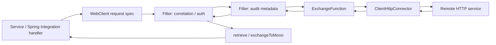
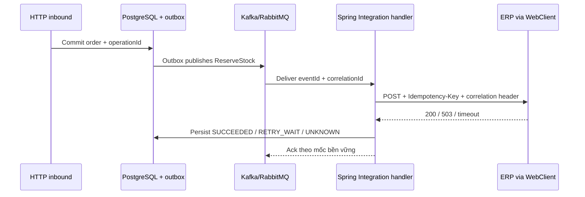
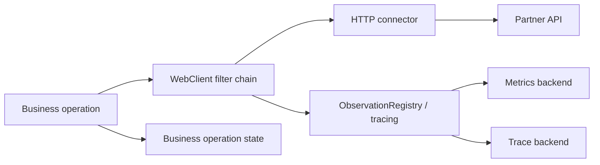

# `ExchangeFilterFunction` và xử lý header theo từng lời gọi

## 1. Vì sao header của WebClient là vấn đề tích hợp, không chỉ là cú pháp?

Một ứng dụng Spring Boot thường gọi nhiều dịch vụ bằng `WebClient`: ERP để tra trạng thái đơn, đối tác vận chuyển để tạo vận đơn, cổng thanh toán để xác minh giao dịch và dịch vụ cấu hình nội bộ. Mỗi request có thể cần `Authorization`, tenant ID, correlation ID, locale, idempotency key hoặc version của hợp đồng. Cùng lúc đó, hệ thống cần timeout, retry, phân loại lỗi, metrics/tracing và logging an toàn.

Nếu các header **được lưu ở client dùng chung rồi thay đổi theo từng request**, hai yêu cầu song song rất dễ ảnh hưởng nhau. Nếu mọi header được thêm bằng filter toàn cục, token của ERP có thể bị gửi nhầm cho dịch vụ CRM. Nếu correlation ID chỉ được đọc từ `ThreadLocal`, chuyển sang reactive scheduler hoặc `ExecutorChannel` có thể làm mất ngữ cảnh. Và nếu filter nuốt response body để log, downstream không còn dữ liệu để deserialize.

Trong module **SPRING_BOOT_INTEGRATION**, nội dung này phục vụ tổ chức các HTTP client cùng cơ sở dữ liệu, cache, broker và Spring Integration adapters; trọng tâm là **cấu hình chung có kiểm soát, hợp đồng dữ liệu, lỗi, giao dịch, chống xử lý trùng, kiểm thử và quan sát**. Ở chương **WebClient**, cần nắm hai công cụ khác nhau:

- **`ExchangeFilterFunction`:** móc chặn dạng hàm quanh request/response của `WebClient`, phù hợp cross-cutting concern trên **từng exchange**.
- **Request-specific headers:** header chỉ áp cho **một lần gọi**, được khai báo trên `RequestHeadersSpec`/`RequestBodySpec` hoặc thêm bởi filter từ ngữ cảnh của lần subscribe.

Mục tiêu của bài là xây một client dùng chung nhưng không dùng chung **trạng thái bảo mật và metadata của từng request**.

## 2. Kiến trúc: request specification, filter chain và HTTP connector

`WebClient` là reactive HTTP client của Spring WebFlux. Một request thường đi qua:



Các thành phần chính:

| Thành phần | Vai trò | Lưu ý |
|---|---|---|
| `WebClient` | HTTP client được xây một lần và có thể tái sử dụng giữa requests. | Không phải nơi chứa state mutable của người dùng hiện tại. |
| `WebClient.Builder` | Khai báo base URL, headers mặc định, filters, connector, codecs. | Builder mutable; cấu hình lúc startup hoặc tạo nhánh bằng `clone()`/`mutate()`. |
| `RequestHeadersSpec`/`RequestBodySpec` | Cấu hình URI, header, cookie, attribute, body cho request đang tạo. | Header ở đây thuộc request cụ thể, không sửa toàn bộ client. |
| `ExchangeFilterFunction` | Hàm `(ClientRequest, ExchangeFunction) -> Mono<ClientResponse>`. | Có thể thay request, quan sát response và điều chỉnh chuỗi xử lý. |
| `ClientRequest` | Snapshot thông tin của outbound request đưa qua filters. | Không sửa trực tiếp; tạo bản mới với `ClientRequest.from(...)`. |
| `ClientResponse` | Response gồm status, headers và body publisher. | Body thường chỉ tiêu thụ một lần; cần quản lý giải phóng dữ liệu. |
| Reactor `Context` | Ngữ cảnh bất biến theo subscription của pipeline reactive. | Không phải HTTP header và không tự vượt qua broker/restart. |
| `ExchangeFunction` | Gửi request tới tầng exchange tiếp theo và trả `Mono<ClientResponse>`. | Filter phải gọi `next.exchange(request)` khi muốn tiếp tục mạng. |

Vì `WebClient` reactive, cấu hình request và việc **request thật sự được gửi** là hai thời điểm khác nhau. Thông thường, tạo một `Mono` chưa gửi mạng; lúc subscriber subscribe, exchange chain mới được thực thi. Retry bằng cách resubscribe có thể khiến cả filter chạy lại.

## 3. Hợp đồng `ExchangeFilterFunction`

Định nghĩa logic cơ bản:

```java
import org.springframework.web.reactive.function.client.ExchangeFilterFunction;
import reactor.core.publisher.Mono;

ExchangeFilterFunction observe = (request, next) -> {
    // Chạy khi request đi qua filter ở thời điểm exchange.
    return next.exchange(request)
            .doOnNext(response -> {
                // Chỉ quan sát metadata an toàn; không đọc mất body.
            });
};
```

Hàm nhận:

1. `request`: request đã được WebClient xây dựng từ method, URI và headers.
2. `next`: exchange function kế tiếp trong chuỗi, có thể là filter khác hoặc connector.
3. Return `Mono<ClientResponse>`: publisher đại diện kết quả trao đổi với server.

Các thao tác cần phân biệt:

- **Đọc request metadata:** `request.method()`, `request.url()`, `request.headers()` và `request.attributes()`.
- **Tạo request mới:** `ClientRequest.from(request)`, sau đó thay headers, attributes hoặc URL theo policy.
- **Tiếp tục:** `next.exchange(updatedRequest)`.
- **Quan sát response:** `doOnNext`/`flatMap` trên `Mono<ClientResponse>`.
- **Dừng trước khi gửi:** trả `Mono.error(...)` khi policy từ chối request; phải xác định lỗi được map ở caller.
- **Xử lý lỗi:** `doOnError` có thể nhìn thấy lỗi từ exchange/transport hoặc filter downstream, nhưng **không tự coi mọi HTTP 4xx/5xx là Throwable**.

Một filter không phải Servlet `Filter`, không phải Spring MVC `HandlerInterceptor` và không trực tiếp chặn HTTP inbound. Nó nằm ở **outbound WebClient exchange pipeline**.

### 3.1. Chức năng nên và không nên đặt vào filter

| Phù hợp ở filter | Nên cân nhắc nơi khác |
|---|---|
| Bổ sung correlation header có kiểm soát. | Quyết định nghiệp vụ từ chối thanh toán. |
| Gắn token cho một client/đối tác xác định. | Lưu trạng thái transaction DB và outbox. |
| Ghi log metadata đã che nhạy cảm. | Reconciliation khi ERP xử lý nhưng response mất. |
| Thống nhất một số request attributes. | Retry workflow nhiều phút hoặc cần durable state. |
| Quan sát status/transport failure. | Mapping domain error riêng cho từng API nếu hợp đồng khác nhau. |

Filter có thể chứa logic nâng cao, nhưng càng nhiều side effects và retry được giấu trong đó, càng khó nhận diện ai chịu trách nhiệm khi một request thất bại.

## 4. Cấu hình `WebClient` từ builder do Spring Boot quản lý

Trong Spring Boot có WebFlux trên classpath và điều kiện auto-configuration thích hợp, thường có thể inject `WebClient.Builder` đã được Boot/customizers thiết lập. Builder ấy có thể mang codecs, connector, ObservationRegistry và những `WebClientCustomizer` được đăng ký trong ứng dụng.

```kotlin
dependencies {
    implementation("org.springframework.boot:spring-boot-starter-webflux")
    implementation("org.springframework.boot:spring-boot-starter-actuator")
}
```

Ví dụ bean client dành riêng cho ERP:

```java
import org.springframework.beans.factory.annotation.Value;
import org.springframework.context.annotation.Bean;
import org.springframework.context.annotation.Configuration;
import org.springframework.web.reactive.function.client.WebClient;

@Configuration(proxyBeanMethods = false)
public class ErpWebClientConfiguration {

    @Bean("erpWebClient")
    WebClient erpWebClient(
            WebClient.Builder bootBuilder,
            @Value("${integration.erp.base-url}") String baseUrl) {

        return bootBuilder
                .baseUrl(baseUrl)
                .defaultHeader("X-Client-Application", "order-integration")
                .filter(CorrelationFilters.fromReactorContext())
                .build();
    }
}
```

`CorrelationFilters` sẽ được định nghĩa ở phần sau. Ví dụ YAML:

```yaml
integration:
  erp:
    base-url: https://erp.internal.example
```

Địa chỉ là minh họa, phải được thay bằng endpoint được quản lý, có allowlist, TLS và cấu hình bí mật phù hợp khi triển khai. `@Bean` có tên riêng giúp các client khác không vô tình dùng URL của ERP.

**Tránh tạo client bằng `WebClient.create()` hoặc `WebClient.builder()` ở bean production mà không có lý do rõ ràng**: những builder thuần đó không tự nhận các `WebClientCustomizer` trong Spring Boot context. HTTP vẫn có thể chạy, nhưng metrics, tracing, codec hoặc connector chung có thể khác.

### 4.1. Tái sử dụng client, không dùng lại builder như request-state

`WebClient` được thiết kế để tái sử dụng. Nếu cần một biến thể, `webClient.mutate()` tạo builder khởi đầu từ cấu hình client đang có; `WebClient.Builder.clone()` tạo builder copy khi API/version hỗ trợ. Không thay `baseUrl`/`defaultHeader` trên một singleton builder dùng chung mỗi lần xử lý tenant request.

Một cách phân tách:

- Bean `erpWebClient` dùng endpoint và auth của ERP.
- Bean `shippingWebClient` dùng endpoint và auth của hãng vận chuyển.
- Mỗi lần gọi dùng `.get()`/`.post()` và bổ sung headers cụ thể.
- Nếu cần filter riêng, chỉ thêm filter vào builder của **client tương ứng**, không thêm token ERP vào toàn bộ client của ứng dụng.

## 5. Gắn filter bằng `filter(...)`, `filters(...)` và `mutate()`

Ví dụ filter thêm header nhận diện tĩnh:

```java
import org.springframework.web.reactive.function.client.ClientRequest;
import org.springframework.web.reactive.function.client.ExchangeFilterFunction;

static ExchangeFilterFunction appNameFilter() {
    return (request, next) -> {
        ClientRequest updated = ClientRequest.from(request)
                .headers(headers ->
                    headers.set("X-Client-Application", "order-integration"))
                .build();

        return next.exchange(updated);
    };
}
```

Đăng ký:

```java
WebClient client = bootBuilder
        .baseUrl(baseUrl)
        .filter(appNameFilter())
        .build();
```

Các điểm cần nhớ:

- `filter(filter)` bổ sung một filter vào builder.
- `filters(listConsumer)` cho phép can thiệp vào danh sách filters hiện tại, gồm thêm/xóa/sắp xếp. Nếu xóa danh sách hoặc thay toàn bộ, có thể làm mất filter do Boot hoặc thư viện khác cấu hình.
- `webClient.mutate().filter(filter).build()` tạo một client mới dựa trên cấu hình client cũ; không sửa ngược client ban đầu.
- Filter có thể cài bằng `ExchangeFilterFunction.ofRequestProcessor(...)` và `ofResponseProcessor(...)` cho trường hợp đơn giản.
- Không dựng `WebClient` mới bên trong mỗi invocation của filter. Làm vậy dễ mất connection reuse, metrics và cấu hình transport.

### 5.1. Vì sao dùng `ClientRequest.from(request)`?

`ClientRequest` không phải object được sửa trực tiếp bằng `request.getHeaders().set(...)`. Tạo bản mới sẽ giữ những phần khác của request — HTTP method, URI, body inserter và nhiều metadata — theo khả năng của builder API.

```java
ClientRequest updated = ClientRequest.from(request)
        .headers(h -> h.set("X-Request-Source", "integration"))
        .build();
```

Đừng tự tạo `ClientRequest.create(request.method(), request.url())` rồi quên copy body, cookies, attributes và các thiết lập quan trọng. Với lệnh `POST`, việc đánh mất body hoặc content type sẽ làm sai hợp đồng dữ liệu.

## 6. Ba cách đặt header: mặc định, từng request và filter

| Nơi đặt | Cú pháp điển hình | Phạm vi | Hợp lý với |
|---|---|---|---|
| `builder.defaultHeader(...)` | Khi tạo `WebClient` bean. | Các request dùng client ấy nếu request chưa đặt header cùng tên theo API. | Header định danh ứng dụng, Accept ổn định. |
| `request.header(...)` / `headers(...)` | Trên `client.get()/post()`. | **Một request cụ thể**. | Idempotency-Key, locale, tenant đã được xác thực. |
| `ExchangeFilterFunction` | Trên builder, chạy ở mỗi exchange. | Mỗi request đi qua client, có thể dựa trên context/attributes. | Correlation, token động, logging/redaction chung. |

Các ví dụ:

```java
// Thiết lập mặc định lúc tạo bean:
WebClient client = bootBuilder
        .defaultHeader("X-Client-App", "order-integration")
        .build();

// Chỉ request này có Idempotency-Key:
Mono<ReservationReceipt> result = client.post()
        .uri("/reservations")
        .header("Idempotency-Key", operationId)
        .bodyValue(command)
        .retrieve()
        .bodyToMono(ReservationReceipt.class);
```

### 6.1. `header(name, value)` và `headers(h -> h.set(...))`

`header(...)` là cách bổ sung giá trị header khi xây request. Nếu cần **một giá trị chính xác và thay thế giá trị cũ**, dùng:

```java
client.get()
        .uri("/orders/{id}", orderId)
        .headers(h -> {
            h.set("X-Tenant-Id", tenantId);
            h.set("X-Correlation-Id", correlationId);
        })
        .retrieve()
        .bodyToMono(OrderView.class);
```

`HttpHeaders.set(...)` thay các giá trị đang có của cùng tên header; điều này đặc biệt quan trọng với `Authorization`, tenant ID và các header có thể bị duplicate. Tuy nhiên, **filter chạy sau giai đoạn tạo request có thể sửa header lần nữa**. Đừng coi “đã set trong method” là một bảo đảm ưu tiên bất biến trước các filters khác.

Không dùng `defaultHeader("Authorization", ... )` của một client dùng chung nhiều tenants. Token có vòng đời/đối tượng khác nhau nên được cung cấp bởi per-request/gateway hoặc filter **riêng đúng đối tác**.

## 7. Ví dụ request-level headers với một gateway nghiệp vụ

Giả sử ERP có REST contract:

```text
GET  /api/orders/{id}
POST /api/orders/{id}/reserve
```

Các DTO minh họa:

```java
public record OrderView(String id, String status, long version) {}

public record ReserveCommand(String sku, int quantity) {}

public record ReservationReceipt(String operationId, String state) {}
```

Gateway dùng `WebClient` bean được Spring quản lý:

```java
import org.springframework.beans.factory.annotation.Qualifier;
import org.springframework.stereotype.Component;
import org.springframework.web.reactive.function.client.WebClient;
import reactor.core.publisher.Mono;

@Component
public class ErpOrderGateway {

    private final WebClient erp;

    public ErpOrderGateway(
            @Qualifier("erpWebClient") WebClient erp) {
        this.erp = erp;
    }

    public Mono<OrderView> getOrder(
            String orderId, String tenantId) {

        return erp.get()
                .uri("/api/orders/{id}", orderId)
                .headers(h -> h.set("X-Tenant-Id", tenantId))
                .retrieve()
                .bodyToMono(OrderView.class);
    }

    public Mono<ReservationReceipt> reserve(
            String orderId,
            String tenantId,
            String operationId,
            ReserveCommand command) {

        return erp.post()
                .uri("/api/orders/{id}/reserve", orderId)
                .headers(h -> {
                    h.set("X-Tenant-Id", tenantId);
                    h.set("Idempotency-Key", operationId);
                })
                .bodyValue(command)
                .retrieve()
                .bodyToMono(ReservationReceipt.class);
    }
}
```

Ví dụ giả định contract của ERP chấp nhận `X-Tenant-Id` và `Idempotency-Key`; trong dự án thật phải xác minh theo tài liệu đối tác. `tenantId` phải đến từ ngữ cảnh **đã xác thực và cho phép truy cập**, không copy nguyên một header không đáng tin cậy từ HTTP inbound.

Không tạo `operationId` mới mỗi lần resubscribe/retry cùng ý định. Nếu lần gửi đầu đã thành công nhưng response bị mất, một key mới có thể tạo reservation thứ hai. Hệ thống vẫn cần đối soát trạng thái sau timeout write.

### 7.1. Vì sao không lưu tenant hiện tại vào field của gateway?

Phản mẫu:

```java
@Component
class UnsafeErpGateway {
    private String currentTenant;

    void setTenant(String tenant) {
        this.currentTenant = tenant;
    }

    // Một request khác có thể ghi currentTenant trước khi gửi network.
}
```

Bean `@Component` mặc định singleton, còn `Mono` có thể được subscribe sau lúc method trả về. Trạng thái mutable thuộc request không nên đặt trong field của singleton/gateway hoặc builder dùng chung. Truyền như tham số method hoặc Reactor Context đã kiểm soát.

## 8. `ExchangeFilterFunction.ofRequestProcessor`: biến đổi request đơn giản

Khi không cần can thiệp response hoặc xử lý phân nhánh, có thể dùng factory:

```java
import org.springframework.web.reactive.function.client.ClientRequest;
import org.springframework.web.reactive.function.client.ExchangeFilterFunction;
import reactor.core.publisher.Mono;

static ExchangeFilterFunction standardHeaders() {
    return ExchangeFilterFunction.ofRequestProcessor(request -> {
        ClientRequest updated = ClientRequest.from(request)
                .headers(h -> {
                    h.set("X-Client-App", "order-integration");
                    h.set("X-Contract-Version", "2");
                })
                .build();

        return Mono.just(updated);
    });
}
```

`ofRequestProcessor` biến đổi request trước khi chuyển qua filter/connector tiếp theo. Vì trả `Mono<ClientRequest>`, processor cũng có thể lấy dữ liệu asynchronous nếu thiết kế đúng, nhưng không nên làm I/O bất ngờ chỉ để điền một header tĩnh.

### 8.1. Thuộc tính nào nên bỏ vào filter?

Ví dụ thông tin tương đối ổn định:

- Tên ứng dụng hoặc version client cố định.
- Correlation ID do caller/gateway hoặc Reactor Context cung cấp.
- Per-partner authentication filter có scope rõ.
- User-agent hoặc header protocol bắt buộc với mọi request của client ấy.

Ngược lại, `Idempotency-Key` của một command phải thuộc **business operation**, nên tốt nhất được truyền tường minh tại gateway method. Nếu filter tự tạo key mới mỗi lần exchange, retry có thể gửi **key khác** dù cùng ý định.

## 9. Reactor Context: lấy correlation ID theo subscription

Trong reactive code, `ThreadLocal` không phải nơi đáng tin cậy để truyền giá trị giữa các stages. Một pipeline có thể chuyển thread, chạy trên scheduler khác, hoặc subscribe về sau. Reactor cung cấp **Context** gắn với subscription và được truy cập qua `Mono.deferContextual(...)`.

Ví dụ filter đầy đủ:

```java
import org.springframework.web.reactive.function.client.ClientRequest;
import org.springframework.web.reactive.function.client.ExchangeFilterFunction;
import reactor.core.publisher.Mono;

public final class CorrelationFilters {

    private CorrelationFilters() {}

    public static ExchangeFilterFunction fromReactorContext() {
        return (request, next) ->
                Mono.deferContextual(context -> {
                    String correlationId =
                            context.getOrDefault("correlationId", "");

                    if (correlationId.isBlank()) {
                        return next.exchange(request);
                    }

                    ClientRequest updated = ClientRequest.from(request)
                            .headers(headers -> headers.set(
                                    "X-Correlation-Id", correlationId))
                            .build();

                    return next.exchange(updated);
                });
    }
}
```

Client code:

```java
Mono<OrderView> result = erpWebClient.get()
        .uri("/api/orders/{id}", "O-42")
        .retrieve()
        .bodyToMono(OrderView.class)
        .contextWrite(context ->
                context.put("correlationId", "request-42"));
```

Khi `result` được subscribe, filter đọc `correlationId` từ Context. Không có giá trị thì ví dụ không gửi header ấy, thay vì gửi literal `unknown` có thể gây nhầm log/trace.

**Quan trọng:** đây là ví dụ về **custom business correlation**. Với distributed tracing chuẩn W3C như `traceparent`, hãy ưu tiên Micrometer Observation/Tracing và context propagation chính thức; không tự xây `traceparent` bằng một ID ngẫu nhiên rồi nghĩ đã có trace hợp lệ.

### 9.1. Context không tự đến từ HTTP inbound

Gắn `.contextWrite(...)` ở ví dụ chỉ chứng minh cách truyền trong một reactive chain. Trong ứng dụng thật, cần xác định nguồn correlation ID:

1. HTTP inbound gateway xác thực/chấp nhận hoặc sinh ID theo policy.
2. Đặt ID vào Reactor Context/Observation Context tương ứng.
3. WebClient filter đọc context để thêm header đối tác hiểu.
4. Broker producer mang ID qua message envelope/header; consumer tạo **context mới** khi xử lý message ở process khác.
5. Log và trace liên kết bằng ID, không để một request ghi đè ngữ cảnh của request khác.

Không sao chép toàn bộ HTTP headers/ThreadLocal từ request inbound sang outbound, vì có thể làm lộ `Authorization`/cookie của người dùng sang đối tác.

## 10. Request attributes khác Reactor Context và HTTP headers

`WebClient` cho phép gắn **attributes** cho từng request. Attributes là metadata **nội bộ của client exchange**, được filter đọc nhưng không tự gửi qua network.

```java
Mono<OrderView> lookup = erpWebClient.get()
        .uri("/api/orders/{id}", orderId)
        .attribute("operation", "order-lookup")
        .attribute("expectedTenant", tenantId)
        .retrieve()
        .bodyToMono(OrderView.class);
```

Filter truy cập:

```java
ExchangeFilterFunction operationLogFilter = (request, next) -> {
    Object operation =
            request.attributes().getOrDefault("operation", "unknown");

    // Ghi metric/log với giá trị operation đã giới hạn cardinality.
    return next.exchange(request);
};
```

| Dữ liệu | Nơi tồn tại | Qua mạng mặc định? | Ví dụ |
|---|---|---|---|
| HTTP header | `ClientRequest.headers()`. | **Có**, gửi đến server theo protocol. | `Idempotency-Key`, `Accept`. |
| Request attribute | `ClientRequest.attributes()`. | **Không**. | Tên logical operation, policy hint nội bộ. |
| Reactor Context | Context của reactive subscription. | **Không**; filter phải chủ động đưa phần cần thiết vào header. | Business correlation, tracing context theo framework. |
| Java `ThreadLocal` | Thread hiện tại. | Không; cũng không an toàn qua mọi scheduler. | MDC trong một thread nếu có bridge phù hợp. |
| Business payload | Request body/DTO. | Có khi serialize body. | `ReserveCommand`. |

Attributes hữu ích khi muốn filter dựa vào operation name mà không đưa operation name vào wire contract. Không lưu object request/credential mutable khổng lồ vào attributes rồi kéo qua tất cả callbacks mà thiếu kiểm soát lifetime.

## 11. Authentication động: scope theo đối tác, không phải global

Một filter có thể lấy token trước mỗi request. Giả sử có abstraction reactive `ErpTokenProvider`:

```java
import reactor.core.publisher.Mono;

public interface ErpTokenProvider {
    Mono<String> currentAccessToken();
}
```

Filter:

```java
import org.springframework.web.reactive.function.client.ClientRequest;
import org.springframework.web.reactive.function.client.ExchangeFilterFunction;
import reactor.core.publisher.Mono;

static ExchangeFilterFunction erpBearerAuth(
        ErpTokenProvider tokens) {

    return (request, next) ->
        Mono.defer(() -> tokens.currentAccessToken())
            .flatMap(token -> {
                ClientRequest authorized =
                        ClientRequest.from(request)
                        .headers(h -> h.setBearerAuth(token))
                        .build();

                return next.exchange(authorized);
            });
}
```

Bean riêng ERP:

```java
@Bean("erpWebClient")
WebClient erpWebClient(
        WebClient.Builder builder,
        ErpTokenProvider tokens,
        ErpClientProperties config) {

    return builder
            .baseUrl(config.baseUrl().toString())
            .filter(erpBearerAuth(tokens))
            .filter(CorrelationFilters.fromReactorContext())
            .build();
}
```

`ErpClientProperties` là typed configuration của ứng dụng, cần đăng ký/bind từ `integration.erp.*`. Ví dụ giả định token provider trả token hợp lệ và xử lý cache/expiry/refresh theo một chính sách riêng. Không gọi `.block()` để refresh token trong filter ở event loop; token provider nên dùng API reactive hoặc cơ chế cache không chặn phù hợp.

### 11.1. Tránh rò rỉ token giữa các host

Các quy tắc bắt buộc:

- Token ERP **chỉ** được gắn vào client dành cho ERP và endpoint/redirect được phép.
- Không dùng một global `WebClientCustomizer` để gắn cùng token vào mọi outbound service.
- Nếu caller có thể đưa URI tuyệt đối, phải kiểm tra host allowlist; đừng gửi bearer token sang một host do request quyết định.
- Không log `Authorization`, cookie, `X-Api-Key` hay URL query chứa secret.
- Khi redirect, kiểm tra chính sách redirect của connector; không mặc định header nhạy cảm được bảo vệ hoàn hảo ở mọi phiên bản/transport.
- Nếu token phụ thuộc tenant/user, xác minh quyền truy cập và audience/scope trước khi lấy token.

Spring Security OAuth2 có các filters/cơ chế hỗ trợ client credentials/authorized clients, tùy thế hệ Spring Security. Khi ứng dụng đã dùng thư viện OAuth2 phù hợp, ưu tiên giải pháp chính thức thay vì tự hiện thực token refresh phức tạp.

## 12. Thứ tự filter ảnh hưởng request và response

Các filters được ghép thành chain. Với hai filters `F1` và `F2` được thêm vào theo thứ tự và lời gọi `next.exchange(...)` bình thường:

```text
Request:  caller -> F1 -> F2 -> connector -> server
Response: caller <- F1 <- F2 <- connector <- server
```

Filter thêm header sau có thể **ghi đè** header của filter trước:

```java
builder
    .filter((request, next) -> next.exchange(
        ClientRequest.from(request)
            .headers(h -> h.set("X-Mode", "A"))
            .build()))
    .filter((request, next) -> next.exchange(
        ClientRequest.from(request)
            .headers(h -> h.set("X-Mode", "B"))
            .build()));
```

Trong ví dụ minh họa, connector thường nhận `X-Mode: B`, vì filter sau dùng `set`. Nếu dùng `add`/`header` nhiều lần, server có thể nhận nhiều values, ảnh hưởng authentication hoặc idempotency.

### 12.1. Quan sát cả request và response không có nghĩa đọc body tùy ý

Một metadata-only logging filter:

```java
import org.slf4j.Logger;
import org.slf4j.LoggerFactory;
import org.springframework.web.reactive.function.client.ExchangeFilterFunction;

private static final Logger log =
        LoggerFactory.getLogger("outbound-http");

static ExchangeFilterFunction statusLogger() {
    return (request, next) -> {
        String method = request.method().name();

        return next.exchange(request)
                .doOnNext(response -> {
                    log.info("Outbound method={} status={}",
                            method, response.statusCode().value());
                })
                .doOnError(error -> {
                    log.warn("Outbound transport failure method={} type={}",
                            method, error.getClass().getSimpleName());
                });
    };
}
```

Chỉ log method và status thì ít nguy cơ PII hơn in full URI/header. Khi cần URI/operation, nên dùng template hoặc operation name đã chuẩn hóa, và redaction.

**HTTP 404/503 không tự đi qua `doOnError` của filter này**: `next.exchange(...)` có thể hoàn tất thành `ClientResponse` mang status ấy. Lỗi HTTP được `retrieve()` chuyển thành exception **sau filter**, trừ khi filter hoặc response handler khác chủ động mapping. Nếu muốn đo lỗi HTTP, kiểm tra `response.statusCode()` trong `doOnNext`; nếu muốn log exception sau `retrieve()`, dùng `doOnError` ở tầng gateway sau khi body/status được map.

## 13. Đọc response body trong filter: cẩn thận dữ liệu một lần

Response body là luồng dữ liệu có resource/buffer lifecycle, không phải một chuỗi có thể đọc lặp vô hạn.

Phản mẫu:

```java
// Không dùng: tiêu thụ response body rồi trả response gốc.
return next.exchange(request)
        .flatMap(response ->
                response.bodyToMono(String.class)
                        .doOnNext(log::info)
                        .thenReturn(response));
```

Sau đoạn này, downstream `retrieve().bodyToMono(OrderView.class)` có thể không còn body để đọc; log raw response còn dễ lộ token, thông tin khách hàng và payload lớn.

Nếu thật sự phải inspect body, cần:

1. Giới hạn kích thước body tối đa và loại dữ liệu được phép ghi.
2. Đọc/giải phóng buffers theo API hỗ trợ, tránh leak pooled `DataBuffer`.
3. Tạo `ClientResponse` mới với body phù hợp cho downstream, giữ status/headers/cookies.
4. Không log bí mật, PII hoặc binary/streaming payload.
5. Kiểm thử response lớn, lỗi decode, cancellation và backpressure.

Đa số ứng dụng nên **log metadata ở filter** và **log/mapping body lỗi tại gateway sau deserialize**, nơi có hợp đồng và redaction cụ thể. Với lỗi 4xx/5xx, `retrieve().onStatus(...)` hoặc `exchangeToMono(...)` thường rõ hơn filter đọc toàn body.

## 14. `retrieve()`, `onStatus(...)` và `exchangeToMono(...)`

Một `ExchangeFilterFunction` biết HTTP exchange, nhưng domain mapping thường thuộc gateway.

### 14.1. `retrieve()` cho API thông thường

```java
return erp.get()
        .uri("/api/orders/{id}", orderId)
        .retrieve()
        .bodyToMono(OrderView.class);
```

Theo mặc định, `retrieve()` xử lý nhiều HTTP 4xx/5xx thành `WebClientResponseException` khi body được tiêu thụ. Nhưng một HTTP 200 vẫn có thể chứa business error trong JSON; code phải kiểm tra hợp đồng.

### 14.2. `onStatus` cho mapping lỗi theo đối tác

```java
return erp.get()
        .uri("/api/orders/{id}", orderId)
        .retrieve()
        .onStatus(
                status -> status.value() == 404,
                response -> Mono.error(
                    new OrderNotFoundException(orderId)))
        .bodyToMono(OrderView.class);
```

`OrderNotFoundException` do ứng dụng định nghĩa. Đoạn này giả định 404 nghĩa là đơn không tồn tại theo hợp đồng ERP, không phải endpoint misconfiguration. Lỗi 401/403, 429, 503 và SOAP/XML business errors cần policy khác.

### 14.3. `exchangeToMono` khi cần nhìn status và body có điều kiện

```java
return erp.get()
        .uri("/api/orders/{id}", orderId)
        .exchangeToMono(response -> {
            if (response.statusCode().is2xxSuccessful()) {
                return response.bodyToMono(OrderView.class);
            }
            if (response.statusCode().value() == 404) {
                return Mono.empty();
            }
            return response.createException()
                    .flatMap(Mono::error);
        });
```

`exchangeToMono` cho caller kiểm soát xử lý `ClientResponse`; khi publisher hoàn tất, Spring có cơ chế giải phóng body chưa tiêu thụ theo hợp đồng API. Dù vậy, đừng giữ reference tới `ClientResponse` rồi cố đọc body trễ bên ngoài callback. Với streaming/`exchangeToFlux`, quản lý lifecycle càng quan trọng.

**Kết luận:** filter thích hợp cho header/cross-cutting; `retrieve()/exchangeToMono` ở gateway thích hợp cho hợp đồng lỗi của operation. Đừng ép filter chung biết tất cả status code nghiệp vụ của nhiều đối tác.

## 15. Retry: đặt ở đâu và filter được gọi mấy lần?

Reactor `retryWhen(...)` thực hiện **resubscribe** với upstream publisher. Khi WebClient exchange được xây lazily, các request filters có thể chạy lại cho từng attempt; token động có thể được lấy lại, nhưng **idempotency key phải giữ nguyên**.

Ví dụ GET idempotent:

```java
import java.time.Duration;
import reactor.util.retry.Retry;

Mono<OrderView> result = erp.get()
        .uri("/api/orders/{id}", orderId)
        .retrieve()
        .bodyToMono(OrderView.class)
        .retryWhen(
            Retry.backoff(2, Duration.ofMillis(200))
                .filter(this::isTransientFailure));
```

`isTransientFailure(Throwable)` là helper do gateway định nghĩa, cần xét status/transport/deadline theo contract. `Retry.backoff(2, ...)` cho phép **tối đa 2 lần retry thêm sau lần thử đầu** nếu predicate cho phép.

Các ràng buộc:

- Không retry lỗi 400/validation/schema/auth liên tục.
- HTTP 429/503 có thể retry có backoff/jitter, tôn trọng quota và `Retry-After` khi thích hợp.
- HTTP request timeout có thể xảy ra sau khi server đã xử lý `POST`; không retry lệnh ghi không có idempotency/đối soát.
- Filter chỉ thấy `ClientResponse`; nếu viết retry **bên trong filter** quanh `next.exchange`, 503 có thể chưa thành exception như khi dùng `retrieve()`.
- Nếu body là stream không thể phát lại, resubscribe/retry có thể không an toàn; kiểm tra khả năng replay của request body.
- Đặt retry budget toàn luồng: HTTP client + Spring Integration + broker consumer không được cùng retry không giới hạn.
- Token refresh và auth filter có thể chạy lại trên mỗi attempt; cần tránh refresh storm khi nhiều requests đồng thời 401.

### 15.1. Không sinh idempotency key trong filter per-attempt

Sai về mặt nghiệp vụ:

```java
// Phản mẫu: mỗi HTTP attempt có key mới.
ClientRequest updated = ClientRequest.from(request)
    .headers(h -> h.set(
        "Idempotency-Key", java.util.UUID.randomUUID().toString()))
    .build();
```

Đúng hơn: `operationId` được tạo **khi nhận một business command mới** và được lưu cùng job/outbox; gateway đưa `operationId` vào header trước retry. Khi message broker redeliver, operation ID vẫn giữ nguyên.

## 16. Timeout và cancellation: filter không thay thế policy transport

Một lời gọi outbound có thể gồm queue wait, connection acquisition, connect/TLS, server processing, đọc/deserialize và retry backoff. `WebClient` có thể chạy trên Reactor Netty, Jetty hoặc connector khác; các cấu hình timeout/pool phụ thuộc transport/version.

Ví dụ minh họa với Reactor Netty khi ứng dụng đã chọn connector này:

```java
import io.netty.channel.ChannelOption;
import java.time.Duration;
import org.springframework.http.client.reactive.ReactorClientHttpConnector;
import reactor.netty.http.client.HttpClient;
import org.springframework.web.reactive.function.client.WebClient;

HttpClient http = HttpClient.create()
        .option(ChannelOption.CONNECT_TIMEOUT_MILLIS, 500)
        .responseTimeout(Duration.ofSeconds(2));

WebClient configured = bootBuilder
        .baseUrl(baseUrl)
        .clientConnector(new ReactorClientHttpConnector(http))
        .filter(CorrelationFilters.fromReactorContext())
        .build();
```

Đoạn này **thay connector có chủ đích**; phải kiểm tra nó có làm mất cấu hình SSL/proxy/connection pool/metrics transport mà Boot hoặc customizer đã cài trước không. Không tạo `HttpClient.create()` mới mỗi request. Nếu ứng dụng dùng mTLS/SSL bundle, cấu hình trên connector thực tế và test chứng chỉ/hostname verification.

Một `Mono.timeout(Duration.ofSeconds(2))` giới hạn **thời gian publisher được phép hoàn tất** từ góc nhìn subscriber, nhưng không thể hoàn tác side effect server đã commit. Cancellation có thể đóng kết nối, không rollback ERP hay database. Vì vậy filter thêm header correlation không giải quyết bất định của remote command; cần idempotency và reconciliation.

## 17. Header và tính nhất quán qua HTTP, database và broker

Một luồng thực tế:



Phân biệt ý nghĩa từng ID:

| ID | Nguồn tạo | Dùng ở đâu? | Có giữ khi retry? |
|---|---|---|---|
| `operationId` | Business command/outbox. | Idempotency-Key, DB state, reconciliation. | **Có**, bắt buộc giữ theo ý định. |
| `eventId` | Event producer. | Inbox dedupe và audit delivery. | Giữ khi redelivery cùng event. |
| `correlationId` | Inbound boundary/workflow. | Log/trace/header đối tác hỗ trợ. | Thường có để nối cùng workflow. |
| `traceId/spanId` | Tracing system. | Distributed tracing với chuẩn propagation. | Có thể tạo span mới mỗi attempt, theo tracing policy. |
| `tenantId` | Identity/authorization domain. | Scope dữ liệu và routing được kiểm soát. | Dựa trên identity đã xác thực, không tùy ý lấy user header. |

Không nhầm `correlationId` với idempotency key: correlation chỉ để **theo dõi**, không bảo đảm server không chạy lệnh hai lần. Nếu Spring Integration nhận message trên một thread khác, không dựa vào MDC/ThreadLocal của HTTP inbound; đưa ID vào **message envelope/header bền vững** rồi tái tạo context khi consumer bắt đầu xử lý.

### 17.1. Không gắn Java transaction vào outbound HTTP header

`@Transactional` của Spring trên JDBC/JPA không lan qua WebClient sang ERP. Không có một `Transaction-ID` tự tạo nào khiến rollback DB hủy remote side effect. Nếu DB commit và HTTP publish cần tin cậy, dùng outbox/saga/compensation và idempotency theo yêu cầu.

## 18. Header truyền qua redirect, proxy và tenant boundary

Một header được set đúng cho `https://erp.example` có thể trở thành rủi ro nếu request bị redirect hoặc URL có thể thay đổi:

- Chặn URI tuyệt đối không thuộc allowlist khi client chứa bearer token.
- Kiểm tra xử lý redirects của HTTP connector và việc forward `Authorization`, cookie hoặc custom tenant header sang host khác.
- Không chuyển toàn bộ inbound headers sang outbound bằng `headers(h -> h.addAll(inboundHeaders))`.
- Không ghi custom headers chứa PII vào metrics labels hoặc logs không được che.
- Với proxy doanh nghiệp, kiểm tra routing, `Host`, `Forwarded` và SSL trust, không giả định proxy biết tenant/trace policy.
- Kiểm tra CR/LF, độ dài và tập ký tự của correlation ID nếu lấy từ một nguồn có thể bị kiểm soát bởi người dùng.

### 18.1. Cùng một WebClient dùng cho nhiều tenant?

Có thể dùng client chung khi **base URL/transport chung** và identity mỗi request được kiểm soát tốt, nhưng không nên chia auth state mutable trong client. Nếu mỗi tenant dùng host, credential hoặc truststore khác, cần client registry/factory có key tin cậy, quota và lifecycle rõ ràng; không mutate builder singleton tùy tenant rồi dùng chung.

## 19. Quan sát: filter logging khác Micrometer Observation

Spring Boot có thể tùy chỉnh `WebClient.Builder` với ObservationRegistry và những thành phần liên quan khi Actuator/Micrometer đã được cấu hình phù hợp. Filter tùy chỉnh để log correlation là một phần bổ sung, **không thay thế** instrumentation chuẩn.



Điều cần kiểm tra:

1. WebClient được build từ **Boot-managed builder**, không tự tạo `WebClient.create()` làm mất customizations.
2. Observation handlers/meters/tracing exporters được cấu hình đúng trong môi trường.
3. HTTP client request count/status/latency phản ánh **từng attempt**, không nhầm với số business operations.
4. Correlation ID xuất hiện trong log/trace ở đúng async boundary; không cần tự tạo `traceparent`.
5. URI template/operation dùng cardinality thấp, không tag theo order/customer/request ID.
6. Không có duplicate instrumentation khiến một request tăng metric hai lần.

### 19.1. Dùng request attribute để phân loại operation

```java
client.get()
        .uri("/api/orders/{id}", orderId)
        .attribute("integrationOperation", "erp-order-lookup")
        .retrieve()
        .bodyToMono(OrderView.class);
```

Filter có thể dùng giá trị này để ghi **application metric** nếu được phép và vocabulary hữu hạn. `request.attributes()` không tự biến thành Micrometer tag hoặc header; phải viết instrumentation riêng nếu cần. Không đưa eventId/orderId vào tag vì cardinality cao.

### 19.2. Lỗi 503 có thể là response, không phải transport exception

Nếu filter chỉ ghi `doOnError`, một HTTP 503 có thể bị tính là “exchange thành công về mặt transport” và được mapping thành exception bởi `retrieve()` sau đó. Instrumentation cần đọc cả **HTTP status** và **lỗi transport**; business error trong body JSON vẫn phải được đo ở gateway.

## 20. Kiểm thử request filter không cần khởi động server thật

Để kiểm tra riêng logic header, có thể tạo một `ExchangeFunction` giả ghi nhận `ClientRequest`. Test này xác minh filter logic, **không** thay thế Spring Boot client wiring/HTTP connector tests.

Ví dụ với JUnit Jupiter và Reactor Test:

```java
import org.junit.jupiter.api.Test;
import org.springframework.http.HttpHeaders;
import org.springframework.http.HttpStatus;
import org.springframework.http.MediaType;
import org.springframework.web.reactive.function.client.ClientResponse;
import org.springframework.web.reactive.function.client.ExchangeFunction;
import org.springframework.web.reactive.function.client.WebClient;
import reactor.core.publisher.Mono;
import reactor.test.StepVerifier;

import static org.junit.jupiter.api.Assertions.assertEquals;

class CorrelationFilterTest {

    record OrderResult(String orderId, String status) {}

    @Test
    void correlationHeaderComesFromSubscriberContext() {
        ExchangeFunction fakeExchange = request -> {
            assertEquals("flow-42",
                    request.headers().getFirst("X-Correlation-Id"));

            return Mono.just(
                ClientResponse.create(HttpStatus.OK)
                    .header(HttpHeaders.CONTENT_TYPE,
                            MediaType.APPLICATION_JSON_VALUE)
                    .body("""
                        {"orderId":"O-42","status":"PAID"}
                        """)
                    .build());
        };

        WebClient webClient = WebClient.builder()
                .exchangeFunction(fakeExchange)
                .filter(CorrelationFilters.fromReactorContext())
                .build();

        Mono<OrderResult> publisher = webClient.get()
                .uri("https://example.invalid/orders/O-42")
                .retrieve()
                .bodyToMono(OrderResult.class)
                .contextWrite(c -> c.put("correlationId", "flow-42"));

        StepVerifier.create(publisher)
                .assertNext(value ->
                    assertEquals("PAID", value.status()))
                .verifyComplete();
    }
}
```

Ví dụ này yêu cầu `reactor-test` trong test dependencies, còn `CorrelationFilters` là class được định nghĩa ở phần 9. Thông thường Boot test starters có JUnit/Jackson/WebFlux dependencies liên quan, nhưng vẫn cần kiểm tra dependency thực tế của dự án. `WebClient.builder()` được dùng **có chủ đích trong unit test** để cô lập filter; không nên lấy nó làm bằng chứng builder production đã nhận Micrometer/SSL/customizers.

### 20.1. Test hai requests không rò header

Tạo hai subscriptions song song với hai `correlationId` khác nhau, fake exchange thu request metadata vào một cấu trúc thread-safe, rồi assert đúng cặp ID/URI. Không dựa vào test tuần tự vì bug mutable shared state thường chỉ xuất hiện dưới concurrency.

Cũng cần test khi Context không chứa key: filter phải đi tiếp và **không** tự gửi giá trị từ request trước. Đây là điều khác hẳn test chỉ kiểm tra một request thành công.

## 21. Kiểm thử thực qua HTTP stub và Spring Boot context

Muốn chứng minh đầy đủ, dùng `@SpringBootTest`, inject **bean production** `erpWebClient`/`ErpOrderGateway`, cấu hình base URL tới HTTP stub (MockWebServer/WireMock/Testcontainers) và kiểm tra:

1. Request URI và HTTP method đúng contract.
2. Header `Authorization` thuộc ERP, không gửi sang host khác.
3. `X-Tenant-Id` và `Idempotency-Key` đúng từng business operation, không bị ghi đè giữa requests.
4. Correlation header lấy từ Reactor Context hoặc được gateway truyền tường minh.
5. JSON serialization, content type và decoder phù hợp.
6. HTTP 4xx/5xx/status mapping đúng; lỗi kết nối được phân loại riêng.
7. Token provider failure khiến **request không được gửi**, không fallback token cũ không hợp lệ.
8. Timeout, retry attempts và network connection limits theo policy.
9. Metric/tracing vẫn hoạt động vì client đi qua builder được Boot cấu hình.

Dùng `@DynamicPropertySource` để cấp URL được bind từ port stub runtime khi phù hợp, tránh hard-code localhost:port và đảm bảo context/cache lifecycle ổn định. Với custom HTTP service chưa có ServiceConnection factory, dynamic property giúp đặt `integration.erp.base-url`; với PostgreSQL/Redis có hỗ trợ, có thể dùng `@ServiceConnection` riêng.

### 21.1. Ma trận test header quan trọng

| Tình huống | Kỳ vọng |
|---|---|
| `defaultHeader` có giá trị chung, request set giá trị riêng | Giá trị cuối đúng theo semantics API/filter đã cấu hình. |
| Header `Authorization` từ user input | Không được forward nguyên trạng sang ERP. |
| Hai tenants gọi song song | Không trộn token/tenant header. |
| Không có correlation ID | Không dùng ID request trước; fallback policy rõ. |
| Retry GET 503 hai lần | Số attempts đúng; correlation không biến đổi bất ngờ. |
| Retry `POST` có idempotency key | Cùng business operation giữ nguyên key. |
| Token provider trả error | Không gửi request với token null/placeholder. |
| Redirect sang host khác | Credential không rò rỉ theo policy. |
| Error response có body lớn/PII | Logging chỉ ghi metadata an toàn; không tiêu thụ body sai. |
| Response body bị cancel | Không leak buffers/connections. |
| Missing/invalid JSON fields | Codec/hợp đồng báo lỗi rõ. |
| Micrometer instrumentation | Có HTTP attempts metrics, URI tags không chứa order ID. |

## 22. Lỗi thường gặp khi filter và header “trông đúng”

| Triệu chứng | Nguyên nhân có thể | Cách kiểm tra |
|---|---|---|
| Header thiếu dù filter đã khai báo | Client thực tế không dùng builder/filter bean đó, hoặc request chưa subscribe. | Kiểm tra bean injection, filter list và HTTP stub. |
| Filter chạy hai lần cho một request | Retry resubscribe, double instrumentation hoặc client bị filter lặp. | So sánh attempts, subscribers và cấu hình mutate/filters. |
| Header người A xuất hiện ở request người B | Mutable field/singleton builder hoặc ThreadLocal leak. | Test concurrency và tránh lưu request-state trong shared bean. |
| `X-Correlation-Id` trống | Reactor Context chưa được đặt hoặc mất qua async boundary. | Kiểm tra nơi `contextWrite` và cách consumer tạo context. |
| HTTP 503 không vào `doOnError` trong filter | `next.exchange` trả `ClientResponse`, `retrieve()` map lỗi sau. | Log status ở response hoặc bắt lỗi ở gateway. |
| Downstream không deserialize được body | Filter đã đọc response body một lần mà không rebuild đúng. | Loại body logging hoặc viết lại có quản lý buffers. |
| `Authorization` bị lặp | Dùng `add`/`header` nhiều lần hoặc nhiều auth filters. | Dùng `setBearerAuth` và test header cuối. |
| OAuth token ERP gửi tới CRM | Auth filter/global customizer scope quá rộng hoặc URI không allowlist. | Tách client/credentials và test redirect/absolute URI. |
| Trace không liên kết sau `ExecutorChannel` | Context propagation thiếu; ThreadLocal không qua thread boundary. | Truyền correlation trong message, kích hoạt tracing bridge phù hợp. |
| Cache/mapping gateway sai sau khi thêm filter | Filter overwrite `Accept`, `Content-Type` hoặc body không giữ nguyên. | Assert wire request/response và converters. |
| Mất HTTP metrics | Client tạo bằng `WebClient.create()` thay Boot builder. | Kiểm tra bean construction và ObservationRegistry. |
| Retry tạo duplicate ERP command | Filter tạo idempotency key mới mỗi attempt. | Tạo key theo operation ở gateway/outbox, tái sử dụng. |
| `timeout` báo lỗi nhưng ERP vẫn có side effect | Caller cancel không rollback remote commit. | Đối soát theo operationId trước retry. |

### 22.1. Hướng kiểm tra theo thứ tự

1. Xác định **WebClient bean** và builder tạo nó; đảm bảo thuộc đúng dependency.
2. Xác định nơi header được thêm: `defaultHeader`, `headers`, filter hay connector.
3. Xác nhận filter có trong chain và thứ tự nếu nhiều filter ghi cùng tên.
4. Xác định Context/attribute có tồn tại tại **subscription** không.
5. Dùng HTTP stub xem **wire headers**, tránh chỉ đọc log từ trước filter cuối.
6. Tách HTTP status, transport exception và business error body.
7. Kiểm tra retry/re-subscription có khiến filter chạy nhiều lần hay không.
8. Thêm regression tests cho isolation, token scope, context propagation và data redaction.

## 23. Những phản mẫu nên tránh

1. **Mutate một singleton `WebClient.Builder` theo tenant ngay trước khi gửi request.** Có thể rò headers/base URL giữa requests.
2. **Tạo một `WebClient.create(...)` mới trong mỗi method** rồi bỏ qua Boot customizers/connection reuse.
3. **Đưa token ERP vào global `WebClientCustomizer`** khi ứng dụng còn gọi nhiều host không cùng audience.
4. **Copy tất cả inbound HTTP headers sang outbound** mà không có allowlist.
5. **Đặt `Idempotency-Key` bằng UUID trong filter ở mỗi attempt**, làm retry có nguy cơ tạo duplicate.
6. **Đọc MDC/ThreadLocal trực tiếp như ngữ cảnh chắc chắn trong reactive pipeline**.
7. **Cho rằng Reactor Context tự trở thành HTTP header** dù không có filter hoặc tracing instrumentation.
8. **Cho rằng `ExchangeFilterFunction.doOnError` sẽ thấy mọi HTTP 4xx/5xx**.
9. **Đọc rồi bỏ response body chỉ để log**, khiến decoder downstream không nhận dữ liệu.
10. **Gắn logging filter in raw headers/body**, làm lộ token, cookie và PII.
11. **Chèn filter retry vào mọi request** mà không phân biệt GET và POST có side effect.
12. **Gắn hai lớp tracing instrumentation** dẫn tới double count hoặc nested spans không mong muốn.
13. **Gọi `.block()` trên Reactor event loop**, làm tắc nghẽn xử lý reactive.
14. **Giữ JDBC transaction mở khi đợi HTTP retry/backoff dài**, gây cạn connection pool.
15. **Tin request timeout có nghĩa remote server chưa commit**.
16. **Dùng `defaultHeaders` để lưu correlation hoặc tenant của “request gần nhất”**.
17. **Test một request tuần tự rồi bỏ qua cross-tenant concurrency và redirect leakage**.

## 24. Checklist áp dụng `ExchangeFilterFunction` trong Spring Boot Integration

- [ ] Xác định API/đối tác, base URL, TLS, token audience và transport của từng `WebClient` bean.
- [ ] Inject `WebClient.Builder` từ Spring Boot context, không bypass customizers vô tình.
- [ ] Dùng một WebClient client được build và tái sử dụng, không mutate builder chung theo request.
- [ ] Phân chia default headers tĩnh, per-request business headers và filter cross-cutting rõ ràng.
- [ ] Header cần một giá trị được set bằng `HttpHeaders.set`/`setBearerAuth`.
- [ ] Bảo đảm các filters giữ method, URI, body, attributes khi tạo `ClientRequest.from(...)`.
- [ ] Xem xét thứ tự filters và khả năng filter sau overwrite header trước.
- [ ] Không gắn credentials đối tác vào global filter hoặc client nhiều host không tin cậy.
- [ ] Correlation lấy từ nguồn tin cậy, đặt trong Reactor Context và/hoặc truyền tường minh.
- [ ] Dùng tracing framework cho `traceparent`; không tự giả mạo distributed trace headers.
- [ ] Không forward toàn bộ inbound headers/PII; áp allowlist, redaction và giới hạn kích thước.
- [ ] Giữ idempotency key ổn định theo business operation, kể cả retry và broker redelivery.
- [ ] Lỗi 4xx/5xx được map ở gateway đúng contract; filter không ngầm nuốt body.
- [ ] HTTP timeout, retry budget, pool, bulkhead và rate limit được cấu hình per dependency.
- [ ] Không block Reactor event loop; lưu ý body publisher cần replay khi retry.
- [ ] Với lệnh ghi, có outbox/inbox/transaction/UNKNOWN reconciliation theo yêu cầu.
- [ ] Có test filter với fake `ExchangeFunction` và Reactor Context.
- [ ] Có integration test gọi production bean với HTTP stub, bao gồm concurrency/tenant isolation.
- [ ] Có tests cho redirect, token refresh failure, header precedence và response body lifecycle.
- [ ] Có metrics HTTP attempts/business latency, không tag theo orderId/correlationId.
- [ ] Có runbook khi header thiếu, lỗi authentication, mất tracing hoặc retry tạo trùng.

## 25. Tổng kết

**`ExchangeFilterFunction` là điểm mở rộng của outbound `WebClient` exchange chain: nó có thể quan sát hoặc tạo bản `ClientRequest` mới, gọi `next.exchange(...)` và xử lý metadata của `ClientResponse`.** Các header thay đổi theo từng request nên được khai báo ở `.headers(...)` trên request spec, hoặc được filter lấy từ Reactor Context/attributes của đúng subscription; không lưu vào mutable singleton state.

Trong **SPRING_BOOT_INTEGRATION**, giải pháp hiệu quả là **dùng builder được Boot quản lý, tách client theo dependency, truyền correlation/tenant/idempotency đúng ranh giới, giới hạn phạm vi authentication và kiểm thử wire headers cùng telemetry**. Các filter không thay thế transaction, durable queue, retry policy hay đối soát sau timeout, nhưng được đặt đúng chỗ sẽ giúp HTTP client thống nhất, an toàn và quan sát được trong những luồng tích hợp thực tế.
