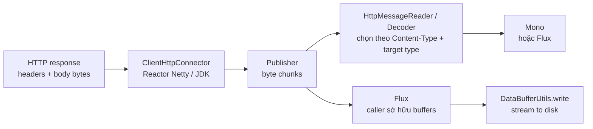
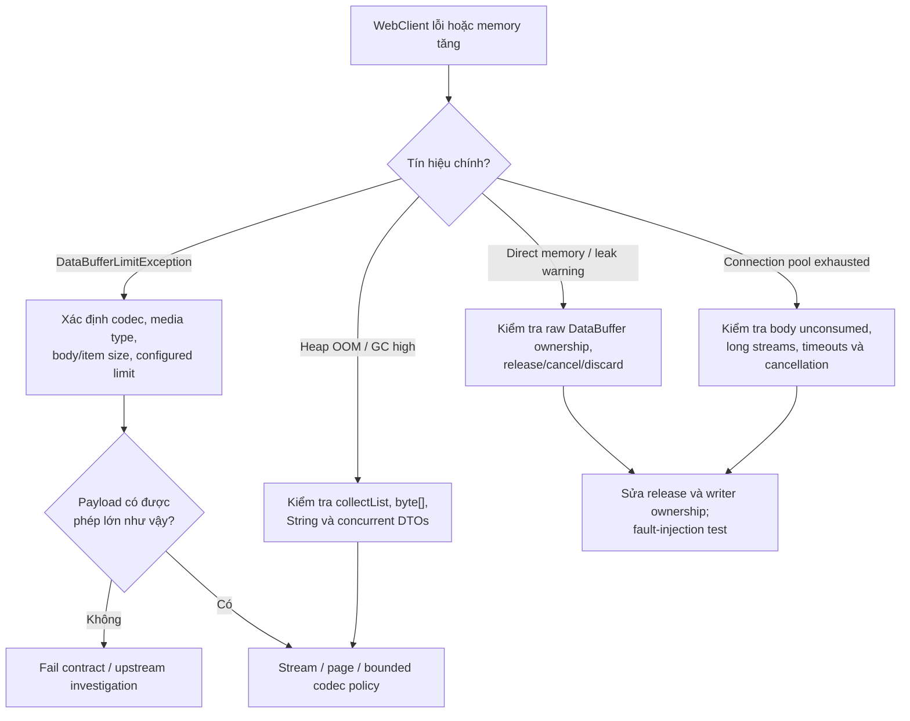

# Codec, maxInMemorySize và giải phóng nội dung phản hồi

## 1. Bài toán: HTTP thành công nhưng ứng dụng vẫn hết bộ nhớ

Một dịch vụ Spring Boot dùng `WebClient` để gọi hệ thống Warehouse, nhận JSON từ một API inventory hoặc tải báo cáo CSV từ đối tác. Ở môi trường thử nghiệm, response thường chỉ vài kilobyte; trong production, một đối tác có thể trả về JSON dài vài megabyte, một trường text không hợp lệ, file hàng gigabyte hoặc stream không kết thúc. Nếu ứng dụng giải mã toàn bộ response thành một `String`/`byte[]`/`List<T>`, bộ nhớ có thể tăng mạnh. Ngược lại, nếu chọn cách xử lý trực tiếp `DataBuffer` mà quên giải phóng, pooled Netty buffers có thể bị rò rỉ dù JVM heap chưa tăng rõ.

Ba câu hỏi vận hành cần trả lời là:

1. **Codec nào** chuyển dữ liệu HTTP bytes thành Java value và giới hạn buffer của codec ở đâu?
2. **`maxInMemorySize` giới hạn điều gì** và điều gì vẫn có thể khiến chương trình sử dụng quá nhiều bộ nhớ?
3. **Ai sở hữu và giải phóng response body/DataBuffer**, đặc biệt khi response lỗi, bị hủy subscription hoặc chỉ đọc status mà không cần body?

Bài thuộc chương **WebClient** của module **SPRING_BOOT_INTEGRATION**: tổ chức tích hợp qua HTTP client, database, cache, broker và adapter Spring Integration. Trọng tâm là cấu hình phù hợp, hợp đồng dữ liệu, lỗi, xử lý trùng lặp, kiểm thử và quan sát luồng tích hợp thực tế. Một response lỗi không được release đúng có thể làm nghẽn connection pool, tăng direct memory hoặc khiến các flow khác timeout; vì thế quản lý body là một phần của **độ tin cậy hệ thống**, không chỉ tối ưu hiệu năng.

**Sau bài học, bạn có thể:**

1. Giải thích pipeline HTTP response → `DataBuffer` → `HttpMessageReader/Decoder` → `Mono/Flux`.
2. Cấu hình codec cho `WebClient.Builder` hoặc `ExchangeStrategies` và chọn ngưỡng `maxInMemorySize` theo hợp đồng dữ liệu.
3. Nhận diện `DataBufferLimitException`, phân biệt giới hạn codec với giới hạn kích thước HTTP response ở tầng bảo mật.
4. Chọn `bodyToMono(Dto.class)` cho payload nhỏ; `bodyToFlux(T.class)`, NDJSON, SSE hoặc `DataBufferUtils.write(...)` cho luồng lớn.
5. Sử dụng `retrieve()`, `onStatus(...)`, `toBodilessEntity()` và `exchangeToMono()/exchangeToFlux()` mà không bỏ quên response body.
6. Áp dụng quy tắc **ownership** với `DataBuffer`, `DataBufferUtils.release(...)` và xử lý cancel/error/discard.
7. Thiết kế download file an toàn, không tích toàn bộ bytes lên heap, không để lại file tạm sau lỗi.
8. Kiểm thử payload quá lớn, error body, stream cancellation, memory pressure, timeout và quan sát rò rỉ.

> **Phạm vi phiên bản:** Các đoạn mã dùng Java 17+, Spring Boot 3.x, Spring Framework 6.x, Spring WebFlux và Reactor Netty phổ biến trong stack đó. Kiểm tra BOM, thư viện codec, các overload API và default thực tế khi dùng Boot 4.x/Spring 7.x. Các giới hạn dung lượng và thời gian trong ví dụ chỉ nhằm minh họa, cần điều chỉnh theo hợp đồng dịch vụ và ngân sách tài nguyên thực tế.

## 2. WebClient xử lý phản hồi qua những tầng nào?



HTTP client connector quản lý connection, response headers và luồng bytes. Spring WebFlux trừu tượng hóa bytes thành các `DataBuffer`. Tùy API gọi ở WebClient, codec sẽ chuyển những buffers này thành Java objects hoặc để caller xử lý bytes thô.

| Tầng | Vai trò | Trách nhiệm của ứng dụng |
| --- | --- | --- |
| `ClientHttpConnector` | Kết nối mạng, đọc headers/body, vận chuyển dữ liệu. | Cấu hình connect/read timeout, TLS, pool và logging phù hợp. |
| `DataBuffer` | Container chứa bytes, có thể backed by Netty pooled direct buffer. | Nếu tự lấy raw buffers, phải xử lý ownership/release. |
| `HttpMessageReader` | Chọn cách đọc body theo media type/target type. | Cấu hình codecs và giới hạn dữ liệu. |
| `Decoder<T>` | JSON → DTO, text → String, bytes → byte[], SSE/NDJSON → events. | Khớp schema/Content-Type; chọn streaming hay aggregation. |
| `Mono<T>` | Publisher tối đa một phần tử. | Không tự hiểu nó bảo đảm ít bytes; một DTO có thể rất lớn. |
| `Flux<T>` | Publisher nhiều phần tử. | Cân nhắc backpressure, giới hạn tổng items/time và cancellation. |
| `WebClient.ResponseSpec` | Xử lý status và decode body theo `retrieve()`. | Đọc lỗi đúng contract; không bỏ response unmanaged. |
| `ClientResponse` | Cho phép đọc status/headers và decode hoặc release body tùy nhánh. | Khi truy cập mức thấp, chọn API tự quản lý vòng đời. |

**Điểm cốt lõi:** “Reactive” không đồng nghĩa “không bao giờ cần buffer”. JSON object vẫn cần đủ bytes để parser dựng thành Java object; một lệnh `collectList()` vẫn tích tất cả elements vào memory. Backpressure là cơ chế điều tiết **dòng dữ liệu**, không phải hạn mức tổng memory cho mọi ứng dụng.

### 2.1. Codec là gì?

Codec kết hợp logic **encode/decode** dữ liệu theo media type và Java target type. Các trường hợp quen thuộc:

- `application/json` → Jackson JSON decoder/encoder cho DTO hoặc collection.
- `text/plain` → `String`.
- `application/octet-stream` → bytes hoặc `DataBuffer`.
- `application/x-ndjson` → nhiều JSON records theo dòng.
- `text/event-stream` → Server-Sent Events (SSE).
- `multipart/form-data` → multipart readers và part buffering/streaming theo configuration.

Không có một “JSON codec” áp dụng được cho mọi body bất kể `Content-Type`. Ví dụ provider trả `text/html` chứa trang lỗi trong khi client yêu cầu `OrderView` có thể gây `UnsupportedMediaTypeException` hoặc decoding error thay vì một domain error có cấu trúc. Cần kiểm tra hợp đồng content type/schema trước khi đổi codec sang kiểu chấp nhận mọi dữ liệu.

### 2.2. Khi nào buffering xảy ra?

```text
HTTP chunks:
 [4KiB] [4KiB] [4KiB] ...

bodyToMono(String.class)  -> gom nội dung của một body vào String
bodyToMono(byte[].class)  -> gom nội dung vào byte array
bodyToMono(OrderView.class) -> decode một JSON object hoàn chỉnh
bodyToFlux(Item.class)    -> có thể decode từng element/record
bodyToFlux(DataBuffer.class) -> truyền byte chunks cho caller
collectList()             -> gom mọi Flux items vào List
DataBufferUtils.join()    -> gom DataBuffers thành một kết quả
```

Giới hạn của decoder thường kiểm soát mức bytes **cần lưu để decode một item/aggregate**. Nó không phải một lệnh cấm mọi đoạn code sau đó giữ vô hạn Java objects trong collection hoặc map của riêng ứng dụng.

## 3. `maxInMemorySize` là gì?

`maxInMemorySize` là giới hạn dung lượng bộ nhớ đệm **cho các codec mặc định liên quan** khi chúng cần aggregate dữ liệu trong lúc giải mã hoặc encode. Spring WebFlux thường có default khoảng **256 KiB** cho nhiều in-memory readers/codecs nếu không được cấu hình riêng; hành vi và default có thể thay đổi theo codec/phiên bản.

Khi một decoder cần tích lũy nhiều bytes hơn giới hạn, có thể phát:

```text
org.springframework.core.io.buffer.DataBufferLimitException:
Exceeded limit on max bytes to buffer
```

Giới hạn này được chủ động đặt để ngăn việc vô tình đọc response quá lớn vào bộ nhớ. Đừng xử lý lỗi bằng cách tăng lên vài trăm MiB ngay lập tức; phải kiểm tra vì sao body lớn, ai chịu trách nhiệm, request có nên streaming không và liệu upstream response có đáng tin cậy hay không.

### 3.1. Ví dụ giới hạn 1 MiB

```java
// WebClientConfiguration.java
package com.example.integration.webclient;

import org.springframework.beans.factory.annotation.Value;
import org.springframework.context.annotation.Bean;
import org.springframework.context.annotation.Configuration;
import org.springframework.web.reactive.function.client.WebClient;

@Configuration(proxyBeanMethods = false)
public class WebClientConfiguration {

    @Bean("warehouseWebClient")
    WebClient warehouseWebClient(
        WebClient.Builder builder,
        @Value("${warehouse.base-url}") String baseUrl
    ) {
        return builder
            .baseUrl(baseUrl)
            .codecs(configurer -> configurer
                .defaultCodecs()
                .maxInMemorySize(1024 * 1024)
            )
            .build();
    }
}
```

```yaml
# application.yml
warehouse:
  base-url: ${WAREHOUSE_BASE_URL:http://localhost:8089}
```

Spring Boot cung cấp `WebClient.Builder` được cấu hình theo môi trường nếu dependency phù hợp, ví dụ từ `spring-boot-starter-webflux`. Dùng **builder được inject** giúp giữ lại những customizers/connector/observations do Boot hoặc dự án thiết lập. Gọi thẳng `WebClient.builder()` ở mỗi service có thể bỏ qua customizations đó.

Mã trên đặt **ngưỡng khoảng 1 MiB** cho các codec mặc định của client được tạo. Đây không phải toàn bộ request size policy của hệ thống: vẫn cần kiểm tra content length, số phần tử, thời gian stream, lượng dữ liệu đã ghi ra file, concurrency và kích thước của Java objects tạo ra.

### 3.2. Cấu hình global property hay riêng client?

Trong nhiều dự án có nhiều upstream:

```text
Warehouse GET /stock/{sku}    -> DTO nhỏ, 256KiB là đủ
Partner GET /catalog          -> JSON item lớn vừa phải, 1MiB
Reporting GET /export.csv     -> file hàng GiB, STREAM chứ không 512MiB buffer
Payment POST /capture         -> JSON nhỏ, giới hạn thấp và timeout chặt
```

Ưu tiên **cấu hình từng client theo contract** thay vì tăng global codec memory limit cho mọi endpoint. Có thể dùng `WebClientCustomizer` để cấu hình chuẩn dùng chung, nhưng các policy đặc biệt nên ở builder/client tương ứng, được review và kiểm thử.

Spring WebFlux server-side cũng có các properties như `spring.codec.max-in-memory-size` tùy phiên bản Spring Boot; property đó và các auto-configured codecs **không thay thế việc kiểm tra WebClient instance thực tế**. Nếu ứng dụng tạo `ExchangeStrategies` hay connector thủ công, các global customizations có thể không áp dụng như mong đợi. Test client đang dùng thật.

### 3.3. Bảng chọn giới hạn theo hợp đồng

| Loại phản hồi | Cách xử lý nên cân nhắc | Có nên tăng limit? |
| --- | --- | --- |
| JSON DTO vài KiB | `bodyToMono(Dto.class)` | Không, default thường đủ. |
| JSON DTO tối đa 700 KiB | `bodyToMono(Dto.class)` với limit 1 MiB | Có, nếu contract cho phép và có bound. |
| JSON array nhiều triệu rows | `bodyToFlux(Item.class)` hoặc API phân trang/NDJSON | Không tăng vài GiB chỉ để `collectList()`. |
| CSV export 3 GiB | `bodyToFlux(DataBuffer.class)` → file | Không dùng `bodyToMono(byte[].class)`. |
| SSE liên tục | `bodyToFlux(ServerSentEvent<T>)` | Bound mỗi event, không tích toàn stream. |
| Error body rất lớn | Bounded error parsing/skip release | Không đọc vô hạn để tạo exception message. |
| Multipart response | Reader từng part/stream part file theo contract | Có limits cho part/headers/aggregate riêng; không xem một knob là đủ. |

**Giới hạn 1 MiB không nói rằng ứng dụng chỉ dùng 1 MiB RAM:** một JVM có thể đồng thời decode 1.000 responses, mỗi DTO giữ các object/strings và còn network buffers, logs, DB writes, caches. Cần tính theo số requests/streams đồng thời.

## 4. Codec configuration nâng cao: builder và ExchangeStrategies

### 4.1. Dùng builder injection cho client production

```java
@Bean
WebClient partnerClient(WebClient.Builder builder) {
    return builder
        .baseUrl("https://partner.example")
        .codecs(codec -> codec.defaultCodecs()
            .maxInMemorySize(2 * 1024 * 1024))
        .build();
}
```

Trong project thật, base URL lấy từ configuration properties, phải xác minh TLS, hostname và quyền egress. Nên đặt `WebClient` là singleton bean được tái sử dụng; không tạo connection resources mới cho từng HTTP request.

### 4.2. `ExchangeStrategies` khi cần toàn quyền về codec

```java
import org.springframework.web.reactive.function.client.ExchangeStrategies;
import org.springframework.web.reactive.function.client.WebClient;

ExchangeStrategies strategies = ExchangeStrategies.builder()
    .codecs(config -> config.defaultCodecs()
        .maxInMemorySize(2 * 1024 * 1024))
    .build();

WebClient client = WebClient.builder()
    .baseUrl("https://partner.example")
    .exchangeStrategies(strategies)
    .build();
```

Đây là **phương án thay thế**, thường dùng khi cần kiểm soát tập codecs cụ thể. Khi tự tạo strategies/builder mới, phải lưu ý các codec customizations khác của Spring Boot/ứng dụng có thể không còn được kế thừa như lúc dùng injected builder. Tránh vừa `exchangeStrategies(...)` vừa cấu hình codecs ở nhiều nơi mà không biết cấu hình cuối cùng.

### 4.3. Custom Jackson codec khi có hợp đồng đặc thù

Nếu đối tác sử dụng format JSON đặc biệt, có thể đăng ký Jackson decoder/encoder với `ObjectMapper` phù hợp. Nhưng cần kiểm tra:

- JSON parser không được phép chấp nhận polymorphic types tùy ý từ dữ liệu không tin cậy.
- Custom codec phải khai báo đúng các `MediaType` cần hỗ trợ.
- Giới hạn `maxInMemorySize` có thực sự tác động tới custom decoder đó không? Tùy cách đăng ký và implementation.
- Một endpoint trả NDJSON/SSE không nên được decode như một JSON document duy nhất.
- ObjectMapper dành cho outbound serialization/inbound deserialization có thể khác nhau nếu đối tác có contract riêng; không đổi mapper toàn ứng dụng để chữa một endpoint.

Trong phần còn lại của bài, dùng codecs mặc định của Spring WebFlux để minh họa lifetime và giới hạn memory; custom codec không giải quyết được việc quên release raw `DataBuffer`.

## 5. Nhận diện và xử lý `DataBufferLimitException`

Một API trả JSON lớn:

```java
// PartnerCatalogClient.java
package com.example.integration.webclient;

import org.springframework.beans.factory.annotation.Qualifier;
import org.springframework.stereotype.Component;
import org.springframework.web.reactive.function.client.WebClient;
import reactor.core.publisher.Mono;

@Component
public class PartnerCatalogClient {
    private final WebClient client;

    public PartnerCatalogClient(
        @Qualifier("warehouseWebClient") WebClient client
    ) {
        this.client = client;
    }

    public Mono<CatalogSnapshot> getSnapshot() {
        return client.get()
            .uri("/api/v1/catalog/snapshot")
            .retrieve()
            .bodyToMono(CatalogSnapshot.class);
    }
}
```

`CatalogSnapshot` là một DTO do ứng dụng định nghĩa. Nếu JSON snapshot vượt ngưỡng decoder, publisher có thể kết thúc bằng `DataBufferLimitException` (trực tiếp hoặc trong cause chain tùy path và framework). Không “fix” bằng:

```java
// RỦI RO: thay lỗi có giới hạn thành yêu cầu giữ tới 1 GiB payload.
.codecs(codec -> codec.defaultCodecs()
    .maxInMemorySize(1024 * 1024 * 1024))
```

Hướng xử lý đúng:

1. Kiểm tra response size thực tế, media type và số fields; so với hợp đồng API.
2. Nếu DTO được phép có kích thước hữu hạn lớn hơn default: chọn limit đủ, có headroom và monitoring.
3. Nếu payload có thể rất lớn: phân trang, NDJSON, SSE, hoặc stream bytes xuống disk/object storage.
4. Nếu upstream trả body bất thường: fail fast, ngắt stream, không retry liên tục một payload luôn vi phạm contract.
5. Nếu ứng dụng cần lưu toàn bộ dữ liệu thành Java object list: chuyển sang xử lý từng phần/batch hoặc thiết kế read model bền vững.

### 5.1. Lỗi size limit khác lỗi JSON malformed

| Loại lỗi | Ví dụ | Hướng phục hồi |
| --- | --- | --- |
| `DataBufferLimitException` | Một JSON object/error body vượt giới hạn codec. | Giảm aggregation, stream/page, hoặc điều chỉnh limit theo contract. |
| JSON parsing error | Payload malformed hoặc type không khớp. | Kiểm tra schema/provider version; không retry mù. |
| Unsupported content type | Nhận HTML nhưng decoder muốn JSON. | Kiểm tra `Content-Type` và error mapping; không mở codec bừa. |
| Network disconnect | Response bị cắt giữa chừng. | Đánh giá retryability theo operation; cleanup resources. |
| User cancel/timeout | Downstream không còn cần kết quả. | Cancel upstream; bảo đảm release/discard/file cleanup. |
| Heap OOM | Giữ quá nhiều objects/list hoặc concurrency lớn. | Giới hạn cardinality/concurrency; profiler và streaming. |
| Direct memory leak | Pooled buffers giữ ref count sau khi không còn dùng. | Sửa ownership/release; memory/leak detection. |

Không map mọi `DataBufferLimitException` thành một “500 rồi retry 3 lần”. Tăng retries trên cùng một response quá lớn chỉ làm tăng tải và log volume.

### 5.2. Giới hạn codec không phải giới hạn HTTP tải xuống

`maxInMemorySize` thường áp dụng khi **codec aggregate** dữ liệu. Với `bodyToFlux(DataBuffer.class)`, bạn nhận bytes dưới dạng stream, không tự có giới hạn **tổng số bytes**. Nếu server liên tục gửi dữ liệu, ứng dụng có thể tải vô hạn tới khi hết disk, deadline hoặc quota.

Để bảo vệ hệ thống còn cần:

- Header `Content-Length` kiểm tra sớm (nhưng **không tin tuyệt đối**).
- Bound theo số bytes thực nhận khi streaming; không chỉ so header vì chunked transfer có thể không có length.
- Max duration, idle timeout, total request deadline và connection pool budget.
- Max item count/size cho JSON stream, NDJSON và SSE.
- Disk quota, temp-file cleanup, file name/path validation và authentication.
- Với HTTP compression, kiểm soát cả kích thước thực khi giải nén, tránh decompression bomb.

Ví dụ API cho phép CSV tối đa 100 MiB: client phải **đếm bytes thực nhận** và dừng khi quá 100 MiB, dù `Content-Length` vắng mặt hoặc sai.

## 6. `retrieve()`: cách mặc định để giải mã và quản lý response

Với response theo hợp đồng DTO nhỏ, `retrieve()` là lựa chọn dễ đọc. Framework sở hữu response body và thực hiện decode/release theo đường xử lý đã chọn:

```java
// OrderView.java
package com.example.integration.webclient;

public record OrderView(
    String orderId,
    String status,
    long version
) {}
```

```java
// OrderQueryGateway.java
package com.example.integration.webclient;

import org.springframework.beans.factory.annotation.Qualifier;
import org.springframework.stereotype.Component;
import org.springframework.web.reactive.function.client.WebClient;
import reactor.core.publisher.Mono;

@Component
public class OrderQueryGateway {
    private final WebClient client;

    public OrderQueryGateway(
        @Qualifier("warehouseWebClient") WebClient client
    ) {
        this.client = client;
    }

    public Mono<OrderView> find(String orderId) {
        return client.get()
            .uri("/api/v1/orders/{id}", orderId)
            .retrieve()
            .bodyToMono(OrderView.class);
    }
}
```

Với `bodyToMono(OrderView.class)`, decoder có trách nhiệm chuyển JSON thành object. Nếu không có body (ví dụ server trả 204), `Mono` có thể hoàn thành rỗng; **không** tự trở thành `new OrderView(...)` hoặc HTTP lỗi. Business adapter cần quy định liệu rỗng là hợp lệ hay sai contract.

### 6.1. Lấy cả status và headers

```java
import org.springframework.http.ResponseEntity;

Mono<ResponseEntity<OrderView>> response = client.get()
    .uri("/api/v1/orders/{id}", orderId)
    .retrieve()
    .toEntity(OrderView.class);
```

`toEntity(...)` vẫn decode body theo target type/codec, nhưng giữ status/headers như `ETag` và `Location`. Nó không làm cho payload lớn hơn trở nên streaming.

### 6.2. Không cần body: `toBodilessEntity()`

Một endpoint `DELETE` thành công trả 204 hoặc 202 không có business JSON:

```java
import org.springframework.http.ResponseEntity;

Mono<ResponseEntity<Void>> deletion = client.delete()
    .uri("/api/v1/reservations/{id}", reservationId)
    .retrieve()
    .toBodilessEntity();
```

`toBodilessEntity()` hướng framework xử lý phần body không sử dụng và trả status/headers. Không dùng `bodyToMono(byte[].class)` chỉ để vứt bytes sau đó. **Lưu ý nghiệp vụ:** 202 Accepted có thể nghĩa là upstream đã nhận một tác vụ bất đồng bộ chứ chưa hoàn tất; quản lý body không thay contract và trạng thái xử lý.

### 6.3. `retrieve()` với HTTP lỗi

Mặc định, response HTTP 4xx/5xx từ `retrieve()` được chuyển sang `WebClientResponseException` hoặc subtype thích hợp. Spring cố đọc body cho exception theo chính sách của nó; phần response body cũng chịu codec/memory behavior. Không tạo logic “đọc toàn bộ error body thành String để log” mà không giới hạn dữ liệu.

Ví dụ mapping 503 mà **không cần giải mã error body**:

```java
Mono<OrderView> result = client.get()
    .uri("/api/v1/orders/{id}", orderId)
    .retrieve()
    .onStatus(
        status -> status.value() == 503,
        response -> response.releaseBody()
            .thenReturn(new UpstreamUnavailableException(
                "Warehouse is temporarily unavailable"
            ))
    )
    .bodyToMono(OrderView.class);
```

`UpstreamUnavailableException` là một `RuntimeException` do ứng dụng định nghĩa; ở đây lambda của `onStatus(...)` trả về `Mono<? extends Throwable>`. `releaseBody()` cho biết ta không cần đọc body lỗi và muốn nhả nội dung trước khi báo lỗi.

Nếu cần error code dạng JSON nhỏ để map domain error, decode bounded:

```java
// ProviderError.java
public record ProviderError(
    String code,
    String message
) {}
```

```java
Mono<OrderView> result = client.get()
    .uri("/api/v1/orders/{id}", orderId)
    .retrieve()
    .onStatus(
        status -> status.value() == 409,
        response -> response.bodyToMono(ProviderError.class)
            .map(problem -> new UpstreamBusinessException(
                problem.code()
            ))
            .switchIfEmpty(Mono.just(
                new UpstreamBusinessException(
                    "UPSTREAM_CONFLICT_WITHOUT_BODY"
                )
            ))
    )
    .bodyToMono(OrderView.class);
```

`UpstreamBusinessException` cũng là exception do ứng dụng định nghĩa. Với response sai JSON/schema hoặc quá limit, việc decode error body **có thể thất bại**; cần error mapping/logs đúng nguyên nhân, không “nuốt” lỗi rồi biến thành success.

**Không làm:**

```java
.onStatus(
    status -> status.value() == 404,
    response -> Mono.empty()
)
.bodyToMono(OrderView.class);
```

Việc trả `Mono.empty()` từ status handler có thể **suppress xử lý lỗi status** rồi cho body đi tiếp vào decoder thành `OrderView`. Nếu body 404 là HTML/error JSON khác schema, decoder lỗi; nếu body rỗng, caller có thể nhận `Mono.empty()` nhưng mất ý nghĩa “not found”. Khi 404 là trạng thái nghiệp vụ, dùng `exchangeToMono(...)` để map rõ `NotFound` hoặc `Optional.empty`.

### 6.4. Không double-subscribe một request có tác dụng phụ

```java
Mono<OrderView> call = client.get()
    .uri("/api/v1/orders/{id}", orderId)
    .retrieve()
    .bodyToMono(OrderView.class);

// Trong mô hình WebClient thông thường, mỗi subscription
// kích hoạt một HTTP exchange mới:
call.subscribe();
call.subscribe();
```

Với GET, điều này gây request thừa; với POST, hai subscriptions có thể tạo **hai side effects**. Không gọi `subscribe()` bên trong service rồi đồng thời trả publisher cho caller nếu chưa định nghĩa ownership. Dùng Reactor composition; nếu chia sẻ kết quả có kiểm soát, nghiên cứu `cache()`/`share()` theo lifetime và error semantics, nhưng đừng coi đó là durable idempotency.

## 7. `exchangeToMono()` và `exchangeToFlux()`: xử lý status tùy ý nhưng vẫn quản lý vòng đời

Trước đây, API `exchange()` cấp thấp cho người gọi `ClientResponse` để tự tiêu thụ/release body. Nếu người dùng chỉ đọc status mà không đọc/drain body, có nguy cơ leak tài nguyên hoặc không tái sử dụng connection như kỳ vọng; API này đã bị deprecated trong các phiên bản Spring Framework liên quan do trách nhiệm quản lý body khó đảm bảo.

**Ưu tiên** `exchangeToMono(...)` và `exchangeToFlux(...)` khi cần quyết định logic decode theo status/headers. Theo API này, sau khi Publisher do callback trả về hoàn tất, framework sẽ kiểm tra và release phần response body chưa được tiêu thụ. Người viết code vẫn nên **consume hoặc release rõ ở mỗi nhánh** cho dễ review.

### 7.1. 200, 304 và 404 là ba kết quả khác nhau

Một API hỗ trợ conditional GET với `If-None-Match`/`ETag`:

```java
// OrderLookup.java — đặt mỗi public type trong file riêng khi triển khai.
sealed interface OrderLookup {
    record Found(OrderView value, String etag)
        implements OrderLookup {}
    record NotModified(String etag)
        implements OrderLookup {}
    record Missing()
        implements OrderLookup {}
}
```

```java
// Trong một gateway có field WebClient client.
public Mono<OrderLookup> findWithEtag(
    String orderId, String knownEtag
) {
    return client.get()
        .uri("/api/v1/orders/{id}", orderId)
        .headers(headers -> {
            if (knownEtag != null && !knownEtag.isBlank()) {
                headers.setIfNoneMatch(knownEtag);
            }
        })
        .exchangeToMono(response -> {
            int status = response.statusCode().value();
            String etag = response.headers()
                .asHttpHeaders().getETag();

            if (status == 304) {
                // Không cần body; 304 không phải một OrderView.
                return response.releaseBody()
                    .thenReturn((OrderLookup)
                        new OrderLookup.NotModified(etag));
            }

            if (status == 404) {
                return response.releaseBody()
                    .thenReturn((OrderLookup)
                        new OrderLookup.Missing());
            }

            if (status >= 200 && status < 300) {
                return response.bodyToMono(OrderView.class)
                    .switchIfEmpty(Mono.error(
                        new IllegalStateException(
                            "200 without required OrderView"
                        )
                    ))
                    .map(value -> (OrderLookup)
                        new OrderLookup.Found(value, etag));
            }

            return response.createException()
                .flatMap(Mono::error);
        });
}
```

Trong code thực tế, method cần khai báo trong class/bean có field `WebClient client` và import `reactor.core.publisher.Mono`. Ví dụ:

- Status 200/2xx: codec decode body đúng `OrderView`.
- Status 304: **không** decode body thành DTO; caller phải dùng cached representation tương ứng ETag.
- Status 404: release body và trả một business result `Missing`, không ném lỗi JSON.
- Status khác: `ClientResponse.createException()` dựng HTTP exception phù hợp; error-body buffering vẫn cần giới hạn.

**ETag hợp lệ không tự bảo đảm dữ liệu cache của client đúng:** phải gắn ETag với representation thực sự đã lưu và bảo vệ cache key/tenant. Nếu 304 nhưng local cache đã mất dữ liệu, cần GET không điều kiện hoặc workflow khác theo contract.

### 7.2. Lỗi phổ biến: trả `ClientResponse` ra khỏi callback

Không viết:

```java
// RỦI RO: giữ ClientResponse để đọc body sau khi
// exchangeToMono đã kết thúc vòng đời response.
Mono<ClientResponse> responseLater =
    client.get().uri("/api/v1/orders/{id}", orderId)
        .exchangeToMono(Mono::just);
```

Khi callback kết thúc, framework có thể release body còn lại. Trả `ClientResponse` ra ngoài rồi gọi `bodyToMono(...)` sau đó **không còn bảo đảm body khả dụng**. Hãy decode hoặc chuyển thành domain result **bên trong** callback.

### 7.3. `exchangeToFlux()` cho stream nhiều records

```java
// Ví dụ endpoint trả NDJSON.
public Flux<InventoryChange> changes(String sku) {
    return client.get()
        .uri("/api/v1/stock/{sku}/changes", sku)
        .accept(MediaType.APPLICATION_NDJSON)
        .exchangeToFlux(response -> {
            if (response.statusCode().is2xxSuccessful()) {
                return response.bodyToFlux(
                    InventoryChange.class
                );
            }
            return response.createException()
                .flatMapMany(Flux::error);
        });
}
```

Ví dụ giả định `InventoryChange` là DTO application, `MediaType` được import từ `org.springframework.http.MediaType` và `Flux` từ Reactor. Không đem `ClientResponse` hoặc raw `InputStream` ra ngoài callback.

**Lưu ý:** `exchangeToFlux` có cơ chế release phần body không dùng khi Publisher kết thúc; nhưng nếu callback trả ra một `Flux<DataBuffer>` thì raw buffers đang được chuyển cho **caller**, nơi đó phải xử lý/release đúng. Tự động cleanup của framework không cho phép bỏ mặc raw buffers mà người dùng đã nhận.

### 7.4. Khi không dùng body, luôn có một đường release rõ ràng

```java
public Mono<Boolean> exists(String orderId) {
    return client.head()
        .uri("/api/v1/orders/{id}", orderId)
        .exchangeToMono(response -> {
            int status = response.statusCode().value();
            if (status == 200) {
                return response.releaseBody().thenReturn(true);
            }
            if (status == 404) {
                return response.releaseBody().thenReturn(false);
            }
            return response.createException()
                .flatMap(Mono::error);
        });
}
```

`HEAD` thông thường không có body, nhưng rõ ràng dùng `releaseBody()` ở những nhánh chỉ xem status giúp hành vi code dễ hiểu nếu upstream vi phạm contract và gửi bytes ngoài dự kiến. `ClientResponse.releaseBody()` trả `Mono<Void>`, không phải một lệnh đồng bộ tức thời; phải **compose hoặc subscribe có owner** để nó được thực thi.

## 8. Quy tắc ownership với `DataBuffer`

Trong Reactor Netty, `DataBuffer` có thể backed by Netty `ByteBuf` **pooled/reference-counted**, thường ở direct memory ngoài Java heap. Khi code dùng `bodyToMono(Dto.class)`, decoder/framework chịu trách nhiệm xử lý/release các buffers trong pipeline bình thường. Nhưng khi gọi `bodyToFlux(DataBuffer.class)`, application bắt đầu nhận **raw buffers**.

**Quy tắc:** component nào sở hữu một raw buffer phải bảo đảm nó được release **đúng một lần theo ownership**, kể cả khi error hoặc cancellation. Đừng release một buffer khi một component khác vẫn đang đọc nó; đừng retain thêm reference mà không tương ứng release.

| Cách đọc | Ai thường chịu trách nhiệm release? | Nguy cơ |
| --- | --- | --- |
| `bodyToMono(OrderView.class)` | Decoder/WebFlux khi chuyển thành DTO. | Aggregation lớn, decode lỗi. |
| `bodyToMono(String.class)` | Decoder/WebFlux. | Tích cả String lớn vào memory. |
| `bodyToFlux(InventoryChange.class)` | Streaming decoder/WebFlux cho buffers nguồn. | Tích lũy items về sau, record quá lớn. |
| `bodyToFlux(DataBuffer.class)` | **Caller/consumer của raw buffers**. | Leak pooled buffers nếu quên release. |
| `DataBufferUtils.join(...)` | Utility quản lý input buffers; **caller release joined result** khi dùng xong. | Giữ aggregate lớn, quên release joined buffer. |
| `DataBufferUtils.write(..., Path, ...)` | Utility quản lý/release buffers ghi thành công theo API path overload. | File temp còn lại khi error/cancel; phải kiểm soát total bytes. |
| `ClientResponse.releaseBody()` | Framework thực hiện release/discard body khi Publisher được subscribe. | Quên compose `Mono<Void>` hoặc release sau callback. |

### 8.1. Nếu cần đọc raw chunk, luôn dùng `try/finally`

```java
import org.springframework.core.io.buffer.DataBuffer;
import org.springframework.core.io.buffer.DataBufferUtils;

Flux<byte[]> chunks = client.get()
    .uri("/api/v1/export/bytes")
    .retrieve()
    .bodyToFlux(DataBuffer.class)
    .map(buffer -> {
        try {
            byte[] bytes = new byte[buffer.readableByteCount()];
            buffer.read(bytes);
            return bytes;
        } finally {
            DataBufferUtils.release(buffer);
        }
    })
    .doOnDiscard(
        DataBuffer.class,
        DataBufferUtils::release
    );
```

Code copy từng chunk thành một `byte[]` rồi release raw `DataBuffer`. Mỗi array vẫn chiếm memory sau đó; nếu caller gọi `chunks.collectList()`, kết quả có thể chiếm toàn bộ dung lượng response. Đây chỉ là minh họa **ownership**, không phải cách tải file khuyến nghị.

`doOnDiscard(DataBuffer.class, DataBufferUtils::release)` giúp giải phóng những buffers bị các operator có hỗ trợ discard bỏ qua, chẳng hạn một số đường cancellation/filter. Nó **không** thay thế release các buffers đã được callback xử lý bình thường và không nên dùng như lời hứa mọi custom operator sẽ gọi discard hooks.

### 8.2. Release không có nghĩa có thể dùng lại buffer

```java
DataBufferUtils.release(buffer);
// ĐỪNG tiếp tục buffer.read(...), giữ ByteBuffer view
// hay chuyển buffer sang thread khác sau khi đã release.
```

Với reference-counted buffers, dữ liệu có thể bị tái sử dụng sau release. Nếu cần xử lý bất đồng bộ, phải xác định **giữ ownership (retain) tới lúc callback hoàn tất**, rồi release ở đường success/error/cancel; tốt hơn là copy một lượng bytes có giới hạn hoặc dùng utilities đã thiết kế đúng lifetime.

### 8.3. Có thể có double release

```text
DataBufferUtils.write(..., Path, ...)
    -> utility release consumed buffers

Caller lại manually release cùng buffer sau đó
    -> double-release / illegal ref count / khó debug
```

Chọn một owner rõ ràng. Đọc Javadoc **đúng overload** của `DataBufferUtils.write` đang dùng: một số overload vào `OutputStream`/`WritableByteChannel` trả `Flux<DataBuffer>` và **không tự release**; khi đó caller cần `doOnNext(DataBufferUtils.releaseConsumer())` hoặc cơ chế tương đương. Overload ghi trực tiếp vào `Path` có quy tắc release khác. Không lấy ví dụ một overload để suy ra mọi overload đều giống nhau.

### 8.4. `DataBufferUtils.join(...)`: giới hạn và release

Nếu thật sự cần gom **một payload nhỏ** theo protocol riêng, có thể dùng bound:

```java
Mono<byte[]> smallBytes = DataBufferUtils.join(
        client.get()
            .uri("/api/v1/small-binary")
            .retrieve()
            .bodyToFlux(DataBuffer.class),
        64 * 1024
    )
    .map(joined -> {
        try {
            byte[] bytes = new byte[joined.readableByteCount()];
            joined.read(bytes);
            return bytes;
        } finally {
            DataBufferUtils.release(joined);
        }
    });
```

`join(..., maxByteCount)` có thể ném `DataBufferLimitException` nếu tổng vượt giới hạn; utility xử lý release các **input buffers** khi kết thúc/lỗi theo contract. Application **phải release joined DataBuffer** ở đường dùng xong như trên. Nếu code chỉ cần bytes theo `bodyToMono(byte[].class)` và đã có codec limit, API đơn giản hơn sẽ dễ bảo trì hơn.

### 8.5. Cancellation là một đường kết thúc riêng

```text
Request nhận bytes
  -> downstream cancel (user đóng tab, take(n), timeout)
  -> upstream subscription cancel
  -> buffers trong pipeline/queue có thể bị discard
  -> file writer/consumer phải dọn tài nguyên của nó
```

Một sequence chỉ xử lý `onComplete` và `onError` mà bỏ qua `cancel` có thể để lại file tạm hoặc giữ tài nguyên. Với Reactor, các hooks như `doFinally(signalType -> ...)` phân biệt `ON_COMPLETE`, `ON_ERROR` và `CANCEL`; với tài nguyên async (file, stream, connection), dùng `usingWhen` hoặc cleanup có cấu trúc thay vì `doOnCancel(() -> blockingIO())` chạy trên event loop.

## 9. Download file lớn: stream xuống disk thay vì gom vào heap

Một export endpoint có thể trả hàng trăm megabyte:

```http
GET /api/v1/reports/monthly/2026-11.csv HTTP/1.1
Accept: text/csv
```

Không làm:

```java
Mono<byte[]> bad = client.get()
    .uri("/api/v1/reports/monthly/2026-11.csv")
    .retrieve()
    .bodyToMono(byte[].class);

// Sau đó Files.write(..., bytes) ở một bước khác.
```

Mã này cố tạo toàn bộ `byte[]` trước khi ghi file. Việc tăng `maxInMemorySize` để nó “chạy được” không giải quyết memory pressure khi nhiều exports song song.

**Thiết kế đề xuất:**

1. Validate report ID và đích lưu do application kiểm soát.
2. Xem `Content-Length` nếu có; từ chối sớm khi vượt quota.
3. **Đếm từng byte thực nhận**, không tin header để làm giới hạn duy nhất.
4. Ghi từng chunk vào file tạm cùng filesystem với đích.
5. Release consumed `DataBuffer` theo contract của `DataBufferUtils.write(..., Path, ...)`.
6. Khi ghi xong, thực hiện atomic move nếu filesystem hỗ trợ.
7. Nếu lỗi hoặc downstream cancellation, xóa file tạm theo cleanup async.
8. Chỉ trả “download complete” khi file đã được publish hợp lệ.

### 9.1. Ví dụ có giới hạn dung lượng và cleanup

```java
// ReportDownloadService.java
package com.example.integration.webclient;

import java.nio.file.Files;
import java.nio.file.Path;
import java.nio.file.StandardCopyOption;
import java.nio.file.StandardOpenOption;
import java.util.concurrent.atomic.AtomicLong;
import org.springframework.beans.factory.annotation.Qualifier;
import org.springframework.core.io.buffer.DataBuffer;
import org.springframework.core.io.buffer.DataBufferUtils;
import org.springframework.stereotype.Service;
import org.springframework.web.reactive.function.client.WebClient;
import reactor.core.publisher.Flux;
import reactor.core.publisher.Mono;
import reactor.core.scheduler.Schedulers;

@Service
public class ReportDownloadService {
    private static final long MAX_BYTES = 100L * 1024 * 1024;

    private final WebClient client;
    private final Path downloadRoot;

    public ReportDownloadService(
        @Qualifier("warehouseWebClient") WebClient client
    ) {
        this.client = client;
        // Ví dụ: đường dẫn do operator cấu hình, không nhận từ HTTP input.
        this.downloadRoot = Path.of("/var/app/reports")
            .toAbsolutePath().normalize();
    }

    public Mono<Path> download(String reportId) {
        if (reportId == null
            || !reportId.matches("[A-Za-z0-9_-]{1,64}")) {
            return Mono.error(new IllegalArgumentException(
                "Invalid report id"
            ));
        }

        Path destination = downloadRoot
            .resolve(reportId + ".csv")
            .normalize();
        if (!destination.startsWith(downloadRoot)) {
            return Mono.error(new SecurityException(
                "Invalid download path"
            ));
        }

        // Một resource (temp file) cho mỗi subscription.
        return Mono.usingWhen(
            Mono.fromCallable(() -> {
                    Files.createDirectories(downloadRoot);
                    return Files.createTempFile(
                        downloadRoot, "report-", ".part"
                    );
                })
                .subscribeOn(Schedulers.boundedElastic()),

            temp -> fetchAndWrite(reportId, temp)
                .then(Mono.fromCallable(() -> Files.move(
                        temp, destination,
                        StandardCopyOption.ATOMIC_MOVE
                    ))
                    .subscribeOn(Schedulers.boundedElastic())),

            this::deleteTemp,
            (temp, error) -> deleteTemp(temp),
            this::deleteTemp
        );
    }

    private Mono<Void> fetchAndWrite(
        String reportId, Path temp
    ) {
        return client.get()
            .uri("/api/v1/reports/{id}.csv", reportId)
            .retrieve()
            .bodyToFlux(DataBuffer.class)
            .transform(buffers -> limitBytes(buffers, MAX_BYTES))
            .as(buffers -> DataBufferUtils.write(
                buffers,
                temp,
                StandardOpenOption.WRITE,
                StandardOpenOption.TRUNCATE_EXISTING
            ));
    }

    private static Flux<DataBuffer> limitBytes(
        Flux<DataBuffer> source, long maxBytes
    ) {
        return Flux.defer(() -> {
            AtomicLong received = new AtomicLong();
            return source.concatMap(buffer -> {
                long total = received.addAndGet(
                    buffer.readableByteCount()
                );
                if (total > maxBytes) {
                    DataBufferUtils.release(buffer);
                    return Mono.<DataBuffer>error(
                        new ReportTooLargeException(maxBytes)
                    );
                }
                // Ownership chuyển sang DataBufferUtils.write(Path).
                return Mono.just(buffer);
            });
        })
        .doOnDiscard(
            DataBuffer.class,
            DataBufferUtils::release
        );
    }

    private Mono<Void> deleteTemp(Path temp) {
        return Mono.fromCallable(() -> Files.deleteIfExists(temp))
            .subscribeOn(Schedulers.boundedElastic())
            .then();
    }
}
```

```java
// ReportTooLargeException.java
package com.example.integration.webclient;

public class ReportTooLargeException
    extends RuntimeException {
    public ReportTooLargeException(long maxBytes) {
        super("Report exceeds " + maxBytes + " bytes");
    }
}
```

**Cách hoạt động:**

- `Flux.defer` tạo `AtomicLong` mới cho từng subscription, tránh dùng một counter chung của nhiều downloads.
- `concatMap` chuyển từng buffer được chấp nhận cho file writer; nếu tổng bytes vượt quota, buffer hiện tại được release rồi publisher báo lỗi. Các buffers đã được writer tiếp nhận được writer quản lý theo API `write(Path)`.
- `DataBufferUtils.write(Publisher<DataBuffer>, Path, OpenOption...)` ghi tuần tự ra file và release các source buffers theo contract của **Path overload**. Không gọi `release` thêm trên những buffers đã được writer sở hữu.
- `doOnDiscard(...)` phục vụ những buffers bị bỏ qua ở đường operators hỗ trợ discard; nguyên tắc **không double release** vẫn phải được giữ.
- `Mono.usingWhen` chạy cleanup cho kết thúc bình thường, error và cancellation. Nếu file đã move, `deleteTemp(...)` không còn temp để xóa.
- `Files.createTempFile`/`Files.move`/`Files.deleteIfExists` là file I/O có khả năng blocking, nên đặt trong `boundedElastic` chứ không chạy trên Netty event loop.
- `ATOMIC_MOVE` chỉ thành công trên filesystem hỗ trợ; nếu không, method phải thất bại hoặc chọn cơ chế publish được thiết kế riêng, **không** âm thầm đổi sang non-atomic move khi consumer khác phụ thuộc tính toàn vẹn.

**Giới hạn của ví dụ:** Đường dẫn `/var/app/reports` là placeholder cho môi trường server được quản lý. Production phải cấu hình root path, quyền filesystem, dung lượng/quotas, cleanup orphaned temp files sau process crash, chống symlink/path traversal và tên file không bị ghi đè ngoài ý muốn. Mã ví dụ đếm bytes lúc giải mã; nếu HTTP compression hoặc response transformation khác làm thay đổi kích thước dữ liệu, cần xác định rõ quota được áp trên bytes **đã giải nén hay trên wire**. Không gửi untrusted path trực tiếp vào `Files.move`.

### 9.2. Dùng `exchangeToMono` để kiểm tra Content-Length trước khi stream

Nếu provider thường cung cấp Content-Length, thêm kiểm tra sớm:

```java
Mono<Void> downloadBody = client.get()
    .uri("/api/v1/reports/{id}.csv", reportId)
    .exchangeToMono(response -> {
        if (!response.statusCode().is2xxSuccessful()) {
            return response.createException()
                .flatMap(Mono::error);
        }
        long declared = response.headers()
            .contentLength().orElse(-1L);

        if (declared > MAX_BYTES) {
            return response.releaseBody().then(Mono.error(
                new ReportTooLargeException(MAX_BYTES)
            ));
        }

        Flux<DataBuffer> body = limitBytes(
            response.bodyToFlux(DataBuffer.class),
            MAX_BYTES
        );
        return DataBufferUtils.write(
            body,
            temp,
            StandardOpenOption.WRITE,
            StandardOpenOption.TRUNCATE_EXISTING
        );
    });
```

Đây là **đoạn thay thế cho phần fetchAndWrite** trong `ReportDownloadService` (các field/method `client`, `temp`, `reportId`, `MAX_BYTES`/`limitBytes` đã được khai báo ở đó). Header `Content-Length` chỉ giúp từ chối sớm; stream vẫn phải có `limitBytes` vì HTTP chunked transfer có thể không cung cấp length hoặc provider có thể gửi sai.

### 9.3. Điều gì xảy ra nếu subscriber hủy download?

Ví dụ caller gọi `download(...).timeout(Duration.ofSeconds(30))`:

1. Khi deadline vượt, Reactor phát timeout/cancel tới upstream trong phạm vi cơ chế Publisher.
2. Client connector ngừng quan tâm response và cleanup connection/buffers trong pipeline framework.
3. Writer ngừng nhận dữ liệu; những buffers còn trong queues/discard paths cần được release theo semantics của utilities/operators.
4. `usingWhen` gọi đường asyncCancel để xóa file tạm.
5. Nếu có một external side effect khác ngoài download (ví dụ server bắt đầu tạo report), **cancel từ client không rollback remote job**.

Process crash không thực thi được cleanup callbacks. Vì vậy ứng dụng vẫn nên có housekeeping task quét các file `*.part` quá tuổi với quy tắc ownership/tránh xóa file đang được writer khác dùng.

### 9.4. Khi nào nên dùng object storage thay vì local disk?

Nếu có nhiều replicas và artifact cần được truy cập từ bất kỳ node nào, local disk có thể không phù hợp. Có thể stream sang object storage qua SDK có backpressure/part upload, checksum, size limit, cancel cleanup và idempotent object key. Khi multipart upload thất bại cần abort các parts còn treo. Không suy ra một lệnh HTTP client đã thành công chỉ vì upstream trả 200 trước khi object storage upload hoàn tất.

## 10. NDJSON: decode từng record thay vì một JSON document khổng lồ

Một API trả:

```http
HTTP/1.1 200 OK
Content-Type: application/x-ndjson

{"eventId":"evt-1","sku":"SKU-42","quantity":2}
{"eventId":"evt-2","sku":"SKU-42","quantity":3}
{"eventId":"evt-3","sku":"SKU-42","quantity":4}
```

Khác với một JSON array phải đọc nguyên list ở API contract phía client, NDJSON gửi các JSON objects độc lập theo dòng. Decoder có thể phát mỗi record thành một item:

```java
// InventoryChange.java
package com.example.integration.webclient;

public record InventoryChange(
    String eventId,
    String sku,
    long quantity
) {}
```

```java
// Trong một gateway có WebClient client.
public Flux<InventoryChange> receiveChanges(String sku) {
    return client.get()
        .uri("/api/v1/stock/{sku}/changes", sku)
        .accept(MediaType.APPLICATION_NDJSON)
        .retrieve()
        .bodyToFlux(InventoryChange.class)
        .take(10_000)              // Giới hạn items nếu contract hữu hạn.
        .timeout(Duration.ofMinutes(2));
}
```

Giả định code đã import `MediaType`, `Duration`, `Flux`. Với NDJSON:

- Codec có thể giữ bytes cho **một record** trong lúc parse; record JSON đơn lẻ quá lớn vẫn có thể vượt `maxInMemorySize`.
- `Flux<InventoryChange>` không tự giới hạn tổng số records; `take(10_000)` hoặc một server-side cursor/window là giới hạn theo nhu cầu.
- `collectList()` sau `bodyToFlux(...)` biến streaming thành tích lũy nhiều objects, có thể gây OOM.
- Nếu chuyển từng item sang DB, không nên `flatMap(..., Integer.MAX_VALUE)` tạo vô hạn concurrent writes. Hãy dùng `concatMap` hoặc `flatMap(..., concurrency)` với transaction boundaries phù hợp.
- Một record lỗi schema ở giữa stream cần có chính sách fail/parking rõ ràng. Không bỏ record lỗi rồi ack toàn batch nếu nghiệp vụ yêu cầu exactly-once ingestion.

### 10.1. Xử lý từng record và giới hạn concurrency

```java
public Mono<Void> importChanges(String sku) {
    return receiveChanges(sku)
        .flatMap(
            change -> inventoryChangeWriter.apply(change),
            8
        )
        .then();
}
```

`inventoryChangeWriter.apply(change)` ở đây trả `Mono<Void>` và phải cung cấp DB transaction/idempotency theo `eventId` nếu stream có thể phát lại. `flatMap(..., 8)` cho phép tối đa 8 writes đồng thời; nếu cần **strict ordering theo SKU**, dùng `concatMap` hoặc cơ chế sequencing/partitioning theo business key, không áp dụng concurrency tùy ý.

### 10.2. Streaming không miễn phí

Nếu mỗi event có JSON 10 MiB, một decoder vẫn có thể cần lượng buffer lớn cho một event. Nếu mỗi event nhỏ nhưng consumer `flatMap` quá nhiều concurrent requests, có thể giữ hàng nghìn objects/in-flight DB operations. Vì thế phải quản lý cả **per-item max**, **total items**, **concurrency** và **deadline**.

## 11. Server-Sent Events (SSE) và stream dài hạn

SSE có media type `text/event-stream` và có thể mở connection lâu:

```http
HTTP/1.1 200 OK
Content-Type: text/event-stream

id: 102
event: stock-changed
data: {"sku":"SKU-42","available":10}

id: 103
event: stock-changed
data: {"sku":"SKU-42","available":9}
```

Ví dụ:

```java
import org.springframework.core.ParameterizedTypeReference;
import org.springframework.http.MediaType;
import org.springframework.http.codec.ServerSentEvent;
import reactor.core.publisher.Flux;

Flux<ServerSentEvent<InventoryEvent>> stream =
    client.get()
        .uri("/api/v1/stock/events")
        .accept(MediaType.TEXT_EVENT_STREAM)
        .retrieve()
        .bodyToFlux(
            new ParameterizedTypeReference<
                ServerSentEvent<InventoryEvent>
            >() {}
        );
```

`InventoryEvent` là DTO của ứng dụng. Khi sử dụng:

- Một SSE event có thể được decode thành một item; codec cần buffer đủ bytes cho event đó, không phải toàn stream.
- Stream có thể kéo dài nhiều giờ; cần idle/read timeout phù hợp và **không** dùng timeout ngắn cho toàn stream nếu đó là kết nối chủ động dài hạn.
- Nếu tự reconnect, dùng stable SSE event ID/`Last-Event-ID` khi provider hỗ trợ. Có thể nhận lại event cũ; downstream phải idempotent.
- Một lỗi codec hoặc event quá lớn có thể kết thúc subscription; không bật reconnect vô hạn với cùng malformed event.
- Khi caller cancel stream, đảm bảo subscription/connection được đóng và không giữ `ServerSentEvent` trong collection vô hạn.
- Giới hạn tốc độ và concurrency downstream; nếu nguồn liên tục nhanh hơn consumer, cần backpressure/queue capacity/overflow policy được thiết kế rõ.

### 11.1. Tại sao không dùng `collectList()` cho SSE?

```java
// RỦI RO: stream không kết thúc nên list tăng vô hạn
Mono<java.util.List<ServerSentEvent<InventoryEvent>>> all =
    stream.collectList();
```

Nếu stream liên tục, `collectList()` có thể **không bao giờ hoàn tất** và list không có giới hạn. Nếu chỉ cần 50 events để hiển thị:

```java
Mono<java.util.List<ServerSentEvent<InventoryEvent>>> first50 =
    stream.take(50).collectList();
```

Đây là một **giới hạn số items**, không phải size limit bytes cho từng SSE. Dùng cả hai theo contract.

## 12. JSON arrays, streaming records và nguy cơ tích lũy ở downstream

Một body có thể là:

```json
[
  {"sku":"SKU-1","available":3},
  {"sku":"SKU-2","available":9},
  {"sku":"SKU-3","available":1}
]
```

Với Jackson reactive decoder, `bodyToFlux(StockItem.class)` có thể decode các elements của một array lần lượt trong những tình huống được hỗ trợ. Tuy nhiên, việc hỗ trợ streaming phụ thuộc **codec, media type, cấu trúc payload và target type**; một JSON object lồng mảng lớn ở sâu bên trong không nhất thiết được tách thành những item nhỏ theo mong muốn.

So sánh:

```java
// Tích toàn bộ danh sách thành một Java object aggregate.
Mono<java.util.List<StockItem>> all = client.get()
    .uri("/api/v1/catalog")
    .retrieve()
    .bodyToMono(new ParameterizedTypeReference<
        java.util.List<StockItem>>() {});

// Stream items; caller phải xử lý với concurrency/bounds.
Flux<StockItem> items = client.get()
    .uri("/api/v1/catalog")
    .retrieve()
    .bodyToFlux(StockItem.class);
```

`StockItem` là DTO application. Đoạn thứ hai thuận lợi hơn cho xử lý dần, **nhưng không có bảo đảm mặc định về giới hạn tổng số items**:

```java
// RỦI RO: gom lại toàn bộ thành List, phá lợi ích streaming.
Mono<java.util.List<StockItem>> reAggregated =
    items.collectList();
```

Nếu business cần một snapshot nhất quán gồm hàng triệu items, cách tốt hơn có thể là **API phân trang có snapshot/cursor**, lưu từng page vào DB/read model và xác minh snapshot version/chunk completion. Streaming decode không tự bảo đảm snapshot consistency khi dữ liệu upstream thay đổi giữa lúc trả response.

### 12.1. `ParameterizedTypeReference` không giải quyết memory limit

`ParameterizedTypeReference<List<OrderView>>` cho codec biết generic type của List, nhưng kết quả vẫn là **một List** trong memory. Nó giúp type-safe deserialization, không chuyển một response lớn thành luồng bounded.

### 12.2. Streaming và error halfway

```text
record 1 -> consumer DB commit
record 2 -> consumer DB commit
record 3 -> malformed JSON, stream lỗi
record 4 -> không được đọc
```

Ngay cả khi WebClient đã release buffers đúng, hai side effects DB của record 1 và 2 có thể đã commit. Retry toàn bộ stream có thể xử lý lại chúng. Vì thế tích hợp streaming import phải dùng stable `eventId`/business key, inbox/unique constraint, transaction theo batch hoặc checkpoint/cursor, không chỉ `retryWhen(...)` toàn Flux.

Nếu dùng `onErrorResume(error -> Flux.empty())` để che lỗi decode, downstream có thể hiểu dữ liệu đã đầy đủ. Một streaming job cần trạng thái `FAILED_PARTIAL`, số items đã commit và cơ chế replay/reconcile theo hợp đồng.

## 13. Chọn API theo mô hình phản hồi

| Nhu cầu | API | Lưu ý vòng đời |
| --- | --- | --- |
| JSON nhỏ, một DTO | `retrieve().bodyToMono(Dto.class)` | Decoder quản lý buffers; bound codec size. |
| JSON rỗng hợp lệ | `bodyToMono(Void.class)` hoặc `toBodilessEntity()` | Không gán empty cho success business nếu contract khác. |
| Status/headers + DTO | `toEntity(Dto.class)` | Vẫn decode body và chịu codec limit. |
| Chỉ status/headers | `toBodilessEntity()` | Framework xử lý body không dùng. |
| 200/304/404 với logic riêng | `exchangeToMono(...)` | Consume/release đúng từng status branch. |
| NDJSON/events | `bodyToFlux(Dto.class)` hoặc `exchangeToFlux(...)` | Bound per-item, total items/time và downstream. |
| SSE | `bodyToFlux(ServerSentEvent<Dto>)` | Stream có thể chạy liên tục; cancel/reconnect/idempotency. |
| File lớn | `bodyToFlux(DataBuffer.class)` + `DataBufferUtils.write(Path)` | Raw buffers ownership, temp file cleanup và total byte bound. |
| Binary nhỏ, cần aggregate | `bodyToMono(byte[].class)` hoặc `DataBufferUtils.join(..., bound)` | Chọn bound nhỏ; release joined DataBuffer nếu tự join. |
| HTTP lỗi chỉ cần status | `onStatus(... response.releaseBody().thenReturn(error))` | Không tạo giant error String/log. |

**Không dùng `exchangeToMono` chỉ vì nó “thấp cấp hơn nên nhanh hơn”.** Khi status handling không phức tạp, `retrieve()` dễ review và ít chỗ sai về ownership.

## 14. Timeout, connection pool và backpressure

### 14.1. Giới hạn codec không phải timeout

Một SSE stream 10 bytes/giây có thể chạy hàng ngày mà không vượt codec memory limit. Một API trả 10 MiB trong 0,1 giây có thể vượt limit ngay. Cần nhiều lớp giới hạn độc lập:

- **Connect timeout:** thời gian thiết lập kết nối ban đầu.
- **Response/read timeout:** giới hạn thời gian chờ phản hồi hoặc chờ dữ liệu theo connector.
- **Total deadline:** tổng thời gian của một logical operation; bao gồm retry/backoff.
- **maxInMemorySize:** giới hạn aggregation của codec/decoder khi có áp dụng.
- **Total received bytes:** quota cần tự thực thi nếu stream raw bytes/file.
- **Concurrency:** số HTTP calls/streams đang xử lý.
- **Max elements:** số events/items được xử lý trong một batch hoặc cửa sổ.
- **Disk quota:** dung lượng file tạm, object storage upload và cleanup.

### 14.2. Reactor Netty response timeout

Ví dụ tùy chọn nếu ứng dụng dùng Reactor Netty:

```java
import java.time.Duration;
import org.springframework.http.client.reactive.ReactorClientHttpConnector;
import org.springframework.web.reactive.function.client.WebClient;
import reactor.netty.http.client.HttpClient;

HttpClient nettyClient = HttpClient.create()
    .responseTimeout(Duration.ofSeconds(5));

WebClient client = WebClient.builder()
    .clientConnector(new ReactorClientHttpConnector(nettyClient))
    .codecs(c -> c.defaultCodecs()
        .maxInMemorySize(1024 * 1024))
    .build();
```

Đây là **cấu hình thay thế**, không đặt đồng thời với các bean trước nếu chưa có chủ đích. Với custom Reactor Netty connector, cần đảm bảo connection provider/SSL/proxy/observability theo Spring Boot setup; tạo `HttpClient.create()` mới với defaults có thể khác customizations sẵn có.

**Đừng áp response timeout 5 giây lên một SSE stream vốn cần kết nối dài hạn** mà chưa xét cadence, keepalive và idle timeout của provider.

### 14.3. Reactive backpressure có giới hạn thực tế

Trong Reactor, downstream request số items từ upstream và một số operators tôn trọng demand đó. Nhưng HTTP socket/network stack có các buffers riêng và provider có thể tiếp tục gửi bytes; không suy ra một `Flux<DataBuffer>` với subscriber chậm khiến tổng memory usage luôn cố định. Các điểm có thể tích lũy:

```text
Network receive buffers
  -> Netty pooled buffers
  -> codec's per-item accumulation
  -> Reactor operator queues/prefetch
  -> downstream flatMap concurrency
  -> application collections / database batches
```

Một phương pháp tổng thể là giảm `flatMap` concurrency, đặt buffer bounds, không `onBackpressureBuffer()` vô hạn, giới hạn số active streams và đo direct memory/queue sizes khi load test.

### 14.4. Blocking trong reactive pipeline

Không làm:

```java
Flux<DataBuffer> body = client.get()
    .uri("/api/v1/export")
    .retrieve()
    .bodyToFlux(DataBuffer.class);

// RỦI RO: block() trên WebFlux event loop.
byte[] allBytes = body
    .collectList()
    .map(buffers -> /* copy all */ new byte[0])
    .block();
```

Đoạn này minh họa **anti-pattern**, không phải một giải pháp copy buffers hợp lệ: `collectList()` giữ raw `DataBuffer`, không release chúng, tạo nguy cơ direct-memory leak và heap pressure; `block()` có thể chặn event loop. Để lưu file, dùng `DataBufferUtils.write(Path)` và trả `Mono<Path>`. Nếu thư viện legacy buộc blocking I/O, đưa đúng đoạn blocking ngắn sang `Schedulers.boundedElastic()` với concurrency control và vẫn quản lý buffer lifetime.

## 15. HTTP error body: bản thân xử lý lỗi cũng có thể tốn bộ nhớ

Một provider có thể trả lỗi rất lớn:

```http
HTTP/1.1 503 Service Unavailable
Content-Type: text/html

<body>... HTML gateway error hàng megabyte ...</body>
```

Nếu application filter hoặc `onStatus(...)` đọc toàn bộ body vào `String` để log, nó có thể vượt `maxInMemorySize` hoặc khiến log/telemetry chiếm tài nguyên. Không giả định mọi error body là JSON và nhỏ chỉ vì success response đã được thiết kế đúng.

### 15.1. Mặc định `retrieve()`

`retrieve()` xử lý 4xx/5xx theo HTTP status, thường tạo một `WebClientResponseException`, có thể giữ response metadata/body bytes được đọc theo behavior/framework version. Trong một số phiên bản/đường thực thi, lỗi decode/buffer của error body có thể được chuyển/giảm để tạo exception; **không dựa vào exception cụ thể duy nhất** khi response lỗi quá lớn. Luồng ứng dụng phải giới hạn logging và memory theo hợp đồng.

### 15.2. Chỉ cần status, không đọc nội dung lỗi

```java
Mono<OrderView> result = client.get()
    .uri("/api/v1/orders/{id}", orderId)
    .retrieve()
    .onStatus(
        status -> status.is5xxServerError(),
        response -> response.releaseBody()
            .thenReturn(
                new UpstreamUnavailableException(
                    "Warehouse 5xx: " + response.statusCode().value()
                )
            )
    )
    .bodyToMono(OrderView.class);
```

**Không log** HTML/body bất kỳ hoặc raw JSON chứa PII, tokens và stack traces của upstream. Với một `String` message cố định cộng status code và correlation ID đã sanitize, error mapping thường đủ để retry policy phân loại transient/permanent.

### 15.3. Nếu cần một phần error body để chẩn đoán

Không dùng kiểu:

```java
// RỦI RO: cố tạo toàn bộ String từ response lỗi.
response.bodyToMono(String.class)
    .doOnNext(log::error);
```

Nếu cần thông tin chẩn đoán, nên ưu tiên provider error code có cấu trúc và **bounded JSON decoder** hoặc logging do gateway cung cấp sau redaction. Trong tình huống bắt buộc trích một vài bytes của body, phải dùng luồng raw byte với **byte cap tuyệt đối**, release tất cả received/discarded buffers và chủ động đóng/release phần còn lại. Đọc “1000 ký tự đầu” **sau khi đã decode toàn bộ String** không giảm memory.

### 15.4. Logging filter không được vô tình tiêu thụ response

Một `ExchangeFilterFunction` dùng để log request/response metadata:

```java
import org.springframework.web.reactive.function.client.ExchangeFilterFunction;

ExchangeFilterFunction metadataLog =
    ExchangeFilterFunction.ofResponseProcessor(response -> {
        logger.info(
            "Upstream status={}",
            response.statusCode().value()
        );
        return Mono.just(response);
    });
```

`logger` là logger có sẵn trong config/service. Filter trên **không đọc body**. Ngược lại, nếu filter làm `response.bodyToMono(String.class)` rồi trả nguyên `ClientResponse` cho downstream, body có thể đã bị tiêu thụ; request chính không thể decode lại. Nếu thật sự cần inspect/replace body, phải hiểu `ClientResponse.mutate()`, dữ liệu đã đọc và ref-counting; mặc định chỉ log metadata/metrics là an toàn hơn.

## 16. Kết hợp WebClient với retry và transaction đúng phạm vi

### 16.1. Không retry vô hạn khi body quá lớn

```text
HTTP GET -> JSON 8 MiB
WebClient maxInMemorySize = 1 MiB
  -> DataBufferLimitException
Retry 3 lần
  -> lại nhận JSON 8 MiB ba lần
```

Đây là lỗi **contract/handling strategy**, không phải upstream transient. Retry cùng codec limit thường chỉ tải thêm bytes, tăng áp lực memory và network. Sửa client sang pagination/streaming hoặc điều chỉnh bound theo API contract.

### 16.2. Không coi GET streaming import là transaction duy nhất

Nếu gateway stream records rồi service lưu PostgreSQL từng item:

```java
return client.get()
    .uri("/api/v1/orders/events")
    .retrieve()
    .bodyToFlux(OrderEvent.class)
    .concatMap(event -> eventWriter.saveOnce(event))
    .then();
```

`eventWriter.saveOnce(event)` phải là operation **idempotent** dựa vào `eventId`/unique marker hoặc business version. Nếu WebClient stream bị cắt ở record 100, những records 1–99 có thể đã commit. Retry toàn bộ HTTP response không được insert 1–99 lần nữa. Thiết kế checkpoint/cursor/outbox/inbox và recovery theo **logical records**, không theo một HTTP subscription duy nhất.

### 16.3. Retry write sau timeout có thể nhân side effect

Nếu `WebClient.post()` đã gửi lệnh giữ hàng, response timeout không bảo đảm upstream chưa commit. Một `retryWhen(Retry.backoff(...))` không thể thay cho stable `Idempotency-Key` và provider contract. Trước khi bật retry, xác minh payload fingerprint, command ID giữ nguyên và response replay/status inquiry.

### 16.4. Spring Integration WebFlux adapter

Khi WebClient được dùng ở outbound gateway/handler của Spring Integration, cần xác định:

- Adapter có thực sự propagate Publisher đến nơi subscription xảy ra không?
- Handler retry advice có retry **kết quả I/O** hay chỉ retry việc tạo một Publisher?
- Poller transaction/ack ở đâu, có vượt qua async boundary hay không?
- Nếu error channel/recoverer nuốt lỗi và ack message, stream có thể bị mất dữ liệu chưa xử lý.
- Broker redelivery sau DB commit cần inbox/idempotency; codec limit hoặc file I/O failure không được ack như success.

Không đẩy raw `DataBuffer` qua queue in-memory của Spring Integration rồi hy vọng receiver khác thread sẽ release đúng nếu chưa định nghĩa ownership/retain/release và durable handoff. Ưu tiên chuyển thành DTO có bound hoặc tệp/object reference với trạng thái hoàn tất đã commit.

## 17. Kiểm thử codec limit với HTTP test server

Kiểm thử tốt phải chứng minh hai điều trái ngược:

1. `bodyToMono(String.class)` phát lỗi khi response vượt `maxInMemorySize` cấu hình.
2. `bodyToFlux(DataBuffer.class)` có thể tiêu thụ tuần tự cùng response mà không cần giữ toàn bộ body; ứng dụng **tự** release từng buffer và giới hạn tổng size khi cần.

Chỉ mock `WebClient` hoặc `ExchangeFunction` có thể không kích hoạt codec stack thực tế. Dùng một HTTP server thử nghiệm với response bytes có thể kiểm soát, ví dụ OkHttp `MockWebServer`. Đây là thư viện thử nghiệm tùy chọn; cần pin một phiên bản tương thích.

### 17.1. Dependencies kiểm thử

```xml
<!-- Maven, Spring Boot BOM cho các Spring dependencies. -->
<dependency>
    <groupId>org.springframework.boot</groupId>
    <artifactId>spring-boot-starter-test</artifactId>
    <scope>test</scope>
</dependency>
<dependency>
    <groupId>io.projectreactor</groupId>
    <artifactId>reactor-test</artifactId>
    <scope>test</scope>
</dependency>
<dependency>
    <groupId>com.squareup.okhttp3</groupId>
    <artifactId>mockwebserver</artifactId>
    <version>4.12.0</version>
    <scope>test</scope>
</dependency>
```

Version MockWebServer ở đây chỉ là ví dụ cho nhánh API `okhttp3.mockwebserver.*`; nếu project có dependency constraints/BOM khác, chọn version đã tương thích, không kéo một version transitive mâu thuẫn vào production. Mục đích chính là kiểm tra Spring codecs qua HTTP response thực, không phải kiểm thử logic của OkHttp.

### 17.2. JUnit test: codec limit và raw streaming

```java
// WebClientCodecLimitTest.java
package com.example.integration.webclient;

import static org.junit.jupiter.api.Assertions.*;

import java.io.IOException;
import java.time.Duration;
import okhttp3.mockwebserver.MockResponse;
import okhttp3.mockwebserver.MockWebServer;
import org.junit.jupiter.api.AfterAll;
import org.junit.jupiter.api.BeforeAll;
import org.junit.jupiter.api.Test;
import org.springframework.core.io.buffer.DataBuffer;
import org.springframework.core.io.buffer.DataBufferLimitException;
import org.springframework.core.io.buffer.DataBufferUtils;
import org.springframework.web.reactive.function.client.WebClient;
import reactor.core.publisher.Mono;
import reactor.test.StepVerifier;

class WebClientCodecLimitTest {
    private static MockWebServer server;
    private static WebClient client;

    @BeforeAll
    static void start() throws IOException {
        server = new MockWebServer();
        server.start();

        client = WebClient.builder()
            .baseUrl(server.url("/").toString())
            .codecs(c -> c.defaultCodecs()
                .maxInMemorySize(8 * 1024))
            .build();
    }

    @AfterAll
    static void stop() throws IOException {
        server.shutdown();
    }

    @Test
    void stringDecoderRejectsLargeBody() {
        server.enqueue(new MockResponse()
            .setResponseCode(200)
            .setHeader("Content-Type", "text/plain")
            .setBody("x".repeat(32 * 1024)));

        Mono<String> response = client.get()
            .uri("/large")
            .retrieve()
            .bodyToMono(String.class);

        StepVerifier.create(response)
            .expectErrorSatisfies(error ->
                assertTrue(
                    hasCause(error, DataBufferLimitException.class),
                    "Expected DataBufferLimitException in cause chain"
                )
            )
            .verify(Duration.ofSeconds(5));
    }

    @Test
    void rawBuffersCanBeConsumedWithoutCollectingWholeBody() {
        server.enqueue(new MockResponse()
            .setResponseCode(200)
            .setHeader(
                "Content-Type", "application/octet-stream"
            )
            .setBody("x".repeat(32 * 1024)));

        Mono<Long> receivedBytes = client.get()
            .uri("/stream")
            .retrieve()
            .bodyToFlux(DataBuffer.class)
            .reduce(0L, (total, buffer) -> {
                try {
                    return total + buffer.readableByteCount();
                } finally {
                    DataBufferUtils.release(buffer);
                }
            });

        StepVerifier.create(receivedBytes)
            .expectNext(32L * 1024)
            .verifyComplete();
    }

    private static boolean hasCause(
        Throwable error, Class<?> expected
    ) {
        for (Throwable current = error;
             current != null;
             current = current.getCause()) {
            if (expected.isInstance(current)) {
                return true;
            }
        }
        return false;
    }
}
```

**Kết luận rút ra:**

- Cùng một response có thể vượt limit của `StringDecoder` nhưng được đọc raw theo chunks.
- Test raw stream **tự release mỗi buffer** trong `finally`; reducer chỉ giữ một biến đếm số byte.
- Test không chứng minh có thể download file vô hạn an toàn. Nó chỉ chứng minh **không cần aggregate toàn bộ body**; production vẫn cần MAX_BYTES và quota như mục 9.
- Test response 32 KiB có kích thước nhỏ chủ đích để nhanh và tái lập; cần load test nhiều streams/concurrency riêng cho direct-memory pressure.

### 17.3. Test 404/error body phải release đúng

Một test khác tạo response 404 với body vài KiB rồi gọi:

```java
Mono<Boolean> exists = client.get()
    .uri("/missing")
    .exchangeToMono(response -> {
        if (response.statusCode().value() == 404) {
            return response.releaseBody()
                .thenReturn(false);
        }
        return response.releaseBody()
            .thenReturn(true);
    });
```

Ở test thực tế, enqueue `MockResponse().setResponseCode(404).setBody(...)` và `StepVerifier.expectNext(false).verifyComplete()`. Lặp nhiều lần dưới cùng connection pool, kiểm tra không có connection leak, nhưng **chỉ test request hoàn tất không phải bằng chứng đủ về pooled memory**. Kết hợp connection metrics/leak detection.

### 17.4. Test cancel và error halfway

Để kiểm thử cancellation một stream:

1. HTTP test server phát body theo chunks có delay.
2. Client đọc `bodyToFlux(DataBuffer.class)` và consume/release raw buffers.
3. Dùng `take(1)` hoặc `StepVerifier.thenCancel()`.
4. Assert subscription không tiếp tục xử lý dữ liệu sau cancel theo contract.
5. Với file writer, assert temp file được xóa qua `usingWhen` sau cancellation/error.
6. Lặp nhiều lần và đo Netty pooled/direct memory, open connections và số temp files còn lại.

Không dùng một integration test chỉ chờ vài mili giây rồi kết luận không có memory leak; Netty buffer pooling làm memory usage có thể không quay về 0 tức thì.

### 17.5. Test payload quá lớn cho download

Một kiểm thử quan trọng:

```text
Configured MAX_BYTES = 100 MiB
Provider gửi Content-Length = 1 KiB (không đáng tin)
Thực tế stream >100 MiB
Expected:
  - dừng và báo ReportTooLargeException
  - release buffer gây vượt giới hạn
  - không move temp thành destination
  - cleanup temp, không tạo file "thành công" thiếu dữ liệu
```

Để tránh test thực sự tải hàng trăm MiB ở unit test, cho phép inject limit nhỏ, ví dụ 8 KiB, vào test service rồi phát 32 KiB; cùng invariant và dễ tái lập. Ví dụ `ReportDownloadService` ở mục 9 đang dùng hằng số `MAX_BYTES` để dễ học; trong production/refactor tests nên chuyển sang cấu hình có validation và inject vào constructor.

### 17.6. Test stream records bị lỗi ở giữa

Ví dụ NDJSON:

```text
{"eventId":"e1","sku":"SKU-42","quantity":1}
{"eventId":"e2","sku":"SKU-42","quantity":2}
malformed-json
{"eventId":"e4","sku":"SKU-42","quantity":4}
```

Test nên assert `Flux<InventoryChange>` báo lỗi decode, không tự nhận e4 như thể dữ liệu hoàn chỉnh. Nếu consumer e1/e2 đã ghi DB, retry phải chống trùng theo `eventId`. Những trường hợp này là **kiểm thử hợp đồng tích hợp**, không đơn thuần test codec.

## 18. Kiểm tra pooled buffer lifecycle ở mức thấp

Khi cần xác minh cách dùng `DataBufferUtils.release(...)`, có thể dùng pooled Netty DataBuffer trong unit test:

```java
// Ví dụ test mức thấp, yêu cầu Reactor Netty/Netty dependencies.
import io.netty.buffer.ByteBufAllocator;
import org.springframework.core.io.buffer.DataBufferUtils;
import org.springframework.core.io.buffer.NettyDataBufferFactory;
import org.springframework.core.io.buffer.PooledDataBuffer;

NettyDataBufferFactory factory =
    new NettyDataBufferFactory(ByteBufAllocator.DEFAULT);

PooledDataBuffer buffer = factory.allocateBuffer(128);
assertTrue(buffer.isAllocated());

try {
    buffer.write(new byte[] {1, 2, 3});
    assertEquals(3, buffer.readableByteCount());
} finally {
    DataBufferUtils.release(buffer);
}

assertFalse(buffer.isAllocated());
```

Đây là **đoạn body của test**, cần import JUnit assertions và đặt trong một test method khi sử dụng. Nó chứng minh buffer **do test trực tiếp sở hữu** được release, không chứng minh toàn bộ WebClient pipeline đã release đúng ở mọi đường cancel.

### 18.1. Netty leak detection

Trong test/staging, có thể bật:

```text
-Dio.netty.leakDetection.level=advanced
```

Mức `paranoid` có thể hữu ích trong một test scope rất nhỏ nhưng chi phí cao; không bật mặc định trên toàn production traffic. Leak detector không đảm bảo phát hiện mọi leak trong một lần chạy, phụ thuộc sampling/GC; kết hợp memory metrics, stress test và code review ownership.

### 18.2. Đừng nhầm heap memory và direct memory

```text
Java heap:
  Strings, Lists, DTOs, byte[], caches...

Off-heap / direct memory:
  Netty pooled ByteBuf, native buffers...

Socket/file resources:
  Connections, file descriptors, pending writes...
```

Một `bodyToMono(List<Dto>)` có thể làm heap tăng. Một raw `DataBuffer` bị giữ không release có thể làm direct-memory tăng, trong khi heap gauge vẫn gần bình thường. Một response body chưa consumed có thể ảnh hưởng connection reuse/pool. Cần theo dõi các lớp tài nguyên **riêng**.

## 19. Ma trận failure modes và trách nhiệm release

| Failure | Khả năng tồn tại tài nguyên | Quy tắc xử lý |
| --- | --- | --- |
| GET 200 JSON nhỏ | Codec aggregates/DTO. | `bodyToMono(Dto)` trong limit; không raw release thủ công. |
| GET 200 JSON vượt limit | Decoder có buffers trung gian. | Để framework giải phóng theo error path; không retry vô hạn. |
| GET 404 với error body | Body lỗi/connection. | `retrieve` default hoặc `onStatus` consume/release rõ. |
| `exchangeToMono` chỉ đọc status | Unconsumed response body. | `releaseBody()`; không trả `ClientResponse` ra ngoài callback. |
| CSV lớn dùng `byte[]` | Heap và aggregated bytes. | Chuyển sang `DataBufferUtils.write(Path)`. |
| Raw `DataBuffer` được đọc trong map | Pooled buffer do caller sở hữu. | `try/finally DataBufferUtils.release`. |
| `DataBufferUtils.join` thành công | Joined buffer do caller sở hữu. | Release joined result sau dùng. |
| `DataBufferUtils.write(Path)` thành công | Writer sở hữu consumed buffers. | Không release lại; move file sau hoàn tất. |
| File download vượt byte quota | Một buffer vượt bound, file tạm. | Release rejected buffer, cancel stream, delete temp. |
| File write I/O error | File temp có thể partial. | Error propagation + usingWhen cleanup. |
| Downstream `take(n)`/timeout cancel | Pending/discarded buffers. | Framework/operator discard hooks, raw owner và cleanup cancel. |
| SSE/NDJSON vô hạn | Reactor queues, DTOs, connection. | Bounds/items/concurrency, tránh `collectList()` vô hạn. |
| WebClient filter đọc body rồi trả response cũ | Body đã tiêu thụ; decoder chính hỏng. | Log metadata, hoặc mutate/rebuild body với ownership rõ. |
| Upstream commit write, response timeout | Remote side effect tồn tại. | Idempotency key/status inquiry, không retry mù. |
| Process crash | Không có Reactor cleanup callbacks. | Temp-file scavenger, durable state/outbox/recovery. |

## 20. Observability: chỉ số nào giúp tìm lỗi memory hoặc release?

### 20.1. Client HTTP metrics

Cần theo dõi:

- Request rate theo upstream/operation/status class.
- Latency p50/p95/p99, connect timeout, response timeout, cancellation count.
- Số active connections, pending acquisition, idle pool, connection reuse/eviction.
- Response size/content-length distribution theo **nhóm endpoint**, không log raw payload.
- Number of in-flight downloads, byte throughput, completed/failed/cancelled downloads.

Spring Boot Actuator/Micrometer/Reactor Netty có thể cung cấp một số metrics phù hợp khi integration và observation được bật, nhưng tên metric/pool meters phụ thuộc version và cấu hình. Các business metrics như `download_bytes_total` hay `download_cancelled_total` thường cần instrument riêng.

### 20.2. Memory metrics và codec errors

| Metric/tín hiệu | Điều cần phân biệt |
| --- | --- |
| JVM heap used/GC pauses | Aggregated Lists/DTOs/String và concurrency. |
| JVM direct/off-heap memory | Pooled Netty buffers và native allocations. |
| Netty pooled allocator used direct/heap | Buffers allocated/reused; không tự nghĩa là leak. |
| `DataBufferLimitException` count | Response hoặc item vượt ngưỡng codec; có thể là contract/size issue. |
| Decoder exceptions theo media type/endpoint | Sai schema/Content-Type hoặc corrupted stream. |
| Download temp-file bytes/count/age | Lỗi cleanup, process crash, disk pressure. |
| Flux cancellation rate | Downstream timeout/client disconnect; có leak path không? |
| Error-body decode size/errors | Gateway lỗi nhưng client parse body quá lớn. |

**Không dùng mỗi “heap ổn” để kết luận không có leak**. Quan sát direct memory, pool behavior, GC/allocations, file descriptors và temp directory growth khi chạy load test đủ dài.

### 20.3. Structured logs không chứa full body

```json
{
  "dependency": "warehouse",
  "operation": "downloadReport",
  "httpStatus": 200,
  "outcome": "CANCELLED",
  "receivedBytes": 1234567,
  "codecLimitBytes": 1048576,
  "byteQuotaBytes": 104857600,
  "durationMillis": 5100
}
```

Đây là **schema log minh họa**, không phải mặc định WebClient tạo ra. ID người dùng, URL có secrets, Authorization header, cookie, token và raw response body phải được redact/giới hạn. Không đưa từng orderId/reportId vào metric tags cardinality cao.

### 20.4. Không “fix” memory bằng cách tắt mọi codec limit

Nếu thấy `DataBufferLimitException` tăng sau deploy:

1. Phân tích contract endpoint và kích thước body thực nhận.
2. Kiểm tra thay đổi serializer/Content-Type và response error HTML bất thường.
3. Kiểm tra có vô tình đổi từ `bodyToFlux<T>` sang `collectList()` hay `bodyToMono(List<T>)` không.
4. So sánh số in-flight requests, pool/heap/direct memory.
5. Chọn tăng limit **có số liệu** hoặc chuyển streaming/pagination, kiểm thử dưới concurrency.
6. Đặt alert response-size drift để phát hiện upstream đổi hợp đồng trước khi OOM.

Đừng tăng limit lên hàng trăm MiB khi API đáng ra chỉ trả một DTO 10 KiB; có thể đây là upstream bug hoặc một error page bị decode sai.

## 21. Runbook khi WebClient gặp `DataBufferLimitException` hoặc nghi buffer leak

### 21.1. Phân luồng điều tra



**Runbook đề xuất:**

1. **Khoanh vùng upstream/endpoint:** success JSON, error HTML, CSV export, NDJSON hay SSE?
2. **Lấy headers/size an toàn:** status, Content-Type, Content-Length (nếu có), bytes thực nhận, không log full body.
3. **Xác minh WebClient bean đang dùng:** injected `WebClient.Builder` hay builder tạo thủ công? Cấu hình `maxInMemorySize` cuối cùng là bao nhiêu?
4. **Xác định API decode:** `bodyToMono(Dto/String/byte[])`, `bodyToFlux(Item)`, `bodyToFlux(DataBuffer)`, `join`, `collectList`?
5. **Nếu codec limit:** xác định per-item aggregate vượt bound, so với hợp đồng; chuyển sang streaming/page hoặc tăng giới hạn có lý do.
6. **Nếu leak/direct memory:** tìm paths raw buffers chưa release, `flatMap` giữ buffer qua async callback, cancel/discard và custom response filters.
7. **Nếu pool cạn:** kiểm tra response body chưa được consumed/released, stream kéo dài, connection acquire pending và timeout.
8. **Nếu download lỗi:** kiểm tra file `.part`, quota, cancellation path, atomic move và cleanup sau crash.
9. **Xem retry:** có đang retry liên tục lỗi `DataBufferLimitException`/schema không? Tắt retry cho lỗi permanent.
10. **Kiểm chứng bằng test có kiểm soát:** payload nhỏ/lớn, HTTP 4xx/5xx, cancellation, data stream không kết thúc, multi-request concurrency.
11. **Theo dõi sau sửa:** direct memory, pool connections, temp files, exception count, p95/p99 latency và request success rate.
12. **Rà hợp đồng/triển khai:** provider có đổi schema hoặc trả error page thay JSON đúng lúc load cao không?

### 21.2. Tại sao “cùng một stack trace” có thể có nhiều nguyên nhân?

Một lỗi xuất hiện khi `bodyToMono(String.class)` có thể đến từ **success body** lớn hoặc **error body** bất thường nếu code map status trước đó. Một `DataBufferLimitException` ở multipart reader có thể liên quan part size, không phải JSON. Ngược lại, một OOM có thể do `collectList()` giữ nhiều DTO nhỏ, không hề có `DataBufferLimitException`.

Vì vậy cần gắn trong log các dimensions **bounded**: upstream, operation, HTTP status, content type, target decode type, codecLimitBytes và bytes read nếu đã được đo; không dùng raw URL chứa PII làm metric tag.

## 22. Những sai lầm thường gặp

| Sai lầm | Hậu quả | Cách sửa |
| --- | --- | --- |
| Nghĩ WebClient reactive nên không cần buffer | JSON object vẫn phải được decode; memory pressure tồn tại. | Hiểu codec pipeline và cách chọn target type. |
| Thấy `DataBufferLimitException` là tăng limit lên 1 GiB | Có thể OOM khi concurrency tăng. | Bound theo contract hoặc stream/page. |
| Nhầm `maxInMemorySize` là response-size quota tổng | Raw stream có thể tải không giới hạn. | Đếm bytes, kiểm tra Content-Length và time/disk quota. |
| `bodyToMono(byte[].class)` cho file lớn | Tích toàn bộ file lên heap. | `bodyToFlux(DataBuffer)` → file writer. |
| `bodyToFlux(Dto)` rồi `collectList()` vô hạn | Mất lợi ích streaming, tăng heap. | Xử lý theo record/batch, bound items/concurrency. |
| Tăng limit để giải quyết NDJSON stream vô hạn | Không kiểm soát tổng số records hoặc lifetime. | Per-item, total-items, deadline và backpressure. |
| Dùng `exchangeToMono` trả `ClientResponse` ra ngoài callback | Body đã/đang bị release sau callback. | Decode thành domain result bên trong callback. |
| Chỉ đọc `response.statusCode()` và bỏ body trong low-level API | Có thể giữ connection/resources khi API không auto-release. | `releaseBody()`/`toBodilessEntity()` hoặc API auto-release. |
| `releaseBody()` gọi nhưng không compose Publisher | Release không được thực thi như kỳ vọng. | `return response.releaseBody().then(...)`. |
| Tự release raw buffer rồi trả buffer cho decoder/file writer | Double-release/use-after-release. | Một owner; release đúng lúc. |
| Đọc raw `DataBuffer` mà quên `finally` | Direct memory leak khi callback ném lỗi. | `try/finally DataBufferUtils.release`. |
| Coi mọi overload `DataBufferUtils.write` tự release | Một số overload trả Flux và không release. | Đọc Javadoc overload cụ thể. |
| Dùng `DataBufferUtils.join` nhưng không release kết quả | Joined buffer giữ memory. | Release joined result ở success/error paths. |
| Dùng `doOnDiscard` thay mọi ownership path | Buffers thực sự đã xử lý vẫn có thể leak. | Release consumed buffers; discard hooks chỉ bổ sung. |
| Quên cancellation cleanup file tạm | Disk đầy khi user đóng kết nối. | `Mono.usingWhen` / asyncCancel path. |
| Ghi file đích trực tiếp rồi báo thành công dù stream lỗi | File partial bị đọc như file hợp lệ. | File tạm + atomic publish/chksum. |
| Chỉ tin Content-Length | Header có thể không có hoặc sai. | Đếm bytes thực nhận, kể cả compressed data policy. |
| Dùng `collectList()` trên SSE | Stream không kết thúc, list tăng vô hạn. | `take(n)`, bounded window hoặc tiêu thụ theo event. |
| Không phân biệt 304 và 200 body | Decode 304 thành DTO rỗng/lỗi. | `exchangeToMono` map rõ NotModified. |
| `onStatus(... -> Mono.empty())` cho mọi 404 | Body lỗi vẫn có thể bị decode như success DTO. | Map business status với `exchangeToMono` và release. |
| Filter đọc response body để log rồi trả response cũ | Downstream không còn body để decode. | Log metadata, hoặc rebuild có ownership rõ. |
| Retry vô hạn lỗi JSON/quá size | Tạo retry storm mà không chữa được contract. | Fail fast và alert. |
| Tin cancellation của HTTP POST rollback ở provider | Side effect đã commit vẫn còn. | Idempotency key/inquiry/reconciliation. |
| Chỉ xem JVM heap, bỏ direct memory | Netty pooled leak khó phát hiện. | Theo dõi heap, direct, pool và temp files. |
| Benchmark một request nhỏ rồi kết luận không leak | Leak xuất hiện theo concurrency/cancel. | Stress/fault-injection tests dài hơn. |

## 23. Checklist thiết kế WebClient production

1. **Xác định response contract:** Content-Type, target Java type, tối đa bytes/item/records và error-body format.
2. **Chọn xử lý body:** Mono DTO nhỏ, Flux DTO/NDJSON/SSE, hay raw DataBuffer streaming.
3. **Cấu hình WebClient đúng:** injected `WebClient.Builder`, connector, TLS/credentials, timeouts và codec limit theo upstream.
4. **Giữ `maxInMemorySize` nhỏ nhất phù hợp:** có số liệu; không dùng nó thay total-size quota.
5. **Nếu dùng raw buffers:** viết ra owner/release strategy; review mọi success/error/cancel path.
6. **Nếu dùng `exchangeToMono/Flux`:** decode hoặc `releaseBody()` trong từng nhánh; không trả ClientResponse ra ngoài.
7. **Error mapping:** không log full response, không giả 404 body là DTO, không retry lỗi schema/size.
8. **Stream file:** validation path, tempfile, byte cap thực nhận, atomic publish, cleanup khi cancel/error/crash.
9. **Stream events:** per-item codec limit, bounded concurrency/items/time, checkpoint và consumer idempotency.
10. **Transactions:** không giữ JDBC locks khi tải file hàng phút; giữ các DB updates ngắn, outbox khi cần durable side effects.
11. **Observability:** heap/direct memory, connection pool, status/latency, codec errors, bytes và tempfile age.
12. **Kiểm thử:** tiny/large/malformed responses, error body, cancel, timeout, download quota, memory pressure và replay.

## 24. Bài tập thực hành

**Bài A — Giới hạn codec**

Tạo một MockWebServer trả `text/plain` 32 KiB và WebClient có `maxInMemorySize=8 KiB`. Kiểm tra `bodyToMono(String.class)` báo `DataBufferLimitException`; sau đó dùng `bodyToFlux(DataBuffer.class)`, release từng buffer và đếm đúng 32 KiB. Giải thích vì sao hai cách đọc có hành vi khác nhau.

**Bài B — Download CSV lớn**

Viết một `ReportDownloadService` có byte quota nhỏ, ví dụ 8 KiB trong test. Provider trả 12 KiB, header Content-Length báo 4 KiB hoặc không có. Chứng minh:

- Download bị từ chối bằng lỗi size.
- Không tạo destination file thành công.
- File tạm được xóa cả khi cancel/error.
- Buffers được writer/rejected-path release đúng một lần.

**Bài C — 200/304/404 và ETag**

Tạo một gateway dùng `exchangeToMono` trả sealed result `Found/NotModified/Missing`. Với 304/404, response body (nếu vi phạm contract mà có) được release. Với 200, decode DTO đúng; với 503, ném domain exception mà không log giant body. Test cùng client qua nhiều status.

**Bài D — NDJSON lỗi giữa chừng**

Stream 100 records, trong đó record 50 sai schema. Consumer ghi từng record vào database với unique `eventId`. Cho stream fail rồi retry theo checkpoint; assert 1–49 không bị insert thêm và không bỏ qua event chưa commit.

**Bài E — Tìm direct-memory leak**

Viết một hàm xử lý `Flux<DataBuffer>` nhưng cố ý quên release (chỉ dùng trong test cô lập), chạy nhiều lần rồi so sánh với version có `try/finally release` và cancel/discard hooks. Bật Netty leak detection trong môi trường test, theo dõi direct-memory metrics. Kết thúc test phải dọn toàn bộ buffers/resources do test sở hữu.

## 25. Câu hỏi tự kiểm tra

1. Tại sao `WebClient` trả `Mono<T>` không có nghĩa response chắc chắn nhỏ?
2. `maxInMemorySize` giới hạn dữ liệu gì? Có áp tổng quota lên `bodyToFlux(DataBuffer.class)` không?
3. Vì sao tăng `maxInMemorySize` lên 1 GiB thường không phải giải pháp đúng cho export 3 GiB?
4. Khi `bodyToFlux(InventoryChange.class)` nhận NDJSON, record đơn lẻ 10 MiB có thể gây lỗi gì?
5. `DataBufferLimitException` khác thế nào với heap OOM và Netty direct-memory leak?
6. Với HTTP 204, khi nào nên dùng `toBodilessEntity()` thay vì `bodyToMono(String.class)`?
7. Tại sao `exchangeToMono(Mono::just)` rồi đọc body từ `ClientResponse` sau đó là nguy hiểm?
8. Khi 404 là dữ liệu nghiệp vụ “không tồn tại”, tại sao chỉ `onStatus(... -> Mono.empty())` có thể sai?
9. Ai phải release buffers khi ứng dụng nhận `bodyToFlux(DataBuffer.class)`?
10. Quy tắc release của `DataBufferUtils.join` khác gì với `DataBufferUtils.write(..., Path)`?
11. Vì sao `DataBufferUtils.release(buffer)` trước khi writer nhận buffer có thể gây use-after-release?
12. `doOnDiscard(DataBuffer.class, DataBufferUtils::release)` có thay thế toàn bộ đường release thông thường không?
13. Vì sao download phải đếm bytes thực nhận thay vì chỉ tin Content-Length?
14. Khi downstream cancel stream, những tài nguyên nào cần cleanup?
15. `Flux<ServerSentEvent<T>>.collectList()` có thể gây vấn đề gì với SSE không kết thúc?
16. Tại sao bật retry cho lỗi `DataBufferLimitException` dễ tạo tải không cần thiết?
17. Khi import NDJSON và error ở item 100, tại sao retry toàn stream có thể nhân đôi DB side effects?
18. Dấu hiệu nào giúp phân biệt heap allocation cao với direct-memory leak?
19. Response body logging trong `ExchangeFilterFunction` có thể làm downstream decoder thất bại bằng cách nào?
20. Nếu WebClient POST timeout, application có được coi đó là bằng chứng upstream chưa commit không?

## 26. Tài liệu tham khảo

- [Spring Framework — WebClient](https://docs.spring.io/spring-framework/reference/web/webflux-webclient.html): WebClient API và cách dùng reactive HTTP client.
- [Spring Framework — WebClient Configuration](https://docs.spring.io/spring-framework/reference/web/webflux-webclient/client-builder.html): builder, codecs và client connectors.
- [Spring Framework — WebClient retrieve](https://docs.spring.io/spring-framework/reference/web/webflux-webclient/client-retrieve.html): response decoding, status handling và body mapping.
- [Spring Framework — WebClient exchange](https://docs.spring.io/spring-framework/reference/web/webflux-webclient/client-exchange.html): `exchangeToMono`/`exchangeToFlux` và response lifecycle.
- [Spring Framework — WebFlux Configuration](https://docs.spring.io/spring-framework/reference/web/webflux/config.html): codecs configuration và memory limits.
- [Spring Framework — Data Buffers and Codecs](https://docs.spring.io/spring-framework/reference/core/databuffer-codec.html): pooled `DataBuffer`, release, codecs và leak risks.
- [Spring Framework — DataBufferUtils Javadoc](https://docs.spring.io/spring-framework/docs/current/javadoc-api/org/springframework/core/io/buffer/DataBufferUtils.html): `join`, `release`, `write` và các overload.
- [Spring Framework — ClientResponse Javadoc](https://docs.spring.io/spring-framework/docs/current/javadoc-api/org/springframework/web/reactive/function/client/ClientResponse.html): `releaseBody`, `bodyToMono`, `createException`.
- [Spring Boot — WebClient](https://docs.spring.io/spring-boot/reference/io/rest-client.html): Boot-managed builders/customization.
- [Project Reactor — Reference](https://projectreactor.io/docs/core/release/reference/): subscriptions, cancellation, backpressure, `usingWhen` và error handling.
- [Reactor Netty — Reference](https://projectreactor.io/docs/netty/release/reference/index.html): HTTP client timeouts, connection pools và metrics.
- [Netty — Reference Counted Objects](https://netty.io/wiki/reference-counted-objects.html): pooled `ByteBuf`, ownership/ref counts.
- [RFC 9110 — HTTP Semantics](https://www.rfc-editor.org/rfc/rfc9110.html): HTTP status, conditional requests và các phương thức HTTP.
- [RFC 9112 — HTTP/1.1](https://www.rfc-editor.org/rfc/rfc9112.html): HTTP/1.1 message framing, Content-Length và chunked transfer coding.
