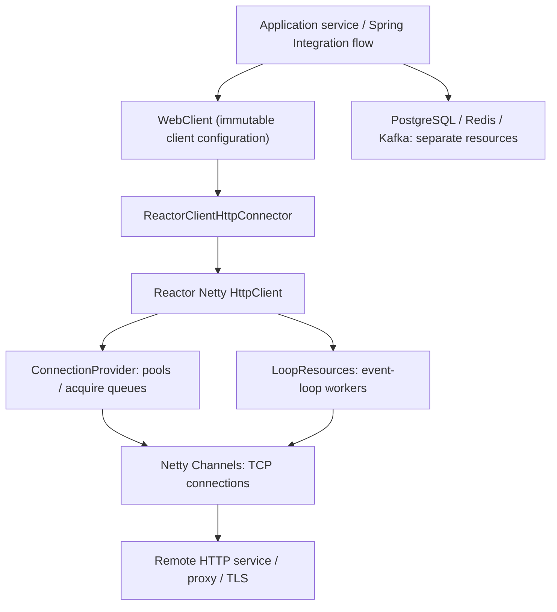
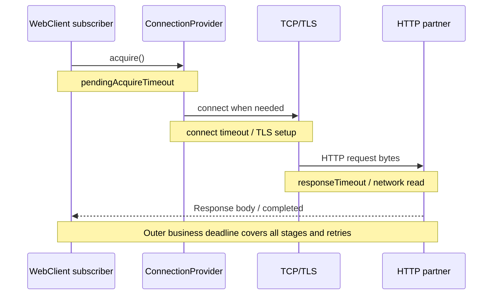
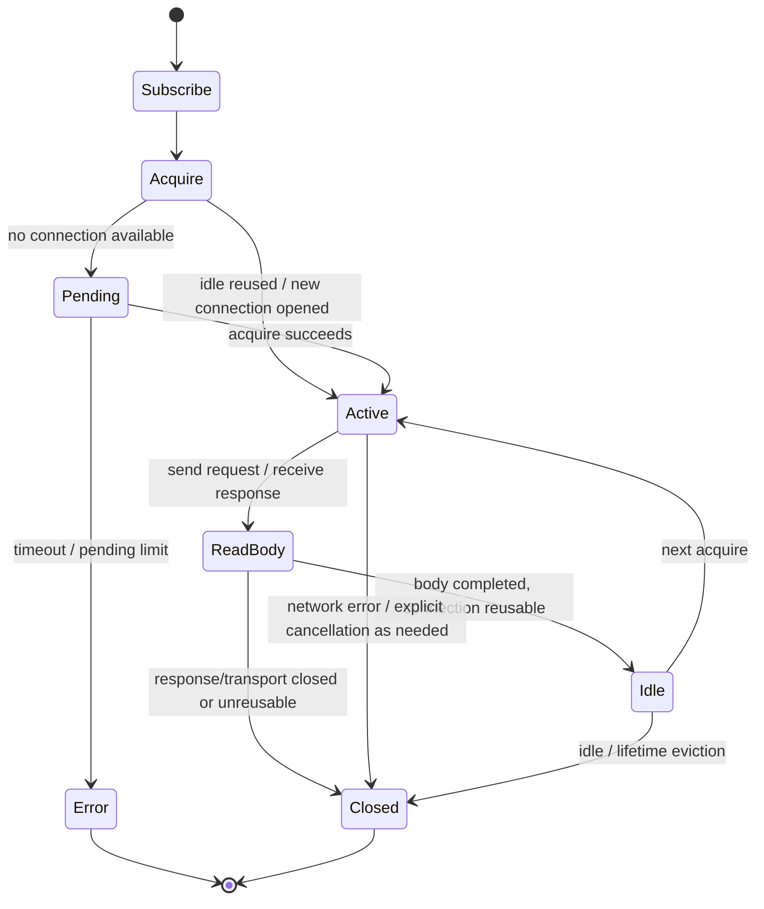
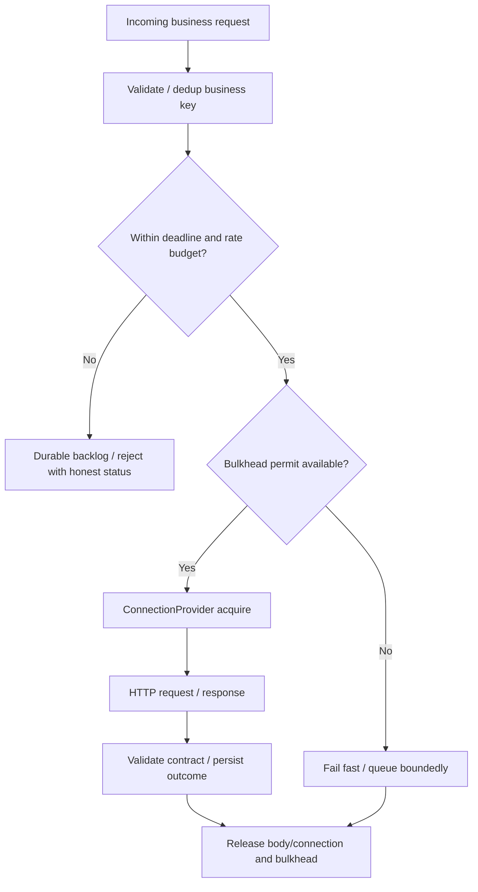
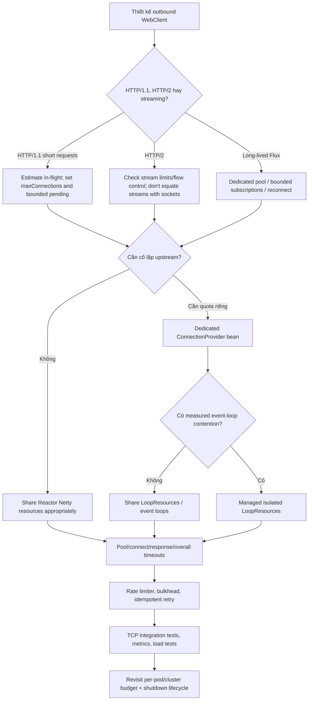

# ConnectionProvider, tài nguyên Reactor Netty và giới hạn kết nối

> **Chương:** WebClient  
> **Module:** SPRING_BOOT_INTEGRATION — tích hợp hệ thống Spring Boot qua HTTP client, cơ sở dữ liệu, cache, broker thông điệp và các adapter Spring Integration. Bài tập trung vào quản lý cấu hình, hợp đồng dữ liệu, giao dịch, lỗi, xử lý trùng lặp, kiểm thử và quan sát các luồng tích hợp thực tế.

## 1. Vấn đề thực tế: WebClient bất đồng bộ nhưng vẫn có giới hạn tài nguyên

Một dịch vụ Spring Boot nhận HTTP requests, gọi API vận chuyển, ghi PostgreSQL và phát sự kiện đến Kafka. Dịch vụ dùng `WebClient` vì muốn I/O không chặn thread:

```java
Mono<ShipmentDto> requestShipment(String orderId) {
    return webClient.post()
            .uri("/v1/shipments")
            .bodyValue(new CreateShipmentRequest(orderId))
            .retrieve()
            .bodyToMono(ShipmentDto.class);
}
```

Nhưng khi lưu lượng tăng từ 50 lên 3.000 requests đồng thời, hệ thống có thể gặp:

- Nhiều HTTP requests chờ **lấy connection từ pool**, trong khi CPU vẫn thấp.
- Lỗi connect timeout hoặc pending acquire timeout xuất hiện cùng lúc.
- Dịch vụ đối tác quá tải, trả HTTP 429/503; retry tạo thêm nhiều requests.
- Số TCP connections và sockets ở trạng thái TIME_WAIT tăng nếu liên tục tạo/dỡ client.
- Reactor Netty event loops bị nghẽn bởi một callback blocking.
- Response body lớn khiến bộ nhớ tăng dù HTTP concurrency chưa cao.
- ApplicationContext restart nhưng resources tự tạo không được đóng, để lại connections và threads.

**Điểm cốt lõi:** reactive giúp không cần một thread chặn cho mỗi request đang chờ network, nhưng **không làm số socket, file descriptors, event loop threads, queue capacity và bộ nhớ trở nên vô hạn**. Trên Reactor Netty, `ConnectionProvider` quản lý phần lớn chính sách cấp phát/tái sử dụng kết nối HTTP; `LoopResources` quản lý event loop resources; `WebClient` là lớp API cao hơn.

### 1.1. Mục tiêu học tập

Sau bài này, bạn có thể:

1. Giải thích vai trò của `WebClient`, `ReactorClientHttpConnector`, `HttpClient`, `ConnectionProvider`, `LoopResources` và global HTTP resources.
2. Phân biệt **max connections**, **active/idle connections**, **pending acquire queue**, **in-flight HTTP requests** và giới hạn downstream.
3. Dùng `ConnectionProvider.builder(...)` thiết lập `maxConnections`, `pendingAcquireMaxCount`, `pendingAcquireTimeout`, `maxIdleTime`, `maxLifeTime`, `evictInBackground` cùng chính sách FIFO/LIFO.
4. Hiểu **connect timeout**, **pool acquire timeout**, **response timeout** và **deadline tổng** là bốn vấn đề khác nhau.
5. Tạo `WebClient` dùng một pool được quản lý theo vòng đời Spring thay vì tạo pool mới cho mỗi request.
6. Biết khi nào nên chia sẻ Reactor Netty global event loops, khi nào cần resource isolation và cách dọn tài nguyên đúng.
7. Nhận diện khác biệt HTTP/1.1 connection reuse với HTTP/2 multiplexing, proxy, TLS và DNS.
8. Thiết kế load-shedding, bounded concurrency, retry/idempotency và không chặn event loop.
9. Kiểm thử pool/timeout bằng local HTTP server thật, quan sát metrics và lập runbook khi pool quá tải.

### 1.2. Phạm vi phiên bản và giả định

Các ví dụ minh họa **Java 17+, Spring Boot 3.2–3.5, Spring Framework 6.x, Reactor Netty 1.1–1.2 (dòng tương thích BOM)**. Khi nâng Spring Boot hoặc Reactor Netty, phải kiểm tra tài liệu đúng phiên bản cho tên API, default values, HTTP/2 behavior và metric names.

Đây là bài về **outbound HTTP client**; `ConnectionProvider` của Reactor Netty không phải JDBC `DataSource` pool, không quản lý Kafka consumer group hay RabbitMQ channels. Tuy nhiên ranh giới tài nguyên giữa những integrations này cần được tính cùng nhau để tránh quá tải dây chuyền.

## 2. Kiến trúc tài nguyên: WebClient không trực tiếp là TCP connection



### 2.1. Từng lớp chịu trách nhiệm gì?

| Lớp | Vai trò | Không nên hiểu thành |
| --- | --- | --- |
| `WebClient` | API reactive: request, URI, headers, codecs, response decoding, filters | Một socket hoặc một pool riêng tự động trên mỗi instance |
| `ReactorClientHttpConnector` | Adapter nối Spring WebClient với Reactor Netty `HttpClient` | Một connection pool manager độc lập |
| `HttpClient` | Cấu hình protocol, TLS, proxy, timeout, transport và network I/O | Thread xử lý business logic |
| `ConnectionProvider` | Cho thuê/tái sử dụng connections; pool size, pending acquire, eviction/metrics | Tổng số requests được phép của toàn hệ thống |
| `LoopResources` | Các Netty event loops (selectors/worker threads) | Thread-per-request hoặc thread pool dành cho JDBC blocking |
| Netty `Channel` | Kết nối/network transport cụ thể | Một business transaction |
| `HttpResources` global | Shared HTTP connection/event-loop resources khi dùng cấu hình mặc định phù hợp | Luôn được Spring tự hủy nếu app tự tạo và sở hữu khác |

Một `WebClient` có thể chia sẻ provider và loops với các clients khác; cũng có thể được cấu hình riêng. **Số WebClient beans không tự bằng số pools**, và **số Reactor threads không bằng số HTTP connections**.

### 2.2. Tạo một Mono không nhất thiết đã chiếm connection

```java
Mono<OrderDto> pending = webClient.get()
        .uri("/v1/orders/{id}", "order-42")
        .retrieve()
        .bodyToMono(OrderDto.class);

// Thông thường CHƯA gửi HTTP request.
// Khi có subscriber, client mới bắt đầu acquire connection.
```

WebClient trên Reactor Netty thường trả **cold publisher**; framework WebFlux, Spring Integration reactive flow hoặc Reactor subscriber thực thi bằng cách subscribe. Hai subscriptions độc lập có thể tạo **hai lần gọi HTTP**. Điều này quan trọng khi dùng POST: timeout/retry/re-subscribe có thể tạo duplicate remote side effects.

### 2.3. HTTP/1.1 persistent connection và reuse

Với HTTP/1.1 keep-alive, client thường:

```text
request A → acquire TCP connection #1 → send/receive → release to idle pool
request B → acquire same idle connection #1 → send/receive → release
request C → if connection #1 busy, open/lease connection #2 (within limit)
```

Sau khi response body được xử lý xong (hoặc được hủy/đóng đúng cách), connection có thể trở lại pool nếu còn dùng được. Nếu server gửi `Connection: close` hoặc connection bị lỗi, client phải dỡ/đổi connection.

Không suy rằng mọi HTTP/1.1 connection đều được reuse mãi: reverse proxy/load balancer có idle timeout, server có max-requests-per-connection, TLS/connection close và mạng có thể cắt giữa chừng.

### 2.4. HTTP/2 multiplexing khác HTTP/1.1

HTTP/2 có thể chạy **nhiều streams đồng thời trên một TCP connection** nếu client/server negotiate protocol và hỗ trợ multiplexing. Vì vậy:

- `maxConnections=20` không đồng nghĩa tối đa **20 HTTP requests in-flight** với HTTP/2.
- Giới hạn concurrent streams, SETTINGS của server, flow control và triển khai Reactor Netty có ảnh hưởng.
- HTTP/2 qua TLS thường cần ALPN/certificates đúng; không chỉ thêm header `Upgrade` rồi mặc định mọi thứ là HTTP/2.
- HTTP/2 stream lỗi/cancel khác thời điểm close TCP connection; cần đo metrics protocol-specific.

Bảng sizing đơn giản theo `maxConnections × requests/connection` chỉ phù hợp làm **mô hình gần đúng cho HTTP/1.1**. Với HTTP/2, đo số active streams và response latency bên cạnh số connections.

## 3. ConnectionProvider tạo nhiều pool theo đích, không phải một quota toàn app

Trong Reactor Netty, connection pooling thường tách theo **remote address / pool key** và đặc tính kết nối. Một provider có thể quản lý nhiều pools tương ứng với các upstream destinations (và cấu hình protocol/proxy liên quan).

```text
ConnectionProvider "external-api"
  ├─ Pool: api.shipping.example:443
  │    active=20, idle=5, pending=15
  ├─ Pool: api.tax.example:443
  │    active=10, idle=2, pending=0
  └─ Pool: api.inventory.example:443
       active=5, idle=8, pending=0
```

Nếu đặt `maxConnections(50)`, đừng suy thành “toàn JVM có tối đa 50 HTTP sockets” khi provider phục vụ **nhiều remote addresses**. Tùy pool key và phiên bản thư viện, hạn mức có thể áp **cho mỗi pool**, nên tổng sockets có thể lớn hơn số cấu hình đơn lẻ.

### 3.1. Một ConnectionProvider nên có phạm vi chủ sở hữu rõ

| Chiến lược | Khi phù hợp | Đánh đổi |
| --- | --- | --- |
| Dùng shared Reactor Netty global resources | Ứng dụng nhỏ/nhiều clients tương tự; ít cấu hình riêng | Khó cô lập noisy upstream, phụ thuộc global lifecycle |
| Một provider dành cho một upstream quan trọng | Partner có SLO/quota/timeout riêng | Phải quản lý bean và dispose đúng |
| Một provider dùng chung nhiều upstream | Chính sách pool đồng nhất; muốn ít bean | Quota tính theo pool key, không phải global business bulkhead |
| Provider riêng + LoopResources chung | Cần cô lập connections nhưng không tạo event loop threads riêng | Upstream chặn event loop vẫn có thể ảnh hưởng clients khác |
| Provider riêng + LoopResources riêng | Cô lập mạnh cho client đặc biệt/high-throughput | Tốn threads/CPU/resources; lifecycle phức tạp |

Không tạo `ConnectionProvider.builder(...).build()` **trong mỗi method request**. Mỗi lần tạo provider mới có thể sinh thêm pools, eviction tasks và resources; dù một WebClient object rẻ hơn một pool, một pool có **lifecycle** cần đóng.

### 3.2. Active, idle, pending và total

Trong một pool:

- **Active (leased):** connections đang được sử dụng cho requests/streams.
- **Idle:** connections sẵn sàng cho thuê lại khi điều kiện reuse hợp lệ.
- **Pending acquire:** subscribers/requests đang đợi lấy connection vì không có connection sẵn và không thể mở thêm trong giới hạn.
- **Total:** số connections pool đang giữ/tạo trong phạm vi đếm tương ứng (active + idle và trạng thái tạo mới có thể được phản ánh khác theo metric).

`maxConnections` giới hạn connections; `pendingAcquireMaxCount` giới hạn số yêu cầu acquire đang được xếp hàng. **Pending requests thường chưa gửi HTTP tới upstream**, do đó một pending acquire timeout không đồng nghĩa upstream đã nhận request.

### 3.3. Phân biệt socket queue với business queue

```text
Incoming order request
    ↓
Business work item / outbox row (durable, DB)
    ↓
WebClient subscriber
    ↓
ConnectionProvider pending acquire (ephemeral, memory)
    ↓
TCP connection acquired
    ↓
HTTP request sent to partner
```

Pending acquire queue **không bền vững**. Nếu JVM restart, những requests đang chờ trong pool biến mất. Với lệnh cần đảm bảo giao, dùng durable outbox/job store và idempotency key; không coi HTTP connection pool là hàng đợi tác vụ tin cậy.

## 4. Tính giới hạn kết nối: ví dụ 40 connections và 80 pending

Giả sử một API partner chỉ cho tối đa 40 HTTP/1.1 connections đồng thời từ ứng dụng. Bạn đặt:

```text
maxConnections = 40
pendingAcquireMaxCount = 80
pendingAcquireTimeout = 2 seconds

Incoming burst: 200 concurrent HTTP subscriptions
```

Nếu chưa có idle connections và đang kết nối/đáp ứng chậm, một mô hình gần đúng:

1. Tối đa khoảng **40** acquire requests có thể dùng/mở connections.
2. Tối đa khoảng **80** acquire requests khác được chờ trong queue.
3. Những acquire requests vượt khả năng nhận vào queue có thể bị từ chối sớm.
4. Những requests đang chờ quá 2 giây có thể nhận pool acquire timeout.
5. Khi một connection được release, pending request có thể được cấp connection và tiếp tục gửi HTTP.

Giới hạn này không có nghĩa HTTP partner chắc chắn chỉ nhận 40 requests **trên toàn cluster**. Nếu chạy 6 pods và mỗi pod có pool 40 connections tới cùng endpoint, tổng có thể lên tới khoảng **240 connections** (với HTTP/1.1 và một pool/endpoint mỗi pod) chưa tính các clients khác.

### 4.1. Công thức sizing sơ bộ

Với các HTTP/1.1 requests hoàn tất theo thời gian gần đúng, Little's Law cho throughput ổn định:

\[
\text{average in-flight requests} \approx
\text{arrival rate (requests/s)} \times
\text{response time (s)}
\]

Ví dụ upstream nhận 100 req/s, p50 response 200 ms → in-flight trung bình khoảng 20. Nhưng phải sizing theo **burst, p95/p99, timeouts, retry, server quota và số replicas**, không lấy p50 để coi 20 connections luôn đủ.

Nếu response p99 tăng từ 200 ms lên 3 giây trong incident, lượng in-flight có thể tăng mạnh **ngay cả khi incoming request rate không đổi**. Pool queue và service latency sẽ tăng, khiến user requests timeout; retry vô tội vạ có thể khuếch đại incident.

### 4.2. Connection count không phải rate limit

| Giới hạn | Bảo vệ điều gì? | Không bảo vệ điều gì? |
| --- | --- | --- |
| `maxConnections` | Số connections trong một pool | Số requests/giây hoặc HTTP/2 streams |
| `pendingAcquireMaxCount` | Số acquire requests chờ trong RAM | Business queue durability |
| `pendingAcquireTimeout` | Thời gian đợi một connection | Thời gian tổng HTTP + retries |
| `maxIdleTime` | Tuổi idle của connection trong pool | Tổng tuổi connection và response timeout |
| `maxLifeTime` | Tuổi tối đa connection để tái sử dụng | Remote server request processing SLA |
| HTTP rate limiter | Requests/s hoặc quota theo window | Concurrent socket count chính xác |
| Application bulkhead/semaphore | Số nghiệp vụ/requests đang xử lý | Đảm bảo delivery/transaction |
| Circuit breaker | Chặn gọi upstream đang thất bại | Thay thế retry/idempotency hoặc data consistency |

Một connection pool limit quá cao có thể làm upstream bị ngập; một limit quá thấp làm queue chờ dài. Chọn dựa trên **năng lực downstream và SLO**, đo thực nghiệm rồi điều chỉnh.

## 5. Cấu hình ConnectionProvider đúng cách

### 5.1. Ví dụ pool cho một API đối tác

```java
import java.time.Duration;
import reactor.netty.resources.ConnectionProvider;

ConnectionProvider shippingPool = ConnectionProvider
        .builder("shipping-http")
        .maxConnections(40)
        .pendingAcquireMaxCount(80)
        .pendingAcquireTimeout(Duration.ofSeconds(2))
        .maxIdleTime(Duration.ofSeconds(20))
        .maxLifeTime(Duration.ofMinutes(5))
        .evictInBackground(Duration.ofSeconds(30))
        .fifo()
        .metrics(true)
        .build();
```

Các thông số trên là **đề xuất minh họa để giải thích**, không phải giá trị tốt nhất cho mọi production. Chúng cần được điều chỉnh theo measurements, Kafka/DB/HTTP downstream limits và phiên bản thư viện. `metrics(true)` yêu cầu hệ thống metrics/registry phù hợp nếu muốn thu thập các gauges/timers; không tự tạo endpoint monitoring chỉ bằng một lời gọi.

### 5.2. maxConnections

`maxConnections(40)` xác định giới hạn số connections tối đa của một pool theo semantics Reactor Netty hiện hành. Trong mô hình HTTP/1.1, khi 40 connections đang được lease và không còn idle connection, acquire request tiếp theo thường **vào pending queue** nếu còn chỗ, hoặc thất bại.

Điểm cần lưu ý:

- Limit thường áp dụng cho **mỗi pool remote endpoint/pool key**, không phải global count của cả JVM.
- Trong môi trường nhiều pods, hạn mức là **mỗi JVM/provider**, không tự chia quota cho tất cả replicas.
- HTTP/2 multiplexing có thể làm số active requests lớn hơn số TCP connections.
- Tăng maxConnections khi server đang 503 có thể **đẩy downstream vào tình trạng xấu hơn**.
- Đừng khai báo maxConnections=1 rồi thực hiện nhiều streaming requests không hoàn tất: phần lớn callers sẽ đợi connection dài.

### 5.3. pendingAcquireMaxCount

`pendingAcquireMaxCount(80)` giới hạn số requests có thể xếp hàng đợi để acquire connection trong pool khi pool đang đạt giới hạn. Đây là một **hàng đợi trong bộ nhớ**, không được broker hoặc database persist.

Khi queue đầy, Reactor Netty có thể phát lỗi acquisition limit trước khi gửi HTTP. Đó là tín hiệu **local saturation**, khác HTTP 429/503 từ server đối tác.

Với một service có 8 Kubernetes replicas và mỗi replica để pending 5.000, toàn deployment có thể giữ rất nhiều pending requests/objects; response chậm hoặc retry lặp sẽ làm heap/GC áp lực dù số connections bị giới hạn. Chọn pending count hữu hạn, phù hợp latency budget.

### 5.4. pendingAcquireTimeout

`pendingAcquireTimeout(Duration.ofSeconds(2))` là **thời gian tối đa một acquisition chờ connection được cấp** theo chính sách pool. Nó không phải:

- TCP connect timeout.
- Thời gian server trả response.
- Tổng thời gian từ khi caller subscribe tới khi kết thúc retries.
- Timeout cho PostgreSQL transaction hoặc HTTP partner business operation.

Một acquire có thể thất bại trước khi gửi bất kỳ request bytes nào tới đối tác. Khi xử lý lỗi, phân biệt **chưa lấy được connection** với **đã gửi POST nhưng response bị mất**, vì chúng có mức rủi ro tạo duplicate khác nhau.

### 5.5. maxIdleTime và maxLifeTime

`maxIdleTime(Duration.ofSeconds(20))` giới hạn thời gian một connection có thể ở trạng thái idle và còn được coi là có thể tái sử dụng. `maxLifeTime(Duration.ofMinutes(5))` giới hạn **tuổi tổng** của connection, dù chưa idle quá lâu.

| Cấu hình | Nhắm tới vấn đề | Cảnh báo |
| --- | --- | --- |
| `maxIdleTime` | Không reuse socket đã idle quá lâu, dễ bị load balancer cắt | Quá thấp làm nhiều TLS handshakes/connection churn |
| `maxLifeTime` | Làm mới connection định kỳ, thích nghi LB/DNS/draining | Quá thấp tạo churn; không bảo đảm ngắt ngay request đang hoạt động |
| `evictInBackground` | Quét và dọn idle/expired connections theo chu kỳ | Có chi phí nền; không biến timeout thành chính xác theo từng mili-giây |
| `fifo()` | Chọn idle connection kiểu first-in-first-out | Có thể reuse connection idle lâu hơn |
| `lifo()` | Ưu tiên idle connection được dùng gần đây | Có thể để các connection khác idle cho đến khi được eviction |

Các connection đang phục vụ request không nên bị xem là “tự động hủy ngay giữa request” chỉ vì vượt maxLifeTime; eviction/reuse policy được áp theo lifecycle của pool/client. Để giới hạn thời gian HTTP request còn hoạt động, dùng **response timeout/deadline** riêng.

### 5.6. FIFO và LIFO: tác động tới socket reuse

Với nhiều idle sockets:

```text
Idle pool: A (oldest idle), B, C (newest idle)

FIFO next acquire → A
LIFO next acquire → C
```

FIFO có thể làm các connections được sử dụng luân phiên; LIFO ưu tiên connections “nóng” và để các connections khác yên, tùy timeout/LB behavior. Không có chính sách tốt nhất cho tất cả workloads. Một server đóng idle sockets ở 30 giây có thể tương tác khác nhau với FIFO/LIFO; cần xem stale reuse, reconnect rate và latency.

### 5.7. metrics(true) không thay observability design

Khi có Micrometer registry và tích hợp metrics tương thích, Reactor Netty có thể xuất gauges/timers về active, idle, pending, max và acquisition time theo provider/remote address. Metrics giúp biết đang nghẽn ở **pool** thay vì server.

Nhưng:

- Không đặt raw orderId/customerId/query string vào metric tags.
- Không tạo tên provider động theo mỗi request, ví dụ `"pool-" + UUID.randomUUID()`.
- Nếu provider được dùng cho nhiều remote hosts, phải nhìn metrics **per pool/remote** theo tagging thực tế.
- Không suy rằng số pending tại thời điểm scrape bằng số requests đã timeout trong cả phút.

### 5.8. Không dựa vào default values bất biến

Reactor Netty có các defaults cho max connections, pending count, eviction, TCP settings; chúng có thể thay đổi theo **version, system properties và transport mode**. Dự án có yêu cầu công suất rõ nên **cấu hình các giới hạn quan trọng tường minh** và đưa phiên bản Reactor Netty vào tài liệu vận hành. Không ghi “default=500 forever” trong runbook rồi quên kiểm tra khi nâng Spring Boot BOM.

## 6. Bốn timeout khác nhau trong một WebClient request



### 6.1. Timeout theo tầng

| Timeout | Cấp cấu hình điển hình | Khi nó bắt đầu quan trọng | Lỗi nghĩa là |
| --- | --- | --- | --- |
| **Pending acquire timeout** | `ConnectionProvider.pendingAcquireTimeout` | Khi chờ thuê connection | Pool quá tải, không lấy được connection kịp |
| **TCP connect timeout** | Netty `ChannelOption.CONNECT_TIMEOUT_MILLIS` | Khi mở TCP connection mới | Không thiết lập được TCP trong thời hạn |
| **HTTP response timeout** | `HttpClient.responseTimeout(Duration)` | Trong lúc chờ/đọc response theo semantics client | Upstream/transport không phản hồi trong giới hạn tương ứng |
| **Overall deadline** | Reactor `Mono.timeout(...)` hoặc orchestration/Resilience4j TimeLimiter | Từ subscription tới terminal result, có thể gồm nhiều stages | Caller không muốn đợi quá budget tổng |
| **TLS handshake timeout** | SSL/TLS provider settings nếu cấu hình | TLS negotiation trên connection mới | Certificate/handshake/network chậm hoặc lỗi |
| **Read/write I/O timeout** | Netty handlers / transport settings nếu cần | Các thao tác socket I/O | Một dạng idle/network stall khác response deadline |

Từng timeout có thể chồng lên nhau. Đặt connect timeout 2 giây, pending acquire 2 giây và response timeout 3 giây **không đảm bảo** toàn request kết thúc trong 3 giây; deadline tổng mới ràng buộc thời gian user phải chờ.

### 6.2. Cấu hình HttpClient riêng

```java
import java.time.Duration;
import io.netty.channel.ChannelOption;
import reactor.netty.http.client.HttpClient;
import reactor.netty.resources.ConnectionProvider;

HttpClient httpClient = HttpClient.create(shippingPool)
        .option(ChannelOption.CONNECT_TIMEOUT_MILLIS, 2_000)
        .responseTimeout(Duration.ofSeconds(3));
```

`shippingPool` là provider được cấu hình ở mục 5; HttpClient ở đây **không được tạo/đóng per request**. TCP connect timeout có hiệu lực khi cần mở **connection mới**; một request dùng pooled idle connection thường không trải qua connect lại. `responseTimeout` áp theo HTTP client behavior (xem docs version cụ thể), không là SLA cho API partner xử lý background sau HTTP 202.

### 6.3. Đặt deadline tổng tại operation

```java
import java.time.Duration;
import reactor.core.publisher.Mono;

Mono<OrderDto> result = shippingWebClient.get()
        .uri("/v1/orders/{id}", orderId)
        .retrieve()
        .bodyToMono(OrderDto.class)
        .timeout(Duration.ofSeconds(5));
```

`shippingWebClient` và `orderId` là các biến đã có trong context ứng dụng. Operator `timeout(...)` phát tín hiệu lỗi khi publisher chưa hoàn tất trong thời hạn; cancellation có thể được truyền xuống HTTP exchange.

**Chú ý:** timeout của một request/Mono không chứng minh partner chưa xử lý. Với lệnh `POST /payments`, response mất sau server COMMIT là **outcome unknown**. Chỉ retry khi business contract/idempotency cho phép, hoặc lookup bằng stable operation ID.

### 6.4. Retry budget và tổng thời gian

Một logic:

```text
Attempt 1: 2s pool wait + 3s HTTP timeout
Backoff:   0.5s
Attempt 2: 2s pool wait + 3s HTTP timeout
Backoff:   1.0s
Attempt 3: 2s pool wait + 3s HTTP timeout
```

có thể vượt 15 giây nếu không có **outer deadline**. Client gọi bạn có thể đã timeout ở giây 6; những retries phía trong làm mất CPU, connections và upstream quota mà không còn giá trị.

Nếu `retryWhen` nằm **trước** `timeout(Duration.ofSeconds(6))` trong pipeline, outer timeout thường ràng buộc cả retries/backoffs dưới nó. Nếu timeout được đặt bên trong một publisher được retry, mỗi attempt có thể được tính lại. Kiểm thử operator ordering thay vì dựa vào cảm giác.

### 6.5. Pool timeout không đồng nghĩa upstream outage

Khi pool cạn:

```text
incoming request → queued to acquire → pending timeout
HTTP bytes not sent to partner
```

Đó là **local capacity rejection**, không phải HTTP 503 của partner. Phân loại lỗi riêng giúp quyết định:

- Load-shed/429/503 tại API của chính ứng dụng nếu service overloaded.
- Giảm in-flight concurrency hoặc tách client bulkheads.
- Điều chỉnh pool queue/timeout sau khi đo traffic.
- Không đổ lỗi vào partner khi request chưa rời JVM.

Ngược lại, connection được cấp và POST đã gửi nhưng read timeout là trường hợp **không chắc side effect đã xảy ra hay chưa**. Hai trường hợp không được map thành một lỗi “UPSTREAM_UNAVAILABLE” rồi retry cùng chính sách một cách mù quáng.

## 7. Spring Boot: cấu hình WebClient dùng provider có vòng đời rõ ràng

### 7.1. Dependencies

```groovy
// build.gradle — Spring Boot plugin/BOM quản lý dependency versions.
dependencies {
    implementation 'org.springframework.boot:spring-boot-starter-webflux'
    implementation 'org.springframework.boot:spring-boot-starter-validation'

    // Tùy dự án: metrics/tracing qua Actuator + registry.
    implementation 'org.springframework.boot:spring-boot-starter-actuator'
    runtimeOnly 'io.micrometer:micrometer-registry-prometheus'

    testImplementation 'org.springframework.boot:spring-boot-starter-test'
    testImplementation 'io.projectreactor:reactor-test'
}
```

Spring Boot `spring-boot-starter-webflux` thường mang Reactor Netty HTTP client cho dòng phiên bản minh họa. Một ứng dụng MVC cũng có thể dùng `WebClient` làm outbound client; thêm WebFlux dependency không tự biến toàn ứng dụng thành reactive web server nếu Spring MVC vẫn quyết định application type.

### 7.2. Externalize policy, không ghi literal trong business code

```yaml
# application.yml
integration:
  shipping:
    base-url: ${SHIPPING_BASE_URL}
    http:
      max-connections: ${SHIPPING_MAX_CONNECTIONS:40}
      max-pending: ${SHIPPING_MAX_PENDING:80}
      acquire-timeout: 2s
      max-idle-time: 20s
      max-life-time: 5m
      eviction-interval: 30s
      connect-timeout: 2s
      response-timeout: 3s
```

`SHIPPING_BASE_URL` lấy từ deployment config/secret-managed service discovery, không lấy tùy ý từ user input; tránh SSRF và rò rỉ headers khi redirect. Khi ứng dụng có nhiều environments, các timeout/limits có thể cần profile override nhưng phải giữ **policy rõ ràng** và có kiểm thử.

### 7.3. @ConfigurationProperties có validation

```java
// ShippingHttpProperties.java
import jakarta.validation.Valid;
import jakarta.validation.constraints.Min;
import jakarta.validation.constraints.NotBlank;
import jakarta.validation.constraints.NotNull;
import java.time.Duration;
import org.springframework.boot.context.properties.ConfigurationProperties;
import org.springframework.validation.annotation.Validated;

@Validated
@ConfigurationProperties(prefix = "integration.shipping")
public record ShippingHttpProperties(
        @NotBlank String baseUrl,
        @Valid @NotNull Http http) {

    public record Http(
            @Min(1) int maxConnections,
            @Min(0) int maxPending,
            @NotNull Duration acquireTimeout,
            @NotNull Duration maxIdleTime,
            @NotNull Duration maxLifeTime,
            @NotNull Duration evictionInterval,
            @NotNull Duration connectTimeout,
            @NotNull Duration responseTimeout) {
    }
}
```

`@Validated`/constraints mô tả ý định; trong một project thật phải bật scanning hoặc `@EnableConfigurationProperties` để tạo bean và đảm bảo validation dependencies trên classpath. Cần bổ sung custom validation nếu muốn cấm `Duration.ZERO`/giá trị âm cho từng field, hoặc muốn so sánh deadline tương quan.

### 7.4. Bean ConnectionProvider chỉ tạo một lần

```java
// ShippingWebClientConfiguration.java
import io.netty.channel.ChannelOption;
import org.springframework.beans.factory.annotation.Qualifier;
import org.springframework.boot.context.properties.EnableConfigurationProperties;
import org.springframework.context.annotation.Bean;
import org.springframework.context.annotation.Configuration;
import org.springframework.http.client.reactive.ReactorClientHttpConnector;
import org.springframework.web.reactive.function.client.WebClient;
import reactor.netty.http.client.HttpClient;
import reactor.netty.resources.ConnectionProvider;

@Configuration(proxyBeanMethods = false)
@EnableConfigurationProperties(ShippingHttpProperties.class)
public class ShippingWebClientConfiguration {

    @Bean(name = "shippingConnectionProvider", destroyMethod = "dispose")
    ConnectionProvider shippingConnectionProvider(
            ShippingHttpProperties props) {
        var cfg = props.http();
        return ConnectionProvider.builder("shipping-http")
                .maxConnections(cfg.maxConnections())
                .pendingAcquireMaxCount(cfg.maxPending())
                .pendingAcquireTimeout(cfg.acquireTimeout())
                .maxIdleTime(cfg.maxIdleTime())
                .maxLifeTime(cfg.maxLifeTime())
                .evictInBackground(cfg.evictionInterval())
                .lifo()
                .metrics(true)
                .build();
    }

    @Bean("shippingWebClient")
    WebClient shippingWebClient(
            WebClient.Builder bootBuilder,
            ShippingHttpProperties props,
            @Qualifier("shippingConnectionProvider")
                    ConnectionProvider provider) {

        HttpClient httpClient = HttpClient.create(provider)
                .option(ChannelOption.CONNECT_TIMEOUT_MILLIS,
                        Math.toIntExact(
                                props.http().connectTimeout().toMillis()))
                .responseTimeout(props.http().responseTimeout());

        return bootBuilder
                .baseUrl(props.baseUrl())
                .clientConnector(
                        new ReactorClientHttpConnector(httpClient))
                .build();
    }
}
```

Vì `shippingConnectionProvider` là Spring bean có `destroyMethod="dispose"`, container gọi `dispose()` khi ApplicationContext được đóng đúng lifecycle. Dùng `WebClient.Builder` do Boot inject giúp giữ các customizers/codecs/observation convention phù hợp, nhưng việc **tự thay client connector** có thể ảnh hưởng các cấu hình HTTP connector/resource khác do Boot/organization đặt; phải kiểm tra cấu hình TLS/proxy/observability thực tế.

Ví dụ trên tạo **pool riêng cho Shipping**, trong khi default Reactor Netty global event loops có thể vẫn được dùng. Điều đó giúp giới hạn sockets của Shipping mà **không khởi một nhóm Netty worker threads riêng**. Không đồng nghĩa Shipping được cô lập khỏi mọi loại tài nguyên khác; xem mục 9 về LoopResources.

### 7.5. Sử dụng bean ở application service

```java
import org.springframework.beans.factory.annotation.Qualifier;
import org.springframework.stereotype.Service;
import org.springframework.web.reactive.function.client.WebClient;
import reactor.core.publisher.Mono;

@Service
public class ShipmentGateway {
    private final WebClient client;

    public ShipmentGateway(
            @Qualifier("shippingWebClient") WebClient client) {
        this.client = client;
    }

    public Mono<ShipmentDto> getShipment(String shipmentId) {
        return client.get()
                .uri("/v1/shipments/{id}", shipmentId)
                .retrieve()
                .bodyToMono(ShipmentDto.class);
    }
}
```

`ShipmentDto` là DTO hợp đồng đối tác minh họa, có thể khai báo:

```java
public record ShipmentDto(
        String id, String orderId, String status) {
}
```

Đừng khởi tạo provider mới bên trong `getShipment(...)`; service dùng lại WebClient đã được cấu hình. Client và provider có thể phục vụ nhiều requests/connections trong cùng vòng đời application.

## 8. Reactor Netty global resources, Spring Boot và ownership

### 8.1. Mặc định chia sẻ là có chủ ý

Trong cấu hình phổ biến, Reactor Netty `HttpClient` có thể sử dụng **global HTTP resources** cho connections/event loops. Chia sẻ tài nguyên có ích:

- Tránh tạo một event-loop group cho mỗi `WebClient`.
- Tái sử dụng TCP connections khi pool key/cấu hình tương thích.
- Giảm số threads và resource overhead trên một JVM.
- Đơn giản hóa cấu hình cho các clients tương tự.

Nhưng cũng có những hậu quả:

- Một callback blocking trên event loop dùng chung có thể ảnh hưởng clients khác.
- Nếu resources được tạo ở ngoài quản lý Spring, context đóng không nhất thiết thu hồi chúng.
- Nhiều `WebClient` không đồng nghĩa mỗi client có pool riêng/lifecycle cô lập.
- Metrics có thể khó phân biệt logical upstream nếu provider names quá chung.

Hãy **phân biệt lifecycle của Spring bean `WebClient` với lifecycle của `ConnectionProvider`/`LoopResources`**. `WebClient` chủ yếu giữ cấu hình và không phải đối tượng bạn cần tạo/destroy cho mỗi HTTP operation.

### 8.2. HttpResources global khác provider tự sở hữu

```text
Default HttpClient:
    Reactor Netty global HttpResources (shared)

HttpClient.create(shippingPool):
    ConnectionProvider: shippingPool (custom, Spring-owned bean)
    Event loops: often Reactor Netty shared/global resources unless runOn(...)

HttpClient.create(shippingPool).runOn(shippingLoops):
    ConnectionProvider: shippingPool (custom)
    Event loops: shippingLoops (custom, Spring-owned bean)
```

Không giả định gọi `HttpClient.create(customProvider)` tự động tạo event loops riêng. Cũng không gọi `HttpResources.disposeLoopsAndConnectionsLater().subscribe()` tùy tiện tại điểm dừng một plugin/client vì bạn có thể đang **dọn resources dùng chung** bởi các WebClients khác trong cùng process.

### 8.3. Spring Boot ReactorResourceFactory

Spring Framework có `ReactorResourceFactory` để quản lý Reactor Netty `LoopResources` và `ConnectionProvider` theo Spring ApplicationContext. Trong nhiều cấu hình Boot/WebFlux, Boot có thể quản lý resources phù hợp với auto-configured connector.

Khi ứng dụng muốn **tách khỏi shared global resources** và có lifecycle nhất quán, có thể cấu hình:

```java
// Một phương án THAY THẾ cho cách tạo provider riêng ở mục 7,
// không thêm đồng thời mà chưa xác định ownership.
import java.time.Duration;
import org.springframework.context.annotation.Bean;
import org.springframework.context.annotation.Configuration;
import org.springframework.http.client.ReactorResourceFactory;
import org.springframework.http.client.reactive.ReactorClientHttpConnector;
import org.springframework.web.reactive.function.client.WebClient;
import reactor.netty.resources.ConnectionProvider;
import reactor.netty.resources.LoopResources;

@Configuration(proxyBeanMethods = false)
class IsolatedReactorResourcesConfiguration {

    @Bean
    ReactorResourceFactory isolatedResourceFactory() {
        ReactorResourceFactory factory = new ReactorResourceFactory();
        factory.setUseGlobalResources(false);
        factory.setConnectionProviderSupplier(() ->
                ConnectionProvider.builder("isolated-partner")
                        .maxConnections(30)
                        .pendingAcquireMaxCount(60)
                        .pendingAcquireTimeout(Duration.ofSeconds(2))
                        .build());
        factory.setLoopResourcesSupplier(() ->
                LoopResources.create("isolated-io", 4, true));
        return factory;
    }

    @Bean("isolatedPartnerWebClient")
    WebClient isolatedPartnerWebClient(
            ReactorResourceFactory isolatedResourceFactory,
            WebClient.Builder builder) {
        return builder
                .baseUrl("https://partner.example.invalid")
                .clientConnector(new ReactorClientHttpConnector(
                        isolatedResourceFactory, httpClient ->
                                httpClient.responseTimeout(
                                        Duration.ofSeconds(3))))
                .build();
    }
}
```

**Điều kiện quan trọng:** ví dụ này được thiết kế như **một cấu hình thay thế** để hướng dẫn resource ownership, không ghép với `shippingConnectionProvider` từ mục 7 vào cùng một client. `ReactorResourceFactory` tạo/quản lý các resources từ suppliers khi khởi tạo, và dọn chúng theo lifecycle của ApplicationContext; cần kiểm tra tương tác với Boot auto-config nếu có nhiều resource factories hoặc web server cũng dùng Reactor Netty.

Đặt `useGlobalResources(false)` nhưng không cung cấp supplier hợp lệ có thể khiến bạn tưởng mình đã cô lập mà thực tế vẫn dùng một default không mong muốn. Khi tách riêng, test **tên provider, số event-loop threads và shutdown behavior**.

### 8.4. Khi nào không nên tự tạo LoopResources?

Thông thường, giới hạn connections của một HTTP partner chỉ cần **provider riêng**, chưa cần vòng event loop riêng. Nếu tạo 10 clients, mỗi client có 8 event loop threads, ứng dụng có thể tiêu thụ gần **80 network worker threads** thay vì tận dụng shared event loops.

Tạo `LoopResources` riêng khi có lý do được đo đạc:

- Cần cô lập high-volume streaming client khỏi các HTTP clients khác.
- Một upstream dùng transport đặc biệt/timing cần isolation.
- Có yêu cầu isolate I/O thread affinity hoặc lifecycle.
- Đã xác định shared event loop contention là bottleneck; không dùng đây để chữa JDBC blocking.

Tăng số event loop workers không tạo thêm PostgreSQL connections, không tăng Kafka partitions và không tự bảo đảm throughput khi bottleneck nằm ở HTTP server/downstream.

### 8.5. Bean lifecycle và tránh resource leaks

Một provider tự tạo có thể được đóng:

```java
@Bean(destroyMethod = "dispose")
ConnectionProvider reportingConnectionProvider() {
    return ConnectionProvider.builder("reporting-http")
            .maxConnections(15)
            .build();
}
```

Trong Spring, method `destroyMethod="dispose"` hướng ApplicationContext gọi đúng method khi đóng bean. Với resources dùng ngoài Spring hoặc trong tests tự dựng, bạn phải dọn có chủ đích, ví dụ:

```java
ConnectionProvider pool = ConnectionProvider.create("temporary-test");
try {
    // Dùng WebClient/HttpClient kết nối tới local test server.
} finally {
    pool.dispose();
}
```

Không gọi `pool.dispose()` sau mỗi response nếu provider còn phục vụ requests khác. Khi shutdown:

1. Dừng nhận business requests mới.
2. Cho in-flight operations hoàn tất trong **grace period** có giới hạn.
3. Ngừng các listener/scheduler tạo requests mới.
4. Đóng provider/loops mà application **sở hữu**.
5. Không tự dispose tài nguyên shared global khi ứng dụng chỉ là một trong nhiều owners.

### 8.6. Vấn đề resource trong Spring tests

Một `@SpringBootTest` có thể tạo ApplicationContext cache. Nếu một test class đóng provider thủ công sau test, test class khác sử dụng **cùng cached context** có thể nhận `connection pool already disposed`. Để tránh:

- Giao lifecycle cho Spring bean thay vì `@AfterEach pool.dispose()` với pool Spring-managed.
- Chỉ đóng thủ công resource được dựng riêng bên trong test method.
- Khi cần thay đổi pool config giữa tests, dùng context/config isolation rõ.
- Tránh bật `@DirtiesContext` bừa bãi; nó đắt và không tự dọn mọi static resources ngoài Spring.
- Test restart/shutdown phải xác định provider được tạo lại hoặc Spring context mới được dựng.

## 9. Event loop thread không phải nơi chạy nghiệp vụ blocking

### 9.1. Reactor Netty event loops làm việc gì?

Netty event loop thường xử lý:

- Socket connect, readiness, read/write.
- Kích hoạt Channel pipeline handlers và một phần reactive operators/callbacks.
- TLS/protocol framing và trao đổi network data.
- Chuyển dữ liệu cho codecs/publishers/subscribers tùy scheduling.

Nó **không** là một worker pool chuyên dụng để chạy 200 ms JDBC query, blocking file read hoặc HTTP synchronous call. Một callback blocking lâu có thể làm chậm **nhiều connections** đang sử dụng event loop đó.

### 9.2. Anti-pattern: block ngay trong pipeline

```java
// Không làm vậy trên event loop.
Mono<ShipmentDto> wrong(String orderId) {
    return webClient.get()
            .uri("/v1/orders/{id}", orderId)
            .retrieve()
            .bodyToMono(OrderDto.class)
            .map(dto -> {
                // JDBC/JPA blocking trên reactive callback:
                OrderEntity entity =
                        jpaOrderRepository.findById(dto.id())
                                .orElseThrow();
                return mapToShipment(entity);
            });
}
```

`jpaOrderRepository`, `OrderEntity` và `mapToShipment` là các thành phần ứng dụng giả định. Vấn đề không nằm ở `map` nói chung, mà ở đoạn **synchronous blocking I/O** bên trong callback có khả năng thực thi trên event-loop thread.

Hậu quả:

- HTTP response đã tới nhưng callback giữ event loop.
- Những channels khác trên event loop không được xử lý kịp.
- Pool connections bị giữ lâu, active tăng và pending queue đầy.
- Metrics có thể báo connection acquisition timeout dù database mới là bottleneck.

### 9.3. Tạm chuyển blocking call sang boundedElastic

Nếu chưa thể chuyển JDBC sang R2DBC, có thể cô lập đoạn blocking:

```java
import reactor.core.publisher.Mono;
import reactor.core.scheduler.Schedulers;

Mono<ShipmentDto> bridgeLegacy(String orderId) {
    return webClient.get()
            .uri("/v1/orders/{id}", orderId)
            .retrieve()
            .bodyToMono(OrderDto.class)
            .flatMap(dto -> Mono.fromCallable(() -> {
                        OrderEntity entity =
                                jpaOrderRepository.findById(dto.id())
                                        .orElseThrow();
                        return mapToShipment(entity);
                    })
                    .subscribeOn(Schedulers.boundedElastic()));
}
```

Đây là **cầu nối legacy** có giới hạn concurrency/queue riêng, không làm JDBC trở thành non-blocking. Spring transaction manager của JPA/JDBC dùng thread-bound context; chuyển thread giữa operators không tự giữ một transaction trên mọi stages. Hãy đặt transaction ở một Spring service method blocking được gọi **qua Spring proxy trên boundedElastic thread**, thay vì mở `@Transactional` quanh method trả Mono rồi kỳ vọng JDBC transaction lan qua Reactor Context.

### 9.4. Không dùng .block() để “giải quyết” pool chậm

```java
// Anti-pattern trong WebFlux event loop hoặc Kafka async callback:
OrderDto order = webClient.get()
        .uri("/v1/orders/{id}", orderId)
        .retrieve()
        .bodyToMono(OrderDto.class)
        .block();
```

`block()` có thể gây block thread và tạo thêm một subscription mới mỗi lần được gọi. Một MVC/imperative entrypoint có thể cần HTTP client đồng bộ như `RestClient`; không chuyển sang `WebClient` rồi gọi `block()` ở mọi nơi mà không xem thread model.

### 9.5. Sizing LoopResources

Reactor Netty event-loop worker counts mặc định gắn với môi trường và system properties theo phiên bản. Đừng tin rằng “N CPU cores luôn có đúng N Netty threads” bất kể cấu hình/runtime.

Nếu dùng:

```java
LoopResources loops =
        LoopResources.create("partner-io", 4, true);

HttpClient client = HttpClient.create(shippingPool)
        .runOn(loops);
```

thì bốn worker threads là **cấu hình ứng dụng đặt cho ví dụ này**, không phải mặc định Reactor Netty. `loops` phải có owner/destroy lifecycle riêng. Không tăng `LoopResources.create(..., 200, ...)` để cứu việc JDBC blocking: sửa callback/DB bottleneck trước, rồi load-test và chọn worker count phù hợp.

### 9.6. Event loop và metrics: một request bị chậm ở đâu?

```text
HTTP client request latency high
  ├── Pool acquire latency high → maxConnections/pending/slow release
  ├── TCP connect latency high → DNS/network/TLS/connections churn
  ├── HTTP response latency high → upstream/proxy/remote processing
  ├── Body decode latency high → payload size/codec/CPU
  └── Event loop tasks delayed → blocking callback/GC/CPU saturation
```

Chỉ tăng pool size khi root cause là **thiếu hợp lý số sockets** và downstream chịu thêm tải. Nếu event loop bị block, tăng maxConnections khiến nhiều sockets hơn nhưng vẫn bị delay.

## 10. Acquire, reuse, close và cancellation

### 10.1. Vòng đời connection khi request thành công



Sơ đồ là **mô hình logic**. Reactor Netty có thể có nhiều trạng thái nội bộ, HTTP/2 multiplexing và race conditions riêng. Điều quan trọng là một connection **không được coi là idle ngay khi response headers tới** nếu response body vẫn đang được tiêu thụ.

### 10.2. Không đọc response body có thể cản trở reuse

API WebClient thuận tiện:

```java
Mono<ShipmentDto> shipment = webClient.get()
        .uri("/v1/shipments/{id}", id)
        .retrieve()
        .bodyToMono(ShipmentDto.class);
```

Với `retrieve().bodyToMono(...)` hoặc `bodyToFlux(...)`, Spring xử lý response decoding và resource release theo lifecycle tương ứng. Khi chỉ cần status/headers, dùng API hỗ trợ tự động xử lý body và release đúng:

```java
Mono<Boolean> accepted = webClient.post()
        .uri("/v1/shipments")
        .bodyValue(request)
        .exchangeToMono(response -> {
            if (response.statusCode().value() == 202) {
                return response.releaseBody().thenReturn(true);
            }
            return response.createException()
                    .flatMap(Mono::error);
        });
```

`request` là DTO đầu vào. `exchangeToMono` được Spring thiết kế để xử lý body/release không dùng ở cuối publisher; ví dụ chủ động `releaseBody()` khi không đọc response. Không tự giữ `ClientResponse` rồi thoát scope mà bỏ body/network resource. API `exchange()` cũ đã từng khiến code dễ quên release; nên chọn `retrieve()`/`exchangeToMono()` theo nhu cầu.

### 10.3. Cancellation không giống HTTP server rollback

```java
Mono<ShipmentDto> slow =
        webClient.post()
                .uri("/v1/shipments")
                .bodyValue(request)
                .retrieve()
                .bodyToMono(ShipmentDto.class)
                .timeout(Duration.ofSeconds(2));
```

Nếu time out, subscription có thể bị cancel và socket/stream được xử lý theo transport lifecycle. Tuy nhiên partner có thể **đã commit shipment** và chỉ response bị chậm/mất. Đừng tự re-submit POST với random idempotency key khi timeout; cần stable key và lookup/reconciliation.

### 10.4. Stream lâu dài giữ tài nguyên

Một `Flux<ShipmentEvent>` từ NDJSON/SSE có thể kéo dài hàng giờ. Một HTTP/1.1 connection đang phục vụ stream thường không trở lại idle pool cho tới khi stream kết thúc hoặc bị cancel đúng cách. Nếu mở 40 stream không bao giờ kết thúc với `maxConnections(40)`, các GET/POST khác dùng cùng pool có thể xếp hàng đến timeout.

Giải pháp:

- Dùng pool riêng cho streaming nếu phải chia tải với short-lived requests.
- Giới hạn số active subscriptions và đặt idle/heartbeat/termination policy.
- Kiểm tra server hỗ trợ reconnect cursor/Last-Event-ID và dedup events.
- Không ghép unbounded `Flux` vào `collectList()`, vì nó có thể không bao giờ hoàn tất.
- Theo dõi thời gian sống stream, cancellations và số connection/stream đang active.

### 10.5. DataBuffer và memory limit

Một response 80 MB JSON body có thể gây áp lực RAM ngay cả khi pool chỉ có **một connection**. Spring codecs có giới hạn in-memory buffer; một cấu hình có thể là:

```yaml
spring:
  codec:
    max-in-memory-size: 512KB
```

Property phụ thuộc Spring Boot version/application configuration; nó không tự bảo đảm mọi custom `WebClient` sử dụng đúng codecs nếu bạn bỏ qua Boot builder/customizers. Không tăng vô hạn `max-in-memory-size` để “sửa” `DataBufferLimitException`: cân nhắc streaming, giới hạn payload hợp đồng, nén/giải nén có kiểm soát và max request/response size.

### 10.6. Connection release không phải DB transaction commit

Khi HTTP response body đã được đọc và connection release trở lại pool, điều đó chỉ nói về **network resource**. Nó không đồng nghĩa:

- PostgreSQL insert đã commit.
- Kafka producer message đã được broker ACK.
- Redis cache invalidation thành công.
- RabbitMQ publisher confirm đã được nhận.
- Remote partner background job đã hoàn thành sau HTTP 202.

Mỗi resource có transaction/acknowledgment contract riêng; integration flow phải thiết kế trạng thái bền vững và retry đúng ranh giới.

## 11. Bounded concurrency, backpressure và load shedding ở tầng ứng dụng

`ConnectionProvider.maxConnections` là **giới hạn socket**, không phải policy duy nhất để bảo vệ business workload. Với HTTP/2, một connection có thể mang nhiều streams; với HTTP/1.1, pool queue có thể xếp hàng nhiều subscribers. Vì vậy nên giới hạn **số operation in-flight** trước khi chạm pool và xây overload policy.

### 11.1. Giới hạn bằng flatMap concurrency

```java
import java.util.List;
import reactor.core.publisher.Flux;
import reactor.core.publisher.Mono;

Mono<List<ShipmentDto>> fetchMany(List<String> shipmentIds) {
    return Flux.fromIterable(shipmentIds)
            .flatMap(
                    id -> shippingWebClient.get()
                            .uri("/v1/shipments/{id}", id)
                            .retrieve()
                            .bodyToMono(ShipmentDto.class),
                    16 // at most 16 concurrent inner publishers
            )
            .collectList();
}
```

Đây là ví dụ **batch hữu hạn**, không dành cho infinite stream. `flatMap(..., 16)` giới hạn số inner publishers đang hoạt động **trong subscription cụ thể**; nếu 100 request handlers đồng thời chạy method này, aggregate concurrency vẫn có thể tới khoảng **1.600**. Cần global bulkhead/rate limiter nếu muốn bảo vệ quota chung.

Nếu kết quả phải giữ đúng thứ tự shipmentIds, `flatMap` có thể phát theo thứ tự response hoàn tất, không bảo đảm thứ tự input. Cân nhắc `flatMapSequential`/`concatMap` hoặc ghi nhận mapping theo ID.

### 11.2. Hạn mức toàn instance với semaphore/bulkhead

Một bulkhead có thể giới hạn số **business operations** cùng gọi một upstream:

```text
Incoming HTTP handlers: 1,000
Bulkhead shipping permits: 32
ConnectionProvider maxConnections: 40
Pool pending: 80

At most 32 operations admitted into shipping call per instance.
Others fail fast / await in a bounded application-level queue.
```

Bulkhead phải được áp đúng mô hình reactive để **release permit on complete/error/cancel**. Không gọi `Semaphore.acquire()` blocking trên event loop và không quên release ở cancellation. Có thể dùng Resilience4j Bulkhead reactor adapter hoặc custom reactive gate với bounded capacity; kiểm thử cancellation và fairness.

**Per-instance quota không phải global quota.** Nếu partner chỉ cho 100 concurrent operations trên toàn deployment và bạn có 5 pods, đặt mỗi pod 100 sẽ không tuân thủ quota. Cần budget chia theo replicas, centralized rate coordination hoặc limiter trên partner gateway với thiết kế phù hợp.

### 11.3. Pool queue càng lớn không làm upstream nhanh hơn

Giả sử upstream xử lý 40 req/s nhưng service nhận 200 req/s kéo dài. Với pending queue 10.000:

```text
arrival = 200 req/s
service capacity = 40 req/s
backlog growth ≈ 160 req/s
queue 10,000 fills in ~62.5s (simplified)
```

Đây chỉ là ước lượng sơ bộ bỏ qua timeouts/retries/bursts. Trong thực tế, queue tích tụ trước deadline của clients khiến nhiều requests **hết giá trị trước khi được gửi**. Chọn pending count theo latency SLA, ưu tiên **reject sớm có kiểm soát** và lưu business intent bền vững nếu operation không được phép mất.

### 11.4. Rate limiting khác concurrency limiting

Một API quota 50 req/s không thể được bảo vệ chỉ bằng `maxConnections(50)`: nếu mỗi request hoàn tất sau 10 ms, 50 sockets có thể gửi hàng nghìn req/s. Cần rate limiter theo time window/token bucket hoặc hạn mức được đối tác cung cấp.

Tương tự, giới hạn 50 req/s không bảo đảm chỉ có 50 requests in-flight: nếu response mất 20 giây, có thể tích lũy nhiều hơn. Kết hợp rate limit, concurrency bulkhead và timeout/budget để có policy đúng.

### 11.5. Một backpressure strategy thực tế



Với nghiệp vụ giao hàng cần **đảm bảo cuối cùng được gửi**, không đẩy một triệu work items vào `ConnectionProvider.pendingAcquireMaxCount`. Ghi outbox/job record cùng database transaction rồi dùng worker điều tiết outbound requests; pool queue chỉ giúp che burst ngắn, không thay business workflow.

## 12. Retry, circuit breaker và idempotency

### 12.1. Retry có thể nhân lượng HTTP request

Ví dụ 100 concurrent requests gặp 503 và mỗi request retry thêm hai lần. Dưới điều kiện lỗi kéo dài, upstream có thể nhận tới **300 attempts** thay vì 100. Nếu nhiều layers cùng retry (controller → service → WebClient → gateway), số attempts còn nhân nhiều hơn.

Nên xác định **một retry owner** và budget rõ:

- GET idempotent thường có thể retry lỗi transient chọn lọc.
- POST/PUT có side effect phải dựa trên business idempotency contract và trạng thái request.
- 4xx validation/authorization/contract errors thường không nên retry như 503.
- Retry khi pool acquire timeout có thể gây **thêm áp lực local queue**, không sửa bottleneck.
- Retry với exponential backoff/jitter phải nằm trong overall deadline.

### 12.2. Ví dụ selective retry cho GET

```java
import java.time.Duration;
import org.springframework.web.reactive.function.client.WebClientRequestException;
import org.springframework.web.reactive.function.client.WebClientResponseException;
import reactor.core.publisher.Mono;
import reactor.util.retry.Retry;

Mono<ShipmentDto> resilientGet(String id) {
    return shippingWebClient.get()
            .uri("/v1/shipments/{id}", id)
            .retrieve()
            .bodyToMono(ShipmentDto.class)
            .retryWhen(Retry.backoff(2, Duration.ofMillis(200))
                    .maxBackoff(Duration.ofSeconds(1))
                    .filter(error -> {
                        if (error instanceof WebClientRequestException) {
                            return true;
                        }
                        if (error instanceof WebClientResponseException ex) {
                            int status = ex.getStatusCode().value();
                            return status == 429 || status == 503
                                    || status == 504;
                        }
                        return false;
                    }))
            .timeout(Duration.ofSeconds(5));
}
```

Retry predicate này **không** phân biệt mọi `WebClientRequestException` (có thể có lỗi cấu hình hostname/cert permanent), và chưa thực hiện `Retry-After`; nó là skeleton để thảo luận chứ không phải retry policy hoàn chỉnh cho payment. Trong production hãy phân loại root cause, biết có request bytes đã đi hay chưa và đo số attempts.

### 12.3. Pool pending timeout có thể retry được không?

Pending acquire timeout xảy ra trước khi lấy connection, vì vậy thường chưa gửi request đến upstream. Nhưng retry **ngay trên cùng provider đang đầy** thường chỉ làm queue tệ hơn. Một policy tốt hơn:

1. Nhận diện local saturation.
2. Giảm số operations admitted, shedding requests đã hết deadline.
3. Không đẩy thêm retry vào queue khi upstream latency vẫn cao.
4. Cho durable workers thử lại sau với backoff hoặc điều phối.
5. Thông báo cho caller status phù hợp và correlation ID, không tuyên bố “đã gửi request” khi chưa gửi.

Phân biệt điều này với response timeout sau khi request đã đi tới partner, vì nguy cơ side effect **không xác định** rất khác.

### 12.4. Một POST có thể đã commit phía đối tác

```text
T0  Shipping service receives POST /shipments, key=order-42-ship
T1  Shipping service creates shipment and commits
T2  Network connection closes before response reaches WebClient
T3  WebClient reports connection error or timeout
T4  Application retries with NEW random key → two shipments possible
```

Phòng ngừa:

- Dùng stable `Idempotency-Key`/business operation ID.
- Lưu intent/outcome của lệnh trong PostgreSQL cùng transactional outbox nếu cần durability.
- Sau timeout, lookup/reconcile bằng key cũ trước khi quyết định retry.
- Bên đối tác cần hỗ trợ idempotent replay hoặc unique business key; nếu không, thiết kế reconciliation thủ công/operational.
- Không coi `Mono.timeout(...)` hay close connection là rollback distributed transaction.

### 12.5. Circuit breaker chỉ bổ sung, không thay pool

Circuit breaker chặn calls khi upstream đang lỗi, giúp giảm áp lực xuống pool và partner. Nhưng circuit breaker có state/rules riêng (failure thresholds, half-open probes, exclusions) và không tự giới hạn rate/concurrency nếu thư viện không cấu hình bulkhead. Kết hợp phù hợp:

```text
Business request
  → deadline/rate limiter
  → bulkhead
  → circuit breaker
  → WebClient / ConnectionProvider
  → remote HTTP partner
```

Thứ tự có thể thay đổi tùy framework/wrapper (ví dụ permit nằm ngoài hay trong retry), do đó phải **test composition**; không chồng hai policies tạo deadlock/timeout bẫy.

### 12.6. Cô lập HTTP timeout khỏi Kafka offset/DB transaction

Nếu một Kafka listener gọi Shipping API qua WebClient:

- Đừng gọi `subscribe()` rồi ACK Kafka ngay; completion/error sẽ thoát khỏi listener boundary.
- Nếu listener xử lý imperative, dùng một orchestration phù hợp hoặc durable outbox thay vì block event loop.
- Nếu cần ghi DB trước/sau HTTP, không coi HTTP call là một phần JDBC transaction.
- Nếu Kafka redeliver sau DB commit nhưng trước offset ACK, idempotent inbox/outbox/partner key phải bảo vệ duplicate.
- Giới hạn concurrency Kafka consumers, WebClient pool và PostgreSQL Hikari pool theo **năng lực chung của flow**.

## 13. Nhiều upstream: tách pool theo mục đích

Một service gọi:

- API giao hàng: nhiều POST ngắn, quota cao vừa phải.
- API thuế: ít GET nhưng đôi khi chậm.
- API audit: streaming events dài.

Dùng chung một provider có thể hợp lý nếu network/policies tương tự, nhưng có thể tạo khó khăn khi phân tích **từng pool key, metrics, deadlines và resource ownership**. Tách provider giúp mỗi upstream có chính sách rõ:

| Upstream | Pool model | Ví dụ policy |
| --- | --- | --- |
| Shipping write API | Dedicated provider | 40 connections, pending 80, strict deadline, idempotency |
| Tax lookup | Dedicated provider | 15 connections, pending 30, GET retry/backoff |
| Audit streaming | Dedicated provider | 10 long-lived connections, subscription quota, reconnect cursor |
| Internal health/metadata | Small provider hoặc shared default | Không để heartbeat bị stream chiếm hết sockets |

Tuy nhiên, riêng provider **không** đồng nghĩa tách event loops hay CPU. Với quá nhiều providers, tăng cấu hình phức tạp, socket/FD overhead và metrics cardinality. Tách khi có nhu cầu SLO/quota/isolation có thể đo.

### 13.1. Không cấu hình mọi URL từ user thành pool mới

```java
// Anti-pattern: mỗi input tạo provider/WebClient mới, không dispose.
Mono<String> proxyForUserUrl(String userUrl) {
    ConnectionProvider p =
            ConnectionProvider.create("dynamic-" + userUrl);
    WebClient c = WebClient.builder()
            .baseUrl(userUrl)
            .clientConnector(
                    new ReactorClientHttpConnector(HttpClient.create(p)))
            .build();
    return c.get().retrieve().bodyToMono(String.class);
}
```

Ngoài resource leak, code trên có **SSRF risk** nếu URL do user kiểm soát và có thể trỏ vào metadata/internal services. Thay vào đó:

1. Define trusted/allowlisted remote service identities.
2. Cấu hình WebClient beans và ConnectionProviders có owner rõ.
3. Chọn client theo logical destination, không theo URL tùy ý.
4. Giới hạn redirect/proxy/auth header behavior.
5. Đo sockets/connection pools theo từng upstream.

### 13.2. Multi-tenant không có nghĩa một pool mỗi tenant

Nếu 10.000 tenants dùng cùng API endpoint, tạo 10.000 `ConnectionProvider` có thể không cần thiết. Hãy xem:

- Tenant-specific auth header / credential isolation.
- Rate limit theo tenant.
- Whether TLS client identity/certificates buộc tách transport connections.
- Query timeout và data isolation.
- Quota/concurrency trên upstream có cần per tenant hay per service.

Thường dùng một hoặc vài providers với request-level credentials an toàn và per-tenant bulkheads/rate limits phù hợp, không tạo provider theo một tenant ID động nếu không có yêu cầu transport isolation thực.

### 13.3. Multi-instance sizing và ephemeral ports

Giả sử mỗi pod có 100 HTTP/1.1 connections và HPA scale tới 20 pods → tối đa ~2.000 sockets tới cùng partner endpoint (bỏ qua nhiều pool keys/protocol). Ngoài partner capacity, host/network còn có giới hạn file descriptors, ephemeral source ports, NAT tables và proxy connection tracking.

Triệu chứng:

- Connect failures, `Cannot assign requested address` hoặc `Too many open files`.
- Connection churn/TIME_WAIT tăng vì maxIdleTime quá thấp hoặc client per-request.
- Load balancer đóng idle connections, gây `PrematureCloseException` khi reuse.
- DNS hoặc certificate/handshake load cao do connection rotation.

Giải pháp không chỉ là nâng Linux ulimit: phải xem pool lifecycle, reuse, connection pressure và platform constraints trước.

## 14. HTTP protocol, TLS, proxy và DNS ảnh hưởng cách pool hoạt động

### 14.1. HTTP/1.1 và HTTP/2 chọn theo nhu cầu thực

Với HTTP/1.1, connection pool thường gắn với số requests đồng thời có thể giữ socket. HTTP/2 multiplexing làm limits phức tạp hơn; cần quan sát **stream limits** và backpressure, không chỉ số channels.

Không bật HTTP/2 để “giảm connections” nếu partner/proxy/TLS không hỗ trợ ổn định. Tương tự, không đặt maxConnections=1 và tin rằng HTTP/2 luôn đạt throughput cao: server `SETTINGS_MAX_CONCURRENT_STREAMS`/flow-control có thể giới hạn, response body lớn có thể chặn tài nguyên.

### 14.2. TLS handshake và connection reuse

Một HTTPS connection mới cần TLS handshake (tùy TLS session reuse) trước khi gửi HTTP. Khi `maxLifeTime`/`maxIdleTime` quá ngắn, client mở mới nhiều connections và tăng handshake cost. Khi quá dài, reverse proxy có thể đóng idle connection dẫn tới stale reuse.

Trong production:

- Dùng truststore/CA phù hợp; không tắt hostname verification.
- Khi dùng mTLS client certificates, có thể cần tách providers/connectors theo identity.
- Kiểm tra proxy tunneling (HTTP CONNECT), certificates và trusted DNS.
- Theo dõi handshake failures riêng connect failures.
- Đảm bảo client đóng/rotate connections khi certificate/secret thay đổi theo chiến lược kiểm soát.

### 14.3. DNS và remote address

Một DNS hostname có thể resolve tới nhiều IPs; load balancer, service discovery và Reactor Netty resolver/caching ảnh hưởng địa chỉ chọn. Pool key còn có thể phụ thuộc host/proxy/transport mode. **Không mặc định** rằng khi DNS đổi thì mọi pooled connection tự động chuyển sang IP mới ngay lập tức.

Khi upstream rotation:

1. Quan sát lỗi connect/response trên connections cũ.
2. Kiểm tra DNS TTL, resolver và pool eviction/lifetime.
3. Xác định load balancer drain policy.
4. Có bounded retry/idempotency đúng.
5. Đo tần suất socket recreation và error spikes.

Không hard-code IP container/Pod/Service vào WebClient rồi mong automatic discovery.

### 14.4. HTTP proxy có thể thay pool topology

Một doanh nghiệp dùng outbound proxy có thể route nhiều URLs qua một proxy server. Khi đó network connection target và authentication/TLS tunnel có thể khác application base URL. Cần:

- Cấu hình proxy trên underlying Reactor Netty `HttpClient`, không chỉ thêm `Proxy-Authorization` header tùy tiện.
- Xác minh HTTP CONNECT/TLS/SNI, proxy exclusions và redirects.
- Kiểm tra resource count và pooling theo proxy/target/protocol ở version thực.
- Không log proxy credentials, bearer tokens hoặc full URI query string.

Với một WebClient dùng cho nhiều partner domains qua proxy, maxConnections **không** mặc định chính xác bằng một global proxy quota; phải đo metrics pool keys thực tế.

### 14.5. Docker Compose/Testcontainers: endpoint thực tế dùng cổng động

Trong test, một HTTP stub có thể lắng nghe container port 8080 và publish host port 49541. JVM Testcontainers dùng:

```java
String baseUrl = "http://" + stub.getHost()
        + ":" + stub.getMappedPort(8080);
```

Spring Boot trong **cùng Docker Compose network** lại có thể dùng `http://stub:8080`. `localhost` trong app container không phải localhost của test JVM/host. Khi test HTTP/2, proxy hoặc TLS, endpoint/certificate SAN phải tương thích với hostname mà client thật gọi.

Không ghi host port ngẫu nhiên vào production configs hoặc outbox durable payload. Chỉ lưu logical destination/operation ID; resolve runtime endpoint tại lúc dispatch.

## 15. Kiểm thử ConnectionProvider bằng local Reactor Netty HTTP server

Một test mock `WebClient` trả `Mono.just(dto)` không cho biết ứng dụng thực sự acquire connection, reuse socket, tôn trọng pending queue hay giải phóng body. Để test transport, cần dùng HTTP server **thật qua TCP loopback** (có thể Reactor Netty `HttpServer`, WireMock, MockWebServer hoặc Testcontainers).

### 15.1. Một JUnit test tự tạo server và provider riêng

```java
// WebClientPoolIntegrationTest.java
import java.time.Duration;
import java.util.List;
import java.util.concurrent.atomic.AtomicInteger;
import org.junit.jupiter.api.AfterEach;
import org.junit.jupiter.api.BeforeEach;
import org.junit.jupiter.api.Test;
import org.springframework.http.client.reactive.ReactorClientHttpConnector;
import org.springframework.web.reactive.function.client.WebClient;
import reactor.core.publisher.Flux;
import reactor.core.publisher.Mono;
import reactor.netty.DisposableServer;
import reactor.netty.http.client.HttpClient;
import reactor.netty.http.server.HttpServer;
import reactor.netty.resources.ConnectionProvider;
import reactor.test.StepVerifier;

import static org.assertj.core.api.Assertions.assertThat;

class WebClientPoolIntegrationTest {
    private DisposableServer server;
    private ConnectionProvider pool;
    private WebClient client;
    private final AtomicInteger requestCount = new AtomicInteger();

    @BeforeEach
    void setUp() {
        requestCount.set(0);
        server = HttpServer.create()
                .host("127.0.0.1")
                .port(0) // OS chọn cổng trống.
                .route(routes -> routes.get(
                        "/work", (request, response) -> {
                            requestCount.incrementAndGet();
                            return response.sendString(
                                    Mono.just("done").delayElement(
                                            Duration.ofMillis(80)));
                        }))
                .bindNow();

        pool = ConnectionProvider.builder("pool-integration-test")
                .maxConnections(2)
                .pendingAcquireMaxCount(50)
                .pendingAcquireTimeout(Duration.ofSeconds(3))
                .build();

        HttpClient httpClient = HttpClient.create(pool)
                .responseTimeout(Duration.ofSeconds(3));

        client = WebClient.builder()
                .baseUrl("http://127.0.0.1:" + server.port())
                .clientConnector(
                        new ReactorClientHttpConnector(httpClient))
                .build();
    }

    @AfterEach
    void tearDown() {
        if (server != null) {
            server.disposeNow();
        }
        if (pool != null) {
            pool.dispose();
        }
    }

    @Test
    void lazyMonoDoesNotSendBeforeSubscription() {
        Mono<String> call = client.get()
                .uri("/work")
                .retrieve()
                .bodyToMono(String.class);

        assertThat(requestCount).hasValue(0);

        StepVerifier.create(call)
                .expectNext("done")
                .verifyComplete();

        assertThat(requestCount).hasValue(1);
    }

    @Test
    void boundedPoolHandlesBurstThroughPendingAcquires() {
        List<String> responses = Flux.range(1, 20)
                .flatMap(i -> client.get()
                                .uri("/work")
                                .retrieve()
                                .bodyToMono(String.class),
                        20)
                .collectList()
                .block(Duration.ofSeconds(10));

        assertThat(responses).hasSize(20);
        assertThat(responses).allMatch("done"::equals);
        assertThat(requestCount).hasValue(20);
    }
}
```

**Điều test chứng minh:**

- HTTP server lắng nghe trên cổng **do OS cấp động** và WebClient kết nối tới đúng cổng qua TCP.
- Mono chưa subscribe thì không phát request trong mô hình thông thường.
- 20 HTTP requests có thể được xử lý với pool chỉ có **2 HTTP/1.1 connections** nhờ chờ acquire/reuse, nếu server đáp ứng nhanh hơn deadline.
- Test tự dispose provider/server sau khi hoàn tất; không rò rỉ test-specific resources.

**Điều test chưa chứng minh:**

- Exactly-once HTTP requests trên remote partner.
- Pool không bao giờ vượt giới hạn ở mọi protocol/configuration.
- Throughput/tail latency ở production.
- Lỗi TLS, proxy, DNS, connection churn hay load balancer idle timeout.

Không assert thứ tự 20 responses do `flatMap` có thể phát theo completion order. Ở đây tất cả payload đều là `"done"`, vì vậy chỉ kiểm tra số lượng và giá trị.

### 15.2. Test pending acquire limit mà không phụ thuộc sleep mù

Để kiểm tra chính xác `pendingAcquireMaxCount` và `pendingAcquireTimeout`:

1. Tạo server có handler **giữ response chưa hoàn tất** bằng publisher/gate kiểm soát được.
2. Tạo provider `maxConnections=1` và `pendingAcquireMaxCount=1`.
3. Subscribe request A, chờ server xác nhận A đã giữ connection.
4. Subscribe request B; nó phải chờ acquire.
5. Subscribe request C khi A chưa được release; nó có thể nhận pending acquire limit error do chỉ còn một slot pending.
6. Kiểm tra lỗi xảy ra ở **local pool**, không có HTTP response 503 từ server.
7. Giải phóng gate, xác nhận request A hoàn tất, B có thể được cấp connection.
8. Dispose subscriptions/resources trong `finally/@AfterEach`.

Không dùng `Thread.sleep(50)` để suy rằng A đã chắc chắn chiếm connection; dùng Reactor `Sinks`, latches, server-side recorded requests hoặc Awaitility với **bounded timeout**. Pool metrics/events có thể được instrument để biết pending acquire thực sự đã xảy ra. Tên exception acquisition có thể khác theo Reactor Netty/Reactor Pool versions; assert **category/behavior**, không phụ thuộc vào thông điệp lỗi nguyên văn.

### 15.3. Test response timeout khác pending timeout

Hai tests tách biệt:

```text
Test PENDING:
  A occupies only connection and holds body open
  B waits to acquire
  Expected: pending acquire timeout; B never reaches server

Test RESPONSE:
  A acquires connection and sends GET
  Server receives request but stalls response
  Expected: response timeout; A has reached server
```

Nếu hai tests đều chỉ `assertThrows(Exception.class)`, bạn bỏ mất thông tin quan trọng nhất cho retry/idempotency: **request bytes đã được gửi đến server hay chưa**.

### 15.4. Test connection reuse và eviction

Để test connection reuse, có thể ghi nhận local/remote socket addresses hoặc channel IDs ở server test, gửi nhiều requests tuần tự, kiểm tra có reuse khi keep-alive hợp lệ. Nhưng:

- Đừng assert một channel ID cụ thể phải tồn tại suốt test; HTTP client có quyền reconnect khi server close.
- Đừng dựa trên số ephemeral port để suy chắc chắn application policy đúng.
- Eviction theo background interval không kích hoạt đúng tại từng millisecond.
- Test bounded waiting với tolerance, không đặt expectation cứng như “đúng 20.000 ms thì đóng”.
- Với HTTP/2, quan sát stream reuse và connection metadata khác HTTP/1.1.

### 15.5. Test cancellation giải phóng tài nguyên

Một streaming HTTP server có thể phát events lâu dài. Subscriber:

```java
StepVerifier.create(streamingClient.get()
                .uri("/events")
                .retrieve()
                .bodyToFlux(ShipmentEvent.class))
        .expectNextCount(3)
        .thenCancel()
        .verify();
```

Đây là **test fragment**: cần `streamingClient`, endpoint SSE/NDJSON và DTO `ShipmentEvent` phù hợp. Sau cancellation, nên quan sát pool/server state với timeout bounded để kiểm chứng connection/stream được cleanup theo protocol. Không assert active connections phải xuống 0 ngay vì một HTTP/1.1 connection có thể được release về **idle pool**, vẫn tồn tại để reuse.

### 15.6. Test multiple upstreams không được suy maxConnections global

Với một provider phục vụ hai HTTP servers trên hai dynamic ports:

1. Start server A/B độc lập.
2. Dùng cùng `ConnectionProvider`, hai WebClients mỗi client trỏ một server.
3. Gây tải tới A/B, quan sát metrics/gauges theo pool key.
4. Xác nhận `maxConnections` là pool policy theo remote destination, không dùng nó làm global business semaphore.
5. Đóng provider một lần sau khi cả hai clients đã dừng.

Nếu muốn tổng concurrency tới A+B là tối đa 20 operations, bổ sung **global application bulkhead**, không dựa vào giả định tất cả remote endpoints dùng chung một connection counter.

## 16. Spring Boot integration tests: kiểm tra effective bean và config

Test thuần Reactor Netty ở mục 15 chưa chứng minh Spring Boot đã inject **đúng bean WebClient và đúng pool**. Integration test cần lấy WebClient từ ApplicationContext và thực thi request với HTTP stub.

### 16.1. Kiểm tra configuration properties được binding

```java
import java.time.Duration;
import org.junit.jupiter.api.Test;
import org.springframework.beans.factory.annotation.Autowired;
import org.springframework.boot.test.context.SpringBootTest;

import static org.assertj.core.api.Assertions.assertThat;

@SpringBootTest(properties = {
        "integration.shipping.base-url=http://127.0.0.1:8089",
        "integration.shipping.http.max-connections=8",
        "integration.shipping.http.max-pending=16",
        "integration.shipping.http.acquire-timeout=500ms",
        "integration.shipping.http.max-idle-time=10s",
        "integration.shipping.http.max-life-time=2m",
        "integration.shipping.http.eviction-interval=30s",
        "integration.shipping.http.connect-timeout=1s",
        "integration.shipping.http.response-timeout=2s"
})
class ShippingPropertiesTest {
    @Autowired ShippingHttpProperties properties;

    @Test
    void bindsPoolPolicy() {
        assertThat(properties.http().maxConnections())
                .isEqualTo(8);
        assertThat(properties.http().maxPending())
                .isEqualTo(16);
        assertThat(properties.http().acquireTimeout())
                .isEqualTo(Duration.ofMillis(500));
    }
}
```

Test này chỉ kiểm tra **binding/validation**, không gửi HTTP. Giá trị `127.0.0.1:8089` là dummy base URL; không chạy một external server thật ở đó. Để chứng minh wiring end-to-end, start mock server cổng động và inject URL **trước khi ApplicationContext tạo Shipping client bean** bằng `@DynamicPropertySource`/Testcontainers.

### 16.2. Đừng tạo WebClient thứ hai trong test

Một anti-pattern:

```java
// Test gọi một client mới, bỏ qua Spring bean được deploy.
WebClient testClient = WebClient.create("http://localhost:8089");
```

Nó không chứng minh `@Qualifier("shippingWebClient")`, connector, headers, pool, TLS và timeout config production được áp dụng. Test quan trọng nên **inject Gateway hoặc WebClient bean thực**, gọi endpoint trên local stub và xác minh:

- URI/path và headers được gửi đúng.
- Response body/metadata được parse đúng.
- Timeout/retry và lỗi được map đúng.
- ConnectionProvider bean lifecycle vẫn sống cho tới khi context đóng.
- Khi context đóng, tài nguyên do context sở hữu được release.

### 16.3. @DynamicPropertySource cho local HTTP stub

```java
// Fragment trong @SpringBootTest class với HTTP server static lifecycle.
import org.springframework.test.context.DynamicPropertyRegistry;
import org.springframework.test.context.DynamicPropertySource;

@DynamicPropertySource
static void shippingUrl(DynamicPropertyRegistry registry) {
    registry.add("integration.shipping.base-url",
            () -> testHttpServerBaseUrl());
}
```

`testHttpServerBaseUrl()` là helper từ test harness dùng port động. Bảo đảm server đã bind xong **trước** khi supplier được resolve; nếu container thuộc JUnit extension, quản lý lifecycle nhất quán. Với Reactor Netty server `@BeforeAll` tự tạo, cần xem Spring TestContext có thể tạo context trước callback JUnit hay không; một static resource được khởi tạo đúng lúc hoặc container-managed lifecycle thường an toàn hơn.

### 16.4. Spring TestContext cache và pools

Trong một suite có nhiều `@SpringBootTest`:

- ApplicationContext có thể được cache và dùng lại giữa test classes.
- `@Bean(destroyMethod="dispose")` không nên bị gọi trực tiếp ở `@AfterEach`.
- Nếu HTTP stub container có vòng đời ngắn hơn cached context, WebClient giữ base URL cũ và connect refused ở class tiếp theo.
- Dùng lifecycle container/context tương thích hoặc cấu hình cache isolation rõ.
- Không dùng port từ lần chạy trước trong shared static constant/file.

Kiểm thử lifecycle là phần riêng của correctness: một pool chỉ hoạt động đúng khi **người sở hữu quản lý được thời điểm tạo và đóng**.

## 17. Observability: nhận biết nghẽn pool với Micrometer

### 17.1. Quan sát ba nhóm số liệu

| Nhóm | Metrics điển hình | Câu hỏi |
| --- | --- | --- |
| **Pool** | active, idle, pending, max, acquire time | Requests có phải đợi socket không? |
| **Network** | connect/TLS errors, pending event-loop tasks, bytes/response time | Connect/transport đang chậm không? |
| **Business HTTP** | request duration p50/p95/p99, status/error ratio, retries, unknown outcomes | Partner có phục vụ đúng SLA không? |

Reactor Netty thường có meter names theo namespace kiểu `reactor.netty.connection.provider.*` (ví dụ active/idle/pending connections và pending acquire time) khi registry/instrumentation tương thích. Tên cụ thể, tag keys, gauges và metric availability **cần xác minh với Reactor Netty/Micrometer version chạy thật**. Đừng xây alert dựa trên một tên metric copy từ bài cũ mà exporter không có.

### 17.2. Trạng thái pool theo thời gian

```text
Normal:
  active = 8/40
  idle = 10
  pending = 0
  p95 HTTP duration = 120 ms

Burst:
  active = 40/40
  idle = 0
  pending = 50
  acquire p95 = 900 ms

Overloaded:
  active = 40/40
  pending = 80/80
  pending acquire failures increase
  caller timeouts and retry attempts increase
```

Đây là **minh họa trạng thái**, không phải output đo được. Các metrics có thể bị trễ theo scrape interval; cần kết hợp counter failures/attempts với gauges thời điểm.

### 17.3. Bốn tín hiệu nên đặt cạnh nhau

Một dashboard tốt cho Shipping API:

1. `reactor.netty.connection.provider.active.connections` và `max.connections` (hoặc metrics tương đương từ version hiện tại).
2. `pending.connections` và acquisition wait time/error count.
3. HTTP client duration + status 429/503/504 + network connect/timeout failures.
4. Hikari pool pending/acquire time, Kafka consumer lag/outbox backlog nếu Shipping call nằm trong workflow xử lý đơn.

Nếu pool pending tăng cùng DB wait, root cause có thể là một callback JDBC blocking giữ event loop hoặc business operation không giải phóng resources. **Không** tăng maxConnections mà không nhìn downstream.

### 17.4. HTTP client observation với Spring Boot builder

Spring Boot Actuator/Micrometer có thể instrument `WebClient` khi sử dụng Boot-managed `WebClient.Builder`/observation configuration. Với HTTP services client:

- Chọn URI **template**, không dùng raw orderId trong metric label.
- Phân biệt status HTTP với network exception và contract violation.
- Truyền trace/correlation context qua reactive pipeline phù hợp.
- Không ghi bearer token, cookie, PII hoặc full raw query string vào tags/logs.
- Đo business outcome riêng: `ACCEPTED`, `CONFIRMED`, `UNKNOWN_REQUIRES_RECONCILIATION`.

`ConnectionProvider.metrics(true)` và HTTP observation của WebClient là **hai lớp khác nhau**. Bật pool metrics không tự tạo business success/failure metric; bật HTTP observation không tự chứng minh pool queue đã được đo.

### 17.5. Resource leak và dấu hiệu cảnh báo

| Triệu chứng | Gợi ý nguyên nhân |
| --- | --- |
| Số Netty threads tăng sau mỗi request | Tạo LoopResources/HttpClient/provider per request hoặc leak |
| Active connections không giảm sau response | Body chưa tiêu thụ/hủy, stream sống quá lâu |
| Idle connections không xuống theo policy | Eviction disabled/lifetime config không như dự kiến |
| Pending acquire tăng liên tục | Downstream chậm, pool nhỏ hoặc requests giữ connections quá lâu |
| FD count/TIME_WAIT cao | Connection churn, short maxIdleTime, no reuse, nhiều instances |
| CPU thấp nhưng HTTP latency cao | Chờ pool, remote service, DNS hoặc socket connect |
| Event-loop task delay tăng | Blocking callbacks, CPU/GC contention |
| Error spikes sau LB idle timeout | Stale pooled connections/reuse strategy |
| Context đóng nhưng process vẫn có threads | Resources ngoài Spring lifecycle hoặc shared global |

Không tuyên bố đây là quan hệ nhân-quả tuyệt đối; luôn phân biệt metrics theo provider, remote host, protocol và thời điểm deploy/config thay đổi.

## 18. Runbook: xử lý pool saturation và lỗi Reactor Netty

### 18.1. Ma trận triệu chứng và điểm kiểm tra

| Triệu chứng | Tầng nghi vấn | Kiểm tra ưu tiên |
| --- | --- | --- |
| `Pending acquire timeout` | Pool queue/available connections | active/max/pending, response duration, in-flight requests |
| Pending acquire limit exceeded | Queue capacity đã đầy | arrival rate, pending max, retry amplification, load-shedding |
| `ConnectTimeoutException` | TCP connect/network | DNS, routing, TLS/proxy, server accept backlog |
| `WebClientRequestException` | Network/client transport | Root cause, request gửi hay chưa, connect vs response failure |
| `PrematureCloseException` | Peer/LB đóng connection | Idle timeout, keep-alive reuse, network resets |
| `ReadTimeoutException` | Transport read stalls | Server latency, response timeout, network |
| `WebClientResponseException.TooManyRequests` | HTTP 429 từ partner | Retry-After/quota, rate limit, không chỉ tăng pool |
| HTTP 503/504 | Partner/gateway overload | Traces/logs, downstream SLA, selective retry |
| `DataBufferLimitException` | Codec/buffer size | Payload contract, streaming, max-in-memory-size |
| `block() is blocking, not supported...` | Blocking call trên non-blocking scheduler | Thread model, loại bỏ block, boundedElastic nếu legacy |
| Netty event loop không phản hồi | Blocking callback/GC | Thread dumps, BlockHound/test, CPU, offloading |
| Connection count không giảm | Stream sống lâu/unconsumed body | Flux lifecycle, cancellation, releaseBody |
| Connection churn/TIME_WAIT | New client/provider per call hoặc lifetime quá thấp | Bean scope, reuse, maxIdle/age, LB policy |
| Pool disposed khi request đang chạy | Shutdown/lifecycle race | Spring context lifecycle, cancel/drain, shared resources |
| Reactor threads còn sau context shutdown | Resource ownership không rõ | Custom LoopResources/ConnectionProvider, global resources |
| Latency tăng sau scale-out | Tổng connections vượt partner quota | Pods × per-pod limits, DB/HTTP quotas |
| HTTP/2 nhiều active calls với ít sockets | Multiplexed streams | Stream concurrency/flow control, không suy từ maxConnections |

Không chỉ dựa vào exception simple name; `WebClientRequestException` có thể wrap nhiều root causes và được ném ở các thời điểm khác nhau. Với lệnh POST quan trọng, phân loại **before-send / after-send / unknown outcome** dựa trên bằng chứng transport và business state, không suy từ tên exception duy nhất.

### 18.2. Quy trình phân tích khi pending tăng

1. **Xác định provider/pool key:** pool nào và remote host nào? Application có một provider hay nhiều?
2. **So active/max:** có chạm giới hạn connections không? HTTP/2 có multiplexing không?
3. **So pending/acquire latency:** đang xếp hàng vì socket hay vì request chưa được subscribe?
4. **Đo response latency:** upstream chậm, proxy chậm hay callback/body decode chậm?
5. **Xem event loops:** có blocking JDBC/JPA/RestClient, CPU saturation hoặc GC pauses?
6. **Xem pool lifecycle:** có tạo provider per request, thiếu dispose, maxIdleTime quá thấp không?
7. **Xem timeout:** pending acquire, connect, response và outer deadline có tính cùng một budget không?
8. **Xem retry:** một request có bao nhiêu attempts; nhiều layers có retry đồng thời không?
9. **Xem downstream constraints:** quota của partner, Kafka consumer concurrency, DB pool, Redis operation latency.
10. **Thử thay đổi trên môi trường cô lập:** load-test maxConnections, pending limit, timeout với server có kiểm soát.
11. **Triển khai có quan sát:** so metrics và error ratio trước/sau, có rollback plan.

### 18.3. Điều gì cần làm ngay khi HTTP partner bị 503 diện rộng?

Một ứng dụng đã có resilience:

- Circuit breaker có thể tạm giảm calls, nhưng probe/backoff phải đúng.
- Rate limiter/bulkhead bảo vệ đối tác và chính process.
- Đối với lệnh ghi, lưu outbox job PENDING/RETRY_LATER, không dồn 1 triệu subscribers vào pending pool.
- Hiển thị response/degraded state trung thực theo SLA; không trả success khi partner chưa xác nhận.
- Khi phục hồi, workers drain backlog có kiểm soát tránh thundering herd.
- Tracing/metrics cho biết bao nhiêu requests chưa gửi, đã gửi nhưng timeout, và đã được đối soát.

Tăng maxConnections trong một incident đối tác đang nghẽn thường **không phải bước đầu tiên**. Hãy giảm áp lực, phân loại lỗi và giữ trạng thái bền vững.

### 18.4. Cảnh báo khi đổi maxIdleTime và maxLifeTime

Một cách debug connection reset sau idle:

```text
External load balancer idle timeout: 60s
Client idle pooled connection age: 70s
Request attempts to reuse that idle socket
Peer has closed it
Client sees premature close and must reconnect
```

Đặt client `maxIdleTime` thấp hơn LB timeout **có thể giúp giảm stale reuse**, nhưng không phải bảo đảm tuyệt đối vì LB có thể đổi policy/network có thể close bất ngờ. Đừng hạ xuống 1 giây làm toàn bộ connections churn rồi TLS handshakes bùng nổ. Chọn policy từ đo đạc và error budgets, có retry phù hợp cho GET/idempotent requests.

### 18.5. Khi startup không thể acquire connection

Nếu một Spring Boot service kiểm tra partner connection trong startup path:

- Không bắt buộc HTTP partner luôn up để application process được khởi động nếu kiến trúc cần degrade/retry.
- Phân biệt **readiness** và **liveness**: lỗi HTTP partner không nhất thiết khiến pod bị restart vô hạn.
- Không tạo WebClient mới mỗi lần health probe.
- Có timeout/rate limit cho health checks để không làm pool bão hòa.
- Nếu critical dependency phải sống mới có thể phục vụ, đánh dấu readiness unavailable trung thực, nhưng không làm liveness phụ thuộc vào một API ngoài cluster khi điều đó gây cascade restarts.

### 18.6. Kiểm tra shutdown resources

Khi deploy rolling update:

```text
SIGTERM / Spring context close
  ↓
Stop accepting new work / stop Kafka listener scheduling
  ↓
Drain or persist in-flight business operations within grace period
  ↓
Dispose application-owned providers and loop resources
  ↓
Process exits / restart gets new resources
```

Provider dispose có thể khiến HTTP requests còn active bị ngắt nếu resources bị đóng trước khi business flow kết thúc. Không dispose tùy tiện trong một `@PreDestroy` chạy trước những workers cần pool; sắp xếp bean lifecycle/SmartLifecycle nếu ứng dụng có các consumers phụ thuộc vào HTTP client, hoặc chuyển tasks còn pending thành durable jobs để recovery.

## 19. Quyết định cấu hình theo SLO và topology

### 19.1. Cây quyết định



### 19.2. Bảng lựa chọn cho ba upstream

| Upstream | Yêu cầu | Thiết kế gợi ý |
| --- | --- | --- |
| HTTP Shipping POST | Bắt buộc không tạo hai shipment, partner quota 50 rps | Provider riêng, bounded pending, global rate limit, stable idempotency key, outbox/reconciliation |
| Tax GET | Có thể retry, cache được, p95 200 ms | Pool nhỏ hơn, retry selective GET, cache TTL và ETag nếu có |
| Audit SSE/NDJSON | Luồng lâu dài, checkpoint | Provider/stream quota riêng, Flux cancellation, reconnect cursor và event dedup |

Các con số phải lấy từ **thực đo** và policy đối tác, không áp dụng cố định 40 connections cho mọi upstream. Nếu WebFlux server cùng dùng Reactor Netty, cân nhắc ảnh hưởng của việc tùy chỉnh global event loops tới server inbound traffic.

### 19.3. Cấu hình quá nhiều không chắc tốt hơn

Khi mỗi client có provider, TLS config, event loop group, rate limit và retry policy riêng, vận hành trở nên phức tạp. Cần:

- Naming chuẩn (service + protocol + logical destination).
- Một nơi quản lý owner/dispose, không tạo resource per call.
- Runbook và alert phân biệt provider/remote endpoint.
- Integration tests kiểm tra config và shutdown.
- Config defaults có guardrails và review thay đổi.

Không nhân bản cùng code cấu hình 20 lần nếu các clients có cùng profile; dùng factory/configuration reusable với bean scope và ownership rõ ràng.

## 20. Bài tập thực hành: WebClient chịu burst nhưng không làm quá tải đối tác

### 20.1. Bối cảnh

Một Spring Boot service nhận yêu cầu giao hàng, dùng `WebClient` gọi đối tác:

```text
POST /v1/shipments    (idempotency key required)
GET  /v1/shipments/{id}
GET  /v1/shipments/events  (NDJSON stream)

Partner characteristics:
  HTTP/1.1 over TLS
  50 req/s sustained quota
  p50 = 100ms, p99 = 2s
  occasional 429/503 and connection resets

App deployment:
  4 pods, each 2 vCPU, 2 GiB RAM
  PostgreSQL stores orders/outbox
  Kafka consumer drives asynchronous shipment creation
```

### 20.2. Yêu cầu triển khai

1. Viết `@ConfigurationProperties` cho base URL, pool size, pending queue, timeouts và retry budget. Có validation: pool size dương, queue hữu hạn, durations dương.
2. Tạo `ConnectionProvider` Spring bean riêng cho Shipping, `destroyMethod="dispose"`. Không tạo provider trong mỗi request.
3. Tạo `WebClient` từ Boot-managed `WebClient.Builder` và `ReactorClientHttpConnector(HttpClient.create(provider))`.
4. Đặt ví dụ `maxConnections=20`, `pendingAcquireMaxCount=40`, acquire timeout 500 ms; tính tổng capacity trên 4 pods và điều chỉnh để tôn trọng upstream quota.
5. Phân biệt connect timeout 1s, response timeout 3s và overall deadline 5s (giải thích kết hợp retries).
6. Thiết kế application bulkhead/rate limiter để không vượt 50 req/s **trên toàn 4 pods**; không dựa vào maxConnections.
7. Viết test Reactor Netty HttpServer port 0 với response delay 80 ms, đo 20 parallel calls; xác nhận body và không leaking resources.
8. Viết test pending limit sử dụng controlled server gate, kiểm tra acquire timeout trước khi server nhận request.
9. Viết test response timeout sau khi server đã nhận POST; không mặc định retry an toàn.
10. Dùng stable `Idempotency-Key` cho POST và outbox state `PENDING / SENT / UNKNOWN_RECONCILIATION`.
11. Tạo một GET với selective retry; xác nhận 400/422 không retry, 503 có bounded backoff và overall timeout.
12. Tạo NDJSON Flux client với separate pool hoặc stream quota. Test cancellation và không giữ connections mãi.
13. Tạo một anti-pattern dùng blocking JDBC trong `map(...)` và quan sát latency/event-loop tasks; sửa bằng proper transactional service offload hoặc kiến trúc reactive.
14. Bật Reactor Netty pool metrics và HTTP observations; xây dashboard active/max/pending, acquire p95, HTTP status, retries và business unknown outcomes.
15. Tạo chaos test ở local stub: slow response, early close, LB-style idle close, DNS/transport interruption; kiểm tra chính sách reuse/cleanup.
16. Chạy smoke test trong Docker Compose/Testcontainers để chắc base URL được cấp từ mapped port động, không từ localhost hard-code.
17. Scale giả lập từ 1 lên 4 pods, tính tổng connections/requests và đánh giá áp lực lên partner, PostgreSQL pool và Kafka backlog.
18. Kiểm tra shutdown: stop Kafka listener nhận work mới, persist jobs chưa xong, dispose provider sau grace period.

### 20.3. Tiêu chí nghiệm thu

| Tiêu chí | Bằng chứng |
| --- | --- |
| Resource ownership rõ | Một provider bean, ứng dụng đóng đúng lifecycle |
| Pool config được áp dụng | Spring Boot wiring test và metrics active/max/pending |
| Không tạo socket tùy tiện | 20 concurrent test calls xử lý qua pool hữu hạn |
| Timeout phân loại đúng | Acquire/connection/response/overall errors tách biệt |
| Không overload partner | Rate limit + bulkhead tính theo cả 4 pods |
| Không duplicate POST | Stable key, partner lookup, outbox/reconciliation |
| Stream an toàn | Flux có quota, cancellation, resume/dedup |
| Không block event loop | Callback non-blocking hoặc được offload đúng |
| Quan sát được incident | Metrics/trace/logs phân biệt local saturation và remote 503 |
| CI tái lập | Local HTTP server port động, không phụ thuộc server production |

### 20.4. Các tình huống cần giải thích

**Tình huống A — maxConnections nhiều nhưng HTTP requests vẫn chậm:**

```text
maxConnections=200
active=25
pending=0
HTTP response p99=8s
Upstream 503 rate=20%
```

Pool **chưa nghẽn**. Tăng maxConnections khó giải quyết partner latency; phải nhìn rate limit, upstream capacity, circuit breaker và SLA.

**Tình huống B — pending acquire tăng liên tục, upstream phản hồi nhanh khi request đã đến:**

```text
maxConnections=10
active=10
pending=80
acquire p95=3s
HTTP response p95 after send=50ms
```

Cần xem incoming burst, pool limit, HTTP protocol, connection reuse và app concurrency. Có thể giới hạn pool quá thấp **so với throughput hợp lệ**, nhưng vẫn phải tính tổng quota across pods trước khi tăng.

**Tình huống C — active không giảm sau response 200:**

```text
20 SSE streams remain open
maxConnections=20
other GET requests pending
```

Response 200 headers tới **không đồng nghĩa stream body đã hoàn tất**. Chia pool hoặc giới hạn subscriptions, quản lý cancel/reconnect/heartbeat.

**Tình huống D — POST timeout nhưng partner đã tạo shipment:**

```text
POST key=order-42-ship
server commits
response socket closes unexpectedly
client sees request exception
```

Không retry với key mới; lookup bằng stable key và đối soát. Không coi `ConnectionProvider` hoặc `Mono.timeout` là transaction manager.

## 21. Checklist trước khi triển khai và câu hỏi tự kiểm tra

### 21.1. Checklist vận hành WebClient/Reactor Netty

- [ ] Có phân biệt `WebClient`, `ReactorClientHttpConnector`, `HttpClient`, `ConnectionProvider` và `LoopResources`?
- [ ] Dùng `WebClient`/provider ở bean scope phù hợp thay vì tạo per request?
- [ ] Resource owner rõ ràng; `ConnectionProvider`/custom `LoopResources` được dispose khi application context kết thúc?
- [ ] Không dispose Reactor Netty global resources một cách tùy tiện khi còn clients dùng chung?
- [ ] Có xác định shared vs isolated event loops dựa trên đo đạc, không tạo nhiều threads vô ích?
- [ ] `maxConnections` được sizing theo remote pool key/protocol/replicas, không coi là global quota?
- [ ] Có tính HTTP/2 streams khi dùng multiplexing, không đồng nhất số requests với số sockets?
- [ ] Có `pendingAcquireMaxCount` hữu hạn, tránh queue vô hạn và heap pressure?
- [ ] `pendingAcquireTimeout` phản ánh latency budget chứ không kéo dài hàng phút để che overload?
- [ ] `maxIdleTime`/`maxLifeTime`/eviction phù hợp proxy/LB/network, không gây connection churn?
- [ ] Có kiểm tra FIFO/LIFO policy trên môi trường có load balancer idle timeout?
- [ ] Phân biệt pending acquire, TCP connect, TLS handshake, HTTP response và overall deadlines?
- [ ] Có giới hạn timeout/retry/backoff tổng trên các operations?
- [ ] Không tự retry mọi 4xx, JSON contract violation hoặc POST khi outcome unknown?
- [ ] Lệnh ghi đối tác có stable idempotency key và cơ chế lookup/reconciliation?
- [ ] Có global/per-instance bulkhead, rate limiter và budget theo tổng số pods nếu upstream có quota?
- [ ] Không dùng `block()` hoặc JDBC/JPA/RestClient blocking trên Reactor Netty event loop?
- [ ] Với legacy blocking call, offload đúng thread + transaction boundary, không chỉ gọi `publishOn` bừa bãi?
- [ ] Có tránh `subscribe()` fire-and-forget trong Spring Integration/Kafka/Batch flows cần theo dõi completion?
- [ ] HTTP response body được consume/release đúng; streaming Flux có cancellation/reconnect/limits?
- [ ] Không dùng unbounded `collectList()` trên streaming response?
- [ ] Có giới hạn codec buffering và không tăng `max-in-memory-size` vô hạn?
- [ ] Resource test dùng dynamic port và cùng bean/properties như production, không WebClient mới tự tạo để làm mock?
- [ ] Có kiểm thử pending limit, response timeout, early close, cancellation và connection reuse/eviction?
- [ ] Metrics active/idle/pending/max/acquire latency + HTTP duration/status/retries được thu đúng version?
- [ ] Không dùng raw URI, eventId, orderId hoặc credentials làm metric tags/logs?
- [ ] Có dashboards đo downstream HTTP quota, DB pool, Kafka lag/outbox backlog cùng với WebClient?
- [ ] Có graceful shutdown trước khi dispose provider và lưu work còn pending vào durable storage?

### 21.2. Câu hỏi tự kiểm tra

1. Vì sao WebClient reactive vẫn có thể làm application hết sockets hoặc file descriptors?
2. `ConnectionProvider` và `LoopResources` khác nhau ở tài nguyên nào?
3. Một Spring Boot JVM có 5 WebClient beans có nhất thiết tạo 5 independent pools không?
4. Khi nào `ConnectionProvider.maxConnections(40)` không có nghĩa cả JVM chỉ có 40 HTTP sockets?
5. Trong HTTP/1.1, active/idle/pending connections có ý nghĩa gì?
6. `pendingAcquireMaxCount` có phải một durable business queue không? Vì sao?
7. Lỗi pending acquire timeout khác connect timeout thế nào về khả năng request đã tới partner?
8. `responseTimeout` khác `Mono.timeout` outer deadline ra sao?
9. `maxIdleTime` và `maxLifeTime` khác nhau thế nào?
10. FIFO và LIFO có thể ảnh hưởng reuse của connection đã idle lâu ra sao?
11. Vì sao tăng pool maxConnections không làm rate limit 50 req/s được tôn trọng?
12. Khi có 8 pods, mỗi pod pool 40 connections, điều gì xảy ra với tổng sockets tới cùng partner?
13. HTTP/2 multiplexing làm công thức “1 request = 1 TCP connection” sai thế nào?
14. Vì sao không tạo `ConnectionProvider` trong mỗi method request?
15. Làm sao giao Spring bean quản lý lifecycle của một provider tự tạo?
16. Khi nào cần `ReactorResourceFactory.setUseGlobalResources(false)` và custom `LoopResources`?
17. Nếu context cache giữa test classes, gọi `pool.dispose()` trong `@AfterEach` có thể gây lỗi gì?
18. Vì sao blocking JPA trong `map(...)` có thể làm pool pending tăng mặc dù upstream phản hồi nhanh?
19. `Schedulers.boundedElastic()` có biến JDBC thành reactive non-blocking và chuyển transaction tự động không?
20. Khi HTTP response headers đã tới, connection có chắc được release ngay không?
21. Vì sao long-lived SSE/NDJSON streams có thể làm GET/POST chờ dù pool limit chưa “bug”?
22. `DataBufferLimitException` có phải dấu hiệu thiếu TCP connections không?
23. Vì sao đặt `flatMap(..., 16)` trong method không giới hạn concurrency toàn JVM khi 100 callers cùng invoke?
24. Làm thế nào kiểm tra pool acquire limit mà không phụ thuộc `Thread.sleep(50)`?
25. ConnectionProvider metrics khác HTTP client duration/status metrics ở tầng nào?
26. Khi partner trả 503 và pool active chỉ 10/50, bước chẩn đoán nào phù hợp?
27. Khi pending queue đầy, nên tăng lên 100.000 hay dùng load-shedding/outbox? Vì sao?
28. HTTP POST timeout có chứng minh server đã rollback operation không?
29. Tại sao Kafka offset ACK hoặc PostgreSQL COMMIT không được suy từ HTTP connection release?
30. Làm sao bảo đảm URL HTTP stub Testcontainers dùng đúng host mapped port trên máy local/CI?

**Ghi nhớ:** `ConnectionProvider` giới hạn, tái sử dụng và cấp phát **connections theo pool**, không phải giới hạn tất cả HTTP requests/giây. `LoopResources` vận hành **event-loop threads**, không phải nơi chạy JDBC/HTTP blocking. Đặt timeout cho từng giai đoạn, pending queue hữu hạn, bulkhead/rate limiter ở tầng nghiệp vụ, quản lý resources theo Spring lifecycle và quan sát active/idle/pending cùng HTTP latency. Với HTTP/2/streaming, không đánh đồng connections và số requests. Với lệnh POST cần tính đúng, phải có stable idempotency key/outbox/reconciliation; network timeout hay cancellation không tự rollback side effect từ xa.

### Tài liệu tham khảo

- [Reactor Netty Reference Guide — Connection Pool](https://projectreactor.io/docs/netty/release/reference/index.html#_connection_pool)
- [Reactor Netty Reference Guide — HTTP Client](https://projectreactor.io/docs/netty/release/reference/index.html#http-client)
- [Reactor Netty ConnectionProvider Javadoc](https://projectreactor.io/docs/netty/release/api/reactor/netty/resources/ConnectionProvider.html)
- [Reactor Netty LoopResources Javadoc](https://projectreactor.io/docs/netty/release/api/reactor/netty/resources/LoopResources.html)
- [Reactor Netty HttpClient Javadoc](https://projectreactor.io/docs/netty/release/api/reactor/netty/http/client/HttpClient.html)
- [Spring Framework — WebClient Configuration](https://docs.spring.io/spring-framework/reference/web/webflux-webclient/client-builder.html)
- [Spring Framework — WebClient Exchange](https://docs.spring.io/spring-framework/reference/web/webflux-webclient/client-exchange.html)
- [Spring Framework — WebClient HTTP Request](https://docs.spring.io/spring-framework/reference/web/webflux-webclient/client-request.html)
- [Spring Framework — WebClient Response](https://docs.spring.io/spring-framework/reference/web/webflux-webclient/client-retrieve.html)
- [Spring Framework — HTTP Client Connectors](https://docs.spring.io/spring-framework/reference/web/webflux-webclient/client-builder.html#webflux-client-builder-reactor-resources)
- [Spring Framework — ReactorResourceFactory Javadoc](https://docs.spring.io/spring-framework/docs/6.2.x/javadoc-api/org/springframework/http/client/ReactorResourceFactory.html)
- [Spring Boot 3.5 — Calling REST Services](https://docs.spring.io/spring-boot/3.5/reference/io/rest-client.html)
- [Spring Boot 3.5 — Observability](https://docs.spring.io/spring-boot/3.5/reference/actuator/observability.html)
- [Micrometer — Reactor Netty Metrics](https://projectreactor.io/docs/netty/release/reference/index.html#_metrics)
- [Project Reactor — Reference Guide](https://projectreactor.io/docs/core/release/reference/)
- [Project Reactor — Testing](https://projectreactor.io/docs/core/release/reference/testing.html)
- [RFC 9110 — HTTP Semantics](https://www.rfc-editor.org/rfc/rfc9110)
