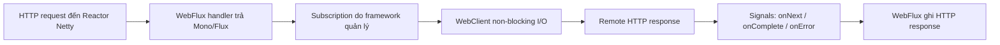
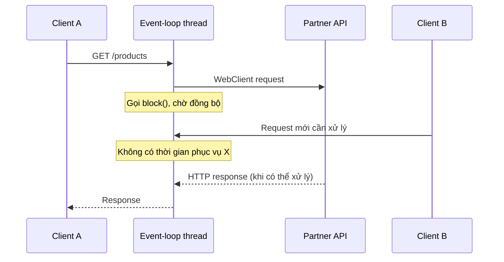
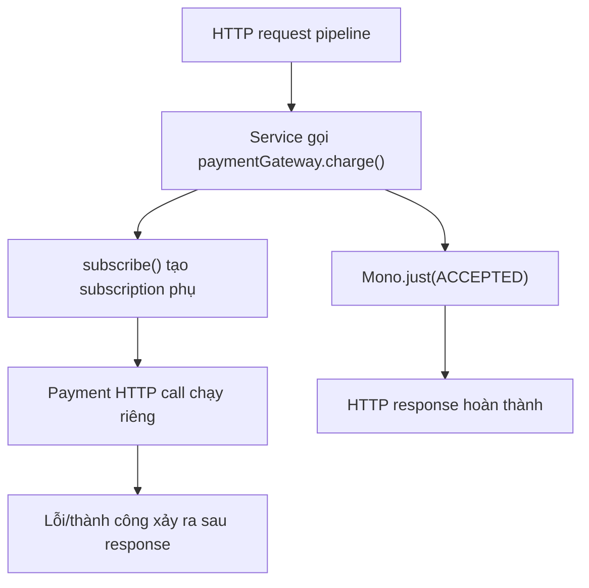
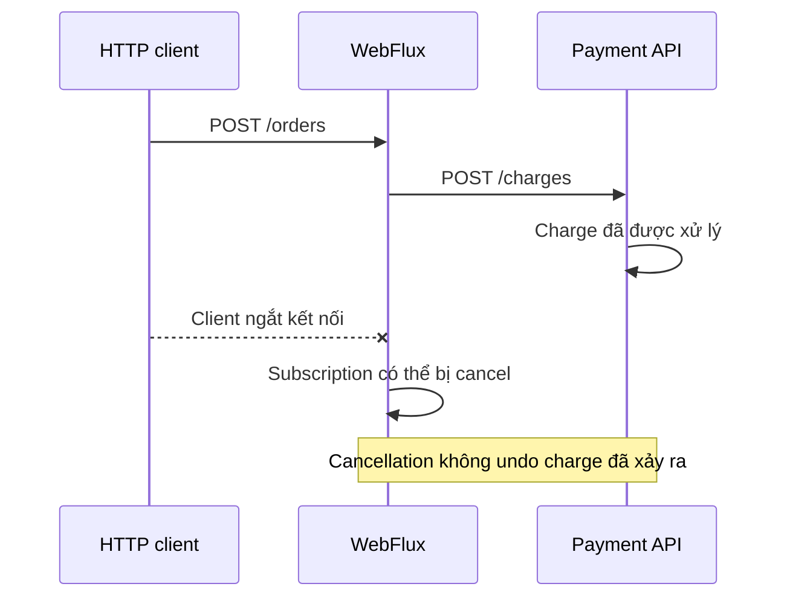
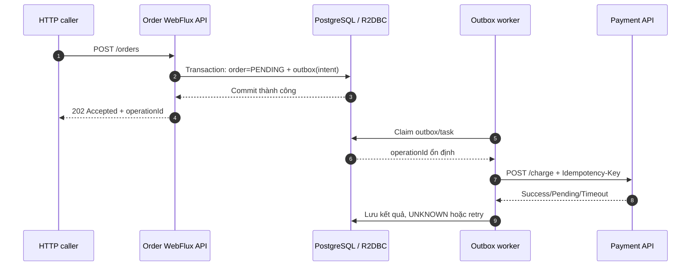

# Tránh block() trên event loop và subscribe() ngoài chuỗi nghiệp vụ

Spring `WebClient` cho phép gọi HTTP bằng một pipeline dựa trên Project Reactor, thường trả về `Mono<T>` hoặc `Flux<T>`. Trong ứng dụng Spring WebFlux, một số ít event-loop threads có thể phục vụ nhiều kết nối cùng lúc vì chúng **không được thiết kế để chờ đồng bộ** cho mỗi request. Chỉ cần đặt `block()` sai chỗ hoặc chủ động gọi `subscribe()` trong một service, lập trình viên có thể phá vỡ chính đặc tính này: request treo, throughput giảm, lỗi bị nuốt, transaction kết thúc sớm hoặc một tác vụ ngoài hệ thống chạy sau khi HTTP response đã báo thành công.

Ví dụ, `order-service` nhận yêu cầu đặt hàng, đọc tồn kho từ Catalog API, lưu ý định thanh toán vào database rồi phát message sang broker. Khi một lời gọi `WebClient` được xử lý ngoài reactive chain, luồng xử lý phía ngoài có thể kết thúc trước khi downstream hoàn thành. Điều đó ảnh hưởng trực tiếp đến hợp đồng dữ liệu, idempotency, thời điểm commit, retry và quan sát lỗi — không chỉ đến hiệu năng.

Bài thuộc chương **WebClient** của mô-đun **SPRING_BOOT_INTEGRATION**. Phạm vi là các luồng tích hợp Spring Boot qua HTTP client, SQL, cache, Kafka/RabbitMQ và Spring Integration adapters. Các ví dụ sử dụng chủ yếu Spring Boot 3.x, Spring Framework 6.x, Reactor 3.x; cần kiểm tra API, instrumentation và cấu hình thực tế trên phiên bản của dự án.

## 1. Mục tiêu học tập

Sau bài này, bạn có thể:

1. Giải thích event loop, non-blocking I/O, subscription, signal và tính lazy của `Mono`/`Flux`.
2. Chỉ ra tại sao `block()` trên Reactor Netty event loop gây lỗi hoặc khiến thread pool bị nghẽn.
3. Giải thích vì sao gọi `subscribe()` trong controller/service thường tạo **detached work** mất liên kết với kết quả nghiệp vụ.
4. Dùng `map`, `flatMap`, `then`, `zip`, `onErrorResume` và `timeout` để giữ các bước trong cùng pipeline.
5. Phân biệt “chuyển công việc blocking sang `boundedElastic`” với việc làm I/O trở nên non-blocking thật sự.
6. Đặt transaction, retry, idempotency, acknowledgement và outbox đúng ranh giới khi gọi HTTP, SQL hoặc broker.
7. Kiểm soát cancellation, context propagation, timeout, resource cleanup và giới hạn concurrency.
8. Kiểm thử rằng lỗi và hoàn tất của downstream được truyền về caller, không mất do fire-and-forget.

## 2. Mô hình nền tảng: event loop không phải thread cho mỗi request

Trong mô hình servlet truyền thống, một request thường được xử lý trên một thread phục vụ có thể chờ gọi JDBC/HTTP blocking. Trong WebFlux với Reactor Netty, event-loop threads đảm nhiệm việc nhận dữ liệu, xử lý sự kiện I/O và tiếp tục pipeline khi có tín hiệu. Hệ thống không cần dành riêng một thread chờ mỗi network call.



Một `Mono<T>` thường biểu thị **không hoặc một giá trị** cùng tín hiệu hoàn tất hoặc lỗi. Một `Flux<T>` có thể biểu thị nhiều giá trị. Đó là các kiểu **Publisher**; phần lớn pipeline Reactor là *lazy* (lạnh, hay *cold*) và chỉ bắt đầu công việc khi có subscription.

Một số thuật ngữ quan trọng:

| Thuật ngữ | Ý nghĩa thực tế |
|---|---|
| Event loop | Một thread xử lý nhiều sự kiện I/O; không nên bị chặn bởi lời gọi chờ lâu |
| Non-blocking I/O | Khi chờ network, thread có thể phục vụ công việc khác |
| Publisher | Mô tả nguồn dữ liệu/tín hiệu mà subscriber có thể đăng ký |
| Subscription | Quan hệ giữa publisher và subscriber, bắt đầu nhận dữ liệu và quản lý demand/cancel |
| `onNext` | Tín hiệu một giá trị |
| `onComplete` | Tín hiệu hoàn tất, không còn giá trị |
| `onError` | Tín hiệu lỗi kết thúc chuỗi |
| Cancellation | Subscriber ngừng quan tâm/không còn nhu cầu nhận dữ liệu |
| Scheduler | Cơ chế quyết định nơi thực thi một số tác vụ/tín hiệu Reactor |

Một event loop có thể thực thi các phép biến đổi ngắn, nhưng khi phải **chờ** network, database, lock hoặc `Thread.sleep`, nó không còn phục vụ tốt các kết nối khác. Tên thread như `reactor-http-nio-*` là dấu hiệu thường gặp trong Reactor Netty, không phải hợp đồng bắt buộc cho mọi container.

### 2.1. Reactive không có nghĩa mọi đoạn code chạy song song

`flatMap` biểu thị việc nối đến Publisher bất đồng bộ; nó không đồng nghĩa tự tạo một Java thread mới cho từng giá trị. `map` thường chạy trên thread đang phát tín hiệu, trừ khi upstream có scheduler boundary. Một pipeline hoàn toàn có thể chạy một số callback trên event-loop thread.

**Non-blocking** nói về cách chờ I/O và dùng thread; **concurrent** nói về nhiều công việc có thể tiến triển đan xen; **parallel** nói về thực thi tại cùng một thời điểm trên nhiều tài nguyên xử lý. Ba khái niệm có liên hệ nhưng không thay thế nhau.

## 3. Mono/Flux là mô tả công việc, không phải kết quả đã có

Giả sử có:

```java
Mono<ProductView> product = webClient.get()
    .uri("/v1/products/{sku}", "SKU-42")
    .retrieve()
    .bodyToMono(ProductView.class);
```

Lệnh tạo `Mono` thường **chưa gửi request**. Nó mô tả cách gọi HTTP khi được subscribe. Một controller WebFlux có thể trả thẳng Publisher cho framework; framework sẽ đăng ký subscription để gửi HTTP response.

```java
@RestController
class ProductController {

    private final ProductGateway gateway;

    ProductController(ProductGateway gateway) {
        this.gateway = gateway;
    }

    @GetMapping("/products/{sku}")
    Mono<ProductView> find(@PathVariable String sku) {
        return gateway.getProduct(sku);
    }
}
```

Ở đây `ProductGateway.getProduct(...)` trả `Mono<ProductView>`. Controller **không cần** và **không nên** gọi `subscribe()`; WebFlux sở hữu terminal subscription, gửi body, xử lý lỗi/cancellation và quản lý response lifecycle.

### 3.1. Một Publisher có thể bị subscribe nhiều lần

Ví dụ:

```java
Mono<ProductView> request = gateway.getProduct("SKU-42");

Mono<ProductView> first = request;
Mono<ProductView> second = request;
```

Hai biến tham chiếu cùng Publisher không có nghĩa dữ liệu remote đã được cache. Với một cold Publisher như lời gọi `WebClient` điển hình, **mỗi subscription** có thể tạo một HTTP request mới. Nếu cần chia sẻ kết quả giữa các subscriber, phải chọn `cache()`/`share()` hoặc cơ chế cache rõ ràng và hiểu lỗi, TTL, kích thước, phiên bản và dữ liệu nhạy cảm. Không thêm `cache()` bừa bãi vào lời gọi thanh toán vì có thể giữ state vượt vòng đời mong muốn.

## 4. Vì sao block() trong event loop là sai?

`Mono.block()` là terminal operation chờ đồng bộ cho tới khi Publisher hoàn tất rồi trả giá trị hoặc ném exception. Lệnh này sử dụng thread hiện tại để chờ.

```java
// Anti-pattern trong WebFlux handler hoặc event-loop callback.
@GetMapping("/products/{sku}")
ProductView bad(@PathVariable String sku) {
    return webClient.get()
        .uri("/v1/products/{sku}", sku)
        .retrieve()
        .bodyToMono(ProductView.class)
        .block(); // Chặn thread đang thực thi.
}
```

Trong Reactor, khi gọi một blocking terminal method như `block()` trên thread được đánh dấu non-blocking (ví dụ nhiều Reactor Netty event-loop threads), Reactor thường từ chối bằng `IllegalStateException` với thông báo tương tự:

```text
block()/blockFirst()/blockLast() are blocking,
which is not supported in thread reactor-http-nio-...
```

Không nên hiểu rằng “chỉ sai khi có exception”; nếu chặn trên một thread không bị đánh dấu non-blocking nhưng vẫn thuộc pool phục vụ công việc nhạy về độ trễ, hệ thống có thể nghẽn mà không có cảnh báo rõ. Vấn đề cốt lõi là **đưa chờ đồng bộ vào đường xử lý đáng lẽ không chờ**.

### 4.1. Điều gì xảy ra khi event loop bị giữ?



Khi lượng request tăng, hậu quả có thể là độ trễ tăng đột biến, timeouts, nghẽn connection pool và throughput thấp. Trong tình huống một event loop chờ tín hiệu mà chính event loop đó cần xử lý, còn có nguy cơ deadlock/starvation.

### 4.2. Cách đúng: trả Publisher

```java
@GetMapping("/products/{sku}")
Mono<ProductView> good(@PathVariable String sku) {
    return webClient.get()
        .uri("/v1/products/{sku}", sku)
        .retrieve()
        .bodyToMono(ProductView.class);
}
```

WebFlux subscribe và xử lý completion/error cho response. Không có terminal blocking call trong controller.

## 5. block() không bị cấm tuyệt đối trong mọi Java code

Vấn đề là **vị trí và hợp đồng thực thi**:

| Ngữ cảnh | Đánh giá |
|---|---|
| WebFlux controller/reactive filter trên event loop | Tránh `block()`; trả Publisher |
| Callback `map`/`flatMap` đang chạy trên event-loop thread | Tránh `block()`; compose |
| Reactor Netty I/O callback | Không chờ đồng bộ |
| Service đang là một phần của reactive chain | Giữ chuỗi non-blocking; không gọi `block()` bên trong |
| Command-line hoặc test đồng bộ, kiểm soát thread | `block(Duration)` có thể chấp nhận ở **biên ngoài** |
| Spring MVC/Servlet service blocking muốn gọi `WebClient` | Có thể block có kiểm soát trên servlet worker thread, nhưng phải giới hạn timeout/concurrency; cân nhắc `RestClient` |
| Background job có thread chuyên dụng cho blocking | Có thể chờ trong ngân sách tài nguyên, nhưng quản lý lifecycle/timeout rõ |

Ví dụ ở một integration test đồng bộ:

```java
ProductView product = gateway.getProduct("SKU-42")
    .block(Duration.ofSeconds(3));
assertThat(product.sku()).isEqualTo("SKU-42");
```

Đoạn này chỉ hợp lệ nếu test chạy trên thread cho phép chờ và có timeout. Trong ứng dụng Servlet truyền thống, nếu nhu cầu là client HTTP đồng bộ thì Spring `RestClient` thường giúp diễn đạt mô hình dễ hơn là gọi `WebClient.block()` khắp các service.

**Quy tắc:** nếu caller đã sử dụng `Mono`/`Flux`, hãy trả/compose Publisher; nếu caller thực sự là API blocking ở biên hệ thống, quyết định rõ nơi chờ và ngân sách thread.

## 6. Vì sao gọi subscribe() trong service nguy hiểm?

`subscribe()` là terminal operation **khởi động một subscription mới**. Nó thường trả về `Disposable` ngay, không đợi downstream hoàn tất:

```java
// Anti-pattern: tách công việc khỏi lời gọi nghiệp vụ.
public Mono<OrderResult> createOrder(CreateOrderCommand command) {
    paymentGateway.charge(command)
        .subscribe(); // Công việc bị tách khỏi Mono mà method trả về.

    return Mono.just(OrderResult.accepted(command.orderId()));
}
```

Caller chỉ đợi `Mono.just(...)` và có thể nhận response thành công ngay cả khi:

- HTTP charge chưa được gửi hoặc chưa hoàn tất;
- downstream trả 401/503 hoặc timeout;
- ứng dụng bị kill trước khi payment hoàn tất;
- client hủy HTTP request nhưng charge vẫn tiếp tục;
- error không được đưa vào pipeline kết quả của `createOrder`;
- tracing/correlation/transaction context không còn liên hệ đúng.

Đặc biệt với thanh toán, `subscribe()` kiểu fire-and-forget có thể tạo trạng thái “đã xác nhận” trong khi nghĩa vụ chưa được ghi nhận bền vững.

### 6.1. subscribe() thay đổi ai sở hữu lifecycle



Subscription phụ không còn chịu sự điều phối tự nhiên từ Publisher của HTTP response. Nếu không có người giữ `Disposable` và chính sách xử lý terminal signals, tác vụ ngoài hệ thống có thể tiếp tục không được quan sát hay bị hủy sai thời điểm.

### 6.2. Một subscribe() không có error consumer có thể làm lỗi “biến mất”

```java
gateway.updateRemote()
    .subscribe();  // Không có owner rõ ràng để xử lý onError.
```

Lỗi trong subscription này không tự ném trở lại method caller vốn đã trả về. Reactor có cơ chế xử lý lỗi mặc định/hook tùy tình huống, nhưng không nên dựa vào log global để bảo đảm nghiệp vụ. Phải giữ error signal trong cùng chain hoặc, ở ranh giới chủ động tiêu thụ, cung cấp handler và lifecycle có trách nhiệm.

## 7. Đúng hơn: compose thay vì subscribe thủ công

Giả sử muốn kiểm tra Catalog rồi gọi một API ghi nhận request. Giữ tất cả trong Publisher được trả về:

```java
public Mono<OrderResult> submit(CreateOrderCommand command) {
    return catalogGateway.getProduct(command.sku())
        .flatMap(product ->
            orderWorkflow.acceptAndPersist(command, product)
        );
}
```

Ở đây `orderWorkflow.acceptAndPersist(...)` phải trả `Mono<OrderResult>` và **không tự subscribe**. Nếu upstream lỗi, terminal signal `onError` tiếp tục đi về controller; nếu caller cancel, cancellation có thể truyền tới các nguồn hỗ trợ. Muốn trả HTTP 202, `acceptAndPersist` phải ghi **bền vững ý định xử lý** vào DB/outbox trước khi phát `OrderResult.accepted`.

### 7.1. Controller giữ business completion trong response

```java
@RestController
@RequestMapping("/orders")
class OrderController {

    private final OrderWorkflow workflow;

    OrderController(OrderWorkflow workflow) {
        this.workflow = workflow;
    }

    @PostMapping
    Mono<ResponseEntity<OrderResult>> create(
            @RequestBody Mono<CreateOrderCommand> request) {
        return request
            .flatMap(workflow::submit)
            .map(result -> ResponseEntity.accepted().body(result));
    }
}
```

Ví dụ này **chỉ trả 202 sau khi `submit` hoàn tất** (theo contract là đã tiếp nhận bền vững), không ngụ ý thanh toán đã thu hay giao hàng đã đặt. Các kiểu `OrderWorkflow`, `OrderResult` và `CreateOrderCommand` là domain types do dự án định nghĩa.

### 7.2. Trường hợp cần trả ngay và xử lý sau

Nếu API yêu cầu asynchronous acceptance:

1. Validate request.
2. Ghi operation ID, state `PENDING` và outbox/task record trong **một transaction bền vững**.
3. Trả `202 Accepted` kèm `operationId` và cách truy vấn trạng thái.
4. Một worker có quản lý lifecycle độc lập đọc hàng đợi/task table và thực thi.

Không biến `subscribe()` trong HTTP controller thành hàng đợi công việc. Khi process bị kill, fire-and-forget work trong RAM có thể mất vĩnh viễn.

## 8. map, flatMap, then: thứ tự và kiểu dữ liệu

### 8.1. map: biến đổi đồng bộ, ngắn, không chờ

```java
Mono<ProductSummary> summary = catalogGateway.getProduct("SKU-42")
    .map(product -> new ProductSummary(
        product.sku(), product.name()));
```

`map` phù hợp cho việc biến đổi giá trị trong bộ nhớ. Không đặt `Thread.sleep`, query JDBC blocking hoặc gọi `block()` bên trong lambda `map` trên event loop.

### 8.2. flatMap: bước kế tiếp trả Publisher

```java
Mono<QuoteResponse> quote = catalogGateway.getProduct("SKU-42")
    .flatMap(product ->
        pricingGateway.getDiscount(product.sku())
            .map(discount -> new QuoteResponse(
                product.sku(),
                product.price().subtract(discount.amount()),
                product.currency()))
    );
```

`pricingGateway.getDiscount(...)` là asynchronous operation, nên `flatMap` nối Publisher con với chuỗi chính. Nếu pricing lỗi, toàn chuỗi nhận `onError` trừ khi code xử lý theo hợp đồng.

### 8.3. then: chờ completion, không cần giá trị cũ

```java
Mono<Void> workflow = auditGateway.recordRequest(command)
    .then(notificationGateway.sendIfAllowed(command));
```

`then` chờ publisher đầu hoàn tất thành công rồi subscribe publisher sau; nếu audit thất bại thì notification không tự chạy. Lưu ý: chỉ dùng sơ đồ này khi cách “audit trước, notification sau” là contract đúng, và audit record đủ bền vững nếu notification có side effect khó bù.

### 8.4. thenReturn: tạo kết quả chỉ sau khi bước trước hoàn tất

```java
Mono<Acceptance> result = taskRepository.persistIntent(command)
    .thenReturn(new Acceptance(command.operationId(), "PENDING"));
```

Giả sử `persistIntent` trả `Mono<Void>` với **completion phản ánh DB transaction đã commit**. `thenReturn` chỉ phát `Acceptance` khi publisher trước kết thúc thành công, không sớm hơn. Nếu `persistIntent` là một method tự `subscribe()` rồi trả `Mono.empty()` thì bảo đảm này mất.

### 8.5. zip: phối hợp công việc độc lập

```java
Mono<QuoteResponse> quote =
    Mono.zip(
        catalogGateway.getProduct("SKU-42"),
        pricingGateway.getDiscount("SKU-42")
    ).map(tuple -> new QuoteResponse(
        tuple.getT1().sku(),
        tuple.getT1().price().subtract(tuple.getT2().amount()),
        tuple.getT1().currency()
    ));
```

`zip` phù hợp khi hai lời gọi đọc độc lập có thể được subscribe đồng thời. Không `zip` hai tác vụ **bắt buộc theo thứ tự** như “ghi đơn đã commit rồi mới charge” nếu điều đó có thể phá invariant. Với `Mono.empty()`, `zip` có thể hoàn tất mà không phát tuple; cần định nghĩa chính sách cho empty responses.

## 9. Side effects và vai trò đúng của doOnNext/doOnSuccess

Một anti-pattern khác là giấu tác vụ nghiệp vụ trong callback quan sát:

```java
// Sai: ghi nghiệp vụ qua một subscription tách rời.
return catalogGateway.getProduct(sku)
    .doOnNext(product ->
        invoiceGateway.createInvoice(product).subscribe()
    );
```

`doOnNext` và `doOnSuccess` chủ yếu thích hợp cho instrumentation, logging hoặc side effects **đồng bộ, ngắn, không có Publisher cần chờ**. Reactor không đợi subscription mới tạo trong callback đó. Nếu tạo invoice là bước bắt buộc, sử dụng `flatMap`:

```java
return catalogGateway.getProduct(sku)
    .flatMap(product ->
        invoiceGateway.createInvoice(product)
            .thenReturn(product)
    );
```

Nếu việc phát invoice chỉ là follow-up sau acceptance và được phép asynchronous, lưu durable intent/outbox trước khi trả thành công.

### 9.1. doOnError không thay thế onErrorResume

`doOnError` quan sát một lỗi đang đi qua, không tự xử lý hoặc chuyển nó thành response hợp lệ:

```java
return gateway.fetch(id)
    .doOnError(ex -> metrics.recordGatewayFailure(ex));
```

Nếu muốn fallback:

```java
return gateway.fetch(id)
    .onErrorResume(TransientCatalogException.class,
        ex -> cachedCatalog.fetchFreshEnough(id));
```

Fallback chỉ đúng nếu cache đủ mới theo contract nghiệp vụ. Với số tiền/giá chính thức, không được tự gán giá cache cũ là sự thật chỉ để tránh lỗi HTTP.

## 10. Các lỗi composition tinh vi

### 10.1. Tạo Publisher nhưng không trả hoặc nối

```java
public Mono<Void> update(String id) {
    gateway.sendUpdate(id); // Trả Mono<Void> nhưng bị bỏ đi.
    return Mono.empty();
}
```

Ở đây request thậm chí có thể **không được gửi**, vì Publisher không được subscribe. Cách đúng:

```java
public Mono<Void> update(String id) {
    return gateway.sendUpdate(id);
}
```

### 10.2. Gọi subscribe() rồi trả Mono.empty()

```java
public Mono<Void> update(String id) {
    gateway.sendUpdate(id).subscribe();
    return Mono.empty();
}
```

Lần này HTTP call có thể được kích hoạt, nhưng completion/error đã tách khỏi caller. Không nên coi đây là “sửa lỗi Publisher không chạy”.

### 10.3. Dùng map sinh Mono<Mono<T>>

```java
Mono<Mono<PaymentStatus>> nested = orderGateway.getOrder(orderId)
    .map(order -> paymentGateway.getStatus(order.paymentId()));
```

`map` tạo một giá trị là Publisher con, không tự subscribe vào Publisher con. Nếu cần kết quả Payment:

```java
Mono<PaymentStatus> status = orderGateway.getOrder(orderId)
    .flatMap(order -> paymentGateway.getStatus(order.paymentId()));
```

### 10.4. Hai lần subscribe không nhất thiết là cache

```java
Mono<PaymentStatus> status = paymentGateway.getStatus(paymentId);
status.subscribe(this::auditStatus);
return status;
```

Caller subscribe vào `status` một lần khác, có thể gọi Payment API hai lần. Ngoài chi phí và race, kết quả hai lần có thể khác nhau. Nếu audit là bắt buộc, nối `flatMap` hoặc `doOnNext` cho việc đồng bộ phù hợp trong **một** pipeline; không tự subscribe.

## 11. HTTP error mapping phải nằm trong reactive chain

`WebClient.retrieve()` có hành vi lỗi mặc định khi gặp HTTP error status. Với một API có hợp đồng riêng, nên chuyển status thành exception nghiệp vụ ở gateway:

```java
public Mono<ProductView> getProduct(String sku) {
    return catalogWebClient.get()
        .uri("/v1/products/{sku}", sku)
        .retrieve()
        .onStatus(
            status -> status.value() == 404,
            response -> Mono.just(
                new ProductNotFoundException(sku)
            )
        )
        .bodyToMono(ProductView.class);
}
```

`ProductNotFoundException` là exception do ứng dụng định nghĩa; ví dụ giả định class đó kế thừa `RuntimeException`. Hàm `onStatus` ở đây trả Publisher phát ra Throwable cho framework, không gọi `subscribe()`. Khi gateway lỗi, error signal tiếp tục về service/controller hoặc `onErrorResume` đã được thiết kế.

Các tình huống phân loại:

| Sự cố | Ngữ nghĩa thường gặp | Hành động |
|---|---|---|
| 400 | Payload/đầu vào sai | Không retry vô hạn |
| 401/403 | Credential/quyền sai | Xử lý auth/config, không coi là transient |
| 404 | Không tồn tại theo contract từng API | Domain not found hoặc route error |
| 409 | Conflict/idempotency state | Đọc body/code, không tự coi retryable |
| 429 | Rate limit | Backoff theo `Retry-After`/contract |
| 503/504 | Gateway/upstream tạm thời | Có thể retry nếu operation an toàn |
| DNS/connect timeout | Lỗi network | Phân loại, retry hữu hạn |
| Read timeout sau POST | Kết quả remote không chắc chắn | Giữ operation ID, đối soát |
| Response body không decode được | Sai schema/format | Báo contract error, tránh retry không kiểm soát |

Đừng đặt một `onErrorResume(ex -> Mono.empty())` toàn cục để làm ứng dụng “luôn thành công”; empty Publisher có ý nghĩa và có thể làm controller trả response không mong đợi, che giấu công việc chưa hoàn tất.

## 12. Timeout là một signal cần được xử lý

`Mono.timeout(Duration)` tạo một error signal khi Publisher không hoàn tất trong thời gian quy định:

```java
return catalogGateway.getProduct(sku)
    .timeout(Duration.ofSeconds(3))
    .onErrorMap(
        java.util.concurrent.TimeoutException.class,
        ex -> new CatalogTimeoutException("Catalog request timed out", ex)
    );
```

`CatalogTimeoutException` là exception ứng dụng. Timeout **không phải** kết quả của nghiệp vụ bên đối tác; nếu request đã đến server, server vẫn có thể hoàn tất side effect dù caller đã cancel/timed out.

### 12.1. Các lớp timeout khác nhau

| Timeout | Đối tượng | Không tự bảo đảm |
|---|---|---|
| Connect timeout | Thiết lập TCP connection | Toàn bộ request kết thúc đúng hạn |
| TLS handshake timeout | Thương lượng TLS | Server xử lý nghiệp vụ đúng |
| Connection-pool acquire timeout | Chờ lấy connection | Remote response latency |
| HTTP response/read timeout | Chờ response hoặc đọc dữ liệu theo transport | Deadline toàn workflow nhiều retries |
| Reactor `timeout` | Thời gian phát tín hiệu trong reactive chain | Remote chưa thực hiện side effect |
| Business deadline | Ngân sách thời gian một request/workflow | Broker/DB/đối tác có rollback nguyên tử |

Tùy Reactor Netty/WebClient version và request factory, cần cấu hình connect, response, read, pool acquisition và TLS ở tầng tương ứng. Một `timeout(3s)` bên ngoài có thể hủy subscription sau 3 giây nhưng không thu hồi được tiền đã charge ở đối tác.

## 13. RetryWhen: chỉ retry đúng lỗi, đúng operation

Reactor cung cấp `retryWhen`:

```java
import java.time.Duration;
import reactor.util.retry.Retry;

Mono<ProductView> product = catalogGateway.getProduct(sku)
    .timeout(Duration.ofSeconds(2))
    .retryWhen(
        Retry.backoff(2, Duration.ofMillis(250))
            .maxBackoff(Duration.ofSeconds(2))
            .jitter(0.3)
            .filter(CatalogErrorPolicy::isTransient)
    );
```

`CatalogErrorPolicy.isTransient(Throwable)` là predicate của ứng dụng, ví dụ chỉ chấp nhận network transient, 429/503 theo contract và lỗi timeout phù hợp. `Retry.backoff(2, ...)` cho phép **tối đa hai lần retry** sau lần đầu, tức tối đa ba attempts, trừ khi pipeline bị hủy/hết deadline. Với `WebClient` cold Publisher, mỗi lần retry có thể tạo **request HTTP mới**.

Không dùng `retryWhen(Retry.indefinitely())` cho POST tạo thanh toán hoặc thao tác không có idempotency contract. Một request `POST` timeout có thể đã thành công phía server; retry cùng logical operation cần key bền vững, lookup trạng thái hoặc reconciliation.

### 13.1. Retry policy không chỉ là annotation

| Operation | Retry có thể phù hợp? | Điều kiện |
|---|---|---|
| GET sản phẩm | Có thể | GET không có side effect, lỗi tạm thời và budget |
| GET trạng thái payment | Có thể | Query theo operation ID, rate limit |
| POST tạo charge | Chỉ khi contract bảo đảm idempotency | Key ổn định, không sinh lại trên mỗi resubscription |
| POST refund | Chỉ khi contract riêng hỗ trợ | Key refund khác key charge, đối soát |
| PUT cập nhật resource | Phải kiểm tra semantics | Có thể cần ETag/version |
| Gửi email | Không giả định an toàn | Notification intent, dedupe/monitoring |

### 13.2. Eager key generation khi retry

Nếu trong chuỗi dùng `Mono.defer(() -> createKeyAndCharge())`, mỗi resubscription của `retryWhen` có thể tạo **key mới**. Điều đó là lỗi nghiêm trọng với side effects. Hãy tạo và lưu operation ID **trước** khi cho phép retry, rồi giữ nguyên khi gọi downstream:

```java
String operationId = durableCommand.operationId();

Mono<ChargeStatus> call = paymentGateway.queryByOperationId(operationId);

return call.retryWhen(
    Retry.backoff(2, Duration.ofMillis(300))
        .filter(PaymentErrorPolicy::isTransient)
);
```

Trong code thật, `durableCommand` phải được lấy từ task/state đã persist. Nếu không còn đủ thời gian hoặc kết quả chưa rõ, chuyển sang `UNKNOWN`/reconciliation thay vì phát POST mới bằng key ngẫu nhiên.

## 14. onErrorResume, onErrorMap, doFinally và quyền sở hữu lỗi

Một reactive chain giữ được tín hiệu lỗi đến caller:

```java
return catalogGateway.getProduct(sku)
    .timeout(Duration.ofSeconds(3))
    .onErrorMap(
        java.util.concurrent.TimeoutException.class,
        ex -> new CatalogTimeoutException("Timeout", ex)
    )
    .doOnError(ex -> metrics.recordFailure("catalog", ex))
    .doFinally(signalType -> metrics.recordTermination(
        "catalog", signalType.name()));
```

Các operator có trách nhiệm khác nhau:

- `onErrorMap`: chuyển một lỗi thành lỗi phù hợp hơn.
- `onErrorResume`: chọn Publisher thay thế theo contract.
- `doOnError`: quan sát, **không tự nuốt lỗi**.
- `doFinally`: chạy khi chuỗi kết thúc bằng complete, error **hoặc cancellation**.
- `onErrorReturn`: trả fallback value nhưng dễ che giấu ngữ nghĩa nếu dùng tùy tiện.
- `retryWhen`: resubscribe có điều kiện; không đảm bảo idempotency.

Ví dụ không nên làm:

```java
return paymentGateway.charge(order)
    .onErrorResume(ex -> Mono.just(ChargeResult.success()));
```

Vì timeout/lỗi thanh toán **không** tương đương đã thu tiền. Có thể trả một trạng thái `PENDING_VERIFICATION` sau khi persist operation để caller không hiểu nhầm.

## 15. Cancellation: caller không muốn chờ nữa nhưng side effect có thể tiếp tục

Trong WebFlux, nếu client đóng kết nối, response được hủy hoặc timeout operator phát tín hiệu, subscription có thể bị cancel. Reactor thường chuyển cancellation đến upstream khi có thể. Nhưng cancellation không bảo đảm:

- remote HTTP server dừng xử lý request đã nhận;
- SQL transaction trên hệ thống ngoài tự rollback;
- Kafka producer đã gửi record bị thu hồi;
- một charge đã capture tự được refund.



Với tác vụ chỉ đọc, cancellation có thể tiết kiệm I/O. Với tác vụ thay đổi tiền/đơn hàng, yêu cầu **durable intent + idempotency + reconciliation** và không gắn tính đúng đắn hoàn toàn vào lifecycle của một HTTP request.

### 15.1. doFinally(CANCEL) không phải compensation

```java
.doFinally(signal -> {
    if (signal == SignalType.CANCEL) {
        log.debug("Caller no longer waiting");
    }
})
```

Không gọi `voidPayment()` fire-and-forget trong `doFinally(CANCEL)` rồi nghĩ đã hoàn tiền. Compensation là workflow nghiệp vụ riêng cần target operation ID, trạng thái và kết quả xác minh.

## 16. Scheduler của Reactor: subscribeOn khác publishOn

Khi cần thay đổi nơi thực thi, Reactor cung cấp hai operator chính:

| Operator | Ảnh hưởng chính | Điều không nên suy luận |
|---|---|---|
| `subscribeOn(scheduler)` | Chuyển giai đoạn subscription và upstream execution theo source | Không biến JDBC blocking thành non-blocking I/O |
| `publishOn(scheduler)` | Chuyển các tín hiệu downstream từ vị trí operator sang scheduler | Không tự xử lý timeout, transaction, side effect |

Ví dụ chỉ dùng `map` nhẹ trên event loop là bình thường:

```java
Mono<String> productName = webClient.get()
    .uri("/v1/products/{sku}", sku)
    .retrieve()
    .bodyToMono(ProductView.class)
    .map(ProductView::name);
```

Không cần `publishOn(Schedulers.parallel())` chỉ để “làm cho reactive hơn”. Mỗi scheduler boundary tạo chi phí chuyển ngữ cảnh; CPU-heavy computation có thể được đưa sang worker phù hợp nhưng phải có giới hạn concurrency.

### 16.1. subscribeOn cho nguồn blocking khi đang chuyển đổi hệ thống

Nếu chưa thể thay JDBC bằng R2DBC và bắt buộc gọi một blocking repository trong reactive chain, có thể cô lập:

```java
import reactor.core.publisher.Mono;
import reactor.core.scheduler.Schedulers;

Mono<OrderEntity> loadOrder(String orderId) {
    return Mono.fromCallable(() -> jdbcOrderRepository.find(orderId))
        .subscribeOn(Schedulers.boundedElastic());
}
```

`boundedElastic` cung cấp worker threads có giới hạn, thích hợp hơn việc chặn Netty event loop. Nhưng:

- JDBC vẫn **blocking** và vẫn chiếm một worker/thread khi chờ DB.
- Pool/queue hữu hạn; nhiều truy vấn chậm có thể khiến `boundedElastic` nghẽn.
- Transaction context của JDBC thường gắn với thread; không dùng một transaction ở WebFlux event-loop thread rồi giả định nó theo task lên `boundedElastic`.
- Không tự động có backpressure/timeout ở database; phải cấu hình JDBC statement timeout, pool và resource cleanup.
- Cần cân nhắc kiến trúc: nếu phần lớn service là JDBC blocking, Spring MVC + `RestClient` có thể đơn giản hơn việc bọc mọi query qua boundedElastic.

### 16.2. Đừng chuyển toàn bộ WebClient sang boundedElastic để né lỗi block()

`webClient.get()...bodyToMono()` đã là non-blocking khi dùng transport reactive phù hợp. Không cần thêm `subscribeOn(boundedElastic())` cho mỗi request. Nếu có `block()` trong chain, cách đúng là **loại bỏ lệnh chờ và compose**, không phải giấu nó trên thread khác trong toàn bộ hệ thống.

## 17. JDBC, JPA và R2DBC: reactive chain không thay đổi driver

Một `Mono` bao ngoài repository không đồng nghĩa truy vấn database đã thành non-blocking. Hai ví dụ:

```java
// Blocking JDBC bị gọi ngay ở thread đang xây Mono:
public Mono<OrderEntity> wrong(String id) {
    OrderEntity entity = jdbcRepository.find(id);
    return Mono.just(entity);
}
```

```java
// JDBC vẫn blocking nhưng việc chờ được cô lập khỏi event loop:
public Mono<OrderEntity> transitional(String id) {
    return Mono.fromCallable(() -> jdbcRepository.find(id))
        .subscribeOn(Schedulers.boundedElastic());
}
```

`Mono.just(jdbcRepository.find(id))` **đánh giá argument trước** khi `Mono` được tạo. Do vậy query vẫn chạy ngay tại thread caller. `Mono.fromCallable` trì hoãn query đến lúc subscription. `subscribeOn(boundedElastic())` là biện pháp chuyển tiếp khi chưa thể dùng reactive driver; không xóa rủi ro connection pool cạn, lock lâu hay query timeout.

### 17.1. R2DBC tạo reactive database I/O

Nếu đã có R2DBC driver/repositories phù hợp, service có thể compose SQL I/O và WebClient mà không cần blocking wrapper:

```java
public Mono<OrderView> findOrderWithShipping(String orderId) {
    return orderRepository.findByOrderId(orderId)
        .flatMap(order ->
            shippingGateway.getStatus(order.shippingId())
                .map(status -> OrderView.from(order, status))
        );
}
```

Ví dụ giả định `orderRepository` là reactive repository trả `Mono<Order>` và `shippingGateway` trả `Mono<ShippingStatus>`. Lưu ý read model có thể có eventual consistency; response cần phản ánh dữ liệu đủ mới theo contract.

### 17.2. Reactive transaction sử dụng Reactor Context

Với R2DBC và `ReactiveTransactionManager`, Spring có thể gắn transaction với **Reactor Context** trong quá trình subscription. Một ví dụ viết hai thay đổi SQL đồng bộ về nghĩa vụ commit:

```java
import org.springframework.transaction.reactive.TransactionalOperator;
import reactor.core.publisher.Mono;

class OrderAcceptanceStore {

    private final TransactionalOperator transactionalOperator;
    private final ReactiveOrderRepository orders;
    private final ReactiveOutboxRepository outbox;

    OrderAcceptanceStore(
            TransactionalOperator transactionalOperator,
            ReactiveOrderRepository orders,
            ReactiveOutboxRepository outbox) {
        this.transactionalOperator = transactionalOperator;
        this.orders = orders;
        this.outbox = outbox;
    }

    Mono<Void> persistIntent(CreateOrderCommand command) {
        return transactionalOperator.transactional(
            orders.insertPending(command)
                .then(outbox.insertOrderAccepted(command))
        ).then();
    }
}
```

`ReactiveOrderRepository` và `ReactiveOutboxRepository` là các adapter giả định được định nghĩa trong dự án; mỗi method trả Publisher. Cả hai phải kết nối cùng transaction manager/database được cấu hình phù hợp. Nếu dùng repository JDBC blocking thay R2DBC trong ví dụ này, không có bảo đảm rằng nó tham gia reactive transaction.

### 17.3. Đừng mở transaction SQL qua một HTTP call dài

```java
// Không nên giữ DB transaction đang mở trong lúc gọi Payment API chậm.
return transactionalOperator.transactional(
    orders.insertPending(command)
        .then(paymentGateway.charge(command))
        .then(orders.markPaid(command.orderId()))
);
```

Ngay cả trong reactive transaction, network Payment API **không tham gia** transaction SQL; rollback SQL không hoàn tác charge. Ngoài ra transaction giữ tài nguyên tới khi remote call hoàn tất hoặc timeout. Thay vào đó:

1. Transaction SQL ngắn: lưu order và outbox/operation intent.
2. Commit SQL.
3. Worker đọc intent, gọi Payment API với stable idempotency key.
4. Lưu kết quả hoặc state `UNKNOWN`, thực hiện reconciliation.

Reactive programming không thay thế kiến trúc nhất quán phân tán.

## 18. Transactional outbox: cách đúng để xử lý sau HTTP response

Một cách hay bị nhầm là:

```java
@PostMapping("/orders")
Mono<ResponseEntity<Void>> create(@RequestBody CreateOrderCommand cmd) {
    paymentGateway.charge(cmd).subscribe();
    return Mono.just(ResponseEntity.accepted().build());
}
```

Đây không phải durable job queue. Nếu service restart sau khi trả `202` nhưng trước khi gửi request, ý định charge có thể biến mất. Nếu Payment API đã charge và response bị mất, không còn operation ID được persist để đối soát.

### 18.1. Luồng thay thế



Luồng này cho phép trả `202` đúng nghĩa: **đã nhận và lưu bền vững**, chưa chắc đã thanh toán. Worker có thể là scheduled poller, Kafka consumer hoặc hệ thống workflow được quản lý; nó phải có idempotency, retries, deadline và giám sát riêng.

### 18.2. Một endpoint phản hồi đúng hợp đồng

```java
@PostMapping("/orders")
public Mono<ResponseEntity<AcceptanceResponse>> create(
        @RequestBody Mono<CreateOrderCommand> request) {
    return request
        .flatMap(command ->
            acceptanceService.persistOrderAndOutbox(command)
                .map(saved ->
                    ResponseEntity.accepted()
                        .body(new AcceptanceResponse(
                            saved.operationId(), "PENDING")))
        );
}
```

`persistOrderAndOutbox` phải là reactive method chỉ phát `saved` khi local transaction đã commit thành công. Nếu service dùng `subscribe()` nội bộ rồi trả một `Mono.just(saved)` ngay, hợp đồng của endpoint bị phá. Nếu caller hủy kết nối **trong lúc commit**, kết quả DB có thể không rõ; cần unique business operation ID để caller retry/tra cứu trạng thái mà không tạo đơn trùng.

### 18.3. Không có exactly-once tự động giữa DB, Kafka và HTTP

Outbox worker có thể publish Kafka thành công rồi crash trước khi ghi `PUBLISHED`. Consumer có thể nhận lại record sau rebalance. Dùng event ID và inbox unique constraint:

```sql
CREATE TABLE processed_events (
    consumer_name VARCHAR(100) NOT NULL,
    event_id VARCHAR(160) NOT NULL,
    processed_at TIMESTAMPTZ NOT NULL DEFAULT now(),
    PRIMARY KEY (consumer_name, event_id)
);
```

Trong một local SQL transaction, chèn inbox key và cập nhật nghiệp vụ. Nếu Kafka record được replay sau DB commit nhưng trước offset commit, duplicate key giúp tránh thực hiện side effect cục bộ lần nữa. Với HTTP side effect bên thứ ba, cần idempotency theo **operation ID** tại bên thứ ba hoặc reconciliation; inbox SQL riêng không tạo atomicity với remote.

## 19. Không subscribe rồi acknowledge Kafka/RabbitMQ quá sớm

Một lỗi tích hợp rất đáng chú ý:

```java
// Anti-pattern: giả định illustrative Spring Kafka listener.
@KafkaListener(topics = "orders.requested")
public void handle(OrderRequested event, Acknowledgment ack) {
    paymentGateway.process(event).subscribe();
    ack.acknowledge(); // Chưa đợi outcome nghiệp vụ.
}
```

Khi `subscribe()` trả về, HTTP request có thể còn chưa hoàn tất. Listener ack khiến Kafka offset có thể được commit dù payment failed sau đó. Nếu app chết, message có thể không được phát lại theo consumer group. Với RabbitMQ, một pattern tương tự là ack delivery ngay sau khi fire-and-forget side effect.

### 19.1. Hướng giải an toàn với message-driven system

Có hai mô hình phổ biến:

**Mô hình A — Listener hoàn tất nhiệm vụ tiếp nhận bền vững:** listener validate và lưu task/inbox/outbox trong DB transaction; chỉ ack sau commit; một worker khác thực hiện Payment API.

**Mô hình B — Listener chờ remote outcome theo contract:** sử dụng listener container/framework hỗ trợ asynchronous return/acknowledgment phù hợp, hoặc một handler đồng bộ có bounded timeout và retry policy. Phải thiết kế đặc biệt với Kafka `max.poll.interval.ms`, consumer thread ownership, rebalance và kết quả UNKNOWN. Không tự ý gọi `block()` trên Reactor event loop để chờ.

Trong Spring Kafka, một số phiên bản hỗ trợ listener return types bất đồng bộ như `CompletableFuture`/`Mono` với cơ chế container acknowledgment tương ứng. Hãy xác minh version và semantics của listener container thật; **không** đơn giản đổi method `void` thành `Mono<Void>` rồi giả định offset tự commit đúng mà không cấu hình/kiểm thử.

### 19.2. Nếu nghiệp vụ phải mất nhiều phút

Đừng giữ Kafka poll thread hoặc AMQP consumer delivery bị treo chờ HTTP hàng phút nếu có thể persist một task rồi ack theo hợp đồng. Thiết kế state `PENDING/IN_FLIGHT/UNKNOWN/DONE`, retry có backoff và DLT/manual review. Mục tiêu là xác nhận **nghĩa vụ đã được tiếp nhận bền vững**, không nhất thiết hoàn tất mọi side effect trong thời hạn broker listener.

## 20. Spring Integration: reactive flow vẫn cần hiểu ranh giới channel

Spring Integration có thể kết nối HTTP outbound gateway, message channels và adapters. Một gateway trả `Mono`/`Flux` hoặc bridge từ message flow vào Reactor vẫn phải làm rõ:

- Caller/channel nào sở hữu terminal subscription?
- Adapter hoàn tất hay acknowledge inbound message tại thời điểm nào?
- Message đi qua `ExecutorChannel` hay scheduler boundary nào?
- Error signal được chuyển về `errorChannel`, reply channel hoặc luồng reactive thế nào?
- Trace/correlation headers có đi qua bridge, retry topic và DLT không?
- Khi caller cancel, work ngoài hệ thống đã có durable intent chưa?

Không đánh đồng “gửi thành công vào `MessageChannel`” với “HTTP partner đã xử lý xong”, nhất là khi channel chuyển async. Một adapter gọi `subscribe()` rồi trả lời success cho phía upstream có thể tạo cùng sự cố mất lỗi và ack sớm như controller.

Nếu API inbound yêu cầu trả reply sau một chuỗi HTTP+SQL, hãy thiết kế gateway **trả Publisher/async result có completion gắn với công việc thật**. Nếu cần fire-and-forget, chuyển sang queue/outbox có ownership, error handling và trạng thái bền vững.

## 21. Context propagation, correlation ID và trace

Trong servlet model, developer thường đưa correlation ID vào SLF4J MDC dựa trên thread. Trong WebFlux, một request có thể đổi thread giữa các operator; **ThreadLocal không phải nguồn context đáng tin khi đi qua reactive chain**.

Reactor cung cấp `Context` gắn với subscription:

```java
import reactor.core.publisher.Mono;
import reactor.util.context.Context;

Mono<ProductView> tracked = Mono.deferContextual(ctx -> {
    String correlationId = ctx.getOrDefault(
        "correlationId", "unknown");

    return catalogWebClient.get()
        .uri("/v1/products/{sku}", "SKU-42")
        .header("X-Correlation-Id", correlationId)
        .retrieve()
        .bodyToMono(ProductView.class);
}).contextWrite(Context.of("correlationId", "corr-81"));
```

`Mono.deferContextual` đọc context **khi subscription xảy ra**, thay vì dựa vào thread nào xây pipeline. `contextWrite` thêm giá trị cho upstream operators theo semantics Reactor. Ví dụ dùng một ID cố định để dễ theo dõi; trong thực tế lấy từ request identity/correlation policy đã xác minh và giới hạn độ dài/ký tự.

### 21.1. Tracing tự động với Micrometer

Nếu Spring Boot/WebClient được cấu hình với Micrometer Observation/Tracing và builder có instrumentation phù hợp, hệ thống có thể tạo spans và inject/extract `traceparent` theo chuẩn tracing. Đừng chủ động viết đè tracing headers chỉ để ép trace ID trùng business correlation ID.

Phân biệt:

| ID | Mục đích |
|---|---|
| Business correlation ID | Kết nối nhiều HTTP/message operations trong một workflow |
| W3C trace ID | Quan sát một distributed trace theo instrumentation |
| Span ID | Định danh một operation trong trace |
| Event ID | Định danh một event logical, hỗ trợ deduplication |
| Idempotency key | Chống tạo side effect trùng cho một operation |

Một HTTP request có thể kết thúc trước khi outbox worker chạy nhiều giờ sau; có thể dùng business correlation ID và span links để nối dấu vết thay vì ép toàn bộ workflow vào một tracing span sống lâu.

### 21.2. Detached subscribe có thể mất context

Nếu service gọi `subscribe()` ngay trong callback, nó tạo subscription mới và không mặc nhiên thừa hưởng mọi `Context`, cancellation, tracing và transaction scope của pipeline chính. Một số instrumentation có cơ chế context propagation, nhưng không nên dựa vào hiệu ứng ngầm để biện hộ cho detached work. Composition thông qua `flatMap`/`then` giữ ownership và truyền context theo contract Reactor.

### 21.3. Bảo mật metadata

Không đưa access token, cookie, PII, thông tin thẻ hoặc URL có credential vào Reactor Context rồi tự động log ở mọi operator. Context là công cụ truyền metadata, không phải secret vault. Không dùng `X-Correlation-Id` do client tự cấp để quyết định tenant authorization.

## 22. WebClient.Builder, connection pools và HTTP timeouts

Một pipeline đúng cú pháp vẫn có thể nghẽn nếu HTTP client thiếu giới hạn tài nguyên. Trong ứng dụng Spring Boot WebFlux, nên inject `WebClient.Builder` được Boot customize thay vì tự tạo builder rỗng ở mọi nơi:

```java
@Configuration(proxyBeanMethods = false)
class PartnerClientsConfiguration {

    @Bean("catalogWebClient")
    WebClient catalogWebClient(WebClient.Builder builder) {
        return builder.clone()
            .baseUrl("https://catalog.internal.example")
            .build();
    }

    @Bean("paymentWebClient")
    WebClient paymentWebClient(WebClient.Builder builder) {
        return builder.clone()
            .baseUrl("https://payments.internal.example")
            .build();
    }
}
```

Đây là một cấu hình minh họa; production phải externalize URLs, auth, TLS, proxy, timeouts và limits. `builder.clone()` giúp cô lập các cấu hình mutable giữa hai upstream mà vẫn giữ những customization thích hợp từ Boot builder.

### 22.1. Reactor Netty connector với timeout

Một ví dụ transport `HttpClient` có connect/response timeout:

```java
import io.netty.channel.ChannelOption;
import java.time.Duration;
import org.springframework.http.client.reactive.ReactorClientHttpConnector;
import org.springframework.web.reactive.function.client.WebClient;
import reactor.netty.http.client.HttpClient;

HttpClient httpClient = HttpClient.create()
    .option(ChannelOption.CONNECT_TIMEOUT_MILLIS, 1_000)
    .responseTimeout(Duration.ofSeconds(3));

WebClient catalogClient = WebClient.builder()
    .baseUrl("https://catalog.internal.example")
    .clientConnector(new ReactorClientHttpConnector(httpClient))
    .build();
```

Ví dụ tạo `HttpClient` trực tiếp để minh họa. Trong Spring Boot thực tế, cần bảo đảm không vô tình bỏ qua SSL bundles, resource factory, observation filters, proxy hay connection provider do hệ thống đã cấu hình. Có thể áp dụng connector tùy chỉnh trên `WebClient.Builder` được inject:

```java
WebClient catalogClient = bootBuilder.clone()
    .baseUrl(catalogUrl)
    .clientConnector(new ReactorClientHttpConnector(httpClient))
    .build();
```

`bootBuilder` và `catalogUrl` là biến được cung cấp từ cấu hình ứng dụng. Việc thay connector có thể thay đổi policy transport được Boot cung cấp; phải kiểm tra integration tests cho TLS, tracing, pool, redirects và network errors.

### 22.2. Connection pool và giới hạn theo upstream

Nếu Catalog chậm, nhiều requests có thể chờ connection trong pool. Một `WebClient` dùng lại thường tốt hơn tạo client/connector mới mỗi request, vì connector có thể sở hữu connection pool và tài nguyên I/O. Khi cần cô lập:

- Connection provider/pool cho Catalog và Payment có giới hạn riêng.
- Pending acquire timeout, max connections, idle/lifetime limits phù hợp tải.
- Rate limiter và bulkhead theo logical upstream.
- Timeout, retry và circuit breaker không nhân tầng quá mức.

**Đừng** tăng maximum connections vô hạn để chữa timeouts; upstream có thể rate limit, DB bị nghẽn hoặc network đang lỗi. Kết hợp metric pool, response latency, `429`, `503` và throughput.

## 23. Backpressure và giới hạn độ đồng thời trong Flux

Một stream dữ liệu nhiều phần tử có thể gửi quá nhiều HTTP calls nếu không giới hạn:

```java
Flux<OrderStatus> statuses = Flux.fromIterable(orderIds)
    .flatMap(paymentGateway::getStatus);
```

Với lượng `orderIds` lớn, một `flatMap` không giới hạn cụ thể theo nghiệp vụ có thể dẫn đến nhiều request đang hoạt động và gây tải cao. Có thể giới hạn:

```java
Flux<OrderStatus> statuses = Flux.fromIterable(orderIds)
    .flatMap(paymentGateway::getStatus, 8);
```

Đối số `8` là độ đồng thời tối đa được yêu cầu của toán tử này, **không phải quota request/giây**. Rate limiting và độ đồng thời là hai khái niệm khác nhau. Chọn giới hạn dựa trên SLA, pool, quota và tải của downstream.

### 23.1. flatMap, concatMap và flatMapSequential

| Operator | Đồng thời | Thứ tự phát kết quả |
|---|---|---|
| `concatMap` | Xử lý inner publishers lần lượt theo thứ tự nguồn | Duy trì theo nguồn |
| `flatMap` | Có thể subscribe nhiều inner publishers đồng thời | Có thể đan xen/đổi thứ tự |
| `flatMapSequential` | Có thể subscribe inner publishers đồng thời | Phát kết quả theo thứ tự nguồn |

Nếu một loạt message phải được xử lý **tuần tự theo một order ID**, không dùng `flatMap` không giới hạn rồi giả định thứ tự nghiệp vụ vẫn được giữ. Với Kafka, ordering trên partition và commit/ack strategy còn phải được thiết kế phù hợp.

### 23.2. Backpressure không bảo đảm remote side effect có thể đảo ngược

Reactive Streams backpressure quản lý demand phía subscriber đối với publisher hỗ trợ, giúp tránh producer dữ liệu không kiểm soát. Nó không tự cung cấp exactly-once HTTP effects hoặc bảo đảm một remote POST bị hủy trước khi server xử lý.

### 23.3. Bounded work từ SQL/Kafka

Nếu một scheduled job tải một triệu row từ JDBC blocking lên `Flux` rồi `flatMap` HTTP, cần kiểm soát cả lượng dữ liệu nạp vào bộ nhớ, batch size, fetch strategy và backpressure ở boundary. Không dùng `Flux.fromIterable(listOfMillionRows)` như một phép “tự động streaming SQL”.

## 24. Lỗi và cancellation khi truyền response dạng Flux

Với endpoint streaming:

```java
@GetMapping(value = "/events", produces = MediaType.TEXT_EVENT_STREAM_VALUE)
Flux<EventDto> stream() {
    return eventGateway.streamEvents();
}
```

WebFlux nắm lifecycle của subscription; khi client ngắt kết nối, cần giải phóng nguồn tài nguyên: network stream, broker subscription hoặc DB cursor. Không dùng `subscribe()` riêng rồi tự ghi response; điều đó làm khó kết nối giữa backpressure, cancellation và resource cleanup.

### 24.1. UsingWhen cho resource bất đồng bộ

Khi một nguồn cần cấp phát và giải phóng resource qua async Publisher, có thể dùng `Mono.usingWhen`/`Flux.usingWhen`:

```java
Mono<Result> result = Mono.usingWhen(
    resourceProvider.acquire(),
    resource -> processWith(resource),
    resource -> resourceProvider.release(resource)
);
```

`resourceProvider`/`processWith` là adapter giả định. `usingWhen` có các overload xử lý riêng completion, error và cancellation; với tài nguyên quan trọng nên định nghĩa cleanup policies cho cả ba nhánh. Không dùng `doFinally` để khởi động một tác vụ cleanup async bằng `subscribe()` rồi coi cleanup đã hoàn tất.

### 24.2. Body và DataBuffer

Với `retrieve().bodyToMono(Foo.class)` hoặc `bodyToFlux(Foo.class)`, Spring codec thường chịu trách nhiệm consume/decode response body và quản lý tài nguyên theo cơ chế framework. Nếu làm việc trực tiếp với `DataBuffer`, cần tuân thủ quy tắc release/reference counting của codec/transport; data buffer leaks có thể làm tăng direct memory ngoài heap. Tránh dùng API thấp khi không cần streaming tùy biến.

### 24.3. Lỗi sau khi HTTP response đã bắt đầu

Nếu SSE/streaming response đã gửi headers và một số chunks rồi upstream phát `onError`, server không nhất thiết còn khả năng đổi response thành một JSON error body có HTTP 500. Cần thiết kế client protocol cho lỗi giữa stream, reconnection, checkpoint và resume position; không tự subscribe để cố “gửi thêm” một response thứ hai.

## 25. Đảm bảo thứ tự nghiệp vụ trong một chain

Một luồng giả định phải:

1. Kiểm tra danh tính và validate input.
2. Lấy sản phẩm từ Catalog.
3. Tính giá theo dữ liệu phù hợp.
4. Lưu order cùng outbox trong một transaction.
5. Chỉ sau local commit mới trả `202`.

Ví dụ composition:

```java
public Mono<AcceptanceResponse> accept(CreateOrderCommand command) {
    return identityGateway.authorize(command.actorId())
        .then(catalogGateway.getProduct(command.sku()))
        .flatMap(product ->
            pricingService.validateAndPrice(command, product)
        )
        .flatMap(quote ->
            acceptanceStore.persistOrderAndOutbox(
                command, quote
            )
        )
        .map(saved ->
            new AcceptanceResponse(saved.operationId(), "PENDING")
        );
}
```

Các service/gateway ở đây trả reactive Publishers, riêng `validateAndPrice` giả định trả `Mono<PriceQuote>`. Không có `subscribe()` hoặc `block()`. Nếu một bước lỗi, không có status acceptance thành công trừ khi code có fallback được thiết kế. Không gộp Payment API call vào transaction SQL; outbox worker xử lý remote sau commit.

### 25.1. Cẩn thận với then bỏ giá trị

`then(...)` bỏ giá trị của Publisher đứng trước và chỉ quan tâm completion. Nếu cần dữ liệu Catalog sau một bước audit, có thể giữ biến trong `flatMap`:

```java
return catalogGateway.getProduct(sku)
    .flatMap(product ->
        auditGateway.recordLookup(product.sku())
            .thenReturn(product)
    );
```

Đừng dùng `thenReturn(product)` ngoài scope của product hoặc làm mất dữ liệu cần thiết rồi truy vấn lại không cần thiết.

### 25.2. Business fallback khác technical fallback

Khi Catalog tạm lỗi, một sản phẩm đang được browse có thể hiển thị thông báo “tạm không có thông tin”; nhưng nếu đặt hàng yêu cầu giá hiện hành, không tự lấy giá cache hết hạn để tính phí. `onErrorResume` phải dựa trên **hợp đồng nghiệp vụ** cho từng endpoint.

## 26. Khi nào subscribe() trực tiếp vẫn là chủ đích hợp lệ?

`subscribe()` là terminal operation nền tảng của Reactor, không phải API bị cấm trong mọi hoàn cảnh. Một ứng dụng cần có **một ranh giới tiêu thụ cuối cùng**. WebFlux, WebClient internals, reactive messaging infrastructure và nhiều test tools đã sở hữu ranh giới đó.

Những trường hợp developer có thể chủ động làm subscriber:

- Một chương trình `main`/CLI đơn giản thực sự sở hữu vòng đời tác vụ.
- Một daemon/worker riêng được khởi tạo theo lifecycle, có giám sát, xử lý error và khả năng cancel/stop.
- Một integration adapter được thiết kế chuyên biệt để chuyển giao Publisher sang hệ thống callback, có explicit ownership và resource cleanup.
- Một test minh họa subscription semantics (dù `StepVerifier` thường phù hợp hơn).

Nếu phải chủ động subscribe, cần có đầy đủ:

1. Ai giữ và giải phóng `Disposable`?
2. `onError` được xử lý, ghi trạng thái và alert ra sao?
3. App shutdown hoặc nguồn cancel thì worker dừng thế nào?
4. Có durable queue/task record nếu crash không?
5. Có giới hạn concurrency và backpressure?
6. Side effects có idempotency, retry, reconciliation và completion contract không?

Ví dụ một ứng dụng CLI với lifecycle do code sở hữu có thể dùng `block(Duration)` ở **biên cuối cùng**, thay vì `subscribe()` rồi thoát process ngay. Với worker dài hạn, nên dùng cơ chế lifecycle chính thức của framework và thử nghiệm shutdown, thay vì nhét `subscribe()` vào constructor hoặc `@PostConstruct` không quản lý được kết quả.

## 27. Một ví dụ WebFlux đầy đủ hơn: đọc thông tin qua WebClient

Một ứng dụng chỉ đọc thông tin từ Catalog API là nơi phù hợp để minh họa một pipeline thuần non-blocking trước khi chuyển sang workflow nhiều side effects.

### 27.1. Dependencies

Ví dụ Gradle:

```groovy
dependencies {
    implementation("org.springframework.boot:spring-boot-starter-webflux")
    implementation("org.springframework.boot:spring-boot-starter-actuator")

    testImplementation("org.springframework.boot:spring-boot-starter-test")
    testImplementation("io.projectreactor:reactor-test")
}
```

Với một ứng dụng Spring Boot dùng cả WebFlux và Spring MVC starters, web application type và auto-configuration có thể không chọn mô hình WebFlux server như kỳ vọng. Cần kiểm tra dependency graph và cấu hình `spring.main.web-application-type` khi cần thiết; dùng `WebClient` **không bắt buộc** toàn ứng dụng phải là reactive web server.

### 27.2. Cấu hình gateway và dữ liệu trả về

```java
package example.catalog;

import java.math.BigDecimal;

public record ProductView(
    String sku, String name, BigDecimal price, String currency
) {}
```

```java
package example.catalog;

import java.time.Duration;
import org.springframework.beans.factory.annotation.Qualifier;
import org.springframework.stereotype.Component;
import org.springframework.web.reactive.function.client.WebClient;
import reactor.core.publisher.Mono;

@Component
public class CatalogGateway {

    private final WebClient client;

    public CatalogGateway(
            @Qualifier("catalogWebClient") WebClient client) {
        this.client = client;
    }

    public Mono<ProductView> getProduct(String sku) {
        return client.get()
            .uri("/v1/products/{sku}", sku)
            .retrieve()
            .bodyToMono(ProductView.class)
            .timeout(Duration.ofSeconds(3));
    }
}
```

`catalogWebClient` là bean `WebClient` cấu hình với base URL, TLS, auth, timeout và observation phù hợp như phần 22. Gateway trả Publisher và **không subscribe**.

### 27.3. Controller không block

```java
package example.catalog;

import org.springframework.http.ResponseEntity;
import org.springframework.web.bind.annotation.GetMapping;
import org.springframework.web.bind.annotation.PathVariable;
import org.springframework.web.bind.annotation.RequestMapping;
import org.springframework.web.bind.annotation.RestController;
import reactor.core.publisher.Mono;

@RestController
@RequestMapping("/api/products")
public class ProductController {

    private final CatalogGateway gateway;

    public ProductController(CatalogGateway gateway) {
        this.gateway = gateway;
    }

    @GetMapping("/{sku}")
    public Mono<ResponseEntity<ProductView>> get(
            @PathVariable("sku") String sku) {
        return gateway.getProduct(sku)
            .map(ResponseEntity::ok)
            .defaultIfEmpty(ResponseEntity.notFound().build());
    }
}
```

Trong ví dụ, `Mono.empty()` được coi là “không tìm thấy”. Trên thực tế `WebClient.retrieve()` thường phát error signal cho HTTP 404 thay vì Mono.empty; để trả `404` đúng, gateway/controller phải map `WebClientResponseException.NotFound` thành trạng thái not-found theo contract, ví dụ dùng `onErrorResume` hoặc một custom `@ControllerAdvice`/`ErrorWebExceptionHandler`. Không được nhìn `defaultIfEmpty` rồi kết luận HTTP 404 từ upstream luôn được chuyển tự động.

Một phiên bản xử lý 404 tường minh:

```java
return gateway.getProduct(sku)
    .map(ResponseEntity::ok)
    .onErrorResume(
        org.springframework.web.reactive.function.client
            .WebClientResponseException.NotFound.class,
        ex -> Mono.just(ResponseEntity.notFound().build())
    );
```

Đoạn trên là **phần body thay thế** cho method controller, không đặt cả hai return statements cùng lúc. Với lỗi 503/timeout, API cần trả lỗi phù hợp và metrics; không tự coi mọi error là “không có sản phẩm”.

### 27.4. Dùng base URL riêng để không rò token

Nếu ứng dụng có Catalog API và Payment API, tạo hai bean `WebClient` từ builder được clone, mỗi bean có auth/trust/timeout riêng. Không thêm token Payment vào `WebClient.Builder` dùng toàn cục nếu mọi upstream không cùng trust boundary. Trong test, xác nhận Catalog request **không chứa** Authorization dành cho Payment.

## 28. Unit test reactive chain với StepVerifier

`StepVerifier` là công cụ của Reactor Test để subscribe vào Publisher và xác minh signals. Nó đặc biệt phù hợp với câu hỏi: *lỗi downstream có đến được caller hay không?*.

### 28.1. Kiểm tra thành công và lỗi

```java
import static org.assertj.core.api.Assertions.assertThat;

import org.junit.jupiter.api.Test;
import reactor.core.publisher.Mono;
import reactor.test.StepVerifier;

class QuoteServiceTest {

    @Test
    void forwardsSuccessfulProduct() {
        Mono<String> result = Mono.just("SKU-42")
            .flatMap(sku -> Mono.just("FOUND:" + sku));

        StepVerifier.create(result)
            .expectNext("FOUND:SKU-42")
            .verifyComplete();
    }

    @Test
    void propagatesPartnerFailureInsteadOfFakeSuccess() {
        Mono<String> result = Mono.<String>error(
            new CatalogUnavailableException("Catalog offline")
        ).map(value -> "SUCCESS:" + value);

        StepVerifier.create(result)
            .expectError(CatalogUnavailableException.class)
            .verify();
    }
}
```

`CatalogUnavailableException` là exception giả định do test/dự án định nghĩa. Những phép thử này minh họa kiểm tra signal; trong integration test thật, nên dùng fake gateway hoặc HTTP stub phản hồi 503/timeout và kiểm tra service/controller không emit response thành công.

### 28.2. Kiểm tra không gửi HTTP trước subscription

Một cách đơn giản để hiểu `Mono.defer`:

```java
import java.util.concurrent.atomic.AtomicInteger;

AtomicInteger calls = new AtomicInteger();

Mono<Integer> lazy = Mono.defer(() -> {
    calls.incrementAndGet();
    return Mono.just(42);
});

assertThat(calls.get()).isZero();

StepVerifier.create(lazy)
    .expectNext(42)
    .verifyComplete();

assertThat(calls.get()).isEqualTo(1);
```

Code dùng `assertThat` của AssertJ như import ở ví dụ trước. Với WebClient, có thể dùng `ExchangeFunction` fake hoặc HTTP mock server để đếm request thực; đừng giả định mọi Publisher đều cold như `Mono.defer`.

### 28.3. Phát hiện detached subscribe bằng test

Giả sử một service bị viết sai như:

```java
public Mono<Acceptance> badSubmit() {
    remoteGateway.failCharge()
        .subscribe();
    return Mono.just(new Acceptance("PENDING"));
}
```

`StepVerifier.create(service.badSubmit()).expectNext(...).verifyComplete()` vẫn có thể pass dù remote call lỗi, bởi nó **không thuộc** Publisher được trả về. Test chỉ kiểm tra kết quả service là chưa đủ. Cần fake gateway ghi subscription/completion và assert rằng service **không phát success trước khi durable acceptance**; tránh viết test “cho phép trả PENDING ngay” nếu app chưa persist task.

Giải pháp thiết kế là sửa code trước:

```java
public Mono<Acceptance> submit() {
    return durableTaskStore.persist()
        .thenReturn(new Acceptance("PENDING"));
}
```

Sau đó kiểm tra `persist()` phát error thì service cũng phát error, và success chỉ xuất hiện sau completion của persistence.

## 29. Kiểm thử HTTP thật với WebTestClient và mock upstream

Test thuần `StepVerifier` không chứng minh đường HTTP, status code, headers và JSON mapping đúng. Nên kết hợp:

- **Unit test** service với fake `Mono`/`Flux`.
- **WebFlux controller test** bằng `WebTestClient`.
- **Gateway integration test** với mock HTTP server như WireMock/MockWebServer để kiểm tra request URL, auth, timeout và response body.
- **Fault-injection test** khi remote server gửi response chậm hoặc đóng kết nối.

Ví dụ `WebTestClient` khi controller được cấu hình trong test context:

```java
@Test
void productEndpointReturnsMappedBody() {
    webTestClient.get()
        .uri("/api/products/SKU-42")
        .exchange()
        .expectStatus().isOk()
        .expectBody()
        .jsonPath("$.sku").isEqualTo("SKU-42");
}
```

`webTestClient` cần được bind tới application/controller và một fake/mock `CatalogGateway` trả `ProductView` hợp lệ. Với test backend thật, mock HTTP server phải nhận request ở đúng base URL và kiểm tra headers; dùng dependency test tương ứng.

### 29.1. Test 503 không được biến thành 200/202

Một phép thử nên mô phỏng upstream trả 503:

```text
Given:
  Catalog mock returns HTTP 503.

When:
  GET /api/products/SKU-42.

Then:
  WebFlux pipeline propagates mapped CatalogUnavailable error.
  Controller/error handler emits HTTP status defined by API contract.
  No unrelated fallback data is presented as authoritative product.
  Failure metric/trace identifies dependency=catalog.
```

Nếu method gọi `subscribe()` rồi trả `Mono.just(ok)`, test HTTP-level có thể cho thấy 200 giả. Nếu method gọi `block()` trên event loop, test WebFlux/Netty có thể bắt lỗi blocking hoặc timeout. Điều này bổ sung cho unit tests.

### 29.2. Test race do caller cancellation

Giả lập client cancel hoặc timeout **sau khi** gửi POST tới API ngoài. Test phải xác nhận:

- Side effect remote có thể vẫn xảy ra.
- Service không tự tạo một operation ID khác khi recover.
- Durable state còn đủ để query/reconcile.
- HTTP response không báo `PAID` khi chưa có bằng chứng.

Không cần kỳ vọng cancellation làm remote đảo ngược hành động; test phải dựa trên hợp đồng bên đối tác.

## 30. Kiểm thử bằng virtual time và scheduler boundaries

Reactor Test có thể dùng `StepVerifier.withVirtualTime` để kiểm tra các timer do Reactor quản lý mà không ngủ hàng giây thực:

```java
import java.time.Duration;
import reactor.core.publisher.Mono;
import reactor.test.StepVerifier;

StepVerifier.withVirtualTime(() ->
        Mono.delay(Duration.ofSeconds(10))
            .map(ignore -> "DONE"))
    .expectSubscription()
    .thenAwait(Duration.ofSeconds(10))
    .expectNext("DONE")
    .verifyComplete();
```

Đặt tạo Publisher **bên trong supplier** của `withVirtualTime` để scheduled operators nhận virtual scheduler theo cơ chế của Reactor Test. Test này kiểm tra timer trong Reactor, không mô phỏng đầy đủ network latency thực của WebClient/Netty hoặc database.

### 30.1. Retry/backoff virtual-time test

Một test mô phỏng hai lỗi trước khi thành công:

```java
import java.time.Duration;
import java.util.concurrent.atomic.AtomicInteger;
import reactor.core.publisher.Mono;
import reactor.test.StepVerifier;
import reactor.util.retry.Retry;

AtomicInteger attempts = new AtomicInteger();

StepVerifier.withVirtualTime(() ->
        Mono.defer(() -> {
            int attempt = attempts.incrementAndGet();
            if (attempt < 3) {
                return Mono.<String>error(
                    new IllegalStateException("transient"));
            }
            return Mono.just("OK");
        }).retryWhen(
            Retry.fixedDelay(2, Duration.ofSeconds(5))
        ))
    .expectSubscription()
    .thenAwait(Duration.ofSeconds(10))
    .expectNext("OK")
    .verifyComplete();
```

Test chứng minh retry logic và timer trong phạm vi đó; không chứng minh một POST remote có thể retry an toàn. Chính sách production còn cần loại lỗi retryable, idempotency, deadline và rate limit.

### 30.2. BlockHound để phát hiện một số blocking calls

Trong môi trường test phù hợp, BlockHound có thể giúp phát hiện các API blocking được gọi trên non-blocking threads (ví dụ `Thread.sleep`). Tuy nhiên công cụ có giới hạn tương thích theo JDK/agent/version và không phát hiện mọi dạng chờ, SQL query chậm hoặc lỗi side effects. Không dùng “test BlockHound pass” làm chứng nhận toàn bộ ứng dụng không blocking.

Một kiểm thử có giá trị khác là chạy tải đồng thời trên WebFlux Netty thật, đo event-loop responsiveness và thread stacks khi upstream chậm. Đừng chỉ nhìn tổng CPU; starvation có thể xảy ra dù CPU không cao.

## 31. Bảng chẩn đoán lỗi và phản mẫu

| Hiện tượng | Nguyên nhân thường gặp | Hướng xử lý |
|---|---|---|
| `IllegalStateException: block() ...` trên `reactor-http-nio-*` | `block()` trong event-loop callback/controller | Trả/compose `Mono`/`Flux` |
| HTTP response 202 nhưng payment chưa lưu intent | `subscribe()` fire-and-forget rồi trả success | Persist durable task/outbox trước response |
| Lỗi gateway chỉ xuất hiện trong log global | Detached subscription không truyền `onError` | Giữ error trong chain, dùng error mapping |
| Controller thành công dù HTTP partner 503 | `onErrorResume` nuốt lỗi hoặc `subscribe()` độc lập | Phân loại lỗi, đúng status/fallback contract |
| Hai HTTP requests dù logic chỉ gọi một lần | Cold Publisher bị subscribe hai lần | Dùng một pipeline, tránh subscribe phụ; cache có chủ đích nếu cần |
| API không được gọi dù service tạo Mono | Publisher được tạo nhưng bỏ đi, không subscribe | Return/flatMap/then |
| Latency cao khi dùng WebFlux | JDBC/JPA/`Thread.sleep` trên event loop | R2DBC hoặc cô lập blocking vào boundedElastic |
| WebClient dùng boundedElastic nhưng vẫn nghẽn | Blocking DB/API giữ quá nhiều worker threads | Giới hạn concurrency, timeout, đổi kiến trúc |
| Retry POST tạo charge trùng | `retryWhen` resubscribe tạo key mới | Durable operation ID, remote idempotency/reconcile |
| Timeout sau remote success | Cancellation không undo side effect | State UNKNOWN và query result |
| Kafka offset commit trước HTTP completion | Listener `subscribe()` rồi ack | Durable accept/async ack semantics phù hợp |
| Request log mất correlation | ThreadLocal MDC không propagate qua Reactor | Reactor Context/Micrometer tracing |
| `Flux.flatMap` gọi 1.000 HTTP requests cùng lúc | Không giới hạn concurrency/rate | `flatMap(mapper, limit)` + rate limiter |
| Một response SSE lỗi sau khi đã gửi chunks | Không thể đổi status sau commit | Protocol error/reconnect/checkpoint |
| Connection pool cạn | Tạo client mỗi request, thiếu giới hạn, downstream chậm | Reuse WebClient, pool/timeout/bulkhead |
| Thread pool quá tải sau `@Async` | Trigger trả về sớm, công việc không bền vững | Managed queue/workers, giới hạn in-flight |

## 32. Quan sát và runbook khi event loop bị nghẽn

Khi production có nhiều request WebFlux timeout:

1. Xác định service/endpoint, thời điểm bắt đầu và tăng latency p95/p99.
2. Kiểm tra Reactor Netty event-loop threads, thread dump và blocking stack frames như `Mono.block`, `Thread.sleep`, JDBC driver, filesystem read hoặc locks.
3. Xác định có `subscribe()` tạo detached outbound calls không; so sánh số request ingress với outbound HTTP calls.
4. Đọc metrics WebClient theo logical dependency, status, timeout, connection acquire latency, pool active/pending và retry attempts.
5. Kiểm tra error signals có bị `onErrorResume` chuyển sai thành success/empty hay không.
6. Kiểm tra job/consumer có ack trước khi async HTTP operation đã được persist hoặc hoàn tất đúng contract không.
7. Nếu phát hiện blocking operation, ưu tiên **compose Publisher** hoặc di chuyển blocking adapter sang một bounded executor thích hợp; không chỉ tăng số event-loop threads để che giấu lỗi.
8. Đánh giá backlog/outbox/UNKNOWN payment operations sau sự cố để tránh quên side effect đã xảy ra.
9. Bổ sung test tái hiện lỗi và theo dõi phục hồi, không chỉ đo response time trở lại bình thường.

### 32.1. Telemetry hữu ích

| Tín hiệu | Phát hiện |
|---|---|
| HTTP request latency/status và active requests | Suy giảm response của API |
| Reactor Netty event-loop delay/responsiveness | Thread không phản hồi nhanh |
| Connection pool pending acquire, active, idle | Áp lực từ upstream chậm |
| WebClient timeout/error theo dependency | Lỗi Catalog/Payment riêng biệt |
| Retry attempts/circuit breaker/rate limit | Request amplification, partner overload |
| Detached/background task count nếu có owner | Công việc ngoài HTTP chain |
| Kafka consumer lag/DLT, AMQP nack/redelivery | Message flow lỗi hoặc ack sai |
| Outbox oldest unpublished, inbox duplicates | Side effect và delivery consistency |
| Pending payment UNKNOWN/reconciliation age | Outcome remote chưa chắc |
| Trace spans và correlation IDs | Điều tra chuỗi HTTP → SQL → broker |

Không gắn raw URL có user input, order ID, token, email hoặc idempotency key vào metric tags có cardinality cao. Dùng nhãn hữu hạn như `dependency=catalog`, `operation=getProduct`, `error=timeout`. Với logs/traces, áp chính sách bảo mật và redaction rõ ràng.

### 32.2. Một trace đáng ngờ

```text
POST /orders             traceId=t-91
  Catalog GET            65 ms OK
  Payment POST scheduled? (không thấy span con)
HTTP response 202        70 ms

2 giây sau:
Payment POST 503         error logged elsewhere, correlation missing
```

Đây là dấu hiệu có thể đã tách subscription hoặc mất context propagation, **không phải kết luận tuyệt đối**. Kiểm tra code, subscription ownership, spans sampling, async infrastructure và các record durable để xác định.

## 33. Bài tập tình huống

### A. block() trong WebFlux endpoint

```java
@GetMapping("/inventory/{sku}")
public Inventory get(@PathVariable String sku) {
    return inventoryGateway.get(sku).block();
}
```

**Câu hỏi:** Điều gì có thể sai và nên sửa thế nào?

**Hướng giải:** Chuyển controller trả `Mono<Inventory>` và trả trực tiếp `inventoryGateway.get(sku)`. Nếu gateway có bước blocking JDBC, phân tách vào `boundedElastic` hoặc thay bằng reactive driver; không chỉ bỏ `block()` rồi để JDBC chạy trên event loop.

### B. subscribe() trong service thanh toán

```java
public Mono<OrderState> pay(Order order) {
    paymentGateway.charge(order).subscribe();
    return Mono.just(OrderState.PAID);
}
```

**Hướng giải:** Không thể trả `PAID` trước khi Payment outcome được xác minh. Nối Publisher bằng `flatMap` để kết quả ảnh hưởng response nếu xử lý synchronous; hoặc persist `PENDING_PAYMENT`/outbox và trả trạng thái đang xử lý, worker xử lý sau.

### C. doOnNext làm việc bất đồng bộ

```java
return catalogGateway.getProduct(sku)
    .doOnNext(p -> auditGateway.sendEvent(p).subscribe());
```

**Hướng giải:** Nếu audit bắt buộc, dùng `flatMap(p -> auditGateway.sendEvent(p).thenReturn(p))`. Nếu chỉ là telemetry, dùng instrumentation phù hợp; không tạo nghiệp vụ detached trong `doOnNext`.

### D. Timeout sau khi đã gửi POST

`Payment API` xử lý charge rồi response bị mất. Pipeline `timeout(3s)` phát lỗi và `retryWhen` chạy lại POST bằng UUID mới.

**Hướng giải:** Deadline/cancellation không hủy charge. Giữ operation ID và Idempotency-Key bền vững; dùng query/reconciliation sau trạng thái UNKNOWN, chỉ retry POST theo hợp đồng đối tác.

### E. Kafka listener ack sớm

Listener gọi `webClient.post()...subscribe()` rồi `ack.acknowledge()`. Ở lần tiếp theo, worker gặp 503.

**Hướng giải:** Không ack dựa trên việc khởi động detached subscription. Chỉ ack khi đã xử lý xong theo consumer contract hoặc đã lưu task/inbox/outbox bền vững; cấu hình async listener container nếu dùng return Publisher được framework hỗ trợ.

### F. Dùng Mono.just với JDBC

```java
Mono<Order> load() {
    return Mono.just(repository.findById("O-101"));
}
```

**Hướng giải:** Method `repository.findById` blocking được chạy **ngay khi xây Mono**. Dùng `Mono.fromCallable(...).subscribeOn(boundedElastic())` để cô lập trong giai đoạn chuyển tiếp, hoặc dùng R2DBC repository thật; nếu repository trả `Optional<Order>`, phải unwrap/handle empty đúng kiểu.

### G. Hai subscriptions tạo hai HTTP calls

Developer giữ `Mono<Price> price = gateway.getPrice()` rồi gọi `price.subscribe(log)` trước khi return `price` cho controller. Metrics cho thấy hai GET.

**Hướng giải:** Cold Publisher có thể chạy lại với mỗi subscriber. Đưa logging vào `doOnNext` trong một pipeline được trả về, không subscribe phụ; nếu nhiều consumers thực sự cần cùng kết quả, thiết kế caching/sharing có thời hạn và kiểm soát dữ liệu.

### H. flatMap không giữ thứ tự

Một Flux gồm 500 lệnh cập nhật cùng aggregate được `flatMap` đến Partner API, đáp ứng sai thứ tự.

**Hướng giải:** Nếu mỗi lệnh phụ thuộc lệnh trước, dùng `concatMap` hoặc partitioning/ordering theo key và giới hạn concurrency. Nếu cần throughput cao cho các aggregates độc lập, tổ chức concurrency theo key và kiểm soát backpressure.

### I. Nhiều replicas và detached job

Một cron ở ba replicas gọi `service.reconcile().subscribe()`. Công việc chạy ba lần và không ai biết khi nào hoàn tất.

**Hướng giải:** Scheduler phải sở hữu lifecycle hoặc chỉ trigger durable work. Dùng DB claim/lease, stable IDs, bounded workers, result persistence và metric, không dựa vào `subscribe()` để tạo distributed job.

### J. Mất trace sau publish

HTTP request có trace ID, nhưng một event được publish trong một `subscribe()` khác không mang correlation/trace. Producer vẫn báo send success.

**Hướng giải:** Giữ các bước trong một pipeline hoặc đưa correlation ID vào durable envelope/outbox. Propagate context theo Reactor/Micrometer/tracing integration, không suy ra completion nghiệp vụ chỉ từ broker send success.

## 34. Checklist review code WebClient

- [ ] WebFlux controller/filter trả `Mono`/`Flux`, không gọi `block()` trên event loop.
- [ ] Service/gateway reactive trả Publisher để caller/framework sở hữu terminal subscription.
- [ ] Không `subscribe()` trong `map`, `flatMap`, `doOnNext`, controller hay listener chỉ để “kích hoạt” một thao tác.
- [ ] Nếu có chủ động subscribe ở boundary hợp lệ, owner giữ `Disposable`, xử lý lỗi/cancellation/lifecycle và durable recovery.
- [ ] Không tạo Publisher rồi bỏ đi; mỗi bước bắt buộc nằm trong chain qua `flatMap`/`then` hoặc operator phù hợp.
- [ ] Đã phân biệt `map` (biến đổi đồng bộ) và `flatMap` (Publisher bất đồng bộ).
- [ ] Đã xem xét cold Publisher và số lần subscribe để tránh duplicate HTTP side effects.
- [ ] JDBC/JPA blocking không chạy trực tiếp trên event loop; chuyển tiếp qua boundedElastic hoặc dùng R2DBC.
- [ ] Không giữ SQL transaction mở qua HTTP side effect kéo dài; dùng outbox/state machine khi cần.
- [ ] HTTP status, timeout, deserialization errors được map rõ theo hợp đồng và tiếp tục truyền qua chain.
- [ ] Retry có backoff, giới hạn attempts, phân loại lỗi và deadline tổng thể.
- [ ] POST có side effect không retry bằng operation ID/key mới; có idempotency và reconciliation.
- [ ] Cancellation không được hiểu là rollback giao dịch ngoài hệ thống.
- [ ] Kafka/RabbitMQ ack đúng thời điểm sau xử lý hoặc durable acceptance; không ack ngay sau detached subscribe.
- [ ] Đã giới hạn concurrency `flatMap`/pool/rate limit đối với downstream.
- [ ] Reactor Context/Micrometer tracing chuyển metadata đúng, không dựa vào ThreadLocal mặc định.
- [ ] WebClient config tách upstream: base URL, auth, TLS, timeout, pool, policy errors.
- [ ] Streaming Publisher và DataBuffer có resource cleanup đúng ở complete/error/cancel.
- [ ] Test StepVerifier kiểm completion/error; HTTP integration test kiểm status/header/timeout.
- [ ] Test crash/restart và multi-replica với durable work, outbox/inbox và external side effects.
- [ ] Có metric cho response latency, event-loop responsiveness, pending pool, retry và business backlog.

## 35. Tổng kết

Hai lời gọi `block()` và `subscribe()` có vai trò rõ ràng trong Reactor, nhưng dùng sai ranh giới tạo ra hai nhóm lỗi nghiêm trọng. **`block()` trên event loop** biến non-blocking processing thành chờ đồng bộ, làm nghẽn khả năng phục vụ nhiều request và có thể bị Reactor từ chối bằng exception. **`subscribe()` bên trong controller/service** tách công việc khỏi Publisher mà caller sở hữu, khiến lỗi, completion, cancellation, tracing và transaction boundary không còn khớp với kết quả nghiệp vụ.

Trong Spring Boot WebFlux, hãy trả Publisher và dùng `map`, `flatMap`, `then`, `zip`, error operators và timeout để mô tả **toàn bộ công việc bắt buộc như một chuỗi**. Với SQL và broker, ranh giới commit/ack phải gắn với nghĩa vụ đã hoàn tất hoặc đã được tiếp nhận bền vững. Với HTTP side effects không thể đảo ngược, cần stable operation ID, idempotency, outbox và reconciliation; chỉ dùng cancellation hay retry không đủ.

Một WebClient integration đáng tin cậy không chỉ “không block”. Nó còn phải có ownership của subscription, lifecycle tài nguyên, backpressure và concurrency limits, cấu hình transport, khả năng quan sát, test lỗi/cancellation và phương án phục hồi khi process chết giữa các bước. Đó mới là cách giữ cả **hiệu năng reactive** lẫn **tính đúng đắn của luồng nghiệp vụ tích hợp** trong mô-đun **SPRING_BOOT_INTEGRATION**.
