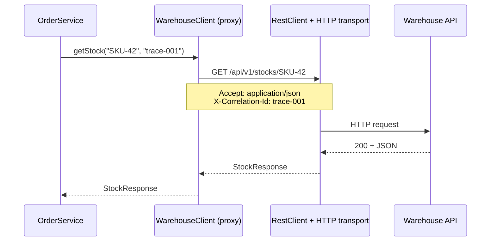

# Khai báo hợp đồng client bằng `@HttpExchange` và các annotation HTTP

## 1. Mục tiêu và bối cảnh

Khi một ứng dụng Spring Boot gọi dịch vụ khác qua HTTP, phần mã gọi đi cần mô tả **hợp đồng tích hợp**: endpoint nào được gọi, phương thức HTTP nào được dùng, tham số nằm ở đâu, nội dung gửi/nhận có cấu trúc gì và lỗi được xử lý thế nào. Việc rải các lời gọi `RestClient.get().uri(...)` hoặc `WebClient.post().bodyValue(...)` khắp business service dễ gây sai lệch về đường dẫn, header và định dạng dữ liệu.

**HTTP Interface** của Spring Framework cho phép khai báo hợp đồng đó dưới dạng Java interface. Các annotation `@HttpExchange`, `@GetExchange`, `@PostExchange`, `@PutExchange`, `@PatchExchange` và `@DeleteExchange` xác định cách chuyển mỗi lời gọi Java thành HTTP request. `HttpServiceProxyFactory` tạo proxy thực thi interface bằng một HTTP client bên dưới.

Ví dụ xuyên suốt bài: `order-service` cần kiểm tra tồn kho và tạo giữ hàng (reservation) ở `warehouse-service`. `order-service` phải truyền mã tương quan, sử dụng khóa chống thực thi trùng khi tạo reservation, cấu hình timeout, nhận kết quả có kiểu và diễn giải lỗi của hệ thống bên ngoài. Đây là một lát cắt của tích hợp Spring Boot qua HTTP, bên cạnh các tích hợp cơ sở dữ liệu, cache, message broker và Spring Integration.

Sau bài học, bạn có thể:

1. Phân biệt hợp đồng HTTP khai báo với phần truyền tải request ở runtime.
2. Dùng annotation ở mức interface, mức method và mức tham số để mô tả đúng request.
3. Tạo Spring bean từ interface qua `RestClientAdapter` hoặc `WebClientAdapter`.
4. Thiết kế DTO, timeout, xác thực, lỗi và idempotency tại ranh giới giữa hai dịch vụ.
5. Kiểm thử URL, method, headers và payload mà không cần gọi dịch vụ thật.

> **Phạm vi phiên bản:** Phần mã minh họa sử dụng Java 17+, Spring Boot 3.2+ với Spring Framework 6.1+ và cách đăng ký proxy thủ công, cũng dùng được trong các thế hệ Spring mới khi API tương thích. Những thuộc tính/chức năng xuất hiện từ Spring Framework 6.2 hoặc hỗ trợ đăng ký tự động của thế hệ 7.x được ghi chú riêng. Cần đối chiếu phiên bản framework thực tế của dự án.

## 2. HTTP Interface hoạt động như thế nào?

Một Java interface chỉ mô tả lời gọi. Khi Spring tạo proxy, mỗi lần gọi method, proxy sẽ:

1. Đọc annotation để xác định HTTP method, URL, header, query và body.
2. Kết hợp URL với `baseUrl`, mở rộng các biến đường dẫn và mã hóa dữ liệu qua HTTP message converters/codecs.
3. Chuyển request cho adapter tương ứng với `RestClient` hoặc `WebClient`.
4. Chuyển HTTP response thành kiểu trả về được khai báo, hoặc phát sinh exception khi lỗi.



Hợp đồng này **không tự tạo HTTP server, không tự đăng ký thành Spring bean, không tự cung cấp retry/circuit breaker** và không thay thế cấu hình xác thực hay kiểm soát giao dịch. Những trách nhiệm đó nằm ở lớp cấu hình client, lớp tích hợp và nghiệp vụ.

### 2.1. Các thành phần

| Thành phần | Trách nhiệm |
| --- | --- |
| Java interface có `@HttpExchange` | Định nghĩa các operation HTTP mà ứng dụng cần sử dụng. |
| Annotation HTTP và annotation tham số | Khai báo request line, query, header, body, cookie, v.v. |
| `HttpServiceProxyFactory` | Sinh proxy triển khai interface và chuyển lời gọi thành request. |
| `RestClientAdapter` | Nối proxy với `RestClient` đồng bộ, phù hợp luồng imperative. |
| `WebClientAdapter` | Nối proxy với `WebClient` reactive, hỗ trợ `Mono`/`Flux`. |
| HTTP request factory/connector | Thực hiện kết nối mạng, TLS, connection pooling và timeout. |
| DTO | Biểu diễn phần hợp đồng dữ liệu trên wire, độc lập với entity lưu trữ nội bộ. |

### 2.2. Dependency tối thiểu

Với dự án Spring Boot 3.2+ kiểu Spring MVC, `spring-boot-starter-web` cung cấp `RestClient`, `@HttpExchange` và các thành phần web cần thiết. Thêm `spring-boot-starter-test` cho kiểm thử. Nếu muốn dùng `WebClient`, cần có `spring-webflux` (thường qua `spring-boot-starter-webflux`); hãy kiểm tra stack đang vận hành trước khi bổ sung.

```xml
<!-- pom.xml: lựa chọn cho client đồng bộ -->
<dependency>
    <groupId>org.springframework.boot</groupId>
    <artifactId>spring-boot-starter-web</artifactId>
</dependency>

<dependency>
    <groupId>org.springframework.boot</groupId>
    <artifactId>spring-boot-starter-test</artifactId>
    <scope>test</scope>
</dependency>
```

Trong ví dụ sẽ dùng `RestClient` để giữ flow đơn giản, sau đó đối chiếu với `WebClient`.

## 3. Khai báo HTTP method, URL và media type

### 3.1. `@HttpExchange` ở mức interface

`@HttpExchange` có thể đặt trên interface để khai báo phần chung cho các method, chẳng hạn prefix URL và kiểu dữ liệu mong muốn:

```java
import org.springframework.http.MediaType;
import org.springframework.web.service.annotation.HttpExchange;

@HttpExchange(
    url = "/api/v1",
    accept = MediaType.APPLICATION_JSON_VALUE
)
public interface WarehouseClient {
    // Các operation sẽ dùng chung prefix /api/v1 và Accept: application/json
}
```

- `url`: một đường dẫn tương đối hoặc URL đầy đủ. URL tương đối được kết hợp với `baseUrl` của client và phần đường dẫn ở method.
- `accept`: giá trị header `Accept`, cho phía server biết representation mà client chấp nhận; có thể chứa nhiều media type.
- `contentType`: header `Content-Type`, cho biết định dạng **request body**. Thường đặt trên các operation có body, không áp dụng đồng loạt cho mọi GET.
- `method`: HTTP method dùng cho `@HttpExchange` tổng quát, ví dụ `@HttpExchange(method = "HEAD", url = "/health")`.
- `headers`: khai báo header tĩnh theo dạng `"X-Client=order-service"` từ **Spring Framework 6.2**; trên 6.1 dùng `@RequestHeader` hoặc cấu hình client thay thế.

Giá trị ở mức method có thể ghi đè cấu hình tương ứng ở mức interface theo quy tắc của annotation. Với các header thay đổi theo từng request (correlation ID, Bearer token, idempotency key), nên dùng tham số `@RequestHeader` hoặc interceptor thay vì giá trị cố định.

### 3.2. Các annotation HTTP chuyên biệt

| Annotation | HTTP method | Tình huống thường gặp |
| --- | --- | --- |
| `@GetExchange` | GET | Lấy thông tin hoặc danh sách. |
| `@PostExchange` | POST | Tạo tài nguyên hoặc gửi lệnh nghiệp vụ. |
| `@PutExchange` | PUT | Thay thế/cập nhật tài nguyên theo hợp đồng PUT. |
| `@PatchExchange` | PATCH | Cập nhật một phần tài nguyên. |
| `@DeleteExchange` | DELETE | Xóa/hủy tài nguyên. |
| `@HttpExchange(method = "...")` | Tùy chọn | HEAD, OPTIONS hoặc HTTP method đặc thù. |

Các annotation chuyên biệt là cách viết ngắn của `@HttpExchange`; thông thường **một method Java chỉ dùng một annotation exchange**. Ví dụ:

```java
@GetExchange("/stocks/{sku}")
StockResponse getStock(@PathVariable("sku") String sku);

@PostExchange(url = "/reservations", contentType = MediaType.APPLICATION_JSON_VALUE)
ReservationResponse reserve(@RequestBody ReservationRequest request);

@HttpExchange(method = "HEAD", url = "/stocks/{sku}")
ResponseEntity<Void> checkStockEndpoint(@PathVariable("sku") String sku);
```

Trong hợp đồng client, `@GetExchange("/stocks/{sku}")` mô tả lời gọi **đi ra**. Đừng nhầm nó với việc khai báo controller bằng `@GetMapping`, cũng đừng mặc định rằng gắn `@HttpExchange` sẽ khiến Spring tự phát hiện và tạo bean.

## 4. Truyền tham số vào HTTP request

Các annotation tham số áp dụng cho method của HTTP Interface:

| Tham số Java | Ý nghĩa trên request | Ví dụ |
| --- | --- | --- |
| `@PathVariable("sku")` | Mở rộng placeholder trong URL. | `/stocks/{sku}` → `/stocks/SKU-42` |
| `@RequestParam("page")` | Thêm query parameter; với form URL encoded có thể thành form data. | `?page=2` |
| `@RequestHeader("X-Correlation-Id")` | Thêm HTTP header động. | `X-Correlation-Id: trace-001` |
| `@RequestBody` | Serialize object thành request body. | JSON của `ReservationRequest` |
| `@RequestPart("file")` | Thêm một part trong multipart request. | File upload |
| `@CookieValue("locale")` | Thêm cookie vào request. | `Cookie: locale=vi` |
| Tham số kiểu `URI` | Đưa URL động vào request; có thể ghi đè URL annotation. | URL từ nguồn cấu hình tin cậy |
| Tham số kiểu `HttpMethod` | Chọn HTTP method tại runtime. | Operation chung đặc biệt |

**Một số quy tắc thiết kế:**

- Ghi tường minh tên trong `@PathVariable("sku")` và `@RequestParam("warehouseId")` để hợp đồng không phụ thuộc vào cách lưu tên tham số trong bytecode.
- Dùng `@RequestParam(name = "page", required = false)` cho tham số thực sự tùy chọn; không truyền `null` cho tham số bắt buộc.
- `@RequestParam` chỉ trở thành form body khi đặt `Content-Type: application/x-www-form-urlencoded`; trong đa số request khác, đây là query parameter. Không coi `@RequestParam` là tương đương `@RequestBody` JSON.
- Với multipart, dùng `@PostExchange(contentType = MediaType.MULTIPART_FORM_DATA_VALUE)` kết hợp `@RequestPart`. File có thể dùng `Resource` và cần chọn client/codec phù hợp để stream nội dung lớn.
- Chỉ cho phép URL động từ danh sách đích tin cậy; việc truyền `URI` tùy ý từ người dùng có thể dẫn đến server-side request forgery (SSRF).
- Những tham số đặc biệt như `@RequestAttribute` phụ thuộc phiên bản và adapter; từ Spring Framework 6.2, `@RequestAttribute` được hỗ trợ với `RestClient` và `WebClient`.

## 5. Ví dụ hoàn chỉnh: hợp đồng client của hệ thống kho

Giả sử API đối tác cung cấp:

| Operation | HTTP request | Dữ liệu |
| --- | --- | --- |
| Xem tồn kho theo SKU | `GET /api/v1/stocks/{sku}` | `StockResponse` |
| Tìm tồn kho theo kho | `GET /api/v1/stocks?warehouseId=HCM-01&page=0` | `StockSearchResponse` |
| Giữ hàng cho đơn | `POST /api/v1/reservations` | `ReservationRequest` → `ReservationResponse` |
| Đổi trạng thái giữ hàng | `PATCH /api/v1/reservations/{id}` | `ReservationStatusPatch` |
| Hủy giữ hàng | `DELETE /api/v1/reservations/{id}` | HTTP status và headers |

### 5.1. DTO là hợp đồng dữ liệu

Các Java record bên dưới biểu diễn JSON của API bên ngoài. Mỗi `public record` được lưu trong **một file Java riêng** với tên tương ứng; đặt chung ở đây để dễ theo dõi.

```java
// StockResponse.java
public record StockResponse(
    String sku,
    String warehouseId,
    int available
) {}

// StockSearchResponse.java
import java.util.List;
public record StockSearchResponse(
    List<StockResponse> items,
    int page,
    int size
) {}

// ReservationRequest.java
public record ReservationRequest(
    String orderId,
    String sku,
    int quantity
) {}

// ReservationResponse.java
public record ReservationResponse(
    String reservationId,
    String status
) {}

// ReservationStatusPatch.java
public record ReservationStatusPatch(
    String status
) {}
```

Không dùng trực tiếp JPA entity làm HTTP DTO: entity có thể chứa trường nội bộ, quan hệ lazy hoặc vòng tham chiếu, và thay đổi schema database không đồng nghĩa với thay đổi API công khai. Khi JSON bên ngoài dùng tên khác, khai báo mapping Jackson như `@JsonProperty` trên DTO; khi API thay đổi cấu trúc đáng kể, cân nhắc adapter chuyển đổi sang domain model nội bộ.

### 5.2. Interface với các annotation HTTP

```java
import org.springframework.http.MediaType;
import org.springframework.http.ResponseEntity;
import org.springframework.web.bind.annotation.PathVariable;
import org.springframework.web.bind.annotation.RequestBody;
import org.springframework.web.bind.annotation.RequestHeader;
import org.springframework.web.bind.annotation.RequestParam;
import org.springframework.web.service.annotation.DeleteExchange;
import org.springframework.web.service.annotation.GetExchange;
import org.springframework.web.service.annotation.HttpExchange;
import org.springframework.web.service.annotation.PatchExchange;
import org.springframework.web.service.annotation.PostExchange;

@HttpExchange(
    url = "/api/v1",
    accept = MediaType.APPLICATION_JSON_VALUE
)
public interface WarehouseClient {

    @GetExchange("/stocks/{sku}")
    StockResponse getStock(
        @PathVariable("sku") String sku,
        @RequestHeader("X-Correlation-Id") String correlationId
    );

    @GetExchange("/stocks")
    StockSearchResponse findStocks(
        @RequestParam("warehouseId") String warehouseId,
        @RequestParam(name = "page", required = false) Integer page
    );

    @PostExchange(
        url = "/reservations",
        contentType = MediaType.APPLICATION_JSON_VALUE
    )
    ResponseEntity<ReservationResponse> createReservation(
        @RequestHeader("Idempotency-Key") String idempotencyKey,
        @RequestBody ReservationRequest request
    );

    @PatchExchange(
        url = "/reservations/{id}",
        contentType = MediaType.APPLICATION_JSON_VALUE
    )
    ReservationResponse updateReservation(
        @PathVariable("id") String reservationId,
        @RequestBody ReservationStatusPatch patch
    );

    @DeleteExchange("/reservations/{id}")
    ResponseEntity<Void> deleteReservation(
        @PathVariable("id") String reservationId
    );
}
```

Ví dụ, `getStock("SKU-42", "trace-001")` chuyển thành:

```http
GET /api/v1/stocks/SKU-42 HTTP/1.1
Host: warehouse.example.internal
Accept: application/json
X-Correlation-Id: trace-001
```

Phản hồi thành công:

```http
HTTP/1.1 200 OK
Content-Type: application/json

{"sku":"SKU-42","warehouseId":"HCM-01","available":12}
```

Lời gọi `createReservation("order-731", new ReservationRequest("ORDER-731", "SKU-42", 2))` được dùng để gửi:

```http
POST /api/v1/reservations HTTP/1.1
Host: warehouse.example.internal
Accept: application/json
Content-Type: application/json
Idempotency-Key: order-731

{"orderId":"ORDER-731","sku":"SKU-42","quantity":2}
```

Kết quả `ResponseEntity<ReservationResponse>` cho phép lấy cả status code, header và body. Phần body có thể rỗng nếu upstream không trả JSON: business service phải tự xác định đây có phải phản hồi hợp lệ theo hợp đồng không.

> **Phân biệt:** Idempotency key chỉ có tác dụng chống tạo trùng nếu phía warehouse thực sự lưu và kiểm tra khóa trong phạm vi thời gian/quy tắc đã thỏa thuận. Việc thêm header ở client tự nó không tạo idempotency. Khi retry một yêu cầu tạo reservation, dùng lại **cùng khóa** cho cùng thao tác logic.

## 6. Tạo client proxy và đăng ký Spring bean

Interface chưa có đối tượng thực thi. Để inject `WarehouseClient` vào service, hãy tạo `RestClient`, bọc nó bằng `RestClientAdapter` rồi sinh proxy.

### 6.1. Cấu hình từ môi trường

`application.yml` minh họa:

```yaml
clients:
  warehouse:
    base-url: https://warehouse.example.internal
    connect-timeout: 2s
    read-timeout: 5s
```

Gắn cấu hình vào record:

```java
import java.net.URI;
import java.time.Duration;
import org.springframework.boot.context.properties.ConfigurationProperties;

@ConfigurationProperties(prefix = "clients.warehouse")
public record WarehouseClientProperties(
    URI baseUrl,
    Duration connectTimeout,
    Duration readTimeout
) {}
```

### 6.2. Tạo `RestClient` với timeout và proxy

```java
import java.net.http.HttpClient;

import org.springframework.boot.context.properties.EnableConfigurationProperties;
import org.springframework.context.annotation.Bean;
import org.springframework.context.annotation.Configuration;
import org.springframework.http.client.JdkClientHttpRequestFactory;
import org.springframework.web.client.RestClient;
import org.springframework.web.client.support.RestClientAdapter;
import org.springframework.web.service.invoker.HttpServiceProxyFactory;

@Configuration(proxyBeanMethods = false)
@EnableConfigurationProperties(WarehouseClientProperties.class)
public class WarehouseClientConfiguration {

    @Bean
    WarehouseClient warehouseClient(
        RestClient.Builder restClientBuilder,
        WarehouseClientProperties properties
    ) {
        HttpClient nativeClient = HttpClient.newBuilder()
            .connectTimeout(properties.connectTimeout())
            .build();

        JdkClientHttpRequestFactory requestFactory =
            new JdkClientHttpRequestFactory(nativeClient);
        requestFactory.setReadTimeout(properties.readTimeout());

        RestClient restClient = restClientBuilder
            .baseUrl(properties.baseUrl().toString())
            .requestFactory(requestFactory)
            .build();

        RestClientAdapter adapter = RestClientAdapter.create(restClient);
        HttpServiceProxyFactory proxyFactory =
            HttpServiceProxyFactory.builderFor(adapter).build();

        return proxyFactory.createClient(WarehouseClient.class);
    }
}
```

Đây là cách đăng ký **thủ công và tường minh**: tạo một bean `WarehouseClient` dành cho warehouse API. Inject `RestClient.Builder` do Boot cung cấp giúp kế thừa cấu hình HTTP message converter/customizer của ứng dụng. Việc chọn `JdkClientHttpRequestFactory` trong ví dụ thể hiện rõ connect timeout và read timeout; nếu tổ chức đã chuẩn hóa HTTP transport, hãy cấu hình factory/connector tương ứng ở một chỗ thay vì mỗi client tự tạo.

Ý nghĩa timeout:

- **Connect timeout** giới hạn thời gian thiết lập kết nối; nó không phải timeout của toàn bộ nghiệp vụ.
- **Read/request timeout** giới hạn thời gian chờ thực thi/đọc phản hồi tùy HTTP transport và API cấu hình; cần đo behavior thực tế của transport dùng trong production.
- Không để timeout vô hạn trong các chuỗi gọi đồng bộ, đặc biệt nếu một request người dùng phải đi qua nhiều dịch vụ liên tiếp.

Với Spring Framework 7.x/Spring Boot 4.x, hệ thống còn có cơ chế nhóm HTTP Service và `@ImportHttpServices` để đăng ký nhiều interface tự động, kèm cấu hình theo group. Cơ chế này phụ thuộc phiên bản; cách tạo proxy ở trên giữ cho bài học áp dụng được với Spring Boot 3.x.

### 6.3. Sử dụng bean trong nghiệp vụ

```java
import java.util.Objects;
import org.springframework.http.ResponseEntity;
import org.springframework.stereotype.Service;

@Service
public class OrderReservationService {
    private final WarehouseClient warehouseClient;

    public OrderReservationService(WarehouseClient warehouseClient) {
        this.warehouseClient = warehouseClient;
    }

    public ReservationResponse reserveForOrder(
        String orderId,
        String sku,
        int quantity
    ) {
        // Khóa ổn định cho một thao tác giữ hàng của đơn.
        String idempotencyKey = "reserve:" + orderId;

        ResponseEntity<ReservationResponse> response =
            warehouseClient.createReservation(
                idempotencyKey,
                new ReservationRequest(orderId, sku, quantity)
            );

        return Objects.requireNonNull(
            response.getBody(),
            "Warehouse trả phản hồi reservation thiếu body"
        );
    }
}
```

Đây là ví dụ tối giản cho một reservation trên một đơn hàng. Nếu một đơn có nhiều đợt giữ hàng hoặc nhiều dòng hàng, phải đưa định danh **thao tác** vào khóa để phân biệt các yêu cầu hợp lệ. Ở hệ thống thực, khóa nên tồn tại ổn định qua restart và retry; không dùng `UUID.randomUUID()` mỗi lần retry.

Nếu bước giữ hàng có liên hệ với ghi database hoặc phát thông điệp:

- Đừng giả định HTTP call từ `@HttpExchange` tự tham gia cùng giao dịch ACID với database của `order-service`.
- Phân biệt lỗi chắc chắn bị từ chối với lỗi chưa biết kết quả (mất kết nối sau khi upstream đã xử lý).
- Với chuỗi nhiều hệ thống, cân nhắc trạng thái nghiệp vụ, outbox, saga/compensation hoặc đối soát để tránh tạo bản ghi lệch.

## 7. Chọn kiểu trả về và runtime đồng bộ/reactive

Kiểu trả về quyết định cách đọc response:

| Kiểu trả về | Ý nghĩa |
| --- | --- |
| `void` | Thực thi request, không lấy body. |
| `T`, ví dụ `StockResponse` | Deserialize body thành object; với lỗi HTTP sẽ theo chính sách error handler. |
| `HttpHeaders` | Lấy response headers. |
| `ResponseEntity<Void>` | Lấy status và headers, không yêu cầu body. |
| `ResponseEntity<T>` | Lấy status, headers và body có kiểu. |
| `Mono<T>`, `Flux<T>` | Trả kết quả reactive khi adapter hỗ trợ Reactor, thường là `WebClientAdapter`. |

`RestClient` là đồng bộ: thread gọi method thường chờ response. `WebClient` hỗ trợ I/O bất đồng bộ theo mô hình reactive và nên dùng kiểu reactive trong flow không chặn. Không khai báo `Mono<T>` trên HTTP Interface dùng `RestClientAdapter` rồi kỳ vọng nó chạy reactive.

Ví dụ thay bằng `WebClient`:

```java
import reactor.core.publisher.Mono;
import org.springframework.web.bind.annotation.PathVariable;
import org.springframework.web.service.annotation.GetExchange;
import org.springframework.web.service.annotation.HttpExchange;

@HttpExchange(url = "/api/v1")
public interface ReactiveWarehouseClient {
    @GetExchange("/stocks/{sku}")
    Mono<StockResponse> getStock(@PathVariable("sku") String sku);
}
```

```java
import org.springframework.web.reactive.function.client.WebClient;
import org.springframework.web.reactive.function.client.support.WebClientAdapter;
import org.springframework.web.service.invoker.HttpServiceProxyFactory;

WebClient webClient = WebClient.builder()
    .baseUrl("https://warehouse.example.internal")
    .build();

ReactiveWarehouseClient client = HttpServiceProxyFactory
    .builderFor(WebClientAdapter.create(webClient))
    .build()
    .createClient(ReactiveWarehouseClient.class);

Mono<StockResponse> stock = client.getStock("SKU-42");
```

Đoạn `WebClient` trên minh họa cơ chế adapter; trong ứng dụng Boot, nên inject `WebClient.Builder` do Boot cấu hình và khai báo thành bean tương tự ví dụ `RestClient`. Để đảm bảo timeout và pool hoạt động như mong muốn, cấu hình connector Reactor Netty/Jetty/JDK đang dùng thay vì chỉ điều chỉnh signature của interface.

## 8. Lỗi HTTP, retry và tính nhất quán của tích hợp

Annotation mô tả đường đi và payload; việc phân loại lỗi vẫn thuộc hợp đồng tích hợp.

### 8.1. Phân biệt lỗi theo trạng thái

| Tình huống | Cách hiểu | Hướng xử lý |
| --- | --- | --- |
| `400 Bad Request` | Client gửi sai schema/validation. | Sửa DTO hoặc mapping, không retry nguyên request. |
| `401/403` | Credential thiếu/hết hạn hoặc không đủ quyền. | Xử lý auth, quyền và rotation token; không retry vô hạn. |
| `404` | Không tìm thấy resource/route. | Chuyển thành “không tồn tại” khi đúng ngữ nghĩa nghiệp vụ; kiểm tra sai path/version. |
| `409 Conflict` | Tranh chấp hoặc vi phạm trạng thái. | Dùng mã lỗi nghiệp vụ; quyết định có cần đọc lại trạng thái. |
| `429 Too Many Requests` | Bị giới hạn tần suất. | Backoff có giới hạn, tôn trọng `Retry-After` nếu upstream hỗ trợ. |
| `5xx` | Upstream lỗi. | Retry có điều kiện, circuit breaker, fallback hoặc queue tùy độ quan trọng. |
| Timeout/network error | Không chắc request đã đến nơi hay đã thành công. | Dùng idempotency key, kiểm tra trạng thái và đối soát trước khi phát lại thao tác có tác dụng phụ. |
| Body thiếu/sai schema | Hợp đồng response bị vi phạm. | Log có kiểm soát, đo lỗi mapping, xử lý theo chính sách tích hợp. |

Khi dùng `RestClient`, response 4xx/5xx mặc định làm phát sinh lỗi thuộc nhóm `RestClientException` (các HTTP status exception thường là `RestClientResponseException` hoặc lớp con như `HttpClientErrorException`). `WebClient` có nhóm `WebClientResponseException`. Lỗi I/O ở `RestClient` thường được biểu diễn qua `ResourceAccessException`. Không gộp mọi exception vào một kết quả như “hết hàng”.

Nếu muốn ánh xạ HTTP lỗi sang lỗi ứng dụng, xử lý tại adapter/service hoặc cấu hình `RestClient.Builder.defaultStatusHandler(...)`:

```java
RestClient restClient = restClientBuilder
    .baseUrl(properties.baseUrl().toString())
    .defaultStatusHandler(
        status -> status.value() == 503,
        (request, response) -> {
            throw new WarehouseUnavailableException("Warehouse đang gián đoạn");
        }
    )
    .build();
```

Ở đây `WarehouseUnavailableException` là exception nghiệp vụ **do ứng dụng tự định nghĩa**; cần bổ sung lớp exception đó nếu áp dụng mã trên. Lưu ý `defaultStatusHandler` ở RestClient xử lý status ở tầng HTTP client, không có thuộc tính tương đương trên chính `@GetExchange`. Với các API trả lỗi kèm JSON có cấu trúc, hãy định nghĩa DTO lỗi và ánh xạ dựa trên body/status thay vì chỉ dựa vào message dạng text.

### 8.2. Retry và idempotency

Không phải request nào cũng nên retry:

- GET thuần đọc thường có thể thử lại có giới hạn với timeout, `429` hoặc một số `5xx`, tùy SLO và độ tải của đối tác.
- POST tạo reservation chỉ an toàn để phát lại nếu bên nhận bảo đảm idempotency theo khóa và xử lý trường hợp cùng khóa/cùng payload.
- PATCH và DELETE phải căn cứ vào hợp đồng của API bên nhận; HTTP method tự nó không đảm bảo thao tác cập nhật một phần có thể phát lại an toàn.
- Dùng exponential backoff, jitter, giới hạn tổng thời gian và concurrency; tránh retry nhân lên theo từng tầng trong một call chain.

**Kịch bản quan trọng:** `order-service` gửi POST, warehouse tạo reservation nhưng kết nối bị ngắt trước khi trả response. Client không biết kết quả. Nếu tạo khóa mới và POST lại, có thể giữ hàng hai lần. Nếu dùng lại khóa hợp lệ, kiểm tra lại trạng thái reservation và upstream triển khai dedup đúng, hệ thống có thể phục hồi an toàn hơn.

### 8.3. Authentication, dữ liệu nhạy cảm và quan sát

- Credential OAuth2/JWT hoặc API key nên đi từ provider bảo mật và được gắn qua interceptor/filter của client khi dùng chung cho nhiều operation; tránh hard-code token trong annotation hay file nguồn.
- Chỉ log URL template, status, latency, correlation/trace ID cần thiết. Không log Bearer token, cookie, dữ liệu cá nhân hoặc toàn bộ request body một cách mặc định.
- Dùng metrics/tracing qua Micrometer/Actuator và cơ chế observation của HTTP client; chọn tag ít biến thể (HTTP method, route template, tên upstream, status), tránh dùng toàn bộ SKU/orderId làm tag metric.
- Cấu hình timeout, pool và giới hạn đồng thời ở HTTP transport; theo dõi p95/p99 latency, timeout rate, error rate và retry rate.
- Với nhiều API đối tác, tách client theo upstream/nhóm cấu hình để tránh chung token, timeout, TLS và error policy một cách vô tình.

## 9. Kiểm thử hợp đồng client

Một HTTP Interface có thể đúng cú pháp Java nhưng vẫn sai URL, media type hoặc cách serialize body. Kiểm thử nên xác nhận **HTTP thực tế được phát ra từ proxy**, thay vì chỉ mock interface và kiểm tra service gọi một method.

### 9.1. Unit/integration test nhẹ với `MockRestServiceServer`

Spring Test cho phép ràng buộc một mock server vào `RestClient.Builder`. Ví dụ sau kiểm tra request GET có đúng path, HTTP method, header và ánh xạ JSON hay không:

```java
import static org.junit.jupiter.api.Assertions.assertEquals;
import static org.springframework.test.web.client.match.MockRestRequestMatchers.header;
import static org.springframework.test.web.client.match.MockRestRequestMatchers.method;
import static org.springframework.test.web.client.match.MockRestRequestMatchers.requestTo;
import static org.springframework.test.web.client.response.MockRestResponseCreators.withSuccess;

import org.junit.jupiter.api.Test;
import org.springframework.http.HttpMethod;
import org.springframework.http.MediaType;
import org.springframework.test.web.client.MockRestServiceServer;
import org.springframework.web.client.RestClient;
import org.springframework.web.client.support.RestClientAdapter;
import org.springframework.web.service.invoker.HttpServiceProxyFactory;

class WarehouseClientContractTest {

    @Test
    void getStockSendsExpectedRequestAndDecodesResponse() {
        RestClient.Builder builder = RestClient.builder()
            .baseUrl("https://warehouse.test");
        MockRestServiceServer server =
            MockRestServiceServer.bindTo(builder).build();

        WarehouseClient client = HttpServiceProxyFactory
            .builderFor(RestClientAdapter.create(builder.build()))
            .build()
            .createClient(WarehouseClient.class);

        server.expect(requestTo(
                "https://warehouse.test/api/v1/stocks/SKU-42"))
            .andExpect(method(HttpMethod.GET))
            .andExpect(header("Accept", "application/json"))
            .andExpect(header("X-Correlation-Id", "trace-001"))
            .andRespond(withSuccess(
                """
                {"sku":"SKU-42","warehouseId":"HCM-01","available":12}
                """,
                MediaType.APPLICATION_JSON
            ));

        StockResponse result = client.getStock("SKU-42", "trace-001");

        assertEquals("SKU-42", result.sku());
        assertEquals(12, result.available());
        server.verify();
    }
}
```

Mock server phải được bind vào **cùng builder trước khi gọi `build()`**. Nếu test kết nối tới một `RestClient` khác, expectation sẽ không quan sát được request.

### 9.2. Bộ trường hợp nên có

1. **Positive:** GET/POST/PATCH/DELETE đúng URL, HTTP method, query, path variables, headers và content type; body decode đúng record.
2. **Optional/encoding:** query parameter không bắt buộc, khoảng trắng/ký tự Unicode trong path/query, nhiều giá trị query, trường JSON tùy chọn.
3. **Negative:** `400`, `404`, `409`, `429`, `5xx`, timeout, malformed JSON, body rỗng không hợp lệ.
4. **Retry/dedup:** cùng idempotency key phải được giữ nguyên trong retry của một thao tác; không vô tình tạo request ghi kép.
5. **Contract thật:** đối chiếu với OpenAPI/provider contract hoặc môi trường test đối tác, đặc biệt sau khi API nâng version.
6. **Observability:** xác nhận log không lộ token, metrics/trace có nhãn hợp lý và timeout được áp dụng đúng transport.

`MockRestServiceServer` phù hợp để kiểm tra cách proxy tạo request. Khi cần kiểm tra TLS, proxy, connection pooling hoặc tính tương thích với một HTTP server thật, dùng mock HTTP server chạy cổng cục bộ (ví dụ WireMock/MockWebServer) hoặc môi trường integration test phù hợp.

## 10. Những lỗi thiết kế thường gặp

| Sai lầm | Hệ quả | Cách khắc phục |
| --- | --- | --- |
| Khai báo interface rồi `@Autowired` ngay | Không có bean proxy nếu chưa đăng ký. | Tạo bean bằng `HttpServiceProxyFactory` hoặc cơ chế HTTP Service registration được phiên bản hỗ trợ. |
| Dùng `@GetMapping` cho client interface | Annotation server mapping không phải hợp đồng proxy HTTP Interface. | Dùng `@GetExchange`/`@HttpExchange`. |
| Nhầm `Accept` và `Content-Type` | Server gửi/trả representation không mong đợi. | `accept` mô tả response mong muốn, `contentType` mô tả request body. |
| Truyền `@RequestParam` rồi chờ JSON body | Request được encode thành query/form khác kỳ vọng. | Dùng `@RequestBody` và xác định JSON content type. |
| Nhầm `ResponseEntity<T>` sẽ bắt mọi lỗi 4xx/5xx | Exception phát sinh trước khi mã nghiệp vụ đọc status. | Cấu hình HTTP error handler hoặc bắt exception phù hợp. |
| Dùng `Mono<T>` trên `RestClientAdapter` | Không tương thích cách vận hành reactive. | Dùng `WebClientAdapter` và kiểu trả về reactive. |
| Đọc timeout/URL cố định trong source | Khó đổi theo môi trường, tăng rủi ro production. | Externalize configuration và áp policy theo upstream. |
| Retry POST với khóa mới | Có thể tạo reservation/trừ tiền hai lần. | Khóa idempotency ổn định, dedup phía nhận, đối soát trạng thái. |
| Dùng domain/JPA entity làm HTTP DTO | Rò rỉ trường nội bộ và coupling schema. | DTO riêng, mapping tại ranh giới tích hợp. |
| Coi mọi lỗi upstream là lỗi người dùng | Sai ngữ nghĩa API nội bộ và khó chẩn đoán. | Phân loại lỗi nghiệp vụ, mạng, xác thực và sự cố upstream. |

## 11. Thực hành áp dụng vào hệ thống

Khi thêm một HTTP Interface mới, thực hiện theo trình tự:

1. **Đọc hợp đồng upstream:** endpoint, phiên bản API, body schema, response/status, auth, rate limit, idempotency, behavior khi timeout.
2. **Tạo DTO theo wire contract:** phân biệt JSON nhận/gửi với entity và business model; xác định trường bắt buộc/tùy chọn.
3. **Viết interface:** prefix chung qua `@HttpExchange`, từng method qua `@GetExchange`/`@PostExchange`..., tham số có tên tường minh.
4. **Đăng ký proxy:** chọn `RestClient` hoặc `WebClient` theo kiến trúc; bind `baseUrl`, TLS, timeout, auth, error handling.
5. **Gọi qua lớp tích hợp:** không để controller hoặc domain service phụ thuộc trực tiếp vào chi tiết HTTP lỗi; chuyển đổi dữ liệu và lỗi tại biên.
6. **Kiểm thử request được tạo:** xác nhận cả trường hợp thành công, lỗi, encoding và khả năng khôi phục sau timeout.
7. **Quan sát vận hành:** giám sát latency/error/retry, correlation ID, kiểm soát payload nhạy cảm và kiểm thử nâng phiên bản API.

**Tự kiểm tra kiến thức:**

- Nếu đặt `@HttpExchange(url = "/api/v1")` ở interface và `@GetExchange("/stocks/{sku}")` ở method, URL sau cùng hình thành từ đâu?
- Vì sao `@RequestParam` không thay thế `@RequestBody` trong POST JSON?
- Khi một POST bị timeout nhưng bên nhận có thể đã xử lý thành công, điều gì phải giữ nguyên ở lần retry?
- `ResponseEntity<ReservationResponse>` cho biết những gì mà `ReservationResponse` riêng lẻ không cho biết?
- Nếu ứng dụng dùng thread-per-request với Spring MVC, khi nào `RestClient` là lựa chọn đơn giản hơn `WebClient`? Khi nào cần đánh giá reactive end-to-end?

## 12. Tài liệu tham khảo

- [Spring Framework — REST Clients và HTTP Interface (6.2)](https://docs.spring.io/spring-framework/reference/6.2/integration/rest-clients.html): tạo proxy, annotation tham số, kiểu trả về và error handling.
- [Spring Framework — HTTP Service Clients (tài liệu hiện hành)](https://docs.spring.io/spring-framework/reference/integration/rest-clients.html): HTTP Service Groups, khả năng đăng ký và API theo phiên bản hiện tại.
- [Spring Framework — `@HttpExchange` Javadoc (6.2)](https://docs.spring.io/spring-framework/docs/6.2.16/javadoc-api/org/springframework/web/service/annotation/HttpExchange.html): thuộc tính `url`, `method`, `accept`, `contentType`, `headers`.
- [Spring Boot — Calling REST Services](https://docs.spring.io/spring-boot/reference/io/rest-client.html): `RestClient.Builder`, `WebClient.Builder` và cấu hình HTTP client của Boot.
- [Spring Framework — `MockRestServiceServer` Javadoc](https://docs.spring.io/spring-framework/docs/6.2.18/javadoc-api/org/springframework/test/web/client/MockRestServiceServer.html): bind mock server vào `RestClient.Builder` để kiểm thử request.
