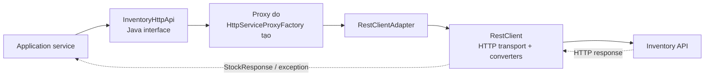
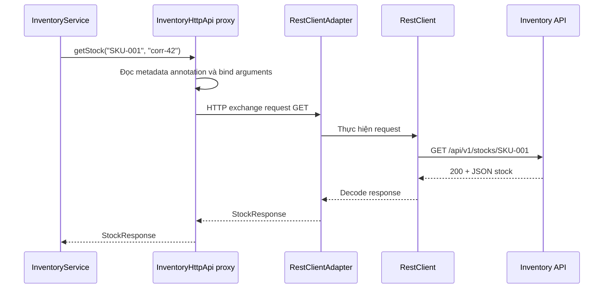
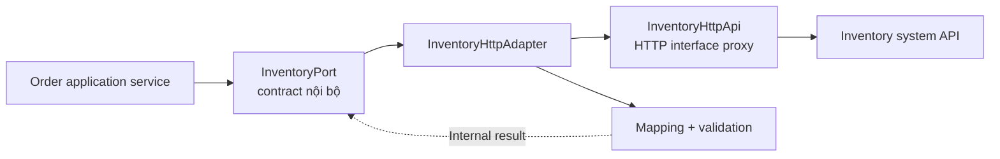
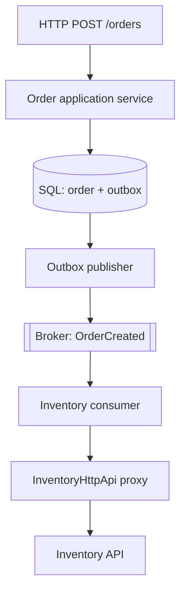

# HttpServiceProxyFactory và cơ chế tạo proxy cho interface

Khi một ứng dụng Spring Boot tích hợp với dịch vụ tồn kho, cổng thanh toán hoặc hệ thống vận chuyển, mã gọi HTTP thường phải lặp lại cùng một việc: ghép URL, chọn HTTP method, truyền path/query/header, serialize JSON, đọc response và xử lý lỗi. **HTTP interface** của Spring Framework cho phép mô tả hợp đồng gọi HTTP bằng một **Java interface có annotation**. `HttpServiceProxyFactory` tạo đối tượng triển khai interface đó ở runtime, rồi chuyển lời gọi phương thức thành HTTP request thông qua client adapter.

Bài thuộc chương **HTTP interface** của module **SPRING_BOOT_INTEGRATION**. Module hướng đến tổ chức tích hợp hệ thống qua HTTP client, SQL, cache, broker và các adapter của Spring Integration; vì vậy chúng ta không chỉ tạo được proxy, mà còn xem xét hợp đồng dữ liệu, cấu hình, timeout, lỗi mạng, idempotency, kiểm thử và quan sát luồng tích hợp.

> **Phạm vi phiên bản:** Ví dụ chính dùng Spring Boot **3.2+**, Spring Framework **6.1+**, Java 17+ với `RestClient` và HTTP Service Interface. API khởi tạo builder, các adapter được hỗ trợ và khả năng tự cấu hình có thể khác giữa các phiên bản Spring; khi dùng Spring Boot 4/Spring Framework 7, cần đối chiếu tài liệu API của phiên bản thực tế. Bài nêu rõ đường đi dùng trong ví dụ thay vì giả định framework tự tạo mọi interface bean.

## 1. Mục tiêu học tập

Sau bài này, bạn có thể:

1. Giải thích vì sao Spring tạo HTTP proxy từ interface và lúc nào HTTP request thực sự xảy ra.
2. Phân biệt vai trò của `@HttpExchange`, `@GetExchange`, `@PostExchange`, `HttpServiceProxyFactory`, `RestClientAdapter` và `WebClientAdapter`.
3. Tạo client theo hợp đồng với `@PathVariable`, `@RequestParam`, `@RequestHeader`, `@RequestBody` và kiểu trả về thích hợp.
4. Cấu hình `RestClient` cho endpoint, timeout và cách tạo bean proxy bằng `@Configuration`.
5. Tách HTTP contract khỏi nghiệp vụ, phân loại lỗi, áp dụng retry/idempotency đúng phạm vi.
6. Kiểm thử proxy với mock HTTP server và lên kế hoạch kiểm thử tích hợp đối với hệ thống đối tác.
7. Theo dõi độ trễ, mã HTTP, timeout và trace khi một interface được dùng trong luồng Spring Boot.

## 2. Vấn đề trước khi có HTTP service interface

Một cách gọi API phổ biến là dùng client tường minh tại từng service:

```java
StockResponse response = restClient.get()
        .uri("/api/v1/stocks/{sku}", sku)
        .header("X-Correlation-Id", correlationId)
        .retrieve()
        .body(StockResponse.class);
```

Cách này hoàn toàn hợp lệ. Tuy nhiên, nếu có vài chục API của cùng đối tác, mã ứng dụng có thể phải lặp lại phương thức HTTP, URL, header và kiểu phản hồi. Việc đọc service cũng khó nhận ra **hợp đồng tích hợp gồm những operation nào**.

Với HTTP interface, ta có thể mô tả:

```java
@HttpExchange("/api/v1")
interface InventoryHttpApi {

    @GetExchange("/stocks/{sku}")
    StockResponse getStock(
            @PathVariable("sku") String sku,
            @RequestHeader("X-Correlation-Id") String correlationId);
}
```

Khi đó mã nghiệp vụ chỉ cần gọi `inventoryApi.getStock("SKU-001", "corr-42")`. Spring dùng metadata của interface để tạo request GET tương ứng.

**Điều quan trọng:** HTTP interface là một *HTTP client contract*; nó không có nghĩa ứng dụng tự cung cấp server endpoint tương ứng. Nó cũng không đồng nghĩa với OpenFeign, JPA repository, RPC bảo đảm giao dịch hay cơ chế phát message. Đây là một lớp khai báo mỏng nằm trên một HTTP client thực tế.

## 3. Các thành phần tham gia và trách nhiệm

| Thành phần | Trách nhiệm | Ví dụ |
| --- | --- | --- |
| **Interface hợp đồng** | Khai báo những operation HTTP mà ứng dụng cần | `InventoryHttpApi` |
| **`@HttpExchange`** | Metadata chung như URL prefix, media type | `@HttpExchange("/api/v1")` |
| **`@GetExchange`, `@PostExchange`...** | HTTP method và URL của từng operation | `@GetExchange("/stocks/{sku}")` |
| **Annotation tham số** | Bind argument Java vào request | `@PathVariable`, `@RequestHeader`, `@RequestBody` |
| **`HttpServiceProxyFactory`** | Đọc metadata interface và tạo proxy gọi HTTP | `factory.createClient(InventoryHttpApi.class)` |
| **HTTP exchange adapter** | Nối cơ chế proxy với HTTP client cụ thể | `RestClientAdapter`, `WebClientAdapter` |
| **HTTP client** | Tạo/gửi request, kết nối, encode/decode, xử lý response | `RestClient` hoặc `WebClient` |
| **Transport / remote API** | Giao tiếp mạng và thực thi nghiệp vụ bên ngoài | HTTPS tới Inventory Service |

Sơ đồ:



`HttpServiceProxyFactory` **không gửi request lúc gọi `createClient(...)`**. Nó tạo một proxy. **Khi một phương thức HTTP interface được gọi**, proxy mới xử lý argument, tạo exchange và để client adapter thực hiện giao tiếp. Việc tạo bean thành công vì vậy chưa chứng minh API bên ngoài đang khả dụng.

## 4. Cơ chế tạo proxy ở runtime

### 4.1. Từ Java interface thành lời gọi HTTP

Dòng chảy khái niệm:

1. Ứng dụng tạo `RestClient` với base URL, request factory, message converter và các cấu hình chung.
2. `RestClientAdapter` cung cấp cầu nối từ tầng HTTP Service Interface đến `RestClient`.
3. `HttpServiceProxyFactory.builderFor(adapter).build()` tạo factory được gắn với adapter.
4. `factory.createClient(InventoryHttpApi.class)` phân tích các phương thức có metadata `@HttpExchange` và tạo proxy triển khai interface.
5. Khi gọi `getStock("SKU-001", "corr-42")`, proxy lấy metadata `GET /stocks/{sku}`, bind `sku` vào path, gắn header và gửi qua adapter.
6. Response được giải mã theo kiểu trả về; HTTP status/transport error được xử lý theo hành vi của HTTP client và cấu hình đã cài.



Trong cách triển khai của Spring, proxy runtime gắn các phương thức được khai báo vào cơ chế xử lý invocation. Không cần tự viết implementation như `InventoryHttpApiImpl` cho mọi endpoint, nhưng **vẫn cần khai báo một bean proxy hoặc cơ chế đăng ký tương đương** theo phiên bản đang dùng.

### 4.2. Proxy không tự thay thế những trách nhiệm nào?

Không có cơ sở để suy ra một interface được annotate sẽ tự có:

- Chứng thực OAuth2/API key, TLS phù hợp, hoặc kiểm soát quyền của người gọi.
- Retry, circuit breaker, rate limit, bulkhead và deadline end-to-end.
- Phân loại lỗi nghiệp vụ: 404 là "không có hàng" hay "sai contract"?
- Idempotency cho các thao tác tạo đơn/giữ hàng.
- Cache, SQL transaction hoặc cơ chế chống gửi trùng.
- Logging an toàn, metrics, correlation ID và distributed tracing đầy đủ.
- Validation ngữ nghĩa của DTO hoặc tương thích schema với đối tác.

Đây là trách nhiệm của cấu hình HTTP client, application service, adapter tích hợp và hợp đồng vận hành.

## 5. Các annotation HTTP interface thường dùng

### 5.1. Khai báo phương thức, URL và media type

Ví dụ interface nhiều operation:

```java
package com.example.integration.inventory;

import org.springframework.http.ResponseEntity;
import org.springframework.web.bind.annotation.PathVariable;
import org.springframework.web.bind.annotation.RequestBody;
import org.springframework.web.bind.annotation.RequestHeader;
import org.springframework.web.bind.annotation.RequestParam;
import org.springframework.web.service.annotation.GetExchange;
import org.springframework.web.service.annotation.HttpExchange;
import org.springframework.web.service.annotation.PostExchange;

@HttpExchange(url = "/api/v1", accept = "application/json")
public interface InventoryHttpApi {

    @GetExchange("/stocks/{sku}")
    StockResponse getStock(
            @PathVariable("sku") String sku,
            @RequestHeader("X-Correlation-Id") String correlationId);

    @GetExchange("/stocks")
    StockResponse[] findStock(
            @RequestParam("warehouse") String warehouse,
            @RequestParam("sku") String sku);

    @PostExchange(url = "/reservations", contentType = "application/json")
    ResponseEntity<ReservationResponse> createReservation(
            @RequestHeader("Idempotency-Key") String idempotencyKey,
            @RequestBody ReservationRequest request);
}
```

Ý nghĩa:

- `@HttpExchange` đặt URL prefix và loại nội dung chấp nhận, để các method không phải lặp lại.
- `@GetExchange`, `@PostExchange` là các annotation chuyên biệt cho HTTP method. Còn có `@PutExchange`, `@PatchExchange`, `@DeleteExchange` tương ứng.
- `@PathVariable("sku")` bind biến path bằng URI template. Không ghép raw chuỗi URL từ dữ liệu ngoài.
- `@RequestParam` thêm tham số query với tên đã quy định.
- `@RequestHeader` gắn header truyền theo từng lời gọi.
- `@RequestBody` truyền DTO thành body, thường được serialize thành JSON bởi message converter phù hợp.
- `ResponseEntity<ReservationResponse>` cho phép quan sát status code và response headers khi hợp đồng cần.

### 5.2. DTO của hệ thống bên ngoài

**`StockResponse.java`**

```java
package com.example.integration.inventory;

import java.time.Instant;

public record StockResponse(
        String sku,
        Integer availableQuantity,
        Instant updatedAt
) {}
```

**`ReservationRequest.java`**

```java
package com.example.integration.inventory;

public record ReservationRequest(
        String orderId,
        String sku,
        int quantity
) {}
```

**`ReservationResponse.java`**

```java
package com.example.integration.inventory;

public record ReservationResponse(
        String reservationId,
        String status
) {}
```

Các record này mô tả **contract của Inventory API trong ví dụ**, không phải database entity của hệ thống đang tích hợp. Trong ứng dụng thực, cần quy định:

- Trường nào bắt buộc, giới hạn số, quy tắc null và đơn vị.
- `updatedAt` dùng ISO 8601 có offset/UTC; với kiểu `Instant`, cấu hình Jackson cần hỗ trợ Java time.
- `quantity` có thể âm hay bằng 0 không? Ai xác minh điều kiện nghiệp vụ?
- `status` của reservation gồm những giá trị nào? Có tương thích khi đối tác thêm giá trị mới không?
- Response khi thiếu dữ liệu, lỗi version hoặc trạng thái bất định được biểu diễn ra sao?

Jackson và message converter thực hiện deserialize dữ liệu; **deserialize thành công chưa chắc hợp đồng nghiệp vụ đã hợp lệ**. Có thể cần mapping DTO bên ngoài sang mô hình nội bộ và validation tại biên adapter.

### 5.3. Cách trả kết quả và điều cần cân nhắc

| Kiểu trả về | Ý nghĩa và bối cảnh |
| --- | --- |
| `StockResponse` | Chỉ quan tâm body khi có phản hồi hợp lệ |
| `ResponseEntity<ReservationResponse>` | Cần status code/header kèm body |
| `ResponseEntity<Void>` | Cần status/header, không cần body |
| `void` | Không cần đọc response body; vẫn có thể phát sinh lỗi HTTP/transport |
| `Mono<StockResponse>` | Mô hình reactive khi kết hợp HTTP interface với adapter thích hợp, như `WebClientAdapter` |

Với API trả `204 No Content`, không nên thiết kế code mặc nhiên truy cập body không-null. Nếu cần xử lý `404` thành Optional hoặc domain result, thực hiện **chuyển đổi lỗi có chủ đích**; đừng mặc định client sinh Optional theo chính sách nghiệp vụ.

## 6. Thêm dependency và đăng ký HTTP proxy

### 6.1. Dependency theo stack

Ví dụ **Gradle (Groovy DSL)** cho Spring Boot 3.2+ với RestClient đồng bộ:

```groovy
dependencies {
    implementation 'org.springframework.boot:spring-boot-starter-web'
    testImplementation 'org.springframework.boot:spring-boot-starter-test'
}
```

Starter web đưa vào các thành phần cần thiết của Spring Web, JSON message conversion và hỗ trợ tạo `RestClient` trong cấu hình Spring Boot thông thường. Nếu không xây MVC server, có thể quản lý dependency HTTP client theo cách khác phù hợp dự án; ví dụ dùng starter web cho một hướng dẫn tối thiểu.

Nếu ứng dụng sử dụng **WebClient** và trả về `Mono`/`Flux`, cần hạ tầng Spring WebFlux phù hợp, thường thông qua `spring-boot-starter-webflux`.

**Lưu ý:** Thêm starter không làm mọi `@HttpExchange` interface tự biến thành bean trong mọi phiên bản Spring Boot. Ví dụ tiếp theo tạo bean proxy **rõ ràng**.

### 6.2. Khai báo cấu hình base URL và timeout

Ví dụ `application.yml`:

```yaml
integration:
  inventory:
    base-url: ${INVENTORY_BASE_URL}
    connect-timeout-ms: 2000
    read-timeout-ms: 5000
```

Bắt buộc cung cấp `INVENTORY_BASE_URL` tại môi trường chạy (ví dụ `https://inventory.internal.example`, chỉ là domain minh họa). Lấy token/credential từ môi trường hoặc secret manager và cấu hình HTTP client phù hợp. Không hardcode secret trong interface.

Với HTTP client đồng bộ, cần **phân biệt**:

- **Connect timeout:** giới hạn thời gian mở kết nối ban đầu tới hệ thống đích.
- **Read/response timeout:** giới hạn chờ đọc response theo cơ chế request factory/client thực tế.
- **Deadline nghiệp vụ:** tổng ngân sách thời gian cho một operation có thể bao gồm nhiều bước, retry và thời gian chờ ở các tài nguyên khác.

Hai timeout cơ bản không đồng nghĩa đã có **deadline end-to-end**. Nếu thêm retry, tổng thời gian có thể vượt quá một lần read timeout.

### 6.3. Tạo bean proxy bằng HttpServiceProxyFactory

**`InventoryHttpClientConfiguration.java`**

```java
package com.example.integration.inventory;

import org.springframework.beans.factory.annotation.Value;
import org.springframework.context.annotation.Bean;
import org.springframework.context.annotation.Configuration;
import org.springframework.http.client.SimpleClientHttpRequestFactory;
import org.springframework.web.client.RestClient;
import org.springframework.web.client.support.RestClientAdapter;
import org.springframework.web.service.invoker.HttpServiceProxyFactory;

@Configuration
public class InventoryHttpClientConfiguration {

    @Bean
    InventoryHttpApi inventoryHttpApi(
            RestClient.Builder builder,
            @Value("${integration.inventory.base-url}") String baseUrl,
            @Value("${integration.inventory.connect-timeout-ms}") int connectMs,
            @Value("${integration.inventory.read-timeout-ms}") int readMs) {

        var requestFactory = new SimpleClientHttpRequestFactory();
        requestFactory.setConnectTimeout(connectMs);
        requestFactory.setReadTimeout(readMs);

        RestClient restClient = builder
                .baseUrl(baseUrl)
                .requestFactory(requestFactory)
                .build();

        var adapter = RestClientAdapter.create(restClient);
        HttpServiceProxyFactory factory = HttpServiceProxyFactory
                .builderFor(adapter)
                .build();

        return factory.createClient(InventoryHttpApi.class);
    }
}
```

Ở đây:

1. Spring Boot cấp `RestClient.Builder` được cấu hình theo hệ sinh thái Spring. Ta tạo **một client riêng cho Inventory API** với base URL và timeout của nó.
2. `SimpleClientHttpRequestFactory` minh họa cách đặt connect/read timeout. Trong hệ thống cần HTTP connection pool, proxy, TLS hoặc policy chuyên biệt, có thể dùng request factory khác (ví dụ dựa trên Apache HttpClient) và cấu hình tài nguyên tương ứng.
3. `RestClientAdapter.create(restClient)` biến client thành adapter mà factory hiểu được.
4. `HttpServiceProxyFactory.builderFor(adapter).build().createClient(InventoryHttpApi.class)` là bước **tạo proxy runtime**.
5. Bean trả về có kiểu `InventoryHttpApi`, cho phép application service inject interface mà không cần biết cách dựng HTTP client.

**Phân biệt rõ:** `@Bean` nói với Spring cách tạo một bean. `HttpServiceProxyFactory` tạo **đối tượng proxy** triển khai interface. Hai cơ chế làm việc cùng nhau nhưng có vai trò riêng.

### 6.4. Gọi proxy ở tầng nghiệp vụ

**`InventoryApplicationService.java`**

```java
package com.example.integration.inventory;

import org.springframework.stereotype.Service;

@Service
public class InventoryApplicationService {

    private final InventoryHttpApi inventoryApi;

    public InventoryApplicationService(InventoryHttpApi inventoryApi) {
        this.inventoryApi = inventoryApi;
    }

    public StockResponse currentStock(
            String sku, String correlationId) {
        if (sku == null || sku.isBlank()) {
            throw new IllegalArgumentException("sku là bắt buộc");
        }
        return inventoryApi.getStock(sku, correlationId);
    }
}
```

`InventoryApplicationService` chỉ biết hợp đồng Java đã được inject. Với test nghiệp vụ, có thể giả lập `InventoryHttpApi`; với test HTTP client, tạo proxy thật rồi dùng mock server để xác nhận request.

Tuy nhiên, với hệ thống có nhiều đối tác, việc để application service dùng trực tiếp DTO của Inventory API có thể làm tăng phụ thuộc vào contract bên ngoài. Khi cần, thêm **port nội bộ** hoặc adapter có mapper `StockResponse → InventoryAvailability`, để domain code chỉ dựa vào mô hình của ứng dụng.

## 7. Khi nào dùng RestClientAdapter và WebClientAdapter?

### 7.1. RestClientAdapter cho lời gọi đồng bộ

`RestClient` cung cấp API HTTP đồng bộ của Spring Framework 6.1+. Một lời gọi:

```java
StockResponse response =
        inventoryHttpApi.getStock("SKU-001", "corr-42");
```

thường giữ luồng hiện tại trong thời gian chờ HTTP hoàn tất. Mô hình này phù hợp khi:

- Ứng dụng Spring MVC hoặc tác vụ background được thiết kế theo blocking I/O.
- Phía gọi cần kết quả ngay để đưa ra quyết định.
- Mức đồng thời, thread pool và timeout được cân đối theo năng lực hạ tầng.

Nếu đối tác chậm, lời gọi sẽ giữ một thread và tài nguyên chờ kết quả. Do đó, giới hạn concurrency, connection pool, timeout và circuit breaker có thể quan trọng hơn việc chỉ thay cú pháp gọi HTTP.

### 7.2. WebClientAdapter cho mô hình reactive

Ví dụ interface trả về reactive type:

```java
package com.example.integration.inventory;

import org.springframework.web.bind.annotation.PathVariable;
import org.springframework.web.service.annotation.GetExchange;
import org.springframework.web.service.annotation.HttpExchange;
import reactor.core.publisher.Mono;

@HttpExchange("/api/v1")
public interface ReactiveInventoryHttpApi {

    @GetExchange("/stocks/{sku}")
    Mono<StockResponse> getStock(@PathVariable("sku") String sku);
}
```

Cấu hình tương ứng:

```java
import org.springframework.context.annotation.Bean;
import org.springframework.context.annotation.Configuration;
import org.springframework.web.reactive.function.client.WebClient;
import org.springframework.web.reactive.function.client.support.WebClientAdapter;
import org.springframework.web.service.invoker.HttpServiceProxyFactory;

@Configuration
class ReactiveInventoryConfiguration {

    @Bean
    ReactiveInventoryHttpApi reactiveInventoryHttpApi(
            WebClient.Builder webClientBuilder) {

        WebClient client = webClientBuilder
                .baseUrl("https://inventory.example.test")
                .build();

        return HttpServiceProxyFactory
                .builderFor(WebClientAdapter.create(client))
                .build()
                .createClient(ReactiveInventoryHttpApi.class);
    }
}
```

Đây là **ví dụ đối chiếu adapter**, chưa phải cấu hình production: base URL cần chuyển thành property, bổ sung authentication, timeout và mức đồng thời phù hợp. Khi dùng `Mono`/`Flux`, các tầng tiếp theo nên duy trì cách xử lý reactive và error signal rõ ràng; không gọi `block()` bừa bãi trên luồng event loop.

### 7.3. So sánh

| Tiêu chí | RestClient + proxy | WebClient + proxy |
| --- | --- | --- |
| Mô hình API | Đồng bộ/blocking | Reactive khi sử dụng `Mono`/`Flux` |
| Tầng ứng dụng phù hợp | Spring MVC, job đồng bộ | WebFlux, luồng I/O async/reactive |
| Kiểu trả về điển hình | DTO, `ResponseEntity<T>` | `Mono<T>`, `Flux<T>` |
| Xử lý lỗi | Exception thông thường | Error signal trong reactive pipeline |
| Điều cần kiểm soát | Thread, pool, timeout, retry | Connection, backpressure, scheduler, timeout, retry |
| Không tự có | Auth, circuit breaker, idempotency | Auth, circuit breaker, idempotency |

Chọn theo kiến trúc ứng dụng và yêu cầu về độ trễ/tải thực tế. HTTP interface chỉ cung cấp **cách khai báo lời gọi**, không tự làm thay đổi cơ chế I/O của client nền.

## 8. Hợp đồng dữ liệu và biến đổi giữa các hệ thống

Giả sử Inventory API trả:

```json
{
  "sku": "SKU-001",
  "availableQuantity": 8,
  "updatedAt": "2026-11-21T02:10:00Z"
}
```

Ứng dụng nội bộ có thể cần:

```json
{
  "productCode": "SKU-001",
  "reservable": true,
  "stockCheckedAt": "2026-11-21T02:10:00Z"
}
```

Việc chuyển `availableQuantity > 0` thành `reservable` là **quy tắc nghiệp vụ** có thể cần thêm điều kiện: số lượng dự trữ, kho phù hợp, thời điểm hết hạn hoặc số lượng yêu cầu. Đó không phải công việc tự động của `HttpServiceProxyFactory`.

Mô hình khuyến nghị cho hệ thống có nhiều adapter:



Tầng adapter có thể:

1. Chuyển input miền nghiệp vụ sang path/query/body của API ngoài.
2. Gọi interface proxy.
3. Kiểm tra schema và dữ liệu phản hồi.
4. Chuẩn hóa enum, đơn vị đo, thời điểm và mã lỗi.
5. Trả một kiểu kết quả nội bộ với ngữ nghĩa rõ ràng.

Quản lý version contract theo lịch triển khai của đối tác. Thêm field JSON tùy chọn khác với đổi ý nghĩa field hiện có. Với trường quan trọng, không nên âm thầm dùng giá trị mặc định như `availableQuantity = 0` khi upstream không gửi trường, vì có thể che lỗi mapping.

## 9. Xử lý lỗi HTTP và sự không chắc chắn

### 9.1. Lỗi tại các tầng khác nhau

Một operation qua proxy có thể thất bại ở nhiều vị trí:

| Tầng | Tình huống | Hướng xử lý |
| --- | --- | --- |
| Bind/serialize | Thiếu tham số, body không serialize được | Sửa contract/mapping; không retry dữ liệu sai |
| Transport | DNS, kết nối bị từ chối, TLS lỗi | Xác định lỗi tạm thời hay cấu hình cố định |
| Timeout | Chờ kết nối hoặc phản hồi quá lâu | Phân biệt operation có thể đã được phía đích xử lý |
| HTTP 4xx | 400, 401, 403, 404, 409, 429 | Ánh xạ theo hợp đồng nghiệp vụ; không retry chung mọi 4xx |
| HTTP 5xx | 500, 502, 503 | Có thể retry có kiểm soát nếu an toàn |
| Deserialize | JSON sai kiểu/khác schema | Contract error; có cảnh báo và kiểm thử tương thích |
| Semantic | Status/mã nghiệp vụ không hợp lệ | Báo lỗi/mapping riêng; không xem như success |

Với `RestClient` mặc định, các status lỗi 4xx/5xx thường trở thành ngoại lệ dạng `RestClientResponseException` và các subtype. Lỗi network có thể được bọc trong ngoại lệ client/transport tương ứng, ví dụ `ResourceAccessException`. Chính xác loại ngoại lệ phụ thuộc cấu hình request factory và status handler; kiểm thử lỗi thực tế là cần thiết.

### 9.2. Ví dụ phân loại 404 ở tầng adapter

Nếu API quy định **404 có nghĩa SKU không tồn tại**, adapter có thể chuyển thành kết quả nội bộ `Optional.empty()`:

```java
package com.example.integration.inventory;

import java.util.Optional;

import org.springframework.stereotype.Component;
import org.springframework.web.client.HttpClientErrorException;

@Component
public class InventoryLookupAdapter {

    private final InventoryHttpApi api;

    public InventoryLookupAdapter(InventoryHttpApi api) {
        this.api = api;
    }

    public Optional<StockResponse> find(
            String sku, String correlationId) {
        try {
            return Optional.ofNullable(api.getStock(sku, correlationId));
        } catch (HttpClientErrorException.NotFound ex) {
            return Optional.empty();
        }
    }
}
```

**Chỉ dùng mapping này khi contract thực sự xác nhận 404 mang ý nghĩa không tìm thấy SKU.** Nếu 404 do sai đường dẫn/version, trả `empty` sẽ che một lỗi cấu hình. Có thể cần thêm `error code` từ response trước khi quyết định.

Đối với 401/403, cần sửa chứng thực/ủy quyền; 400/422 thường yêu cầu sửa payload; 429 cần giới hạn tần suất và tôn trọng `Retry-After` khi có. Không gom mọi exception thành "không có hàng".

### 9.3. Timeout: gửi rồi nhưng chưa nhận được kết quả

Ví dụ lời gọi:

```text
POST /api/v1/reservations
Idempotency-Key: order-101-reserve-v1
Body: { "orderId": "order-101", "sku": "SKU-001", "quantity": 2 }
```

Có thể xảy ra:

1. Inventory API tạo reservation và commit thành công.
2. Kết nối ngắt trước khi client đọc được response.
3. Ứng dụng Spring Boot nhận timeout.
4. Nếu retry bằng một yêu cầu khác khóa idempotency, có thể tạo reservation thứ hai.

**Timeout không chứng minh phía đích chưa xử lý.** Với thao tác có side effect như POST, retry chỉ an toàn khi hợp đồng/API đích hỗ trợ idempotency hoặc có cách xác minh kết quả theo operation ID. Header `Idempotency-Key` trong ví dụ chỉ có tác dụng nếu API đích **thực thi** ý nghĩa của header đó.

### 9.4. Retry, circuit breaker và giới hạn tải

Một chính sách hợp lý cho luồng gọi API ngoài có thể gồm:

- Timeout có giới hạn, ngân sách thời gian tổng cho một operation.
- Retry có backoff/jitter với lỗi tạm thời và thao tác an toàn khi gửi lại.
- Giới hạn số lần retry để không tạo bão request khi đối tác đang gặp sự cố.
- Circuit breaker tạm ngừng gọi nếu tỷ lệ lỗi vượt ngưỡng đã đặt.
- Bulkhead/rate limiter giới hạn số request đồng thời hoặc tốc độ theo đối tác.
- Fallback chỉ khi có ngữ nghĩa nghiệp vụ hợp lệ, ví dụ trả trạng thái "chưa xác minh" thay vì tự coi là "còn hàng".

Spring HTTP interface **không tự bổ sung** các cơ chế trên. Có thể cấu hình ở service/adapter, HTTP client hoặc với thư viện chịu lỗi phù hợp, tránh đặt retry ở nhiều tầng mà không kiểm soát tích lũy số lần gửi.

## 10. Giao dịch, SQL, cache và broker khi dùng HTTP proxy

Trong module **SPRING_BOOT_INTEGRATION**, HTTP call thường chỉ là **một bước** của luồng tích hợp nhiều tài nguyên.

Ví dụ tạo đơn:



Những ranh giới quan trọng:

- `@Transactional` trên datasource có thể bảo đảm cập nhật SQL nằm trong một giao dịch cục bộ; nó **không tự rollback** thao tác HTTP hoặc message đã được publish.
- Nếu gọi HTTP trong transaction SQL đang giữ khóa lâu, độ trễ và timeout phía ngoài có thể khiến connection pool/lock bị giữ quá lâu. Cần thiết kế trình tự và thời gian giao dịch thận trọng.
- Transactional outbox có thể lưu sự kiện cần phát đi trong cùng transaction SQL để phục hồi sau sự cố; consumer vẫn cần chống xử lý trùng.
- Cache có thể giảm số lần gọi HTTP nhưng phải có TTL/invalidation và quy tắc chấp nhận dữ liệu cũ. Đừng cache quyết định quan trọng nếu dữ liệu không đáp ứng yêu cầu độ mới.
- Broker consumer có thể nhận lại message sau lỗi/acknowledgment; thao tác outbound HTTP phải có khóa nghiệp vụ ổn định hoặc cơ chế đối soát.

Proxy giải quyết phần **định nghĩa và thực hiện HTTP exchange**; tính đúng đắn xuyên SQL, cache và broker vẫn là trách nhiệm của kiến trúc luồng.

## 11. Kiểm thử HTTP interface proxy

Có ba lớp kiểm thử nên phân biệt:

1. **Unit test application service** dùng mock `InventoryHttpApi` để kiểm tra logic nhánh thành công/lỗi, không phụ thuộc mạng.
2. **HTTP client contract test** tạo proxy thật và dùng mock HTTP server để kiểm tra method, URL, header, body, kiểu response và lỗi HTTP.
3. **Integration/contract test với hệ thống thật hoặc sandbox** để kiểm tra schema, auth/TLS, version, rate limit và hành vi retry/idempotency trong môi trường gần thực tế.

### 11.1. Test proxy thật với MockRestServiceServer

Ví dụ JUnit 5, Spring Test và `RestClient`:

```java
package com.example.integration.inventory;

import static org.junit.jupiter.api.Assertions.assertEquals;
import static org.springframework.test.web.client.match.MockRestRequestMatchers.header;
import static org.springframework.test.web.client.match.MockRestRequestMatchers.method;
import static org.springframework.test.web.client.match.MockRestRequestMatchers.requestTo;
import static org.springframework.test.web.client.response.MockRestResponseCreators.withSuccess;

import org.junit.jupiter.api.Test;
import org.springframework.http.HttpMethod;
import org.springframework.http.MediaType;
import org.springframework.test.web.client.MockRestServiceServer;
import org.springframework.web.client.RestClient;
import org.springframework.web.client.support.RestClientAdapter;
import org.springframework.web.service.invoker.HttpServiceProxyFactory;

class InventoryHttpApiTest {

    @Test
    void bindsPathAndCorrelationHeaderAndReadsResponse() {
        RestClient.Builder builder = RestClient.builder()
                .baseUrl("https://inventory.example.test");

        MockRestServiceServer mockServer =
                MockRestServiceServer.bindTo(builder).build();

        InventoryHttpApi api = HttpServiceProxyFactory
                .builderFor(RestClientAdapter.create(builder.build()))
                .build()
                .createClient(InventoryHttpApi.class);

        mockServer.expect(requestTo(
                    "https://inventory.example.test/api/v1/stocks/SKU-001"))
                .andExpect(method(HttpMethod.GET))
                .andExpect(header("X-Correlation-Id", "corr-42"))
                .andRespond(withSuccess("""
                        {
                          "sku": "SKU-001",
                          "availableQuantity": 8,
                          "updatedAt": "2026-11-21T02:10:00Z"
                        }
                        """, MediaType.APPLICATION_JSON));

        StockResponse response = api.getStock("SKU-001", "corr-42");

        assertEquals("SKU-001", response.sku());
        assertEquals(8, response.availableQuantity());
        mockServer.verify();
    }
}
```

Test này chứng minh proxy sử dụng URI prefix, path variable, HTTP method, header và JSON response như đã khai báo. `MockRestServiceServer` chặn request ở HTTP client; **không gửi network request tới domain ví dụ**. Để test phần POST, bổ sung assertion body JSON, `Content-Type` và `Idempotency-Key`.

**Lưu ý cấu hình:** Khi gắn mock server vào `RestClient.Builder`, không nên ghi đè request factory của builder sau bước bind, vì có thể làm request đi ra mạng thật thay vì qua mock server.

### 11.2. Kiểm thử lỗi HTTP

Cùng kỹ thuật trên, mock server có thể trả `404`, `429`, `503` hoặc body sai schema. Những assertion có ý nghĩa:

| Trường hợp | Cần xác minh |
| --- | --- |
| 200 với JSON hợp lệ | Bind/deserialize đúng dữ liệu và thời điểm |
| 204 No Content | Không truy cập body như thể chắc chắn có dữ liệu |
| 400/422 | Phân loại sai contract; không retry nguyên payload |
| 401/403 | Xem là lỗi auth/permission cần xử lý riêng |
| 404 | Chỉ chuyển thành "không tìm thấy" nếu hợp đồng cho phép |
| 429 | Chính sách backoff và giới hạn retry phù hợp |
| 503 | Phân loại lỗi tạm thời, logging an toàn |
| Timeout | Không tự suy ra request chưa đến hệ thống đích |
| JSON sai kiểu | Không âm thầm tạo kết quả domain "hợp lệ" từ dữ liệu lỗi |
| POST gửi lại cùng key | Hợp đồng idempotency được giữ ổn định qua retry |

Cần xác minh **chính sách retry ở tầng thực thi** và hợp đồng của API đích, không chỉ test annotation mapping.

### 11.3. Kiểm thử contract và lỗi thực tế

Mock server có thể được lập trình trả bất kỳ JSON nào nên test xanh chưa chứng minh đối tác thật đang gửi cùng schema. Kết hợp:

- Contract test với JSON schema/OpenAPI/fixture đã được phía đối tác đồng thuận.
- Sandbox test cho authentication, TLS, status code và giới hạn request.
- Fault test cho timeout, reset connection và rate limiting.
- Integration test với SQL/broker nếu HTTP call nằm trong quy trình outbox, inbox hoặc consumer retry.

Với HTTP external service không thể chạy trong container, một mock HTTP server cho test tự động và sandbox cho test hợp đồng thường là hai lớp bổ sung nhau.

## 12. Gỡ lỗi khi HttpServiceProxyFactory không hoạt động như mong muốn

| Triệu chứng | Nguyên nhân thường gặp | Nơi kiểm tra |
| --- | --- | --- |
| Không inject được bean kiểu interface | Chưa tạo proxy bean hoặc cấu hình chưa được scan | `@Configuration`, `@Bean`, loại interface |
| Bean tạo được nhưng gọi HTTP 404 | Sai base URL, path prefix, API version | URL thực nhận bởi mock server/đối tác |
| Query/path không như dự kiến | Sai tên annotation hoặc bind tham số | `@PathVariable`, `@RequestParam`, encoding |
| Body JSON không đúng | Sai DTO, converter, media type | `@RequestBody`, `Content-Type`, JSON serialized |
| Không đọc được `Instant` | Message converter/Jackson Java time chưa phù hợp | Version thư viện, module Jackson, dữ liệu thời gian |
| 401/403 | Credential thiếu/hết hạn hoặc thiếu quyền | Client auth, chính sách token và TLS |
| 429/503 liên tục | Retry quá nhiều hoặc phía đích quá tải | Rate limit, timeout, retry budget |
| Timeout tăng khi tải cao | Pool/thread bị nghẽn, API đích chậm | Client connection pool, request latency |
| Gọi proxy trong reactive flow bị block | Dùng RestClient đồng bộ trên event loop | Chọn adapter phù hợp và mô hình scheduling |
| Mất correlation khi đi qua broker | Header/tracing context không được truyền tiếp | Quy tắc tạo và truyền correlation ID |

Một số lỗi là **lỗi client contract**, số khác là **lỗi mạng/hạ tầng** hoặc **lỗi nghiệp vụ**. Log cần giữ mã operation, endpoint ở mức route template, HTTP status, thời gian và correlation ID, không log credential hoặc full payload nhạy cảm.

## 13. Bảo mật và quan sát khi vận hành

### 13.1. An toàn ở ranh giới HTTP

- Dùng HTTPS/TLS, xác thực server theo chính sách; đối tác nội bộ vẫn cần cơ chế định danh và phân quyền.
- Quản lý API key, bearer token hoặc OAuth2 client credentials từ secret manager hoặc cấu hình được bảo vệ. Token không thuộc domain DTO.
- Giới hạn dữ liệu nhạy cảm trong request/response log, trace span, exception và metric tags.
- Xác thực dữ liệu đối tác trả về: tên sản phẩm, URL, trạng thái, thời điểm và giá trị tiền không tự nhiên đáng tin chỉ vì HTTP status 200.
- Giữ giới hạn kích thước response, timeout và pool để giảm rủi ro quá tải.
- Nếu endpoint/host nhận từ người dùng, cần whitelist hoặc quy tắc kiểm soát để tránh biến HTTP client thành công cụ gọi URL nội bộ tùy ý (SSRF). Trong ví dụ, base URL lấy từ cấu hình đáng tin cậy.

### 13.2. Tín hiệu nên đo

| Tín hiệu | Ý nghĩa |
| --- | --- |
| Thời gian gọi HTTP theo operation | Phát hiện API nào chậm và tác động lên latency tổng |
| Tỷ lệ 2xx/4xx/5xx và transport error | Phân biệt lỗi contract, auth và sự cố hạ tầng |
| Số lần timeout/retry/circuit breaker mở | Đo mức bất ổn của dependency |
| Độ sâu hàng đợi và tuổi message | Khi proxy được gọi từ consumer xử lý nền |
| Số sự kiện trùng/idempotency conflict | Phát hiện retry hoặc xử lý lặp lại |
| Connection pool/thread saturation | Phát hiện nút thắt tại HTTP client/runtime |
| Correlation ID/trace ID xuyên adapter | Nối inbound request → SQL → broker → HTTP outbound |

Spring Boot có thể tích hợp quan sát qua Actuator/Micrometer/tracing khi dependency và instrumentation phù hợp được bật. Tên metric và cách tự động instrument client phụ thuộc phiên bản và cách tạo client; nên sử dụng builder do Spring Boot cung cấp khi muốn kế thừa cấu hình quan sát của ứng dụng, đồng thời xác minh bằng test hoặc môi trường thực.

Không gắn `orderId`/`eventId` lên **metric label** có cardinality rất cao; các ID này thích hợp hơn với log/traces có kiểm soát. Metric tag nên dùng tên dependency, route mẫu, loại lỗi hoặc operation với tập giá trị hữu hạn.

## 14. Nên dùng HTTP interface trong trường hợp nào?

**Phù hợp khi:**

- Có một API đối tác với nhiều operation và cần mô tả hợp đồng rõ ràng trong Java.
- Muốn application service gọi interface, tách phần chi tiết HTTP ra cấu hình/adapter.
- Có nhu cầu dùng cùng cách khai báo method/path/header trong nhiều phần của ứng dụng.
- Muốn dễ viết test cho request mapping qua mock HTTP server.
- Muốn dùng `RestClient` hoặc `WebClient` làm transport nền mà không tự viết request cho từng method.

**Có thể cân nhắc cách khác khi:**

- Chỉ có một lời gọi HTTP đơn giản, code `RestClient` trực tiếp đã đủ rõ.
- Cần xử lý HTTP exchange rất động, phức tạp, không tự nhiên khi diễn đạt bằng annotation trên interface.
- Ứng dụng đã thống nhất một HTTP client/framework khác có quy định retry, auth và codegen riêng; cần xét chi phí thay thế.
- Đối tác có OpenAPI schema và dự án yêu cầu generated client kèm công cụ versioning; proxy khai báo thủ công vẫn cần contract test và đồng bộ thay đổi.

Không nên chọn HTTP interface chỉ vì giảm số dòng code. Mục tiêu quan trọng là **hợp đồng dễ hiểu, cấu hình tập trung, lỗi rõ ràng và có thể kiểm thử**.

## 15. Câu hỏi tự kiểm tra

1. `HttpServiceProxyFactory` làm gì trong lúc tạo bean và lúc gọi một method trên proxy?
2. `@HttpExchange` khác `@GetExchange`/`@PostExchange` ở phạm vi áp dụng như thế nào?
3. Vì sao cần `RestClientAdapter` dù đã có `RestClient`?
4. Nếu đã viết một interface có `@GetExchange`, Spring Boot có tự inject được interface đó trong mọi phiên bản không? Nếu không, cần thêm bước gì?
5. `@PathVariable`, `@RequestParam`, `@RequestHeader` và `@RequestBody` đi vào những phần nào của HTTP request?
6. Khi nào dùng `StockResponse` và khi nào nên dùng `ResponseEntity<StockResponse>`?
7. Một HTTP POST timeout có chứng minh phía đích chưa ghi dữ liệu không? Làm sao tránh tạo reservation hai lần?
8. Lỗi 404 nên luôn biến thành `Optional.empty()` hay phụ thuộc vào hợp đồng API?
9. `@Transactional` ở hệ thống gọi có thể rollback HTTP side effect đã hoàn tất ở dịch vụ đích không?
10. Những test nào cần để chứng minh interface khai báo đúng path, header, body và dữ liệu trả về?
11. Vì sao WebClientAdapter phù hợp hơn khi tầng ứng dụng trả về `Mono`/`Flux`?
12. Các metric/log nào giúp nhận biết một API chậm là do network, pool, rate limit hay lỗi hợp đồng?

### Bài tập thực hành

Mở rộng `InventoryHttpApi`:

- Thêm operation `GET /api/v1/reservations/{reservationId}` và mapping DTO có trạng thái.
- Xây một `InventoryPort` nội bộ để không đưa `ReservationResponse` thẳng vào domain service.
- Viết mock-server test xác minh `POST /reservations` gửi JSON chính xác, header idempotency key và đọc `201 Created` hoặc `202 Accepted` theo hợp đồng.
- Kiểm thử `404`, `409`, `429`, `503`, malformed JSON và timeout; phân loại trường hợp nào được retry.
- Dùng một khóa idempotency ổn định cho cùng thao tác đặt giữ hàng và kiểm tra tại sandbox rằng API đích có hỗ trợ khóa đó.
- Bổ sung correlation ID và quan sát thời gian gọi outbound theo operation.

**Tiêu chí hoàn thành:** Một lớp nghiệp vụ có thể inject interface nội bộ, gọi proxy qua adapter, mô phỏng response/lỗi HTTP trong test và không làm mất ngữ nghĩa nghiệp vụ khi xảy ra timeout hoặc gửi lại.

## 16. Ghi nhớ

- **`@HttpExchange` và các annotation HTTP method** là hợp đồng khai báo đường đi, phương thức, tham số và payload của một HTTP client.
- **`HttpServiceProxyFactory`** tạo proxy triển khai interface ở runtime; nó không tạo mạng/kết nối lúc khởi tạo proxy và cũng không tự biến interface thành bean nếu chưa đăng ký.
- **`RestClientAdapter`** và **`WebClientAdapter`** nối cơ chế proxy với các HTTP client thực thi, tương ứng với mô hình đồng bộ hoặc reactive phù hợp.
- **Proxy không bảo đảm nghiệp vụ đúng**: cần validation, mapping contract, timeout, auth, retry có giới hạn, idempotency và quan sát.
- **Kiểm thử proxy bằng mock HTTP server** xác minh mapping request/response; contract/sandbox test và kiểm thử lỗi bổ sung độ tin cậy khi chạy với hệ thống ngoài.

Trong module **SPRING_BOOT_INTEGRATION**, HTTP service interface là một cách xây dựng outbound adapter gọn và minh bạch. Khi được đặt trong luồng kết hợp SQL, cache, broker và Spring Integration, proxy giúp đóng gói hợp đồng gọi HTTP, còn các tầng khác đảm nhận giao dịch, chống trùng, xử lý lỗi và phục hồi hệ thống.
