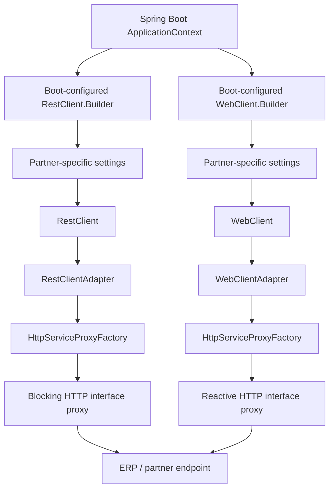
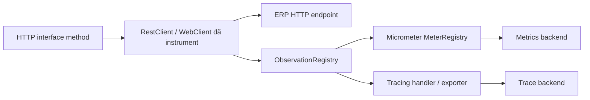
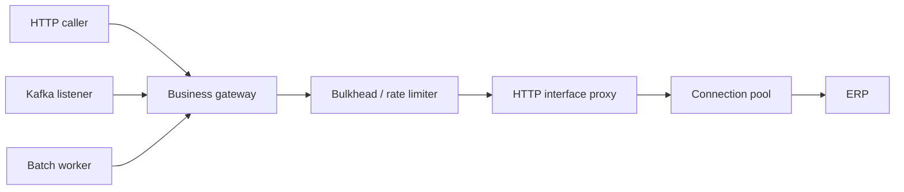

# Sử dụng builder đã được Boot tùy chỉnh thay vì bỏ qua cấu hình chung

## 1. Bài toán: HTTP interface chạy đúng nhưng mất cấu hình tích hợp

Ứng dụng Spring Boot tích hợp hệ thống thường gọi nhiều API đối tác: tra cứu tồn kho qua REST, lấy trạng thái thanh toán, đồng bộ ERP qua HTTP và lưu kết quả vào PostgreSQL, Redis hoặc broker. **HTTP interface** của Spring cho phép mô tả lời gọi HTTP dưới dạng Java interface, giảm code xây URL, gọi client và deserialize lặp đi lặp lại.

Tuy nhiên, HTTP interface chỉ mô tả **hợp đồng gọi**. Một proxy interface không tự quyết định được timeout, TLS, proxy mạng, authentication, connection pool, message converters/codecs, metrics hoặc tracing. Tất cả những phần này phụ thuộc vào **HTTP client thực sự được gắn vào proxy**.

Vấn đề thường gặp:

```java
// Trông ngắn gọn nhưng bỏ qua phần tùy chỉnh RestClient.Builder của Boot.
RestClient client = RestClient.create("https://erp.example.invalid");
HttpServiceProxyFactory factory =
        HttpServiceProxyFactory.builderFor(
                RestClientAdapter.create(client))
            .build();

ErpOrderApi api = factory.createClient(ErpOrderApi.class);
```

Đoạn code có thể trả về HTTP 200 và ánh xạ JSON thành công, nhưng **không mặc nhiên kế thừa các customizer, ObservationRegistry, transport hoặc chính sách của builder do Spring Boot cung cấp**. Hậu quả là chỉ một nhóm lời gọi mất metric, dùng connection timeout khác, không có correlation header hoặc không áp dụng cấu hình chung.

Trong module **SPRING_BOOT_INTEGRATION**, bài học này thuộc chương **HTTP interface**, đồng thời gắn với mục tiêu tổ chức tích hợp HTTP client, database, cache, broker và Spring Integration có cấu hình, hợp đồng dữ liệu, giao dịch, lỗi, idempotency, kiểm thử và khả năng quan sát nhất quán.

**Nguyên tắc chính:** tạo underlying `RestClient`/`WebClient` từ **builder được Spring Boot inject**, sau đó dùng adapter để tạo HTTP interface proxy. `HttpServiceProxyFactory` không phải cơ chế tự động lấy lại những customizer đã bị bỏ qua trước đó.

Sau bài học, bạn sẽ biết:

- Phân biệt HTTP interface contract, client, builder, adapter và proxy factory.
- Lắp ráp HTTP interface từ `RestClient.Builder` hoặc `WebClient.Builder` do Boot quản lý.
- Nhận diện những cách khởi tạo có nguy cơ làm mất cấu hình chung.
- Đặt ranh giới cấu hình global, theo đối tác và theo từng request đúng chỗ.
- Giữ metrics/tracing, authentication, timeout, connection pooling và codec hoạt động khi tạo proxy.
- Kiểm thử bean wiring, đường truyền thực và các failure scenario.

## 2. Cấu trúc HTTP interface: proxy không thay thế client

Spring Framework 6 cung cấp **declarative HTTP service interfaces**. Với Spring Framework 6.1+ và Spring Boot 3.2+ có các thành phần thường dùng:

| Thành phần | Vai trò | Điểm quan trọng |
|---|---|---|
| `@HttpExchange`, `@GetExchange`, `@PostExchange`... | Khai báo method, URI, HTTP method, content type. | Chỉ là contract/metadata; chưa có network call. |
| `RestClient` | HTTP client đồng bộ, fluent API. | Có request factory, interceptors, converters và observation. |
| `WebClient` | HTTP client reactive. | Có exchange connector, filters, codecs và observation. |
| `RestClient.Builder`/`WebClient.Builder` | Cấu hình và xây client. | Boot có thể áp dụng một tập customizer ở đây. |
| `RestClientAdapter`/`WebClientAdapter` | Kết nối client vào abstraction của HTTP interface. | Adapter dùng **client đã được build**. |
| `HttpServiceProxyFactory` | Tạo implementation proxy cho Java interface. | Không tự bổ sung lại cấu hình Boot bị bỏ qua. |
| Service/gateway bean | Định nghĩa ranh giới nghiệp vụ, error mapping, retry. | Không nên trộn chi tiết HTTP vào domain layer. |



Đặc biệt, `@HttpExchange` không đồng nghĩa endpoint **được expose** như một Spring MVC controller. Trong bài này interface mô tả **outbound HTTP client**; proxy gọi dịch vụ bên ngoài. Đừng nhầm với `@RestController` hoặc HTTP server handler.

### 2.1. Điều kiện phiên bản

Các ví dụ đồng bộ dưới đây hướng tới **Spring Boot 3.2+ và Spring Framework 6.1+** có `RestClient` và `RestClientAdapter`. Một số ví dụ WebClient HTTP interface đã khả dụng trong thế hệ Framework sớm hơn, nhưng tên API factory/adapter và cấu hình có thể đổi giữa các phiên bản.

Nếu dùng Spring Boot 3.0/3.1, `RestClient` chưa phải lựa chọn tương đương; cần chọn WebClient hoặc giải pháp HTTP interface được framework version đó hỗ trợ. Trong bản Boot mới hơn, luôn xác nhận Java version, auto-configuration, dependency BOM và các method API thật của dự án. Không tự trộn dependency Spring Framework mới vào một Boot cũ khi chưa xét tương thích.

## 3. Định nghĩa hợp đồng HTTP interface đúng cách

Giả sử ERP cung cấp:

```text
GET  /api/orders/{orderId}/status
POST /api/orders/{orderId}/refresh
```

Một contract Java có thể viết:

```java
package com.example.integration.erp;

import org.springframework.http.MediaType;
import org.springframework.web.bind.annotation.PathVariable;
import org.springframework.web.bind.annotation.RequestBody;
import org.springframework.web.bind.annotation.RequestHeader;
import org.springframework.web.service.annotation.GetExchange;
import org.springframework.web.service.annotation.HttpExchange;
import org.springframework.web.service.annotation.PostExchange;

@HttpExchange(
    url = "/api/orders",
    accept = MediaType.APPLICATION_JSON_VALUE,
    contentType = MediaType.APPLICATION_JSON_VALUE
)
public interface ErpOrderApi {

    @GetExchange("/{orderId}/status")
    OrderStatusResponse getStatus(
            @PathVariable("orderId") String orderId);

    @PostExchange("/{orderId}/refresh")
    RefreshResponse refresh(
            @PathVariable("orderId") String orderId,
            @RequestHeader("Idempotency-Key") String requestKey,
            @RequestBody RefreshRequest request);
}
```

Các DTO Java minh họa:

```java
public record OrderStatusResponse(
        String orderId, String status, long version) {}

public record RefreshRequest(String source) {}

public record RefreshResponse(
        String operationId, String status) {}
```

`@PathVariable("orderId")` ràng buộc tên rõ ràng, không phụ thuộc hoàn toàn vào tham số Java có được biên dịch với `-parameters` hay không. `@RequestHeader("Idempotency-Key")` đặt key nghiệp vụ theo **hợp đồng đã được ERP chấp thuận**, không phải vì HTTP interface tự mang đến idempotency.

Method trên vẫn có thể thất bại bởi network timeout, JSON deserialization, HTTP 429/503 hoặc lỗi hợp đồng. Java interface làm code ngắn hơn nhưng không giải quyết mặc định chính sách xử lý lỗi.

### 3.1. URI tương đối và URI tuyệt đối

Contract dùng đường dẫn **tương đối** để builder định nghĩa base URL theo môi trường. Nếu code ở tầng nghiệp vụ tự ghép URL hoàn chỉnh từ input người dùng hoặc đưa absolute URI vào interface, có thể bỏ qua base URL đã quản lý và gây SSRF/đưa credential đến host không tin cậy.

Tốt hơn:

```yaml
integration:
  erp:
    base-url: ${ERP_BASE_URL}
```

`ERP_BASE_URL` phải được cung cấp từ cấu hình môi trường/secret management phù hợp, với allowlist host và scheme theo hợp đồng. Không lấy base URL tùy ý từ payload của HTTP inbound rồi gọi ngay.

## 4. Cách đúng: inject `RestClient.Builder` từ Spring Boot

Spring Boot có thể auto-configure `RestClient.Builder` khi classpath và điều kiện bean phù hợp. Builder đó là nơi Boot và các `RestClientCustomizer` áp dụng cấu hình chung như message converters, request factory selection, observation registry hoặc customizer do ứng dụng định nghĩa.

Thay vì `RestClient.create(...)` hoặc `RestClient.builder()` từ code ứng dụng, hãy inject builder:

```java
package com.example.integration.erp;

import org.springframework.beans.factory.annotation.Value;
import org.springframework.context.annotation.Bean;
import org.springframework.context.annotation.Configuration;
import org.springframework.web.client.RestClient;
import org.springframework.web.client.support.RestClientAdapter;
import org.springframework.web.service.invoker.HttpServiceProxyFactory;

@Configuration(proxyBeanMethods = false)
public class ErpHttpInterfaceConfiguration {

    @Bean
    ErpOrderApi erpOrderApi(
            RestClient.Builder bootBuilder,
            @Value("${integration.erp.base-url}") String baseUrl) {

        RestClient restClient = bootBuilder
                .baseUrl(baseUrl)
                .defaultHeader("X-Client-App", "order-integration")
                .build();

        HttpServiceProxyFactory factory =
                HttpServiceProxyFactory.builderFor(
                        RestClientAdapter.create(restClient))
                    .build();

        return factory.createClient(ErpOrderApi.class);
    }
}
```

Luồng thực thi:

1. Spring inject một `RestClient.Builder` đã được hệ thống tạo/tùy chỉnh theo auto-configuration thực tế.
2. Configuration chỉ bổ sung `baseUrl` và header **riêng cho ERP**.
3. `build()` tạo `RestClient` mang tập thiết lập của builder.
4. `RestClientAdapter.create(...)` đóng gói client.
5. `HttpServiceProxyFactory` tạo implementation của `ErpOrderApi`.
6. Application service inject `ErpOrderApi` và sử dụng như Java interface.

Ở đây, **proxy không gọi mạng trong lúc tạo bean**. HTTP request thực tế xảy ra khi gọi method `getStatus(...)`/`refresh(...)`.

### 4.1. Ví dụ gọi từ application service

```java
import org.springframework.stereotype.Service;

@Service
public class OrderStatusService {
    private final ErpOrderApi erpApi;

    public OrderStatusService(ErpOrderApi erpApi) {
        this.erpApi = erpApi;
    }

    public OrderStatusResponse lookup(String orderId) {
        return erpApi.getStatus(orderId);
    }
}
```

Caller không biết về `HttpServiceProxyFactory`, `RestClientAdapter`, HTTP headers hoặc connection factory. Những chi tiết đó nằm ở **adapter/configuration layer**. Khi cần error translation, giới hạn concurrency hoặc retry nghiệp vụ, có thể đặt thêm gateway facade thay vì để mọi service gọi proxy trực tiếp và tự xử lý exception theo cách khác nhau.

### 4.2. Vị trí cấu hình global và theo đối tác

Header `X-Client-App` ở ví dụ là header vô hại theo đối tác. Không đặt `Authorization` hoặc API key của ERP trong customizer global nếu app còn gọi ngân hàng/CRM khác. Các thiết lập cần phân tầng:

| Cấp | Ví dụ | Nên đặt tại |
|---|---|---|
| Chung toàn app | Observation, logger correlation an toàn, cơ chế converter chung. | Boot-managed builder/customizers theo scope phù hợp. |
| Theo dependency | Base URL, SSL truststore, connection pool, timeout, API credential. | Bean tạo client ERP/CRM riêng. |
| Theo operation | `Idempotency-Key`, SOAP/HTTP operation header, deadline cụ thể. | Method contract, interceptor hoặc gateway. |
| Theo request | Trace context, business ID, tenant/locale đã được xác thực. | Method arguments/Context propagation, không mutate shared client. |

**Cấu hình chung** không có nghĩa mọi dependency phải chia cùng timeout hoặc credentials. Mục tiêu là giữ nền tảng Boot, rồi chuyên biệt hóa nơi cần thiết.

## 5. Đối chiếu: cách tạo client làm mất customization

Ba cách có thể tạo ra cùng kiểu `RestClient` nhưng **khác nguồn cấu hình**:

```java
// A. Builder do Boot quản lý: ưu tiên.
RestClient fromBoot =
        bootBuilder.baseUrl(baseUrl).build();

// B. API tĩnh của Spring Framework: không tự lấy Boot customizers.
RestClient direct =
        RestClient.create(baseUrl);

// C. Builder thuần của Spring Framework: không tự lấy Boot customizers.
RestClient plain =
        RestClient.builder().baseUrl(baseUrl).build();
```

Tương tự với WebClient:

```java
// Giữ WebClientCustomizer đã có trên builder được Boot inject.
WebClient managed = bootWebClientBuilder
        .baseUrl(baseUrl).build();

// Không tự nhận customizers của builder do Boot cung cấp.
WebClient direct = WebClient.create(baseUrl);
WebClient plain = WebClient.builder().baseUrl(baseUrl).build();
```

| Hành vi | Builder từ Boot context | `create()` / `builder()` thuần |
|---|---|---|
| Bean/customizers của Boot được áp khi tạo builder | Theo điều kiện auto-configuration. | **Không tự kế thừa**. |
| Micrometer HTTP observation/tracing | Có thể được cấu hình trên builder. | Phải instrument riêng nếu muốn. |
| Message converters/codecs được Boot custom | Được giữ khi không thay thế cấu hình. | Dùng default thuần hoặc cấu hình thủ công. |
| Custom transport/SSL/proxy của ứng dụng | Có thể đã gắn bởi customizer. | Không tự nhận từ context. |
| Interceptor/filter chung | Có thể đã có. | Không tự lấy các bean customizer. |
| HTTP request gửi được không? | Có, nếu endpoint/hợp đồng đúng. | **Cũng có thể có**, nên lỗi khó nhận ra. |

Cần nhấn mạnh: không phải `create()` mặc nhiên là **sai kỹ thuật**. Nếu ứng dụng chủ ý tự gắn `ObservationRegistry`, transport, SSL, authentication và mọi cross-cutting concern thì client có thể hợp lệ. Nhưng trong ứng dụng Spring Boot cần thống nhất cấu hình, điều đó tạo **hai đường cấu hình** khó kiểm toán, đặc biệt khi dự án thêm một customizer mới.

### 5.1. “Dùng factory đúng” nhưng client bên trong sai

Một phản mẫu rất phổ biến:

```java
@Bean
ErpOrderApi erpOrderApi() {
    RestClient client = RestClient.create(
            "https://erp.example.invalid");

    return HttpServiceProxyFactory.builderFor(
            RestClientAdapter.create(client))
        .build()
        .createClient(ErpOrderApi.class);
}
```

`HttpServiceProxyFactory` đúng API, annotation đúng, method gọi thành công, nhưng underlying `RestClient` bị tạo tách khỏi cấu hình Boot. Sửa lỗi ở **điểm khởi tạo client**, không phải trên interface method hay thêm một annotation tưởng tượng trên `ErpOrderApi`.

## 6. Boot-managed `WebClient.Builder` cho HTTP interface reactive

Nếu ứng dụng dùng Spring WebFlux, Boot có thể cung cấp `WebClient.Builder` đã áp codec/connector/filter/observation customizers. Cách lắp proxy tương tự `RestClient`, khác ở kiểu phản hồi reactive:

```java
package com.example.integration.inventory;

import org.springframework.web.bind.annotation.PathVariable;
import org.springframework.web.service.annotation.GetExchange;
import org.springframework.web.service.annotation.HttpExchange;
import reactor.core.publisher.Mono;

@HttpExchange("/api/inventory")
public interface InventoryHttpApi {

    @GetExchange("/{sku}")
    Mono<InventoryResponse> getStock(
            @PathVariable("sku") String sku);
}

public record InventoryResponse(
        String sku, long available, String warehouse) {}
```

Configuration:

```java
import org.springframework.beans.factory.annotation.Value;
import org.springframework.context.annotation.Bean;
import org.springframework.context.annotation.Configuration;
import org.springframework.web.reactive.function.client.WebClient;
import org.springframework.web.reactive.function.client.support.WebClientAdapter;
import org.springframework.web.service.invoker.HttpServiceProxyFactory;

@Configuration(proxyBeanMethods = false)
public class InventoryHttpInterfaceConfiguration {

    @Bean
    InventoryHttpApi inventoryHttpApi(
            WebClient.Builder bootBuilder,
            @Value("${integration.inventory.base-url}") String baseUrl) {

        WebClient webClient = bootBuilder
                .baseUrl(baseUrl)
                .build();

        return HttpServiceProxyFactory.builderFor(
                    WebClientAdapter.create(webClient))
                .build()
                .createClient(InventoryHttpApi.class);
    }
}
```

Ví dụ cấu hình:

```yaml
integration:
  inventory:
    base-url: ${INVENTORY_BASE_URL}
```

**`Mono<InventoryResponse>` chỉ mô tả việc thực thi**; network request thường bắt đầu khi publisher được subscribe. Không gọi `.block()` trên Netty event loop để biến nó thành đồng bộ. Nếu ứng dụng chủ yếu JDBC/MVC blocking, dùng `RestClient` có thể đơn giản và phù hợp hơn; chọn loại client theo concurrency model thực tế, không vì HTTP interface bắt buộc reactive.

### 6.1. Builder có thể mutable

`RestClient.Builder` và `WebClient.Builder` đều có các operation cấu hình làm thay đổi builder. Spring Boot thường bố trí scope/cơ chế để người nhận có builder có thể tùy chỉnh độc lập; chi tiết phụ thuộc version. Nếu bạn giữ một builder mutable làm singleton tự định nghĩa rồi nhiều thread đồng thời thay `baseUrl`/default header, client có thể bị nhiễm cấu hình đối tác khác.

Một mẫu an toàn khi cần tái sử dụng cùng builder trong code của bạn:

```java
RestClient erpClient =
        bootRestClientBuilder.clone()
            .baseUrl(erpUrl)
            .build();

RestClient crmClient =
        bootRestClientBuilder.clone()
            .baseUrl(crmUrl)
            .build();
```

`clone()` trên builder của các phiên bản Framework có hỗ trợ tạo nhánh cấu hình từ một builder đã tùy chỉnh. Nếu app inject builder riêng cho từng `@Bean` từ Boot, cũng có thể không cần giữ một shared mutable builder. Tuy nhiên, **clone từ builder thuần chỉ tạo bản sao của cấu hình thuần**, không tự biến nó thành Boot-managed.

### 6.2. Đừng xóa mất codecs đã cấu hình

Khi tùy chỉnh `WebClient`, có thể thêm codecs cho payload lớn hoặc tùy chỉnh Jackson; không tự thay toàn bộ `ExchangeStrategies`/connector mà không kiểm tra những customizations có sẵn. Một WebClient từ Boot có thể đã dùng ObjectMapper và codec policy thống nhất. Thay riêng transport/codec bằng một object mới có thể khiến behavior khác các client còn lại.

## 7. Customizers thực sự hoạt động ở đâu?

Spring Boot có các extension points cho builders. Ví dụ với RestClient trong Boot 3.2+ có thể đăng ký `RestClientCustomizer` để thêm metadata chung cho những client được tạo từ builder được Boot quản lý:

```java
import org.springframework.boot.web.client.RestClientCustomizer;
import org.springframework.context.annotation.Bean;
import org.springframework.context.annotation.Configuration;

@Configuration
class HttpClientDefaultsConfiguration {

    @Bean
    RestClientCustomizer identifyApp() {
        return builder -> builder
                .defaultHeader(
                    "X-Integration-Client", "order-integration");
    }
}
```

Đây là customizer **trên builder**, không phải trên `HttpServiceProxyFactory`. Một `RestClient` tạo bằng `RestClient.create(...)` sẽ không tự chạy customizer bean đó. Trong ví dụ, header là định danh tĩnh không nhạy cảm; không áp key riêng của đối tác toàn app.

Bên WebClient, customizers có thể áp filter, codec hoặc connector khi builder được auto-configure. Quy tắc tương tự: **client do ai tạo, và builder đó đã đi qua customizers nào?**

### 7.1. Tại sao thứ tự cấu hình quan trọng?

Giả sử Boot customizer đặt một `ClientHttpRequestFactory` có connection pool, còn configuration của ERP gọi `.requestFactory(...)` để dùng transport riêng. Thiết lập sau có thể **thay thế transport đã có**, trong khi các interceptors/observation của builder vẫn được giữ. Điều này có thể có chủ đích, nhưng cần biết mình vừa thay phần nào.

Ngược lại, nếu thay `ObservationRegistry` bằng `ObservationRegistry.NOOP` hoặc xóa filters khi build client, có thể mất metric/tracing. Không kết luận “đã inject builder nên chắc chắn mọi instrumentation tồn tại” nếu application vẫn ghi đè cấu hình ở bước sau.

### 7.2. Customizers cấp ứng dụng không nên chứa thông tin của mọi đối tác

Một `RestClientCustomizer` global thêm `Authorization: Bearer <ERP token>` có thể khiến token ERP gửi tới CRM hoặc dịch vụ khác. Phân tách:

- **Global:** policy an toàn dùng chung, observation, cấu hình chung không chứa bí mật theo đối tác.
- **Per-client:** credentials, truststore, base URL, timeout, pool/bulkhead và header riêng.
- **Per-operation/request:** idempotency key, deadline, correlation hoặc locale theo business context đã xác thực.

Tách layer như vậy giúp HTTP interface gọn mà vẫn không làm rò rỉ credential giữa các hệ thống.

## 8. Quản lý cấu hình endpoint bằng typed properties

Khi có nhiều endpoint, để tất cả URL rải rác trong `@Value` có thể khiến thiếu validation hoặc cấu hình sai profile. Dùng `@ConfigurationProperties` giúp gom những giá trị thuộc về một đối tác:

```java
import java.net.URI;
import org.springframework.boot.context.properties.ConfigurationProperties;

@ConfigurationProperties(prefix = "integration.erp")
public record ErpHttpProperties(
        URI baseUrl,
        int maxAttempts) {}
```

Đăng ký properties:

```java
import org.springframework.boot.context.properties.EnableConfigurationProperties;
import org.springframework.context.annotation.Configuration;

@Configuration(proxyBeanMethods = false)
@EnableConfigurationProperties(ErpHttpProperties.class)
class IntegrationPropertiesConfiguration {}
```

Sử dụng trong factory:

```java
@Bean
ErpOrderApi erpOrderApi(
        RestClient.Builder builder,
        ErpHttpProperties config) {

    RestClient client = builder
            .baseUrl(config.baseUrl().toString())
            .build();

    return HttpServiceProxyFactory.builderFor(
                RestClientAdapter.create(client))
            .build()
            .createClient(ErpOrderApi.class);
}
```

Ví dụ YAML:

```yaml
integration:
  erp:
    base-url: https://erp.internal.example
    max-attempts: 2
```

Địa chỉ trên chỉ là ví dụ. Trong production nên validation bắt buộc scheme `https`, host đã cho phép, timeout/quota hợp lệ; nếu thiếu base URL, fail fast khi startup thay vì chạy được rồi lỗi lúc có đơn hàng đầu tiên. `max-attempts` ở đây là **cấu hình nghiệp vụ**, không tự kích hoạt retry chỉ vì có field; phải được áp trong retry policy có giới hạn.

### 8.1. Cấu hình không phải dữ liệu đầu vào request

Không biến tham số `tenantId` hoặc `customerId` thành host trong URL. Nếu multi-tenant có những endpoint khác nhau, phải có resolver dựa trên allowlist/mapping tin cậy, credential per tenant và test SSRF. Đừng để interface tự do dùng absolute URI do user cung cấp chỉ vì cần linh hoạt.

## 9. Timeout và transport: tùy chỉnh mà không phá builder chung

HTTP interface không cung cấp “một timeout duy nhất cho mọi pha”. Độ trễ thực tế gồm DNS, lấy connection từ pool, TCP/TLS handshake, gửi body, chờ server, đọc response, decode JSON, retry/backoff và queue wait ở executor/bulkhead.

Các lớp timeout có ý nghĩa khác nhau:

| Loại | Đo cái gì? | Vấn đề khi không thiết lập |
|---|---|---|
| Connection acquisition | Chờ lấy HTTP connection có sẵn từ pool. | Pool cạn làm task chờ lâu. |
| Connect timeout | Thời gian mở kết nối TCP tới host. | Đường mạng lỗi giữ thread. |
| TLS handshake | Thời gian thiết lập HTTPS và xác minh chứng chỉ. | Lỗi bảo mật/network khó tách khỏi response chậm. |
| Read/response timeout | Chờ/đọc response theo transport. | ERP treo khiến nhiều worker bị giữ. |
| Overall deadline | Tổng thời gian từ lúc nhận tác vụ đến hoàn tất. | Retry/queue khiến vượt SLO dù từng attempt có timeout. |

Spring Framework có nhiều `ClientHttpRequestFactory` (JDK, Apache HttpComponents, ...), WebClient có connector (thường Reactor Netty). **Tên method cấu hình timeout/pool khác nhau theo transport và phiên bản**. Vì vậy, hãy chọn transport trước, sau đó bổ sung cấu hình **trên builder đã inject** thay vì tạo RestClient/WebClient thuần.

Ví dụ minh họa cách dùng JDK HTTP client và request factory trong Spring Framework 6.1+:

```java
import java.net.http.HttpClient;
import java.time.Duration;
import org.springframework.http.client.JdkClientHttpRequestFactory;
import org.springframework.web.client.RestClient;

RestClient createErpClient(RestClient.Builder bootBuilder,
                           String baseUrl) {
    HttpClient http = HttpClient.newBuilder()
            .connectTimeout(Duration.ofMillis(400))
            .build();

    JdkClientHttpRequestFactory factory =
            new JdkClientHttpRequestFactory(http);
    factory.setReadTimeout(Duration.ofSeconds(2));

    return bootBuilder
            .baseUrl(baseUrl)
            .requestFactory(factory)
            .build();
}
```

Ví dụ trên là **cấu hình thay transport có chủ đích**. Nó không khẳng định JDK factory có cùng policy connection pool với Apache HttpComponents. Việc gọi `.requestFactory(factory)` có thể ghi đè factory do Boot/customizer đã chọn; cần kiểm tra TLS, pooling, request buffering, redirect, authentication, observation và metric transport sau thay đổi. Nếu cần proxy hoặc mTLS, cấu hình đúng ở transport đã chọn; không tắt xác minh chứng chỉ để “xử lý nhanh” sự cố kết nối.

### 9.1. Quản lý timeout bằng một ngân sách tổng

Ví dụ: HTTP inbound còn 1,5 giây, ứng dụng đã mất 300 ms ở DB, tác vụ phải đợi bulkhead 200 ms. Không nên cấp ERP read timeout 1,5 giây **mới** và tiếp tục retry 2 lần. Đặt deadline đầu-cuối, tính thời gian còn lại trước từng attempt và từ chối/short-circuit khi không đủ ngân sách.

Một `CompletableFuture.orTimeout(...)` chỉ giới hạn thời gian caller chờ, không tự hủy side effect phía ERP. Đặc biệt với `POST` tạo đơn, timeout có thể xảy ra sau khi ERP đã commit; phải có idempotency key và quy trình đối soát.

## 10. HTTP client observation, metrics và tracing phải được giữ

Một lý do quan trọng để dùng Boot-managed builder là **HTTP client observation**. Trong các cấu hình Spring Boot 3.x/Micrometer phù hợp, auto-configuration có thể nối `ObservationRegistry` vào builder và tạo HTTP client request observations khi client thực sự gửi request.

Những thành phần liên quan:



Cần phân biệt:

1. **Client được instrument:** được xây từ builder mang observation configuration hoặc instrument thủ công.
2. **Observation handlers:** có handler ghi metrics/tracing phù hợp.
3. **Registry và export:** có `MeterRegistry` và exporter/tracing bridge nếu muốn gửi dữ liệu ra dashboard.
4. **HTTP request có thực thi:** method được gọi; với `WebClient` cần có subscribe.

Có Actuator trong classpath **không** chứng minh mọi outbound HTTP client đều instrument. Tạo client bằng `RestClient.create(...)`, `WebClient.create(...)` rồi gọi qua HTTP interface proxy có thể bỏ qua instrumentation mà vẫn nhận response thành công.

### 10.1. URI template và low-cardinality tags

HTTP interface:

```java
@GetExchange("/{orderId}/status")
OrderStatusResponse getStatus(
        @PathVariable("orderId") String id);
```

Giữ template `/api/orders/{orderId}/status` thay vì tự ghép absolute URI chứa từng ID. Khi observation framework hỗ trợ, template giúp metric tag `uri` ổn định hơn. Hãy **kiểm tra tag thực tế** với phiên bản Framework đang chạy, vì cách tạo URI/adapter/custom request có thể ảnh hưởng thông tin template được nhận.

Không dùng `orderId`, `customerId`, email, token, trace ID hay request ID làm metric tag; cardinality cao gây nhiều time series và có thể lộ dữ liệu. Các tag tốt thường là `client=erp`, `operation=order-status`, `method=GET`, `status=200/503` hoặc những giá trị hữu hạn tương ứng với instrumentation thực tế.

### 10.2. Đo HTTP attempt khác với business operation

Giả sử một lần đọc trạng thái ERP retry sau HTTP 503:

```text
Business operation: lookupOrderStatus(O-42)
  HTTP attempt 1 -> 503 (150 ms)
  Backoff -> 100 ms
  HTTP attempt 2 -> 200 (220 ms)
Business operation hoàn tất sau khoảng 470 ms
```

HTTP client request metrics có thể ghi **hai HTTP attempts**, trong khi business operation chỉ có **một lần tra cứu**. Nếu cần đo SLO người dùng, phải có timer/business observation bao quanh retry và backoff, không suy số lượng đơn hàng từ HTTP request count.

## 11. Authentication và security: không bỏ qua cấu hình chung nhưng cũng không rò rỉ bí mật

Client tạo từ builder được quản lý có thể đã có SSL/proxy/observation customizers. Tuy nhiên, **authentication của đối tác thường phải được cấu hình có chủ đích**; Boot không tự biết API key hay OAuth2 token nào phù hợp với ERP.

Có thể dùng một client-specific interceptor khi cần:

```java
import org.springframework.http.HttpHeaders;
import org.springframework.http.client.ClientHttpRequestInterceptor;
import org.springframework.web.client.RestClient;

RestClient createAuthenticatedClient(
        RestClient.Builder bootBuilder,
        String endpoint,
        ErpTokenProvider tokenProvider) {

    ClientHttpRequestInterceptor auth = (request, body, execution) -> {
        String token = tokenProvider.currentToken();
        request.getHeaders().setBearerAuth(token);
        return execution.execute(request, body);
    };

    return bootBuilder
            .baseUrl(endpoint)
            .requestInterceptor(auth)
            .build();
}
```

`ErpTokenProvider` là abstraction do ứng dụng định nghĩa; ví dụ này không mô tả cách cấp token. Nếu có OAuth2 client integration, nên dùng support tương ứng và đúng grant/audience thay vì tự viết token logic tùy tiện.

Các ràng buộc:

- Không thêm credentials của ERP vào tất cả REST/WebClient builders qua customizer global.
- Không log `Authorization`, cookie, body chứa PII hoặc full URI có secret trong query.
- Không gửi credentials sang host redirect ngoài allowlist; xem redirect policy của transport.
- Kiểm soát truststore/SSL bundle và certificate rotation; không tắt hostname verification.
- Nếu dùng header từ application context/ThreadLocal, nhớ ranh giới async/reactive propagation.

### 11.1. Per-request header khác default header

`defaultHeader(...)` phù hợp với giá trị tĩnh dùng cho mọi request của một client. `@RequestHeader("Idempotency-Key")` phù hợp giá trị riêng của từng command. Với trace/correlation ID, dùng instrumentation/context propagation phù hợp; không sửa mutable `RestClient.Builder` hoặc `WebClient.Builder` mỗi lần có request mới.

## 12. Custom interceptors/filters: thứ tự, logging và duplication

Khi ứng dụng có nhiều `RestClientCustomizer` hoặc `WebClientCustomizer`, client có thể sở hữu nhiều interceptor/filter:

- Authentication.
- Correlation header.
- Metrics/tracing.
- Custom headers và error mapping.
- Logging/diagnostics có redaction.
- Retry nếu thư viện thiết kế ở tầng HTTP client.

Chúng có thể phụ thuộc **thứ tự chạy**. Ví dụ, filter logging không được in raw token đã gắn bởi auth filter. Nếu instrument bằng tay một client đã được Boot instrument, có nguy cơ **double counting** HTTP request metric hoặc tạo nested spans không mong muốn.

Không làm “đúng một lần” bằng cách phỏng đoán từ code. Trong test, assert số HTTP attempts và observation count tương ứng; kiểm tra header/interceptor behavior thực tế.

### 12.1. Không thay list interceptor bằng cách làm mất những phần trước

Một số phương thức setter của transport/builder có thể **thay toàn bộ cấu hình**; một số khác thêm phần tử. Khi customizer dùng `setInterceptors`/`requestInterceptors` hoặc `exchangeStrategies`, phải hiểu API đang **append, mutate hay replace**. Trong dự án tích hợp lớn, tạo một helper có tên rõ `configureErpClient(...)` và có regression tests để đảm bảo thêm authentication không xóa mất observation hoặc proxy.

## 13. Chọn error handling đúng tầng

HTTP interface có thể trả Java DTO, `ResponseEntity<T>`, `Mono<T>` hoặc kiểu được framework version hỗ trợ. Nhưng các HTTP status/error không tự trở thành domain exception hợp lệ.

Ví dụ ERP trả:

| Kết quả HTTP | Ý nghĩa có thể có | Chiến lược |
|---|---|---|
| 200 + dữ liệu hợp lệ | Tra cứu thành công. | Map DTO sang domain view. |
| 200 + `businessError` trong JSON | HTTP thành công, nghiệp vụ thất bại. | Parse error code rồi map rõ. |
| 400 | Request không khớp hợp đồng. | Không retry mù; kiểm tra DTO/validation. |
| 401/403 | Credential/permission sai. | Cảnh báo/cấu hình lại, không bão retry. |
| 404 | Không tìm thấy hoặc endpoint sai. | Theo hợp đồng: not found có thể là outcome bình thường. |
| 409 | Conflict/version. | Điều phối concurrency/idempotency. |
| 429 | Đối tác giới hạn lưu lượng. | Tôn trọng rate limit, backoff và deadline. |
| 500/503 | Server lỗi/tạm không khả dụng. | Retry bounded nếu operation an toàn. |
| Connect/read timeout | Không nhận được kết quả đầy đủ. | Phân biệt GET và lệnh ghi có side effect. |

Với `RestClient` và `WebClient`, các status handler/filter có thể chuyển response thành exception được phân loại. Đừng đặt `onStatus` tùy tiện ở mọi proxy method; policy nên tập trung tại client/gateway và có test cho response body lỗi, vì HTTP interface proxy sử dụng client đã cấu hình.

### 13.1. Error mapping nên nằm ở gateway adapter

Một facade nghiệp vụ có thể bao proxy:

```java
@Service
public class ErpOrderGateway {
    private final ErpOrderApi api;

    public ErpOrderGateway(ErpOrderApi api) {
        this.api = api;
    }

    public OrderStatusResponse getStatus(String orderId) {
        try {
            return api.getStatus(orderId);
        } catch (RestClientResponseException ex) {
            throw mapHttpFailure(ex); // Helper ứng dụng định nghĩa.
        } catch (ResourceAccessException ex) {
            throw mapTransportFailure(ex);
        }
    }
}
```

Ví dụ này giả định dùng blocking `RestClient`, đã import các class exception và có helper `mapHttpFailure`/`mapTransportFailure`. Không lấy ví dụ để kết luận mọi HTTP client (đặc biệt WebClient) ném cùng exception class. Với `WebClient` reactive, mapping lỗi phải nằm trong pipeline thay vì `try/catch` bên ngoài một `Mono` chưa subscribe.

## 14. Retry, rate limit và circuit breaker không do HTTP interface tự tạo

`@HttpExchange` không biến `POST` thành idempotent. Nếu `refresh(...)` gặp read timeout, ERP có thể đã bắt đầu job; retry tạo thêm job sẽ sai nếu không có một request key ổn định.

Quy tắc:

1. Retry chỉ các lỗi được phân loại an toàn, tối đa số attempt và backoff/jitter.
2. Xác định **một tầng sở hữu retry**; tránh retry 3 lần ở gateway, 3 lần ở HTTP filter và 3 lần ở consumer.
3. Đặt circuit breaker/bulkhead/rate limit theo endpoint và tổng số replica.
4. Với command ghi, truyền idempotency key theo hợp đồng đối tác, cùng key cho mọi retry của cùng ý định.
5. Nếu timeout khiến kết quả không rõ, truy vấn trạng thái/đối soát trước khi quyết định phát lại.
6. Không giữ JDBC transaction mở trong khi chờ HTTP retry lâu.

Ví dụ `@RequestHeader("Idempotency-Key")` trên interface giúp truyền key, nhưng **chỉ phía ERP và chính sách nghiệp vụ mới quyết định idempotency thực tế**. Nếu ERP không hỗ trợ, cần thiết kế khóa nghiệp vụ, đối soát hoặc workflow bù trừ.

## 15. Connection pool, executor và concurrency budget phải đi cùng nhau

Một HTTP interface proxy có thể được gọi từ:

- Controller Spring MVC.
- `@Async` method trong `ThreadPoolTaskExecutor`.
- Spring Integration service activator.
- Kafka/RabbitMQ listener.
- Spring Batch step.

Mỗi nguồn có concurrency khác nhau. Nếu có 10 worker threads gọi cùng RestClient, nhưng HTTP transport chỉ cho 4 connections, 6 task có thể chờ pool; nếu ERP chỉ cho 20 requests/giây và có 5 replica, tăng pool không làm upstream chịu được nhiều hơn.



Nên đo ít nhất:

| Metric | Giúp phát hiện |
|---|---|
| HTTP client request duration/count/outcome | Độ trễ và tỷ lệ lỗi theo endpoint. |
| Connection pool active/idle/pending | Chờ connection, pool saturation. |
| Thread pool queue wait/active/rejections | Task chờ và quá tải trong JVM. |
| Bulkhead in-flight/rejections | Quota phụ thuộc thực tế. |
| Retry count/backoff/attempts | Retry storm hoặc upstream throttling. |
| Business operation latency | Tổng thời gian từ business call đến outcome. |

**Boot-managed builder không thay được policy về concurrency.** Nó giúp gom cấu hình transport/instrumentation, còn queue, rate limit và throughput vẫn cần thiết kế theo dependency.

## 16. Transaction và Spring Integration: không xem HTTP call là một phần DB commit

HTTP interface gọi qua RestClient/WebClient không tham gia một JDBC transaction một cách nguyên tử. Nếu service mở `@Transactional`, ghi DB rồi gọi ERP, rollback DB không khiến ERP tự rollback. Khi chờ ERP lâu, service có thể giữ connection/lock làm giảm tài nguyên.

Luồng dễ lỗi:

```text
BEGIN DB transaction
  INSERT order
  POST ERP /refresh
  ERP đã chấp nhận
  DB commit thất bại
=> ERP có side effect nhưng DB không có order
```

Trong hệ thống cần độ tin cậy:

1. Validate command và có business ID.
2. Ghi trạng thái DB + outbox trong **một DB transaction**.
3. Sau commit, worker/dispatcher lấy công việc bền vững.
4. Gateway HTTP interface gọi ERP với idempotency key.
5. Ghi lại outcome và đối soát khi kết quả không xác định.
6. Ack Kafka/RabbitMQ theo bước bền vững được hợp đồng quy định.

`ExecutorChannel` hoặc `@Async` chỉ đổi thread, không tạo durable queue và không tự truyền transaction/context. Không ack broker ngay khi `executor.execute(...)` nhận task nếu job cần được hoàn thành hoặc lưu bền vững trước ack.

## 17. Nhiều client cùng app: bảo vệ isolation

Giả sử ứng dụng dùng một ERP REST client và một Payment API client. Cùng dùng Spring Boot-managed `RestClient.Builder` là hợp lý, nhưng cần **hai bean độc lập**:

```java
@Bean
ErpOrderApi erpOrderApi(
        RestClient.Builder builder,
        ErpHttpProperties props) {
    RestClient client = builder.clone()
            .baseUrl(props.baseUrl().toString())
            .build();
    return HttpServiceProxyFactory.builderFor(
            RestClientAdapter.create(client))
        .build()
        .createClient(ErpOrderApi.class);
}

@Bean
PaymentApi paymentApi(
        RestClient.Builder builder,
        PaymentHttpProperties props) {
    RestClient client = builder.clone()
            .baseUrl(props.baseUrl().toString())
            .build();
    return HttpServiceProxyFactory.builderFor(
            RestClientAdapter.create(client))
        .build()
        .createClient(PaymentApi.class);
}
```

`PaymentApi` và `PaymentHttpProperties` là contract/properties ứng dụng tự định nghĩa. Hai method có thể nhận builder từ Spring container theo semantics version đang dùng; `clone()` minh họa ý định tách cấu hình trước khi build. Nếu một custom transport hoặc auth interceptor được cấu hình toàn cục, hãy kiểm tra nó có phù hợp cho **cả hai** hay không.

Nguyên tắc isolation:

- Không dùng cùng bearer token cho nhiều đối tác nếu không thuộc cùng audience.
- Có thể dùng connection pool chung khi topology hợp lý, nhưng quota per-route/per-partner phải rõ.
- Không sửa base URL trên một builder đang được share đồng thời.
- Không chuyển domain DTO của ERP sang Payment API vì chúng có cùng field name.
- Tách circuit breaker, timeout và metric dimension `partner`/`operation` theo workload.

## 18. Lựa chọn Boot-managed builder khi API nằm trong thư viện nội bộ

Một thư viện `partner-sdk` có thể chứa HTTP interface và helper xây proxy. Nếu helper viết:

```java
public static ErpOrderApi create(String url) {
    RestClient rest = RestClient.create(url);
    return HttpServiceProxyFactory.builderFor(
            RestClientAdapter.create(rest))
        .build()
        .createClient(ErpOrderApi.class);
}
```

thì dù ứng dụng Spring Boot đang có `RestClientCustomizer` rất tốt, helper vẫn bỏ qua chúng. Thay đổi thiết kế API:

```java
public static ErpOrderApi create(
        RestClient.Builder configuredBuilder,
        String url) {

    RestClient rest = configuredBuilder.clone()
            .baseUrl(url)
            .build();

    return HttpServiceProxyFactory.builderFor(
            RestClientAdapter.create(rest))
        .build()
        .createClient(ErpOrderApi.class);
}
```

Ở application:

```java
@Bean
ErpOrderApi erpOrderApi(
        RestClient.Builder bootBuilder,
        @Value("${integration.erp.base-url}") String baseUrl) {
    return PartnerSdk.create(bootBuilder, baseUrl);
}
```

Thư viện không cần import Spring Boot auto-configuration; nó **nhận dependency đã được cấu hình từ ngoài**. Cách này giúp test riêng builder và làm thư viện dễ dùng cho cả Spring Boot lẫn môi trường Spring Framework thuần. Nếu SDK hỗ trợ đưa sẵn `RestClient` thay vì builder, càng dễ bảo toàn transport/observation đã build.

## 19. Test HTTP interface đúng cấu hình, không chỉ kiểm tra DTO

Một unit test tạo client bằng `RestClient.builder()` rồi assert deserialize JSON có thể chứng minh interface mapping, nhưng **không** chứng minh ứng dụng production đang inject builder do Boot quản lý hoặc customizers được áp.

Để test kỹ, nên có hai cấp:

1. **Contract/method test:** request HTTP chính xác, URI template, headers, body, response và mapping lỗi đúng.
2. **Boot wiring test:** bean HTTP interface đi qua RestClient.Builder/WebClient.Builder thực sự được Boot/customizers cung cấp; observation, auth, timeout/transport và các thiết lập liên quan còn hiệu lực.

### 19.1. Kiểm thử interface với `MockRestServiceServer`

Spring Framework 6.1+ hỗ trợ bind `MockRestServiceServer` vào một `RestClient.Builder` để intercept lời gọi từ client build ra từ builder ấy. Ví dụ khung test:

```java
import org.junit.jupiter.api.Test;
import org.springframework.beans.factory.annotation.Autowired;
import org.springframework.boot.test.context.SpringBootTest;
import org.springframework.http.MediaType;
import org.springframework.test.web.client.MockRestServiceServer;
import org.springframework.web.client.RestClient;
import org.springframework.web.client.support.RestClientAdapter;
import org.springframework.web.service.invoker.HttpServiceProxyFactory;

import static org.assertj.core.api.Assertions.assertThat;
import static org.springframework.test.web.client.match.MockRestRequestMatchers.requestTo;
import static org.springframework.test.web.client.response.MockRestResponseCreators.withSuccess;

@SpringBootTest
class ErpHttpInterfaceTest {

    @Autowired
    RestClient.Builder bootBuilder;

    @Test
    void callsExpectedEndpointThroughHttpInterface() {
        MockRestServiceServer server =
                MockRestServiceServer.bindTo(bootBuilder).build();

        RestClient client = bootBuilder
                .baseUrl("https://erp.test.invalid")
                .build();

        ErpOrderApi api = HttpServiceProxyFactory
                .builderFor(RestClientAdapter.create(client))
                .build()
                .createClient(ErpOrderApi.class);

        server.expect(requestTo(
                "https://erp.test.invalid/api/orders/O-42/status"))
            .andRespond(withSuccess("""
                {"orderId":"O-42","status":"PAID","version":3}
                """, MediaType.APPLICATION_JSON));

        OrderStatusResponse response = api.getStatus("O-42");

        assertThat(response.status()).isEqualTo("PAID");
        assertThat(response.version()).isEqualTo(3);
        server.verify();
    }
}
```

Test này tạo một proxy từ **builder Boot được inject** trong test context và chứng minh mapping/đường gọi, không kết luận mọi bean production đều dùng cùng proxy instance. Nếu production có bean client tạo từ một path khác, hãy thêm một test gọi đúng **bean production** qua HTTP stub tại URL cấu hình của test.

### 19.2. Test một customizer chung thực sự được áp

Đăng ký customizer ví dụ `identifyApp()` và thêm kỳ vọng header:

```java
import static org.springframework.test.web.client.match.MockRestRequestMatchers.header;

server.expect(requestTo(
        "https://erp.test.invalid/api/orders/O-42/status"))
    .andExpect(header("X-Integration-Client", "order-integration"))
    .andRespond(withSuccess("""
        {"orderId":"O-42","status":"PAID","version":3}
        """, MediaType.APPLICATION_JSON));
```

Đây là đoạn **thay thế phần expectation** trong test trước, không phải một test hoàn chỉnh độc lập. Nó chứng minh client dùng customizer khi được tạo từ builder Boot. Nếu đổi `bootBuilder` thành `RestClient.builder()`, header do customizer của Boot thêm sẽ không tự xuất hiện.

### 19.3. Kiểm thử bean production với HTTP stub và properties động

Một test mạnh hơn khởi động Spring context thật, đặt `integration.erp.base-url` trỏ tới HTTP stub (ví dụ MockWebServer hoặc WireMock), inject **`ErpOrderApi` bean production**, gọi method và kiểm tra:

- URI/headers/auth/content-type thực tế.
- JSON serialization và mapping exception.
- Timeout khi stub cố ý delay, redirect và connection failures.
- Metric/timer HTTP client thật sự tăng sau request.
- Không có label `orderId` làm cardinality tăng.
- Token của đối tác A không gửi tới đối tác B.

Với `WebClient`, dùng HTTP stub hoặc `MockWebServer`/`WebTestClient` theo mức test phù hợp; nếu method trả `Mono`, phải subscribe/await completion trước khi assert request và observation. Cần chú ý các Spring Boot test configurations có thể disable telemetry exporter; nếu kiểm tra Micrometer, bật test observability/in-memory registry phù hợp thay vì gửi telemetry tới production.

## 20. Kiểm tra metrics/tracing bằng test có kết quả đo thực

Chỉ kiểm tra `getStatus()` trả `PAID` là chưa đủ để phát hiện việc tạo client bằng builder sai. Test observability có thể:

1. Dùng một `MeterRegistry` test hoặc `ObservationRegistry` có observation handlers phù hợp.
2. Tạo client từ **Boot-managed builder**.
3. Gọi HTTP stub hai lần theo URI template, với hai ID khác nhau.
4. Đọc HTTP client metric do phiên bản Framework xuất ra, thường có observation name như `http.client.requests`.
5. Xác nhận số attempts tăng như mong đợi; **uri tag** vẫn dùng template/giá trị cardinality thấp, không chứa `O-42`/`O-99`.
6. Chạy biến thể tạo `RestClient.create(...)` để chứng minh ranh giới cấu hình, nếu đó là regression bug từng xảy ra.

Tùy version Spring Boot/Micrometer và registry, tên timer hoặc metric xuất ra backend có thể biến đổi, ví dụ hậu tố `_seconds_count` trên Prometheus. Không hard-code một tên exporter cho mọi môi trường. Metrics không tự thay thế tracing: trace cần bridge/exporter/sampling, và propagation tới ERP chỉ có nếu phía downstream hỗ trợ.

### 20.1. Async context propagation

Nếu HTTP interface được gọi từ `@Async` hoặc Spring Integration `ExecutorChannel`, correlation/trace context từ thread inbound không tự truyền đầy đủ. Có thể cần `TaskDecorator` hoặc Micrometer context propagation tương ứng. Với WebClient reactive, Reactor Context được dùng khác `ThreadLocal`; test phải đi qua **ranh giới thật** để xem trace/span có liên kết hay không.

Không copy toàn bộ `SecurityContext` hoặc request object sang background worker nếu chỉ cần business ID. Truyền ngữ cảnh tối thiểu và xóa/restore đúng khi dùng thread pool.

## 21. Troubleshooting: HTTP interface mất cấu hình chung

| Triệu chứng | Nguyên nhân có thể | Cách kiểm tra/sửa |
|---|---|---|
| HTTP interface gọi OK nhưng thiếu HTTP client metrics | Client được tạo bằng `RestClient.create(...)`/`WebClient.create(...)`. | Dùng builder inject; test `ObservationRegistry` và HTTP stub. |
| Một đối tác có tracing, đối tác khác không | Hai cách tạo builder hoặc một client bị override observation. | Truy dấu từng `@Bean` tới underlying client. |
| Timeout khác giữa hai HTTP interfaces | Một client dùng transport mặc định, một client dùng request factory riêng. | Kiểm tra bean builder, factory, deadline và pool. |
| Thiếu custom header của ứng dụng | Bỏ qua `RestClientCustomizer`/`WebClientCustomizer`. | Assert header qua mock/stub; inject builder. |
| Có customizers nhưng mất SSL bundle/proxy | Factory/connector bị replace sau khi builder cấu hình. | Test transport thực, TLS/mTLS/proxy. |
| Token ERP gửi nhầm CRM | Credentials nằm ở customizer global/shared mutable builder. | Tách auth per-client và assert không leak. |
| Client bean không tạo được | Thiếu HTTP interface class/adapter, version không hỗ trợ API, bean ambiguous. | Kiểm tra Boot/Framework version, imports, bean qualifiers. |
| HTTP interface nhận 404 dù controller counterpart tồn tại | Base URL/path ghép sai, URI absolute thay override, encoding. | Kiểm tra request URL thực và hợp đồng. |
| WebClient method không gửi request | `Mono` chưa subscribe. | Subscribe và assert trên HTTP stub. |
| WebClient treo khi gọi từ event loop | Code gọi `block()`/blocking operation trên event loop. | Giữ reactive chain hoặc chuyển blocking boundary đúng. |
| Mọi request báo lỗi JSON | Codec/ObjectMapper bị thay; DTO/field version sai. | Test hợp đồng serialization và code path client. |
| Timeout `POST` dẫn tới tạo trùng | Retry không ổn định idempotency key. | Ghi nhận operation key, tra cứu kết quả và giới hạn retry. |
| CPU/threads tăng khi ERP chậm | Không có bulkhead/queue/connection limit hoặc retry storm. | Đo pool, retries, p95/p99, giới hạn producer. |

### 21.1. Quy trình điều tra theo thứ tự

1. Xác định Java interface và bean proxy thực sự được inject.
2. Tìm nơi tạo `RestClient`/`WebClient` cho `RestClientAdapter`/`WebClientAdapter`.
3. Xác nhận builder đến từ Spring context, không phải static builder thuần.
4. Kiểm tra customizers, request factory/connector, SSL, headers và ObservationRegistry.
5. Gọi HTTP stub, ghi request và kiểm tra cả metrics/trace context.
6. Phân biệt lỗi network/transport với HTTP status và business error.
7. Khi sửa đường tạo client, thêm regression test cho header/metric/timeout đã từng bị mất.

Không chỉ xem `@HttpExchange` và kết luận sai. Nguồn cấu hình client nằm ở **bean factory path**, không nằm trong annotation.

## 22. Những phản mẫu cần tránh

1. Tạo proxy bằng `HttpServiceProxyFactory` đúng nhưng underlying client là `RestClient.create(...)`, khiến Boot customization bị bỏ qua.
2. Cho rằng thêm `spring-boot-starter-actuator` sẽ đo mọi thư viện HTTP bên ngoài.
3. Đặt toàn bộ auth, SSL và timeout của mọi đối tác trong một singleton builder mutable.
4. Tạo builder mới trong mỗi request, đồng thời mất connection pool sharing và observation.
5. Dùng token của ERP trong global `RestClientCustomizer` rồi vô tình gửi sang API khác.
6. Đổi `ClientHttpRequestFactory`/`ExchangeStrategies` mà không kiểm tra điều gì bị thay.
7. Gắn correlation ID của từng đơn vào metric tags, gây cardinality cao.
8. Gọi `WebClient.block()` trên Reactor event loop.
9. Retry `POST` timeout không có idempotency/đối soát.
10. Giữ `@Transactional` DB trong lúc gọi ERP chậm rồi kỳ vọng rollback cả ERP.
11. Test trực tiếp `RestClient.builder()` rồi kết luận bean production đã nhận customizer Boot.
12. Chỉ assert HTTP 200 mà không test error status, timeout, header, serialization và metric.
13. Dùng host/URL do người dùng gửi làm base URL mà không kiểm tra allowlist/SSRF.
14. Tin `@HttpExchange` thay thế được circuit breaker, bulkhead, timeout và durable outbox.

## 23. Checklist triển khai HTTP interface trong Spring Boot

- [ ] Xác nhận Spring Boot/Spring Framework version và HTTP interface APIs được hỗ trợ.
- [ ] Khai báo Java interface với `@HttpExchange` và annotations method/parameter rõ ràng.
- [ ] Inject `RestClient.Builder`/`WebClient.Builder` từ Spring Boot ApplicationContext.
- [ ] Tạo client bằng builder đã được Boot/customizers cấu hình; **không lén dùng `create()` thuần** trong library/helper.
- [ ] Gắn `RestClientAdapter`/`WebClientAdapter` với **client đã build đúng**.
- [ ] Khai báo proxy thành Spring bean; application service inject interface hoặc gateway facade.
- [ ] Tách endpoint, credentials, TLS, proxy, timeout và pool theo dependency.
- [ ] Dùng `@ConfigurationProperties` và validate URL/quota; không cho URI tùy ý từ request.
- [ ] Kiểm tra customizer global không làm lộ token hoặc gửi header không hợp lệ sang đối tác khác.
- [ ] Kiểm tra override request factory/connector/codecs không phá cấu hình đã có.
- [ ] Có timeout từng pha, deadline đầu-cuối, connection pool và bulkhead per dependency.
- [ ] Với WebClient, không block event loop và test subscription đúng cách.
- [ ] Có error translation tách transport error, HTTP response status và business error.
- [ ] Retry bounded với idempotency; lệnh ghi timeout có trạng thái UNKNOWN/đối soát.
- [ ] HTTP interface không mở local DB transaction dài xuyên remote call.
- [ ] Broker/ExecutorChannel chỉ ack theo bước bền vững, không theo enqueue RAM.
- [ ] Có HTTP client metric/trace khi instrumentation yêu cầu và test URI tag cardinality thấp.
- [ ] Test HTTP stub dùng builder Boot, thêm regression tests cho custom headers/observability.
- [ ] Test bean proxy production, TLS/transport nếu có mTLS hoặc proxy đặc thù.
- [ ] Log/trace che token, thông tin khách hàng và payload nhạy cảm; có dashboard/runbook.

## 24. Tổng kết

**HTTP interface là hợp đồng gọi; `RestClient`/`WebClient` mới là nơi mang cấu hình transport, codec, authentication và observation.** Khi ứng dụng Spring Boot đã có builder được quản lý, tạo client bằng `RestClient.create(...)`, `RestClient.builder()` hoặc `WebClient.create(...)` mà không cấu hình tương đương sẽ bỏ qua đường customizer chung, dù proxy interface vẫn hoạt động về mặt HTTP.

Trong **SPRING_BOOT_INTEGRATION**, hãy **inject builder đã được Boot tùy chỉnh → bổ sung cấu hình per-partner → build client → tạo adapter → tạo HTTP interface proxy → kiểm thử request và telemetry**. Giữ ranh giới này rõ ràng giúp kết nối HTTP tới ERP/đối tác thống nhất với timeout, giao dịch, idempotency, retry, tracing và vận hành các luồng tích hợp thực tế.
