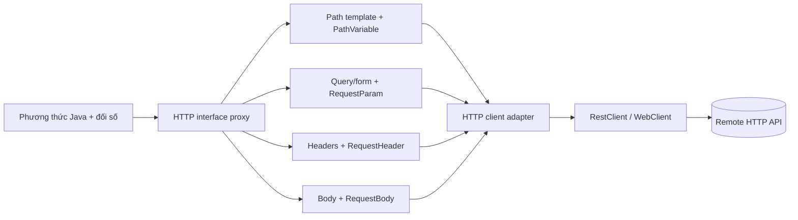
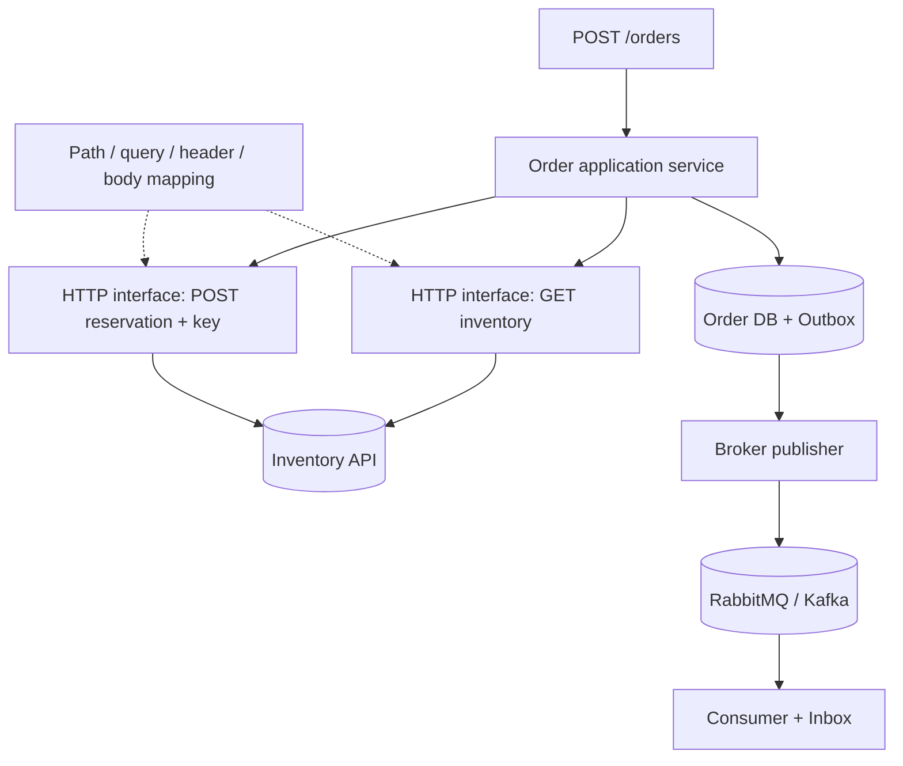

# Ánh xạ đối số vào đường dẫn, query, header và request body

## 1. HTTP interface biến lời gọi Java thành hợp đồng HTTP

Trong mô-đun **SPRING_BOOT_INTEGRATION**, một Spring Boot service thường cần gọi Catalog API, Payment API, Inventory Service hoặc một hệ thống legacy. Một lựa chọn là viết thủ công nhiều lời gọi `RestClient`/`WebClient`; lựa chọn khác là khai báo **HTTP interface** bằng các annotation của Spring Framework, sau đó tạo proxy để chuyển lời gọi Java thành HTTP request.

Ví dụ:

```java
ProductView product = catalogClient.findProduct(
    "sku-123", "VN", "tenant-17"
);
```

Đối với caller, đây là phương thức Java. Trên network, nó có thể tương ứng:

```http
GET /v1/products/sku-123?region=VN HTTP/1.1
Host: catalog.example.test
Accept: application/json
X-Tenant-Id: tenant-17
```

**Ánh xạ đối số (argument mapping)** là quy tắc quyết định **giá trị tham số của phương thức Java đi vào đâu trong HTTP request**:

- `@PathVariable`: thay một biến trong URL path.
- `@RequestParam`: biểu diễn tham số query hoặc form parameter theo content type và adapter.
- `@RequestHeader`: đặt HTTP request header.
- `@RequestBody`: serialize object thành nội dung request body.
- `@RequestPart`: biểu diễn các phần của multipart request trong trường hợp phù hợp.

Nếu ánh xạ sai, client có thể gọi nhầm resource, gửi token sai nơi, tạo URL không được encode, đặt sai `Content-Type`, hoặc phát ra JSON không đúng schema. Những lỗi ấy có thể ảnh hưởng hợp đồng dữ liệu, retry, idempotency và observability của toàn bộ flow.



Bài học thuộc chương **HTTP interface** và tập trung trực tiếp vào **“Ánh xạ đối số vào đường dẫn, query, header và request body”**. Nó sử dụng Spring Boot 3.2+ với Spring Framework 6.1+ cho ví dụ `RestClientAdapter`; các phiên bản khác có thể khác cách khởi tạo factory, khả năng resolver và converter, nên cần đối chiếu API đang dùng. `HttpServiceProxyFactory` không phải cơ chế tự khởi động một HTTP server hay thay thế validation của remote service.

## 2. Phân biệt annotation của HTTP client proxy với annotation trong controller

Các annotation như `@PathVariable`, `@RequestParam`, `@RequestHeader` và `@RequestBody` thường xuất hiện trong Spring MVC controller:

```java
@GetMapping("/products/{sku}")
ProductDto get(@PathVariable("sku") String sku) { /* ... */ }
```

Trong HTTP interface, chúng cũng được dùng để mô tả **cách client gửi HTTP request**, nhưng vị trí của method khác:

- Controller: nhận request đến và **giải mã** path/query/header/body thành tham số method.
- HTTP interface proxy: nhận lời gọi Java và **mã hóa** tham số method thành path/query/header/body gửi đi.

Ví dụ HTTP interface:

```java
import org.springframework.web.bind.annotation.PathVariable;
import org.springframework.web.bind.annotation.RequestHeader;
import org.springframework.web.bind.annotation.RequestParam;
import org.springframework.web.service.annotation.GetExchange;
import org.springframework.web.service.annotation.HttpExchange;

@HttpExchange(url = "/v1", accept = "application/json")
public interface CatalogClient {

    @GetExchange("/products/{sku}")
    ProductView findProduct(
        @PathVariable("sku") String sku,
        @RequestParam("region") String region,
        @RequestHeader("X-Tenant-Id") String tenantId
    );
}
```

`ProductView` là DTO do ứng dụng định nghĩa. Interface này mới chỉ mô tả **hợp đồng gọi đi**, chưa có implementation. Spring sẽ tạo proxy qua `HttpServiceProxyFactory` kết hợp với một HTTP client adapter.

| Thành phần | Vai trò |
| --- | --- |
| `@HttpExchange` | Metadata chung của interface/method, ví dụ base path tương đối, accept, content type |
| `@GetExchange` | Mô tả HTTP GET và đường dẫn method |
| `@PostExchange` | Mô tả HTTP POST |
| `@PutExchange`, `@PatchExchange`, `@DeleteExchange` | Các HTTP methods khác |
| `@PathVariable` | Ánh xạ giá trị vào URI template |
| `@RequestParam` | Ánh xạ tham số query hoặc form tùy request |
| `@RequestHeader` | Ánh xạ giá trị vào HTTP header |
| `@RequestBody` | Truyền object làm body để converter encode |
| `HttpServiceProxyFactory` | Tạo Java proxy từ declarative interface |
| `RestClientAdapter`/`WebClientAdapter` | Cầu nối giữa proxy và HTTP transport |

**Chú ý:** dùng cùng một annotation tên `@RequestBody` không có nghĩa remote server tự validate được payload. Client phải serialize đúng, server phải deserialize/validate và hợp đồng API phải định nghĩa ý nghĩa dữ liệu.

## 3. Tạo HTTP interface proxy bằng RestClient.Builder của Spring Boot

Maven với Spring Boot quản lý dependency versions:

```xml
<dependency>
    <groupId>org.springframework.boot</groupId>
    <artifactId>spring-boot-starter-web</artifactId>
</dependency>
```

Starter này thường mang Spring MVC, Jackson và các thành phần HTTP client cần thiết cho `RestClient`; remote API phải tồn tại riêng. Cấu hình endpoint theo environment:

```yaml
catalog:
  api:
    base-url: ${CATALOG_API_BASE_URL:https://catalog.example.test}
```

Một cấu hình Spring Bean:

```java
package example.integration.catalog;

import org.springframework.beans.factory.annotation.Value;
import org.springframework.context.annotation.Bean;
import org.springframework.context.annotation.Configuration;
import org.springframework.web.client.RestClient;
import org.springframework.web.client.support.RestClientAdapter;
import org.springframework.web.service.invoker.HttpServiceProxyFactory;

@Configuration
public class CatalogClientConfiguration {

    @Bean
    CatalogClient catalogClient(
            RestClient.Builder builder,
            @Value("${catalog.api.base-url}") String baseUrl) {

        RestClient restClient = builder
            .baseUrl(baseUrl)
            .build();

        HttpServiceProxyFactory factory =
            HttpServiceProxyFactory
                .builderFor(RestClientAdapter.create(restClient))
                .build();

        return factory.createClient(CatalogClient.class);
    }
}
```

Ở Spring Boot 3.2+/Spring Framework 6.1+, đây là mẫu phổ biến: **`RestClient.Builder` được Boot cung cấp**, giúp tái sử dụng message converters, customizers và observation phù hợp trong context. Các cấu hình như SSL, timeout, proxy, auth và interceptors phải được thiết kế theo client cụ thể.

`HttpServiceProxyFactory` tạo proxy, không tạo service phía server. Khi `catalogClient.findProduct(...)` được gọi, proxy xử lý argument resolvers, tạo HTTP request qua `RestClient`, rồi chuyển response về kiểu return đã khai báo.

### 3.1. Vì sao nên dùng builder được quản lý?

Nếu dùng `RestClient.create("https://...")` ở mọi nơi, bạn có thể vô tình bỏ qua những customizations do Spring Boot hoặc tổ chức đưa vào: observability, message converters, load balancing, auth, request factory. Với nhiều đối tác, tạo **client bean riêng** từ builder đã quản lý rồi áp base URL/config khác nhau, không dùng một global RestClient mutable cho mọi lời gọi.

### 3.2. Base URL và annotation path được ghép theo hợp đồng

Với:

```text
RestClient baseUrl = https://catalog.example.test
@HttpExchange url = /v1
@GetExchange url  = /products/{sku}
sku = sku-123
```

URI mong muốn là:

```text
https://catalog.example.test/v1/products/sku-123
```

Cần kiểm tra các dấu `/` khi ghép path, dấu `?` và URL encoding; nếu base URL của môi trường đã chứa `/v1`, không đặt thêm `/v1` trong annotation gây route lặp.

## 4. @PathVariable: ánh xạ một đối số vào URI template

`@PathVariable` thay giá trị tại placeholder `{name}` trong đường dẫn HTTP.

```java
@HttpExchange("/v1")
interface ProductQueryClient {

    @GetExchange("/products/{sku}")
    ProductView getProduct(
        @PathVariable("sku") String sku
    );

    @GetExchange("/warehouses/{warehouseId}/products/{sku}")
    InventoryView getStock(
        @PathVariable("warehouseId") String warehouseId,
        @PathVariable("sku") String sku
    );
}
```

Lời gọi:

```java
client.getStock("wh-01", "sku-123");
```

Kỳ vọng:

```http
GET /v1/warehouses/wh-01/products/sku-123 HTTP/1.1
```

**Tên placeholder phải khớp**: `{warehouseId}` tương ứng `@PathVariable("warehouseId")`. Nếu annotation dùng nhầm `"warehouse"`, resolver không có key cho template và request có thể lỗi trước khi gửi.

### 4.1. Khai báo tên rõ ràng thay vì dựa vào parameter metadata

Có thể thấy code:

```java
@GetExchange("/products/{sku}")
ProductView getProduct(@PathVariable String sku);
```

Cách này phụ thuộc khả năng đọc tên tham số từ bytecode/compilation (ví dụ cấu hình `-parameters`) và resolver. **Ưu tiên `@PathVariable("sku")`** trong public integration contracts để giảm phụ thuộc vào build flags và refactor đổi tên biến Java.

### 4.2. Không xem path segment là chuỗi tùy ý

Các giá trị có khoảng trắng, `/`, `?`, `#` hoặc ký tự Unicode cần được encode theo URI rules. Ví dụ:

```text
sku = "Tủ gỗ / mẫu A"
```

Không nên tự nối:

```java
// Không an toàn: tự ghép path, không quản lý encoding.
String url = "/v1/products/" + sku;
```

HTTP interface cùng URI template giúp HTTP adapter/URI builder thực hiện mã hóa phù hợp. Nhưng **quy tắc encode dấu slash (%2F), decode ở reverse proxy và path normalization khác nhau giữa các hạ tầng**. Nếu business identifier thực sự cho phép slash, cần một hợp đồng route phù hợp, có thể dùng query parameter hoặc một định danh opaque như UUID/base64url thay vì kỳ vọng tất cả proxy bảo toàn encoded slash.

### 4.3. Bắt buộc validate path IDs ở biên

Nếu `sku` phải theo mẫu `[A-Za-z0-9_-]{1,64}`, hãy validate ở adapter/domain boundary, không đợi remote API trả 404. `@PathVariable` quyết định **vị trí**, không tự biến mọi chuỗi thành ID hợp lệ.

Không dùng input path để xây URL tới host tùy ý. Base URL của partner cần nằm trong trusted configuration để tránh server-side request forgery; path ID phải được xử lý như dữ liệu, không như một phần điều khiển host/protocol.

## 5. @RequestParam: ánh xạ vào query string

Với GET request, `@RequestParam` thường được đưa vào URL query:

```java
@HttpExchange("/v1")
interface SearchClient {

    @GetExchange("/products")
    SearchResult search(
        @RequestParam("keyword") String keyword,
        @RequestParam("page") int page,
        @RequestParam("size") int size
    );
}
```

Lời gọi:

```java
searchClient.search("cà phê rang", 2, 20);
```

Mong đợi một request tương đương:

```http
GET /v1/products?keyword=c%C3%A0%20ph%C3%AA%20rang&page=2&size=20 HTTP/1.1
```

Thứ tự tham số query và cách biểu diễn dấu cách (`%20` hoặc `+` trong một số ngữ cảnh) có thể khác giữa URI builders/encoders. Khi test hợp đồng, kiểm tra **các cặp tên–giá trị sau decode** hoặc expected URI theo client configuration thay vì khẳng định mọi HTTP client serialize giống hệt chuỗi byte ở ví dụ.

### 5.1. Query là bộ lọc, không phải route identity

| Dữ liệu | Chọn path hay query? | Ví dụ |
| --- | --- | --- |
| ID resource cụ thể | Path | `/products/{sku}` |
| Phân trang | Query | `?page=2&size=20` |
| Bộ lọc trạng thái | Query | `?status=ACTIVE` |
| Từ khóa tìm kiếm | Query | `?keyword=cafe` |
| Nhiều tag | Query lặp hoặc định dạng đã thống nhất | `?tag=a&tag=b` |
| Trạng thái/thao tác phức tạp cần thay đổi dữ liệu | Body theo hợp đồng API | JSON POST/PUT |

Không nhét JSON dài vào query chỉ vì `@RequestParam` tiện; URL có thể bị giới hạn chiều dài bởi browser, proxy, server hoặc log dữ liệu nhạy cảm.

### 5.2. Tham số tùy chọn và null

Ví dụ:

```java
@GetExchange("/products")
SearchResult find(
    @RequestParam("status") String status,
    @RequestParam(value = "page", required = false) Integer page
);
```

Với argument nullable/optional, việc **bỏ query parameter** khi truyền `null` hoặc `Optional.empty()` phải được kiểm tra theo Spring Framework version và resolver thực tế. Không mặc định `null` luôn giống chuỗi rỗng `""`:

```text
/products                 # Không có filter status
/products?status=         # Có filter status nhưng giá trị rỗng
/products?status=ACTIVE   # Có filter có giá trị
```

Ba dạng này có thể mang nghĩa khác nhau ở server. Với API quan trọng, định nghĩa rõ semantics missing vs empty, và viết HTTP contract tests cho cả hai.

### 5.3. List/collection và multi-valued query

Một API có thể nhận:

```text
GET /products?tag=book&tag=imported
```

Interface minh họa:

```java
@GetExchange("/products")
SearchResult byTags(
    @RequestParam("tag") java.util.List<String> tags
);
```

Tuy nhiên **cách serialize collection** có thể phụ thuộc argument resolver, `ConversionService` và HTTP adapter: một số backend/hợp đồng mong các keys lặp, một số dùng chuỗi phân tách dấu phẩy. Không coi `List<String>` là bằng chứng chắc chắn wire format là `tag=book&tag=imported`; kiểm tra request thực tế, hoặc định nghĩa custom request building nếu remote API có yêu cầu đặc thù.

Nếu tags rỗng, cần quyết định bỏ parameter, gửi parameter rỗng hay coi request invalid. Đừng gửi danh sách 20.000 IDs trong URL; cân nhắc một endpoint POST search có JSON body khi dữ liệu truy vấn lớn.

## 6. Phân biệt @RequestParam trong query với form body

Một điểm dễ nhầm: `@RequestParam` không phải luôn đồng nghĩa **query string** bất kể HTTP method.

Trong Spring HTTP interface, đối số được ánh xạ có thể được đưa vào **URL parameters** hoặc được dùng cho **`application/x-www-form-urlencoded` request body** theo HTTP method, content type và adapter/client version. Ví dụ một OAuth/legacy endpoint nhận form:

```http
POST /oauth/token HTTP/1.1
Content-Type: application/x-www-form-urlencoded

grant_type=client_credentials&scope=inventory.read
```

Không nên viết một interface POST với `@RequestParam` rồi **đoán** form fields sẽ luôn nằm ở URL. Nếu muốn một form contract rõ, có thể khai báo content type và dùng đối số phù hợp, sau đó kiểm thử body thật:

```java
import org.springframework.web.service.annotation.PostExchange;
import org.springframework.web.bind.annotation.RequestParam;

interface OAuthFormClient {

    @PostExchange(
        url = "/oauth/token",
        contentType = "application/x-www-form-urlencoded"
    )
    TokenResponse requestToken(
        @RequestParam("grant_type") String grantType,
        @RequestParam("scope") String scope
    );
}
```

`TokenResponse` là DTO ứng dụng. Khả năng hỗ trợ form encoding, behavior của từng annotation và URI/bộ chuyển đổi phải được xác nhận bằng integration test với adapter đang dùng.

**Quy tắc để tránh sai hợp đồng:**

- Query là dữ liệu nằm sau `?` trong URL.
- Form body là các cặp tên–giá trị **trong body**, với `Content-Type: application/x-www-form-urlencoded`.
- JSON body được serialize theo `application/json`.
- Multipart sử dụng các parts được phân tách boundary, không giống form urlencoded.
- Nếu cần body chính xác ngoài khả năng resolver mặc định, dùng `RestClient`/`WebClient` trực tiếp hoặc custom resolver phù hợp thay vì ép một annotation không đúng ngữ nghĩa.

## 7. @RequestHeader: ánh xạ tham số vào HTTP headers

Header có nhiều mục đích: correlation, tenant, localization, content negotiation, authorization, conditional requests và idempotency.

```java
@HttpExchange("/v1")
interface TenantCatalogClient {

    @GetExchange("/products/{sku}")
    ProductView getProduct(
        @PathVariable("sku") String sku,
        @RequestHeader("X-Tenant-Id") String tenantId,
        @RequestHeader("X-Request-Id") String requestId,
        @RequestHeader("Accept-Language") String language
    );
}
```

Ví dụ gọi:

```java
client.getProduct(
    "sku-123",
    "tenant-17",
    "req-80a7",
    "vi-VN"
);
```

Mong đợi các header đi kèm:

```http
GET /v1/products/sku-123 HTTP/1.1
X-Tenant-Id: tenant-17
X-Request-Id: req-80a7
Accept-Language: vi-VN
```

### 7.1. @RequestHeader và header cấu hình tĩnh

Ví dụ interface áp các metadata cố định:

```java
@HttpExchange(
    url = "/v1",
    accept = "application/json"
)
interface VersionedCatalogClient {
    @GetExchange("/products/{sku}")
    ProductView get(
        @PathVariable("sku") String sku,
        @RequestHeader("X-Request-Id") String requestId
    );
}
```

`accept = "application/json"` mô tả response content types được mong đợi; còn `@RequestHeader("X-Request-Id")` đặt một giá trị động theo từng lời gọi. Đừng cố giải quyết mọi authentication bằng một giá trị token hard-code trong annotation hoặc singleton RestClient builder.

### 7.2. Authorization header có cần là tham số method?

Với outbound service credentials, thường tốt hơn khi cấu hình authentication qua interceptor/filter chuyên biệt, lấy token từ credential provider và refresh hợp lệ. Không bắt mọi business method phải nhận raw token rồi truyền vòng quanh flow.

Nếu API cần **on-behalf-of token**, hãy định nghĩa ranh giới cấp quyền rất rõ: token nào được phép forward, tới audience nào, ttl bao lâu, có cần token exchange không. Không copy toàn bộ inbound HTTP headers từ client sang downstream; làm vậy có thể phát tán `Cookie`, `Authorization` hoặc identity không được ủy quyền.

### 7.3. Header injection và tính tin cậy

Header values từ input chưa tin cậy cần validation/normalization. Đặc biệt:

- Ngăn giá trị chứa CR/LF hoặc điều khiển header injection.
- Giới hạn chiều dài, số lượng và allowlist header names.
- Không cho caller tự điều khiển `Host`, `Content-Length` hoặc các hop-by-hop headers qua một API generic.
- `X-Tenant-Id` từ caller không phải bằng chứng quyền truy cập; downstream phải xác thực tenant theo policy.
- `X-Request-Id` phục vụ correlation, không phải khóa duy nhất để chống trùng business nếu contract không bảo đảm nó được cấp đúng.

## 8. @RequestBody: DTO Java thành JSON request body

`@RequestBody` đặt một object làm **nội dung HTTP request**. Với converter Jackson phù hợp, Spring encode object thành JSON khi content type là `application/json`.

Ví dụ tạo đơn ở Partner API:

```java
import java.math.BigDecimal;
import java.util.List;

public record OrderLineRequest(
    String sku,
    int quantity
) {}

public record CreateOrderRequest(
    String customerId,
    List<OrderLineRequest> lines
) {
    public CreateOrderRequest {
        lines = List.copyOf(lines);
    }
}

public record CreateOrderResponse(
    String orderId,
    String status
) {}
```

Interface:

```java
import org.springframework.web.bind.annotation.RequestBody;
import org.springframework.web.bind.annotation.RequestHeader;
import org.springframework.web.service.annotation.HttpExchange;
import org.springframework.web.service.annotation.PostExchange;

@HttpExchange("/v1")
public interface PartnerOrderClient {

    @PostExchange(
        url = "/orders",
        contentType = "application/json",
        accept = "application/json"
    )
    CreateOrderResponse createOrder(
        @RequestHeader("Idempotency-Key") String operationId,
        @RequestHeader("X-Tenant-Id") String tenantId,
        @RequestBody CreateOrderRequest request
    );
}
```

Lời gọi:

```java
var request = new CreateOrderRequest(
    "cus-17",
    List.of(new OrderLineRequest("sku-123", 2))
);

CreateOrderResponse response = client.createOrder(
    "reserve:ord-1024",
    "tenant-17",
    request
);
```

Mong đợi trên network:

```http
POST /v1/orders HTTP/1.1
Content-Type: application/json
Accept: application/json
Idempotency-Key: reserve:ord-1024
X-Tenant-Id: tenant-17

{
  "customerId": "cus-17",
  "lines": [
    {"sku": "sku-123", "quantity": 2}
  ]
}
```

**`@RequestBody` chỉ cho biết object nào được dùng làm body**, không tự bảo đảm JSON schema, field naming, null handling, enum encoding hoặc định dạng thời gian phù hợp provider. Điều đó phụ thuộc `HttpMessageConverter`/`ObjectMapper`, kiểu DTO và yêu cầu của remote API.

### 8.1. DTO không được là JPA entity

Không truyền thẳng `OrderEntity` chứa lazy relationships, internal IDs, persistence state, token hoặc thông tin không thuộc API contract. DTO riêng giúp giữ ổn định JSON dù database schema hoặc entity mapping thay đổi.

Record với `List.copyOf` tạo collection không cho mutate qua reference đó, nhưng chỉ shallow-copy; nếu element là mutable bean, cần defensive copy sâu hoặc dùng kiểu bất biến.

### 8.2. Null, absent và default values

Đừng trông đợi `@RequestBody CreateOrderRequest` tự đảm bảo không null, số lượng dương hoặc customer tồn tại. Nên validate ở biên ứng dụng:

```java
public final class OrderRequestChecks {

    private OrderRequestChecks() {}

    public static void requireValid(CreateOrderRequest request) {
        if (request == null
                || request.customerId() == null
                || request.customerId().isBlank()
                || request.lines() == null
                || request.lines().isEmpty()
                || request.lines().stream().anyMatch(
                    line -> line == null
                        || line.sku() == null
                        || line.sku().isBlank()
                        || line.quantity() <= 0
                )) {
            throw new IllegalArgumentException(
                "Invalid create-order request"
            );
        }
    }
}
```

Với `CreateOrderRequest` record trên, canonical constructor cũng nên validate `lines != null` trước khi gọi `List.copyOf` nếu muốn exception business-friendly. `@Valid` hoặc Jakarta Bean Validation có thể được dùng tại boundary, nhưng **không nên giả định declarative HTTP client proxy tự kích hoạt method validation giống Spring MVC controller** nếu không cấu hình method validation/AOP tương ứng.

## 9. Content-Type, Accept và message conversion là ba yếu tố khác nhau

Nhiều lỗi HTTP interface xuất hiện vì trộn:

- **`Content-Type`:** định dạng **request body mà client gửi**.
- **`Accept`:** định dạng **response mà client mong nhận**.
- **Message converter/codec:** thành phần **thực sự serialize/deserialize bytes**.

| Trường hợp | Content-Type gửi | Accept | Converter/codecs |
| --- | --- | --- | --- |
| GET dữ liệu JSON | Thường không có request body | `application/json` | Decode JSON response |
| POST JSON | `application/json` | `application/json` | Encode request DTO, decode response DTO |
| POST form | `application/x-www-form-urlencoded` | Theo provider | Encode cặp field, decode response |
| Upload multipart | `multipart/form-data; boundary=...` | Theo provider | Multipart writer/reader |
| PUT binary | `application/octet-stream` | Theo provider | Resource/byte[] writer |
| XML/SOAP hoặc legacy | `application/xml` hoặc format chuyên biệt | Theo contract | XML converter/codec tương ứng |

`@PostExchange(contentType="application/json")` khai báo ý định, nhưng **không thể tự bổ sung Jackson converter nếu classpath/config không có**. Nếu payload có kiểu không serialize được, lỗi có thể xảy ra trước khi gửi; nếu server trả response content type không hỗ trợ, lỗi deserialize có thể xảy ra sau khi nhận HTTP response.

### 9.1. Content negotiation không thay thế schema version

Một response `application/json` có thể mang JSON v1 hoặc v2; cả hai đều hợp cú pháp JSON nhưng khác business contract. Đặt schema version ở URL, header hoặc body theo hợp đồng, và dùng provider/consumer contract tests.

### 9.2. Null body vs empty body vs JSON null

Ba wire forms khác nhau:

```text
HTTP request không có body
HTTP request có zero-length body
HTTP request body chứa literal: null
```

Nếu API phân biệt PATCH/partial update, không được dựa vào serializer mặc định để suy nghĩa null. Với JSON Merge Patch hoặc JSON Patch, dùng content type và schema chính xác, test từng trường hợp thay vì gửi DTO thường rồi mong server hiểu “không đổi”.

## 10. Ghép path, query, header và body trong một method

Một request có thể chứa đồng thời bốn loại dữ liệu. Ví dụ cập nhật trạng thái reservation:

```java
import org.springframework.web.bind.annotation.PathVariable;
import org.springframework.web.bind.annotation.RequestBody;
import org.springframework.web.bind.annotation.RequestHeader;
import org.springframework.web.bind.annotation.RequestParam;
import org.springframework.web.service.annotation.HttpExchange;
import org.springframework.web.service.annotation.PutExchange;

public record UpdateReservationRequest(
    String status,
    String reason
) {}

public record ReservationView(
    String reservationId,
    String status
) {}

@HttpExchange("/v1")
public interface ReservationClient {

    @PutExchange(
        url = "/tenants/{tenantId}/reservations/{reservationId}",
        contentType = "application/json"
    )
    ReservationView update(
        @PathVariable("tenantId") String tenantId,
        @PathVariable("reservationId") String reservationId,
        @RequestParam("source") String source,
        @RequestHeader("If-Match") String versionETag,
        @RequestHeader("X-Request-Id") String requestId,
        @RequestBody UpdateReservationRequest body
    );
}
```

Lời gọi:

```java
ReservationView result = client.update(
    "tenant-17",
    "rsv-1024",
    "order-service",
    "\"v3\"",
    "req-80a7",
    new UpdateReservationRequest("CONFIRMED", "payment-ok")
);
```

HTTP request mong muốn:

```http
PUT /v1/tenants/tenant-17/reservations/rsv-1024?source=order-service HTTP/1.1
If-Match: "v3"
X-Request-Id: req-80a7
Content-Type: application/json

{"status":"CONFIRMED","reason":"payment-ok"}
```

| Đối số Java | Annotation | Vị trí trên HTTP | Vai trò |
| --- | --- | --- | --- |
| `tenantId` | `@PathVariable` | `/tenants/tenant-17` | Context/resource scope |
| `reservationId` | `@PathVariable` | `/reservations/rsv-1024` | Resource identity |
| `source` | `@RequestParam` | `?source=order-service` | Query context |
| `versionETag` | `@RequestHeader` | `If-Match` | Optimistic concurrency / conditional request |
| `requestId` | `@RequestHeader` | `X-Request-Id` | Correlation |
| `body` | `@RequestBody` | JSON body | State transition request |

Nếu remote service dùng `If-Match` để chống lost update, ETag phải đến từ response/contract tương ứng. Không tự tạo một ETag không liên hệ server version rồi hy vọng server chấp nhận.

## 11. Nhiều tham số có cùng tên và dynamic headers

HTTP hỗ trợ nhiều query parameters hoặc header values cùng tên theo quy tắc của từng giao thức. Tuy nhiên mapping ở declarative interfaces phải được xác minh ở wire level.

### 11.1. Tránh string concatenation cho multi-valued params

Sai:

```java
String query = "?tag=" + String.join(",", tags);
```

Cách này có thể không đúng server contract, không encode dấu phẩy và những ký tự đặc biệt, hoặc làm mất ý nghĩa nhiều values.

Tốt hơn là khai báo collection và kiểm thử request thực tế; nếu provider bắt buộc `tag=a&tag=b` mà resolver/adapter của version hiện tại không tạo đúng, dùng custom argument resolver hoặc `RestClient`/`WebClient` tường minh cho endpoint này.

### 11.2. Default headers vs per-call headers

Các header chung cho một đối tác như `User-Agent`, `Accept`, `X-Client-Version` có thể đặt ở `RestClient.Builder.defaultHeader(...)`. Headers theo từng request như tenant, correlation ID, auth delegate hoặc idempotency key nên đi qua method parameters hoặc interceptor an toàn.

Không mutate shared bean `RestClient`/`HttpHeaders` để đặt tenant cho một request; nếu nhiều thread gọi đồng thời, có nguy cơ **tenant leakage** sang request khác.

### 11.3. HTTP header value có thể là nhiều kiểu Java

Các resolvers/converters có thể hỗ trợ String, number, collections hoặc những kiểu được `ConversionService` chuyển thành chuỗi. Đối với provider contract nghiêm ngặt, **dùng String với format đã chốt và test** để tránh khác biệt như `Instant.toString()`, enum name, dấu thập phân theo locale hoặc danh sách phân tách dấu phẩy.

## 12. Query encoding, URI templates và double encoding

Đường dẫn/query đều cần chuyển dữ liệu thành URI hợp lệ. Những ký tự quan trọng:

| Ký tự | Vì sao cần chú ý? |
| --- | --- |
| Khoảng trắng | Có thể thành `%20` hoặc `+` tùy ngữ cảnh |
| `&` trong query value | Không được bị hiểu thành phân cách query parameters |
| `=` trong query value | Không được tách nhầm tên và giá trị |
| `?` trong path | Không được trở thành bắt đầu query |
| `/` trong path variable | Có thể bị decode hoặc normalization khác nhau qua proxy |
| `#` | Trên URI client có thể là fragment, không thuộc HTTP request target |
| Unicode | Phải chuyển thành bytes/percent encoding hợp lệ |
| `%` | Có thể gây double-encoding nếu caller đã encode trước |

Giả sử query value là:

```text
"trà sữa & bánh"
```

Muốn server nhận nguyên văn, caller nên truyền **raw business string** vào `@RequestParam`. Không tự thay `&` thành `%26` rồi lại đưa qua URI builder có thể encode lần nữa thành `%2526`.

### 12.1. Nguyên tắc ownership của encoding

Một layer phải có trách nhiệm rõ:

- **Caller:** cung cấp giá trị nghiệp vụ chưa encode.
- **HTTP interface/URI builder:** tạo URL theo encoding rules.
- **Server/gateway:** parse/decode request target một lần theo contract.
- **Business service:** validate field sau khi decode.

Khi gặp lỗi 404 với path có dấu `/` hoặc dấu `%`, xem **request target thực trên network** và gateway routing, không chỉ log Java argument. Test path traversal-like inputs và các ký tự reserved; không giải quyết bằng cách tắt URI encoding.

### 12.2. Base URL không được lấy tùy ý từ input user

Tránh signature kiểu `fetch(String targetUrl)` rồi dùng targetUrl làm host không qua kiểm soát. Nếu cần multi-tenant endpoints, cung cấp allowlist hosts/regions từ trusted configuration, chặn loopback/metadata-service/internal networks theo security policy và kiểm tra redirects. URI encoding là yêu cầu kỹ thuật; **SSRF protection** là trách nhiệm khác.

## 13. @RequestPart cho multipart: khác @RequestBody JSON

Nếu API cần upload tài liệu kèm metadata, request thường là `multipart/form-data`, gồm nhiều parts với tên/Content-Type riêng.

Wire shape minh họa:

```http
POST /v1/documents HTTP/1.1
Content-Type: multipart/form-data; boundary=----boundary123

------boundary123
Content-Disposition: form-data; name="metadata"
Content-Type: application/json

{"documentType":"INVOICE","orderId":"ord-1024"}
------boundary123
Content-Disposition: form-data; name="file"; filename="invoice.pdf"
Content-Type: application/pdf

<binary bytes>
------boundary123--
```

Đây là cấu trúc minh họa, boundary thực do client multipart writer tạo, **không được tự hard-code cố định** khi sử dụng adapter có khả năng tự quản lý multipart.

Spring HTTP interface cung cấp `@RequestPart` để khai báo parts trong các cấu hình tương ứng:

```java
import org.springframework.core.io.Resource;
import org.springframework.web.bind.annotation.RequestPart;
import org.springframework.web.service.annotation.PostExchange;

public record DocumentMetadata(
    String documentType, String orderId
) {}

interface DocumentUploadClient {

    @PostExchange(
        url = "/v1/documents",
        contentType = "multipart/form-data"
    )
    UploadReceipt upload(
        @RequestPart("metadata") DocumentMetadata metadata,
        @RequestPart("file") Resource file
    );
}
```

`UploadReceipt` là response DTO. **Sự hỗ trợ multipart và cách encode part metadata phụ thuộc `HttpMessageConverter`/codec, resource type và HTTP adapter thực tế**. File name có thể đến từ `Resource.getFilename()`; nếu provider yêu cầu tên file/content type chính xác, dùng Resource phù hợp và kiểm thử bằng server thật.

### 13.1. Không dùng @RequestBody cho hai object riêng trong cùng JSON request

Một HTTP request thường có **một body**. Nếu API nhận object chứa nhiều phần JSON, hãy tạo DTO tổng:

```java
public record CreateShipmentRequest(
    Address destination,
    java.util.List<Parcel> parcels
) {}
```

rồi truyền một `@RequestBody CreateShipmentRequest`. Không gắn `@RequestBody` cho hai method parameters rồi kỳ vọng framework ghép thành một JSON object.

### 13.2. Vấn đề giới hạn upload

Với file upload:

- Giới hạn file size, media type và scan/validation ở server.
- Đặt timeout, connection limits và retry policy theo kích thước.
- Không tự retry upload non-idempotent khi response thất lạc mà không có operation ID.
- Không giữ toàn bộ file lớn trong byte[] nếu có lựa chọn streaming an toàn.
- Không log body hoặc raw file bytes vì có thể chứa PII.

## 14. Chọn kiểu return và xử lý HTTP response

Argument mapping là một nửa hợp đồng; kiểu return cũng quyết định response được giải mã như thế nào.

```java
import org.springframework.http.ResponseEntity;
import org.springframework.web.bind.annotation.PathVariable;
import org.springframework.web.service.annotation.DeleteExchange;
import org.springframework.web.service.annotation.GetExchange;

interface ProductMutationClient {

    @GetExchange("/v1/products/{sku}")
    ProductView getBody(
        @PathVariable("sku") String sku
    );

    @GetExchange("/v1/products/{sku}")
    ResponseEntity<ProductView> getWithStatusAndHeaders(
        @PathVariable("sku") String sku
    );

    @DeleteExchange("/v1/products/{sku}")
    void delete(
        @PathVariable("sku") String sku
    );
}
```

- Trả `ProductView` khi caller chỉ quan tâm body và HTTP adapter xử lý status theo chính sách.
- Trả `ResponseEntity<ProductView>` khi cần status/headers, ví dụ ETag/Location và conditional requests.
- Trả `void` khi response không chứa dữ liệu cần dùng; nhưng **không có body không có nghĩa không có lỗi HTTP**.
- Nếu cần streaming hoặc response body lớn, cân nhắc reactive `Flux<DataBuffer>`/resource streaming hoặc API HTTP client tường minh theo khả năng adapter.

### 14.1. 204 No Content khác JSON null

Một GET có thể trả 204 (không body). Nếu method return `ProductView`, caller có thể nhận null hoặc gặp xử lý đặc thù tùy adapter. **Định nghĩa nullability/empty-response contract** thay vì mặc định một giá trị “không có sản phẩm” từ mọi response rỗng.

### 14.2. API errors vẫn cần mapping

`@GetExchange`, `@PostExchange` chỉ định method, không tự tạo domain exception khi server trả 400/409/422. Tùy client, `RestClient`/`WebClient` thường xử lý 4xx/5xx thành exceptions (với cách exchange phù hợp); business adapter nên phân loại:

- 400/422: invalid request/schema; thường không retry.
- 401/403: auth/authorization; không retry nóng.
- 404: có thể là resource not found theo contract.
- 409/412: optimistic conflict; xử lý business concurrency.
- 429: throttle; xem `Retry-After`.
- 502/503/504: transient candidates, còn phụ thuộc idempotency/deadline.
- Timeout/connection reset: trạng thái side effect có thể **chưa rõ**, cần đối soát.

HTTP interface proxy không xóa bỏ yêu cầu error contract, retry budget và observability.

## 15. RestClientAdapter và WebClientAdapter: cùng annotation, khác execution

HTTP interface hỗ trợ cả sync và reactive adapters, nhưng return type và lifecycle phải khớp mục đích.

### 15.1. Blocking client qua RestClient

```java
RestClient restClient = restBuilder
    .baseUrl("https://catalog.example.test")
    .build();

HttpServiceProxyFactory factory =
    HttpServiceProxyFactory.builderFor(
        RestClientAdapter.create(restClient)
    ).build();

CatalogClient client = factory.createClient(
    CatalogClient.class
);
```

Lời gọi `client.findProduct(...)` thường chờ kết quả HTTP theo sync contract. Nếu service đang chạy trên thread servlet hoặc Spring Integration `DirectChannel`, timeout/downstream latency giữ caller chờ.

### 15.2. Reactive interface qua WebClient

```java
import org.springframework.web.bind.annotation.PathVariable;
import org.springframework.web.reactive.function.client.WebClient;
import org.springframework.web.reactive.function.client.support.WebClientAdapter;
import org.springframework.web.service.annotation.GetExchange;
import org.springframework.web.service.invoker.HttpServiceProxyFactory;
import reactor.core.publisher.Mono;

public interface ReactiveCatalogClient {

    @GetExchange("/v1/products/{sku}")
    Mono<ProductView> findProduct(
        @PathVariable("sku") String sku
    );
}

// Trong @Configuration tạo client:
WebClient webClient = webClientBuilder
    .baseUrl("https://catalog.example.test")
    .build();

ReactiveCatalogClient client = HttpServiceProxyFactory
    .builderFor(WebClientAdapter.create(webClient))
    .build()
    .createClient(ReactiveCatalogClient.class);
```

`webClientBuilder` là `WebClient.Builder` đã được inject từ Spring Boot trong configuration class; snippet minh họa phần tạo proxy, không khai báo toàn bộ bean. Đối với WebFlux, trả `Mono` giữ mô hình non-blocking nếu các bước trong chain không tự gọi `block()`. **Reactive không đồng nghĩa business asynchronous request accepted**: caller HTTP vẫn có thể chờ completion trước khi server gửi response.

### 15.3. Không trộn return type không phù hợp adapter

Đừng khai báo `Mono<ProductView>` rồi tạo proxy với một synchronous adapter mà không kiểm tra nó hỗ trợ conversion đó. Ngược lại, gọi `block()` tùy tiện trên event-loop có thể gây lỗi và mất lợi ích reactive. Chọn loại interface/method returns theo transport và model xử lý thực tế.

## 16. Đặt timeout, retry và idempotency ở ranh giới HTTP

Argument mapping đúng vẫn chưa tạo một hệ tích hợp đáng tin cậy. Khi một HTTP interface method gọi remote API, cần bảo đảm:

- **Connect timeout:** giới hạn thiết lập kết nối.
- **Read/response timeout:** giới hạn chờ response/đọc dữ liệu theo HTTP client transport.
- **Deadline tổng:** budget cho cả request, các retry/backoff và những bước DB/cache/broker khác.
- **Retry policy:** chỉ thử lại lỗi tạm thời đã phân loại, có backoff/jitter và trần attempts.
- **Idempotency:** đảm bảo một logical operation không tạo side effect lặp khi timeout sau commit.
- **Circuit breaker/bulkhead:** bảo vệ thread, connection và downstream khi outage.

### 16.1. Idempotency key phải ổn định qua attempts

Ví dụ `PartnerOrderClient.createOrder(...)` ở mục 8:

```java
String idempotencyKey = "create-order:" + commandId;

// Tất cả attempts của cùng commandId phải dùng lại idempotencyKey.
CreateOrderResponse result =
    partnerOrderClient.createOrder(
        idempotencyKey, tenantId, request
    );
```

Nếu remote server đã tạo order nhưng response mất, client có thể retry **với cùng key**; remote phải có implementation dedupe thực sự. Chỉ thêm `Idempotency-Key` header phía client **không bảo đảm** server hỗ trợ. Nếu provider không hỗ trợ, cần reconciliation/query by business ID thay vì tự động POST lần nữa.

### 16.2. Không đợi HTTP interface trong transaction DB kéo dài

Ví dụ Order Service ghi PostgreSQL rồi gọi inventory API trong một `@Transactional` kéo dài; nếu Inventory chậm, transaction DB có thể giữ locks/connections lâu. Cân nhắc:

- Tách HTTP read-only trước transaction nếu hợp đồng cho phép.
- Ghi intent/outbox rồi xử lý bất đồng bộ nếu kết quả không cần ngay.
- Với side effect xuyên service, dùng saga/compensation hoặc workflow state.
- Không tin `@Transactional` tự bao phủ transaction của remote HTTP API.

### 16.3. Tên phương thức Java không thể hiện retry boundary

`client.createOrder(...)` có vẻ như một call atomic, nhưng có thể có retry ở RestClient interceptor, AOP decorator, API gateway và remote load balancer. Đếm tổng attempts và đặt một tầng sở hữu retry để tránh retry multiplication.

## 17. Contract testing: kiểm tra HTTP request thật, không chỉ Java signature

Một bài test chỉ mock `CatalogClient` rồi assert method được gọi **không kiểm tra mapping**. Bài học này cần test HTTP request sinh ra từ proxy.

### 17.1. Test path, query và header với MockRestServiceServer

Ví dụ JUnit 5, Spring Test, AssertJ:

```java
import static org.assertj.core.api.Assertions.assertThat;
import static org.springframework.test.web.client.match.MockRestRequestMatchers.header;
import static org.springframework.test.web.client.match.MockRestRequestMatchers.method;
import static org.springframework.test.web.client.match.MockRestRequestMatchers.requestTo;
import static org.springframework.test.web.client.response.MockRestResponseCreators.withSuccess;

import org.junit.jupiter.api.Test;
import org.springframework.http.HttpMethod;
import org.springframework.http.MediaType;
import org.springframework.test.web.client.MockRestServiceServer;
import org.springframework.web.client.RestClient;
import org.springframework.web.client.support.RestClientAdapter;
import org.springframework.web.service.invoker.HttpServiceProxyFactory;

class CatalogInterfaceContractTest {

    @Test
    void mapsPathQueryAndTenantHeader() {
        RestClient.Builder builder = RestClient.builder()
            .baseUrl("https://catalog.example.test");

        MockRestServiceServer server =
            MockRestServiceServer.bindTo(builder).build();

        CatalogClient client = HttpServiceProxyFactory
            .builderFor(
                RestClientAdapter.create(builder.build())
            )
            .build()
            .createClient(CatalogClient.class);

        server.expect(requestTo(
                "https://catalog.example.test/v1/products/sku-123?region=VN"
            ))
            .andExpect(method(HttpMethod.GET))
            .andExpect(header("X-Tenant-Id", "tenant-17"))
            .andRespond(withSuccess(
                "{\"sku\":\"sku-123\",\"name\":\"Coffee\"}",
                MediaType.APPLICATION_JSON
            ));

        ProductView response = client.findProduct(
            "sku-123", "VN", "tenant-17"
        );

        assertThat(response.sku()).isEqualTo("sku-123");
        server.verify();
    }
}
```

Test giả định `ProductView` là DTO/record có các field `sku` và `name` tương thích với JSON:

```java
public record ProductView(String sku, String name) {}
```

`CatalogClient` dùng interface ở mục 2, với `@HttpExchange(url="/v1")` và `@GetExchange("/products/{sku}")`. Các import/classes tùy project phải có Spring Test/AssertJ từ `spring-boot-starter-test`.

**Test này xác minh endpoint request đã ghép path, query, header đúng**. Nó không kiểm tra TLS, DNS, retry, real server contract hoặc authentication rules.

### 17.2. Test JSON body và idempotency header

Ví dụ thêm test cho `PartnerOrderClient`:

```java
import static org.springframework.test.web.client.match.MockRestRequestMatchers.jsonPath;
import static org.springframework.test.web.client.match.MockRestRequestMatchers.header;
import static org.springframework.test.web.client.match.MockRestRequestMatchers.method;
import static org.springframework.test.web.client.match.MockRestRequestMatchers.requestTo;
import static org.springframework.test.web.client.response.MockRestResponseCreators.withSuccess;

// Trong một phương thức @Test riêng:
RestClient.Builder builder = RestClient.builder()
    .baseUrl("https://partner.example.test");

MockRestServiceServer server =
    MockRestServiceServer.bindTo(builder).build();

PartnerOrderClient client = HttpServiceProxyFactory
    .builderFor(RestClientAdapter.create(builder.build()))
    .build()
    .createClient(PartnerOrderClient.class);

server.expect(requestTo("https://partner.example.test/v1/orders"))
    .andExpect(method(org.springframework.http.HttpMethod.POST))
    .andExpect(header("Idempotency-Key", "create-order:cmd-17"))
    .andExpect(header(
        org.springframework.http.HttpHeaders.CONTENT_TYPE,
        org.springframework.http.MediaType.APPLICATION_JSON_VALUE
    ))
    .andExpect(jsonPath("$.customerId").value("cus-17"))
    .andExpect(jsonPath("$.lines[0].sku").value("sku-123"))
    .andExpect(jsonPath("$.lines[0].quantity").value(2))
    .andRespond(withSuccess(
        "{\"orderId\":\"ord-1024\",\"status\":\"CREATED\"}",
        org.springframework.http.MediaType.APPLICATION_JSON
    ));

client.createOrder(
    "create-order:cmd-17",
    "tenant-17",
    new CreateOrderRequest(
        "cus-17",
        java.util.List.of(
            new OrderLineRequest("sku-123", 2)
        )
    )
);

server.verify();
```

**Lưu ý:** snippet là phần thân của một test method, tái dùng DTO/interface ở mục 8. Bài test kiểm tra JSON structure, content type và header. Test khác nên kiểm tra `X-Tenant-Id`, null/invalid args và missing/empty fields. Với remote API thực, dùng provider/consumer contract testing hoặc integration test WireMock/Testcontainers/mock server có cấu hình SSL/encoding cần thiết.

### 17.3. Matrix test argument mapping

| Case | Kỳ vọng cần kiểm tra |
| --- | --- |
| `sku=sku-123` | Path `/products/sku-123` |
| `sku` có khoảng trắng/Unicode | URI được encode và server decode đúng |
| `sku` có dấu slash/percent | Không route sai/traversal/double encoding |
| `region=VN` | Query `region=VN` đúng |
| `region` null/empty | Theo hợp đồng missing/empty |
| Query list nhiều tags | Repeated/CSV format đúng provider |
| Query có `&` và `=` trong value | Không bị tách thành query params khác |
| Header tenant/correlation | Đúng từng request, không leak cross-thread |
| Header chứa CR/LF | Bị reject/sanitize theo policy |
| POST JSON body | JSON fields, content type và encoding đúng |
| JSON null/missing | Hợp đồng provider được giữ |
| Form-urlencoded POST | Body vs URL placement đúng |
| Multipart | Parts, boundary, filename và type đúng |
| HTTP 400/401/404/409/429/503 | Status/error mapping rõ |
| HTTP timeout sau POST commit | Retry key giữ nguyên, không side effect lặp |
| Response 204 | Empty/null semantics đúng |
| Multiple base URLs | Không gọi nhầm host/tenant |

Không chỉ assert số lần gọi Java proxy; phải có kiểm thử **HTTP request target, headers và bytes/body semantics**.

## 18. Các lỗi thường gặp và cách xử lý

| Triệu chứng | Nguyên nhân | Hướng xử lý |
| --- | --- | --- |
| HTTP 404 dù SKU tồn tại | Path ghép sai, biến sai tên, double prefix | Kiểm tra template + actual URI |
| URI không hợp lệ khi SKU chứa dấu cách | Tự nối path hoặc encode sai | Truyền raw value vào URI template, test |
| Query bị tách thành nhiều key | Query value chứa `&` chưa encode | Để URI builder encode, không nối chuỗi |
| Query list thành một string không mong muốn | Collection conversion khác server contract | Xác minh wire format hoặc custom mapping |
| Optional query gửi `status=` khi cần bỏ hẳn | Null/missing semantics khác | Test và định nghĩa rõ API |
| Header `X-Tenant-Id` của request trước lọt vào request sau | Mutable shared default headers / context leak | Dùng per-call header an toàn |
| API trả 415 Unsupported Media Type | Content-Type/body converter sai | Cấu hình `contentType` và converter |
| API trả 406 Not Acceptable | Accept không phù hợp | Đối chiếu provider contract |
| Body là JSON nhưng sai field name | Jackson naming/DTO khác schema | Contract test JSON bytes |
| Body serialize lỗi trước gửi | DTO chứa JPA proxy, cycle, unsupported type | Dùng DTO riêng và Jackson modules phù hợp |
| Server báo 400 khi dùng form | `@RequestParam` được gửi vào query/body khác mong đợi | Kiểm tra form content type và request thực |
| Multipart thiếu filename/content type | Resource/part writer không phù hợp | Dùng Resource đúng và test multipart |
| 401/403 ngẫu nhiên | Token hết hạn hoặc sai audience | Credential provider/refresh đúng, không log token |
| 409/412 khi cập nhật | ETag/If-Match stale | Reread + conflict handling, không blind retry |
| POST tạo trùng đơn | Timeout sau server commit, retry không có idempotency | Stable key + server dedupe/reconciliation |
| MDC/trace mất trên async executor | Context ThreadLocal không propagate | Observation/context propagation và test |
| WebClient interface bị block event-loop | Gọi `block()` trong reactive chain | Dùng reactive return end-to-end |
| Test mock proxy xanh nhưng production lỗi | Chưa kiểm tra HTTP wire contract | MockRestServiceServer + provider contract tests |

### 18.1. Phân biệt lỗi request mapping và lỗi remote service

Một `IllegalArgumentException` từ resolver có thể xảy ra **trước khi request được gửi** (thiếu path variable, giá trị không hợp lệ). Một `RestClientResponseException` thường biểu thị remote đã trả HTTP error. Một `ResourceAccessException`/transport exception có thể xảy ra khi request chưa tới server, hoặc sau khi server đã nhận nhưng response bị mất.

Cách phân loại quan trọng vì **retry một request chưa gửi** khác retry một POST có thể đã commit. Không coi mọi exception như “remote chắc chắn chưa chạy”.

## 19. Observability: nhìn thấy path, query, header và body mà không lộ dữ liệu

Một HTTP interface proxy là boundary giữa business flow và remote dependency. Bạn nên quan sát:

- Outbound request count theo **partner/operation** (bounded values).
- HTTP status class, response latency p50/p95/p99 và timeout rate.
- Retry attempts/exhausted, circuit breaker open, connection pool wait.
- Payload serialization/deserialization errors.
- Correlation/trace context xuyên HTTP và message broker khi phù hợp.
- Business effects: reservation/order created, conflict/duplicate, eventual status.

### 19.1. Không gắn raw URI hoặc header values làm metric labels

Sai:

```text
http.client.uri=/v1/products/sku-123
http.client.uri=/v1/products/sku-124
http.client.uri=/v1/products/sku-125
...
```

Một URI khác cho mỗi SKU làm cardinality tăng rất nhanh. Dùng **URI template** như `/v1/products/{sku}` hoặc operation name có số lượng giới hạn. Không dùng access tokens, customer IDs hoặc body JSON làm metric tags.

### 19.2. Log có chọn lọc

Structured log nên có:

```text
operation=catalog.get_product
partner=catalog
correlationId=req-80a7
outcome=success
status=200
durationMs=142
```

Không log toàn bộ `Authorization`, cookies, query có PII hay request body thanh toán. Khi cần điều tra argument mapping, bật test/mock server hoặc logging có masking/retention phù hợp, không bật raw wire dump trên production.

### 19.3. Spring Integration adapter và HTTP interface

Một Spring Integration `ServiceActivator` có thể gọi `CatalogClient`; ở đây interface chỉ chịu trách nhiệm **HTTP transport contract**. Flow vẫn phải xử lý:

- `DirectChannel`: HTTP exception thường về caller đồng bộ.
- `ExecutorChannel`: lỗi handler chạy trên worker thread; cần error channel hoặc job state.
- Broker consumer: HTTP 503 có thể kích hoạt redelivery, cần bounded retry/idempotency.
- Transaction: không mở DB transaction kéo dài quanh HTTP request nếu có thể tránh.
- Headers: Spring `MessageHeaders` không tự được forward thành HTTP headers; muốn forward correlation/tenant cần mapping có chủ đích.

Không đẩy toàn bộ `MessageHeaders` của broker/HTTP inbound vào `@RequestHeader` dưới dạng map không kiểm soát; chọn allowlist và bảo vệ quyền.

## 20. Tình huống tổng hợp: Order Service gọi Inventory API

Giả sử Order Service:

1. Nhận `POST /orders` từ người dùng.
2. Dùng HTTP interface để lấy tồn kho và giá từ Inventory/Catalog.
3. Gửi request giữ hàng bằng POST có `Idempotency-Key`.
4. Ghi order + outbox vào PostgreSQL.
5. Phát `OrderCreated` qua broker; Notification consumer cập nhật trạng thái.
6. Dùng Redis cache cho dữ liệu đọc, nhưng nguồn sự thật nằm ở owner service/database.



### 20.1. Interface mẫu gắn đúng từng loại argument

```java
import org.springframework.web.bind.annotation.PathVariable;
import org.springframework.web.bind.annotation.RequestBody;
import org.springframework.web.bind.annotation.RequestHeader;
import org.springframework.web.bind.annotation.RequestParam;
import org.springframework.web.service.annotation.GetExchange;
import org.springframework.web.service.annotation.HttpExchange;
import org.springframework.web.service.annotation.PostExchange;

@HttpExchange(url = "/v1", accept = "application/json")
public interface InventoryHttpInterface {

    @GetExchange("/warehouses/{warehouseId}/stocks/{sku}")
    StockView getStock(
        @PathVariable("warehouseId") String warehouseId,
        @PathVariable("sku") String sku,
        @RequestParam("region") String region,
        @RequestHeader("X-Tenant-Id") String tenantId
    );

    @PostExchange(
        url = "/reservations",
        contentType = "application/json"
    )
    ReservationReply reserve(
        @RequestHeader("Idempotency-Key") String key,
        @RequestHeader("X-Tenant-Id") String tenantId,
        @RequestBody ReservationRequest request
    );
}
```

`StockView`, `ReservationReply` và `ReservationRequest` là DTO có schema thuộc hợp đồng với Inventory API, không phải JPA entity của Order Service.

**Một lượt GET:**

```http
GET /v1/warehouses/wh-01/stocks/sku-123?region=VN HTTP/1.1
X-Tenant-Id: tenant-17
Accept: application/json
```

**Một lượt POST:**

```http
POST /v1/reservations HTTP/1.1
Idempotency-Key: reserve:ord-1024:sku-123
X-Tenant-Id: tenant-17
Content-Type: application/json
Accept: application/json

{"orderId":"ord-1024","sku":"sku-123","quantity":2}
```

### 20.2. Các failure windows cần xét

| Sự cố | Điều nhìn thấy | Cách bảo vệ |
| --- | --- | --- |
| GET stock timeout | Không biết trạng thái tồn kho hiện tại | Deadline/retry bounded, không tự giả tồn kho |
| POST reservation timeout sau commit | Trạng thái kết quả chưa xác định | Stable idempotency key + query/reconciliation |
| Header tenant sai | Có nguy cơ cross-tenant access | Authorization tại Inventory + validation client |
| JSON khác schema mới | 400/422 hoặc conversion error | Contract tests/versioning |
| Order DB commit nhưng broker publish fail | Downstream không nhận event | Transactional outbox |
| Consumer nhận event trùng | Side effect bị lặp | Inbox/unique business event ID |
| Redis cache stale | GET thông tin đọc không mới | TTL/invalidation, source-of-truth rules |

### 20.3. Checklist trước khi merge HTTP interface

- [ ] Path annotations và `@PathVariable` names khớp chính xác?
- [ ] Raw input được URI builder encode đúng, không double encode hoặc chèn host?
- [ ] Query params có đúng name, optional/missing/empty semantics và collection format?
- [ ] Form-urlencoded POST được kiểm tra body/query đúng theo adapter?
- [ ] Headers động đúng phạm vi request; tenant/auth/tracing không bị rò giữa callers?
- [ ] `@RequestBody` DTO không mang JPA entity/secrets, serialize ra JSON đúng schema?
- [ ] `Content-Type`, `Accept`, charset và response type phù hợp?
- [ ] Multipart parts, filename, media type đã được test nếu có upload?
- [ ] Chọn `RestClientAdapter` hay `WebClientAdapter` đúng execution model?
- [ ] Timeout, retry budget, circuit breaker và idempotency policy được xác định?
- [ ] Có test HTTP target, query, headers, body, conversion errors và status mapping?
- [ ] Logs/traces không lộ token, query PII hoặc raw payment body?
- [ ] Flow có outbox/inbox/reconciliation nếu side effect đi qua DB/broker?

**Kết luận:** Spring **HTTP interface** cho phép dùng phương thức Java làm client contract, nhưng tính đúng đắn nằm ở **ánh xạ đối số thực trên wire**: `@PathVariable` tạo URI path, `@RequestParam` tạo query/form values theo request, `@RequestHeader` tạo per-call HTTP metadata, và `@RequestBody` cung cấp object để converter tạo body JSON hoặc định dạng khác. Dùng `HttpServiceProxyFactory` với `RestClientAdapter`/`WebClientAdapter` giúp giảm code lặp, nhưng không thay thế URI encoding, schema validation, timeout, security, retry/idempotency, provider contract tests hay observability của một luồng tích hợp Spring Boot.
