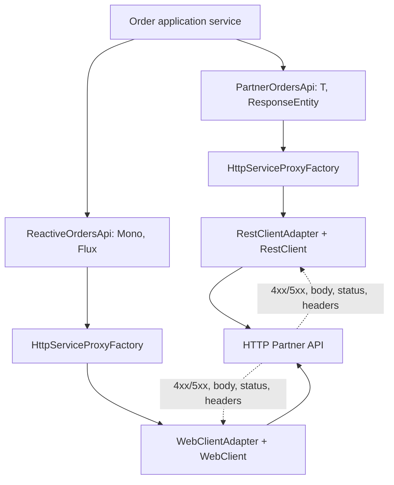
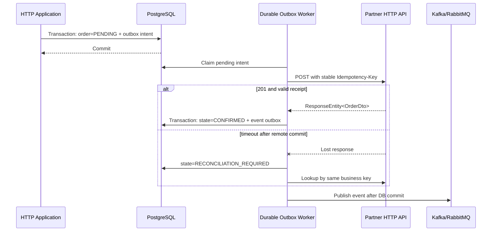
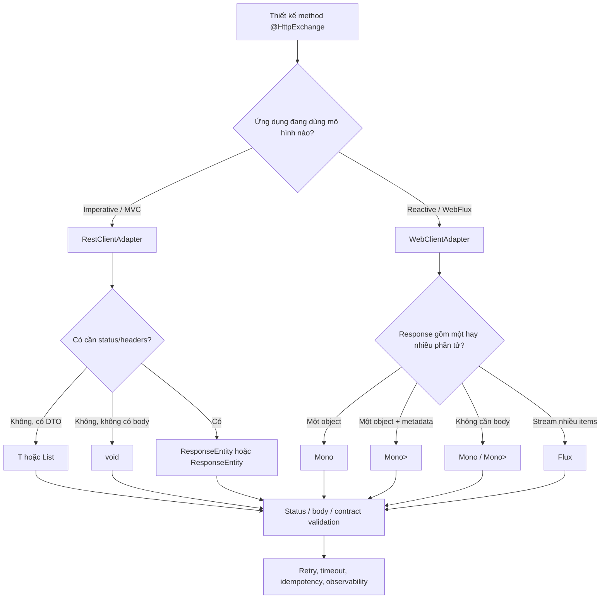

# Kiểu trả về đồng bộ, ResponseEntity và kiểu reactive

> **Chương:** HTTP interface  
> **Module:** SPRING_BOOT_INTEGRATION — tích hợp hệ thống trong Spring Boot qua HTTP client, cơ sở dữ liệu, cache, broker thông điệp và adapter Spring Integration; trọng tâm là cấu hình, hợp đồng dữ liệu, giao dịch, lỗi, xử lý trùng lặp, kiểm thử và quan sát luồng tích hợp thực tế.

## 1. Tại sao kiểu trả về là một phần của hợp đồng HTTP?

Giả sử dịch vụ đặt hàng cần gọi API đối tác:

- `GET /v1/orders/{id}`: lấy thông tin một đơn.
- `POST /v1/orders`: tạo đơn và nhận `201 Created` cùng `Location`.
- `DELETE /v1/orders/{id}`: hủy/xóa theo contract, có thể nhận `204 No Content`.
- `GET /v1/orders/events`: nhận dòng sự kiện phát liên tục dưới dạng streaming.

Cả bốn endpoint đều dùng HTTP nhưng **không nên có cùng kiểu trả về**. Trả `OrderDto` từ GET có thể đủ nếu chỉ cần dữ liệu; nhưng POST tạo mới cần giữ **status, header và body** để đối soát. DELETE hợp đồng không có body có thể dùng `void` hoặc `ResponseEntity<Void>`. API streaming cần cách biểu diễn **bất đồng bộ, nhiều phần tử và backpressure**, chẳng hạn `Flux<OrderEvent>`.

Spring Framework hỗ trợ **HTTP Service Interfaces** (giao diện khai báo client) qua `@HttpExchange` và các annotation như `@GetExchange`, `@PostExchange`. `HttpServiceProxyFactory` tạo proxy để thực thi method dựa trên một HTTP client adapter; chính adapter và kiểu trả về quyết định cách dữ liệu, headers, status và tín hiệu lỗi đi vào code.

### 1.1. Bài toán chọn sai return type

```java
// Đối tác quy định POST thành công trả 201 và Location.
@PostExchange("/v1/orders")
OrderDto create(@RequestBody CreateOrderRequest request);
```

Giao diện trên chỉ bộc lộ body. Nếu tầng nghiệp vụ cần `Location` để tra cứu lại đơn sau timeout, method đã **bỏ mất thông tin quan trọng của protocol**. Thay vào đó:

```java
@PostExchange("/v1/orders")
ResponseEntity<OrderDto> create(
        @RequestBody CreateOrderRequest request);
```

Ngược lại, nếu GET luôn chỉ cần danh sách DTO, việc bắt mọi service layer phụ thuộc vào `ResponseEntity<List<OrderDto>>` có thể làm **rò rỉ chi tiết HTTP** vào domain model. Kiểu trả về phải đúng **nhu cầu ứng dụng**, không phải cứ “nhiều metadata hơn là tốt hơn”.

### 1.2. Mục tiêu học tập

Sau bài này, bạn có thể:

1. Tạo HTTP interface dựa trên `@HttpExchange`, `RestClientAdapter` và `WebClientAdapter`.
2. Phân biệt kiểu trả về **đồng bộ** như `T`, `void`, `ResponseEntity<T>`, `ResponseEntity<Void>` với **reactive** như `Mono<T>`, `Mono<ResponseEntity<T>>` và `Flux<T>`.
3. Chọn khi nào cần body, status, headers, `Location`, `ETag` hoặc `Retry-After`.
4. Xử lý response rỗng, `204`, `202`, `304`, `404`, lỗi parse JSON và phản hồi sai hợp đồng.
5. Hiểu ranh giới blocking/non-blocking, subscription, timeout, cancellation và backpressure.
6. Giữ dữ liệu HTTP ở adapter boundary, mapping thành domain result để tránh coupling.
7. Kiểm thử proxy đồng bộ với `MockRestServiceServer` và proxy reactive với một HTTP test server thật.

## 2. HTTP interface là client contract, không phải controller

Trong Spring Framework 6.1+, một HTTP interface có thể như sau:

```java
// PartnerOrdersApi.java
import java.util.List;
import org.springframework.http.ResponseEntity;
import org.springframework.web.bind.annotation.PathVariable;
import org.springframework.web.bind.annotation.RequestBody;
import org.springframework.web.bind.annotation.RequestHeader;
import org.springframework.web.bind.annotation.RequestParam;
import org.springframework.web.service.annotation.DeleteExchange;
import org.springframework.web.service.annotation.GetExchange;
import org.springframework.web.service.annotation.HttpExchange;
import org.springframework.web.service.annotation.PostExchange;

@HttpExchange(url = "/v1/orders", accept = "application/json")
public interface PartnerOrdersApi {

    @GetExchange("/{orderId}")
    OrderDto getById(@PathVariable String orderId);

    @GetExchange
    List<OrderDto> findByCustomer(
            @RequestParam String customerId);

    @PostExchange(contentType = "application/json")
    ResponseEntity<OrderDto> create(
            @RequestBody CreateOrderRequest request,
            @RequestHeader("Idempotency-Key") String idempotencyKey);

    @DeleteExchange("/{orderId}")
    ResponseEntity<Void> delete(@PathVariable String orderId);
}
```

Các annotation mang những phần của hợp đồng HTTP:

| Annotation | Ý nghĩa ở **client** | Không nên suy rằng |
| --- | --- | --- |
| `@HttpExchange` | Base path, method, content type, accept trên interface/method | Tự đăng ký route server với MVC |
| `@GetExchange` | HTTP GET tới path đã khai báo | Response chắc chắn 200 hoặc có body |
| `@PostExchange` | HTTP POST, có thể gửi body | POST tự idempotent hoặc có DB transaction |
| `@DeleteExchange` | HTTP DELETE | Phản hồi luôn 204 hoặc resource luôn bị xóa |
| `@RequestBody` | Serialize request object | Tự validate toàn bộ business rule |
| `@PathVariable` | Gắn biến vào URI template | Server chắc chắn có resource |
| `@RequestParam` | Gửi query parameter | Không cần encoding/validation |
| `@RequestHeader` | Gửi header per invocation | Không cần quản lý token/secret |

HTTP service interface là **giao diện khai báo cho client proxy**. `@HttpExchange` cũng có thể được Spring MVC/WebFlux sử dụng ở một số mô hình server-side contract, nhưng trong bài này ta dùng rõ **outbound HTTP client** qua `HttpServiceProxyFactory`, không thay thế `@RestController` hoặc inbound route mapping.

### 2.1. DTO thuộc hợp đồng đối tác

```java
import java.math.BigDecimal;
import java.time.Instant;

public record CreateOrderRequest(
        String customerId,
        BigDecimal amount,
        String currency) {
}

public record OrderDto(
        String id,
        String customerId,
        String state,
        BigDecimal amount,
        Instant createdAt) {
}
```

Những DTO này là **contract examples**. API thật cần xác định validation, nullability, field naming, enum/state version, currency/scale, timezone và chính sách schema evolution. Không serialize thẳng JPA entity/Redis cache object thành hợp đồng HTTP công khai.

### 2.2. Vì sao không trả entity repository?

Nếu HTTP interface khai báo trả `PurchaseOrderEntity`, tầng tích hợp bị ràng buộc vào persistence mapping: lazy-loaded associations, database column names, cache fields và migration có thể ảnh hưởng schema đối tác. Nên tách:

```text
Partner JSON
   ↓ Jackson / HTTP interface
PartnerOrderDto
   ↓ validate + normalize
DomainOrder / ApplicationResult
   ↓ persistence mapping
JPA entity / JDBC row / R2DBC record
```

Tách tầng giúp một response 200 sai schema không bị coi là entity hợp lệ rồi ghi xuống database.

## 3. Kiến trúc hai adapter và “thế giới” return type



| Mô hình | Adapter tiêu biểu | Kiểu trả về nên chọn | Execution model |
| --- | --- | --- | --- |
| **HTTP đồng bộ** | `RestClientAdapter` từ `RestClient` | `T`, `List<T>`, `void`, `ResponseEntity<T>`, `ResponseEntity<Void>` | Method thường block đến response/exception |
| **HTTP reactive** | `WebClientAdapter` từ `WebClient` | `Mono<T>`, `Mono<ResponseEntity<T>>`, `Mono<Void>`, `Flux<T>` | Publisher thường lazy; I/O khi subscribe |
| **Metadata-only** | Adapter hỗ trợ kiểu metadata tương ứng | `ResponseEntity<Void>`, có thể các kiểu `HttpHeaders`/status tùy API adapter | Không cần parse DTO body |
| **Streaming** | Thường `WebClientAdapter` | `Flux<T>` | Có thể phát nhiều items, hỗ trợ cancellation/backpressure |

Với Spring Framework mới, danh sách return types hỗ trợ có thể mở rộng hoặc thay đổi theo adapter/version. Bài minh họa các loại thông dụng trên **Spring Boot 3.2–3.5 / Spring Framework 6.1–6.2 / Spring WebFlux 6.x**. Khi nâng Boot 4.x, đối chiếu tài liệu return type và API tương ứng trước khi copy code.

**Lưu ý:** reactive return type không có nghĩa server response là bất đồng bộ theo nghiệp vụ. Một `Mono<OrderDto>` chỉ là mô tả **I/O client không chặn thread cho tới khi subscribe**. Partner có thể đã xử lý đồng bộ và trả 200/201, hoặc trả 202 và thực hiện công việc sau; đó là semantics của HTTP status/business contract, không do việc dùng Mono quyết định.

## 4. Cấu hình proxy đồng bộ với RestClientAdapter

### 4.1. Dependency Gradle

```groovy
// Dự án đã áp dụng Spring Boot plugin và BOM tương thích.
dependencies {
    implementation 'org.springframework.boot:spring-boot-starter-web'
    implementation 'org.springframework.boot:spring-boot-starter-validation'

    testImplementation 'org.springframework.boot:spring-boot-starter-test'
}
```

`spring-boot-starter-web` cung cấp infrastructure MVC/Jackson và `RestClient` trên Boot 3.2+. Nếu ứng dụng **chỉ là client**, có thể chọn các modules cần thiết mà không cần mở HTTP server; minh họa dùng starter để dễ theo dõi. Không thêm reactive WebFlux dependency chỉ để tạo một HTTP interface đồng bộ.

### 4.2. Externalized configuration

```yaml
# application.yml
integration:
  partner:
    orders:
      base-url: ${PARTNER_ORDERS_BASE_URL}
```

```java
// PartnerOrdersConfiguration.java
import org.springframework.beans.factory.annotation.Value;
import org.springframework.context.annotation.Bean;
import org.springframework.context.annotation.Configuration;
import org.springframework.web.client.RestClient;
import org.springframework.web.client.support.RestClientAdapter;
import org.springframework.web.service.invoker.HttpServiceProxyFactory;

@Configuration(proxyBeanMethods = false)
class PartnerOrdersConfiguration {

    @Bean
    PartnerOrdersApi partnerOrdersApi(
            RestClient.Builder builder,
            @Value("${integration.partner.orders.base-url}")
                    String baseUrl) {

        RestClient restClient = builder.baseUrl(baseUrl).build();
        RestClientAdapter adapter = RestClientAdapter.create(restClient);

        HttpServiceProxyFactory factory =
                HttpServiceProxyFactory.builderFor(adapter).build();
        return factory.createClient(PartnerOrdersApi.class);
    }
}
```

Inject `RestClient.Builder` do Boot quản lý giúp kế thừa message converters, observation/customizers, request factory/TLS config của ứng dụng khi chúng đã được cấu hình. Nếu project tự tạo `RestClient.create(...)` khắp nơi, dễ bỏ qua cấu hình security, timeout, proxy hoặc correlation headers. Trong production, cần xác định connect/read timeout và tổng deadline theo request factory thực tế.

**Bảo mật:** `PARTNER_ORDERS_BASE_URL` là cấu hình deployment đáng tin cậy, không phải URL được người dùng gửi trực tiếp; tránh SSRF và rò rỉ bearer token/cookie. Các credentials lấy từ secret manager/environment, không hard-code vào source/YAML.

### 4.3. Call site có tính đồng bộ

```java
import org.springframework.stereotype.Service;

@Service
public class OrderLookupService {
    private final PartnerOrdersApi partner;

    public OrderLookupService(PartnerOrdersApi partner) {
        this.partner = partner;
    }

    public String currentState(String orderId) {
        OrderDto remote = partner.getById(orderId);
        if (remote == null || remote.id() == null
                || remote.state() == null) {
            throw new IllegalStateException(
                    "Upstream returned invalid order payload");
        }
        return remote.state();
    }
}
```

`partner.getById(...)` với `RestClientAdapter` thường hoàn tất khi đã nhận/deserialize body hoặc ném lỗi; nó **chiếm thread của caller trong lúc chờ I/O**. Điều này phù hợp MVC/imperative workflows khi đã giới hạn timeouts và concurrency. Không đưa lời gọi blocking trực tiếp lên Reactor Netty event loop hoặc thread xử lý reactivity nhạy latency.

### 4.4. Không tự coi null là 404

Với `RestClientAdapter`, HTTP 404 thường đi theo error handling của `RestClient` (ví dụ `HttpClientErrorException.NotFound`). Một body `null` có thể đến từ response rỗng, `204` hoặc JSON literal `null` tùy API/converter. Không viết logic “`remote == null` nghĩa là order không tồn tại” trừ khi contract đã quy định và gateway đã map status tương ứng.

## 5. Ma trận kiểu trả về đồng bộ: T, List<T>, void và ResponseEntity<T>

| Khai báo HTTP interface | Khi dùng | Nhận được | Mất hoặc cần thêm |
| --- | --- | --- | --- |
| `OrderDto` | GET object chỉ cần body | DTO đã deserialize | Không lộ status/headers cho caller |
| `List<OrderDto>` | GET JSON array | Danh sách typed DTO | Metadata pagination/header |
| `void` | Endpoint thành công không cần body | Không cần response content | Không có status/header để quyết định |
| `ResponseEntity<OrderDto>` | Cần status, headers và body | `getStatusCode()`, `getHeaders()`, `getBody()` | Phải validate body có thể null |
| `ResponseEntity<Void>` | Cần status/headers nhưng không parse body | Metadata HTTP | Không có DTO content |
| `ResponseEntity<List<OrderDto>>` | Danh sách + header phân trang, ETag | List và metadata | Có nguy cơ đẩy chi tiết HTTP lên domain |

### 5.1. Trả body `T` chỉ phù hợp khi metadata không quan trọng

```java
@GetExchange("/{orderId}")
OrderDto getById(@PathVariable String orderId);
```

Ưu điểm: caller dùng ngay DTO, interface dễ đọc. Nhược điểm: nếu sau này cần xử lý `ETag` để optimistic concurrency hoặc `Retry-After`, method chưa biểu diễn thông tin đó. Đổi return type là thay đổi source contract của các caller.

### 5.2. Danh sách generic khác raw List

```java
@GetExchange
List<OrderDto> findByCustomer(
        @RequestParam String customerId);
```

Proxy có thể dùng metadata generic của method để xây type token cho converter. Đừng khai báo raw `List` hoặc `Object` rồi ép phần tử về `OrderDto`: Jackson có thể deserialize thành `LinkedHashMap`, gây `ClassCastException` muộn ở application layer. Với envelope phân trang, dùng DTO như `PageEnvelope<OrderDto>` thay vì JSON array giả định.

### 5.3. Void là “không cần body”, không phải “không biết HTTP status”

```java
@DeleteExchange("/{orderId}")
void deleteIgnoringBody(@PathVariable String orderId);
```

Một client phù hợp có thể vẫn **ném exception khi nhận HTTP error**. Return type void chỉ nghĩa caller không nhận body/metadata dưới dạng giá trị trả về. Nếu DELETE yêu cầu phân biệt 202 Accepted, 204 No Content, 404 Not Found hoặc đọc header version, dùng `ResponseEntity<Void>`.

### 5.4. ResponseEntity<T> giữ body và status/headers

```java
@PostExchange(contentType = "application/json")
ResponseEntity<OrderDto> create(
        @RequestBody CreateOrderRequest request,
        @RequestHeader("Idempotency-Key") String key);
```

Đọc kết quả:

```java
ResponseEntity<OrderDto> response =
        partner.create(request, "order-42-create");

if (response.getStatusCode().value() != 201) {
    throw new IllegalStateException(
            "Expected 201 Created from partner");
}
java.net.URI location = response.getHeaders().getLocation();
OrderDto created = response.getBody();
if (location == null || created == null
        || created.id() == null || created.id().isBlank()) {
    throw new IllegalStateException(
            "Invalid success response contract");
}
```

Đoạn này giả định endpoint **quy định 201 + Location + body hợp lệ**. Với API khác, 202+job ticket, 201+Location không body hoặc 200+resource đều có thể hợp lệ. Cách đúng là **viết test theo contract thực**, không coi một cách trả của đối tác là quy tắc HTTP chung.

### 5.5. ResponseEntity<Void> giữ status/headers khi không có body

```java
@DeleteExchange("/{orderId}")
ResponseEntity<Void> delete(
        @PathVariable String orderId);
```

```java
ResponseEntity<Void> response = partner.delete("order-42");
if (response.getStatusCode().value() != 204) {
    throw new IllegalStateException(
            "Partner did not return agreed 204 response");
}
```

`ResponseEntity<Void>` phù hợp khi endpoint cam kết no-content nhưng caller vẫn cần status, `ETag` hoặc một header audit/correlation. **Không** kỳ vọng `getBody()` có payload từ generic type `Void`.

## 6. Status, header và body: những hợp đồng không thể suy ra từ generic type

Kiểu trả về Java chỉ mô tả **hình dạng giá trị client muốn nhận**. Server có thể trả nhiều status, headers khác nhau, body rỗng, JSON sai schema hoặc lỗi mạng. Adapter phải kiểm tra **ý nghĩa giao thức** trước khi chuyển sang domain result.

### 6.1. Ma trận HTTP status thường gặp

| Status | Ý nghĩa thông thường | Điều cần chú ý khi chọn kiểu trả về |
| --- | --- | --- |
| **200 OK** | Request thành công, thường có representation | `T` hoặc `ResponseEntity<T>`; body phải được validate |
| **201 Created** | Tài nguyên được tạo | `ResponseEntity<T>` khi cần `Location`/ETag và body |
| **202 Accepted** | Request được chấp nhận để xử lý sau | DTO ticket/operation ID, không coi đã hoàn tất nghiệp vụ |
| **204 No Content** | Thành công không có response body | `void` hoặc `ResponseEntity<Void>`; không ép thành DTO |
| **206 Partial Content** | Trả một phần representation | Cần hỗ trợ Range/Content-Range đúng contract |
| **304 Not Modified** | Thông báo cache validation, không có body mới | Kết hợp ETag/cache state; không suy là JSON rỗng hợp lệ |
| **400/422** | Sai request hoặc business validation | Error taxonomy; không parse thành success DTO |
| **401/403** | Authn/authz hoặc policy của upstream | Không mặc định là lỗi user cuối khi service credential sai |
| **404** | Không tìm thấy target theo endpoint semantics | Không tự đổi sang `null`/`Optional.empty()` |
| **409/412** | Conflict/optimistic concurrency | Phân biệt idempotency replay với payload mismatch |
| **429** | Rate limit | Dùng `Retry-After`, max attempts, deadline |
| **502/503/504** | Lỗi gateway/dependency | Với write, outcome có thể chưa rõ dù status là lỗi |

### 6.2. HTTP 204 không nên được deserialize như OrderDto

Một method `@GetExchange` trả `OrderDto` nhưng server lại gửi 204 có thể dẫn tới body null hoặc trạng thái không khớp contract. Mã như:

```java
OrderDto order = partner.getById("order-42");
String state = order.state(); // Có thể NullPointerException.
```

sẽ che nguyên nhân: **phản hồi upstream không đúng hợp đồng**, chứ không phải domain không có state. Với endpoint phải trả JSON object, dùng `ResponseEntity<OrderDto>` và validate:

```java
ResponseEntity<OrderDto> response =
        partner.getWithMetadata("order-42");
if (response.getStatusCode().value() != 200
        || response.getBody() == null
        || response.getBody().id() == null) {
    throw new PartnerContractException(
            "Expected 200 with complete order body");
}
```

`getWithMetadata(...)` là **method bổ sung minh họa** phải được khai báo trong interface khi dùng, ví dụ:

```java
@GetExchange("/{orderId}")
ResponseEntity<OrderDto> getWithMetadata(
        @PathVariable String orderId);
```

Điều quan trọng: `ResponseEntity<T>` giúp kiểm tra status/headers, **không tự validate toàn bộ DTO**; việc kiểm tra required fields, amount, currency và state vẫn là trách nhiệm ở adapter/domain boundary.

### 6.3. HEAD: metadata mà không có entity body

Nếu đối tác có `HEAD /v1/orders/{id}` để trả `ETag`, `Last-Modified` hoặc `Content-Length`:

```java
import org.springframework.http.ResponseEntity;
import org.springframework.web.bind.annotation.PathVariable;
import org.springframework.web.service.annotation.HttpExchange;

@HttpExchange(method = "HEAD", url = "/v1/orders/{orderId}")
ResponseEntity<Void> head(@PathVariable String orderId);
```

Đây là một **method fragment**, đặt trong interface thích hợp. Nó không phải `@GetExchange` nhưng yêu cầu method HEAD. `ResponseEntity<Void>` giúp đọc status/headers; nếu chỉ cần header, một số adapter/phiên bản hỗ trợ return type metadata trực tiếp như `HttpHeaders`, nhưng `ResponseEntity<Void>` là lựa chọn rõ ràng khi còn cần status.

**Không** dùng `ResponseEntity<OrderDto>` rồi cố deserialize body khi HTTP HEAD đúng chuẩn không gửi representation body.

### 6.4. ETag và If-Match dùng cho optimistic concurrency

Giả sử GET trả:

```http
HTTP/1.1 200 OK
Content-Type: application/json
ETag: "order-rev-7"

{"id":"order-42","state":"NEW"}
```

Khi cập nhật order:

```java
import org.springframework.web.bind.annotation.RequestHeader;
import org.springframework.web.service.annotation.PutExchange;

@PutExchange(
        url = "/{orderId}",
        contentType = "application/json")
ResponseEntity<OrderDto> replace(
        @PathVariable String orderId,
        @RequestHeader("If-Match") String etag,
        @RequestBody ReplaceOrderRequest request);
```

`ReplaceOrderRequest` là DTO minh họa cần khai báo theo contract. Caller lấy `response.getHeaders().getETag()` từ GET đã kiểm chứng, rồi gửi lại header `If-Match`. Nếu server trả `412 Precondition Failed`, phải reload state và xem có được thực hiện lại transition hay không; không retry nguyên ETag cũ vô hạn.

### 6.5. Location và 202 Accepted

Đối tác có thể trả:

```http
HTTP/1.1 202 Accepted
Location: /v1/operations/op-9f4
Retry-After: 3

{"operationId":"op-9f4","state":"PENDING"}
```

Return type hợp lý là `ResponseEntity<OperationTicket>` thay vì `OrderDto`, vì **order cuối cùng chưa có**:

```java
public record OperationTicket(
        String operationId, String state) {
}

@PostExchange(
        url = "/v1/imports",
        contentType = "application/json")
ResponseEntity<OperationTicket> startImport(
        @RequestBody ImportRequest request);
```

`ImportRequest` là DTO của API nhập dữ liệu giả định. Application phải lưu operation ID, kiểm tra `Location` có hợp lệ/đáng tin hay không, rồi poll hoặc nhận webhook/event theo contract. Không trả kết quả “COMPLETED” chỉ vì HTTP 202.

### 6.6. Header có thể chứa dữ liệu nhạy cảm

`ResponseEntity.getHeaders()` có thể bao gồm `Set-Cookie`, auth-related headers hoặc dấu vết proxy. Khi log, chỉ chọn fields cần thiết: `status`, `ETag` đã sanitize, `Location` an toàn, correlation ID hoặc `Retry-After`. Không serialize toàn bộ `ResponseEntity` lên log ở mức INFO trong production.

## 7. Proxy reactive với WebClientAdapter

Trong ứng dụng WebFlux hoặc một workflow cần composition bất đồng bộ, khai báo kiểu reactive giúp giữ **non-blocking I/O** và xử lý luồng qua Reactor. Chọn `WebClientAdapter` thay vì `RestClientAdapter` để các method khai báo `Mono`, `Flux`.

### 7.1. Dependency

```groovy
dependencies {
    implementation 'org.springframework.boot:spring-boot-starter-webflux'
    implementation 'org.springframework.boot:spring-boot-starter-validation'

    testImplementation 'org.springframework.boot:spring-boot-starter-test'
    testImplementation 'io.projectreactor:reactor-test'
}
```

Ví dụ sử dụng `WebClient` và `reactor.core.publisher.Mono/Flux` trong Spring Framework 6.1–6.2. Ứng dụng chỉ cần client reactive có thể dùng modules phù hợp mà không bắt buộc xây server WebFlux. Nếu trên classpath có cả MVC và WebFlux starters, Spring Boot mặc định có thể chọn web application type MVC; **không suy rằng chỉ thêm WebFlux dependency sẽ làm tất cả controller trở thành non-blocking**.

### 7.2. Reactive HTTP interface

```java
// ReactivePartnerOrdersApi.java
import java.util.List;
import org.springframework.http.ResponseEntity;
import org.springframework.web.bind.annotation.PathVariable;
import org.springframework.web.bind.annotation.RequestBody;
import org.springframework.web.bind.annotation.RequestHeader;
import org.springframework.web.bind.annotation.RequestParam;
import org.springframework.web.service.annotation.GetExchange;
import org.springframework.web.service.annotation.HttpExchange;
import org.springframework.web.service.annotation.PostExchange;
import reactor.core.publisher.Flux;
import reactor.core.publisher.Mono;

@HttpExchange(
        url = "/v1/orders",
        accept = "application/json")
public interface ReactivePartnerOrdersApi {

    @GetExchange("/{orderId}")
    Mono<OrderDto> getById(
            @PathVariable String orderId);

    @GetExchange("/{orderId}")
    Mono<ResponseEntity<OrderDto>> getWithMetadata(
            @PathVariable String orderId);

    @GetExchange
    Mono<List<OrderDto>> findByCustomer(
            @RequestParam String customerId);

    @PostExchange(contentType = "application/json")
    Mono<ResponseEntity<OrderDto>> create(
            @RequestBody CreateOrderRequest request,
            @RequestHeader("Idempotency-Key") String key);

    @GetExchange(url = "/events", accept = "application/x-ndjson")
    Flux<OrderEvent> events();
}
```

Ví dụ `OrderEvent` được định nghĩa như:

```java
import java.time.Instant;

public record OrderEvent(
        String eventId,
        String orderId,
        String type,
        Instant occurredAt) {
}
```

**Hai kiểu trả về cho danh sách khác nhau:**

- `Mono<List<OrderDto>>` là **một response JSON array** được deserialize toàn bộ thành một list (hữu ích với page nhỏ/hữu hạn).
- `Flux<OrderDto>` thường dùng khi client thực sự muốn nhận **nhiều phần tử** từ body; với streaming NDJSON/SSE có thể xử lý tăng dần nếu HTTP codec và server truyền theo định dạng streaming. Dùng Flux cho JSON array lớn không bảo đảm toàn bộ pipeline streaming theo ý muốn nếu converter/proxy/buffers/server không hỗ trợ.

### 7.3. Tạo proxy từ WebClientAdapter

```java
// ReactivePartnerOrdersConfiguration.java
import org.springframework.beans.factory.annotation.Value;
import org.springframework.context.annotation.Bean;
import org.springframework.context.annotation.Configuration;
import org.springframework.web.reactive.function.client.WebClient;
import org.springframework.web.reactive.function.client.support.WebClientAdapter;
import org.springframework.web.service.invoker.HttpServiceProxyFactory;

@Configuration(proxyBeanMethods = false)
class ReactivePartnerOrdersConfiguration {

    @Bean
    ReactivePartnerOrdersApi reactivePartnerOrdersApi(
            WebClient.Builder builder,
            @Value("${integration.partner.orders.base-url}")
                    String baseUrl) {

        WebClient webClient = builder.baseUrl(baseUrl).build();
        WebClientAdapter adapter = WebClientAdapter.create(webClient);
        HttpServiceProxyFactory factory =
                HttpServiceProxyFactory.builderFor(adapter).build();
        return factory.createClient(ReactivePartnerOrdersApi.class);
    }
}
```

Inject builder do Boot cung cấp giúp áp dụng codecs, observation, client connector/TLS khi chúng được cấu hình. `WebClientAdapter` có thể hỗ trợ những return types đồng bộ với cơ chế block timeout ở các phiên bản framework phù hợp, nhưng **kiến trúc bài này cố ý trả Mono/Flux qua adapter reactive**; không xây một proxy mà mọi caller phải `.block()` mới hoạt động.

### 7.4. Mono<T> không chạy khi chỉ được tạo

```java
Mono<OrderDto> pending =
        reactiveApi.getById("order-42");
// Chưa có subscription từ caller/framework.

pending.subscribe(order -> {
    // Callback chạy bất đồng bộ: chỉ là minh họa,
    // đừng tự subscribe rời rạc trong business service.
});
```

Một `Mono` thường **lazy/cold**, và HTTP request thực sự được thực thi khi có subscription. Nếu subscribe lại cùng cold `Mono`, có thể phát sinh **request mới**; điều này đặc biệt quan trọng với POST side effects.

Trong Spring WebFlux controller, thường **trả Mono/Flux cho framework subscribe** thay vì gọi `subscribe()` thủ công. Trong service layer, composition với `map/flatMap/then/onErrorResume` giữ execution/error/cancellation trong một pipeline có kiểm soát.

### 7.5. Composition không block

```java
import reactor.core.publisher.Mono;
import org.springframework.stereotype.Service;

@Service
class ReactiveOrderLookupService {
    private final ReactivePartnerOrdersApi partner;

    ReactiveOrderLookupService(ReactivePartnerOrdersApi partner) {
        this.partner = partner;
    }

    Mono<String> currentState(String orderId) {
        return partner.getById(orderId)
                .switchIfEmpty(Mono.error(
                        new PartnerContractException(
                                "Missing order body")))
                .flatMap(order -> {
                    if (order.id() == null
                            || order.state() == null) {
                        return Mono.error(
                                new PartnerContractException(
                                        "Invalid partner order"));
                    }
                    return Mono.just(order.state());
                });
    }
}
```

Ở đây lỗi không được ném khi mới lấy biến `Mono`; nhiều lỗi phát sinh thành tín hiệu `onError` **sau khi subscribe**. Một `try/catch` bao quanh lời gọi `partner.getById(...)` sẽ không bắt được mọi lỗi HTTP/reactive xảy ra sau đó.

## 8. Mono<ResponseEntity<T>>, Mono<Void> và Flux<T>

### 8.1. Mono<ResponseEntity<T>> để giữ status, headers và body

```java
Mono<ResponseEntity<OrderDto>> responsePublisher =
        reactiveApi.create(request, "order-42-create");

Mono<OrderDto> createdOrder =
        responsePublisher.flatMap(response -> {
            if (response.getStatusCode().value() != 201) {
                return Mono.error(
                        new PartnerContractException(
                                "Expected 201 Created"));
            }
            OrderDto body = response.getBody();
            if (body == null || body.id() == null) {
                return Mono.error(
                        new PartnerContractException(
                                "Missing order receipt"));
            }
            return Mono.just(body);
        });
```

`responsePublisher` là **một publisher phát ra một ResponseEntity** khi nhận response. Nếu cần metadata nhưng không có body, có thể khai báo `Mono<ResponseEntity<Void>>`. Việc dùng `ResponseEntity<T>` bên trong Mono không làm mất tính reactive; trạng thái sẽ có khi HTTP response được xử lý trong subscription.

### 8.2. Mono<Void> khác Mono<ResponseEntity<Void>>

```java
@HttpExchange(method = "DELETE", url = "/{orderId}")
Mono<Void> deleteNoMetadata(
        @PathVariable String orderId);

@HttpExchange(method = "DELETE", url = "/{orderId}")
Mono<ResponseEntity<Void>> deleteWithMetadata(
        @PathVariable String orderId);
```

`Mono<Void>` hoàn tất bằng `onComplete` khi không cần trả phần tử; client vẫn có thể phát `onError` cho HTTP error. `Mono<ResponseEntity<Void>>` phát **một metadata object** chứa status/headers và body không mong đợi. Nếu API cần phân biệt 202/204, return metadata thay vì vứt bỏ nó.

Không dùng `Mono<Void>` rồi `defaultIfEmpty(new OrderDto(...))` để “tạo response thành công” khi không có body; đó là đánh tráo contract. `Mono.empty()` là một kết quả về **số phần tử phát ra**, không phải HTTP 404.

### 8.3. Flux<T> cho các phần tử đến dần

Khi server cung cấp NDJSON:

```http
HTTP/1.1 200 OK
Content-Type: application/x-ndjson

{"eventId":"evt-1","orderId":"order-42","type":"CREATED"}
{"eventId":"evt-2","orderId":"order-42","type":"CONFIRMED"}
```

Client có thể trả:

```java
@GetExchange(
        url = "/events",
        accept = "application/x-ndjson")
Flux<OrderEvent> events();
```

`Flux<OrderEvent>` phù hợp khi body có nhiều records và codec có thể decode tăng dần. **Không được kết luận** mọi upstream gửi JSON array đều truyền theo thời gian thực; nếu server trả toàn bộ array sau khi tạo xong, `Flux` vẫn có thể nhận các phần tử theo batch/chunks. Với SSE, media type và kiểu element (có thể `ServerSentEvent<OrderEvent>`) phải phù hợp decoder và contract của đối tác.

### 8.4. Backpressure có giới hạn thực tế

Trong Reactor, downstream subscriber có thể giới hạn demand. Tuy nhiên TCP socket, server send buffer, JSON decoder và HTTP chunking có giới hạn/buffer riêng; backpressure **không bảo đảm** partner server sẽ dừng sinh dữ liệu chính xác sau mỗi item. Với streams lớn:

- Giới hạn concurrency, batch/window size và in-memory buffers.
- Xử lý cancellation khi client disconnect; giải phóng resource.
- Có idle timeout hoặc heartbeat cho stream dài.
- Có checkpoint/cursor nếu muốn reconnect/resume sau mất mạng.
- Đặt giới hạn lỗi parse/invalid record; không âm thầm nuốt record lỗi.
- Không mở PostgreSQL transaction xuyên suốt một stream vô hạn.

### 8.5. Reactive return type không làm công việc blocking trở thành non-blocking

```java
// Anti-pattern trong reactor event-loop:
Mono<OrderDto> load(String id) {
    OrderEntity entity = jpaRepository.findById(id).orElseThrow();
    return Mono.just(map(entity));
}
```

Đoạn này vẫn chạy JPA blocking **trước khi trả Mono**, có thể chặn event loop. Nếu cần tích hợp legacy blocking:

```java
Mono<OrderDto> loadLegacy(String id) {
    return Mono.fromCallable(() -> {
                OrderEntity entity =
                        jpaRepository.findById(id).orElseThrow();
                return map(entity);
            })
            .subscribeOn(
                    reactor.core.scheduler.Schedulers.boundedElastic());
}
```

Đây là **giải pháp tương thích tạm thời có giới hạn concurrency**, không biến JDBC/JPA thành R2DBC hay làm transaction thread-bound tự lan xuyên mọi Reactor operators. Khi hệ thống chủ yếu imperative, thường hợp lý hơn dùng `RestClientAdapter` và thread model đã được đo đạc.

## 9. HTTP error và reactive error signal không được biểu diễn bằng cùng một “giá trị rỗng”

HTTP interface không tự chuyển status lỗi thành domain result. Theo cấu hình mặc định thông thường, các HTTP adapters xử lý 4xx/5xx theo HTTP client đang dùng:

| Tầng | Loại lỗi thường gặp | Khi nào lỗi xuất hiện |
| --- | --- | --- |
| `RestClientAdapter` | `HttpClientErrorException`, `HttpServerErrorException`, `RestClientResponseException` | Trong lời gọi đồng bộ; có thể ném trực tiếp |
| `RestClientAdapter` | `ResourceAccessException` | Khi I/O/DNS/connection/timeout không có response hợp lệ |
| `WebClientAdapter` | `WebClientResponseException` và subclasses như `NotFound` | Thành tín hiệu `onError` trên publisher |
| `WebClientAdapter` | `WebClientRequestException` | Khi request/network thất bại trước khi có response hợp lệ |
| Cả hai | Conversion/decoding exception | Response body sai JSON/Content-Type/schema |
| Application adapter | `PartnerContractException`/domain error | Status/body không khớp hợp đồng đã định |

### 9.1. Exception minh họa cho contract violation

```java
// PartnerContractException.java
public final class PartnerContractException
        extends RuntimeException {

    public PartnerContractException(String message) {
        super(message);
    }

    public PartnerContractException(
            String message, Throwable cause) {
        super(message, cause);
    }
}
```

Đây là exception do ứng dụng định nghĩa, **không phải class Spring có sẵn**. Khi log/trả lỗi cho caller, tránh đặt raw response body vào message vì có thể chứa PII, token và thông tin nội bộ đối tác.

### 9.2. HTTP 404 không tự trở thành Optional.empty()

Với GET đơn hàng, một contract có thể quy định **mọi 404 đúng endpoint nghĩa là đơn không tồn tại**. Nếu vậy, có thể map tại lớp adapter:

```java
// Fragment của adapter imperative:
import java.util.Optional;
import org.springframework.web.client.HttpClientErrorException;

Optional<OrderDto> find(String orderId) {
    try {
        OrderDto dto = partner.getById(orderId);
        if (dto == null) {
            throw new PartnerContractException(
                    "Missing successful order body");
        }
        return Optional.of(dto);
    } catch (HttpClientErrorException.NotFound notFound) {
        return Optional.empty();
    }
}
```

Chỉ dùng mapping này khi contract đảm bảo 404 thực sự là `ORDER_NOT_FOUND`. Một proxy/ngateway có thể trả 404 do route bị cấu hình sai hoặc API version cũ; trong trường hợp đó, nếu contract có error code cụ thể thì **phải kiểm tra code** trước khi cho rằng resource không tồn tại.

Với reactive:

```java
import org.springframework.web.reactive.function.client.WebClientResponseException;
import reactor.core.publisher.Mono;

Mono<OrderDto> findReactive(String orderId) {
    return reactiveApi.getById(orderId)
            .onErrorResume(
                    WebClientResponseException.NotFound.class,
                    error -> Mono.empty());
}
```

Đây cũng là **method fragment trong adapter** với giả định 404 hợp lệ tương đương absence. `Mono.empty()` từ một error mapper như vậy mang ý nghĩa mà **chính adapter đặt ra**; `Mono.empty()` từ body thiếu bất ngờ phải được phân biệt với trường hợp not-found đã xác minh.

### 9.3. ResponseEntity<T> không “cứu” HTTP 500 thành response thành công

```java
@GetExchange("/{orderId}")
ResponseEntity<OrderDto> getWithMetadata(
        @PathVariable String orderId);
```

Với status error, một RestClient/WebClient adapter **vẫn có default error handling**. Không kỳ vọng lời gọi trên sẽ luôn trả `ResponseEntity<OrderDto>` ngay cả khi server gửi 503: mặc định HTTP client có thể ném exception thay vì trả object chứa 503 cho code kiểm tra.

Nếu cần xem toàn bộ 4xx/5xx dưới dạng response (ví dụ proxy transparent), phải cấu hình status handlers/exchange behavior ở **underlying HTTP client** theo API/version, đồng thời có test xác minh error bodies và giới hạn kích thước. Không tắt xử lý lỗi rộng khắp rồi deserialize một HTML 503 thành `OrderDto`.

### 9.4. Không được bắt lỗi reactive bằng try/catch quanh method call

```java
// Sai kỳ vọng: try/catch bên ngoài không bắt mọi lỗi onError.
try {
    Mono<OrderDto> mono = reactiveApi.getById("order-42");
    return mono;
} catch (Exception ex) {
    return Mono.empty();
}
```

Nhiều lỗi xảy ra **sau khi subscribe**, nên cần các toán tử như `onErrorMap`, `onErrorResume`, `doOnError` và `retryWhen`. Hơn nữa, việc `return Mono.empty()` cho mọi exception biến outage thành “không có order”, phá tính đúng đắn của dữ liệu.

### 9.5. Phản hồi 2xx nhưng sai contract là lỗi riêng

Ví dụ:

```http
HTTP/1.1 200 OK
Content-Type: application/json

{"id":null,"state":"SETTLED","amount":-10.00}
```

HTTP status thành công nhưng business invariant sai. Jackson có thể tạo một DTO dù `id=null` hoặc `amount<0`. Bài học không thể chỉ test HTTP status:

- Validate required fields/format và enum/state được hỗ trợ.
- Kiểm tra ID trong response đúng với request.
- Với `BigDecimal` amount, so khớp currency, scale/precision theo contract.
- Nếu API dùng envelope `{"success":false}` dưới HTTP 200, kiểm tra business code sau deserialize.
- Một JSON array trả cho method `OrderDto` là decoding failure; không map thành empty order list.

Không tự retry mọi contract violation: nếu upstream rollout schema mới, gửi lại 10 lần cùng request chỉ gây tăng tải.

## 10. Validate DTO sau khi deserialize: nullable body không tự là hợp lệ

Jakarta Validation có thể mô tả các ràng buộc trên DTO:

```java
// ValidatedOrderDto.java
import jakarta.validation.constraints.DecimalMin;
import jakarta.validation.constraints.NotBlank;
import jakarta.validation.constraints.NotNull;
import java.math.BigDecimal;
import java.time.Instant;

public record ValidatedOrderDto(
        @NotBlank String id,
        @NotBlank String customerId,
        @NotBlank String state,
        @NotNull @DecimalMin("0.01") BigDecimal amount,
        @NotNull Instant createdAt) {
}
```

**Nhưng HTTP interface không mặc định kích hoạt Bean Validation cho tất cả response DTOs**. `@NotBlank` chỉ là metadata ràng buộc, adapter cần gọi validator hoặc cơ chế validation đã được cấu hình/kiểm chứng rõ.

### 10.1. Adapter validate status, body và identity

```java
import jakarta.validation.Validator;
import org.springframework.http.ResponseEntity;

public final class OrderResponseValidator {
    private final Validator validator;

    public OrderResponseValidator(Validator validator) {
        this.validator = validator;
    }

    public ValidatedOrderDto validate(
            ResponseEntity<ValidatedOrderDto> response,
            String expectedOrderId) {
        if (response.getStatusCode().value() != 200) {
            throw new PartnerContractException(
                    "Expected HTTP 200 for order lookup");
        }
        ValidatedOrderDto body = response.getBody();
        if (body == null || !validator.validate(body).isEmpty()) {
            throw new PartnerContractException(
                    "Invalid partner order response");
        }
        if (!expectedOrderId.equals(body.id())) {
            throw new PartnerContractException(
                    "Partner returned an unrelated order");
        }
        return body;
    }
}
```

Đoạn này giả định đã khai báo method HTTP interface trả `ResponseEntity<ValidatedOrderDto>` và đã inject bean `Validator` từ Spring Boot. Nó chủ ý **không log nội dung Bean Validation violations**, vì một số field chứa thông tin người dùng. Với endpoint GET sử dụng 304/ETag, cần nhánh cache-aware riêng thay vì áp cứng HTTP 200.

### 10.2. Dữ liệu vắng mặt và HTTP absence là hai chuyện khác nhau

| Trường hợp | Cần xử lý |
| --- | --- |
| HTTP 404 + error code not found theo contract | Adapter có thể trả `Optional.empty()` hoặc `Mono.empty()` |
| HTTP 200 + JSON literal `null` nhưng contract đòi object | Contract violation |
| HTTP 200 + body rỗng | Contract violation hoặc no-content theo contract riêng |
| HTTP 204 | Thành công không body; phù hợp `void`/`ResponseEntity<Void>` |
| HTTP 200 + `[]` | Danh sách rỗng **hợp lệ khi API trả list** |
| HTTP 200 + `{}` thiếu ID | DTO validation failure |
| HTTP 202 + operation ticket | Pending, không phải đối tượng cuối cùng |

Nếu mọi trường hợp đều trở thành `null`, caller không thể quyết định retry, trả 404, hiển thị pending hay điều tra schema drift.

### 10.3. JSON unknown fields và versioning

Cho phép unknown fields có thể giúp tương thích ngược, nhưng **không** có nghĩa các field bắt buộc là tùy chọn. Khi server thêm enum state mới, adapter cần policy: từ chối rõ `UNKNOWN_STATE` hoặc map một domain state có nghĩa, không mặc định coi mọi state mới là `COMPLETED`.

Đặc biệt, nếu interface trả `List<OrderDto>` và API chuyển sang:

```json
{
  "items": [{"id":"order-42"}],
  "nextCursor": "page-2",
  "total": 500
}
```

thì cần đổi return type thành `PageEnvelope<OrderDto>` cùng pagination logic. Không hy vọng Jackson tự tách `items` từ object thành list nếu không có converter/contract phù hợp.

## 11. Chọn giữa Mono<List<T>> và Flux<T> cho phân trang/streaming

### 11.1. Một HTTP page nên là một response rõ ràng

```java
import java.util.List;

public record PageEnvelope<T>(
        List<T> items,
        String nextCursor) {
}

@GetExchange
Mono<PageEnvelope<OrderDto>> page(
        @RequestParam String cursor,
        @RequestParam int limit);
```

Method này là **fragment của reactive HTTP interface**, dành cho API giả định trả một JSON object có `items` và `nextCursor`. Một `Mono<PageEnvelope<OrderDto>>` nêu rõ **mỗi HTTP request tương ứng một page**. Dùng `Flux<OrderDto>` cho API phân trang cần logic gọi nhiều page có giới hạn, ví dụ:

```text
GET ?cursor=page-1 → items[0..99], nextCursor=page-2
GET ?cursor=page-2 → items[100..199], nextCursor=page-3
...
GET ?cursor=page-N → items[..], nextCursor=null
```

Không tự gọi API lặp vô hạn nếu partner trả lại cursor cũ. Phải giới hạn số pages/items, tổng timeout, rate limiting và lưu checkpoint khi cần restart.

### 11.2. Flux từ nhiều pages không giống Flux từ một streaming response

| Nguồn dữ liệu | Return type tại interface | Cách hoạt động |
| --- | --- | --- |
| Một page JSON object | `Mono<PageEnvelope<T>>` | Một request, một body object |
| Một JSON array nhỏ | `Mono<List<T>>` | Một request, toàn bộ list |
| NDJSON/SSE lâu dài | `Flux<T>` | Một HTTP response được giải mã nhiều items qua thời gian |
| API cursor pagination nhiều requests | Thường `Mono<PageEnvelope<T>>` + orchestration ngoài interface | Nhiều HTTP requests, cần stop condition và retry/cursor |
| WebSocket bidirectional | Không phải HTTP interface request-response tiêu chuẩn | Dùng WebSocket client/handler phù hợp |

Tránh nhầm việc một `Flux<T>` phát 100 items với **100 HTTP requests**: có thể chỉ là một response NDJSON, hoặc một orchestration paging tạo nhiều requests. Hai mô hình có concurrency, retry, checkpoint và memory behavior khác nhau.

### 11.3. Stream lỗi giữa chừng có thể đã phát nhiều records

Với `Flux<OrderEvent>`:

```text
onNext(evt-1)
onNext(evt-2)
network breaks
onError(connection reset)
```

Subscriber đã nhìn thấy hai events trước khi lỗi. Nếu xử lý event có side effect, **retry cả stream** có thể phát lại hai events đó. Cần stable `eventId`, inbox/dedup và cursor/reconnect contract. Không coi `Flux.retry(3)` là giải pháp đúng cho mọi streaming API.

### 11.4. Streaming và ResponseEntity metadata

Một số phiên bản/adapter có thể hỗ trợ kiểu kết hợp response metadata với reactive body, chẳng hạn `ResponseEntity<Flux<T>>` hoặc cấu trúc tương đương. Cần kiểm tra **danh sách return types chính thức của version đang chạy** trước khi chọn kiểu nâng cao này; bài sử dụng hai lựa chọn dễ kiểm chứng: `Mono<ResponseEntity<T>>` cho body hữu hạn và `Flux<T>` cho body stream.

Nếu metadata streaming bắt buộc (ví dụ cursor từ header, total sequence count hoặc ETag), có thể dùng API WebClient thấp hơn để lấy `ClientResponse`/`ResponseEntity` theo contract, thay vì cố nhét mọi use case vào một annotation return type.

## 12. Timeout, retry và cancellation theo từng mô hình

### 12.1. Đồng bộ: timeout trả về exception tại lời gọi

Với `RestClientAdapter`, caller đang chờ response. Một timeout có thể ném `ResourceAccessException` (hoặc exception tương ứng dưới lớp request factory) **ngay tại lời gọi**. Client phải cấu hình connect/read timeout và tổng budget/retry ở orchestration layer.

Ví dụ cấu hình request factory đơn giản, **chỉ dùng để minh họa**:

```java
import org.springframework.http.client.SimpleClientHttpRequestFactory;
import org.springframework.web.client.RestClient;

SimpleClientHttpRequestFactory requestFactory =
        new SimpleClientHttpRequestFactory();
requestFactory.setConnectTimeout(2_000);
requestFactory.setReadTimeout(3_000);

RestClient client = RestClient.builder()
        .baseUrl(baseUrl)
        .requestFactory(requestFactory)
        .build();
```

Đây là fragment với biến `baseUrl` đã được định nghĩa. Trong production, nếu dùng Apache HttpComponents, JDK client, proxy/TLS/connection pooling hoặc Boot customizers, phải cấu hình timeout trên **request factory thực sự đang dùng**. Đừng thay request factory vô tình làm mất connection pool hoặc TLS policy chỉ để copy ví dụ.

### 12.2. Reactive: timeout là tín hiệu onError/cancellation

```java
import java.time.Duration;
import reactor.core.publisher.Mono;

Mono<OrderDto> bounded =
        reactiveApi.getById("order-42")
                .timeout(Duration.ofSeconds(3));
```

Khi quá hạn, publisher phát lỗi timeout; bên dưới có thể hủy subscription/network request. **Không đồng nghĩa** server đã rollback tác vụ đang xử lý. Đối với POST, việc mất response sau khi server commit làm kết quả **chưa xác định**, dù lỗi xuất hiện dưới dạng `TimeoutException`.

### 12.3. Retry một GET với budget, không retry mọi POST

```java
import java.time.Duration;
import org.springframework.web.reactive.function.client.WebClientRequestException;
import org.springframework.web.reactive.function.client.WebClientResponseException;
import reactor.util.retry.Retry;

Mono<OrderDto> resilientLookup(String orderId) {
    return reactiveApi.getById(orderId)
            .retryWhen(Retry.backoff(2, Duration.ofMillis(200))
                    .maxBackoff(Duration.ofSeconds(2))
                    .filter(error -> {
                        if (error instanceof WebClientRequestException) {
                            return true;
                        }
                        if (error instanceof WebClientResponseException ex) {
                            int code = ex.getStatusCode().value();
                            return code == 429 || code == 503
                                    || code == 504;
                        }
                        return false;
                    }))
            .timeout(Duration.ofSeconds(5));
}
```

Đây là **một fragment ở reactive adapter** với biến `reactiveApi` đã được inject. `Retry.backoff(2, ...)` cho tối đa **hai retries bổ sung sau attempt đầu** theo Reactor semantics, không phải tối đa hai requests. Trong production, cần xét `Retry-After`, global rate limiter, idempotency, jitter và thời gian timeout mỗi attempt lẫn deadline tổng; không đặt quá nhiều retry owners ở WebClient, service và scheduler.

**Quan trọng:** nếu áp dụng tương tự vào `POST /payments`, retry có thể tạo hai khoản thanh toán khi response đầu bị mất. Cần stable idempotency key và khả năng lookup/reconciliation từ đối tác trước khi cho phép retry lệnh ghi.

### 12.4. Ai quản lý retry trong HTTP interface?

`@HttpExchange` không là annotation retry policy. Nếu cần `@Retryable` hoặc Resilience4j/circuit breaker ở tầng khác, phải xác định:

- Retry áp trên HTTP interface proxy, adapter wrapper hay workflow?
- HTTP exception nào là transient? 400/401/409/422/JSON sai schema thường không phải cùng loại 503.
- Timeout bao gồm cả backoff và số attempts hay chỉ một request?
- Nếu subscription của cold Mono bị tạo lại, idempotency key có giữ nguyên không?
- Circuit breaker open sẽ map thành loại lỗi gì cho application service?

Không viết `onErrorResume(error -> Mono.empty())` cho mọi lỗi chỉ để caller “không phải xử lý exception”.

### 12.5. Request cancellation và side effects

Khi caller hủy `Mono<OrderDto>`/`Flux<OrderEvent>`, WebClient có thể ngừng nhận response và giải phóng tài nguyên. Điều này **không bảo đảm** HTTP partner đã ngừng xử lý request đã nhận. Nếu client hủy POST do user disconnect:

```text
Client disconnects / cancels subscription
    ↓
WebClient stops awaiting response
    ↓
Partner may already have committed operation
    ↓
Application must reconcile using stable request ID
```

Vì vậy HTTP client cancellation, Reactor transaction cancellation và business operation cancellation là **ba khái niệm khác nhau**. Không suy rằng hủy subscription đã rollback một request ở remote service.

## 13. Kiểu trả về và giao dịch: không kéo HTTP vào ACID của database

Mặc dù `ResponseEntity<T>` giúp đọc status và `Mono<T>` giúp composition bất đồng bộ, **không kiểu trả về nào biến remote HTTP API thành một phần của database transaction**.

### 13.1. Anti-pattern: database transaction mở trong lúc chờ HTTP

```java
// Pseudocode: hành vi nguy hiểm khi remote API ghi dữ liệu.
@Transactional
public void placeOrder(CreateOrderRequest request) {
    orders.save(mapToEntity(request));
    ResponseEntity<OrderDto> response =
            partner.create(request, "order-42-create");
    if (response.getStatusCode().value() != 201) {
        throw new IllegalStateException("Unexpected status");
    }
}
```

Đoạn này cố ý dùng `orders` và `mapToEntity` như tên minh họa. Nếu đối tác đã commit order nhưng PostgreSQL rollback, **lệnh remote không tự rollback**. Nếu HTTP chậm, transaction giữ connection/locks lâu hơn cần thiết. Với reactive `Mono<ResponseEntity<OrderDto>>`, chỉ thay return type cũng **không tạo transaction phân tán** với R2DBC.

### 13.2. Thiết kế bền vững cho POST có side effect

Một quy trình thường phù hợp:



Ý nghĩa:

- **ResponseEntity** lưu đủ status, `Location` và business receipt để đối soát.
- **Idempotency-Key** phải ổn định cho một operation logic, kể cả khi retry.
- HTTP timeout sau khi gửi tạo **outcome unknown**, không phải chắc chắn rollback.
- Outbox ghi ý định phát event cùng transaction business DB, worker phát sau commit.
- Broker consumer cần dedup theo stable event ID khi publish replay.

Đối với các GET chỉ đọc, không nhất thiết phải dùng outbox. Với lệnh ghi cần audit/recovery, một return type đẹp **không thay thế** state machine và durability.

### 13.3. Reactive pipeline và R2DBC transaction boundary

```java
// Fragment minh họa — không đại diện atomic SQL + HTTP:
Mono<OrderDto> workflow =
        reactiveApi.create(request, stableRequestKey)
                .flatMap(response -> {
                    if (response.getStatusCode().value() != 201
                            || response.getBody() == null) {
                        return Mono.error(
                                new PartnerContractException(
                                        "Unexpected create response"));
                    }
                    return orderRepository.save(
                            mapToReactiveEntity(response.getBody()))
                            .thenReturn(response.getBody());
                });
```

Ví dụ giả định `orderRepository.save(...)` là **reactive repository** trả `Mono`. HTTP side effect xảy ra ở **remote service** và R2DBC local transaction (nếu có) chỉ bảo vệ database connection/resource của mình. Không mở transaction SQL từ trước HTTP call rồi để chờ `Retry-After` hàng chục giây; dùng outbox/state machine ở ranh giới nghiệp vụ.

### 13.4. Đừng tự subscribe trong Spring Integration/Batch

Nếu một Spring Integration handler hoặc Spring Batch processor gọi reactive proxy:

```java
reactiveApi.create(request, key)
        .subscribe(receipt -> log.info("submitted"));
return success;
```

Đây là **anti-pattern**: method trả thành công ngay trước khi HTTP thực thi xong, và lỗi có thể bị phát vào callback rời rạc; transaction/acknowledgment của flow không tự đợi Mono. Chọn:

- Pipeline reactive được **framework subscribe và chờ terminal signal** đúng boundary.
- Hoặc nếu flow imperative, sử dụng client đồng bộ với timeout rõ ràng.
- Hoặc giao nhiệm vụ cho durable worker/outbox có trạng thái theo dõi.

Không biến `Flux`/`Mono` thành “fire and forget” chỉ vì khó chờ; khi message quan trọng cần giao, phải có owner nhận lỗi và phục hồi.

### 13.5. HTTP metadata và cache/Redis

Nếu GET trả `ETag`, ứng dụng có thể lưu version/content metadata trong Redis để gửi `If-None-Match` và xử lý HTTP 304. Tuy nhiên:

- `304` không cung cấp body mới; phải có cached representation tương ứng.
- Cache miss đồng thời 304 là **trạng thái cần xử lý**, không tự trả object rỗng.
- Redis TTL hết trước upstream ETag có thể làm stale data/revalidation logic phức tạp.
- Không dùng cache result để khẳng định một POST payment đã thành công nếu không có nguồn xác nhận.

Đối với HTTP 429/503, có thể dùng stale cache **chỉ khi business contract cho phép**, kèm timestamp và metric degrade; không nuốt lỗi payment/permission dưới dạng cache miss.

## 14. Kiểm thử HTTP interface đồng bộ với MockRestServiceServer

`MockRestServiceServer` mô phỏng response HTTP tại tầng client, cho phép kiểm tra URI, method, headers, body và mapping của proxy mà không cần server chạy ngoài JVM. Nó thích hợp cho `RestClientAdapter` do `RestClient.Builder` có hook gắn mock server.

### 14.1. Một test class tự tạo RestClientAdapter

```java
// PartnerOrdersApiTest.java
import org.junit.jupiter.api.BeforeEach;
import org.junit.jupiter.api.Test;
import org.springframework.http.HttpMethod;
import org.springframework.http.HttpStatus;
import org.springframework.http.MediaType;
import org.springframework.http.ResponseEntity;
import org.springframework.test.web.client.MockRestServiceServer;
import org.springframework.web.client.HttpClientErrorException;
import org.springframework.web.client.RestClient;
import org.springframework.web.client.support.RestClientAdapter;
import org.springframework.web.service.invoker.HttpServiceProxyFactory;

import static org.assertj.core.api.Assertions.assertThat;
import static org.assertj.core.api.Assertions.assertThatThrownBy;
import static org.springframework.test.web.client.match.MockRestRequestMatchers.*;
import static org.springframework.test.web.client.response.MockRestResponseCreators.*;

class PartnerOrdersApiTest {
    private MockRestServiceServer server;
    private PartnerOrdersApi partner;

    @BeforeEach
    void setUp() {
        RestClient.Builder builder = RestClient.builder()
                .baseUrl("https://partner.example.invalid");
        server = MockRestServiceServer.bindTo(builder).build();
        RestClient restClient = builder.build();

        partner = HttpServiceProxyFactory
                .builderFor(RestClientAdapter.create(restClient))
                .build()
                .createClient(PartnerOrdersApi.class);
    }

    @Test
    void returnsTypedBodyOn200() {
        server.expect(requestTo(
                "https://partner.example.invalid/v1/orders/order-42"))
                .andExpect(method(HttpMethod.GET))
                .andRespond(withSuccess("""
                        {
                          "id":"order-42",
                          "customerId":"cus-A",
                          "state":"CONFIRMED",
                          "amount":125.50,
                          "createdAt":"2026-11-21T09:30:00Z"
                        }
                        """, MediaType.APPLICATION_JSON));

        OrderDto result = partner.getById("order-42");
        assertThat(result.id()).isEqualTo("order-42");
        assertThat(result.state()).isEqualTo("CONFIRMED");
        server.verify();
    }

    @Test
    void preservesStatusHeadersAndBodyOn201() {
        server.expect(requestTo(
                "https://partner.example.invalid/v1/orders"))
                .andExpect(method(HttpMethod.POST))
                .andExpect(header("Idempotency-Key", "order-42-create"))
                .andRespond(withStatus(HttpStatus.CREATED)
                        .header("Location",
                                "https://partner.example.invalid/"
                                + "v1/orders/order-42")
                        .contentType(MediaType.APPLICATION_JSON)
                        .body("""
                                {
                                  "id":"order-42",
                                  "customerId":"cus-A",
                                  "state":"NEW",
                                  "amount":125.50,
                                  "createdAt":"2026-11-21T09:30:00Z"
                                }
                                """));

        ResponseEntity<OrderDto> response = partner.create(
                new CreateOrderRequest(
                        "cus-A", new java.math.BigDecimal("125.50"), "USD"),
                "order-42-create");

        assertThat(response.getStatusCode().value()).isEqualTo(201);
        assertThat(response.getHeaders().getLocation())
                .hasPath("/v1/orders/order-42");
        assertThat(response.getBody()).isNotNull();
        assertThat(response.getBody().id()).isEqualTo("order-42");
        server.verify();
    }

    @Test
    void deleteReturnsStatusWithoutBody() {
        server.expect(requestTo(
                "https://partner.example.invalid/v1/orders/order-42"))
                .andExpect(method(HttpMethod.DELETE))
                .andRespond(withStatus(HttpStatus.NO_CONTENT));

        ResponseEntity<Void> response = partner.delete("order-42");
        assertThat(response.getStatusCode().value()).isEqualTo(204);
        assertThat(response.getBody()).isNull();
        server.verify();
    }

    @Test
    void defaultClientDoesNotTurn404IntoNull() {
        server.expect(requestTo(
                "https://partner.example.invalid/v1/orders/missing"))
                .andRespond(withStatus(HttpStatus.NOT_FOUND));

        assertThatThrownBy(() -> partner.getById("missing"))
                .isInstanceOf(
                        HttpClientErrorException.NotFound.class);
        server.verify();
    }
}
```

**Yêu cầu:** test source dùng `spring-boot-starter-test` và Spring Framework HTTP service classes phù hợp. Ví dụ dùng `OrderDto` có `Instant`; Spring Boot/Jackson thường có Java Time module khi starter web được cấu hình đúng. Nếu dựng `ObjectMapper` thủ công trong test khác, cần đăng ký các Jackson modules tương ứng.

Các tests này xác nhận **HTTP interface proxy thật** serialize URI/header và deserialize body; khác một mock `when(partner.getById(...)).thenReturn(...)`. Dù vậy, MockRestServiceServer không mô phỏng DNS/TLS/connection pool thật và không chứng minh partner server tuân contract.

### 14.2. Test 200 không có body không phải successful DTO

```java
@Test
void missingSuccessBodyMustNotBecomeDomainSuccess() {
    server.expect(requestTo(
            "https://partner.example.invalid/v1/orders/order-42"))
            .andRespond(withStatus(HttpStatus.OK)
                    .contentType(MediaType.APPLICATION_JSON));

    // Decoder có thể trả null hoặc ném conversion exception.
    // Trong cả hai trường hợp, không được trả domain success.
    assertThatThrownBy(() -> {
        OrderDto dto = partner.getById("order-42");
        if (dto == null || dto.id() == null) {
            throw new PartnerContractException(
                    "Missing required order body");
        }
    }).isInstanceOfAny(
            PartnerContractException.class,
            org.springframework.web.client.RestClientException.class);
    server.verify();
}
```

Test fragment minh họa một **response rỗng** của MockRestServiceServer trong trường hợp client adapter có thể trả null. Không dùng test này để khẳng định mọi converter/version đều trả null thay vì ném decoding exception. Trong bài kiểm thử của ứng dụng, hãy assert adapter **không trả domain success** khi body bắt buộc vắng mặt, bất kể underlying decoder ném exception hay trả null.

### 14.3. Test Header và body generic

Nếu một endpoint GET danh sách yêu cầu `X-Total-Count` hoặc `Link`:

```java
@GetExchange
ResponseEntity<List<OrderDto>> listWithMetadata(
        @RequestParam int page,
        @RequestParam int size);
```

Test cần xác minh status, `getHeaders().getFirst("X-Total-Count")` và `getBody()` có đúng phần tử `OrderDto`, không phải raw `Map`. Với cursor pagination, cần kiểm tra `nextCursor` và stop condition riêng. Không lấy một response array rỗng làm bằng chứng API đã kết thúc khi server còn cursor.

### 14.4. Không dùng HTTP status handler mock để che schema lỗi

Ngoài 404/500, kiểm thử:

- 200 + JSON object thiếu `id` hoặc sai `amount`.
- 200 + JSON array khi method trả `OrderDto`.
- 200 + `text/html` do proxy login redirect.
- 204 trong endpoint buộc trả body.
- 202 với operation ticket, không phải OrderDto đã hoàn tất.
- 201 với `Location` thiếu hoặc trỏ domain không nằm trong allowlist.
- 429 + `Retry-After`, 503 body malformed và timeout.

Mục tiêu là **giữ status/headers/contract validation** đúng, không phải chỉ đạt coverage bằng những mocks luôn trả DTO đẹp.

## 15. Kiểm thử proxy reactive với HTTP server kiểm thử

Đối với `WebClientAdapter`, test nên kiểm tra **subscription semantics**, `onNext/onComplete/onError`, status/headers và streaming thật qua một HTTP server cục bộ. Có thể dùng WireMock, MockWebServer hoặc một server chạy cổng ngẫu nhiên; ví dụ dùng **OkHttp MockWebServer** để dễ mô phỏng HTTP status, body và headers.

### 15.1. Test dependency cho MockWebServer

```groovy
dependencies {
    testImplementation 'org.springframework.boot:spring-boot-starter-test'
    testImplementation 'io.projectreactor:reactor-test'
    // Ví dụ dependency cho test server; pin version phù hợp BOM dự án.
    testImplementation 'com.squareup.okhttp3:mockwebserver:4.12.0'
}
```

Version ở đây là ví dụ test library, không phải khẳng định mọi Boot BOM đều quản lý nó. Với OkHttp 5.x, group/artifact/API có thể khác; kiểm tra đúng version đang dùng. MockWebServer chạy trên **localhost cổng động**, không gọi partner thật.

### 15.2. Dựng WebClientAdapter trong JUnit

```java
// ReactivePartnerOrdersApiTest.java
import java.io.IOException;
import java.util.concurrent.TimeUnit;
import okhttp3.mockwebserver.MockResponse;
import okhttp3.mockwebserver.MockWebServer;
import org.junit.jupiter.api.AfterEach;
import org.junit.jupiter.api.BeforeEach;
import org.junit.jupiter.api.Test;
import org.springframework.http.ResponseEntity;
import org.springframework.web.reactive.function.client.WebClient;
import org.springframework.web.reactive.function.client.WebClientResponseException;
import org.springframework.web.reactive.function.client.support.WebClientAdapter;
import org.springframework.web.service.invoker.HttpServiceProxyFactory;
import reactor.core.publisher.Mono;
import reactor.test.StepVerifier;

import static org.assertj.core.api.Assertions.assertThat;

class ReactivePartnerOrdersApiTest {
    private MockWebServer server;
    private ReactivePartnerOrdersApi partner;

    @BeforeEach
    void setUp() throws IOException {
        server = new MockWebServer();
        server.start();

        WebClient webClient = WebClient.builder()
                .baseUrl(server.url("/").toString())
                .build();
        partner = HttpServiceProxyFactory
                .builderFor(WebClientAdapter.create(webClient))
                .build()
                .createClient(ReactivePartnerOrdersApi.class);
    }

    @AfterEach
    void tearDown() throws IOException {
        server.shutdown();
    }

    @Test
    void getIsLazyAndEmitsTypedDto() {
        server.enqueue(new MockResponse()
                .setResponseCode(200)
                .addHeader("Content-Type", "application/json")
                .setBody("""
                        {
                          "id":"order-42",
                          "customerId":"cus-A",
                          "state":"CONFIRMED",
                          "amount":125.50,
                          "createdAt":"2026-11-21T09:30:00Z"
                        }
                        """));

        Mono<OrderDto> call = partner.getById("order-42");
        assertThat(server.getRequestCount()).isZero();

        StepVerifier.create(call)
                .assertNext(dto -> {
                    assertThat(dto.id()).isEqualTo("order-42");
                    assertThat(dto.state()).isEqualTo("CONFIRMED");
                })
                .verifyComplete();
        assertThat(server.getRequestCount()).isEqualTo(1);
    }

    @Test
    void getWithMetadataRetainsEtag() {
        server.enqueue(new MockResponse()
                .setResponseCode(200)
                .addHeader("Content-Type", "application/json")
                .addHeader("ETag", "\"rev-7\"")
                .setBody("""
                        {
                          "id":"order-42",
                          "customerId":"cus-A",
                          "state":"NEW",
                          "amount":125.50,
                          "createdAt":"2026-11-21T09:30:00Z"
                        }
                        """));

        StepVerifier.create(partner.getWithMetadata("order-42"))
                .assertNext(response -> {
                    assertThat(response.getStatusCode().value())
                            .isEqualTo(200);
                    assertThat(response.getHeaders().getETag())
                            .isEqualTo("\"rev-7\"");
                    assertThat(response.getBody()).isNotNull();
                })
                .verifyComplete();
    }

    @Test
    void http404BecomesOnErrorByDefault() {
        server.enqueue(new MockResponse().setResponseCode(404));

        StepVerifier.create(partner.getById("missing"))
                .expectError(
                        WebClientResponseException.NotFound.class)
                .verify();
    }

    @Test
    void ndjsonProducesMultipleEvents() {
        server.enqueue(new MockResponse()
                .setResponseCode(200)
                .addHeader(
                        "Content-Type", "application/x-ndjson")
                .setBody("""
                        {"eventId":"evt-1","orderId":"order-42","type":"CREATED","occurredAt":"2026-11-21T09:30:00Z"}
                        {"eventId":"evt-2","orderId":"order-42","type":"CONFIRMED","occurredAt":"2026-11-21T09:31:00Z"}
                        """));

        StepVerifier.create(partner.events())
                .assertNext(event ->
                        assertThat(event.eventId()).isEqualTo("evt-1"))
                .assertNext(event ->
                        assertThat(event.eventId()).isEqualTo("evt-2"))
                .verifyComplete();
    }
}
```

Chú ý: `@BeforeEach` tạo HTTP server cổng động, `@AfterEach` đóng server. `StepVerifier` **subscribe** và chờ terminal signal. Test thứ nhất assert chưa gửi request **trước subscription**; nếu mỗi lần subscribe tạo một request mới thì đó là hành vi cần biết khi thiết kế retry và POST idempotency.

**Lưu ý về NDJSON:** mỗi dòng được encode thành một JSON object hoàn chỉnh và phân tách bằng ký tự newline. Đừng format một object trải trên nhiều dòng rồi giả định mọi NDJSON decoder vẫn chấp nhận. Khi partner dùng SSE thay vì NDJSON, cần đổi media type, element type và tests tương ứng.

### 15.3. Test 201 nhưng thiếu Location/body

Với `Mono<ResponseEntity<OrderDto>>`, khi server trả 201 mà không có `Location` hoặc body:

- Proxy có thể emit `ResponseEntity<OrderDto>` với `body==null`.
- Adapter validator cần phát `PartnerContractException` nếu endpoint cam kết 201 + Location + receipt.
- Không dùng `Mono.empty()` để “coi như create không xảy ra”: server **có thể đã tạo tài nguyên**.
- Nếu response không thể đọc, dùng stable `Idempotency-Key` và API lookup/reconciliation.

Test khác nên gửi 202 + ticket hợp lệ với một method có return type `Mono<ResponseEntity<OperationTicket>>`, rồi assert application giữ trạng thái `PENDING`, không chuyển thẳng thành `COMPLETED`.

### 15.4. Test cancellation và streaming cần giới hạn

Nếu stream phát mỗi giây một record, test có thể:

1. Mock server gửi data trễ có chủ đích, hoặc dùng Reactor Netty server có lịch phát ổn định.
2. `StepVerifier.create(partner.events()).expectNextCount(n).thenCancel().verify()` để kiểm tra caller có thể hủy subscription.
3. Assert resource được cleanup và không có side effect mới ở consumer sau cancellation **nếu server/test harness cho phép quan sát**.
4. Test retry/resume bằng cursor và stable event IDs; không tin rằng Flux tự phục hồi đúng state.

Đừng dùng `Thread.sleep(5000)` như cơ chế đồng bộ chính. Dùng StepVerifier, latches/condition await với deadline để tránh flaky tests khi CI chậm.

### 15.5. Kiểm thử proxy chưa đủ để chứng minh toàn integration

| Kiểm thử proxy | Đã kiểm chứng | Chưa kiểm chứng |
| --- | --- | --- |
| `MockRestServiceServer` + RestClientAdapter | URI/header/method/body/status mapping | TLS, connection pool, service authentication thực |
| `MockWebServer` + WebClientAdapter | HTTP qua socket local, Mono/Flux, status/header | Hợp đồng partner staging, gateway/proxy production |
| WireMock/MockWebServer fault injection | Timeout/connection close/5xx/invalid JSON | DB/broker transaction consistency |
| Spring Boot full-context test | Bean wiring, properties, filters/interceptors | Partner thật, broker cluster durability |
| Contract test theo OpenAPI/examples | Request/response schema tương thích | Business side effect, 202 eventual completion |
| End-to-end nhiều services | Sự kiện/DB/cache/broker phối hợp | Không thể chứng minh “không bao giờ lỗi” |

Khi viết test cho HTTP interface, ngoài happy path cần ít nhất một test **4xx**, **5xx**, **2xx sai hợp đồng**, **timeout** và **idempotency replay** nếu có POST.

## 16. Quan sát và chẩn đoán HTTP interface trong production

### 16.1. Metrics cần nhìn qua cả HTTP client và business workflow

| Signal | Đo để trả lời điều gì? | Cảnh báo |
| --- | --- | --- |
| HTTP client duration p50/p95/p99 | Upstream có chậm không? | Dài hơn tổng request budget |
| Requests theo status | 2xx, 4xx, 429, 503, 504 tăng hay giảm? | Phân biệt lỗi hợp đồng với rate limit |
| `response_contract_violation_total` | Bao nhiêu 2xx thiếu body/sai schema? | Tăng sau khi partner deploy |
| Conversion/decoder error rate | JSON/Jackson/codecs có sai kiểu? | Enum/field mới hoặc Content-Type không đúng |
| `retry_attempts_total` | Một business operation đã gọi bao lần? | Retry amplification/storm |
| HTTP client connection pool | Bao nhiêu requests đang đợi connection? | Pool wait/exhaustion |
| Reactive subscriptions/cancellations | Stream bị hủy/timeout nhiều không? | Client disconnect và broken streams |
| Stream item throughput/lag | Flux phát records có ổn định không? | Backpressure/cursor progression |
| Outcome-unknown queue | POST không nhận được ACK/response | Cần reconciliation |
| Outbox oldest pending age | DB đã commit nhưng event chưa phát | Worker/broker unavailable |

Tùy Boot version và instrumentation, Actuator/Micrometer có thể ghi HTTP client metrics/traces khi client được cấu hình qua Boot-managed builders. **Không mặc định** mọi metric ở trên xuất hiện tự động; các business metrics, contract violations, outbox states cần instrument rõ.

### 16.2. Log an toàn, không tăng cardinality

Một log ngắn có thể là:

```text
traceId=2fc1...redacted
client=partnerOrders
operation=createOrder
httpMethod=POST
routeTemplate=/v1/orders
httpStatus=201
responseContract=VALID
durationMs=223
attempt=1
businessOutcome=PENDING_CONFIRMATION
```

Không đưa raw order ID, customer ID, full URL query string, idempotency key, `Authorization`, cookies hoặc response body lên metric labels. Khi cần điều tra một event cụ thể, dùng eventId/operation ID trong audit store có phân quyền, không lưu full IDs vào các time-series metrics có cardinality cao.

### 16.3. Trace khác transaction

Một trace đi qua Spring MVC/WebFlux controller → HTTP interface → PostgreSQL/outbox → RabbitMQ/Kafka consumer vẫn có thể chứa **nhiều local transactions riêng**. Trace correlation giúp đối soát tiến trình; nó không chứng minh toàn bộ các hệ thống cùng một ACID transaction. Đặc biệt:

- HTTP request đang mở không đảm bảo JPA/R2DBC transaction chưa commit.
- WebClient subscription ở thread khác không tự tham gia imperative ThreadLocal transaction.
- Kafka/RabbitMQ ACK không chứng minh HTTP partner đã trả 201.
- ResponseEntity có 201 không chứng minh sự kiện downstream đã được xử lý.

### 16.4. Runbook theo triệu chứng

| Triệu chứng | Nguyên nhân có thể | Cách xác minh |
| --- | --- | --- |
| `HttpClientErrorException.NotFound` | API resource không tồn tại hoặc route sai | Error code, URL template, API version |
| `ResponseEntity<T>.getBody()==null` | 204/body rỗng/JSON null | Status và contract endpoint, Content-Type |
| GET 200 nhưng JSON parse lỗi | DTO schema drift/decoder mismatch | JSON fixture, Jackson modules, required fields |
| `ClassCastException LinkedHashMap` | Raw `List.class` thay vì generic return | Typed method signature/ParameterizedTypeReference |
| 202 bị coi như 201 | Chưa xử lý async ticket | Status, Location, polling/webhook contract |
| PUT 412 | ETag/version stale | `If-Match`, đọc state mới, concurrency |
| 429/503 retry quá nhiều | Nhiều retry layers hoặc không có budget | Attempts, deadline, Retry-After |
| POST timeout nhưng DB partner đã tạo resource | Mất response sau remote commit | Idempotency lookup/reconciliation |
| `Mono` không phát request | Không ai subscribe | WebFlux handler/StepVerifier, return publisher |
| `Mono` gửi hai requests | Hai subscriptions hoặc retry | Stable key, cold publisher semantics |
| Event loop bị nghẽn | Blocking RestClient/JPA trong reactive callback | Thread dump, BlockHound/test instrumentation |
| `Flux` leak memory | Buffer không giới hạn hoặc upstream nhanh | Operator buffers, backpressure, limits |
| Stream retry gây duplicate | Re-subscribe từ đầu, không có cursor | EventId/inbox, resume token |
| 304 không có dữ liệu hiển thị | Cache miss nhưng dùng conditional request | ETag + cached representation |
| HTTP proxy qua TLS bị lỗi | Truststore/proxy/redirect/config | Client request factory/connector, cert chain |
| Tests pass nhưng production thiếu auth header | Test không dùng Boot client config | Integration wiring test, HTTP exchange assertions |

### 16.5. Khi nào cần tách interface thành hai contracts?

Nếu một số callers dùng MVC/imperative, một số dùng WebFlux/reactive, tránh tạo một interface có lẫn `OrderDto get(...)` và `Mono<OrderDto> getAsync(...)` chỉ để “dùng chung” mà không có thiết kế rõ. Có thể:

- Chia hai interfaces theo execution model, dùng chung DTO và endpoint contract.
- Tạo hai adapters riêng với `RestClientAdapter` và `WebClientAdapter`.
- Đặt domain service phụ thuộc interface **nghiệp vụ** (không phụ thuộc trực tiếp HTTP-specific return types) nếu có nhiều transport.
- Áp cùng policies về validation, idempotency, error taxonomy và observability ở cả hai implementations.
- Dùng contract tests để hai adapters cho kết quả nghiệp vụ tương đương ở status/body/headers quan trọng.

Một class proxy duy nhất không tự bảo đảm thread model đúng cho mọi caller.

## 17. Cây quyết định lựa chọn return type



### 17.1. Không nên tự động chọn kiểu phức tạp nhất

Nếu GET một đơn chỉ dùng `id` và `state`, `OrderDto` từ `RestClientAdapter` là lựa chọn đơn giản. Nếu cần `ETag` để cập nhật có điều kiện, `ResponseEntity<OrderDto>` có giá trị thật. Nếu server streaming events trong một API WebFlux, `Flux<OrderEvent>` hợp lý; nếu chỉ có một trang JSON array hữu hạn, `Mono<List<OrderDto>>` dễ điều phối và validate hơn.

**Ba tiêu chí ưu tiên theo thứ tự:**

1. **Contract của endpoint**: body format, status thành công hợp lệ, headers bắt buộc, lỗi và streaming semantics.
2. **Execution model của ứng dụng**: blocking hay reactive, ai subscribe, ai quản lý lifecycle.
3. **Nhu cầu tầng gọi**: chỉ cần domain DTO hay phải giữ protocol metadata để đối soát.

### 17.2. Bảng lựa chọn theo tình huống tích hợp

| Tình huống | Kiểu trả về gợi ý | Điều kiện thành công |
| --- | --- | --- |
| MVC tra cứu chi tiết đơn | `OrderDto` | 200 + JSON body valid |
| MVC tra danh sách ít records | `List<OrderDto>` | 200 + JSON array valid |
| MVC tạo order và dùng Location | `ResponseEntity<OrderDto>` | 201 + Location + body theo contract |
| MVC gọi DELETE, chỉ cần biết request hoàn tất | `void` | Default status handling phù hợp |
| MVC DELETE cần phân biệt 202/204 | `ResponseEntity<Void>` | Đọc status/header, không mong body |
| MVC kiểm tra ETag | `ResponseEntity<Void>` với HEAD hoặc `ResponseEntity<T>` với GET | ETag hợp lệ và được lưu |
| WebFlux GET một đơn | `Mono<OrderDto>` | 200 + valid DTO sau subscribe |
| WebFlux GET kèm ETag | `Mono<ResponseEntity<OrderDto>>` | Validate status/header/body |
| WebFlux DELETE no-content | `Mono<Void>` | onComplete, lỗi ở onError |
| WebFlux gửi POST cần Location | `Mono<ResponseEntity<OrderDto>>` | Stable idempotency key, 201 contract |
| WebFlux nhận NDJSON events | `Flux<OrderEvent>` | Nhiều items, cancellation/resume/dedup |
| WebFlux đọc một page phân trang | `Mono<PageEnvelope<OrderDto>>` | Có items/nextCursor đúng contract |
| API trả 202 operation ticket | `ResponseEntity<OperationTicket>` hoặc reactive tương ứng | State=PENDING, tra cứu kết quả về sau |

## 18. Bài tập thực hành và checklist production

### 18.1. Bài tập: hai HTTP interfaces cho cùng một API đối tác

**Bối cảnh:** một ứng dụng Spring Boot tích hợp với dịch vụ đơn hàng của đối tác. Đối tác hỗ trợ:

```text
GET    /v1/orders/{id}
  200 + JSON OrderDto, ETag
  404 + {"code":"ORDER_NOT_FOUND"}

POST   /v1/orders
  Idempotency-Key header
  201 + Location + JSON OrderDto
  409 + {"code":"IDEMPOTENCY_REPLAY" | "PAYLOAD_MISMATCH"}
  429 + Retry-After
  503 + error payload

DELETE /v1/orders/{id}
  204 No Content
  202 Accepted + operation ticket (nếu xử lý bất đồng bộ)

GET    /v1/orders/events
  200 + application/x-ndjson streaming events
```

**Thực hiện:**

1. Tạo DTO cho `CreateOrderRequest`, `OrderDto`, `OperationTicket` và `OrderEvent`. Định nghĩa required fields và business invariants.
2. Khai báo `PartnerOrdersApi` với `RestClientAdapter`: GET trả DTO, POST trả `ResponseEntity<OrderDto>`, DELETE trả `ResponseEntity<Void>` nếu contract chỉ 204; nếu DELETE có 202 ticket thì thiết kế kiểu/endpoint response riêng để không bỏ metadata.
3. Khai báo `ReactivePartnerOrdersApi` tương ứng: `Mono<OrderDto>`, `Mono<ResponseEntity<OrderDto>>`, `Mono<ResponseEntity<Void>>` và `Flux<OrderEvent>`.
4. Cấu hình proxy bằng `HttpServiceProxyFactory.builderFor(...)`, base URL từ environment, timeout/TLS/credentials an toàn.
5. Triển khai adapter validation: 200 body không null, ID khớp request, amount/Instant/currency valid; 201 có Location được kiểm chứng.
6. Phân loại 404 theo provider error code; không biến 503 thành empty result hoặc thành 404.
7. Với 202, lưu operation ID và theo dõi pending, không đánh dấu order `COMPLETED` ngay.
8. Tạo một flow GET conditional dùng ETag/If-None-Match và cache; xử lý 304 khi cached representation còn hiệu lực.
9. Với POST, dùng idempotency key gắn với business request, mô phỏng timeout sau khi partner commit, đối soát bằng key cũ trước retry.
10. Viết unit test cho DTO/validator và `MockRestServiceServer` tests kiểm tra URI, request headers, 200/201/204/404/429/503.
11. Dùng MockWebServer hoặc WireMock test reactive proxy: **chưa subscribe chưa có request**, onError cho 404, body metadata cho 201, NDJSON stream phát nhiều items.
12. Thử subscribe hai lần vào một cold `Mono` từ POST; xác minh hệ thống không tạo business operation thứ hai nhờ idempotency.
13. Mô phỏng stream bị mất kết nối sau hai events, retry/resume với cursor và consumer dedup theo `eventId`.
14. Gắn metrics/tracing cho duration, status, contract violations, retries, cancellation và outcome unknown.
15. Nếu có PostgreSQL/Kafka/RabbitMQ downstream, dùng outbox/inbox để kiểm chứng recovery giữa SQL commit và event publish.

**Tiêu chí nghiệm thu:** interface phản ánh đúng status/body/headers, không nuốt lỗi HTTP hoặc JSON sai hợp đồng; code imperative không block event loop; Mono/Flux được subscribe đúng lifecycle; lệnh ghi HTTP có chống trùng/đối soát; test xác nhận cả happy path và failure paths.

### 18.2. Checklist review trước khi merge

- [ ] Interface dùng đúng `@HttpExchange`/`@GetExchange`/`@PostExchange` và URI template theo API contract?
- [ ] Client proxy được tạo qua `HttpServiceProxyFactory` với adapter phù hợp Boot/Framework version?
- [ ] Không dùng `@HttpExchange` ở client và tự giả định đây là server controller?
- [ ] RestClient đồng bộ trả `T`, `void`, `ResponseEntity<T>` đúng nhu cầu, không bỏ metadata bắt buộc?
- [ ] WebClient reactive trả `Mono<T>`, `Mono<ResponseEntity<T>>`, `Mono<Void>` hoặc `Flux<T>` theo lifecycle?
- [ ] Có phân biệt `Mono<List<T>>` với `Flux<T>`, một JSON page với streaming NDJSON/SSE?
- [ ] Không dùng raw `List`/`Object` khi DTO cần deserialize có type?
- [ ] 200, 201, 202, 204, 206, 304 được giải thích theo contract, không giả định tất cả 2xx có body?
- [ ] 404/409/412/429/5xx được map theo method và error body, không biến mọi lỗi thành null/empty?
- [ ] Có validation bắt buộc sau deserialize, kiểm tra ID, amount, currency, timestamp, enum và version?
- [ ] `ResponseEntity<T>` không bị coi là bảo đảm lỗi 4xx/5xx được trả về dưới dạng object?
- [ ] Có cấu hình timeout/connect/pool/overall deadline trên HTTP client thực sự được dùng?
- [ ] Retry owner duy nhất, có backoff, budget, rate limit và phân loại transient/permanent/outcome unknown?
- [ ] POST side effect dùng stable idempotency key và có lookup/reconciliation khi timeout mất ACK?
- [ ] Không dùng `subscribe()` rời rạc trong service hoặc `block()` trực tiếp trên Reactor event loop?
- [ ] Flux streaming có cancellation, backpressure/memory limit, reconnect và dedup phù hợp?
- [ ] Không giữ JDBC/JPA transaction mở qua HTTP retry dài hoặc hiểu HTTP đã tham gia local DB transaction?
- [ ] Base URL và headers credentials không lấy từ đầu vào không tin cậy; tránh SSRF/redirect rò rỉ token?
- [ ] Có test sync proxy với `MockRestServiceServer` và reactive proxy với HTTP test server?
- [ ] Có metric/log/trace status, contract failures và retry nhưng không để PII/ID raw vào metric labels?

### 18.3. Câu hỏi tự kiểm tra

1. HTTP service interface khác gì với Spring MVC `@RestController`?
2. Vai trò của `HttpServiceProxyFactory`, `RestClientAdapter` và `WebClientAdapter` là gì?
3. Khi nào `OrderDto` phù hợp hơn `ResponseEntity<OrderDto>`?
4. HTTP `201 Created` và `202 Accepted` khác nhau về business completion ra sao?
5. Vì sao `void` không đồng nghĩa “bỏ qua HTTP error”?
6. Khi một API DELETE trả `204 No Content`, kiểu `ResponseEntity<Void>` có ích gì?
7. Vì sao ResponseEntity không tự validate DTO hoặc luôn trả object cho status 503?
8. 404 có tự trở thành `Optional.empty()` hoặc `Mono.empty()` ở HTTP interface không?
9. `Mono<List<OrderDto>>` và `Flux<OrderDto>` khác nhau thế nào về response shape và streaming?
10. Vì sao `Mono<OrderDto>` có thể chưa gửi HTTP request khi method vừa return?
11. Subscribe lại cùng cold Mono có thể tạo request mới không? POST cần bảo vệ thế nào?
12. `Mono<Void>` có giống `Mono<ResponseEntity<Void>>` về thông tin status/headers không?
13. Khi nhận 304, có thể parse response body thành một OrderDto mới không?
14. ETag và `If-Match` giúp ngăn lost update như thế nào?
15. Với JSON 200 thiếu field bắt buộc, nên trả success, empty result hay contract error?
16. `try/catch` quanh một method trả Mono có bắt được tất cả lỗi phát sinh sau subscribe không?
17. HTTP 429 và `Retry-After` khác gì 400 validation error về policy retry?
18. Cancellation của Flux/Mono có bảo đảm server đã rollback một POST không?
19. Tại sao không gọi blocking RestClient hoặc JPA trực tiếp trên Reactor event loop?
20. Vì sao `@Transactional` không bảo đảm atomicity giữa PostgreSQL và HTTP partner?
21. Kiểm thử với MockRestServiceServer và MockWebServer khác mock một interface trực tiếp như thế nào?
22. Với HTTP stream có retry, vì sao cần stable eventId và resume cursor?

**Ghi nhớ:** HTTP interface trả về **`T`/`void`** khi caller chỉ cần body hoặc completion; trả **`ResponseEntity<T>`/`ResponseEntity<Void>`** khi status/headers là một phần của quyết định; trả **`Mono<T>`/`Mono<ResponseEntity<T>>`/`Flux<T>`** khi muốn giữ execution model reactive. Return type không thay thế **hợp đồng HTTP, validation, timeout, idempotency, transaction boundary và kiểm thử**. Một `200` có thể mang dữ liệu sai; một `202` chưa phải hoàn tất; một POST timeout có thể đã commit ở đối tác.

### Tài liệu tham khảo

- [Spring Framework — HTTP Interface](https://docs.spring.io/spring-framework/reference/integration/rest-clients.html#rest-http-interface)
- [Spring Framework — REST Clients (RestClient, WebClient)](https://docs.spring.io/spring-framework/reference/integration/rest-clients.html)
- [Spring Framework — HttpServiceProxyFactory Javadoc](https://docs.spring.io/spring-framework/docs/6.2.x/javadoc-api/org/springframework/web/service/invoker/HttpServiceProxyFactory.html)
- [Spring Framework — RestClientAdapter Javadoc](https://docs.spring.io/spring-framework/docs/6.2.x/javadoc-api/org/springframework/web/client/support/RestClientAdapter.html)
- [Spring Framework — WebClientAdapter Javadoc](https://docs.spring.io/spring-framework/docs/6.2.x/javadoc-api/org/springframework/web/reactive/function/client/support/WebClientAdapter.html)
- [Spring Framework — HTTP Message Conversion](https://docs.spring.io/spring-framework/reference/web/webmvc/message-converters.html)
- [Spring Framework — WebFlux WebClient](https://docs.spring.io/spring-framework/reference/web/webflux-webclient.html)
- [Spring Framework — HTTP Client Testing](https://docs.spring.io/spring-framework/reference/testing/spring-mvc-test-client.html)
- [Spring Boot 3.5 — Calling REST Services](https://docs.spring.io/spring-boot/3.5/reference/io/rest-client.html)
- [Spring Boot 3.5 — Testing Applications](https://docs.spring.io/spring-boot/3.5/reference/testing/spring-boot-applications.html)
- [Project Reactor — Reference](https://projectreactor.io/docs/core/release/reference/)
- [RFC 9110 — HTTP Semantics](https://www.rfc-editor.org/rfc/rfc9110)
- [RFC 9457 — Problem Details for HTTP APIs](https://www.rfc-editor.org/rfc/rfc9457)
