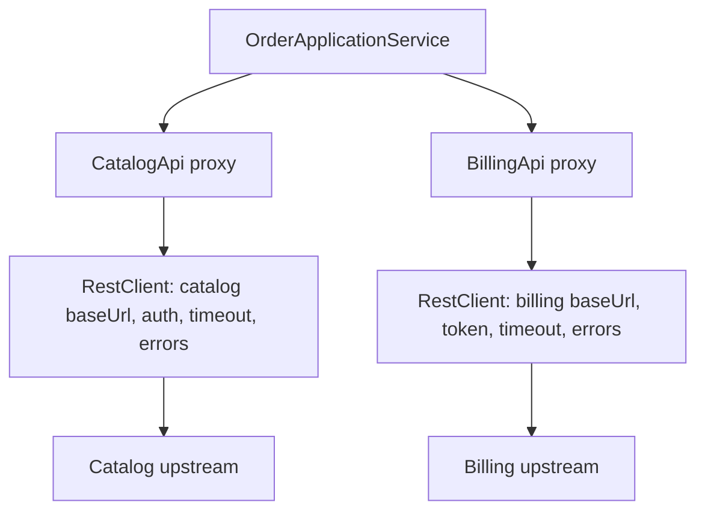
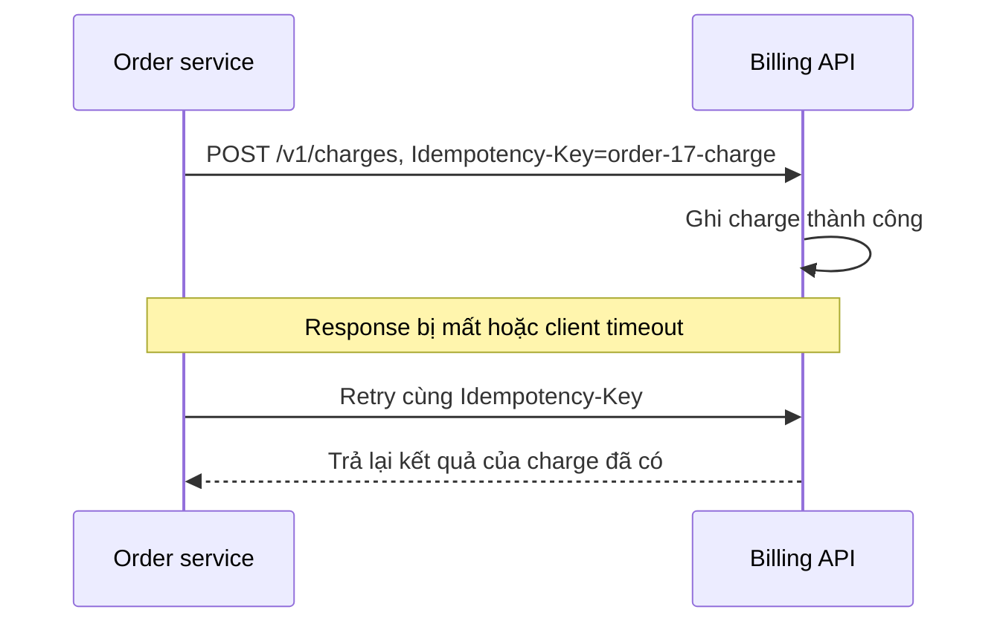
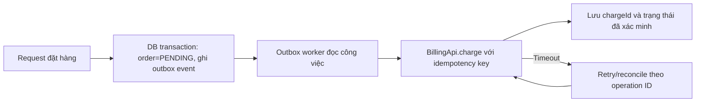

# Tiêm nhiều HTTP interface với địa chỉ và chính sách riêng

Khi xây dựng một ứng dụng Spring Boot tích hợp nhiều hệ thống, ta thường phải gọi **nhiều HTTP API** có hợp đồng và yêu cầu vận hành khác nhau. Ví dụ, một dịch vụ đặt hàng đọc thông tin sản phẩm từ *Catalog API* nhưng gửi yêu cầu thu tiền tới *Billing API*. Hai hệ thống có hostname, phương thức xác thực, timeout, chính sách retry, kiểu lỗi và ngưỡng giới hạn riêng. Nếu dùng một HTTP client cấu hình chung cho tất cả, rất dễ gửi nhầm token, gọi sai địa chỉ hoặc áp dụng retry nguy hiểm cho thao tác thanh toán.

Chương **HTTP interface** của mô-đun **SPRING_BOOT_INTEGRATION** tập trung vào cách dùng **declarative HTTP interface** của Spring để định nghĩa hợp đồng gọi HTTP bằng Java interface, tạo proxy với `HttpServiceProxyFactory`, khai báo nhiều bean, tiêm đúng client vào service, và quản lý lỗi, giao dịch, chống trùng lặp, kiểm thử, quan sát luồng tích hợp thực tế.

Bài này dùng chủ yếu **Spring Framework 6.1+ và Spring Boot 3.2+** làm ví dụ. Tên API và cách cấu hình có thể thay đổi theo phiên bản, đặc biệt với Spring Boot/Spring Framework mới hơn. Khi áp dụng, cần đối chiếu phiên bản dependencies đang thực sự chạy.

## 1. Kết quả cần đạt

Sau bài học, bạn có thể:

1. Giải thích tại sao HTTP interface là hợp đồng, còn `RestClient` hoặc `WebClient` mới sở hữu kết nối và chính sách vận chuyển.
2. Tạo hai HTTP interface cho hai upstream, mỗi interface có `baseUrl`, timeout, header và xử lý lỗi riêng.
3. Tiêm client theo **kiểu Java** khi hai interface khác nhau; dùng `@Qualifier` khi nhiều bean có cùng kiểu interface.
4. Tránh rò rỉ credential và tránh sự cố do cấu hình một builder mutable dùng chung.
5. Thiết kế timeout, retry, rate limit, circuit breaker và idempotency theo tính chất từng API.
6. Kiểm thử địa chỉ, header, request/response, status code và tình huống lỗi của từng bean độc lập.
7. Vận hành đa upstream với log, metric, trace và cấu hình theo môi trường.

## 2. Vì sao cần nhiều HTTP interface thay vì một HTTP client chung?

Giả sử ứng dụng `order-service` gọi hai hệ thống:

| Thuộc tính | Catalog API | Billing API |
|---|---|---|
| Mục đích | Đọc giá, tồn kho | Tạo yêu cầu thanh toán |
| Địa chỉ | `https://catalog.internal.example` | `https://billing.internal.example` |
| Auth | mTLS hoặc credential dành cho catalog | Bearer token dành riêng cho billing |
| Timeout mong muốn | Kết nối 1 s, đọc 2 s | Kết nối 2 s, đọc 5 s |
| Retry | GET an toàn theo hợp đồng; có thể retry lỗi tạm thời | POST chỉ retry khi có idempotency key |
| Xử lý 404 | Sản phẩm không tồn tại | Không đồng nghĩa sản phẩm không tồn tại |
| Giới hạn đồng thời | Nhiều yêu cầu đọc | Ít yêu cầu thanh toán có kiểm soát |
| Telemetry | `dependency=catalog` | `dependency=billing` |

Sử dụng một `RestClient` với URL, header, timeout và error handling toàn cục có thể tạo các lỗi:

- Token Billing được gắn vào request Catalog.
- Một địa chỉ tương đối `/v1/products` bị ghép với Billing base URL.
- Retry tự động một request POST có side effect mà không có idempotency key.
- Một upstream chậm làm cạn connection pool chung, ảnh hưởng upstream còn lại.
- Logs và metrics chỉ báo “HTTP client failed”, không biết phụ thuộc nào lỗi.

Giải pháp là **một interface cho mỗi hợp đồng API** và **một transport client cấu hình riêng cho mỗi chính sách kết nối**. Các bean được đặt tên rõ và tiêm tường minh ở nơi sử dụng.

## 3. Mô hình gồm bốn lớp



| Lớp | Trách nhiệm |
|---|---|
| **Java HTTP interface** | Định nghĩa method, HTTP verb, URI path, request parameter, headers và kiểu dữ liệu |
| **HTTP service proxy** | Triển khai interface bằng cách chuyển lời gọi Java thành HTTP request |
| **RestClient/WebClient** | Quản lý base URL, authentication, codec, network timeout, interceptor/filter, error mapping và quan sát |
| **Application service** | Phối hợp nghiệp vụ, deadline tổng thể, retry hợp lệ, giao dịch, idempotency và fallback |

Một `HttpServiceProxyFactory` tạo proxy từ adapter (ví dụ `RestClientAdapter`). Bản thân interface **không tự biết địa chỉ máy chủ** và không tự kết nối nếu chưa được tạo proxy. Bean có kiểu interface có thể được tiêm vào constructor như bất kỳ Spring bean nào.

Điểm đặc biệt của declarative HTTP client: **hợp đồng HTTP được thể hiện bằng Java method**. Method signature và annotation quyết định cách xây request; còn chính sách vận chuyển là trách nhiệm của client được gắn với proxy.

## 4. Ví dụ nghiệp vụ và cấu trúc project

Ứng dụng `order-service` có hai luồng:

1. Nhận `productSku`, hỏi Catalog API để lấy giá hiện tại.
2. Sau khi xác nhận đơn và điều kiện nghiệp vụ, gửi `charge` qua Billing API với một idempotency key ổn định.

Các thành phần ví dụ:

```text
order-service
├── integration/
│   ├── catalog/CatalogApi.java
│   ├── billing/BillingApi.java
│   ├── config/PartnerHttpProperties.java
│   ├── config/PartnerHttpConfiguration.java
│   └── security/BillingTokenProvider.java
├── application/OrderApplicationService.java
└── domain/...
```

Đây là cấu trúc minh họa để phân định trách nhiệm; không có yêu cầu phải dùng đúng tên package hoặc tách nhiều module Java.

### 4.1. Dependencies

Đối với Spring Boot 3.2+ dùng transport đồng bộ `RestClient`, có thể dùng starter web:

```groovy
dependencies {
    implementation("org.springframework.boot:spring-boot-starter-web")
    implementation("org.springframework.boot:spring-boot-starter-validation")

    testImplementation("org.springframework.boot:spring-boot-starter-test")
}
```

Spring Web cung cấp annotation `@HttpExchange`, `@GetExchange`, `@PostExchange`, `RestClient` và `HttpServiceProxyFactory`. Không cần Spring Cloud OpenFeign cho cách tiếp cận này. Starter validation là tùy chọn cho validation lớp cấu hình nếu project sử dụng Jakarta Bean Validation.

Nếu ứng dụng là reactive hoặc muốn dùng `WebClient`, dùng dependency WebFlux phù hợp (phần sau). Đừng trộn hai mô hình blocking/reactive nếu chưa xác định rõ nơi được phép block.

## 5. Định nghĩa HTTP interface thứ nhất: Catalog API

```java
package example.integration.catalog;

import org.springframework.http.MediaType;
import org.springframework.web.bind.annotation.PathVariable;
import org.springframework.web.service.annotation.GetExchange;
import org.springframework.web.service.annotation.HttpExchange;

@HttpExchange(
    url = "/v1/products",
    accept = MediaType.APPLICATION_JSON_VALUE
)
public interface CatalogApi {

    @GetExchange("/{sku}")
    ProductView getProduct(@PathVariable("sku") String sku);
}
```

DTO minh họa:

```java
package example.integration.catalog;

import java.math.BigDecimal;

public record ProductView(
    String sku,
    String name,
    BigDecimal price,
    String currency
) {}
```

Nếu client được tạo với `baseUrl=https://catalog.internal.example` thì:

```text
catalogApi.getProduct("SKU-42")
  -> GET https://catalog.internal.example/v1/products/SKU-42
     Accept: application/json
  <- 200 OK
     {"sku":"SKU-42","name":"Keyboard","price":125.00,"currency":"USD"}
```

`@GetExchange` ánh xạ method sang GET. `@PathVariable` điền path variable vào URL; việc mã hóa path/query phụ thuộc quá trình dựng URI của client. Đầu vào chứa ký tự đặc biệt phải được đối xử như **giá trị**, không tự nối chuỗi URL thủ công.

Nếu upstream trả 404, timeout hoặc JSON không đúng schema, method không bảo đảm trả một `ProductView`. Ứng dụng phải xử lý lỗi transport, lỗi HTTP và lỗi hợp đồng dữ liệu như những trường hợp riêng.

## 6. Định nghĩa HTTP interface thứ hai: Billing API

```java
package example.integration.billing;

import org.springframework.http.MediaType;
import org.springframework.web.bind.annotation.RequestBody;
import org.springframework.web.bind.annotation.RequestHeader;
import org.springframework.web.service.annotation.HttpExchange;
import org.springframework.web.service.annotation.PostExchange;

@HttpExchange(
    url = "/v1/charges",
    accept = MediaType.APPLICATION_JSON_VALUE,
    contentType = MediaType.APPLICATION_JSON_VALUE
)
public interface BillingApi {

    @PostExchange
    ChargeResult charge(
        @RequestBody ChargeRequest request,
        @RequestHeader("Idempotency-Key") String idempotencyKey
    );
}
```

```java
package example.integration.billing;

import java.math.BigDecimal;

public record ChargeRequest(
    String orderId,
    BigDecimal amount,
    String currency
) {}

public record ChargeResult(
    String chargeId,
    String status
) {}
```

Lưu ý: các record ví dụ trên là **hai Java top-level public records**, cần đặt trong hai file Java riêng khi thực sự triển khai; gộp ở đây chỉ nhằm tiết kiệm chỗ hiển thị.

Lời gọi `charge(...)` mang một idempotency key do application service truyền xuống. Nếu kết nối timeout **sau khi** Billing đã xử lý yêu cầu, ứng dụng cần dùng lại **chính key đó** khi retry thay vì tạo một key mới.

Các annotation chỉ mô tả hợp đồng request. Chúng **chưa quyết định**:

- Gọi server nào;
- Lấy Bearer token từ đâu;
- Bao lâu thì connect/read timeout;
- Có retry POST không;
- Billing HTTP 409 hoặc 422 được dịch thành lỗi nghiệp vụ gì.

Những quyết định này đặt trong transport configuration và application policy.

## 7. Cấu hình nhiều upstream theo môi trường

Tạo namespace tường minh để tránh nhầm với cấu hình server HTTP của chính ứng dụng:

```yaml
# application.yml; địa chỉ và thời gian chỉ để minh họa
integrations:
  catalog:
    base-url: https://catalog.internal.example
    connect-timeout: 1s
    read-timeout: 2s
  billing:
    base-url: https://billing.internal.example
    connect-timeout: 2s
    read-timeout: 5s
```

Trong môi trường local, có thể override qua profile hoặc environment variables:

```yaml
# application-local.yml
integrations:
  catalog:
    base-url: http://localhost:18081
  billing:
    base-url: http://localhost:18082
```

Trong Compose, ứng dụng chạy **bên trong container** thường phải dùng service DNS như `http://catalog:8080` và `http://billing:8080` thay vì `localhost`. Trong Testcontainers hoặc WireMock, port có thể được chọn động; test nên truyền đúng URL được runtime cung cấp.

**Không hardcode credential** trong `application.yml` hoặc Git. Lấy token từ secret manager/identity provider/môi trường chạy, và không log toàn bộ cấu hình đã bind.

### 7.1. Bind cấu hình thành kiểu dữ liệu

Một kiểu cấu hình tổng hợp dùng record:

```java
package example.integration.config;

import java.net.URI;
import java.time.Duration;
import org.springframework.boot.context.properties.ConfigurationProperties;

@ConfigurationProperties(prefix = "integrations")
public record PartnerHttpProperties(
    Endpoint catalog,
    Endpoint billing
) {
    public record Endpoint(
        URI baseUrl,
        Duration connectTimeout,
        Duration readTimeout
    ) {}
}
```

Với Spring Boot 3.x, record chỉ có một canonical constructor thường được dùng cho constructor binding. `Duration` có thể bind từ `1s`, `500ms` hoặc `2m`. Giá trị `URI` giúp phân biệt rõ địa chỉ server với các chuỗi cấu hình tùy ý.

Trong ứng dụng thực tế, nên bổ sung validation: URI phải là `http` hoặc `https` theo môi trường, host phải thuộc tập được phép, timeout phải dương, giá trị không được null. Có thể dùng Bean Validation trên configuration properties và test việc khởi động khi cấu hình sai. Không nên chờ đến request đầu tiên mới biết thiếu `base-url`.

## 8. Tạo hai bean với RestClient và HttpServiceProxyFactory

Mỗi bean nhận cấu hình riêng, tạo `RestClient` riêng, rồi gắn adapter vào `HttpServiceProxyFactory`.

```java
package example.integration.config;

import example.integration.catalog.CatalogApi;
import example.integration.billing.BillingApi;
import example.integration.security.BillingTokenProvider;
import org.springframework.boot.context.properties.EnableConfigurationProperties;
import org.springframework.context.annotation.Bean;
import org.springframework.context.annotation.Configuration;
import org.springframework.http.HttpHeaders;
import org.springframework.http.MediaType;
import org.springframework.http.client.SimpleClientHttpRequestFactory;
import org.springframework.web.client.RestClient;
import org.springframework.web.client.support.RestClientAdapter;
import org.springframework.web.service.invoker.HttpServiceProxyFactory;

@Configuration(proxyBeanMethods = false)
@EnableConfigurationProperties(PartnerHttpProperties.class)
public class PartnerHttpConfiguration {

    @Bean
    CatalogApi catalogApi(
            RestClient.Builder builder,
            PartnerHttpProperties props) {

        var options = props.catalog();
        RestClient client = builder.clone()
            .baseUrl(options.baseUrl().toString())
            .requestFactory(requestFactory(options))
            .defaultHeader(HttpHeaders.ACCEPT,
                MediaType.APPLICATION_JSON_VALUE)
            .build();

        return HttpServiceProxyFactory
            .builderFor(RestClientAdapter.create(client))
            .build()
            .createClient(CatalogApi.class);
    }

    @Bean
    BillingApi billingApi(
            RestClient.Builder builder,
            PartnerHttpProperties props,
            BillingTokenProvider tokenProvider) {

        var options = props.billing();
        RestClient client = builder.clone()
            .baseUrl(options.baseUrl().toString())
            .requestFactory(requestFactory(options))
            .requestInterceptor((request, body, execution) -> {
                // Đọc token tại thời điểm request để hỗ trợ rotation.
                request.getHeaders().setBearerAuth(tokenProvider.accessToken());
                return execution.execute(request, body);
            })
            .build();

        return HttpServiceProxyFactory
            .builderFor(RestClientAdapter.create(client))
            .build()
            .createClient(BillingApi.class);
    }

    private static SimpleClientHttpRequestFactory requestFactory(
            PartnerHttpProperties.Endpoint options) {

        var factory = new SimpleClientHttpRequestFactory();
        factory.setConnectTimeout(Math.toIntExact(
            options.connectTimeout().toMillis()));
        factory.setReadTimeout(Math.toIntExact(
            options.readTimeout().toMillis()));
        return factory;
    }
}
```

Ví dụ dùng `SimpleClientHttpRequestFactory` để làm rõ connect/read timeout và là mẫu dễ theo dõi. Với workload production cần throughput cao, connection pooling, proxy, HTTP/2 hoặc TLS chuyên biệt, chọn request factory/HTTP transport phù hợp như Apache HttpClient hoặc JDK HttpClient và cấu hình pool riêng theo từng upstream. API cấu hình timeout có thể khác theo Spring Framework và transport.

`Math.toIntExact(...)` khiến timeout quá lớn báo lỗi rõ khi chuyển mili-giây sang số nguyên. Nên kết hợp validation dương; code minh họa chưa tự kiểm tra null hoặc timeout âm.

### 8.1. TokenProvider là dependency riêng của Billing

Trong ví dụ:

```java
package example.integration.security;

public interface BillingTokenProvider {
    String accessToken();
}
```

Ứng dụng phải cung cấp một **bean triển khai** interface này bằng cơ chế lấy credential thực tế (OAuth2 client, vault hoặc secret provider). Ví dụ cố ý không đưa token giả trực tiếp vào mã nguồn; vì thế đây là bộ khung cần ghép với bean `BillingTokenProvider` của hệ thống trước khi chạy.

Điều cần giữ:

- Không tạo hoặc chia sẻ Bearer token Billing với Catalog.
- Có cơ chế làm mới token khi hết hạn; không chỉ đọc token một lần rồi cache vĩnh viễn nếu policy yêu cầu rotation.
- Không ghi token vào log, metric tags hoặc exception message.
- Trong test, cung cấp token giả riêng và xác nhận nó chỉ xuất hiện ở request Billing.

### 8.2. Vì sao dùng `builder.clone()`?

`RestClient.Builder` là **mutable builder**. Gọi `baseUrl(...)`, `defaultHeader(...)`, `requestInterceptor(...)` thay đổi cấu hình builder. Nếu dùng lại một builder mutable cho hai upstream mà không cô lập, một bean có thể vô tình nhận cấu hình của bean kia.

Một `RestClient.Builder` do Spring Boot tự cấu hình có thể mang theo message converters và observation customization. Clone trước khi chỉnh giúp mỗi bean giữ cấu hình riêng mà vẫn thừa hưởng cấu hình nền phù hợp:

```java
RestClient catalog = bootBuilder.clone()
    .baseUrl("https://catalog.internal.example")
    .build();

RestClient billing = bootBuilder.clone()
    .baseUrl("https://billing.internal.example")
    .build();
```

Nếu tự gọi `RestClient.builder()`, ứng dụng vẫn tạo được client, nhưng có thể bỏ qua một số customization mà Spring Boot áp dụng cho builder được tiêm. Cần xác minh observation, codecs, TLS và customizers trước khi chuyển từ builder do Boot quản lý sang builder thủ công.

### 8.3. Vì sao phải cấu hình timeout riêng?

- **Connect timeout**: giới hạn thời gian thiết lập kết nối mạng.
- **Read/response timeout**: giới hạn thời gian chờ đọc dữ liệu hoặc response theo semantics của transport.
- **Business deadline**: giới hạn tổng thời gian dành cho một nghiệp vụ, có thể gồm nhiều request và retry.

Không thể mặc nhiên coi `read-timeout: 5s` là “toàn bộ lời gọi luôn kết thúc trong 5 giây” với mọi transport, streaming body, retry và các giai đoạn TLS/DNS/connection-pool acquisition. Cần kiểm tra timeout của transport thật và đặt deadline tổng thể ở tầng service nếu cần.

## 9. Tiêm hai interface khác kiểu: constructor injection

Do `CatalogApi` và `BillingApi` là hai kiểu Java khác nhau, Spring thường phân giải bean theo kiểu mà không cần `@Qualifier`:

```java
package example.application;

import example.integration.catalog.CatalogApi;
import example.integration.catalog.ProductView;
import example.integration.billing.BillingApi;
import example.integration.billing.ChargeRequest;
import example.integration.billing.ChargeResult;
import java.math.BigDecimal;
import org.springframework.stereotype.Service;

@Service
public class OrderApplicationService {

    private final CatalogApi catalogApi;
    private final BillingApi billingApi;

    public OrderApplicationService(
            CatalogApi catalogApi,
            BillingApi billingApi) {
        this.catalogApi = catalogApi;
        this.billingApi = billingApi;
    }

    public ProductView lookup(String sku) {
        return catalogApi.getProduct(sku);
    }

    public ChargeResult charge(
            String orderId,
            BigDecimal amount,
            String currency,
            String stableIdempotencyKey) {
        return billingApi.charge(
            new ChargeRequest(orderId, amount, currency),
            stableIdempotencyKey
        );
    }
}
```

Ở đây:

1. Spring tự tiêm `CatalogApi` proxy được tạo từ Catalog RestClient.
2. Spring tự tiêm `BillingApi` proxy được tạo từ Billing RestClient.
3. Application service không cần biết base URL, token hay cách xây HTTP request.

Ví dụ thể hiện cách phối hợp hai lời gọi; nó **không** tự tạo đảm bảo giao dịch nguyên tử giữa Catalog, Billing và database. Trong nghiệp vụ thanh toán thật, key phải được tạo hoặc lưu bền vững để lần retry/restart vẫn dùng lại. Không đặt lời gọi HTTP chậm bên trong transaction SQL mở lâu nếu có thể thiết kế workflow/outbox an toàn hơn.

## 10. Khi cùng một interface phải gọi nhiều địa chỉ

Trường hợp phổ biến khác là một hợp đồng dùng tại nhiều môi trường, region hoặc tenant. Ví dụ `CatalogApi` có hai bản triển khai:

- `catalogPrimaryApi` ở region chính;
- `catalogBackupApi` ở region dự phòng.

Cả hai bean đều có **kiểu Java `CatalogApi`**. Nếu service chỉ có constructor parameter `CatalogApi catalogApi`, Spring có thể báo `NoUniqueBeanDefinitionException` vì tìm thấy nhiều ứng viên.

### 10.1. Khai báo bean có tên riêng

Đoạn mã sau minh họa **một cấu hình thay thế** cho `CatalogApi` của phần 8; không nên ghép nguyên cả hai cấu hình vào cùng project mà chưa điều chỉnh số lượng bean:

```java
@Configuration(proxyBeanMethods = false)
class RegionalCatalogConfiguration {

    @Bean("catalogPrimaryApi")
    CatalogApi catalogPrimaryApi(RestClient.Builder builder) {
        RestClient client = builder.clone()
            .baseUrl("https://catalog-primary.internal.example")
            .build();
        return proxy(client);
    }

    @Bean("catalogBackupApi")
    CatalogApi catalogBackupApi(RestClient.Builder builder) {
        RestClient client = builder.clone()
            .baseUrl("https://catalog-backup.internal.example")
            .build();
        return proxy(client);
    }

    private static CatalogApi proxy(RestClient client) {
        return HttpServiceProxyFactory
            .builderFor(RestClientAdapter.create(client))
            .build()
            .createClient(CatalogApi.class);
    }
}
```

Địa chỉ trong ví dụ là hostname minh họa; trên production hãy đưa vào `@ConfigurationProperties` hoặc nguồn cấu hình được quản lý, cũng như bổ sung auth/timeout cho từng region.

### 10.2. Tiêm rõ bean bằng `@Qualifier`

```java
@Service
public class CatalogComparisonService {

    private final CatalogApi primary;
    private final CatalogApi backup;

    public CatalogComparisonService(
            @Qualifier("catalogPrimaryApi") CatalogApi primary,
            @Qualifier("catalogBackupApi") CatalogApi backup) {
        this.primary = primary;
        this.backup = backup;
    }

    public ProductView loadPrimary(String sku) {
        return primary.getProduct(sku);
    }
}
```

Cần import `org.springframework.beans.factory.annotation.Qualifier`, `org.springframework.stereotype.Service` và DTO/interface tương ứng. Cách tiêm bằng constructor với `@Qualifier` là tường minh và hoạt động ngay cả khi hai bean có cùng kiểu.

### 10.3. `@Primary` có phù hợp không?

`@Primary` chỉ định ứng viên ưu tiên khi một injection point có nhiều bean cùng kiểu. Nó có ích nếu hệ thống thật sự có **một client mặc định** và các client khác là ngoại lệ.

Nhưng trong hệ thống thanh toán, multi-region hoặc multi-tenant, mặc định âm thầm có thể dẫn tới gọi sai upstream. Nếu mỗi client có ý nghĩa nghiệp vụ riêng, nên dùng qualifier tường minh thay vì dựa vào `@Primary` để che giấu ambiguity.

### 10.4. Đặt tên theo vai trò, không theo chi tiết tạm thời

Tên `catalogPrimaryApi`/`catalogBackupApi` cho thấy vai trò. Tên như `client1`/`client2` khiến code review và metrics khó hiểu. Có thể định nghĩa custom qualifier annotation như `@PrimaryCatalog` hoặc `@BackupCatalog` khi dự án lớn và cần dùng ở nhiều điểm tiêm.

Không dùng tên bean của Catalog để đại diện một lớp policy hoàn toàn khác (ví dụ chuyển sang Billing) nếu hợp đồng HTTP không giống nhau; khi đó nên có interface riêng.

## 11. Địa chỉ tương đối, absolute URL và ranh giới bảo mật

Với interface:

```java
@HttpExchange(url = "/v1/products")
interface CatalogApi {
    @GetExchange("/{sku}")
    ProductView getProduct(@PathVariable String sku);
}
```

Các đường dẫn tương đối từ interface được ghép theo chính sách URI của `RestClient`/`WebClient`, thường dựa vào base URL đã cấu hình. Không đặt hostname cố định trong annotation nếu cùng hợp đồng được sử dụng cho local, staging và production.

Những vấn đề cần kiểm soát:

1. Một **absolute URI** truyền vào ở các API cho phép cấu hình URI có thể bỏ qua base URL. Tránh chấp nhận URL tùy ý từ người dùng khi client chứa credential nội bộ; nếu bắt buộc, dùng allowlist host/scheme và kiểm tra redirect policy.
2. Path variable cần encoding đúng. Không tự tạo đường dẫn bằng nối chuỗi với dữ liệu chưa kiểm tra.
3. Tách `baseUrl` theo upstream và môi trường; cổng published của host khác địa chỉ dịch vụ bên trong Compose/Kubernetes.
4. Với redirect HTTP, cần biết transport có chuyển tiếp Authorization header không. Không cho phép token đi tới host ngoài trust boundary.
5. Với custom URI resolver, base path và slash cần kiểm thử cụ thể để tránh `/api/v1` bị mất hoặc ghép hai lần.

Nếu có nhiều tenant với endpoint động, không khởi tạo một lượng vô hạn HTTP client theo mỗi request. Nên có mapping tenant → cấu hình đã được kiểm duyệt, giới hạn cache/pool, vòng đời token và cleanup. Injection bằng qualifier phù hợp với **số cấu hình tĩnh có kiểm soát**.

## 12. Xác thực và headers phải gắn với đúng upstream

Một hệ thống có thể dùng các cách xác thực khác nhau:

| Kiểu | Nơi cấu hình thường phù hợp | Ghi chú |
|---|---|---|
| API key cố định có rotation | Interceptor/request customizer riêng của client | Không để lộ trong source/log |
| OAuth2 Bearer token | Token provider hoặc OAuth2 client integration theo upstream | Quản lý expiry, refresh, scopes |
| mTLS | HTTP transport/SSL bundle riêng | Xác nhận server identity và client certificate |
| Basic Auth | Client policy riêng nếu hệ thống bắt buộc | Chỉ dùng qua HTTPS, quản lý secret an toàn |
| Trace/correlation ID | Observation/tracing filter hoặc request parameter | Không dùng làm auth |
| Idempotency key | Argument của operation có side effect | Giữ ổn định qua retry |

Trong ví dụ Billing, interceptor lấy token tại thời điểm gửi request:

```java
.requestInterceptor((request, body, execution) -> {
    request.getHeaders().setBearerAuth(tokenProvider.accessToken());
    return execution.execute(request, body);
})
```

Không truyền chung interceptor này vào bean Catalog. Nếu dùng global `RestClientCustomizer` để gắn Authorization cho mọi client, rất dễ cấp token sai phạm vi. Những cấu hình toàn cục chỉ nên bao gồm các policy an toàn dùng chung như tracing/correlation và message converters.

### 12.1. Dynamic request headers

Với dữ liệu thay đổi theo một request, annotation method là lựa chọn dễ đọc:

```java
@GetExchange("/{sku}")
ProductView getProduct(
    @PathVariable String sku,
    @RequestHeader("X-Correlation-Id") String correlationId
);
```

Đây là **biến thể method** để minh họa header; nếu áp dụng, cập nhật callers tương ứng. Không tự ý đưa token nhạy cảm làm parameter rồi ghi cả tham số method vào tracing.

### 12.2. TLS, proxy và connection pool

Trong production, timeout không phải chính sách duy nhất. Từng upstream có thể cần:

- Truststore/certificate bundle khác nhau; mTLS cho một upstream nhưng không dùng cho upstream khác.
- Proxy corporate hoặc non-proxy hosts theo mạng.
- Connection pool size, idle timeout và connection TTL riêng.
- DNS TTL, HTTP/2, keep-alive và giới hạn concurrent requests.

Cấu hình tại **HTTP transport** trước khi tạo RestClient/WebClient adapter, rồi giữ một client dùng lại qua nhiều request. Đừng tạo mới transport có pool trong mỗi lời gọi service; dễ rò connection/thread và tốn handshake.

## 13. Mỗi upstream có chính sách xử lý HTTP status riêng

Không nên biến toàn bộ `4xx`/`5xx` thành một exception chung rồi quên ý nghĩa nghiệp vụ.

Ví dụ:

| Status | Catalog | Billing |
|---|---|---|
| `200` | Sản phẩm tìm thấy | Có thể không áp dụng cho POST |
| `201` | Ít gặp | Charge được tạo |
| `400` | SKU/query sai | Payload tiền tệ hoặc amount sai |
| `401/403` | Credential/phân quyền Catalog | Token hoặc scope Billing sai |
| `404` | Không tìm thấy sản phẩm | Có thể là route/charge không tồn tại, tùy contract |
| `409` | Tranh chấp version/inventory | Có thể là idempotency conflict hoặc trạng thái thanh toán |
| `422` | Dữ liệu không hợp lệ về nghiệp vụ | Điều kiện thanh toán bị từ chối |
| `429` | Throttling Catalog | Throttling Billing |
| `502/503/504` | Lỗi gateway/upstream tạm thời | Lỗi có thể xảy ra sau khi giao dịch được thực hiện |

`RestClient` có hành vi mặc định ném exception với nhiều HTTP error statuses. Có thể đăng ký `defaultStatusHandler` trên **client cụ thể** để chuyển lỗi thành exception mang ngữ nghĩa riêng.

Ví dụ Catalog:

```java
RestClient catalogRestClient = builder.clone()
    .baseUrl(catalogUrl)
    .defaultStatusHandler(
        status -> status.value() == 404,
        (request, response) -> {
            throw new CatalogProductNotFoundException(
                "Catalog product was not found");
        })
    .build();
```

`CatalogProductNotFoundException` là exception ứng dụng cần tự định nghĩa. Ở đây method chỉ minh họa mapping 404; các status khác có thể giữ mặc định hoặc được mapping theo contract upstream. Không copy nguyên status handler của Catalog sang Billing nếu 404 mang ý nghĩa khác.

### 13.1. Giữ lỗi đủ giàu thông tin

Một lỗi HTTP hữu ích cho tầng application cần tối thiểu:

- upstream identity (`catalog`/`billing`);
- operation (`lookupProduct`/`charge`);
- HTTP status hoặc loại network failure;
- mã lỗi của upstream nếu có trong response body;
- request ID/correlation ID;
- thông tin lỗi retryable hay non-retryable theo contract.

Nhưng phải **lọc dữ liệu nhạy cảm**: không log Authorization, cookie, thông tin thẻ, số tiền nhạy cảm, PII hoặc toàn bộ response nếu contract không cho phép. Không đưa URL với token trong query vào exception message.

### 13.2. Parse lỗi dạng Problem Details

Nhiều API trả JSON problem/error envelope. Có thể ánh xạ body lỗi ở adapter/gateway layer thành domain exception thay vì để application service hiểu mọi field của HTTP response. Khi dùng custom status handler, cần chú ý response body là stream; đọc một lần và deserialize đúng cách nếu muốn giữ error code. Kiểm thử cả body rỗng, body lỗi không đúng JSON và charset khác.

## 14. Retry là chính sách nghiệp vụ, không phải thuộc tính tự có của interface

Một interface có `@PostExchange` không tự biết request có được retry an toàn không. `RestClient` và proxy không mặc nhiên tạo retry policy phù hợp mọi operation.

### 14.1. Phân loại theo operation

| Operation | Retry mặc định nên xem xét | Lý do |
|---|---|---|
| Catalog GET sản phẩm | Có thể retry một số lỗi kết nối/`503` với ngân sách giới hạn | Request chủ yếu là đọc; xác nhận upstream GET thật sự side-effect free |
| Billing POST tạo charge | Chỉ retry khi có idempotency key và contract hỗ trợ | Timeout không chứng minh server chưa xử lý |
| Billing GET trạng thái charge | Có thể retry lỗi tạm thời nếu hợp đồng ổn định | Quan sát trạng thái sau request không chắc kết quả |
| Cancel/refund POST | Ràng buộc chặt idempotency key và trạng thái chuyển tiếp | Không muốn tạo refund trùng |
| `400`, `401`, `403`, `422` | Thường không retry tự động | Input/config/credential cần sửa |
| `429` | Retry theo rate limit và `Retry-After` nếu contract cho phép | Không gửi dồn gây quá tải |

### 14.2. Deadline tổng thể quan trọng hơn một lần timeout

Ví dụ Billing có connect timeout 2 giây và read timeout 5 giây, một application request có deadline 8 giây. Nếu tầng retry tự chạy ba lần mà không theo ngân sách tổng thể, caller có thể đợi dài hơn nhiều so với 8 giây.

Một chính sách minh họa:

```text
Business deadline: 8 giây
Attempt 1: timeout theo thời gian còn lại
If transient failure and budget remains:
   backoff + jitter
Attempt 2: dùng cùng Idempotency-Key
If budget exhausted:
   trả trạng thái chưa xác định hoặc chuyển sang kiểm tra charge status
```

Retry có thể được triển khai bằng Spring Retry, Resilience4j hoặc policy riêng của application. Dù dùng thư viện nào, cần tránh **retry nhân tầng**: gateway retry 3 lần, service retry 3 lần và edge retry 3 lần có thể gây 27 lần gọi.

### 14.3. Retry thanh toán sau timeout



Luồng chỉ an toàn **nếu Billing API có hợp đồng idempotency thực sự**. Header tự nó không làm backend chống trùng; nếu đối tác bỏ qua header, phải dùng phương án khác như lưu operation ID, truy vấn trạng thái hoặc reconciliation.

## 15. Circuit breaker, bulkhead, rate limit và fallback theo upstream

Khi Catalog liên tục timeout, không nên để lỗi đó làm cạn tài nguyên dùng cho Billing.

- **Circuit breaker Catalog:** ngắt tạm request đến Catalog khi lỗi vượt ngưỡng; thử phục hồi sau khoảng thời gian được cấu hình.
- **Circuit breaker Billing:** ngưỡng và tiêu chí lỗi khác Catalog; Billing 4xx nghiệp vụ không nhất thiết tính là system failure.
- **Bulkhead/connection pool:** dành giới hạn đồng thời cho mỗi dependency để một upstream chậm không chiếm tất cả thread/connection.
- **Rate limiter:** tuân thủ quota của từng API key hoặc tenant.
- **Fallback:** dùng dữ liệu cache khi nghiệp vụ cho phép; không “giả thanh toán thành công” để làm fallback.

Ví dụ chính sách:

| Dependency | Circuit | Fallback | Điều kiện đúng đắn |
|---|---|---|---|
| Catalog | Mở khi timeout tăng | Giá cache có TTL, nếu nghiệp vụ cho phép | Giá cũ có thể gây sai đơn; xác định phiên bản giá |
| Billing | Mở khi lỗi hệ thống tăng | Lưu trạng thái `PENDING_PAYMENT`, xử lý sau | Không trả `PAID` khi chưa xác nhận charge |

Ngưỡng circuit breaker không nên giống nhau chỉ vì hai bean cùng dùng `RestClient`. Dùng tên policy riêng như `catalogCircuit` và `billingCircuit` giúp cấu hình và observability không lẫn nhau.

## 16. Bảo vệ transaction và dữ liệu khỏi HTTP side effect

Với luồng `OrderApplicationService` vừa cập nhật SQL vừa gọi Billing, cần trả lời câu hỏi:

> Nếu database commit thành công nhưng Billing timeout, trạng thái đơn hàng phải là gì?

Không có HTTP interface hay `@Transactional` JDBC thông thường nào tự tạo distributed transaction nguyên tử với Billing API.

### 16.1. Anti-pattern: giữ transaction SQL trong lúc gọi HTTP lâu

```java
@Transactional
public void placeOrder(...) {
    repository.save(order);
    billingApi.charge(...); // Có thể chờ hàng giây hoặc timeout
    repository.markPaid(...);
}
```

Đoạn code minh họa nhiều rủi ro:

- Transaction giữ lock/connection DB trong khi chờ network.
- JDBC rollback không hoàn tác một charge bên Billing đã thực hiện.
- Retry toàn bộ method có thể tạo nhiều external side effects.

Một lựa chọn đáng tin cậy hơn trong nhiều use case là **transactional outbox hoặc state machine**:



Trong mô hình này, application có thể commit tiếp nhận yêu cầu một cách bền vững, còn worker thực hiện thanh toán sau. Thiết kế trạng thái phản hồi API phải phản ánh kết quả thật: `PENDING` không được tuyên bố là `PAID`.

### 16.2. Khi REST client được gọi từ Kafka listener

Nếu một listener Kafka nhận `OrderConfirmedEvent` rồi gọi `BillingApi.charge(...)`:

1. Event phải có định danh ổn định dùng làm deduplication/idempotency key.
2. Chỉ acknowledge Kafka offset khi đã hoàn thành **nghĩa vụ tiêu thụ** theo contract (ví dụ lưu bền vững outbox, hoặc charge đã được xác nhận và cập nhật DB an toàn).
3. Nếu timeout làm kết quả Billing chưa rõ, không được ack rồi mất dấu tác vụ.
4. Cần retry, DLT hoặc reconciliation có owner và metric.

HTTP interface giải quyết việc gọi API; ranh giới **Kafka offset commit/DB transaction/outbox** vẫn cần được thiết kế độc lập.

## 17. Sử dụng WebClient cho ứng dụng reactive

HTTP interface cũng có thể chạy trên `WebClientAdapter`. Nếu dùng WebFlux/Reactor và muốn trả về `Mono<T>`, khai báo một interface riêng:

```java
import org.springframework.web.bind.annotation.PathVariable;
import org.springframework.web.service.annotation.GetExchange;
import org.springframework.web.service.annotation.HttpExchange;
import reactor.core.publisher.Mono;

@HttpExchange("/v1/products")
public interface ReactiveCatalogApi {

    @GetExchange("/{sku}")
    Mono<ProductView> getProduct(@PathVariable("sku") String sku);
}
```

Tạo proxy:

```java
import org.springframework.web.reactive.function.client.WebClient;
import org.springframework.web.reactive.function.client.support.WebClientAdapter;
import org.springframework.web.service.invoker.HttpServiceProxyFactory;

WebClient catalogWebClient = WebClient.builder()
    .baseUrl("https://catalog.internal.example")
    .build();

ReactiveCatalogApi api = HttpServiceProxyFactory
    .builderFor(WebClientAdapter.create(catalogWebClient))
    .build()
    .createClient(ReactiveCatalogApi.class);
```

Tương tự `RestClient`, tạo riêng một `WebClient` theo upstream để gắn WebClient filters, authentication, Reactor Netty connector, timeout và limits. Nếu ứng dụng Boot đã cung cấp `WebClient.Builder` có customization, ưu tiên inject builder thay vì tự tạo builder trống.

Không gọi `.block()` bên trong luồng xử lý WebFlux event-loop chỉ để biến reactive thành synchronous; điều đó có thể chặn event-loop và gây nghẽn. Nếu service là ứng dụng Servlet truyền thống với API blocking, `RestClient` thường là lựa chọn dễ giải thích hơn.

### 17.1. Timeout reactive không tự giống RestClient

Với Reactor Netty, có thể cấu hình connect timeout, response timeout, pool acquisition và TLS handshake timeout ở Reactor Netty `HttpClient`, sau đó tạo `ReactorClientHttpConnector` cho từng WebClient. Nếu viết `.timeout(Duration.ofSeconds(3))` trên `Mono`, đó là timeout ở tầng reactive chain; nó không nhất thiết đồng nhất với transport timeout hoặc không bảo đảm upstream dừng công việc đã nhận.

### 17.2. Từ WebClient sang RestClient khi refactor

Khi thay transport:

- Giữ hợp đồng method khi kiểu trả về, headers và encoding tương thích.
- Thay `WebClientAdapter` bằng `RestClientAdapter` và kiểm tra kiểu đồng bộ/reactive.
- Revalidate timeout, error mapping, observability và retry; không copy nguyên policy như thể API là một.
- Kiểm tra số thread blocked và connection pool khi traffic tăng.

Không nên chỉ đổi adapter rồi giả định toàn bộ hành vi vận hành giống nhau.

## 18. Dynamic client và multi-tenant: khi qualifier không đủ

`@Qualifier` giải quyết tốt hai hoặc vài bean cố định. Nhưng nếu có hàng trăm tenant với endpoint khác nhau, tạo một bean cho mỗi tenant thường khó quản lý.

Một mô hình thích hợp:

```text
Caller cung cấp tenantId (đã xác thực)
    ↓
TenantRoutingService tra registry tenantId -> policy
    ↓
Kiểm tra URI/scheme/host allowlist và quyền tenant
    ↓
Lấy client đã cache có giới hạn hoặc xây client được quản lý
    ↓
Gọi HTTP interface phù hợp
```

Những ràng buộc cần có:

- Không tin trực tiếp `baseUrl` do request/user nhập. Đây là ranh giới SSRF.
- Phân chia credential theo tenant; tránh cache token ở bean dùng chung sai phạm vi.
- Giới hạn số transport clients, connection pools và thread resources.
- Tách metric theo **loại dịch vụ** và một tập nhãn có cardinality kiểm soát; không gắn user ID/URL tùy ý vào metric.
- Có cơ chế refresh/revoke cấu hình và giải phóng client cũ khi topology thay đổi.

Nếu chỉ có vài region/partner ổn định, named beans + qualifiers thường rõ ràng hơn client registry động.

## 19. Lỗi thường gặp khi khai báo nhiều HTTP interface

| Hiện tượng | Nguyên nhân thường gặp | Hướng khắc phục |
|---|---|---|
| `NoSuchBeanDefinitionException` cho `CatalogApi` | Chỉ định nghĩa interface nhưng chưa tạo proxy bean | Tạo bean qua `HttpServiceProxyFactory`, kiểm tra component scan/config |
| `NoUniqueBeanDefinitionException` | Có nhiều bean cùng interface, injection thiếu qualifier | Dùng `@Qualifier` hoặc custom qualifier |
| Request sang nhầm hostname | Dùng builder mutable chung hoặc ghép URI sai | Cô lập builder, base URL theo bean, test exact URL |
| Billing nhận token Catalog | Global auth interceptor/shared headers | Auth interceptor riêng từng client |
| App chạy trong Docker không gọi được `localhost` | `localhost` trỏ tới chính container | Dùng service DNS hoặc published address đúng topology |
| HTTP 404 làm toàn bộ service báo lỗi hệ thống | Chưa mapping lỗi theo contract | Map Catalog not found thành domain exception/kết quả hợp lệ |
| POST payment bị trùng sau timeout | Retry không giữ idempotency key | Key bền vững; query/reconcile kết quả chưa rõ |
| Traffic tăng khiến hết connection | Tạo client mỗi request hoặc pool không phù hợp | Reuse client, pool/bulkhead theo upstream |
| Log làm lộ Bearer token | Log toàn bộ headers/request | Redact token/PII, sampling an toàn |
| Timeout một request kéo dài bất ngờ | Không giới hạn total deadline và retry | Timeout từng giai đoạn + business deadline |
| Test pass khi gọi sai upstream | Mock server dùng chung, assert thiếu URL/header | Tách mock per bean và kiểm tra exact request |
| Ứng dụng thiếu telemetry mặc dù Boot đã bật observability | Dùng `RestClient.builder()` thủ công bỏ customizers | Dùng builder do Boot inject, kiểm tra instrumentation |

## 20. Kiểm thử từng client độc lập

Một bài test tốt phải bắt được lỗi **gọi nhầm upstream** và **rò header**. Chỉ mock `CatalogApi` bằng Mockito ở application service là hữu ích để test nghiệp vụ, nhưng chưa kiểm tra Spring HTTP interface proxy dựng request đúng.

### 20.1. Kiểm tra bean wiring bằng ApplicationContext

Với hai interface khác nhau:

```java
@Autowired CatalogApi catalogApi;
@Autowired BillingApi billingApi;

@Test
void bothProxiesExist() {
    assertThat(catalogApi).isNotNull();
    assertThat(billingApi).isNotNull();
}
```

Đây là smoke test cơ bản. Nó chưa đủ để kết luận địa chỉ và headers đúng. Với hai bean cùng kiểu, nên kiểm tra `@Qualifier` bằng một context test có cấu hình thật.

### 20.2. HTTP-level test với MockRestServiceServer

Spring Test cung cấp `MockRestServiceServer` để kiểm tra HTTP request từ `RestClient`. Ý tưởng quan trọng là **mỗi builder/client có mock server riêng**:

```java
import static org.springframework.test.web.client.match.MockRestRequestMatchers.requestTo;
import static org.springframework.test.web.client.response.MockRestResponseCreators.withSuccess;

import org.junit.jupiter.api.Test;
import org.springframework.http.MediaType;
import org.springframework.test.web.client.MockRestServiceServer;
import org.springframework.web.client.RestClient;
import org.springframework.web.client.support.RestClientAdapter;
import org.springframework.web.service.invoker.HttpServiceProxyFactory;

class CatalogProxyTest {

    @Test
    void buildsRequestAgainstCatalogBaseUrl() {
        RestClient.Builder builder = RestClient.builder()
            .baseUrl("https://catalog.test");

        MockRestServiceServer server =
            MockRestServiceServer.bindTo(builder).build();

        CatalogApi api = HttpServiceProxyFactory
            .builderFor(RestClientAdapter.create(builder.build()))
            .build()
            .createClient(CatalogApi.class);

        server.expect(requestTo(
                "https://catalog.test/v1/products/SKU-42"))
            .andRespond(withSuccess("""
                {"sku":"SKU-42","name":"Keyboard","price":125.00,
                 "currency":"USD"}
                """, MediaType.APPLICATION_JSON));

        ProductView product = api.getProduct("SKU-42");
        org.assertj.core.api.Assertions.assertThat(product.sku())
            .isEqualTo("SKU-42");
        server.verify();
    }
}
```

Đoạn code giả định `CatalogApi` và `ProductView` được import từ phần trên, cùng các thư viện test cần thiết. Test này kiểm tra URL cụ thể và JSON mapping. Trong test production, nên bổ sung assertions về HTTP verb, Accept, Authorization **không tồn tại** ở Catalog và timeout trên transport.

### 20.3. Test không rò header và không trộn client

Tạo hai mock servers:

```text
catalogMock:
  expect GET /v1/products/SKU-42
  assert Host: catalog.test
  assert Authorization header absent (nếu contract Catalog không dùng Bearer)

billingMock:
  expect POST /v1/charges
  assert Host: billing.test
  assert Authorization: Bearer <token test>
  assert Idempotency-Key: order-17-charge
  assert Content-Type: application/json
```

Gọi hai proxy lần lượt và song song (nếu client/transport hỗ trợ) để phát hiện builder/header mutable state bị chia sẻ. Không đưa token thực vào fixture hoặc snapshot logs.

### 20.4. Contract test và integration test

MockRestServiceServer hữu ích cho mapping request ở tầng Spring, nhưng không mô phỏng đầy đủ:

- DNS/TLS/mTLS, proxy, HTTP/2 hoặc connection pooling;
- connection timeout/read timeout trên mạng thật;
- cấu trúc response của hệ thống đối tác khi contract thay đổi;
- retry/circuit breaker phối hợp với threads và network failure.

Với tích hợp quan trọng, kết hợp:

1. **Unit test** application service, mock interface.
2. **HTTP proxy test** với MockRestServiceServer/WireMock cho URL, header, JSON và status.
3. **Integration test** với WireMock server hoặc service stub qua TCP thật cho timeout/retry/connection pool.
4. **Consumer-driven contract test** hoặc thử trên môi trường đối tác nếu tổ chức có quy trình hợp đồng API.

## 21. Ma trận kiểm thử các trường hợp lỗi

| Test case | Điều gây lỗi | Kết quả cần xác nhận |
|---|---|---|
| Hai base URL khác nhau | Catalog và Billing nhận request qua hai stub | Không có call nhầm host |
| Hai auth policy khác nhau | Chỉ Billing cần Bearer | Header nhạy cảm không rò sang Catalog |
| Same interface, two beans | Tiêm primary và backup bằng qualifier | Service nhận đúng địa chỉ |
| Catalog trả 404 | Stub trả product missing | Domain xử lý “không có sản phẩm”, không retry 404 vô hạn |
| Catalog trả 503 | Stub lỗi tạm thời | Retry hữu hạn, metrics đúng |
| Billing POST timeout sau khi server xử lý | Stub nhận và ghi charge nhưng chặn response | Retry cùng idempotency key hoặc reconcile |
| Billing trả 401/403 | Token sai/thiếu scope | Không retry vô hạn bằng token cũ |
| Billing trả 409 | Idempotency conflict | Phân biệt với trường hợp duplicate hợp lệ theo contract |
| JSON không hợp lệ | Stub trả body sai schema | Xử lý lỗi deserialize, không coi là success |
| Connection refused | Stub chưa mở port | Timeout/retry budget không làm request treo lâu |
| Slow upstream | Stub delay response | Client timeout và business deadline hoạt động |
| Burst traffic | Nhiều requests đồng thời | Pool/bulkhead của một upstream không làm nghẽn upstream khác |
| Token rotation | Provider trả token mới ở lần gọi sau | Request dùng đúng token mới nếu policy yêu cầu |
| Invalid endpoint config | URL thiếu scheme hoặc host không cho phép | Startup fail với cấu hình lỗi rõ ràng |
| Trace propagation | Tracing bật trên RestClient.Builder | Trace/correlation ID hiện diện đúng, không lộ secret |

Đối với thay đổi cấu hình nhẹ, không cần thêm test chỉ để lặp lại giá trị hardcode. Nhưng với lỗi có nguy cơ **gọi nhầm máy chủ hoặc lộ credential**, một HTTP-level test xác nhận URL/header là kiểm thử có giá trị cao.

## 22. Quan sát từng dependency khi vận hành

Khi một request trải qua Catalog, Billing và database, đội vận hành cần biết lỗi ở đâu và call nào đã thành công. Một trace có thể nhìn như:

```text
POST /orders
  ├─ catalog.getProduct [HTTP GET]  85 ms  200
  ├─ orders-db.transaction           23 ms  COMMIT
  └─ billing.charge [HTTP POST]    5000 ms  TIMEOUT
       └─ business state = PENDING_PAYMENT
```

Các thông tin nên có:

- **Dependency name** ổn định: `catalog`, `billing`, không cần URL đầy đủ chứa user input.
- **Operation**: `getProduct`, `charge`.
- **HTTP method**, status group, timeout/error class.
- **Latency** p50/p95/p99, connect failures, pool wait, retry count và circuit state.
- **Trace ID** liên kết request đầu vào với lời gọi outbound.
- **Idempotency key** chỉ log theo cách được phép và đã kiểm soát dữ liệu nhạy cảm.

Spring Boot có thể tự cấu hình observation/tracing cho RestClient/WebClient được tạo qua builder của Boot nếu dependencies liên quan có mặt. Hãy xác nhận instrumentation trong version thực tế, tránh nghĩ cứ tiêm bean là chắc chắn có trace propagation. Không đưa access token, cookie hoặc nội dung tài chính vào metric tags.

### 22.1. Tách metric theo host hay theo logical dependency?

Hostname có thể đổi qua load balancer hoặc theo môi trường. Nhãn `dependency=billing` ổn định hơn URL raw khi tổng hợp dashboard. Nếu cần phân biệt region, dùng nhãn có tập giá trị hữu hạn như `region=primary/backup`. Tránh dùng path chứa order ID/SKU tùy ý làm nhãn vì cardinality có thể tăng không giới hạn.

## 23. Quy trình xử lý sự cố: Billing lỗi, Catalog vẫn bình thường

Khi production báo “đặt hàng không thanh toán được”, một runbook:

1. **Xác nhận upstream bị ảnh hưởng** bằng metric/trace: request tới Billing hay Catalog? Có nhầm base URL hoặc nhầm routing?
2. **Đọc loại lỗi**: DNS/TLS/auth/4xx/5xx/timeout/pool exhaustion/serialization.
3. **Xem contract và idempotency**: thao tác charge đã có thể hoàn tất ở Billing trước khi response mất hay chưa?
4. **Đối chiếu trạng thái nội bộ**: order state, outbox job, chargeId, idempotency key và lịch sử retry.
5. **Khắc phục đúng phạm vi**: refresh token Billing, tăng capacity đúng pool, sửa URI/ACL, tạm đóng circuit, retry/reconcile có kiểm soát.
6. **Xác minh sau sửa**: success rate Billing trở lại, trạng thái PENDING được giải quyết, không tạo duplicate charge và Catalog không bị ảnh hưởng.

Một response HTTP 504 từ gateway **không chứng minh** Billing chưa thực hiện charge. Không tạo idempotency key mới chỉ để “thử lại” khi chưa biết trạng thái giao dịch cũ.

## 24. Câu hỏi kiểm tra và bài tập

**Bài tập A — Hai kiểu interface khác nhau.** Ứng dụng có một bean `CatalogApi` và một bean `BillingApi`. Có cần qualifier trong constructor nhận hai tham số tương ứng không?

*Gợi ý:* Thông thường không, vì Spring phân giải được theo hai kiểu Java khác nhau. Nếu có nhiều bean trong cùng một kiểu, cần xác định qualifier hoặc cấu hình ưu tiên.

**Bài tập B — Cùng một interface cho hai region.** Một project có hai bean `CatalogApi`, tạo từ hai base URL. Service nhận `CatalogApi catalogApi` rồi bị lỗi ambiguous bean.

*Gợi ý:* Gắn tên bean và `@Qualifier` tại injection point. Việc đặt tên theo region/vai trò và test exact hostname giúp tránh nhầm.

**Bài tập C — Bearer token bị gửi nhầm.** Một `RestClientCustomizer` toàn cục thêm header Authorization Billing cho mọi RestClient.

*Gợi ý:* Dời Billing authentication vào client cụ thể; giữ global customizer cho policy an toàn dùng chung. Viết test chứng minh Catalog không nhận Billing token.

**Bài tập D — Thanh toán timeout.** Billing đã ghi charge nhưng response mất. Lớp retry tạo UUID mới cho lần POST thứ hai.

*Gợi ý:* Có nguy cơ charge trùng. Idempotency key phải ổn định theo operation và được Billing hỗ trợ; nếu chưa rõ trạng thái, query/reconcile trước khi thực hiện hành động có tác dụng phụ khác.

**Bài tập E — Trạng thái HTTP 404.** Catalog 404 nghĩa là SKU không tồn tại, nhưng Billing 404 nghĩa là route sai/charge reference không tồn tại. Có nên dùng một global status handler cho cả hai?

*Gợi ý:* Không. Mapping theo hợp đồng từng upstream, giữ exception nghiệp vụ khác nhau.

**Bài tập F — Timeout “không có tác dụng”.** Cấu hình read timeout 5 giây nhưng application request mất hơn 15 giây vì ba lượt retry.

*Gợi ý:* Timeout một attempt không phải deadline của toàn bộ workflow. Giới hạn ngân sách tổng thể và số lần retry.

**Bài tập G — WebClient trong WebFlux.** Một service reactive gọi `Mono.block()` ở event-loop để dùng interface trả DTO đồng bộ.

*Gợi ý:* Điều này có thể nghẽn event-loop. Dùng interface trả `Mono<T>` với `WebClientAdapter` và composition reactive hoặc chuyển blocking work sang scheduler thích hợp nếu bắt buộc.

## 25. Checklist triển khai đa HTTP interface

- [ ] Mỗi upstream có một Java interface phản ánh hợp đồng API thật.
- [ ] Mỗi proxy được tạo từ transport có **base URL** và **policy** rõ ràng.
- [ ] Cấu hình được externalize, validated, không chứa secret trong Git.
- [ ] Dùng kiểu riêng để tiêm khi có thể; cùng kiểu thì dùng `@Qualifier`/custom qualifier.
- [ ] Tránh chia sẻ mutable builder, token interceptor và error handler sai phạm vi.
- [ ] Connect/read/response timeout và tổng business deadline được phân biệt.
- [ ] Retry chỉ áp dụng cho operation và error class đã được chứng minh an toàn.
- [ ] POST có side effect dùng idempotency key bền vững nếu upstream hỗ trợ.
- [ ] Có chính sách riêng cho circuit breaker, bulkhead, pool và rate limit.
- [ ] Không để một remote HTTP call biến JDBC transaction thành giao dịch phân tán giả.
- [ ] Có mapping status/body lỗi theo từng upstream và không log credential/PII.
- [ ] Tests xác nhận exact URL, method, headers, JSON, auth isolation và timeout.
- [ ] Metrics/traces phân biệt logical dependency và operation với cardinality thấp.
- [ ] Có phương án reconciliation khi một external request có kết quả không xác định.

## 26. Ghi nhớ

**HTTP interface định nghĩa cách gọi API; HTTP transport quyết định gọi ở đâu và theo chính sách nào.** Với hai upstream khác hợp đồng, dùng hai interface và hai proxy bean rõ ràng; Spring tiêm tự nhiên theo kiểu. Với nhiều endpoint triển khai cùng một interface, khai báo nhiều bean có tên riêng và tiêm bằng `@Qualifier` để ý nghĩa lựa chọn trở nên tường minh.

Trong Spring Boot Integration, một cấu hình đa HTTP interface đáng tin cậy không dừng ở việc đặt đúng `baseUrl`. Nó còn cần xác thực tách biệt, timeout theo dependency, error mapping theo hợp đồng, retry an toàn, idempotency cho tác vụ có side effect, transaction/outbox đúng ranh giới và kiểm thử URL/header thực tế. Khi mỗi phụ thuộc có policy và observability riêng, sự cố của một đối tác dễ chẩn đoán hơn và ít gây ảnh hưởng ngoài phạm vi của nó.
