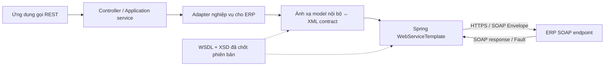

# SOAP, WSDL, XML Schema và tình huống tích hợp hệ thống cũ

## 1. Vì sao ứng dụng Spring Boot vẫn cần hiểu SOAP?

Trong nhiều doanh nghiệp, hệ thống mới viết bằng Spring Boot phải trao đổi dữ liệu với ERP, core banking, bảo hiểm, quản lý kho hoặc cổng dịch vụ công đã vận hành từ lâu. Các hệ thống này có thể công bố **SOAP web service** thay vì REST API. Mục tiêu tích hợp thường không phải thay thế ngay hệ thống cũ, mà là trao đổi dữ liệu với nó một cách có hợp đồng, có kiểm soát lỗi và có khả năng vận hành lâu dài.

Trong phạm vi **SPRING_BOOT_INTEGRATION**, bài học này gắn với việc tổ chức tích hợp hệ thống qua HTTP client, cơ sở dữ liệu, cache, broker thông điệp và các adapter của Spring Integration. SOAP là một trường hợp điển hình của **tích hợp đồng bộ qua HTTP**: phía Spring Boot gọi dịch vụ bên ngoài, chuyển đổi hợp đồng XML thành mô hình nội bộ, kiểm soát timeout, lỗi, giao dịch, trùng lặp, kiểm thử và khả năng quan sát.

Sau bài học, bạn có thể:

- Phân biệt vai trò của **XML**, **XML Schema (XSD)**, **SOAP** và **WSDL** trong cùng một hợp đồng tích hợp.
- Đọc WSDL để xác định operation, kiểu dữ liệu, địa chỉ dịch vụ, giao thức và yêu cầu SOAPAction.
- Thiết kế SOAP client trong Spring Boot bằng Spring Web Services mà không để lớp nghiệp vụ phụ thuộc trực tiếp vào các lớp sinh từ WSDL.
- Nhận diện các tình huống thường gặp khi nối hệ thống cũ: thay đổi hợp đồng, định dạng dữ liệu, SOAP Fault, timeout, retry, bảo mật và sai lệch trạng thái.

> **Bối cảnh xuyên suốt:** Dịch vụ `customer-api` dùng Spring Boot cần lấy thông tin khách hàng từ hệ thống ERP cũ. ERP chỉ có operation `GetCustomer` qua SOAP. Ứng dụng mới công bố REST API cho người dùng nội bộ, nhưng phía sau sử dụng SOAP client để gọi ERP.

## 2. Bốn khái niệm cần tách bạch

| Thành phần | Trả lời câu hỏi | Vai trò trong tích hợp |
|---|---|---|
| **XML** | Dữ liệu được biểu diễn như thế nào? | Cú pháp phân cấp bằng phần tử, thuộc tính, namespace và nội dung văn bản. |
| **XML Schema (XSD)** | XML nào được xem là hợp lệ? | Khai báo phần tử, kiểu dữ liệu, thứ tự, tính bắt buộc, số lần xuất hiện và các ràng buộc. |
| **SOAP** | Thông điệp trao đổi có cấu trúc gì? | Quy định `Envelope`, `Header`, `Body`, `Fault` và cách đóng gói thông điệp theo phiên bản SOAP. |
| **WSDL** | Dịch vụ có những thao tác và cách gọi nào? | Mô tả operation, input/output, kiểu dữ liệu, binding, endpoint và các thông tin hợp đồng khác. |

Không nên đồng nhất chúng: một tài liệu XML hợp lệ chưa chắc là SOAP hợp lệ; một SOAP Envelope đúng cấu trúc chưa chắc đáp ứng XSD của operation; một XML được chấp nhận theo XSD chưa chắc là thông điệp mà endpoint đang yêu cầu theo WSDL.

Luồng triển khai thường như sau:



Điểm thiết kế quan trọng: **WSDL/XSD là hợp đồng ở ranh giới tích hợp**, không phải mô hình dữ liệu chuẩn của toàn bộ ứng dụng. Khi ERP thay đổi hợp đồng, phạm vi tác động lý tưởng chỉ nằm trong adapter.

## 3. SOAP message gồm những gì?

SOAP là giao thức trao đổi thông điệp dựa trên XML; HTTP là phương tiện vận chuyển phổ biến, nhưng SOAP không đồng nghĩa với HTTP. Một SOAP message gồm `Envelope` bao quanh `Body` và phần `Header` tùy chọn.

Ví dụ request SOAP 1.1 gọi `GetCustomer`:

```xml
<?xml version="1.0" encoding="UTF-8"?>
<soapenv:Envelope
    xmlns:soapenv="http://schemas.xmlsoap.org/soap/envelope/"
    xmlns:cus="urn:legacy:customer:v1">
  <soapenv:Header>
    <cus:correlationId>req-7f92</cus:correlationId>
  </soapenv:Header>
  <soapenv:Body>
    <cus:GetCustomerRequest>
      <cus:customerId>42</cus:customerId>
    </cus:GetCustomerRequest>
  </soapenv:Body>
</soapenv:Envelope>
```

Ví dụ response thành công:

```xml
<soapenv:Envelope
    xmlns:soapenv="http://schemas.xmlsoap.org/soap/envelope/"
    xmlns:cus="urn:legacy:customer:v1">
  <soapenv:Body>
    <cus:GetCustomerResponse>
      <cus:customer>
        <cus:id>42</cus:id>
        <cus:name>Nguyen Van A</cus:name>
      </cus:customer>
    </cus:GetCustomerResponse>
  </soapenv:Body>
</soapenv:Envelope>
```

Ở đây, tiền tố `soapenv` và `cus` chỉ là bí danh; **URI namespace mới xác định tên phần tử**. Hai phần tử cùng tên `GetCustomerRequest` nhưng khác namespace là hai phần tử khác nhau. Đó là lý do lỗi namespace thường làm một request trông “đúng XML” vẫn bị dịch vụ từ chối.

Một số điểm cần phân biệt giữa hai phiên bản thông dụng:

| Đặc điểm | SOAP 1.1 | SOAP 1.2 |
|---|---|---|
| Namespace `Envelope` | `http://schemas.xmlsoap.org/soap/envelope/` | `http://www.w3.org/2003/05/soap-envelope` |
| HTTP `Content-Type` thường dùng | `text/xml; charset=utf-8` | `application/soap+xml; charset=utf-8` |
| Xác định action | Header HTTP `SOAPAction` thường xuất hiện | Có thể dùng tham số `action` trong `application/soap+xml` |
| Cấu trúc `Fault` | `faultcode`, `faultstring`, `detail` | `Code`, `Reason`, `Detail` |

Phiên bản SOAP phải phù hợp với **binding của WSDL** và khả năng của endpoint. Không đổi từ 1.1 sang 1.2 chỉ vì cả hai cùng dùng XML.

### SOAP Fault là phản hồi có ý nghĩa giao thức

Khi ERP không xử lý được yêu cầu, nó có thể trả về một SOAP Fault:

```xml
<soapenv:Envelope xmlns:soapenv="http://schemas.xmlsoap.org/soap/envelope/">
  <soapenv:Body>
    <soapenv:Fault>
      <faultcode>soapenv:Client</faultcode>
      <faultstring>Invalid customer identifier</faultstring>
      <detail>
        <errorCode xmlns="urn:legacy:errors:v1">CUSTOMER_ID_INVALID</errorCode>
      </detail>
    </soapenv:Fault>
  </soapenv:Body>
</soapenv:Envelope>
```

SOAP Fault không đơn giản tương đương với HTTP status. Một SOAP 1.1 server thường trả HTTP 500 khi có lỗi xử lý SOAP, nhưng ở các triển khai thực tế còn tồn tại gateway và dịch vụ cũ trả status không nhất quán. Client cần đọc **cả tầng HTTP lẫn SOAP Body/Fault**. Thông điệp HTTP 200 cũng không đảm bảo nghiệp vụ thành công nếu hợp đồng response chứa mã lỗi nghiệp vụ riêng.

## 4. XML Schema (XSD): hợp đồng dữ liệu thật sự

XSD định nghĩa cấu trúc mà request/response phải tuân theo. Ví dụ hợp đồng cho `GetCustomer`:

```xml
<?xml version="1.0" encoding="UTF-8"?>
<xs:schema
    xmlns:xs="http://www.w3.org/2001/XMLSchema"
    xmlns:tns="urn:legacy:customer:v1"
    targetNamespace="urn:legacy:customer:v1"
    elementFormDefault="qualified">

  <xs:element name="GetCustomerRequest">
    <xs:complexType>
      <xs:sequence>
        <xs:element name="customerId" type="xs:long"/>
      </xs:sequence>
    </xs:complexType>
  </xs:element>

  <xs:element name="GetCustomerResponse">
    <xs:complexType>
      <xs:sequence>
        <xs:element name="customer" type="tns:CustomerType"/>
      </xs:sequence>
    </xs:complexType>
  </xs:element>

  <xs:complexType name="CustomerType">
    <xs:sequence>
      <xs:element name="id" type="xs:long"/>
      <xs:element name="name" type="xs:string"/>
    </xs:sequence>
  </xs:complexType>
</xs:schema>
```

Với `elementFormDefault="qualified"`, các phần tử con `customerId`, `customer`, `id`, `name` cũng phải nằm trong namespace `urn:legacy:customer:v1`. Tùy XSD thực tế, một số phần tử con có thể **không** bắt buộc mang namespace; luôn kiểm tra schema thay vì đoán theo tên.

Các ràng buộc XSD cần đặc biệt chú ý khi viết adapter:

| Ràng buộc | Ý nghĩa | Lỗi tích hợp điển hình |
|---|---|---|
| `xs:sequence` | Thứ tự phần tử có ý nghĩa | XML đủ field nhưng gửi sai thứ tự. |
| `minOccurs="0"` | Phần tử có thể vắng mặt | Nhầm **vắng mặt** với giá trị rỗng. |
| `nillable="true"` | Có thể gửi `xsi:nil="true"` | Nhầm `nil`, chuỗi rỗng và không gửi phần tử. |
| `maxOccurs="unbounded"` | Phần tử lặp thành danh sách | Chỉ đọc phần tử đầu, mất dữ liệu. |
| `xs:decimal` | Số thập phân theo lexical form của XML | Làm tròn tiền tệ do dùng `double` thay vì `BigDecimal`. |
| `xs:dateTime` | Thời điểm theo ISO 8601, có thể kèm múi giờ | Chuyển đổi sai khi thiếu offset hoặc dùng giờ máy chủ. |
| `xs:enumeration` | Chỉ nhận tập giá trị chỉ định | ERP bổ sung mã trạng thái, adapter cũ không hiểu. |

**Phân biệt ba trạng thái**: không có `<name>`, có `<name/>`, và có `<name xsi:nil="true"/>` có thể mang các nghĩa khác nhau. Việc JAXB sinh ra `null` trong Java chưa đủ để khẳng định hệ thống cũ nhận cả ba trạng thái giống nhau.

### Namespace và việc phát triển hợp đồng

Namespace có thể chứa hậu tố phiên bản như `:v1`, nhưng **có hay không có phiên bản trong namespace không tự động quyết định tương thích**. Một thay đổi XSD có thể phá vỡ client dù endpoint hoặc namespace vẫn giữ nguyên. Trước khi nâng phiên bản cần so sánh tập phần tử bắt buộc, kiểu dữ liệu, thứ tự, enum, ràng buộc và SOAP operation.

## 5. WSDL mô tả operation, binding và endpoint

WSDL 1.1 là dạng rất thường gặp ở hệ thống cũ. Nó trả lời ba nhóm câu hỏi:

1. **Hợp đồng logic:** Có operation nào? Thông điệp input/output là gì? Chúng tham chiếu những phần tử XSD nào?
2. **Hợp đồng truyền tải:** Dùng SOAP 1.1 hay SOAP 1.2? `document/literal` hay `rpc/encoded`? Action là gì?
3. **Địa chỉ vật lý:** Gửi tới URL nào, qua HTTP hay HTTPS, và có nhiều cổng dịch vụ khác nhau không?

Ví dụ WSDL 1.1 thu gọn cho schema ở trên:

```xml
<wsdl:definitions
    xmlns:wsdl="http://schemas.xmlsoap.org/wsdl/"
    xmlns:soap="http://schemas.xmlsoap.org/wsdl/soap/"
    xmlns:xs="http://www.w3.org/2001/XMLSchema"
    xmlns:tns="urn:legacy:customer:v1"
    targetNamespace="urn:legacy:customer:v1">

  <wsdl:types>
    <xs:schema>
      <xs:import namespace="urn:legacy:customer:v1"
                 schemaLocation="customer.xsd"/>
    </xs:schema>
  </wsdl:types>

  <wsdl:message name="GetCustomerInput">
    <wsdl:part name="parameters" element="tns:GetCustomerRequest"/>
  </wsdl:message>
  <wsdl:message name="GetCustomerOutput">
    <wsdl:part name="parameters" element="tns:GetCustomerResponse"/>
  </wsdl:message>

  <wsdl:portType name="CustomerPortType">
    <wsdl:operation name="GetCustomer">
      <wsdl:input message="tns:GetCustomerInput"/>
      <wsdl:output message="tns:GetCustomerOutput"/>
    </wsdl:operation>
  </wsdl:portType>

  <wsdl:binding name="CustomerSoapBinding" type="tns:CustomerPortType">
    <soap:binding style="document"
                  transport="http://schemas.xmlsoap.org/soap/http"/>
    <wsdl:operation name="GetCustomer">
      <soap:operation soapAction="urn:legacy:customer:v1/GetCustomer"/>
      <wsdl:input><soap:body use="literal"/></wsdl:input>
      <wsdl:output><soap:body use="literal"/></wsdl:output>
    </wsdl:operation>
  </wsdl:binding>

  <wsdl:service name="CustomerService">
    <wsdl:port name="CustomerPort" binding="tns:CustomerSoapBinding">
      <soap:address location="https://erp.example.invalid/soap/customer"/>
    </wsdl:port>
  </wsdl:service>
</wsdl:definitions>
```

`https://erp.example.invalid/...` là địa chỉ **minh họa**, không phải endpoint có thể gọi. Trong môi trường thực tế, endpoint có thể khác giữa dev, test và production ngay cả khi tất cả cùng sử dụng một WSDL/XSD. Tránh đóng cứng địa chỉ xuất hiện trong WSDL vào mã nguồn; cấu hình endpoint theo môi trường.

Khi tiếp nhận WSDL từ đối tác, hãy đọc theo thứ tự **`service/port` → `binding` → `portType/operation` → `message/part` → `types/XSD`** để nhanh chóng đi từ URL đến phần tử XML cần gửi. Với `document/literal`, SOAP Body thường chứa các phần tử được chỉ định trực tiếp bởi XSD. Nếu gặp `rpc/encoded`, cần xem khả năng hỗ trợ của thư viện được chọn; đây là kiểu cũ, phức tạp hơn và không nên tự giả định client `document/literal` sẽ tương thích.

> Đường dẫn lấy WSDL như `.../CustomerService?wsdl` là nơi tải **mô tả hợp đồng**. URL gọi SOAP thực tế là địa chỉ trong `soap:address`, có thể khác hẳn. Không gửi mọi request SOAP tới URL `?wsdl`.

## 6. Tổ chức SOAP client trong Spring Boot

Với Spring Boot, một lựa chọn phổ biến cho SOAP client là **Spring Web Services (Spring-WS)** với `WebServiceTemplate`. Client có thể marshal Java object thành XML, gửi SOAP Envelope và unmarshal response. Đây là một cách tích hợp ở ranh giới ứng dụng; ứng dụng không cần để SOAP lan tới controller hay business service.

Luồng dữ liệu nên tách thành ba mô hình:

```text
REST request / domain command
    → CustomerErpAdapter (quy tắc ánh xạ, lỗi, retry)
    → JAXB request (theo XSD/WSDL của ERP)
    → WebServiceTemplate → ERP SOAP endpoint
    ← JAXB response
    ← Domain Customer / Result
```

### 6.1. Quản lý dependency và sinh lớp hợp đồng

Một ứng dụng Spring Boot dùng Spring-WS client thường cần thư viện Spring Web Services, JAXB marshalling và XML binding runtime tương ứng. Ví dụ khai báo Maven (phiên bản do BOM của dự án quản lý khi phù hợp):

```xml
<dependency>
  <groupId>org.springframework.boot</groupId>
  <artifactId>spring-boot-starter-web-services</artifactId>
</dependency>
```

Cần kiểm tra phiên bản Java/Spring Boot và `jakarta.xml.bind` so với `javax.xml.bind`: Spring Boot 3 trở lên dựa trên Jakarta APIs. Mã JAXB sinh theo namespace Java cũ (`javax.*`) có thể không phù hợp với runtime dùng `jakarta.*`. Từ Java 11, các công cụ JAX-WS/JAXB không còn được đóng gói sẵn như ở một số bản JDK trước; hãy quản lý công cụ sinh mã như dependency/plugin build độc lập.

Một quy trình triển khai thường dùng:

1. Nhận **bản WSDL và mọi XSD import** đã kiểm tra và chốt phiên bản với ERP.
2. Dùng công cụ sinh JAXB model hoặc SOAP client được chọn (ví dụ JAXB XJC hoặc Apache CXF codegen), kiểm tra namespace Java của mã sinh.
3. Đặt các lớp sinh trong package riêng, ví dụ `com.example.integration.erp.generated`.
4. Viết adapter chuyển lớp JAXB sang model ứng dụng. Không sử dụng trực tiếp lớp JAXB làm response DTO cho REST API.
5. Khi hợp đồng thay đổi, tái sinh mã một cách có kiểm soát và đánh giá ảnh hưởng trong adapter.

Đoạn code tiếp theo giả định XSD đã sinh các lớp `GetCustomerRequest`, `GetCustomerResponse` và lớp khách hàng dưới package `com.example.integration.erp.generated`. Tên lớp thực tế có thể khác theo generator và cách thiết kế XSD.

### 6.2. Cấu hình `WebServiceTemplate`

```yaml
# application.yml
legacy:
  customer:
    endpoint: ${LEGACY_CUSTOMER_SOAP_URL}
```

```java
import org.springframework.beans.factory.annotation.Value;
import org.springframework.context.annotation.Bean;
import org.springframework.context.annotation.Configuration;
import org.springframework.oxm.jaxb.Jaxb2Marshaller;
import org.springframework.ws.client.core.WebServiceTemplate;

@Configuration
public class ErpSoapConfiguration {

    @Bean
    Jaxb2Marshaller erpMarshaller() {
        Jaxb2Marshaller marshaller = new Jaxb2Marshaller();
        marshaller.setContextPath("com.example.integration.erp.generated");
        return marshaller;
    }

    @Bean
    WebServiceTemplate erpWebServiceTemplate(
            Jaxb2Marshaller erpMarshaller,
            @Value("${legacy.customer.endpoint}") String endpoint) {

        WebServiceTemplate template = new WebServiceTemplate();
        template.setMarshaller(erpMarshaller);
        template.setUnmarshaller(erpMarshaller);
        template.setDefaultUri(endpoint);
        return template;
    }
}
```

`setContextPath(...)` phải trùng với JAXB package được sinh và có metadata JAXB thích hợp, chẳng hạn `ObjectFactory` hoặc `jaxb.index`. Với một số schema, object cần được bọc trong `JAXBElement` do `ObjectFactory` tạo ra; ví dụ bên dưới giả định request/response sinh được ánh xạ trực tiếp thành XML root element.

Trong dự án thật, cần **cấu hình rõ connection timeout, read/response timeout, TLS, xác thực, giới hạn kết nối** tại transport/message sender tương ứng phiên bản thư viện. Không dùng timeout không giới hạn; không đặt timeout tùy tiện bằng một con số chung cho mọi upstream. Nên có cấu hình riêng theo từng đối tác và SLA.

### 6.3. Gửi request theo WSDL

```java
import com.example.integration.erp.generated.GetCustomerRequest;
import com.example.integration.erp.generated.GetCustomerResponse;
import org.springframework.stereotype.Component;
import org.springframework.ws.client.core.WebServiceTemplate;
import org.springframework.ws.soap.client.core.SoapActionCallback;

@Component
public class ErpCustomerSoapClient {

    private final WebServiceTemplate template;

    public ErpCustomerSoapClient(WebServiceTemplate erpWebServiceTemplate) {
        this.template = erpWebServiceTemplate;
    }

    public GetCustomerResponse getCustomer(long customerId) {
        GetCustomerRequest request = new GetCustomerRequest();
        request.setCustomerId(customerId);

        Object response = template.marshalSendAndReceive(
                request,
                new SoapActionCallback("urn:legacy:customer:v1/GetCustomer")
        );

        if (!(response instanceof GetCustomerResponse result)) {
            throw new IllegalStateException("Unexpected ERP SOAP response type");
        }
        return result;
    }
}
```

`SoapActionCallback` minh họa SOAPAction của **SOAP 1.1 binding** trong WSDL ví dụ. Không tự suy ra giá trị SOAPAction từ tên phương thức Java: hãy đọc `soap:operation` trong binding thật. Với SOAP 1.2, cần kiểm tra cách message factory và transport phát ra tham số `action` phù hợp.

Một lớp `CustomerErpAdapter` nên gọi client này, chuyển `GetCustomerResponse` thành `Customer` nội bộ và ánh xạ lỗi ERP sang loại lỗi của ứng dụng. Khi cần đổi từ ERP SOAP sang nguồn dữ liệu khác, controller và quy tắc nghiệp vụ không phải sửa theo từng phần tử XML.

### 6.4. Khi nào cần CXF hoặc JAX-WS client?

Nếu đối tác yêu cầu nhiều WS-* policy, kiểu hợp đồng phức tạp, MTOM, WS-Addressing hoặc có công cụ client JAX-WS đã ổn định, Apache CXF có thể phù hợp. Quyết định dựa trên WSDL, chính sách bảo mật, chuẩn SOAP và vận hành hiện có; không chỉ dựa vào việc codegen tạo được Java stub. Tránh trộn nhiều stack SOAP không cần thiết trong cùng một tích hợp.

## 7. Adapter chống phụ thuộc vào hệ thống cũ

Đối với core banking/ERP lâu năm, sự khác nhau về ngôn ngữ nghiệp vụ thường lớn hơn sự khác nhau về công nghệ. ERP có thể gọi khách hàng là `AccountHolder`, biểu diễn trạng thái bằng `A/I/S`, dùng ngày kiểu `yyyyMMdd` hoặc dùng chuỗi trống thay cho giá trị chưa có.

Adapter cần chuyển đổi theo **ngữ nghĩa** thay vì chỉ copy field:

| ERP SOAP contract | Model nội bộ | Điều cần quyết định |
|---|---|---|
| `ACTIVE_FLAG = "Y"/"N"` | `active: boolean` | Có trạng thái thứ ba như “chưa xác định” không? |
| `CustomerNo` dạng chuỗi | `customerId: String` | Có số 0 ở đầu không? Không ép sang `long` nếu là mã định danh. |
| `Balance` dạng `xs:decimal` | `BigDecimal` + currency | Đơn vị tiền, scale và quy tắc làm tròn. |
| `LastUpdated` không có offset | Thời điểm theo miền nghiệp vụ | Timezone thực tế do ERP quy định là gì? |
| SOAP Fault `CUSTOMER_NOT_FOUND` | Lỗi nghiệp vụ `CustomerNotFound` | Lỗi này có được retry hay không? |

Một adapter tốt còn có thể chuẩn hóa mã lỗi và phiên bản hợp đồng, làm sạch dữ liệu, thêm correlation ID và bảo vệ tầng ứng dụng khỏi các thay đổi nhỏ trong XML. Tuy nhiên, adapter **không được tự đoán** giá trị thiếu hoặc che giấu dữ liệu mâu thuẫn; các quy tắc chuyển đổi phải được thống nhất với chủ sở hữu hệ thống nguồn.

### Tình huống thay thế dần hệ thống cũ

Khi ứng dụng mới cung cấp REST nhưng phụ thuộc SOAP ở phía sau, REST API có thể giữ hợp đồng ổn định cho các client mới. Lớp tích hợp dần chuyển một operation sang dịch vụ hiện đại hơn mà không buộc tất cả client phải hiểu WSDL. Mẫu này chỉ an toàn nếu quản lý rõ nguồn dữ liệu chuẩn, luồng ghi và khả năng đọc thấy dữ liệu nhất quán trong thời kỳ chuyển đổi.

## 8. Lỗi, timeout, retry, giao dịch và xử lý trùng lặp

SOAP qua HTTP vẫn gặp mọi vấn đề của mạng phân tán. Điểm khó là đôi khi **client không biết ERP đã xử lý request hay chưa**: kết nối đứt sau khi ERP commit nhưng trước khi client nhận response.

Phân loại tình huống trước khi xử lý:

| Trường hợp | Ví dụ | Chiến lược |
|---|---|---|
| Lỗi xác thực hoặc không đúng hợp đồng | HTTP 401/403, XML sai namespace, schema không khớp | Sửa cấu hình/hợp đồng; không retry mù. |
| SOAP Fault nghiệp vụ | Khách hàng không tồn tại, vượt hạn mức | Ánh xạ sang kết quả hoặc lỗi nghiệp vụ; thường không retry. |
| Lỗi hạ tầng tạm thời | Timeout, ngắt kết nối, ERP quá tải | Retry có giới hạn và backoff nếu operation an toàn; quan sát tỷ lệ lỗi. |
| Timeout sau khi gửi lệnh ghi | `CreatePayment`, `CreateOrder` | Coi kết quả là **chưa xác định**, kiểm tra trạng thái hoặc đối soát trước khi gửi lại. |
| Response XML không tương thích | Trường mới, enum lạ, namespace sai | Ghi nhận lỗi hợp đồng và cảnh báo; không âm thầm bỏ qua dữ liệu quan trọng. |

Khi xử lý bằng Spring-WS, hãy phân biệt lỗi transport với `SoapFaultClientException` và lỗi marshal/unmarshal. Không bắt tất cả exception rồi trả `null`; cách đó làm mất thông tin để retry, cảnh báo hoặc truy vết.

### Retry có điều kiện

- Với operation chỉ đọc như `GetCustomer`, có thể retry timeout hoặc một số lỗi 5xx có chọn lọc, **giới hạn số lần, có backoff và jitter**, đồng thời tính vào tổng thời gian chờ của người gọi.
- Với operation tạo/gửi tiền/đặt hàng, không retry khi chưa biết server đã commit hay chưa, trừ khi ERP hỗ trợ **idempotency key**, request ID duy nhất hoặc cơ chế tra cứu giao dịch đảm bảo an toàn.
- Tách **business key** và **request/correlation ID**: correlation ID để truy vết; idempotency key để chống thực thi lặp. Hai giá trị không mặc nhiên thay thế nhau.
- Khi tích hợp bất đồng bộ qua queue, phải dự kiến nhận cùng một thông điệp nhiều lần, theo dõi idempotency key ở bước xử lý SOAP và có cơ chế DLQ/đối soát.

### Giao dịch xuyên hệ thống

Một giao dịch `@Transactional` trên database Spring Boot **không tự động bao phủ** lệnh SOAP đã thực hiện ở ERP. Ví dụ, database nội bộ rollback không làm ERP tự động hủy đơn hàng. Với workflow nhiều hệ thống, cân nhắc lưu trạng thái trung gian, outbox, bước bù (compensation), kiểm tra trạng thái và đối soát định kỳ thay vì giả định có một transaction ACID xuyên HTTP.

## 9. Bảo mật SOAP/XML

Tích hợp SOAP thường liên quan dữ liệu nhạy cảm hoặc chức năng lõi của doanh nghiệp; cần xem cả bảo mật kênh truyền lẫn bảo mật thông điệp.

**Ở tầng truyền tải:** sử dụng HTTPS, xác minh chứng chỉ máy chủ, quản lý truststore, xem xét mutual TLS nếu đối tác yêu cầu, giới hạn outbound network và đặt credential trong secret manager. Nếu dùng HTTP Basic, OAuth token ở gateway hoặc chứng chỉ client, cách cấu hình phải tuân theo hợp đồng với ERP.

**Ở tầng thông điệp:** một số đối tác yêu cầu WS-Security như `UsernameToken`, timestamp, chữ ký XML hoặc mã hóa một phần SOAP Body. TLS **không thay thế** WS-Security trong hệ thống cần xác thực/chữ ký ở cấp thông điệp đi qua nhiều trung gian. Spring-WS có tích hợp WS-Security, chẳng hạn interceptor dựa trên WSS4J, nhưng cấu hình phải khớp policy, thuật toán và chứng chỉ của đối tác.

**Ở tầng XML parser:** phải phòng vệ trước XXE, tải DTD/external entity, entity expansion và XML kích thước quá lớn. Không bật xử lý external entity chỉ để “cho XML parse được”. Nếu code trực tiếp với DOM, SAX, StAX hoặc `TransformerFactory`, cấu hình parser an toàn và giới hạn tài nguyên tương ứng. Chỉ lấy WSDL/XSD từ nguồn tin cậy và kiểm soát các tài nguyên được `import`/`include`.

**Ở tầng ghi log:** SOAP Envelope có thể chứa số tài khoản, CCCD, địa chỉ hoặc token WS-Security. Ưu tiên log mã operation, correlation ID, thời gian, kích thước, loại lỗi và mã lỗi đã làm sạch. Chỉ lưu payload có kiểm soát, che dữ liệu nhạy cảm, giới hạn thời gian lưu và phân quyền truy cập.

## 10. Kiểm thử hợp đồng và luồng lỗi

Kiểm thử SOAP client cần nhiều mức, nhưng mỗi mức trả lời một câu hỏi khác nhau:

| Mức kiểm thử | Cần xác minh | Cách thực hiện gợi ý |
|---|---|---|
| Mapping | Trường miền nghiệp vụ được chuyển đúng sang JAXB và ngược lại? | Unit test adapter với fixture có trường rỗng, `nil`, enum và ngày giờ. |
| XML contract | Payload có đúng namespace, thứ tự, kiểu dữ liệu, phần tử bắt buộc? | Marshal và validate bằng XSD đã chốt phiên bản; kiểm tra SOAPAction nếu cần. |
| SOAP client | Client xử lý SOAP response và Fault đúng? | `MockWebServiceServer` của Spring-WS hoặc stub HTTP trả SOAP Envelope. |
| Tích hợp đối tác | Endpoint thật có chấp nhận hợp đồng, TLS và xác thực? | Test trong môi trường sandbox/UAT do ERP quản lý. |
| Vận hành | Timeout, ngắt kết nối, retry, đo lường hoạt động đúng? | Bài test sự cố có kiểm soát, đặc biệt với operation ghi. |

Ví dụ ý tưởng với Spring-WS test client:

```java
// Dependency kiểm thử: org.springframework.ws:spring-ws-test
MockWebServiceServer mockServer =
        MockWebServiceServer.createServer(webServiceTemplate);

mockServer.expect(payload(new StringSource(expectedRequestPayload)))
        .andRespond(withPayload(new StringSource(responsePayload)));

soapClient.getCustomer(42L);
mockServer.verify();
```

`expectedRequestPayload` và `responsePayload` ở đây là **phần tử payload trong SOAP Body**, không phải toàn bộ Envelope. Cần import các static matcher/response creator của Spring-WS test trong test thực tế. Để kiểm tra header SOAPAction, SOAP Fault, timeout và nội dung header đặc thù, bổ sung matcher/stub tương ứng; ví dụ trên chỉ minh họa luồng thành công.

Tối thiểu nên có fixture cho: một response hợp lệ, `CUSTOMER_NOT_FOUND`, SOAP Fault kỹ thuật, sai namespace, phần tử bắt buộc bị thiếu, mã enum chưa biết, giá trị `nil`, timeout và lỗi xác thực. Các fixture phải bám sát WSDL/XSD mà đối tác thực sự triển khai.

## 11. Quan sát tích hợp trong môi trường thực tế

Một HTTP call có thể chứa SOAP business operation, nên chỉ theo dõi URL chưa đủ. Với mỗi lượt gọi, nên theo dõi:

- **Metric:** số lượng request, latency p50/p95/p99, tỷ lệ SOAP Fault theo nhóm, timeout, retry, circuit breaker mở, tỷ lệ response không giải mã được.
- **Trace:** span outbound theo `GetCustomer` hoặc tên operation; kết nối trace từ REST request tới bước adapter và HTTP transport. Nếu hệ thống cũ không hỗ trợ trace header, ít nhất giữ được correlation ID trong ứng dụng và log gateway.
- **Log:** endpoint alias, operation, correlation ID, mã lỗi đã chuẩn hóa, số lần thử, elapsed time; không log payload có bí mật mặc định.
- **Alert:** tỷ lệ lỗi/timeout tăng, độ trễ vượt SLA, tăng số transaction cần đối soát hoặc schema mismatch sau thay đổi đối tác.

Metric label không nên chứa customerId, requestId hoặc giá trị tùy ý có cardinality cao. Với các operation ghi, dashboard cần phân biệt rõ **thành công**, **thất bại xác định được** và **chưa xác định kết quả** để đội vận hành không vô tình tạo giao dịch trùng.

## 12. Ví dụ quyết định thiết kế: lấy thông tin và tạo đơn hàng

Giả sử ERP cung cấp hai operation:

| Operation | `GetCustomer` | `CreateOrder` |
|---|---|---|
| Loại thao tác | Đọc | Ghi |
|---|---|---|
| Retry khi timeout | Có thể, với giới hạn | Chỉ khi ERP bảo đảm idempotency hoặc đã xác minh chưa tạo |
| Cache | Có thể cân nhắc TTL ngắn nếu dữ liệu cho phép | Không cache kết quả thực thi làm cơ chế chống lặp |
| Xử lý kết quả chưa rõ | Thông báo lỗi và thử lại có kiểm soát | Lưu `PENDING_RECONCILIATION`, tra cứu trạng thái trước khi gửi lại |
| Phụ thuộc transaction DB | Không cần transaction phân tán | Lưu workflow state/outbox, thiết kế bù trừ nếu cần |
| Điều cần log | Operation, latency, kết quả đã làm sạch | Thêm business key và idempotency key đã được bảo vệ |

Một luồng thực tế có thể là:

1. REST API nhận lệnh tạo đơn; kiểm tra dữ liệu và lưu bản ghi `PENDING` cùng business key duy nhất.
2. Adapter tạo XML theo XSD, gửi SOAP request với request ID/idempotency key **nếu ERP hỗ trợ hợp đồng đó**.
3. Nếu trả thành công, lưu mã đơn của ERP và chuyển trạng thái `CONFIRMED`.
4. Nếu SOAP Fault nghiệp vụ xác định, chuyển trạng thái `REJECTED` theo quy tắc nghiệp vụ.
5. Nếu timeout sau khi gửi, chuyển sang trạng thái `UNKNOWN` hoặc `PENDING_RECONCILIATION`; kiểm tra qua operation tra cứu hoặc báo cáo đối soát trước khi có quyết định gửi lại.

Đây là lý do “gọi SOAP thành công” chỉ là một phần trong tích hợp hệ thống: **tính đúng đắn của trạng thái nghiệp vụ** và khả năng phục hồi sau lỗi quan trọng không kém cú pháp XML.

## 13. Checklist trước khi kết nối một SOAP service cũ

- [ ] Có bản WSDL **và toàn bộ XSD import/include** đã chốt phiên bản; biết ai sở hữu hợp đồng.
- [ ] Xác định `service`, `port`, `binding`, SOAP version, operation, SOAPAction và endpoint theo môi trường.
- [ ] Làm rõ `document/literal`, cấu trúc XML, namespace, phần tử tùy chọn, `nil`, enum, ngày giờ và kiểu tiền tệ.
- [ ] Kiểm tra stack Spring Boot/Java/JAXB tương thích; khoanh vùng generated classes trong package tích hợp.
- [ ] Thiết kế adapter chuyển contract ERP ↔ model nội bộ; chuẩn hóa SOAP Fault và mã lỗi nghiệp vụ.
- [ ] Cấu hình HTTPS, chứng chỉ, credential/WS-Security nếu cần, parser XML an toàn và giới hạn payload.
- [ ] Cấu hình timeout, connection pool, retry/circuit breaker theo đặc tính **từng operation**.
- [ ] Có cơ chế idempotency/đối soát cho operation ghi; không mặc định `@Transactional` bao phủ SOAP.
- [ ] Có fixture kiểm thử SOAP Fault, lỗi XSD, timeout, thay đổi hợp đồng và UAT với endpoint của đối tác.
- [ ] Theo dõi latency, fault, timeout, correlation ID và trạng thái giao dịch chưa xác định; che dữ liệu nhạy cảm trong log.

## 14. Tổng kết

**XML** mô tả hình dạng dữ liệu; **XSD** ràng buộc dữ liệu hợp lệ; **SOAP** chuẩn hóa thông điệp; **WSDL** công bố thao tác, binding và địa chỉ dịch vụ. Đọc đủ bốn lớp giúp tránh các lỗi tích hợp thường gặp như nhầm endpoint `?wsdl`, sai namespace, sai SOAPAction và hiểu nhầm HTTP 200 là nghiệp vụ thành công.

Trong Spring Boot, hãy coi SOAP là một **adapter ở biên hệ thống**: dùng thư viện thích hợp để marshal/unmarshal, giữ generated model tách khỏi domain, triển khai timeout và quản lý lỗi rõ ràng. Với hệ thống cũ, các quyết định về retry, idempotency, giao dịch, đối soát, bảo mật XML và quan sát luồng thường quyết định độ tin cậy nhiều hơn chính dòng code gửi SOAP request.
