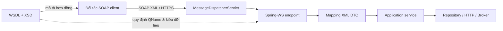
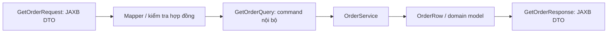

# Thiết lập `spring-boot-starter-webservices`

Trong **SPRING_BOOT_INTEGRATION**, hệ thống không phải lúc nào cũng trao đổi bằng REST/JSON. Ngân hàng, bảo hiểm, hệ thống ERP và nhiều đối tác lâu đời vẫn dùng **SOAP/XML**, thường kèm **WSDL**, **XSD**, yêu cầu xác thực riêng và hợp đồng chặt chẽ về kiểu dữ liệu. Khi một dịch vụ Spring Boot phải cung cấp hoặc gọi SOAP API, `spring-boot-starter-webservices` giúp tích hợp **Spring Web Services (Spring-WS)** với hạ tầng Spring Boot.

Bài thuộc chương **SOAP và XML**, tập trung vào cách thiết lập starter, cấu hình endpoint và client, công bố WSDL, ánh xạ XML, cũng như các giới hạn liên quan đến hợp đồng dữ liệu, giao dịch, lỗi, chống xử lý trùng, kiểm thử và quan sát. Ví dụ dựa trên **Java 17+ và Spring Boot 3.x/Spring-WS 4.x**; khi dự án sử dụng thế hệ khác, cần đối chiếu API và dependency theo BOM tương ứng.

## 1. Mục tiêu học tập

Sau bài học, bạn có thể:

1. Giải thích vai trò của SOAP Envelope, WSDL, XSD và Spring-WS trong một luồng tích hợp.
2. Thêm đúng starter `spring-boot-starter-webservices`, xác định phần Spring Boot tự cấu hình và phần ứng dụng phải khai báo.
3. Xây dựng một SOAP endpoint từ schema XML, công bố WSDL và xử lý request bằng `@Endpoint`.
4. Tách DTO XML/JAXB khỏi mô hình nghiệp vụ và mô hình lưu trữ nội bộ.
5. Gọi SOAP service bên ngoài bằng `WebServiceTemplate`, xử lý SOAP Fault, timeout và retry.
6. Thiết kế bảo vệ XML, transaction, idempotency, kiểm thử và observability cho luồng SOAP thực tế.

## 2. SOAP, WSDL và XSD giải quyết những việc khác nhau

| Khái niệm | Công dụng | Điều cần nhớ |
| --- | --- | --- |
| **SOAP** | Quy định cấu trúc thông điệp XML, envelope, header, body và fault | Là giao thức trao đổi thông điệp; không đồng nghĩa với cách lưu dữ liệu. |
| **WSDL** | Mô tả operation, message, binding, endpoint và cách gọi dịch vụ | Là tài liệu hợp đồng để phía client tạo mã và kiểm tra tương thích. |
| **XSD** | Định nghĩa phần tử XML, namespace, kiểu, thứ tự và ràng buộc dữ liệu | Điều khiển định dạng payload theo hợp đồng; không tự xác minh tất cả quy tắc nghiệp vụ. |
| **Spring-WS** | Xử lý message SOAP, chọn endpoint, chuyển đổi payload và gọi SOAP service | Khác với Spring MVC REST controller và khác với JAX-WS runtime. |
| **Spring Boot starter** | Kéo dependency cần thiết, kích hoạt auto-configuration theo điều kiện | Không tự viết WSDL hay nghiệp vụ của ứng dụng. |



Ví dụ một SOAP 1.1 request có thể trông như sau:

```xml
<soapenv:Envelope
    xmlns:soapenv="http://schemas.xmlsoap.org/soap/envelope/"
    xmlns:ord="https://api.example.org/contracts/orders/v1">
  <soapenv:Header/>
  <soapenv:Body>
    <ord:GetOrderRequest>
      <ord:orderId>ORD-2026-001</ord:orderId>
    </ord:GetOrderRequest>
  </soapenv:Body>
</soapenv:Envelope>
```

**SOAP Body** chứa phần tử nghiệp vụ `GetOrderRequest`; **SOAP Header** chứa metadata theo các tiêu chuẩn hoặc hợp đồng của đối tác, chẳng hạn thông tin định tuyến, correlation ID hay token WS-Security. Namespace URI của phần tử XML là một phần của danh tính (QName) của nó. Hai phần tử cùng tên `GetOrderRequest` nhưng khác namespace **không** phải cùng một message theo hợp đồng.

SOAP 1.1 thường dùng `Content-Type: text/xml`; SOAP 1.2 thường dùng `application/soap+xml`, và có khác biệt về envelope namespace cũng như cách thể hiện action. Không đổi version chỉ bằng cách sửa HTTP header; client, message factory, binding trong WSDL và phía server phải thống nhất.

## 3. Khởi tạo project và thêm dependency đúng

Artifact Maven chính xác là **`org.springframework.boot:spring-boot-starter-webservices`**. Đây cũng là tên starter có trên Spring Initializr khi chọn **Spring Web Services**.

Ví dụ Maven, sử dụng Spring Boot parent/BOM để quản lý các phiên bản thư viện tương thích:

```xml
<dependencies>
    <dependency>
        <groupId>org.springframework.boot</groupId>
        <artifactId>spring-boot-starter-webservices</artifactId>
    </dependency>

    <!-- Cần khi sinh WSDL 1.1 động từ XSD bằng DefaultWsdl11Definition. -->
    <dependency>
        <groupId>wsdl4j</groupId>
        <artifactId>wsdl4j</artifactId>
        <scope>runtime</scope>
    </dependency>

    <dependency>
        <groupId>org.springframework.boot</groupId>
        <artifactId>spring-boot-starter-test</artifactId>
        <scope>test</scope>
    </dependency>
    <dependency>
        <groupId>org.springframework.ws</groupId>
        <artifactId>spring-ws-test</artifactId>
        <scope>test</scope>
    </dependency>
</dependencies>
```

Ví dụ Gradle Groovy DSL tương đương:

```groovy
dependencies {
    implementation 'org.springframework.boot:spring-boot-starter-webservices'
    runtimeOnly 'wsdl4j:wsdl4j'
    testImplementation 'org.springframework.boot:spring-boot-starter-test'
    testImplementation 'org.springframework.ws:spring-ws-test'
}
```

**Không cần thêm `spring-boot-starter-web` chỉ để tạo SOAP endpoint**, nếu ứng dụng đã có Servlet web server từ starter Web Services và không dùng Spring MVC controller. Khi ứng dụng phục vụ cả REST và SOAP, có thể dùng cả hai starter trong cùng process nhưng cần phân biệt đường dẫn SOAP của `MessageDispatcherServlet` với các route MVC.

JAXB/Jakarta XML Binding dùng cho việc chuyển XML thành đối tượng Java. Trên Java hiện đại, các lớp JAXB phát sinh dùng package `jakarta.xml.bind.*`; không trộn lớp `javax.xml.bind.*` của thế hệ Java EE cũ với stack Jakarta của Spring Boot 3.x. Nếu chọn sinh mã từ XSD, cấu hình plugin XJC tại build time; không sửa trực tiếp các lớp Java đã sinh.

## 4. Spring Boot tự cấu hình đến đâu?

Khi chạy ứng dụng **Servlet** với Spring-WS trên classpath và thỏa điều kiện auto-configuration, Spring Boot cung cấp hạ tầng để nhận SOAP request qua `MessageDispatcherServlet`. Boot cũng hỗ trợ đăng ký và công bố tài nguyên WSDL/XSD có trong vị trí cấu hình. Tuy nhiên, Boot **không** tự biết operation của hệ thống, nghiệp vụ, schema công khai, cách ánh xạ lỗi hay địa chỉ SOAP service của đối tác.

| Thành phần | Spring Boot/Spring-WS có thể cung cấp | Ứng dụng phải quyết định |
| --- | --- | --- |
| Servlet vận chuyển SOAP | `MessageDispatcherServlet` và servlet mapping theo cấu hình Boot, khi các điều kiện được đáp ứng | Đường dẫn công khai, proxy, TLS và phân quyền |
| Định tuyến endpoint | Spring-WS tìm `@Endpoint`/`@PayloadRoot` trong Spring context | Operation, namespace, phương thức handler và xử lý nghiệp vụ |
| Công bố WSDL/XSD | Tích hợp các `WsdlDefinition`/`XsdSchema` bean; có thể nhận tài nguyên từ `spring.webservices.wsdl-locations` | Nội dung schema và chính sách versioning hợp đồng |
| SOAP client | Auto-configure `WebServiceTemplateBuilder` | Tạo `WebServiceTemplate` cần dùng, URI, marshaller, xác thực, timeout, interceptor |
| Fault và retry | Có các extension point để ánh xạ lỗi, SOAP fault | Chính sách lỗi nghiệp vụ, khả năng thử lại và idempotency |
| Database/broker/cache | Auto-configuration tương ứng khi thêm dependency và thuộc tính phù hợp | Giao dịch, outbox, DTO, consistency và luồng tích hợp |

Ví dụ cấu hình `application.yml`:

```yaml
server:
  port: 8080

spring:
  webservices:
    path: /services
```

`spring.webservices.path` điều khiển mapping của SOAP servlet do Boot cấu hình; **không** phải URL của hệ thống SOAP đối tác. Trong các dự án có nhiều servlet, cấu hình `server.servlet.context-path` hoặc reverse proxy có thể thêm tiền tố vào URL bên ngoài.

Nếu chỉ cần công bố WSDL/XSD tĩnh đã cung cấp trong `src/main/resources/wsdl/`, có thể cấu hình:

```yaml
spring:
  webservices:
    path: /services
    wsdl-locations: classpath:/wsdl/
```

Boot có cơ chế tạo các bean `SimpleWsdl11Definition` và `SimpleXsdSchema` theo tài nguyên phù hợp tại vị trí này. Khi muốn tạo **WSDL động từ XSD**, ứng dụng vẫn phải khai báo `DefaultWsdl11Definition` tương ứng. Không nhầm `wsdl-locations` với một cơ chế tự tạo operation nghiệp vụ.

Với đường đi tự cấu hình của Boot, **không thêm `@EnableWs` và không tự đăng ký thêm một `MessageDispatcherServlet` chỉ vì thấy ví dụ cũ làm vậy**. Việc dùng cấu hình Spring-WS thủ công có thể tác động đến điều kiện auto-configuration, dẫn tới hai servlet hoặc mapping khác mong đợi. Chỉ cấu hình thủ công khi thật sự cần thay thế một hành vi của Boot và đã kiểm tra điều kiện bean.

## 5. Ví dụ XSD-first: công bố dịch vụ tra cứu đơn hàng

Giả sử một hệ thống đối tác gọi `GetOrder` bằng SOAP và nhận trạng thái xử lý của đơn hàng. Chúng ta định nghĩa schema trước; mã endpoint, Java binding và WSDL phải tuân theo schema đó.

### 5.1. Tạo XSD làm hợp đồng

File minh họa `src/main/resources/xsd/orders.xsd`:

```xml
<?xml version="1.0" encoding="UTF-8"?>
<xs:schema
    xmlns:xs="http://www.w3.org/2001/XMLSchema"
    xmlns:tns="https://api.example.org/contracts/orders/v1"
    targetNamespace="https://api.example.org/contracts/orders/v1"
    elementFormDefault="qualified">

  <xs:element name="GetOrderRequest">
    <xs:complexType>
      <xs:sequence>
        <xs:element name="orderId" type="xs:string"/>
      </xs:sequence>
    </xs:complexType>
  </xs:element>

  <xs:element name="GetOrderResponse">
    <xs:complexType>
      <xs:sequence>
        <xs:element name="orderId" type="xs:string"/>
        <xs:element name="status" type="xs:string"/>
      </xs:sequence>
    </xs:complexType>
  </xs:element>
</xs:schema>
```

Hai phần tử gốc `GetOrderRequest` và `GetOrderResponse` có hậu tố theo convention của `DefaultWsdl11Definition`. Bộ tạo WSDL có thể suy ra operation **GetOrder** từ cặp tên này. Namespace URI là danh tính hợp đồng, không yêu cầu phải truy cập được bằng HTTP.

Schema trên cố ý nhỏ để học cách wiring. Trong hệ thống thật, cần quy định giới hạn độ dài `orderId`, tập giá trị hợp lệ của `status`, dữ liệu tùy chọn, timezone, tiền tệ và chính sách phát triển schema. Validation XSD không thay thế kiểm tra quyền tra cứu đơn hàng của đối tác.

### 5.2. Đăng ký XSD và bean WSDL

```java
import org.springframework.context.annotation.Bean;
import org.springframework.context.annotation.Configuration;
import org.springframework.core.io.ClassPathResource;
import org.springframework.ws.wsdl.wsdl11.DefaultWsdl11Definition;
import org.springframework.xml.xsd.SimpleXsdSchema;
import org.springframework.xml.xsd.XsdSchema;

@Configuration(proxyBeanMethods = false)
public class OrderWsdlConfiguration {

    @Bean
    XsdSchema ordersSchema() {
        return new SimpleXsdSchema(new ClassPathResource("xsd/orders.xsd"));
    }

    @Bean(name = "orders")
    DefaultWsdl11Definition ordersWsdl(XsdSchema ordersSchema) {
        var definition = new DefaultWsdl11Definition();
        definition.setPortTypeName("OrdersPort");
        definition.setLocationUri("/services");
        definition.setTargetNamespace("https://api.example.org/contracts/orders/v1");
        definition.setSchema(ordersSchema);
        return definition;
    }
}
```

Khi ứng dụng chạy trên `localhost:8080`, có thể kiểm tra WSDL tại **`http://localhost:8080/services/orders.wsdl`**. Tên bean `orders` là tên tài nguyên WSDL công bố. SOAP request gửi đến **`http://localhost:8080/services`**, không phải URL kết thúc bằng `.wsdl`.

`DefaultWsdl11Definition` tiện trong giai đoạn tạo dịch vụ mới; đối tác đã ký hợp đồng WSDL thường cần **WSDL cố định, có version và kiểm soát thay đổi**. Nếu bên ngoài phải dựa vào WSDL lâu dài, nên kiểm duyệt và phát hành tài liệu WSDL ổn định, kiểm tra diff của schema/WSDL trong CI. Đừng giả định nâng cấp thư viện sẽ không thay đổi chi tiết WSDL được sinh từ convention.

> Nếu dự án có nhiều bean `XsdSchema`, hãy đặt tên rõ và dùng `@Qualifier` tại điểm inject để chọn đúng schema; tránh dựa ngầm vào một bean duy nhất.

## 6. Sinh Java XML DTO từ XSD bằng JAXB/XJC

Spring-WS xử lý được XML bằng các API low-level như `Source`, nhưng dịch vụ SOAP có hợp đồng ổn định thường thuận tiện hơn khi dùng các lớp Java **sinh từ XSD**. Plugin XJC là bước build tạo ra `GetOrderRequest`, `GetOrderResponse` với các annotation JAXB, giúp hạn chế lỗi khi sửa tay field hoặc namespace.

Ví dụ cấu hình `jaxb2-maven-plugin`:

```xml
<build>
  <plugins>
    <plugin>
      <groupId>org.codehaus.mojo</groupId>
      <artifactId>jaxb2-maven-plugin</artifactId>
      <version>4.0.0</version>
      <executions>
        <execution>
          <id>generate-soap-types</id>
          <goals>
            <goal>xjc</goal>
          </goals>
        </execution>
      </executions>
      <configuration>
        <sources>
          <source>src/main/resources/xsd/orders.xsd</source>
        </sources>
        <packageName>org.example.integration.soap.contract</packageName>
      </configuration>
    </plugin>
  </plugins>
</build>
```

Sau khi chạy pha build sinh mã tương ứng (ví dụ `mvn generate-sources`), các class được đặt vào thư mục generated sources và IDE/build tool cần nhận thư mục đó. Đường dẫn package trong ví dụ là quy ước minh họa; cấu hình binding của dự án và plugin version quyết định kết quả thực tế. **Không chép và chỉnh tay các file generated**; thay XSD/binding rồi sinh lại.

Một số XSD có thể sinh phần tử wrapper `JAXBElement<T>` qua `ObjectFactory`, thay vì một đối tượng `@XmlRootElement` trực tiếp. Khi đó endpoint hoặc client phải dùng đúng kiểu mà công cụ sinh ra; không ép kiểu tùy tiện. Các đoạn mã tiếp theo giả định XJC tạo `GetOrderRequest`/`GetOrderResponse` có thể dùng trực tiếp làm root element từ cấu trúc XSD minh họa.

### Ranh giới dữ liệu

Lớp sinh từ XSD chỉ là **SOAP DTO**; các trường và kiểu của nó phục vụ hợp đồng bên ngoài. Không gán nhiệm vụ lưu database hoặc quản lý transaction cho lớp này. Luồng nên rõ:



Nếu đổi `orders.status_code` trong database mà hợp đồng SOAP vẫn công bố `status`, mapper hấp thụ thay đổi đó. Khi đối tác yêu cầu SOAP schema mới, cần đánh giá compatibility riêng thay vì kéo toàn bộ đổi cấu trúc DB vào WSDL.

## 7. Viết `@Endpoint` xử lý SOAP request

Sau khi có JAXB DTO, endpoint dùng `@PayloadRoot` để chọn handler theo **namespace và local name** của phần tử gốc trong SOAP Body.

```java
import org.example.integration.soap.contract.GetOrderRequest;
import org.example.integration.soap.contract.GetOrderResponse;
import org.springframework.ws.server.endpoint.annotation.Endpoint;
import org.springframework.ws.server.endpoint.annotation.PayloadRoot;
import org.springframework.ws.server.endpoint.annotation.RequestPayload;
import org.springframework.ws.server.endpoint.annotation.ResponsePayload;

@Endpoint
public class OrderSoapEndpoint {
    static final String NS = "https://api.example.org/contracts/orders/v1";

    private final OrderService orderService;

    public OrderSoapEndpoint(OrderService orderService) {
        this.orderService = orderService;
    }

    @PayloadRoot(namespace = NS, localPart = "GetOrderRequest")
    @ResponsePayload
    public GetOrderResponse getOrder(@RequestPayload GetOrderRequest request) {
        OrderSummary summary = orderService.findOrder(request.getOrderId());

        var response = new GetOrderResponse();
        response.setOrderId(summary.orderId());
        response.setStatus(summary.status());
        return response;
    }
}
```

`OrderService` và `OrderSummary` trong ví dụ là **thành phần ứng dụng** cần tự triển khai, không được Spring-WS sinh ra. Chẳng hạn, `OrderSummary` có thể là `record OrderSummary(String orderId, String status) {}`, còn `OrderService` truy vấn database và kiểm tra quyền truy cập của đối tác.

Ý nghĩa các annotation:

| Annotation | Tác dụng |
| --- | --- |
| `@Endpoint` | Đánh dấu Spring bean là SOAP endpoint mà Spring-WS có thể tìm thấy. |
| `@PayloadRoot(namespace, localPart)` | Chọn method theo QName của phần tử request trong SOAP Body. |
| `@RequestPayload` | Yêu cầu Spring-WS chuyển phần payload thành tham số method phù hợp. |
| `@ResponsePayload` | Đưa giá trị trả về thành phần payload XML của SOAP response. |

Không dùng `@RestController`/`@RequestMapping` thay cho `@Endpoint` khi mục tiêu là tiếp nhận **SOAP Envelope** theo Spring-WS. Phương thức SOAP có thể được gọi qua HTTP POST giống REST, nhưng cách định tuyến, schema, phần Header và cấu trúc lỗi hoàn toàn khác.

### Dữ liệu sai và quy tắc nghiệp vụ

Spring-WS tìm được endpoint và JAXB unmarshal thành công **không đồng nghĩa** request đã qua toàn bộ XSD validation và nghiệp vụ. Tùy cấu hình, có thể thêm `PayloadValidatingInterceptor` để kiểm tra payload với XSD trước khi handler chạy. Kiểm tra quyền đối tác, sự tồn tại đơn hàng, quyền xem trạng thái hoặc tính hợp lệ theo vòng đời vẫn thuộc service/domain.

Với endpoint đọc như ví dụ, có thể đặt transaction `readOnly` ở service/repository phù hợp. Không giữ transaction DB mở khi endpoint đồng thời gọi SOAP/HTTP đối tác, vì network delay có thể giữ connection và lock quá lâu.

## 8. Gửi SOAP request và kiểm tra phản hồi

Với `GetOrderRequest` đã định nghĩa, ví dụ request XML đầy đủ:

```xml
<?xml version="1.0" encoding="UTF-8"?>
<soapenv:Envelope
    xmlns:soapenv="http://schemas.xmlsoap.org/soap/envelope/"
    xmlns:ord="https://api.example.org/contracts/orders/v1">
  <soapenv:Header/>
  <soapenv:Body>
    <ord:GetOrderRequest>
      <ord:orderId>ORD-2026-001</ord:orderId>
    </ord:GetOrderRequest>
  </soapenv:Body>
</soapenv:Envelope>
```

Lưu request thành `request.xml` bên ngoài mã nguồn ứng dụng, rồi thử bằng curl tại máy chạy dịch vụ:

```bash
curl --fail-with-body \
  --header 'Content-Type: text/xml; charset=utf-8' \
  --data-binary @request.xml \
  http://localhost:8080/services
```

Với phiên bản SOAP 1.1, một số đối tác yêu cầu HTTP header `SOAPAction`; phải dùng giá trị đúng trong WSDL/hợp đồng của họ. Không tự đoán action từ tên Java method hoặc đường dẫn HTTP. `--fail-with-body` giúp giữ thông tin body khi HTTP trả mã lỗi; vẫn cần đọc SOAP Fault ở cấp giao thức, không chỉ nhìn exit code.

Ví dụ phản hồi thành công:

```xml
<soapenv:Envelope xmlns:soapenv="http://schemas.xmlsoap.org/soap/envelope/">
  <soapenv:Body>
    <ord:GetOrderResponse
        xmlns:ord="https://api.example.org/contracts/orders/v1">
      <ord:orderId>ORD-2026-001</ord:orderId>
      <ord:status>PROCESSING</ord:status>
    </ord:GetOrderResponse>
  </soapenv:Body>
</soapenv:Envelope>
```

Tên prefix như `ord` không có ý nghĩa định danh độc lập; namespace URI và local name mới xác định phần tử. Test XML không nên chỉ so khớp chuỗi raw nếu khác biệt prefix, whitespace hoặc thứ tự attribute vẫn hợp lệ theo XML.

## 9. Gọi SOAP API của đối tác bằng `WebServiceTemplate`

`spring-boot-starter-webservices` hỗ trợ cả **SOAP server** lẫn **SOAP client**. Đối với outbound call, Spring Boot có thể cấp `WebServiceTemplateBuilder`, nhưng **không tự tạo một `WebServiceTemplate` đầy đủ cấu hình phù hợp với mọi đối tác**. Ứng dụng cần chỉ định URI, XML marshaller/unmarshaller, timeout, SOAP action, xác thực và cách xử lý lỗi.

Ví dụ cấu hình thuộc tính riêng của adapter:

```yaml
app:
  partners:
    order-soap:
      uri: https://sandbox.partner.example.org/soap/orders
      soap-action: https://partner.example.org/contracts/orders/GetOrder
```

Đây là namespace `app.*` của **ứng dụng**, không phải một thuộc tính Boot tự hiểu. Trong hệ thống thật, URL cần được cấp theo biến môi trường/secret/config management và bind bằng `@ConfigurationProperties` có validation. Ví dụ dưới dùng `@Value` cho ngắn gọn.

```java
import org.springframework.beans.factory.annotation.Value;
import org.springframework.boot.webservices.client.WebServiceTemplateBuilder;
import org.springframework.context.annotation.Bean;
import org.springframework.context.annotation.Configuration;
import org.springframework.oxm.jaxb.Jaxb2Marshaller;
import org.springframework.ws.client.core.WebServiceTemplate;

@Configuration(proxyBeanMethods = false)
public class PartnerSoapClientConfiguration {

    @Bean
    Jaxb2Marshaller partnerMarshaller() {
        var marshaller = new Jaxb2Marshaller();
        marshaller.setContextPath("org.example.integration.soap.contract");
        return marshaller;
    }

    @Bean
    WebServiceTemplate partnerWebServiceTemplate(
            WebServiceTemplateBuilder builder,
            Jaxb2Marshaller partnerMarshaller,
            @Value("${app.partners.order-soap.uri}") String uri) {

        return builder
                .setDefaultUri(uri)
                .setMarshaller(partnerMarshaller)
                .setUnmarshaller(partnerMarshaller)
                .build();
    }
}
```

`@Value` đọc `app.partners.order-soap.uri` từ cấu hình môi trường; khi nhiều tham số hơn, có thể chuyển sang `@ConfigurationProperties` để quản lý và validate tập thuộc tính của adapter. `Jaxb2Marshaller` phải trỏ đến đúng package chứa các lớp JAXB đã sinh/binding; package sai hoặc thiếu JAXB runtime làm marshal/unmarshal thất bại. Nếu mã đối tác dùng một bộ XSD khác, hãy có **marshaller và DTO riêng cho đối tác**: không dùng chung lớp SOAP endpoint công khai chỉ vì hai hợp đồng cùng mô tả đơn hàng.

Gọi SOAP API:

```java
import org.example.integration.soap.contract.GetOrderRequest;
import org.example.integration.soap.contract.GetOrderResponse;
import org.springframework.beans.factory.annotation.Value;
import org.springframework.beans.factory.annotation.Qualifier;
import org.springframework.stereotype.Component;
import org.springframework.ws.client.core.WebServiceTemplate;
import org.springframework.ws.soap.client.core.SoapActionCallback;

@Component
public class PartnerOrderSoapAdapter {
    private final WebServiceTemplate template;
    private final String soapAction;

    public PartnerOrderSoapAdapter(
            @Qualifier("partnerWebServiceTemplate") WebServiceTemplate template,
            @Value("${app.partners.order-soap.soap-action}") String soapAction) {
        this.template = template;
        this.soapAction = soapAction;
    }

    public GetOrderResponse fetch(String orderId) {
        var request = new GetOrderRequest();
        request.setOrderId(orderId);

        Object response = template.marshalSendAndReceive(
                request,
                new SoapActionCallback(soapAction));

        return (GetOrderResponse) response;
    }
}
```

Trong ví dụ, URI là **default URI** nên `marshalSendAndReceive(request, callback)` gửi tới đúng địa chỉ cấu hình. `SoapActionCallback` phục vụ SOAPAction theo hợp đồng và đặc biệt phổ biến với SOAP 1.1; không coi nó là cơ chế xác thực.

**Đặt timeout rõ ràng:** timeout kết nối và đọc phản hồi cần phù hợp SLA của đối tác, giới hạn request tổng thể và chính sách retry. API cấu hình HTTP message sender có thể khác giữa các bản Boot; dự án Boot 3.4+ có thể tùy chỉnh qua `WebServiceTemplateBuilder.httpMessageSenderFactory(...)` và `WebServiceMessageSenderFactory`, trong khi các bản cũ dùng cơ chế builder/sender khác. Luôn xác minh trên version thực tế trước khi áp dụng đoạn code timeout từ tài liệu của một phiên bản khác.

## 10. SOAP Fault, HTTP status và chính sách xử lý lỗi

**SOAP Fault** là cấu trúc lỗi theo giao thức SOAP, không tương đương JSON error body của REST. Với SOAP 1.1, Fault có thể chứa `faultcode`, `faultstring`, `faultactor` và `detail`. Với SOAP 1.2, cấu trúc fault khác; đừng ánh xạ theo chuỗi raw cố định cho mọi version.

Ví dụ SOAP 1.1 Fault minh họa:

```xml
<soapenv:Envelope xmlns:soapenv="http://schemas.xmlsoap.org/soap/envelope/">
  <soapenv:Body>
    <soapenv:Fault>
      <faultcode>soapenv:Client</faultcode>
      <faultstring>Invalid order identifier</faultstring>
      <detail>
        <ord:error xmlns:ord="https://api.example.org/contracts/orders/v1">
          <ord:code>ORDER_ID_INVALID</ord:code>
        </ord:error>
      </detail>
    </soapenv:Fault>
  </soapenv:Body>
</soapenv:Envelope>
```

| Tình huống | Ý nghĩa | Cách xử lý phù hợp |
| --- | --- | --- |
| XML không đúng cấu trúc hoặc namespace | Request không khớp hợp đồng | Trả SOAP Fault theo chính sách của dịch vụ; ghi nhận loại lỗi, không thử lại vô hạn. |
| Sai quy tắc nghiệp vụ/không có quyền | Hợp đồng hợp lệ nhưng không thể xử lý | Fault có mã nghiệp vụ ổn định, detail đủ dùng, không lộ dữ liệu nhạy cảm. |
| Đối tác trả SOAP Fault | Có phản hồi ứng dụng từ dịch vụ ngoài | Phân loại fault code/detail, ánh xạ sang lỗi miền của adapter. |
| Timeout/kết nối thất bại | Chưa chắc đối tác đã hoặc chưa xử lý | Retry có giới hạn chỉ khi an toàn theo idempotency; theo dõi deadline. |
| DB/broker không sẵn sàng | Lỗi hạ tầng bên trong | Rollback transaction phù hợp, fault không để lộ stack trace/SQL. |

Spring-WS có `SoapFaultMappingExceptionResolver`, `@SoapFault` và các extension point để ánh xạ exception vào Fault. Chọn một chiến lược rõ ràng, kiểm thử namespace/code/detail; không để mọi lỗi rơi vào một fault chung thiếu ngữ nghĩa. Ở phía client, `WebServiceTemplate` có cơ chế phát hiện SOAP Fault (thường biểu hiện qua `SoapFaultClientException` theo cấu hình); nên chuyển lỗi giao thức sang exception hoặc kết quả nghiệp vụ có nghĩa.

HTTP status và SOAP Fault đều cần được kiểm tra: một phản hồi có body Fault, kể cả khi transport HTTP có mã bất thường, vẫn chứa thông tin giao thức quan trọng. Ngược lại, một lỗi kết nối không có SOAP Envelope nên không thể “đọc fault code” để quyết định retry.

## 11. XML security, xác thực và quyền truy cập

SOAP/XML có các bề mặt tấn công riêng. Thêm starter chỉ dựng hạ tầng xử lý SOAP; **không** tự bật cơ chế WS-Security, không tự chặn mọi XML payload nguy hiểm và không tự bảo đảm chỉ đối tác hợp lệ được gọi API.

Các kiểm soát cần xem xét khi triển khai:

- **Transport:** dùng HTTPS/TLS; cân nhắc mutual TLS nếu đối tác yêu cầu nhận dạng hai chiều. Không chấp nhận chứng chỉ không tin cậy chỉ để chạy được trên production.
- **WS-Security:** nếu hợp đồng yêu cầu UsernameToken, chữ ký XML, timestamp hoặc mã hóa message, cấu hình Spring-WS Security/WSS4J và interceptor tương ứng; phân biệt credential của SOAP Header với `Authorization` HTTP.
- **XML parser:** chặn external entity/DTD không cần thiết, bảo vệ trước XXE/SSRF và XML entity expansion; kiểm tra cấu hình parser, marshaller và các library thực tế trong stack.
- **Giới hạn tài nguyên:** giới hạn kích thước body, độ sâu XML, thời gian parse, số concurrent request và timeout để tránh quá tải.
- **XSD validation:** bật và kiểm thử đúng schema; validation XSD không thay thế kiểm tra quyền, logic nghiệp vụ hoặc dữ liệu tra cứu ở DB.
- **Thông tin trong log:** không log toàn bộ SOAP Envelope khi chứa thông tin cá nhân, token hoặc chữ ký; nếu cần debug, chỉ bật logging đã redacted trong thời gian ngắn.
- **Version và dependency:** cập nhật bản vá bảo mật theo BOM tương thích; không trộn `javax.*` và `jakarta.*` trong XML binding của thế hệ Jakarta.

Với XML signature, cần đặc biệt cẩn trọng khi lấy dữ liệu đã xác thực từ message: phải bảo đảm ứng dụng dùng đúng phần tử đã được ký và tránh signature wrapping. Kiểm thử các trường hợp header bị thiếu, chữ ký sai, timestamp quá hạn, danh tính không đủ quyền và payload XML không hợp lệ.

## 12. Giao dịch, chống trùng lặp và tích hợp với hệ thống khác

Ví dụ `GetOrder` là truy vấn đọc. Khi SOAP operation **ghi dữ liệu** (tạo đơn, hoàn tiền, xác nhận giao dịch), các tính chất tích hợp trở nên quan trọng:

1. **Ranh giới transaction:** đặt `@Transactional` quanh các thao tác database cần nguyên tử tại application service. Một transaction JDBC không tự bao gồm SOAP call ra đối tác, HTTP, broker hoặc Redis.
2. **Idempotency:** nếu request có thể được gửi lại sau timeout, giao thức/hợp đồng nên mang một `requestId` hoặc `businessKey` ổn định. Lưu dấu xử lý trong cùng database với tác động nghiệp vụ và ràng buộc unique phù hợp.
3. **Phát sự kiện:** nếu operation cần ghi DB rồi công bố message Kafka/AMQP, cân nhắc **transactional outbox**: ghi dữ liệu và outbox trong một transaction, sau đó publisher gửi message và xử lý phát trùng.
4. **Khôi phục lỗi:** dùng retry có giới hạn và backoff cho lỗi transient; không retry mù quáng các Fault nghiệp vụ hoặc thao tác chưa có khóa idempotency.
5. **Đồng bộ cache:** xác định nguồn dữ liệu chuẩn; dùng invalidation hoặc cập nhật cache phù hợp sau commit, theo dõi khả năng cache stale.

Ví dụ luồng SOAP ghi:

```mermaid
sequenceDiagram
    participant C as SOAP client
    participant E as @Endpoint
    participant S as Application service
    participant D as Database
    participant O as Outbox publisher
    participant B as Broker
    C->>E: SubmitOrderRequest(requestId)
    E->>S: submit(command)
    S->>D: BEGIN; unique requestId + order + outbox; COMMIT
    S-->>E: Kết quả
    E-->>C: SubmitOrderResponse
    O->>D: Đọc outbox chưa gửi
    O->>B: Publish event
    Note over O,B: Có thể phát lại; consumer cần idempotent
```

Nếu SOAP client timeout ngay **sau khi server đã commit** nhưng trước khi nhận response, client không biết request thành công hay chưa. Một lần retry với `requestId` giữ nguyên phải trả kết quả nhất quán hoặc báo trùng theo hợp đồng; không tạo thêm đơn. Nếu cùng `requestId` nhưng payload khác nhau, cần định nghĩa rõ xung đột thay vì coi chúng là cùng một yêu cầu hợp lệ.

## 13. Quan sát và vận hành SOAP service

Một SOAP API có thể trả HTTP 200, 500, hoặc Fault theo nhiều tình huống; chỉ theo dõi mã HTTP là chưa đủ để hiểu lỗi vận hành.

| Tín hiệu | Mục đích |
| --- | --- |
| Thời gian xử lý theo operation | Phân biệt `GetOrder` chậm do XML parsing, database hay HTTP outbound. |
| Tỷ lệ SOAP Fault theo loại | Phát hiện dữ liệu sai schema, quyền truy cập, lỗi nghiệp vụ và lỗi server. |
| Latency/kết nối đối tác | Xác định timeout và sự cố của SOAP service bên ngoài. |
| Connection pool, DB transaction | Phát hiện nghẽn khi operation SOAP thực thi nhiều truy vấn. |
| Retry và idempotency hit | Theo dõi số request gửi lại sau timeout và hiệu quả chống trùng. |
| Outbox backlog/broker lag | Quan sát hậu xử lý bất đồng bộ sau khi SOAP operation hoàn thành. |
| Correlation ID và request ID | Liên kết request từ đối tác tới service, DB, cache và broker. |

Spring Boot Actuator/Micrometer giúp triển khai metric, health và tracing tùy dependency/cấu hình. Không mặc định cho rằng mọi SOAP operation đều có metric tùy chỉnh chỉ vì đã thêm starter. Nên bổ sung đo thời gian và phân loại lỗi tại adapter/service, gắn operation name và correlation ID nhưng tránh dùng giá trị `orderId`/email/transaction ID làm metric tag có cardinality cao.

Nếu chạy sau API gateway/reverse proxy, xác minh scheme/host/path được công bố trong WSDL phản ánh địa chỉ thực mà đối tác sử dụng; nếu cần, cấu hình forward headers và chính sách rewrite WSDL có kiểm soát. Đừng public endpoint Actuator nhạy cảm hoặc thông tin cấu hình chỉ để chẩn đoán WSDL.

## 14. Kiểm thử SOAP theo từng ranh giới

| Cấp kiểm thử | Mục tiêu | Cách làm gợi ý |
| --- | --- | --- |
| Unit test mapper/service | Logic nghiệp vụ, chuẩn hóa DTO và rẽ nhánh lỗi | JUnit 5, fake/mock repository, không cần Spring context. |
| SOAP endpoint test | QName, request XML, handler, response payload hoặc SOAP Fault | `MockWebServiceClient` của `spring-ws-test`. |
| SOAP client integration test | Outbound URI, SOAPAction, marshalling, timeout và fault mapping | `MockWebServiceServer` gắn vào `WebServiceTemplate`. |
| Contract test | WSDL/XSD, namespace, thứ tự field, khả năng đọc dữ liệu của đối tác | XML/XSD validation, schema diff, fixture từ WSDL phiên bản cũ. |
| Full integration/E2E | HTTP thật qua Servlet, DB/broker/cache thực theo phạm vi bài test | `@SpringBootTest(RANDOM_PORT)`, Testcontainers và assertion trạng thái cuối. |

### 14.1. Kiểm tra endpoint không cần mở cổng HTTP

Ví dụ cấu trúc kiểm thử bằng `MockWebServiceClient`:

```java
import static org.springframework.ws.test.server.RequestCreators.withPayload;
import static org.springframework.ws.test.server.ResponseMatchers.noFault;

import javax.xml.transform.Source;
import javax.xml.transform.stream.StreamSource;
import java.io.StringReader;

import org.junit.jupiter.api.BeforeEach;
import org.junit.jupiter.api.Test;
import org.springframework.beans.factory.annotation.Autowired;
import org.springframework.boot.test.context.SpringBootTest;
import org.springframework.context.ApplicationContext;
import org.springframework.ws.test.server.MockWebServiceClient;

@SpringBootTest
class OrderSoapEndpointTest {
    @Autowired ApplicationContext context;
    MockWebServiceClient client;

    @BeforeEach
    void setUp() {
        client = MockWebServiceClient.createClient(context);
    }

    @Test
    void getOrderReturnsSoapResponseWithoutFault() {
        Source payload = new StreamSource(new StringReader("""
            <ord:GetOrderRequest
                xmlns:ord="https://api.example.org/contracts/orders/v1">
              <ord:orderId>ORD-2026-001</ord:orderId>
            </ord:GetOrderRequest>
            """));

        client.sendRequest(withPayload(payload)).andExpect(noFault());
    }
}
```

Test minh họa chỉ xác minh **không phát Fault**; một bộ test thực tế nên thêm `payload(...)` hoặc XPath assertion cho `orderId`, `status`, namespace và dữ liệu chính xác. Service/repository phải có fixture đủ để trả `ORD-2026-001`; có thể import bean fake hoặc dùng dữ liệu test. Khi kiểm tra lỗi nghiệp vụ, hãy assert đúng SOAP Fault code/detail thay vì chỉ xác minh method ném Java exception.

### 14.2. Kiểm tra SOAP client với server giả lập ở lớp Spring-WS

`MockWebServiceServer` chặn thông điệp mà `WebServiceTemplate` gửi ra và đáp lại bằng SOAP payload đã kiểm soát. Nhờ đó có thể kiểm tra marshalling, SOAPAction, nội dung request và lỗi SOAP mà không gọi hệ thống đối tác thật. Test này khác với unit test mock Java interface và cũng không chứng minh DNS/TLS hoặc môi trường đối tác thật.

Trong một thử nghiệm có độ tin cậy cao, hãy kiểm tra riêng: không thể unmarshal khi namespace sai; SOAP 1.1/1.2 content type không khớp; timeout; fault nghiệp vụ; response chứa phần tử tùy chọn; thay đổi WSDL gây lỗi client sinh từ schema cũ.

### 14.3. Test HTTP thật đến database và adapter

Khi cần chứng minh mapping Servlet, endpoint, authentication, transaction và repository cùng hoạt động, dùng `@SpringBootTest(webEnvironment = RANDOM_PORT)` và gửi SOAP Envelope qua HTTP client thật đến `/services`. Nếu handler truy cập PostgreSQL, chạy migration và database đúng dialect bằng Testcontainers. Nếu còn phát Kafka, chỉ gọi bài test E2E của **toàn tuyến** khi broker và consumer thực sự tham gia phạm vi test.

Với operation có side effect, bắt buộc có kịch bản **gửi trùng cùng request ID** và **timeout sau commit**: đây là những lỗi mà mock endpoint thành công một lần không chứng minh được. Với thông điệp XML bất đồng bộ qua file, broker hoặc Spring Integration, cần xác minh retry, định danh message và trạng thái hoàn tất sau khởi động lại.

## 15. Lỗi cấu hình thường gặp và cách khoanh vùng

| Hiện tượng | Khả năng nguyên nhân | Cách xác minh |
| --- | --- | --- |
| Không tìm được `/services/orders.wsdl` | Chưa có `DefaultWsdl11Definition` bean, tên bean sai, servlet path/context path khác, thiếu WSDL4J | Xem bean definition, condition report, log khởi động và đường dẫn công bố. |
| POST SOAP trả 404 | `spring.webservices.path` sai, servlet không được đăng ký, cấu hình Boot bị thay bằng manual | Xem mapping Servlet và các điều kiện auto-configuration. |
| Payload không vào endpoint | QName khác `@PayloadRoot`, sai SOAP version hoặc sai body root | So sánh namespace URI, local name, Envelope namespace với XSD/WSDL. |
| JAXB lỗi marshalling | Lớp sinh sai namespace/package, thiếu `JAXBElement` wrapper hoặc runtime | Kiểm tra XJC output, `ObjectFactory`, context path và object root. |
| Client SOAP outbound thất bại | URL, TLS, proxy, SOAPAction, timeout hoặc credential sai | Tách lỗi kết nối/HTTP khỏi SOAP Fault và so sánh WSDL của đối tác. |
| Trả thông điệp SOAP nhưng sai schema | Không bật validation hoặc mapper bỏ/đổi field | Kiểm tra XSD, payload thực và contract test. |
| Một giao dịch tạo bản ghi hai lần | Request được retry sau timeout mà không có idempotency key bền vững | Kiểm tra unique constraint, transaction, dấu vết request ID và response của lần gửi trùng. |
| WSDL công bố URL nội bộ | Reverse proxy/TLS termination, locationUri hoặc forwarded header chưa đồng bộ | Mở WSDL từ phía đối tác và đối chiếu `soap:address` với địa chỉ public. |

Khi cần debug auto-configuration, có thể bật báo cáo condition khi chạy với `--debug` trong môi trường kiểm soát; không bật log body SOAP chứa dữ liệu cá nhân hoặc token theo mặc định.

## 16. Checklist triển khai SOAP trong hệ thống tích hợp

Trước khi đưa `spring-boot-starter-webservices` vào môi trường thật, hãy kiểm tra:

1. **Hợp đồng:** WSDL và XSD được version hóa, có namespace ổn định, mô tả field tùy chọn, Fault, SOAPAction và SOAP 1.1/1.2 đúng nhu cầu?
2. **Dependency:** starter đúng tên, Spring Boot BOM tương thích, WSDL4J nếu sinh WSDL động, JAXB/XJC dùng Jakarta phù hợp với bản Boot?
3. **Server:** `spring.webservices.path`, WSDL bean và `@PayloadRoot` khớp; không đăng ký servlet trùng hoặc vô tình vô hiệu auto-configuration?
4. **Client:** địa chỉ đối tác theo môi trường, marshaller, SOAPAction, credential, TLS, connection/read timeout và fault mapping đã rõ?
5. **Dữ liệu:** XML DTO tách khỏi DB/domain; XSD validation và quy tắc nghiệp vụ áp dụng đúng ranh giới?
6. **An toàn:** HTTPS/mTLS hoặc WS-Security theo hợp đồng, bảo vệ XXE/DTD, body size, replay, quyền truy cập và redaction trong log?
7. **Tin cậy:** transaction DB, idempotency key, retry giới hạn, outbox/inbox và khôi phục khi response bị mất đã được thiết kế?
8. **Kiểm thử:** endpoint/client test, schema/contract test, SOAP Fault, timeout, reverse proxy WSDL, transaction và duplicate request đã được kiểm chứng?
9. **Quan sát:** metrics theo operation và fault type, correlation ID xuyên adapter, theo dõi outbound latency, DB pool và backlog broker/outbox?

## Tài liệu chính thức tham khảo

- [Spring Boot – Web Services](https://docs.spring.io/spring-boot/3.5/reference/io/webservices.html): auto-configuration, `spring-boot-starter-webservices` và `WebServiceTemplateBuilder`.
- [Spring Guide – Producing a SOAP web service](https://spring.io/guides/gs/producing-web-service/): schema-first, `DefaultWsdl11Definition`, JAXB và thử nghiệm SOAP request.
- [Spring Web Services – Reference Documentation](https://docs.spring.io/spring-ws/reference/): endpoint, WSDL/XSD, SOAP Fault và client/server testing.

**Ghi nhớ:** `spring-boot-starter-webservices` là điểm khởi đầu để chạy SOAP trên Spring Boot, nhưng độ tin cậy của tích hợp nằm ở **WSDL/XSD đúng hợp đồng, XML DTO được ánh xạ chủ động, endpoint/client được cấu hình rõ, bảo mật XML, transaction và idempotency có kiểm thử**. Boot hỗ trợ tạo hạ tầng; ứng dụng chịu trách nhiệm toàn bộ hành vi nghiệp vụ khi SOAP kết nối tới database, cache, broker và các hệ thống bên ngoài.
