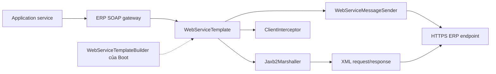
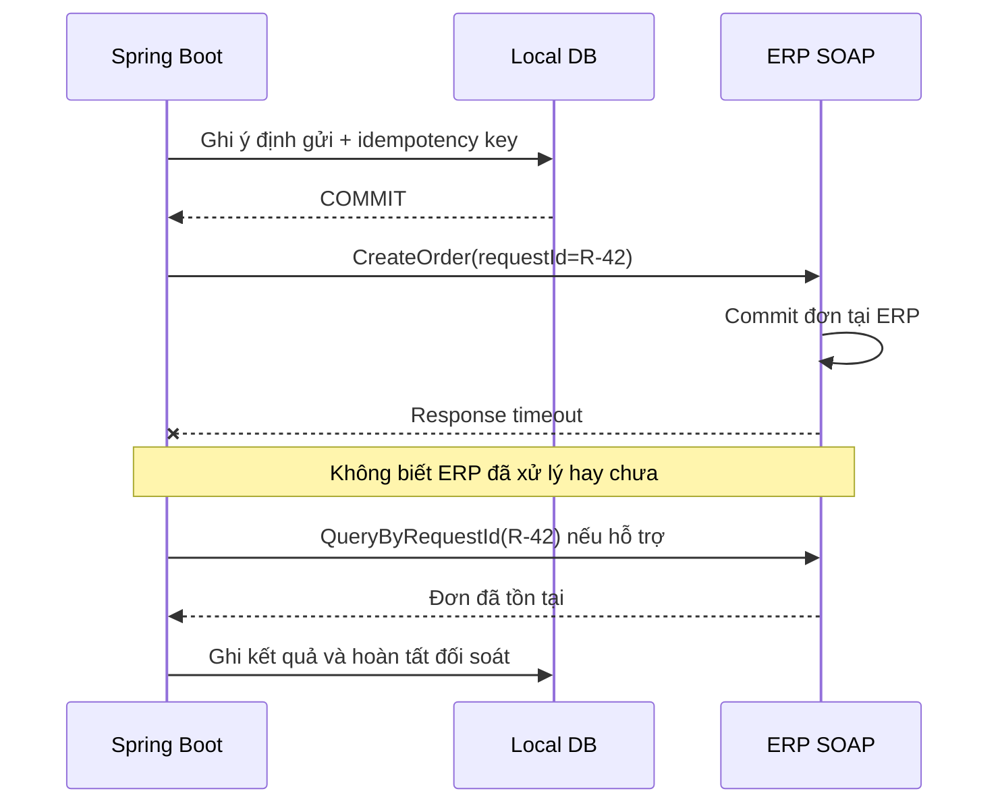
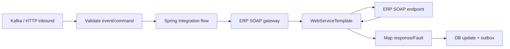

# WebServiceTemplateBuilder và tạo WebServiceTemplate

## 1. Bài toán: gọi SOAP an toàn từ ứng dụng Spring Boot

Nhiều hệ thống ERP, ngân hàng, bảo hiểm và cổng dịch vụ lâu năm vẫn công bố giao diện **SOAP** với hợp đồng **WSDL/XSD**. Một ứng dụng Spring Boot có thể cần gọi dịch vụ `GetCustomer` để tra cứu hồ sơ, `CreateOrder` để ghi đơn, hoặc `ConfirmPayment` để cập nhật một giao dịch. Khác với REST client thường gửi JSON, SOAP client trao đổi **XML Envelope**, sử dụng namespace, kiểu dữ liệu và đôi khi có `SOAPAction`, WS-Security, chữ ký số hoặc chứng chỉ hai chiều.

Trong module **SPRING_BOOT_INTEGRATION**, việc gọi SOAP là một nhánh của tích hợp qua HTTP client, cơ sở dữ liệu, cache, broker thông điệp và các adapter Spring Integration. Để triển khai đáng tin cậy, ta cần quản lý **cấu hình endpoint, hợp đồng XML, connection/timeout, giao dịch, lỗi, retry, idempotency, kiểm thử và quan sát**.

Spring Web Services cung cấp **`WebServiceTemplate`**, một client cấp cao giúp gửi SOAP message và xử lý phản hồi. Spring Boot cung cấp **`WebServiceTemplateBuilder`** để tạo các template đã nhận cấu hình và customizer phù hợp của application context. Đây chính là trọng tâm bài: **Boot thường không tạo một `WebServiceTemplate` dùng chung cho mọi đối tác; Boot hỗ trợ builder để mỗi client chủ động xây template theo hợp đồng của mình**.

Ví dụ xuyên suốt: ứng dụng `order-integration` gọi SOAP endpoint của ERP để kiểm tra trạng thái đơn. Trong ứng dụng còn có một SOAP endpoint khác để tra cứu khách hàng. Hai endpoint có thể dùng WSDL/XSD, chứng chỉ và timeout khác nhau, vì thế không nên vô tình chia sẻ cấu hình của template cho mọi cuộc gọi.

Sau bài học, bạn có thể:

- Phân biệt `WebServiceTemplate`, `WebServiceTemplateBuilder`, `WebServiceTemplateCustomizer` và `Jaxb2Marshaller`.
- Tạo SOAP client bean từ builder Spring Boot quản lý và tách cấu hình theo từng đối tác.
- Gửi nhận XML bằng `marshalSendAndReceive`, thiết lập endpoint, `SOAPAction` và interceptor đúng cách.
- Phân biệt SOAP Fault, lỗi HTTP/transport, lỗi ánh xạ XML và lỗi nghiệp vụ.
- Thiết kế timeout, xác thực, WS-Security, retry/idempotency và ranh giới transaction.
- Viết test SOAP client với `MockWebServiceServer` và quan sát hành vi trong môi trường chạy thực tế.

## 2. Kiến trúc SOAP client: những lớp phải hiểu

Trước khi tạo template, cần nhìn rõ hợp đồng giữa ứng dụng và hệ thống đối tác:

| Thành phần | Vai trò | Câu hỏi cần trả lời |
|---|---|---|
| **WSDL** | Mô tả operations, messages, bindings và service endpoints. | Operation dùng SOAP 1.1 hay SOAP 1.2? Có `SOAPAction` không? |
| **XSD** | Mô tả cấu trúc, kiểu dữ liệu và ràng buộc XML. | Namespace nào? Trường bắt buộc, `nillable`, thứ tự phần tử ra sao? |
| **JAXB classes** | Các lớp Java được sinh/tương ứng với XML schema. | Request/response có `@XmlRootElement` hay dùng `JAXBElement`? |
| **Marshaller/Unmarshaller** | Chuyển Java object ↔ XML theo JAXB/OXM. | Java classes khớp hợp đồng XSD nào? |
| **`WebServiceTemplate`** | Tổ chức vòng đời gửi request và nhận response/fault. | URI, message factory, sender, interceptors nào? |
| **`WebServiceTemplateBuilder`** | Hỗ trợ khởi tạo và áp cấu hình/template customizers. | Template này có sử dụng builder do Boot quản lý không? |
| **`WebServiceMessageSender`** | Gửi message qua transport (thường HTTP/HTTPS). | Connect/read timeout, TLS, pool, proxy, auth ra sao? |
| **`ClientInterceptor`** | Can thiệp trước/sau request và khi có fault. | Correlation ID, audit, WS-Security, redaction? |



**`WebServiceTemplate` không phải `RestTemplate` cho SOAP.** Nó làm việc với `WebServiceMessage`/SOAP Envelope và các abstraction của Spring-WS. Cơ chế ánh xạ XML và fault khác với việc gửi JSON qua `RestClient`.

## 3. Cấu hình dependency và điều kiện auto-configuration

Ví dụ Maven cho Spring Boot 3.x:

```xml
<dependency>
    <groupId>org.springframework.boot</groupId>
    <artifactId>spring-boot-starter-web-services</artifactId>
</dependency>

<!-- Khi ứng dụng cần ánh xạ JAXB và runtime chưa cung cấp provider phù hợp,
     khai báo JAXB implementation tương thích với BOM/phiên bản dự án. -->
```

Hoặc Gradle Kotlin DSL:

```kotlin
dependencies {
    implementation("org.springframework.boot:spring-boot-starter-web-services")
    // Khai báo JAXB runtime tương thích nếu dependency graph chưa có.
}
```

Với **Spring Boot 3.x/Spring Framework 6+/Spring Web Services 4.x**, thư viện dùng namespace Jakarta (`jakarta.xml.bind`) cho JAXB. Những lớp sinh từ tool cũ dùng `javax.xml.bind` (thường gắn với thế hệ Spring 5/Boot 2) không thể được xem là tương thích tự động; phải đối chiếu generator, JAXB version và contract.

Trong cấu hình Boot tiêu chuẩn, khi các lớp Spring Web Services có mặt và điều kiện auto-configuration khớp, Boot có thể cung cấp **`WebServiceTemplateBuilder`** cùng cơ chế customizer. Nhưng **Boot không nhất thiết đăng ký sẵn một bean `WebServiceTemplate` duy nhất** bởi mỗi đối tác cần endpoint, marshaller, message sender và chính sách bảo mật riêng.

Các nguyên nhân khiến builder/khả năng tùy biến không xuất hiện như kỳ vọng:

1. Chưa có `spring-boot-starter-web-services` hoặc classpath thiếu thư viện liên quan.
2. Một bean builder/configuration do ứng dụng tự định nghĩa khiến auto-configuration nhường quyền hoặc customizer không được áp dụng.
3. Dependency Spring Boot/Spring-WS/Spring Framework bị ghim phiên bản không tương thích.
4. Profile/test context không khởi tạo đủ cấu hình hoặc customizer của ứng dụng.
5. Với nhiều template, injection không dùng qualifier nên chọn nhầm endpoint.

Khi cần biết chắc, xem **Condition Evaluation Report** của phiên bản Spring Boot đang chạy thay vì suy đoán từ tên bean.

### 3.1. Builder được quản lý mang lại điều gì?

`WebServiceTemplateBuilder` là con đường để ứng dụng dựng template có áp những tùy biến thích hợp. Những customizer có thể thiết lập message sender, interceptor, marshaller, default URI hoặc đặc tính khác tùy theo code ứng dụng và phiên bản Boot. Builder **không tự biết WSDL nào là của ERP**, không sinh JAXB class và không tự cấp credentials/chứng chỉ cho endpoint.

Nếu tạo trực tiếp `new WebServiceTemplate()` ở một nơi khác, template đó **không mặc nhiên thừa hưởng customizer do Spring Boot quản lý**. Cách tạo bằng tay không sai, nhưng phải cấu hình mọi thành phần cần thiết một cách có chủ đích.

## 4. Tạo `WebServiceTemplate` bằng builder được Spring inject

Giả sử ứng dụng đã sinh JAXB classes tương ứng với WSDL/XSD của ERP vào package `com.example.integration.erp.soap`. Một configuration đơn giản:

```java
import org.springframework.beans.factory.annotation.Qualifier;
import org.springframework.beans.factory.annotation.Value;
import org.springframework.boot.webservices.client.WebServiceTemplateBuilder;
import org.springframework.context.annotation.Bean;
import org.springframework.context.annotation.Configuration;
import org.springframework.oxm.jaxb.Jaxb2Marshaller;
import org.springframework.ws.client.core.WebServiceTemplate;

@Configuration
public class ErpSoapClientConfiguration {

    @Bean("erpMarshaller")
    Jaxb2Marshaller erpMarshaller() {
        Jaxb2Marshaller marshaller = new Jaxb2Marshaller();
        marshaller.setContextPath("com.example.integration.erp.soap");
        return marshaller;
    }

    @Bean("erpWebServiceTemplate")
    WebServiceTemplate erpWebServiceTemplate(
            WebServiceTemplateBuilder builder,
            @Qualifier("erpMarshaller") Jaxb2Marshaller marshaller,
            @Value("${integration.erp.soap.endpoint}") String endpoint) {

        WebServiceTemplate template = builder.build();
        template.setDefaultUri(endpoint);
        template.setMarshaller(marshaller);
        template.setUnmarshaller(marshaller);
        return template;
    }
}
```

Cấu hình ngoài code:

```yaml
integration:
  erp:
    soap:
      endpoint: ${ERP_SOAP_ENDPOINT}
```

Điểm cần chú ý:

- **Builder được Spring inject** nên các customizer của builder có cơ hội được áp dụng. `builder.build()` tạo ra template để ứng dụng cấu hình thêm những đặc tính riêng.
- `setDefaultUri(...)` xác định địa chỉ mặc định cho các lời gọi không chỉ định URI tường minh. Đây là **SOAP service endpoint thực thi**, không nhất thiết là URL `?wsdl`.
- `setMarshaller(...)` và `setUnmarshaller(...)` dùng cùng `Jaxb2Marshaller` khi request/response cùng một JAXB context.
- `setContextPath(...)` yêu cầu package có cấu trúc JAXB thích hợp, thường có `ObjectFactory` hoặc `jaxb.index` tương ứng từ code generation. Nếu chỉ có các POJO tự viết không đầy đủ JAXB metadata, khởi tạo có thể lỗi.
- Bean `WebServiceTemplate` được dùng lại cho nhiều request. **Không thay đổi endpoint, marshaller hoặc interceptor của shared template ngay trước mỗi lời gọi** vì nhiều thread có thể đang dùng chung.
- Nếu một customizer toàn cục và cấu hình ngay sau `build()` cùng thiết lập một thuộc tính, thiết lập sau có thể ghi đè giá trị trước. Phải quyết định mức áp dụng global/per-client.

Ví dụ dùng property trong source code Spring là `@Value("${integration.erp.soap.endpoint}")`; hệ thống thật nên cung cấp URI qua cấu hình theo môi trường, không hard-code endpoint hay credential.

### 4.1. Tránh giả định một template cho mọi đối tác

ERP A có namespace, SOAPAction và chứng chỉ khác đối tác B. Có thể tạo hai template riêng:

```java
@Bean("partnerWebServiceTemplate")
WebServiceTemplate partnerWebServiceTemplate(
        WebServiceTemplateBuilder builder,
        @Qualifier("partnerMarshaller") Jaxb2Marshaller marshaller,
        @Value("${integration.partner.soap.endpoint}") String endpoint) {

    WebServiceTemplate template = builder.build();
    template.setDefaultUri(endpoint);
    template.setMarshaller(marshaller);
    template.setUnmarshaller(marshaller);
    return template;
}
```

Đoạn trên giả định bean `partnerMarshaller` đã được định nghĩa tương ứng với schema đối tác. Injection tại gateway phải dùng `@Qualifier`; đừng phụ thuộc vào tên method hoặc thứ tự tạo bean để suy ra template được chọn.

## 5. `WebServiceTemplateBuilder`, customizer và thứ tự cấu hình

Một nhu cầu phổ biến là mọi SOAP client cùng phải có một interceptor để gắn correlation ID hoặc tuân chuẩn ghi log. Trong Spring Boot 3.x, `WebServiceTemplateCustomizer` là điểm mở rộng để áp tùy biến trên template được tạo bằng builder có cơ chế phát hiện customizer tương ứng.

Ví dụ minh họa một customizer đặt một thuộc tính chung:

```java
import org.springframework.boot.webservices.client.WebServiceTemplateCustomizer;
import org.springframework.context.annotation.Bean;
import org.springframework.context.annotation.Configuration;

@Configuration
class SoapTemplateDefaultsConfiguration {

    @Bean
    WebServiceTemplateCustomizer soapTemplateDefaults() {
        return template -> {
            // Chỉ minh họa thuộc tính an toàn, không áp endpoint ERP cho mọi đối tác.
            template.setCheckConnectionForError(true);
        };
    }
}
```

**Lưu ý phiên bản:** cơ chế tự phát hiện customizer và các phương thức cụ thể của builder có thể thay đổi theo Spring Boot. Nếu ứng dụng chủ động tạo một builder mới bằng constructor hoặc bỏ qua builder được inject, không thể giả định customizer bean sẽ tự được áp. Cần kiểm tra bằng test hành vi thực tế.

Không nên đặt `setDefaultUri("https://erp...")` trong customizer global nếu ứng dụng còn gọi SOAP của hệ thống khác. Tương tự, một interceptor gắn token ERP không được đưa tới mọi SOAP endpoint. Phân loại cấu hình:

| Cấp cấu hình | Ví dụ | Cách quản lý |
|---|---|---|
| Toàn ứng dụng | Policy XML an toàn, naming/metric convention, redaction chung. | Customizer tổng quát nếu phù hợp. |
| Theo đối tác | Endpoint, truststore, WS-Security, HTTP authentication, SOAP version. | Bean/template/transport riêng. |
| Theo operation | `SOAPAction`, request timeout đặc thù, business ID, idempotency key. | Callback, adapter hoặc client policy rõ ràng. |
| Theo request | Correlation ID, mã giao dịch, deadline còn lại. | Dữ liệu request/callback; không mutate shared template. |

Nếu yêu cầu tùy chỉnh hoàn toàn khác nhau giữa nhiều đối tác, cấu hình rõ trong từng `@Bean` có thể dễ hiểu hơn việc viết customizer global đầy điều kiện.

## 6. Ánh xạ XML bằng JAXB: Java object không đủ nếu sai hợp đồng

`WebServiceTemplate` có nhiều phương thức gửi nhận; khi sử dụng JAXB, lựa chọn tiện lợi là `marshalSendAndReceive(...)`. Marshaller tạo XML từ Java object, unmarshaller tạo Java object từ SOAP response payload.

Ví dụ XSD mô tả payload (rút gọn):

```xml
<xs:schema xmlns:xs="http://www.w3.org/2001/XMLSchema"
           targetNamespace="urn:acme:erp:order:v1"
           xmlns:tns="urn:acme:erp:order:v1"
           elementFormDefault="qualified">

  <xs:element name="GetOrderStatusRequest">
    <xs:complexType>
      <xs:sequence>
        <xs:element name="OrderId" type="xs:string"/>
      </xs:sequence>
    </xs:complexType>
  </xs:element>

  <xs:element name="GetOrderStatusResponse">
    <xs:complexType>
      <xs:sequence>
        <xs:element name="Status" type="xs:string"/>
      </xs:sequence>
    </xs:complexType>
  </xs:element>
</xs:schema>
```

Một request SOAP 1.1 tương ứng có dạng:

```xml
<soapenv:Envelope
    xmlns:soapenv="http://schemas.xmlsoap.org/soap/envelope/"
    xmlns:ord="urn:acme:erp:order:v1">
  <soapenv:Header/>
  <soapenv:Body>
    <ord:GetOrderStatusRequest>
      <ord:OrderId>O-10042</ord:OrderId>
    </ord:GetOrderStatusRequest>
  </soapenv:Body>
</soapenv:Envelope>
```

`WebServiceTemplate` và Spring-WS xử lý Envelope/Body, còn JAXB thường ánh xạ **payload phần Body**. Namespace `urn:acme:erp:order:v1`, tên phần tử và thứ tự phần tử là một phần của hợp đồng, không phải chi tiết trình bày tùy ý.

### 6.1. Sinh class từ WSDL/XSD

Dự án thường sinh JAXB classes từ WSDL/XSD trong bước build bằng plugin/codegen phù hợp, sau đó version hóa source sinh hoặc định nghĩa bước generate reproducible. Đừng chỉ đổi một class Java nếu XSD của đối tác đổi: cần cập nhật hợp đồng, regenerate và chạy contract tests.

Ở Spring Boot 3.x, chọn tool sinh mã hỗ trợ **Jakarta JAXB**. Các lớp có `@XmlRootElement` có thể truyền trực tiếp; một số tool sinh Java classes đi kèm `ObjectFactory` tạo `JAXBElement<T>` cho phần tử gốc. Khi đó adapter phải dùng wrapper đúng tên QName/namespace. Không thể khẳng định mọi class tên `GetOrderStatusRequest` đều marshal trực tiếp được.

### 6.2. Lỗi XML thường khác lỗi transport

| Hiện tượng | Gốc vấn đề thường gặp |
|---|---|
| Marshaller báo không biết class | JAXB context thiếu package/`@XmlSeeAlso`/`ObjectFactory` hoặc type chưa được register. |
| ERP báo element không đúng | Sai namespace/QName, casing hoặc thứ tự `xs:sequence`. |
| Lỗi `nil`/optional | Khác biệt giữa phần tử bị bỏ qua và `xsi:nil="true"`. |
| Số tiền sai | Dùng `float/double` thay vì ánh xạ decimal chính xác, sai scale/currency. |
| Ngày giờ lệch | Nhầm timezone/offset với local time, conversion `xs:dateTime`. |
| Server từ chối message | SOAP version, content type, SOAPAction hoặc security header không phù hợp. |

Nếu SOAP request đúng cấu trúc nhưng nghiệp vụ từ chối vì mã đơn không hợp lệ, đây là lỗi **hợp đồng/nghiệp vụ**, không phải vấn đề khởi tạo builder.

## 7. Gửi request và đọc response bằng `marshalSendAndReceive`

Giả định đã sinh `GetOrderStatusRequest` và `GetOrderStatusResponse` theo WSDL ERP. Một gateway tách SOAP khỏi application service:

```java
import org.springframework.beans.factory.annotation.Qualifier;
import org.springframework.stereotype.Component;
import org.springframework.ws.client.core.WebServiceTemplate;
import org.springframework.ws.soap.client.core.SoapActionCallback;

@Component
public class ErpOrderSoapGateway {

    private final WebServiceTemplate soap;

    public ErpOrderSoapGateway(
            @Qualifier("erpWebServiceTemplate") WebServiceTemplate soap) {
        this.soap = soap;
    }

    public String getStatus(String orderId) {
        GetOrderStatusRequest request = new GetOrderStatusRequest();
        request.setOrderId(orderId);

        Object reply = soap.marshalSendAndReceive(
                request,
                new SoapActionCallback("urn:acme:erp:order:v1:GetOrderStatus")
        );

        GetOrderStatusResponse response = (GetOrderStatusResponse) reply;
        return response.getStatus();
    }
}
```

**Ví dụ giả định** các JAXB classes được sinh có root element và getter/setter tương ứng. Nếu tool sinh `JAXBElement` wrapper, cần dùng `ObjectFactory` để tạo request và mở wrapper response; không ép kiểu trực tiếp khi đối tượng trả về thực tế là `JAXBElement<GetOrderStatusResponse>`.

`SoapActionCallback` là công cụ thông dụng để cung cấp SOAP Action cho operation theo hợp đồng. **Giá trị Action phải lấy từ WSDL/binding hoặc tài liệu chính thức của đối tác**, không suy từ tên method, URL hoặc namespace bằng quy tắc tự chế.

Nếu `WebServiceTemplate` đã có `defaultUri`, phương thức trên dùng endpoint đó. Khi cần gọi một URI khác có chủ đích, `WebServiceTemplate` có overload nhận URI:

```java
Object response = soap.marshalSendAndReceive(
    "https://partner.example.invalid/soap/orders",
    request,
    new SoapActionCallback("urn:acme:erp:order:v1:GetOrderStatus")
);
```

Đây là URL minh họa với đuôi `.invalid`, không phải endpoint thật. **Không lấy URI tùy ý từ input người dùng** để tránh SSRF và gửi credential/WS-Security header tới host không tin cậy. Chọn endpoint từ allowlist cấu hình cho từng đối tác.

### 7.1. Nhắc lại về SOAPAction và SOAP version

Với SOAP 1.1 qua HTTP, SOAPAction thường là header HTTP có yêu cầu và giá trị phụ thuộc WSDL binding/đối tác. Với SOAP 1.2, action thường gắn với media type `application/soap+xml` theo hợp đồng, nên không thể áp nguyên quy tắc SOAP 1.1 cho mọi service. Nếu ERP dùng SOAP 1.2, cần cấu hình message factory/version tương ứng và test content type/action chính xác.

## 8. Chọn `WebServiceMessageFactory` và SOAP 1.1/1.2

`WebServiceTemplate` sử dụng `WebServiceMessageFactory` để tạo/đọc thông điệp; Spring-WS thường dùng factory tạo SOAP message phù hợp với thư viện đang có. Khi đối tác yêu cầu SOAP version cụ thể, cần cấu hình factory nhất quán với WSDL binding và transport.

Bảng so sánh:

| Điểm | SOAP 1.1 | SOAP 1.2 |
|---|---|---|
| Envelope namespace | `http://schemas.xmlsoap.org/soap/envelope/` | `http://www.w3.org/2003/05/soap-envelope` |
| Media type HTTP thường gặp | `text/xml` | `application/soap+xml` |
| Cách biểu diễn action | Thường dùng `SOAPAction` HTTP header. | Có thể qua `action` parameter theo chuẩn/hợp đồng. |
| Cấu trúc Fault | `faultcode`, `faultstring`, `detail`. | `Code`, `Reason`, `Detail` và các phần tử tương ứng. |

**Không thay namespace thủ công trên XML** mà vẫn giữ message factory/HTTP header cũ. Khi test, xác nhận cả Envelope namespace lẫn media type và Action. Nếu dùng WS-Addressing, `wsa:Action` thuộc cơ chế khác với SOAPAction HTTP; tránh nhầm hai loại header.

Một template thường nên cố định một cấu hình SOAP version cho một nhóm endpoint. Nếu hai đối tác dùng version khác nhau, khai báo các bean rõ ràng để tránh thao tác thay message factory khi nhiều thread đang gọi đồng thời.

## 9. HTTP transport: connect/read timeout, pool và TLS

`WebServiceTemplate` tổ chức request/response, còn **`WebServiceMessageSender`** quyết định cách mở kết nối và gửi dữ liệu. Với SOAP qua HTTP/HTTPS, cần ít nhất các câu hỏi:

- **Connection acquisition:** nếu dùng HTTP pool, request chờ lấy connection tối đa bao lâu?
- **TCP connect:** thời gian tối đa để thiết lập kết nối?
- **TLS handshake:** xác thực certificate/hostname và thời gian handshake?
- **Response/read:** chờ phản hồi hoặc dữ liệu trên socket tối đa bao lâu?
- **Overall deadline:** cả acquisition + connect + gửi + chờ + parse XML + retry được phép mất bao lâu?
- **Pool:** có bao nhiêu connection tối đa theo host và tổng cho mỗi instance? Tổng trên mọi replica là bao nhiêu?

Spring-WS có nhiều loại sender tùy phiên bản, như sender dựa trên JDK HTTP và Apache HttpComponents. Tên class, phương thức timeout (số nguyên hoặc `Duration`) và hỗ trợ pooling phụ thuộc phiên bản Spring-WS và HTTP client backend. Vì vậy phần này dùng **pseudocode chính sách** để tránh áp API của transport này sang transport khác:

```text
erpSoapTransport:
  connectTimeout: 300 ms
  connectionAcquireTimeout: 100 ms
  readOrResponseTimeout: 1.5 s
  maxConnectionsPerRoute: 16
  maxConnectionsTotal: 32

erpSoapOperation:
  overallDeadline: min(2 s, remainingCallerDeadline)
  maxInFlight: 12
  retries: only for classified safe/idempotent cases
```

Đây **không phải YAML property có sẵn của Spring Boot hoặc Spring-WS**. Ứng dụng phải ánh xạ những quyết định này thành cấu hình `WebServiceMessageSender`/HTTP client và bulkhead tương ứng. Đặt read timeout 1,5 s không có nghĩa operation tổng thể luôn kết thúc trong 2 s nếu có queue wait, parsing hoặc retry.

### 9.1. Truyền sender vào template

Mẫu cấu hình ở mức Java:

```java
@Bean("erpWebServiceTemplate")
WebServiceTemplate erpWebServiceTemplate(
        WebServiceTemplateBuilder builder,
        @Qualifier("erpMarshaller") Jaxb2Marshaller marshaller,
        @Qualifier("erpMessageSender") WebServiceMessageSender sender,
        @Value("${integration.erp.soap.endpoint}") String endpoint) {

    WebServiceTemplate template = builder.build();
    template.setDefaultUri(endpoint);
    template.setMarshaller(marshaller);
    template.setUnmarshaller(marshaller);
    template.setMessageSender(sender);
    return template;
}
```

Trong ví dụ, `erpMessageSender` là bean do ứng dụng thiết lập ở lớp transport, có thể chứa truststore, proxy và timeout. Việc `setMessageSender` sau `build()` **có thể ghi đè sender từ customizer toàn cục**; đó là quyết định có chủ đích cho ERP, cần được ghi rõ.

Dùng **HTTPS**, kiểm tra certificate chain và hostname theo chuẩn; không tắt TLS verification để “sửa nhanh” lỗi môi trường. Nếu đối tác yêu cầu mTLS, quản lý keystore/truststore và rotation qua secret manager/cấu hình được bảo vệ. Thời hạn token/password phải được theo dõi riêng.

### 9.2. Không gọi SOAP trong database transaction dài

Một `@Transactional` JDBC method đọc DB rồi chờ ERP 3 giây có thể giữ connection/lock toàn thời gian ấy. Khi nhiều request cùng thực hiện, pool DB có thể cạn ngay cả khi SQL nhanh. Nên tách transaction DB ngắn và lời gọi SOAP sang workflow có trạng thái rõ ràng, dùng outbox/saga/đối soát khi ghi nhiều hệ thống.

## 10. SOAP headers, `ClientInterceptor` và callback

SOAP message có **Envelope**, **Header** và **Body**. Header thường chứa thông tin xác thực, WS-Addressing, correlation hoặc yêu cầu của đối tác. Spring-WS cho phép tác động thông điệp ở nhiều điểm:

| Điểm mở rộng | Dùng khi nào | Lưu ý |
|---|---|---|
| `SoapActionCallback` | Chỉ định Action cho operation. | Action đúng WSDL/binding. |
| `WebServiceMessageCallback` | Bổ sung/sửa request ở mức message. | Không mutate shared template; tránh chèn XML thô thiếu kiểm soát. |
| `ClientInterceptor` | Áp logic chung trước request, sau response hoặc khi có fault. | Correlation, security, logging redaction; không đọc payload rồi làm mất stream. |
| `WebServiceMessageSender` | Transport: TLS, HTTP auth, proxy, timeout, pooling. | Xử lý authentication ở đúng lớp theo yêu cầu đối tác. |
| `Jaxb2Marshaller` | Mapping payload XML ↔ Java. | Không chịu trách nhiệm xác thực HTTP/WS-Security. |

Đối với correlation ID, có thể truyền giá trị nghiệp vụ trong Header hoặc HTTP header nếu đối tác đã quy định. Không tự thêm một element bất kỳ rồi giả định ERP sẽ hiểu. Nếu API đối tác yêu cầu WS-Addressing hoặc WS-Security, dùng chuẩn phù hợp thay vì tạo header custom có cùng tên.

**Cẩn thận bảo mật:** không log toàn bộ SOAP Envelope chứa password, token, số tài khoản, hồ sơ khách hàng hoặc chữ ký. Nếu bật message tracing của Spring-WS để điều tra, chỉ bật trong môi trường có kiểm soát, che payload và tắt sau khi điều tra xong.

## 11. Bảo mật SOAP: HTTPS, HTTP auth và WS-Security là ba tầng khác nhau

Nhiều tích hợp SOAP yêu cầu đồng thời nhiều cơ chế:

1. **HTTPS/TLS:** bảo vệ kết nối trên mạng; mTLS giúp xác thực certificate phía client và server khi hợp đồng yêu cầu.
2. **HTTP authentication:** Basic, Bearer hoặc cơ chế gateway trên request HTTP.
3. **WS-Security:** bảo mật ở mức SOAP message như UsernameToken, chữ ký XML, timestamp, mã hóa phần tử; yêu cầu phù hợp WS-SecurityPolicy và algorithm suite.

Không nên nói “có HTTPS là đủ” nếu WSDL/policy yêu cầu chữ ký message. Ngược lại, ký XML không thay thế việc xác thực TLS endpoint. Với Spring-WS, một số trường hợp có thể dùng `Wss4jSecurityInterceptor` tương thích với version để áp WS-Security. Cấu hình chính xác phụ thuộc token type, key alias, cryptographic provider, clock skew, signature coverage và đặc tả của đối tác.

Các biện pháp vận hành:

- Giữ khóa riêng trong keystore hoặc secret store, không commit password vào source code.
- Quản lý thời gian hiệu lực, rotation certificate và secret; thử nghiệm trước khi hết hạn.
- Giới hạn kích thước XML, thời gian parse và kích hoạt cơ chế chống XML external entity (XXE)/DTD khi dùng parser chấp nhận XML từ bên ngoài.
- Không tải schema/DTD từ nguồn không tin cậy trong quá trình xử lý request.
- Xác minh chính xác endpoint/host trước khi gửi credential hoặc header đã ký.

## 12. Phân loại SOAP Fault, transport error và lỗi mapping

Một lỗi SOAP có thể được thể hiện bằng **SOAP Fault** trong Envelope, không chỉ qua HTTP status. Đối với SOAP 1.1, server thường trả HTTP 500 kèm Fault; với các hệ thống thực tế có thể tồn tại implementation khác nhau. Vì vậy **không retry mọi HTTP 500 như một lỗi hạ tầng** mà phải đọc Fault và phân loại.

Spring-WS thường ném `SoapFaultClientException` khi nhận Fault được nhận diện. Cũng có lỗi kết nối/transport, timeout, marshalling/unmarshalling và protocol exception khác. Application service cần phân biệt:

| Loại kết quả | Dấu hiệu | Chính sách gợi ý |
|---|---|---|
| Thành công SOAP/HTTP, body hợp lệ | DTO phản hồi ánh xạ được. | Xử lý kết quả theo hợp đồng nghiệp vụ. |
| SOAP Fault do dữ liệu không hợp lệ | Fault code/detail thể hiện validation/business error. | Không retry mù quáng; trả lỗi hợp đồng hoặc đưa vào xử lý dữ liệu. |
| SOAP Fault do hệ thống đối tác bận | Fault code/detail phù hợp quy tắc đã thỏa thuận. | Retry có giới hạn nếu thao tác an toàn; có backoff/deadline. |
| HTTP 401/403 | Sai HTTP auth hoặc chính sách phân quyền. | Kiểm tra credential/rotation/quyền; không retry hàng loạt. |
| TCP/TLS/connect failure | Không thiết lập được kênh trao đổi. | Kiểm tra network/certificate; retry an toàn theo chính sách. |
| Read timeout sau yêu cầu ghi | Không có response trong giới hạn. | **Kết quả nghiệp vụ có thể chưa xác định**; đối soát trước khi gửi lại. |
| JAXB mapping error | Sai namespace/element/version schema. | Sửa hợp đồng/codegen; thường không phải lỗi tạm thời. |
| XML quá lớn/không hợp lệ | Parse limit hoặc schema lỗi. | Từ chối/log an toàn; tránh tải vô hạn. |

Ví dụ adapter bắt lỗi theo tầng:

```java
public OrderStatus getStatus(String orderId) {
    try {
        return translateSoapResponse(erpSoapGateway.getStatus(orderId));
    } catch (SoapFaultClientException fault) {
        // Map fault code/detail sang lỗi nghiệp vụ hay lỗi upstream đã phân loại.
        throw classifyFault(fault);
    } catch (WebServiceIOException transportFailure) {
        // Không khẳng định server chưa xử lý: cần xét operation đang gọi.
        throw classifyTransportFailure(transportFailure);
    }
}
```

Đây là **khung minh họa**: `translateSoapResponse`, `classifyFault`, `classifyTransportFailure` và các kiểu liên quan do ứng dụng định nghĩa. Nếu mapping exception khác xảy ra, tầng xử lý lỗi cần bảo đảm không bị “nuốt” rồi trả giá trị thành công giả.

Đặc biệt, không log raw Fault detail nếu đối tác có thể đặt dữ liệu nhạy cảm vào `detail`. Ghi loại Fault, operation, correlation ID đã che và thông tin phù hợp chính sách dữ liệu.

## 13. Retry, idempotency và transaction xuyên hệ thống

Một phương thức SOAP `GetOrderStatus` chỉ đọc thường có thể được retry có kiểm soát khi connect timeout hoặc upstream 503, nếu hợp đồng không có side effect. Một phương thức `CreateOrder` có thể **đã tạo đơn thành công tại ERP** dù caller nhận read timeout. Gửi lại request với ID mới có nguy cơ tạo hai đơn.

Mô hình tư duy:



Các chiến lược:

- **Idempotency key:** dùng một định danh cố định cho cùng yêu cầu nghiệp vụ nếu ERP hỗ trợ.
- **Business key và tra cứu trạng thái:** tra cứu đơn theo mã ngoài khi response bị mất.
- **Transactional outbox:** ghi thay đổi DB nội bộ và ý định gọi/publish trong cùng transaction, worker xử lý sau commit.
- **Retry budget:** số lần thử, backoff, jitter và tổng deadline; không retry mọi lỗi ở nhiều tầng.
- **Compensation/saga:** khi nghiệp vụ cần bù trừ nhiều hệ thống, ghi rõ bước nào có thể hoàn tác và bước nào cần đối soát thủ công.

`@Transactional` trên Spring service **chỉ** bảo vệ các resource do transaction manager điều phối. Nó không khiến ERP SOAP tự rollback khi DB nội bộ rollback. Một SOAP write có kết quả chưa biết phải được lưu trạng thái `UNKNOWN`/`PENDING_RECONCILIATION` theo hợp đồng thay vì xử lý như thất bại chắc chắn.

### 13.1. Timeout phải tính cả lúc chờ tài nguyên

Nếu HTTP API có deadline 1,2 giây, SOAP budget 700 ms mà request đã chờ bulkhead/connection pool 500 ms, ERP không nên được cấp thêm nguyên 700 ms rồi khiến response vượt deadline. Cần tính thời gian còn lại trên mỗi attempt, bao gồm queue, connect, response, parse và retry.

`WebServiceTemplate` là synchronous API theo cách dùng thông dụng. Nếu gọi từ `@Async` hoặc executor, operation chỉ chuyển sang thread khác; timeout và quota của ERP vẫn phải được giới hạn riêng.

## 14. Tích hợp `WebServiceTemplate` với Spring Integration

Spring Integration cung cấp nhiều cách tổ chức flow: message channel, service activator, gateway, transformer và outbound adapter. Với SOAP, cách dễ kiểm soát là **gói `WebServiceTemplate` vào một gateway bean chuyên trách** rồi cho flow gọi bean đó.



Những điều phải quyết định trước khi triển khai:

- Flow sử dụng `DirectChannel` sẽ giữ thread caller khi outbound SOAP call đang chờ. Nếu chuyển sang `ExecutorChannel`, transaction/thread-local context của caller không tự được giữ.
- Một message được gửi vào executor/queue RAM **chưa đồng nghĩa đã được xử lý bền vững**. Không ack message Kafka/RabbitMQ sớm chỉ vì worker đã nhận task nếu nghiệp vụ đòi xử lý hoàn chỉnh.
- Nếu broker giao lại message sau khi DB commit/ack thất bại, adapter SOAP có thể bị gọi lại; cần idempotency theo business ID.
- Bulkhead và pool theo endpoint giúp ERP bị chậm không chiếm hết threads/connections của các dịch vụ tích hợp khác.

Không đặt business logic lớn vào `ClientInterceptor`. Interceptor nên phụ trách kỹ thuật giao tiếp như correlation, security, audit an toàn; phần trạng thái đơn, retry nghiệp vụ và đối soát thuộc application service/adapter.

## 15. Kiểm thử SOAP client bằng `MockWebServiceServer`

Spring Web Services có module `spring-ws-test` để kiểm tra `WebServiceTemplate` mà không cần gọi ERP thật. Test có thể xác minh payload, SOAPAction/header, response và Fault. Khai báo dependency test nếu chưa có:

```xml
<dependency>
    <groupId>org.springframework.ws</groupId>
    <artifactId>spring-ws-test</artifactId>
    <scope>test</scope>
</dependency>
```

Khung test XML thuần (minh họa API của Spring-WS test):

```java
import javax.xml.transform.Source;
import javax.xml.transform.stream.StreamSource;
import java.io.StringReader;
import org.junit.jupiter.api.Test;
import org.springframework.beans.factory.annotation.Autowired;
import org.springframework.beans.factory.annotation.Qualifier;
import org.springframework.boot.test.context.SpringBootTest;
import org.springframework.ws.client.core.WebServiceTemplate;
import org.springframework.ws.test.client.MockWebServiceServer;

import static org.junit.jupiter.api.Assertions.assertEquals;
import static org.springframework.ws.test.client.RequestMatchers.payload;
import static org.springframework.ws.test.client.ResponseCreators.withPayload;

@SpringBootTest(properties =
        "integration.erp.soap.endpoint=http://localhost:18080/soap")
class ErpSoapClientTest {

    @Autowired
    @Qualifier("erpWebServiceTemplate")
    WebServiceTemplate template;

    @Autowired
    ErpOrderSoapGateway gateway;

    @Test
    void sendsExpectedPayload() {
        MockWebServiceServer server =
                MockWebServiceServer.createServer(template);

        Source expectedRequest = new StreamSource(new StringReader("""
            <ord:GetOrderStatusRequest xmlns:ord="urn:acme:erp:order:v1">
                <ord:OrderId>O-10042</ord:OrderId>
            </ord:GetOrderStatusRequest>
            """));

        Source responsePayload = new StreamSource(new StringReader("""
            <ord:GetOrderStatusResponse xmlns:ord="urn:acme:erp:order:v1">
                <ord:Status>PAID</ord:Status>
            </ord:GetOrderStatusResponse>
            """));

        server.expect(payload(expectedRequest))
              .andRespond(withPayload(responsePayload));

        assertEquals("PAID", gateway.getStatus("O-10042"));
        server.verify();
    }
}
```

Đây là **khung test tích hợp**: dự án phải cung cấp `ErpOrderSoapGateway`, template, JAXB classes, marshaller, ứng dụng Spring Boot và test dependencies như đã nêu ở các phần trước. Lời gọi `gateway.getStatus(...)` thực thi qua đúng template mà mock server đã gắn vào; `server.verify()` xác nhận expectation đã được đáp ứng. URI localhost trong cấu hình test chỉ là giá trị thay thế; request được `MockWebServiceServer` xử lý trong tiến trình, không phải gọi ERP thật.

Có thể dùng `MockWebServiceServer` với `WebServiceTemplate` tạo bằng builder trong test Spring context. Điều quan trọng là **mock server và gateway phải dùng chính cùng một template instance**. Nếu gateway tự tạo `new WebServiceTemplate()` bên trong method, server sẽ không chặn được request như mong đợi.

### 15.1. Nên kiểm thử những gì?

| Test | Điều cần xác minh |
|---|---|
| Request hợp lệ | Namespace, root element, thứ tự các element, kiểu dữ liệu và SOAPAction. |
| Success response | JAXB unmarshal đúng kiểu, mapping domain chính xác. |
| SOAP Fault | Fault code/detail được phân loại, không trả thành công giả. |
| Transport timeout | Timeout/error mapping có chính sách retry phù hợp. |
| XML validation | Field bắt buộc, `xsi:nil`, decimal, datetime, encoding. |
| Hai endpoint | `@Qualifier` và marshaller đúng, không gửi sai đối tác. |
| Security header | WS-Security/TLS/HTTP auth được cấu hình đúng trong test integration phù hợp. |
| Idempotency | Retry sau timeout write không tạo side effect trùng. |
| Resource behavior | Pool/bulkhead có giới hạn, queue không tăng vô hạn khi ERP chậm. |
| Observability | Operation metrics, request IDs đã che, log không lộ payload nhạy cảm. |

Test unit/mock giúp xác định serialization và gọi phương thức; để kiểm tra **TLS mTLS, HTTP pooling, proxy, timeout thực tế và header HTTP**, cần thêm integration test dùng HTTP server giả lập/thực nghiệm với transport thực, hoặc môi trường staging phù hợp. `MockWebServiceServer` thường thay transport để mô phỏng message exchange, nên **không đủ** để chứng minh TLS và connection pool đã cấu hình đúng.

## 16. Quan sát SOAP client: không đánh đồng builder với metrics tự động

Một nhầm lẫn phổ biến là: “Đã dùng builder của Spring Boot nên chắc chắn có metric SOAP.” `WebServiceTemplateBuilder` giúp áp customizers, nhưng **khả năng phát HTTP client metrics/tracing phụ thuộc instrumentations và transport đang dùng**. Không được suy diễn rằng mọi lời gọi Spring-WS sẽ tự có cùng timer `http.client.requests` như `RestClient` hoặc `WebClient`.

Với SOAP, nên theo dõi ít nhất hai nhóm:

**Business-operation metrics:**

- `soap.erp.get-order-status.duration` hoặc một tên metric operation ổn định.
- Tổng số lần gọi, thành công, SOAP Fault theo loại, network timeout, parse errors.
- Retry attempts, bulkhead rejection, số yêu cầu cần đối soát do kết quả ghi chưa rõ.

**Transport/resource metrics:**

- Active/idle/pending HTTP connections và acquisition timeout nếu sender dùng pool có instrumentation.
- Connect/read timeouts, TLS handshake errors và remote HTTP status nếu transport cung cấp.
- Thread pool/bulkhead saturation, queue wait và latency đầu-cuối.

Tên metric nêu trên là **gợi ý của ứng dụng**, không phải lời khẳng định Spring-WS tự tạo sẵn. Có thể dùng Micrometer `Timer` hoặc `Observation` bao quanh gateway để đo *một operation logic*; nếu retry làm nhiều HTTP attempts, đo thêm attempt count riêng.

### 16.1. Low-cardinality tags và thông tin nhạy cảm

Tags nên hữu hạn: `partner=erp-a`, `operation=get-order-status`, `outcome=success|fault|timeout`. **Không** dùng `orderId`, số tài khoản, correlation ID, raw endpoint URL có query động hoặc nguyên SOAP Fault detail làm metric tags. Những chi tiết này nếu cần chỉ nên xuất hiện trong log/trace được kiểm soát, che bí mật và có chính sách lưu trữ.

Nếu correlation qua SOAP Header hoặc HTTP header, phải xác định rõ cách tạo, cách truyền và quy định bảo mật. Khi chuyển thread bằng `@Async` hoặc Spring Integration executor, MDC/trace context không tự lan truyền đầy đủ; cần `TaskDecorator` hoặc context propagation được kiểm thử.

## 17. Troubleshooting: từ lỗi bean đến SOAP Fault

| Triệu chứng | Nguyên nhân cần kiểm tra | Hướng xử lý |
|---|---|---|
| Không inject được `WebServiceTemplateBuilder` | Thiếu starter/classpath, auto-config back off hoặc version không khớp. | Kiểm tra dependency graph và Condition Evaluation Report. |
| Có builder nhưng không có `WebServiceTemplate` bean | Boot không tạo mặc định một template dùng chung. | Tự định nghĩa `@Bean` từ builder cho từng đối tác. |
| Gateway gọi sai ERP endpoint | Default URI/qualifier bị nhầm, override URI lúc gọi. | Tách template theo đối tác và test URI. |
| `marshalSendAndReceive` lỗi trước khi gửi | JAXB context thiếu class/root, request là `JAXBElement` chưa đúng. | Kiểm tra generated classes, `ObjectFactory`, marshaller config. |
| SOAP Fault vì sai message | Namespace, SOAP version, SOAPAction, header sai. | So sánh với WSDL/XSD và captured sanitized request. |
| HTTP 401/403 | HTTP auth/token/cert không phù hợp. | Phân biệt HTTP auth, mTLS và WS-Security. |
| Lỗi signature/time skew | Chữ ký XML/WS-Security timestamp/key alias sai. | Kiểm tra clock skew, keystore, policy, signed parts. |
| Connect timeout tăng | DNS/network/TLS/pool/resource hoặc upstream down. | Kiểm tra từng pha; không retry vô hạn. |
| Read timeout ở `CreateOrder` | ERP có thể đã commit nhưng response mất. | Đánh dấu UNKNOWN và đối soát theo idempotency key. |
| Pool hết connection | Nhiều request blocking, retry storm, connection leak. | Giới hạn concurrency, đo pending/leased, review timeout và pool. |
| Có Actuator nhưng không thấy SOAP metrics | Chưa có instrumentation cho template/sender/gateway. | Đo operation chủ động, kiểm tra transport metrics. |
| Test mock server không chặn call | Gateway dùng template instance khác hoặc tự tạo mới. | Inject cùng bean vào gateway và mock server. |
| XML parse ngốn CPU/RAM | Payload quá lớn, XXE/DTD/namespace xử lý không an toàn. | Giới hạn size/complexity và cấu hình parser an toàn. |

### 17.1. Quy trình điều tra có thứ tự

1. Xác định application **tạo `WebServiceTemplate` bằng cách nào** và bean nào được inject.
2. Đối chiếu endpoint, WSDL binding, SOAP version, Action và namespace.
3. Kiểm tra `Jaxb2Marshaller`/generated classes với một payload test cố định.
4. Nếu đã phát network request, phân biệt connection/TLS/auth timeout với SOAP Fault.
5. Quan sát pool, pending, in-flight, retries, request deadline, log/trace đã redacted.
6. Đối với lệnh ghi timeout, thực hiện tra cứu/đối soát; **không thử lại thủ công khi chưa biết trạng thái**.
7. Viết regression test cho nguyên nhân đã xác định, gồm cả cấu hình builder nếu lỗi do client tạo thủ công.

## 18. Khi nào không nên dùng `WebServiceTemplate`?

`WebServiceTemplate` rất hợp với mô hình SOAP request/response đồng bộ trong Spring Boot. Nhưng không phải lựa chọn duy nhất:

| Nhu cầu | Công cụ/thiết kế nên cân nhắc |
|---|---|
| SOAP contract rõ, XML JAXB, request/response trong JVM | `WebServiceTemplate` và JAXB/OXM. |
| Cần SOAP/WS-Security policy phức tạp, WS-ReliableMessaging hoặc tiêu chuẩn đặc thù | Đánh giá Apache CXF hoặc stack SOAP chuyên biệt phù hợp hợp đồng. |
| Phía đối tác cung cấp REST/JSON | `RestClient`/`WebClient` thay vì ép SOAP. |
| Luồng file hàng triệu bản ghi | Spring Batch và adapter SOAP ở bước cần thiết, có giới hạn tốc độ. |
| Công việc gửi lệnh không được mất qua restart | Durable queue/outbox + worker có thể khởi động lại; template là lớp transport. |
| Kết quả từ nhiều hệ thống cần nhất quán | Saga/compensation, idempotency và đối soát; template không cung cấp distributed ACID. |

Không dùng SOAP chỉ vì trong ứng dụng đã có starter web-services; chọn theo **hợp đồng thực tế của upstream**. Ngược lại, nếu ERP chỉ có SOAP, đừng tự phát minh JSON proxy thiếu kiểm thử contract ở ranh giới chuyển đổi.

## 19. Checklist triển khai production

- [ ] WSDL/XSD đã được version hóa hoặc quản lý cùng dependency/code generation reproducible.
- [ ] Spring Boot, Spring-WS và JAXB runtime/generator dùng chung thế hệ Jakarta hoặc javax tương thích.
- [ ] `WebServiceTemplateBuilder` được inject từ Spring context, không tạo template “lạc” ở từng request.
- [ ] Mỗi đối tác có bean template, endpoint, marshaller, message sender và qualifier riêng khi cần.
- [ ] Default URI là SOAP endpoint thực thi, không phải mặc định URL WSDL.
- [ ] JAXB root/QName/namespace/`xs:sequence`, optional/nillable, money/date/time được kiểm thử.
- [ ] SOAP 1.1/1.2, SOAPAction và WS-Addressing action được cấu hình theo binding.
- [ ] HTTP connect/acquire/read timeout và overall deadline được thiết kế cùng retry budget.
- [ ] Connection pool, in-flight bulkhead và rate limit phù hợp quota đối tác và số replica.
- [ ] HTTPS/mTLS, HTTP auth, WS-Security, key rotation và XML parser an toàn được kiểm tra.
- [ ] SOAP Fault, transport error, mapping error và business error có chính sách khác nhau.
- [ ] SOAP write có idempotency key/tra cứu trạng thái, không retry mù khi timeout.
- [ ] Không giữ local DB transaction dài trong khi chờ ERP; dùng outbox/đối soát khi cần.
- [ ] Có test request/response/Fault bằng `MockWebServiceServer` và integration test transport/TLS.
- [ ] Gateway có metric operation/timeout/retry và log/trace đã che dữ liệu nhạy cảm.
- [ ] Có runbook phân biệt lỗi schema, auth, TLS, pool, Fault và kết quả ghi chưa xác định.

## 20. Tổng kết

**`WebServiceTemplate` là SOAP client thực hiện gửi, nhận và xử lý XML; `WebServiceTemplateBuilder` của Spring Boot là công cụ tạo template có áp cấu hình/customizer phù hợp.** Boot thường tạo builder thay vì cung cấp một `WebServiceTemplate` duy nhất cho tất cả endpoint, vì mỗi đối tác có WSDL/XSD, marshaller, SOAP version, transport và chính sách bảo mật khác nhau.

Trong **SPRING_BOOT_INTEGRATION**, tạo được một client gửi nhận SOAP thành công mới là bước đầu. Một tích hợp đủ tin cậy cần **hợp đồng XML chính xác, timeout/pool rõ ràng, bảo mật, phân loại Fault, retry có idempotency, ranh giới transaction, kiểm thử và quan sát**. Tách phần SOAP vào gateway bean từ builder được quản lý giúp những quyết định này kiểm tra, thay đổi và vận hành được mà không làm rò rỉ chi tiết XML ra toàn bộ nghiệp vụ.
