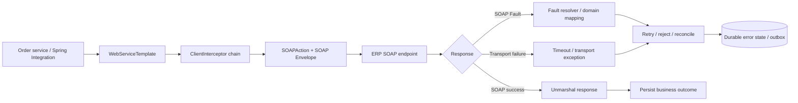
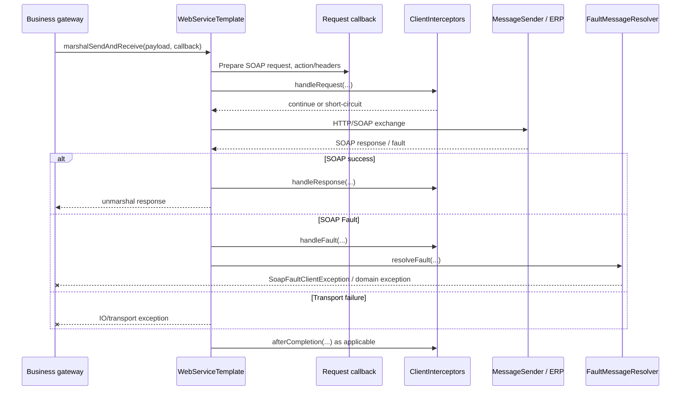
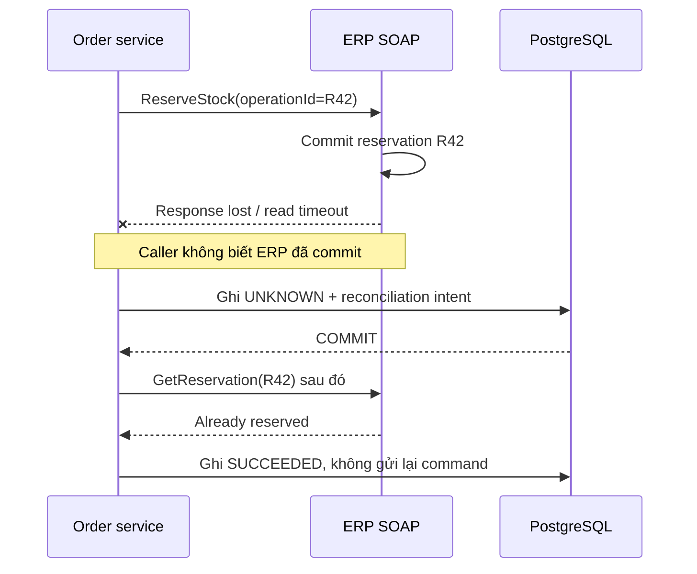

# SOAPAction, interceptor và xử lý SOAP Fault

## 1. Vì sao ba chủ đề này quyết định độ tin cậy của SOAP integration?

Trong module **SPRING_BOOT_INTEGRATION**, ứng dụng Spring Boot không chỉ xử lý HTTP client, cơ sở dữ liệu, cache, broker và Spring Integration adapters; nó còn phải làm việc với các dịch vụ SOAP/XML cũ của ERP, hệ thống kế toán, bảo hiểm hoặc nhà cung cấp bên ngoài. Một business operation có thể ghi trạng thái PostgreSQL, gửi lệnh SOAP để dự trữ hàng rồi phát Kafka event; nếu SOAP phản hồi sai hợp đồng hoặc timeout sau khi thực hiện lệnh, quyết định retry ảnh hưởng trực tiếp tính đúng đắn nghiệp vụ.

Ba thành phần cần hiểu cùng nhau:

- **SOAPAction** chỉ ra ý định của SOAP operation ở ranh giới giao thức khi hợp đồng/binding yêu cầu; không thay cho body QName hay WS-Addressing action.
- **Client interceptor** trong Spring Web Services (Spring-WS) quan sát hoặc can thiệp các bước trước/sau lời gọi `WebServiceTemplate`, hỗ trợ cross-cutting concerns như logging an toàn, auditing và security.
- **SOAP Fault** là thông điệp lỗi có cấu trúc của SOAP. Một HTTP 500 có thể mang SOAP Fault, nhưng lỗi HTTP/transport và business fault không đồng nhất; client phải phân loại trước khi retry hoặc trả kết quả.

Một flow ví dụ:



Bài học thuộc chương **SOAP và XML**; mục tiêu là hiểu đường đi thực sự của request và response trong Spring Boot, sử dụng WSDL/XSD làm hợp đồng dữ liệu, bảo đảm giao dịch và idempotency ở ranh giới SOAP, kiểm thử và quan sát flow đúng tình huống thành công lẫn lỗi.

Sau bài, bạn có thể:

1. Đọc WSDL để xác định operation và SOAPAction phù hợp, không tự đoán từ Java method name.
2. Cấu hình `WebServiceTemplate`, `SoapActionCallback` và interceptor có trách nhiệm rõ ràng.
3. Phân biệt SOAP 1.1, SOAP 1.2, HTTP headers, SOAP headers và WS-Addressing.
4. Bắt `SoapFaultClientException`, đọc fault code/detail và ánh xạ thành lỗi nghiệp vụ an toàn.
5. Quyết định retry, DLQ/reconciliation và acknowledgement mà không làm trùng side effect.
6. Test cả SOAPAction, interceptor lifecycle, fault mapping, timeout, security và observability.

## 2. Cấu trúc SOAP request/response: ba lớp không được nhập nhằng

SOAP thường hoạt động trên HTTP nhưng thông điệp SOAP và HTTP không cùng một lớp:

```text
HTTP request
  - method: POST
  - URL: https://erp.example/soap/InventoryService
  - Content-Type: text/xml; charset=utf-8   (SOAP 1.1 ví dụ)
  - SOAPAction: "urn:erp:ReserveStock"        (SOAP 1.1 binding ví dụ)
  - Authorization / TLS / proxy metadata
  Body:
    <soap:Envelope>
      <soap:Header>...</soap:Header>
      <soap:Body>
        <erp:ReserveStockRequest>...</erp:ReserveStockRequest>
      </soap:Body>
    </soap:Envelope>
```

| Lớp | Ví dụ | Ai chịu trách nhiệm? |
|---|---|---|
| **HTTP transport** | URL, HTTP status, media type, SOAPAction HTTP header. | Transport sender, HTTP server/proxy. |
| **SOAP envelope** | `Envelope`, `Header`, `Body`, `Fault`. | SOAP message factory, marshal/unmarshal, security interceptor. |
| **Business contract** | `ReserveStockRequest`, `OrderId`, `Quantity`, lỗi `INSUFFICIENT_STOCK`. | WSDL/XSD và các quy tắc của ERP. |
| **Application workflow** | `operationId`, idempotency, transaction, outbox, retry. | Spring Boot service và integration flow. |

Với SOAP body, **namespace URI và local name** mới là định danh phần tử; prefix `erp` chỉ là bí danh XML. Hai XML documents dùng prefix khác nhau có thể vẫn cùng QName và hợp lệ theo XSD.

Không nhầm `SOAPAction` với endpoint URL. Nhiều operations cùng gửi tới một URL nhưng có body và action khác nhau.

## 3. SOAP 1.1 và SOAP 1.2: khác biệt liên quan tới action và fault

| Nội dung | SOAP 1.1 | SOAP 1.2 |
|---|---|---|
| Envelope namespace | `http://schemas.xmlsoap.org/soap/envelope/` | `http://www.w3.org/2003/05/soap-envelope` |
| HTTP Content-Type điển hình | `text/xml` | `application/soap+xml` |
| Action qua HTTP | Header `SOAPAction` theo HTTP binding SOAP 1.1. | `action` parameter của `application/soap+xml` khi binding dùng nó. |
| Fault code cơ bản | `Client`, `Server`, `VersionMismatch`, `MustUnderstand`. | `Sender`, `Receiver`, `VersionMismatch`, `MustUnderstand`, `DataEncodingUnknown`. |
| SOAP Fault layout | `faultcode`, `faultstring`, `faultactor`, `detail`. | `Code`, `Reason`, `Node`, `Role`, `Detail`; có thể có `Subcode`. |

Những tên fault code trên cần được hiểu **theo đúng SOAP version**, không viết code so sánh `Client` cho SOAP 1.2 rồi kết luận server đang hoạt động sai.

### 3.1. SOAPAction HTTP header ở SOAP 1.1

Ví dụ trên đường truyền:

```http
POST /soap/InventoryService HTTP/1.1
Host: erp.example
Content-Type: text/xml; charset=utf-8
SOAPAction: "urn:erp:inventory:ReserveStock"
```

Nội dung action do **WSDL binding/hợp đồng của service** quy định. Một số dịch vụ cũ yêu cầu exact action, bao gồm URI/case; một số khác chấp nhận action rỗng hoặc không sử dụng action để dispatch. Không suy luận action từ tên class `ReserveStockRequest` hay tự thêm dấu `/`, `#` nếu WSDL không yêu cầu.

### 3.2. SOAP 1.2 không nên bị xử lý như SOAP 1.1

Ví dụ media type SOAP 1.2:

```http
POST /soap/InventoryService HTTP/1.1
Content-Type: application/soap+xml; charset=utf-8; action="urn:erp:inventory:ReserveStock"
```

Đây **không phải cùng cơ chế bắt buộc** với header `SOAPAction` của SOAP 1.1. Spring-WS SOAP message factory phải dùng đúng version với endpoint; chỉ sửa một header HTTP không tự biến envelope 1.1 thành SOAP 1.2.

Một lỗi `VersionMismatch` có thể do gửi envelope namespace hoặc content type không phù hợp, không phải do Java DTO đơn thuần.

## 4. WSDL chỉ ra SOAPAction ở đâu?

Trong WSDL 1.1, binding SOAP operation có thể khai báo action, ví dụ:

```xml
<wsdl:definitions
    xmlns:wsdl="http://schemas.xmlsoap.org/wsdl/"
    xmlns:soap="http://schemas.xmlsoap.org/wsdl/soap/"
    xmlns:tns="urn:erp:inventory:v1"
    targetNamespace="urn:erp:inventory:v1">

  <!-- message, portType, types và service lược bớt -->
  <wsdl:binding name="InventorySoap11Binding"
                type="tns:InventoryPortType">
    <soap:binding style="document"
                  transport="http://schemas.xmlsoap.org/soap/http"/>
    <wsdl:operation name="ReserveStock">
      <soap:operation
          soapAction="urn:erp:inventory:ReserveStock"/>
      <wsdl:input>
        <soap:body use="literal"/>
      </wsdl:input>
      <wsdl:output>
        <soap:body use="literal"/>
      </wsdl:output>
    </wsdl:operation>
  </wsdl:binding>
</wsdl:definitions>
```

Đoạn trên chỉ là **mảnh WSDL minh họa**, không phải WSDL hoàn chỉnh: các phần tử `types`, `message`, `portType`, `service` và bindings tương ứng cần có để generate client/validate đầy đủ.

Phải phân biệt:

- `wsdl:operation name="ReserveStock"`: tên operation trong contract.
- `soap:operation soapAction="..."`: URI action cho binding SOAP/HTTP tương ứng.
- `wsdl:input`/`wsdl:output`: các thông điệp và schema trong WSDL.
- `soap:address location="..."`: endpoint URL khi WSDL chứa service/port.
- `tns:ReserveStockRequest`: QName của payload element theo XSD; có thể dùng dispatch ở server.

**Không lấy action của WSDL binding SOAP 1.1 để áp vào SOAP 1.2 binding khác**. Hệ thống có thể công bố nhiều ports/bindings với action và endpoint riêng.

### 4.1. Checklist khi tích hợp WSDL của đối tác

1. Chọn đúng service/port/binding/environment (test, staging, production).
2. Xác định SOAP version từ binding.
3. Kiểm tra `soapAction` hoặc action semantics tương ứng.
4. Xem namespace/QName của request/response root elements.
5. Xác định có yêu cầu WS-Addressing `Action`, WS-Security, MTOM, mTLS hay không.
6. Đọc các `wsdl:fault`/XSD fault detail, mã nghiệp vụ và retry contract.
7. Kiểm tra timeout, idempotency, khả năng tra cứu operation sau lỗi mất response.
8. Ghi hợp đồng này thành integration tests, không chỉ chạy thử thủ công bằng SOAP UI.

## 5. SOAPAction không phải WS-Addressing Action

Một số dịch vụ hỗ trợ WS-Addressing. Khi đó có thể có XML header:

```xml
<wsa:Action xmlns:wsa="http://www.w3.org/2005/08/addressing">
  urn:erp:inventory:ReserveStock
</wsa:Action>
```

Dù giá trị đôi khi giống nhau, **WS-Addressing `wsa:Action` nằm trong SOAP Header**, còn SOAP 1.1 `SOAPAction` nằm ở HTTP header. Một server có thể kiểm tra **cả hai** theo policy và từ chối nếu chúng không nhất quán.

Các header liên quan của WS-Addressing còn có `To`, `MessageID`, `ReplyTo`, `RelatesTo`. Chúng phục vụ message routing/relating, **không tự tạo idempotency key** cho thao tác dự trữ kho.

Khi WSDL/policy yêu cầu WS-Addressing, sử dụng **support/callback chuyên biệt của Spring-WS hoặc WS stack phù hợp phiên bản** thay vì viết chuỗi XML bằng tay. Một `SoapActionCallback` chỉ đặt SOAPAction theo cơ chế tương ứng, **không** bảo đảm toàn bộ WS-Addressing headers đã được xây.

## 6. Spring-WS client pipeline: callback, interceptor và fault resolver

`WebServiceTemplate` là điểm vào phổ biến của Spring Web Services cho SOAP/XML client. Nó dùng marshaller/unmarshaller hoặc gửi XML `Source` trực tiếp, message factory, transport sender và interceptors.

Một chu kỳ khái niệm:



Sơ đồ rút gọn: chi tiết thứ tự và xử lý short-circuit phụ thuộc interceptor contract, response/fault checks và phiên bản Spring-WS. **Callback chạy khi tạo request; interceptor tham gia trong exchange; fault resolver định nghĩa cách lỗi SOAP được báo về caller.** Không dùng chúng thay nhau tùy ý.

### 6.1. Những extension points chính

| Extension point | Mục đích |
|---|---|
| `WebServiceMessageCallback` | Chỉnh request message sau khi dựng: SOAPAction, XML headers, attachments theo API. |
| `SoapActionCallback` | Callback sẵn có để đặt SOAPAction cho request SOAP. |
| `ClientInterceptor` | Cross-cutting hook trước request, sau response, khi fault, sau completion. |
| `FaultMessageResolver` | Quyết định ném exception hoặc policy khi SOAP response là Fault. |
| `Jaxb2Marshaller` | Bind Java objects với XML schema-based model. |
| `WebServiceMessageSender` | Thực hiện transport HTTP/HTTPS hoặc dạng khác tùy stack. |
| `SoapMessageFactory` | Tạo message SOAP theo version/implementation. |

Một interceptor **không tự được gắn** vào mọi `WebServiceTemplate` chỉ vì là Spring bean; template phải được cấu hình sử dụng đúng danh sách interceptors.

## 7. Dependency và cấu hình SOAP client trong Spring Boot

Với các thế hệ Spring Boot hỗ trợ Spring Web Services, thường dùng starter:

```kotlin
dependencies {
    implementation("org.springframework.boot:spring-boot-starter-web-services")

    // Nếu dùng JAXB-generated classes trong Java hiện đại:
    implementation("org.glassfish.jaxb:jaxb-runtime")

    testImplementation("org.springframework.boot:spring-boot-starter-test")
    testImplementation("org.springframework.ws:spring-ws-test")
}
```

Version của Jakarta XML Binding, SAAJ implementation và Spring-WS phải tương thích với **BOM Spring Boot**. Ở các version cũ có `javax.xml.bind`, trong Spring Boot 3.x/Spring-WS 4.x phổ biến là namespace `jakarta.*`. Không trộn codegen/generated classes thuộc `javax.*` với runtime `jakarta.*` mà chưa có migration strategy.

Spring Boot có thể cung cấp `WebServiceTemplateBuilder` để cấu hình client nhất quán theo phiên bản, song những API builder có thể khác giữa các major releases. Trong ví dụ dưới đây, ta cấu hình **Spring-WS `WebServiceTemplate` trực tiếp** để làm rõ từng trách nhiệm; khi triển khai hãy kết hợp cấu hình sender, security, observability và customizations đang được ứng dụng quản lý.

### 7.1. Properties cho ERP SOAP endpoint

```yaml
integration:
  erp:
    soap:
      uri: https://erp.internal.example/soap/InventoryService
      action:
        reserve-stock: urn:erp:inventory:ReserveStock
        get-reservation: urn:erp:inventory:GetReservation
      connect-timeout: 2s
      read-timeout: 5s
```

Đây là **application-specific properties**. Spring Boot không mặc nhiên bind `integration.erp.soap.*` vào message sender, client template hay retry policy; ứng dụng phải khai báo `@ConfigurationProperties` hoặc `@Value` và truyền chúng tới đúng beans. URI/action ở ví dụ là giả, phải lấy từ contract của môi trường thực tế.

Không đặt production URL làm fallback âm thầm trong test profile, đặc biệt nếu test có lệnh ghi.

## 8. Xây `WebServiceTemplate` với JAXB và interceptor đúng phạm vi

Giả sử XJC/JAXB đã sinh request/response classes từ WSDL/XSD trong package `com.example.integration.erp.soap.generated`.

```java
import org.springframework.beans.factory.annotation.Qualifier;
import org.springframework.beans.factory.annotation.Value;
import org.springframework.context.annotation.Bean;
import org.springframework.context.annotation.Configuration;
import org.springframework.oxm.jaxb.Jaxb2Marshaller;
import org.springframework.ws.client.core.WebServiceTemplate;
import org.springframework.ws.client.support.interceptor.ClientInterceptor;

@Configuration(proxyBeanMethods = false)
class ErpSoapConfiguration {

    @Bean
    Jaxb2Marshaller erpMarshaller() {
        Jaxb2Marshaller marshaller = new Jaxb2Marshaller();
        marshaller.setContextPath(
                "com.example.integration.erp.soap.generated");
        return marshaller;
    }

    @Bean("erpSoapTemplate")
    WebServiceTemplate erpSoapTemplate(
            Jaxb2Marshaller erpMarshaller,
            @Qualifier("erpSoapAuditInterceptor")
            ClientInterceptor audit,
            @Value("${integration.erp.soap.uri}")
            String endpointUri) {

        WebServiceTemplate template = new WebServiceTemplate();
        template.setDefaultUri(endpointUri);
        template.setMarshaller(erpMarshaller);
        template.setUnmarshaller(erpMarshaller);
        template.setInterceptors(new ClientInterceptor[]{audit});
        return template;
    }
}
```

**Điều kiện để ví dụ chạy:** có generated JAXB classes với `ObjectFactory`/`@XmlRootElement` hoặc `JAXBElement` phù hợp, SAAJ/SOAP message factory được cấu hình trên classpath, bean interceptor bên dưới, endpoint URI reachable và security/transport đúng. Đoạn code minh họa cơ chế, không tự động dựng WSDL, TLS truststore hoặc timeout settings.

Nếu ứng dụng dùng nhiều SOAP endpoints, tạo template/gateway riêng theo dependency hoặc binding; không thay `defaultUri` hoặc `interceptors` của singleton template theo request/tenant bằng mutable state.

### 8.1. SOAP version phải cấu hình theo binding

Với SOAP 1.2, tùy implementation/phiên bản Spring-WS, `SaajSoapMessageFactory` có thể được cấu hình `SoapVersion.SOAP_12` rồi gắn cho template. Với SOAP 1.1, dùng factory/version tương ứng. Đừng sửa SOAPAction HTTP header để giải quyết lỗi envelope version.

Ví dụ cấu hình message factory SOAP 1.2 trong Spring configuration:

```java
import org.springframework.context.annotation.Bean;
import org.springframework.ws.soap.SoapVersion;
import org.springframework.ws.soap.saaj.SaajSoapMessageFactory;

@Bean
SaajSoapMessageFactory erpSoap12MessageFactory() {
    SaajSoapMessageFactory factory = new SaajSoapMessageFactory();
    factory.setSoapVersion(SoapVersion.SOAP_12);
    return factory;
}
```

Khi chọn SOAP 1.2, truyền factory này vào `WebServiceTemplate` bằng `setMessageFactory(...)` trước khi template được dùng. Đừng cùng lúc khởi tạo một message factory SOAP 1.1 khác rồi đặt SOAPAction theo 1.2 và kỳ vọng hai binding tự tương thích. Bean factory ở ví dụ được Spring quản lý lifecycle; cần SAAJ implementation tương thích classpath/version.

Kiểm tra trên wire: media type, SOAP envelope namespace, SOAPAction/action parameter và body QName **phải cùng thuộc một binding**.

## 9. `SoapActionCallback`: API chuẩn để đặt SOAPAction

Spring-WS cung cấp `org.springframework.ws.soap.client.core.SoapActionCallback`. Callback này dùng `SoapMessage` API để đặt action trước khi request được gửi.

```java
import org.springframework.beans.factory.annotation.Qualifier;
import org.springframework.stereotype.Component;
import org.springframework.ws.client.core.WebServiceTemplate;
import org.springframework.ws.soap.client.core.SoapActionCallback;

@Component
class ErpStockGateway {

    private final WebServiceTemplate template;

    ErpStockGateway(
            @Qualifier("erpSoapTemplate")
            WebServiceTemplate template) {
        this.template = template;
    }

    ReserveStockResponse reserve(ReserveStockRequest request) {
        Object response = template.marshalSendAndReceive(
                request,
                new SoapActionCallback(
                    "urn:erp:inventory:ReserveStock"));

        return (ReserveStockResponse) response;
    }
}
```

`ReserveStockRequest`/`ReserveStockResponse` là **generated JAXB types hoặc DTO được marshal đúng theo WSDL**, không phải hai record Java tùy ý có thể gửi mà thiếu JAXB mappings. Tùy WSDL codegen, `marshalSendAndReceive` có thể trả về `JAXBElement<...>` thay vì trực tiếp `ReserveStockResponse`; gateway cần xử lý đúng generated contract, không cast mù trong production.

### 9.1. Khi nào dùng overload có URI?

Nếu một template có endpoint mặc định nhưng có một lời gọi cần endpoint khác được **cấu hình/allowlist tin cậy**, Spring-WS hỗ trợ overload nhận URI:

```java
Object response = template.marshalSendAndReceive(
        configuredEndpointUri,
        request,
        new SoapActionCallback(configuredAction));
```

Không lấy `configuredEndpointUri` trực tiếp từ input không tin cậy của người dùng rồi gửi token/WS-Security signature vào host tùy ý; đây là nguy cơ SSRF và credential leakage. Với nhiều partners, ưu tiên gateway hoặc client factory riêng.

### 9.2. Action nên thuộc operation contract

Có thể khai báo constants hoặc typed configuration cho từng operation để không copy string khắp controller, service và retry callback:

```java
final class ErpSoapActions {
    static final String RESERVE_STOCK =
            "urn:erp:inventory:ReserveStock";
    static final String GET_RESERVATION =
            "urn:erp:inventory:GetReservation";

    private ErpSoapActions() {}
}
```

Nếu đối tác thay WSDL/action, thay đổi ở adapter và chạy regression tests. Không dùng một action chung cho mọi operation nếu WSDL yêu cầu các actions khác nhau.

## 10. Request callback tùy biến: chọn action và SOAP headers có kiểm soát

`SoapActionCallback` là lựa chọn mặc định khi chỉ cần action. Nếu cần thêm SOAP header như correlation/message ID hoặc một phần metadata riêng của ERP, có thể dùng `WebServiceMessageCallback`:

```java
import org.springframework.ws.WebServiceMessage;
import org.springframework.ws.client.core.WebServiceMessageCallback;
import org.springframework.ws.soap.SoapMessage;

WebServiceMessageCallback callback = (WebServiceMessage message) -> {
    if (!(message instanceof SoapMessage soapMessage)) {
        throw new IllegalStateException("Expected a SOAP message");
    }

    soapMessage.setSoapAction(
            "urn:erp:inventory:ReserveStock");

    // Nếu ERP yêu cầu custom SOAP header:
    // sử dụng SoapHeader API/Transformer/JAXB và namespace QName
    // đúng hợp đồng, không đặt XML bằng chuỗi không escape.
};
```

Không dùng đoạn pseudo-code này để tự sinh WS-Security signature; ký XML cần canonicalization, timestamp, nonce, reference IDs, key material và policy chính xác. Hãy ưu tiên interceptor/library bảo mật chuyên biệt.

### 10.1. Header xử lý ở đúng lớp

| Cần truyền | Đặt tại đâu? |
|---|---|
| SOAP 1.1 action | `SoapActionCallback`/`SoapMessage.setSoapAction`. |
| WS-Addressing `Action`/`MessageID` | SOAP header qua WS-Addressing support. |
| Business correlation theo WSDL | SOAP header QName hoặc payload nếu contract yêu cầu. |
| HTTP Basic auth / OAuth2 bearer | Transport sender/client authentication config hoặc header policy tương ứng. |
| WS-Security UsernameToken/signature | WS-Security interceptor/message policy. |
| TLS client certificate | HTTPS connection factory/SSL context. |
| Retry/idempotency key | Operation envelope hoặc SOAP header/payload đã thống nhất với ERP. |

**Không phải mọi header tên “Action” có cùng nghĩa.** Đối tác có thể kiểm tra cả WS-Addressing Action, SOAPAction và QName của Body. Quyết định theo WSDL + policy + wire test.

## 11. `ClientInterceptor`: những hook có ý nghĩa gì?

Spring-WS định nghĩa `org.springframework.ws.client.support.interceptor.ClientInterceptor` với các hook:

```java
public interface ClientInterceptor {
    boolean handleRequest(MessageContext messageContext)
            throws WebServiceClientException;

    boolean handleResponse(MessageContext messageContext)
            throws WebServiceClientException;

    boolean handleFault(MessageContext messageContext)
            throws WebServiceClientException;

    void afterCompletion(
            MessageContext messageContext, Exception ex)
            throws WebServiceClientException;
}
```

Đây là **chữ ký API rút gọn** để học, không phải file interface cần tự tạo. `MessageContext` giữ request/response messages theo trạng thái exchange; không phải `HttpServletRequest` và không phải JDBC transaction context.

| Hook | Thời điểm thường gặp | Trách nhiệm phù hợp |
|---|---|---|
| `handleRequest` | Request SOAP đã được tạo, trước khi gọi transport. | Header/correlation policy, metadata logging, validation an toàn. |
| `handleResponse` | Có response được xử lý như SOAP success. | Audit status/timing, kiểm tra metadata không tiêu thụ body. |
| `handleFault` | Response được xác định là SOAP Fault. | Ghi fault category, tracing, vận hành; không thay fault resolver. |
| `afterCompletion` | Cleanup sau exchange theo interceptor lifecycle. | Restore resources/scope đã mở, diagnostics về exception. |

Các methods `handleRequest`/`handleResponse`/`handleFault` trả boolean để điều khiển tiếp tục chain theo hợp đồng API. **Trả `false` không phải cách chuẩn để khẳng định nghiệp vụ thành công**; có thể short-circuit và ảnh hưởng những interceptor tiếp theo hoặc response handling.

### 11.1. Interceptor khác HTTP client filter

`ClientInterceptor` là cơ chế **Spring Web Services**, không phải `ExchangeFilterFunction` của WebClient, Servlet Filter hay Spring MVC HandlerInterceptor. Nó nhìn `WebServiceMessage`/`MessageContext`; muốn chỉnh HTTP socket settings, TLS hoặc proxy cần cấu hình message sender.

Interceptor phù hợp cho cross-cutting concerns, nhưng không nên chứa toàn bộ business logic hoặc transaction DB. Một interceptor có thể chạy nhiều lần nếu gateway bị retry.

## 12. Ví dụ interceptor log metadata nhưng không đọc mất payload

```java
import org.slf4j.Logger;
import org.slf4j.LoggerFactory;
import org.springframework.stereotype.Component;
import org.springframework.ws.context.MessageContext;
import org.springframework.ws.client.WebServiceClientException;
import org.springframework.ws.client.support.interceptor.ClientInterceptor;
import org.springframework.ws.soap.SoapMessage;

@Component("erpSoapAuditInterceptor")
public class ErpSoapAuditInterceptor implements ClientInterceptor {

    private static final Logger log =
            LoggerFactory.getLogger(ErpSoapAuditInterceptor.class);

    @Override
    public boolean handleRequest(MessageContext context)
            throws WebServiceClientException {

        if (context.getRequest() instanceof SoapMessage soap) {
            // Có thể ánh xạ action sang operation name hữu hạn.
            log.debug("ERP SOAP request action={}",
                    safeOperation(soap.getSoapAction()));
        }
        return true;
    }

    @Override
    public boolean handleResponse(MessageContext context)
            throws WebServiceClientException {

        log.debug("ERP SOAP success response received");
        return true;
    }

    @Override
    public boolean handleFault(MessageContext context)
            throws WebServiceClientException {

        log.warn("ERP SOAP Fault received");
        return true;
    }

    @Override
    public void afterCompletion(
            MessageContext context, Exception ex)
            throws WebServiceClientException {

        if (ex != null) {
            log.warn("ERP SOAP exchange aborted, type={}",
                    ex.getClass().getSimpleName());
        }
    }

    private static String safeOperation(String action) {
        if ("urn:erp:inventory:ReserveStock".equals(action)) {
            return "reserve-stock";
        }
        if ("urn:erp:inventory:GetReservation".equals(action)) {
            return "get-reservation";
        }
        return "unknown-action";
    }
}
```

Bản thực nên dùng `ObservationRegistry`/Micrometer và tags hữu hạn; logging tối thiểu trên tránh vô tình ghi raw SOAP body, `Authorization`, UsernameToken hoặc thông tin thanh toán. `safeOperation` chỉ ánh xạ những action được biết, tránh dùng action không giới hạn làm metric tag.

### 12.1. Không đọc rồi tiêu thụ body chỉ để ghi log

Một interceptor dùng `message.writeTo(OutputStream)` có thể ghi toàn bộ envelope ra buffer/file; tùy message implementation, streaming, attachments và buffering, việc này tăng memory/CPU, có nguy cơ lộ secret và có thể ảnh hưởng dữ liệu còn lại cho downstream.

Với production, ưu tiên **metadata + redaction + sampling**. Nếu phải quan sát payload khi debug, dùng cơ chế logging có giới hạn kích thước, che dữ liệu nhạy cảm, kiểm thử MTOM/large payload và chỉ bật theo quy trình vận hành có thời hạn.

## 13. Thứ tự interceptors và đường response/fault

Nếu template có chuỗi:

```java
template.setInterceptors(new ClientInterceptor[]{
    correlationInterceptor,
    wsSecurityInterceptor,
    auditInterceptor
});
```

Thông thường request đi qua chain theo thứ tự đăng ký; response/fault/completion được xử lý theo orchestration của Spring-WS, thường **ngược thứ tự** với các interceptors đã tham gia trước đó. Không đặt một interceptor phụ thuộc side effect của hook sau mà chưa kiểm tra lifecycle, đặc biệt nếu interceptor trước trả `false` hoặc ném exception.

### 13.1. Những rủi ro thực tế của thứ tự

- Nếu SOAP header được thêm **sau khi** WS-Security đã ký message, chữ ký có thể không bao gồm header mới hoặc không hợp lệ theo policy.
- Nếu logging chạy trước redaction, log có thể lộ token/PII; tốt nhất không ghi raw envelope ngay từ đầu.
- Nếu correlation interceptor cần action đã được request callback đặt, bảo đảm callback tạo action **trước** hook cần đọc theo pipeline.
- Nếu security interceptor phát fault/trả false ở request stage, downstream interceptor có thể không nhìn thấy response như test đơn giản mong đợi.
- Nếu hai interceptors cùng sửa SOAPAction, người đặt cuối có thể thay đổi action của operation; nên có **một owner** cho action.

**Một pipeline quan sát tốt phải kiểm thử cả success, SOAP Fault và transport failure**, không chỉ happy path.

## 14. SOAP Fault là gì? Nhìn vào envelope thực tế

SOAP Fault là cấu trúc lỗi ở **SOAP Body**, không phải chỉ một HTTP status code hay Java exception.

Ví dụ SOAP 1.1:

```xml
<soap:Envelope
    xmlns:soap="http://schemas.xmlsoap.org/soap/envelope/"
    xmlns:erp="urn:erp:inventory:v1">
  <soap:Body>
    <soap:Fault>
      <faultcode>soap:Client</faultcode>
      <faultstring>Invalid reservation request</faultstring>
      <detail>
        <erp:InventoryFault>
          <erp:code>INVALID_QUANTITY</erp:code>
          <erp:message>Quantity must be positive</erp:message>
        </erp:InventoryFault>
      </detail>
    </soap:Fault>
  </soap:Body>
</soap:Envelope>
```

Các thành phần:

- `faultcode`: phân loại cấp SOAP protocol (ví dụ Client/Server), **không đủ** để hiểu mọi mã nghiệp vụ.
- `faultstring`: diễn giải dành cho con người, không phải máy phân loại ổn định.
- `detail`: phần dữ liệu có cấu trúc của service; có thể theo XSD fault contract.
- `faultactor` (nếu có ở SOAP 1.1): tác nhân chịu trách nhiệm trong chuỗi xử lý.

### 14.1. SOAP 1.2 Fault

Ví dụ rút gọn:

```xml
<env:Envelope
    xmlns:env="http://www.w3.org/2003/05/soap-envelope">
  <env:Body>
    <env:Fault>
      <env:Code>
        <env:Value>env:Receiver</env:Value>
      </env:Code>
      <env:Reason>
        <env:Text xml:lang="en">Temporary ERP failure</env:Text>
      </env:Reason>
      <env:Detail>
        <errorCode xmlns="urn:erp:faults">UPSTREAM_UNAVAILABLE</errorCode>
      </env:Detail>
    </env:Fault>
  </env:Body>
</env:Envelope>
```

SOAP 1.2 có thêm `Subcode`/`Node`/`Role` khi cần. Không dùng XPath trỏ vào `faultstring` của SOAP 1.1 để parse SOAP 1.2.

## 15. SOAP Fault, HTTP 500 và lỗi transport không đồng nghĩa

Một số khả năng:

| Quan sát | Diễn giải |
|---|---|
| HTTP 500 với SOAP Envelope chứa `Fault` | Thường là SOAP fault hợp lệ theo binding; cần xử lý SOAP fault code/detail. |
| HTTP 500 với HTML của reverse proxy | Có thể là gateway/proxy/transport/server failure, **không phải SOAP Fault**. |
| HTTP 401/403 không có SOAP body | Authentication/authorization/transport failure. |
| HTTP 200 với SOAP Fault | Có thể gặp ở server không tuân thủ chuẩn hoặc intermediary; cần xem cấu hình fault detection và kiểm thử. |
| HTTP 200 với XML business error nhưng không có `Fault` | Ứng dụng phải đọc business response và phân loại theo contract; fault resolver không tự chạy. |
| Timeout trước khi nhận response | Không biết chắc remote write đã thực hiện hay chưa. |
| XML malformed/namespace sai | Lỗi parse/unmarshal/contract, có thể chưa đến business logic. |

Với SOAP trên HTTP, không nên viết logic “status 500 => transient retry” vì **fault Client/Sender có thể là validation** và thử lại cùng payload sẽ thất bại mãi. Tương tự, không kết luận HTTP 200 là business success nếu SOAP body chứa business status từ chối.

## 16. `WebServiceTemplate` mặc định xử lý Fault ra sao?

`WebServiceTemplate` có cơ chế fault detection và `FaultMessageResolver`. Với cấu hình phổ biến, resolver mặc định `SoapFaultMessageResolver` chuyển SOAP Fault thành `SoapFaultClientException`.

Ví dụ:

```java
import org.springframework.ws.soap.client.SoapFaultClientException;

try {
    Object response = template.marshalSendAndReceive(
            request,
            new SoapActionCallback(ErpSoapActions.RESERVE_STOCK));

    // Xử lý response hợp lệ theo JAXB/WSDL.
} catch (SoapFaultClientException fault) {
    // Đã nhận một SOAP Fault có cấu trúc; xem code/detail.
}
```

`SoapFaultClientException` cung cấp phương thức lấy **fault code QName** và **fault string/reason**; có thể truy cập `SoapFault` để đọc structured detail theo Spring-WS API/version tương ứng.

### 16.1. Các loại exception cần phân biệt

| Tình huống | Exception/nhóm có thể thấy | Hướng xử lý |
|---|---|---|
| SOAP Fault hợp lệ | `SoapFaultClientException` theo resolver mặc định. | Phân loại fault code/detail, map domain outcome. |
| HTTP transport status không phải SOAP Fault | `WebServiceTransportException` hoặc lỗi vận chuyển tương ứng. | Kiểm tra status/network, không parse giả fault. |
| I/O, reset, timeout | `WebServiceIOException` hoặc exception bọc nguyên nhân I/O. | Xem operation semantics và uncertain outcome. |
| XML marshalling/unmarshalling lỗi | Spring OXM/JAXB exception tương ứng. | Kiểm tra schema/binding; thường không retry nóng. |
| WS-Security validation failure | Fault của service hoặc security exception ở interceptor. | Sửa signature/clock/cert/credentials, không retry vô hạn. |
| Business rejection ở response bình thường | DTO/status code trong SOAP body. | Map theo contract application. |

Exception cụ thể phụ thuộc **message sender, factory, JAXB provider và phiên bản Spring-WS**. Không viết handler bắt chỉ một class rồi coi mọi lỗi còn lại là “SOAP Fault”.

### 16.2. HTTP-status heuristic và interoperability

`WebServiceTemplate` có các lựa chọn liên quan tới kiểm tra transport connection cho error/fault, chẳng hạn `setCheckConnectionForError` và `setCheckConnectionForFault`. Chúng có thể cần cân nhắc khi tích hợp service cũ trả HTTP status không chuẩn.

**Không tắt các checks theo thói quen.** Việc điều chỉnh có thể làm thay đổi khi nào HTTP 500 được coi là transport error hoặc khi nào body được kiểm tra fault. Hãy chứng minh bằng wire fixture và integration tests trên endpoint cụ thể, đồng thời giữ phân biệt lỗi SOAP với HTML/JSON gateway error.

## 17. Đọc fault code và detail nhưng không phụ thuộc faultstring

Một fault có thể nói `soap:Client`, nhưng ứng dụng cần biết lỗi là `INVALID_QUANTITY`, `OUT_OF_STOCK` hay `DUPLICATE_RESERVATION`.

Ví dụ một mapper ở gateway boundary:

```java
import javax.xml.namespace.QName;
import org.springframework.ws.soap.client.SoapFaultClientException;

public final class ErpFaultClassifier {

    public ErpFailure classify(SoapFaultClientException fault) {
        QName code = fault.getFaultCode();

        // Đọc structured detail bằng JAXB/DOM secure parser
        // theo XSD fault contract của ERP.
        String vendorCode = extractAllowedErrorCode(fault);

        if ("INVALID_QUANTITY".equals(vendorCode)) {
            return ErpFailure.validation("INVALID_QUANTITY");
        }
        if ("OUT_OF_STOCK".equals(vendorCode)) {
            return ErpFailure.rejected("OUT_OF_STOCK");
        }
        if ("UPSTREAM_UNAVAILABLE".equals(vendorCode)) {
            return ErpFailure.transientFailure("UPSTREAM_UNAVAILABLE");
        }

        return ErpFailure.unknown(
                code == null ? "UNKNOWN_SOAP_CODE"
                        : code.getLocalPart());
    }

    private String extractAllowedErrorCode(
            SoapFaultClientException fault) {
        // Triển khai theo SOAP Fault detail QName/XSD của đối tác.
        return null;
    }
}
```

`ErpFailure` là type domain do ứng dụng định nghĩa, với factory methods phù hợp policy; `extractAllowedErrorCode` **chưa triển khai**. Ví dụ chỉ làm rõ nguyên tắc phân loại, không phải class chạy độc lập. Trong production cần parse đúng QName/namespace/version, kiểm tra null, độ dài và whitelist mã lỗi.

### 17.1. Vì sao không parse `getFaultStringOrReason()`?

`faultstring` có thể thay đổi theo locale, phiên bản ERP hoặc nội dung dynamic như số đơn/tên khách hàng. Nếu viết `message.contains("out of stock")`, một đổi ngôn ngữ hoặc thông báo từ upstream có thể phá retry policy.

Ưu tiên **fault detail có schema hoặc mã lỗi ổn định**. Nếu đối tác chỉ cung cấp faultstring, phải ghi lại hạn chế của hợp đồng và xử lý mặc định an toàn; không coi string matching là bảo đảm correctness.

### 17.2. Unknown fault code phải có nơi đến

Một fault không có detail hoặc code mới sau ERP deployment nên được phân loại `UNKNOWN_REMOTE_FAULT`, ghi operation ID/correlation và cảnh báo, không tự retry liên tục hoặc chuyển thành business success.

## 18. Map SOAP Fault sang domain error và API response

Tầng SOAP gateway nên **cô lập** các exception của Spring-WS khỏi controller/consumer business logic. Ví dụ:

```java
public sealed interface ReserveStockOutcome
        permits ReservationAccepted, ReservationRejected,
                ReservationPendingReconciliation {}

public record ReservationAccepted(String reservationId)
        implements ReserveStockOutcome {}

public record ReservationRejected(String code)
        implements ReserveStockOutcome {}

public record ReservationPendingReconciliation(String operationId)
        implements ReserveStockOutcome {}
```

Trong ứng dụng, gateway có thể:

- Trả `ReservationAccepted` nếu response contract xác nhận ERP đã commit.
- Trả `ReservationRejected` khi fault detail là business rejection có kết quả rõ.
- Ghi `UNKNOWN`/pending reconciliation khi POST write timeout và ERP có thể đã commit.
- Ném/đưa lỗi kỹ thuật đã phân loại cho retry coordinator khi service tạm unavailable.
- Ghi failure/quarantine bền vững nếu schema/security/config cần sửa.

### 18.1. Bảng mapping theo ngữ cảnh

| Kết quả SOAP/transport | Chính sách application thường phù hợp |
|---|---|
| Fault Sender/Client + `INVALID_QUANTITY` | Reject payload, không retry nóng; HTTP 400/422 nếu API contract phù hợp. |
| Fault business `OUT_OF_STOCK` | Ghi business rejection; có thể HTTP 409/422 tùy hợp đồng, không mặc định 500. |
| Fault Receiver/Server + `UPSTREAM_UNAVAILABLE` | Retry bounded khi operation an toàn, hoặc durable retry. |
| Fault security `INVALID_SIGNATURE` | Dừng retry nóng, cảnh báo cấu hình/chữ ký/chứng chỉ. |
| SOAP version/binding mismatch | Sửa client/message factory/WSDL, không retry. |
| Connection timeout trước khi gửi | Có thể retry sau khi phân loại; vẫn cần đánh giá side effect. |
| Read timeout sau request ghi | Outcome `UNKNOWN`, query ERP bằng operation ID trước khi phát lại. |
| Response HTTP 200 có business error DTO | Map từ schema response, không qua FaultMessageResolver. |

Không trả raw SOAP Fault XML/stack trace/URI có credentials ra public API. Error response của Spring Boot nên có business error code, message công khai, correlation ID đã kiểm soát và trạng thái xử lý rõ ràng.

## 19. Tùy biến `FaultMessageResolver` khi cần một policy chung

Nếu nhiều calls sử dụng cùng template và cùng quy tắc fault mapping, có thể cấu hình `FaultMessageResolver`:

```java
import org.springframework.ws.WebServiceMessage;
import org.springframework.ws.client.core.FaultMessageResolver;
import org.springframework.ws.soap.SoapFault;
import org.springframework.ws.soap.SoapMessage;

class ErpFaultMessageResolver implements FaultMessageResolver {

    @Override
    public void resolveFault(WebServiceMessage message) {
        if (!(message instanceof SoapMessage soap)) {
            throw new IllegalStateException(
                    "Expected SOAP fault message");
        }

        SoapFault fault = soap.getSoapBody().getFault();

        // Bản thực: đọc QName/code/detail theo ERP WSDL/XSD.
        String safeCode =
                fault == null ? "SOAP_FAULT_UNAVAILABLE"
                        : fault.getFaultCode().getLocalPart();

        throw new ErpRemoteFaultException(safeCode);
    }
}
```

`ErpRemoteFaultException` là custom runtime exception cần tự định nghĩa; nên giữ nguyên nhân và dữ liệu fault đã được kiểm duyệt khi thích hợp. Đoạn code là **mẫu adapter**, không thể map business semantics đầy đủ nếu không parse typed detail. Cần kiểm tra nullable `getFaultCode()` và version API khi triển khai thật.

Gắn vào template:

```java
template.setFaultMessageResolver(
        new ErpFaultMessageResolver());
```

**Rủi ro:** một resolver chung sẽ tác động tới **mọi operation của template**. Nếu nhiều SOAP operations có fault schemas khác nhau, một gateway-level `catch (SoapFaultClientException)` rồi map theo operation có thể dễ kiểm soát hơn. Không tự nuốt Fault trong resolver và trả bình thường khiến method nhận `null` rồi tưởng gọi thành công.

### 19.1. Interceptor `handleFault` không phải fault resolver

`handleFault` dùng để quan sát hoặc can thiệp message theo cross-cutting policy, còn `FaultMessageResolver` quyết định cách chuyển SOAP Fault thành exception. Return `true` từ interceptor **không tự có nghĩa fault đã được business xử lý thành công**. Nếu muốn một business rejection được coi là outcome hợp lệ, hãy trả outcome typed tại gateway/application boundary, không bẻ đường lỗi thành response rỗng.

## 20. Fault detail, JAXB và validation phải có ranh giới rõ

Một SOAP Fault `detail` có thể chứa XML theo một XSD riêng, khác với request/response JAXB model. Những yếu tố cần xử lý:

1. Tìm đúng fault detail element theo **QName**, không chỉ local name.
2. Giới hạn số detail elements và kích thước XML.
3. Parse bằng JAXB binding đã biết hoặc parser XML an toàn, không cho untrusted types.
4. Validate schema/version khi cần contract integrity.
5. Không tin fault detail là input đã được xác thực: proxy/đối tác lỗi có thể trả nội dung bất ngờ.
6. Phân biệt SOAP 1.1 `detail` với SOAP 1.2 `Detail`.
7. Lưu vendor code, không lưu raw full XML vào metrics/logs.
8. Khi unknown schema/version, chuyển fallback code và alert, không throw ra lỗi parser rồi mất nguyên nhân gốc.

### 20.1. XXE và XML parser hardening

SOAP/XML có thể chứa external entities/DOCTYPE hoặc references không mong muốn. Với parser tùy chỉnh (DOM/SAX/StAX/Transformer) cần vô hiệu DTD/external entity resolution, giới hạn expansion/depth/size và sử dụng **secure processing** phù hợp. Spring-WS/SAAJ/JAXB versions khác nhau có mặc định bảo vệ khác nhau, nên không chỉ giả định môi trường an toàn vì code dùng `WebServiceTemplate`.

Nếu dùng WSDL/XSD từ remote URL trong build hoặc runtime, cân nhắc kiểm soát network access/allowlist và pin artifact/schema để tránh SSRF, tải tài liệu không tin cậy hoặc thay đổi ngoài dự kiến.

## 21. Retry SOAP Fault: chỉ retry khi có bằng chứng hợp đồng

Có hai loại quyết định khác nhau:

- **Retryable technical fault**: backend tạm lỗi, throttle, lock contention theo code hợp đồng.
- **Non-retryable contract/business fault**: payload không hợp lệ, không đủ tồn kho, unauthorized, sai SOAPAction/version.

Không suy ra tất cả `SoapFaultClientException` đều tạm thời, cũng không suy ra SOAP fault `Server`/`Receiver` luôn an toàn để retry một command ghi. Một server có thể trả fault sau khi một phần tác vụ đã commit, hoặc fault semantics do đối tác quy định khác chuẩn kỳ vọng.

### 21.1. Ma trận retry cho SOAP operation

| Operation và lỗi | Hành động khuyến nghị |
|---|---|
| `GetReservation` (read-only) + transient transport failure | Retry bounded/backoff trong deadline nếu hợp đồng đọc an toàn. |
| `ReserveStock` (write) + request validation Fault | Không retry; sửa payload/contract. |
| `ReserveStock` + `OUT_OF_STOCK` business Fault | Ghi rejected, không retry nóng. |
| `ReserveStock` + fault tạm thời có xác nhận không commit | Có thể retry với cùng key theo contract. |
| `ReserveStock` + read timeout không biết side effect | Ghi `UNKNOWN`; tra cứu trạng thái trước retry. |
| SOAPAction mismatch/mustUnderstand/version fault | Sửa binding/header/security, không retry. |
| Authentication/certificate/signature failure | Cảnh báo cấu hình và quyền, không retry storm. |
| ERP 503 gateway HTML | Phân loại transport/service failure, không parse giả SOAP Fault. |

### 21.2. Ngân sách thời gian tổng

Một tích hợp có thể retry ở HTTP client sender, `Spring Retry`/`RequestHandlerRetryAdvice`, Spring Integration poller và broker consumer. Nếu mỗi tầng thử ba lần, một business command có thể tạo hàng chục lời gọi ERP. Hãy chọn **một owner** cho policy retry, quy định attempts tối đa, backoff, jitter, deadline, rate/bulkhead limits và nơi chuyển sang durable retry/quarantine.

Không giữ JDBC transaction và connection pool slot trong lúc ngủ backoff dài hoặc gọi ERP quá chậm. Ưu tiên **outbox/durable worker** cho lỗi kéo dài.

## 22. SOAP write timeout: kết quả `UNKNOWN` và idempotency

Một lỗi nguy hiểm:



Nên tạo `operationId`/`idempotencyKey` **trước** attempt đầu tiên và giữ qua retry/replay. Nó có thể nằm trong SOAP body hoặc custom header theo WSDL. Tuy nhiên, **một header tùy ý có key không tự khiến ERP idempotent**: upstream phải thực sự kiểm tra key hoặc cung cấp business query/reconciliation.

### 22.1. Phân biệt các trạng thái

| State ứng dụng | Điều đã biết |
|---|---|
| `SUCCEEDED` | Có xác nhận đáng tin cậy ERP đã thực hiện operation. |
| `REJECTED` | Có phản hồi nghiệp vụ cho biết operation không được thực hiện theo contract. |
| `RETRY_WAIT` | Có lỗi tạm thời và command đủ an toàn để gửi lại theo policy. |
| `UNKNOWN` | Chưa biết lệnh ghi đã commit từ phía ERP hay chưa. |
| `QUARANTINED` | Cần sửa contract/cấu hình hoặc duyệt replay. |

Các trạng thái trên thuộc **domain workflow**, không phải mặc định của `WebServiceTemplate`. SOAPAction, interceptor và fault resolver không thể thay thế một state machine bền vững.

## 23. SOAP trong Spring Integration: chuyển lỗi ở đúng boundary

Trong Spring Integration, một service activator có thể gọi gateway SOAP:

```text
Kafka / HTTP inbound
  -> Validate ReserveStock command
  -> Persist intent (outbox/job)
  -> Spring Integration service activator
  -> ErpStockGateway (WebServiceTemplate)
  -> ERP SOAP endpoint
  -> Persist result / durable failure / reconciliation
  -> Ack broker theo mốc commit
```

Những lỗi cần quan tâm:

- `SoapFaultClientException` từ `marshalSendAndReceive` có thể propagate trực tiếp nếu handler chạy trên `DirectChannel` đồng bộ.
- Với `ExecutorChannel`/poller, exception thường không quay về caller thread; cần recovery/error channel đúng endpoint.
- `RequestHandlerRetryAdvice` có thể retry service activator, nhưng phải phân loại lỗi và idempotency ở business boundary.
- `ErrorMessageSendingRecoverer` đưa lỗi sang error channel, **không** tự ghi durable DLQ hoặc hoàn tất nghiệp vụ.
- Kafka/RabbitMQ ack sau khi chỉ enqueue task in-memory có thể gây mất work.
- Khi error được xử lý/quarantine, lưu `operationId`, `eventId`, mã SOAP fault/transport class đã chuẩn hóa và payload reference bền vững.

Nếu gắn retry advice quanh một handler cũng insert database rows, retries có thể chạy lại **toàn bộ handler side effect**. Nên tách domain transaction và SOAP operation boundary rõ, thường sử dụng outbox và worker để ngăn dual-write failure.

### 23.1. SOAP Fault không nhất thiết phải vào DLQ

Một business Fault như `OUT_OF_STOCK` là một **kết quả nghiệp vụ có thể hoàn tất** (rejected), không nhất thiết là “poison message”. Có thể ghi rejected outcome và ack source message sau commit. Ngược lại, lỗi schema/XML không parse được hoặc SOAPAction mismatch nên quarantine và cảnh báo để sửa cấu hình, thay vì retry vô hạn.

## 24. WS-Security, TLS và SOAPAction: đừng đánh đồng

SOAP endpoints có thể yêu cầu:

- HTTPS/TLS server certificate validation.
- mTLS client certificate.
- HTTP Basic authentication hoặc OAuth2 token theo policy.
- WS-Security UsernameToken, timestamp, nonce, signature/encryption.
- WS-Addressing headers và SOAPAction chính xác.
- Client IP allowlist/proxy headers.

Trong Spring-WS, `Wss4jSecurityInterceptor` có thể được dùng cho WS-Security theo module/version phù hợp, nhưng **không phải mọi tùy chọn WSS4J đều giống nhau giữa các major versions**. Hãy dựa vào policy WSDL/WS-Policy, sử dụng keystore/truststore test/staging riêng, và kiểm tra signed elements/algorithm suite thực tế.

### 24.1. Thứ tự sửa header và ký XML

Nếu một interceptor thêm business SOAP header **sau khi message đã ký**, chữ ký có thể không bao phủ dữ liệu mới, hoặc signature references không còn khớp. Tương tự, SOAPAction hoặc WS-Addressing Action không nhất quán có thể bị intermediary từ chối trước khi business handler chạy.

Dùng một cấu hình interceptor order được kiểm thử trên wire với service/sandbox. Không tắt signature verification, hostname verification hoặc XML security parser protections chỉ để test qua.

### 24.2. Ngăn lộ credentials qua template dùng chung

Một `WebServiceTemplate` có WS-Security credentials hoặc HTTP sender với Authorization nên dành cho **một trust boundary/partner**. Không cho phép user input chọn arbitrary URI rồi gửi template có secret tới host bên ngoài. Một template có thể thread-safe ở trạng thái cấu hình ổn định, nhưng **đổi default URI, interceptors, marshaller hoặc credentials per-request trên singleton** là phản mẫu.

## 25. Gắn correlation và observability xuyên SOAP/HTTP/broker

Tracing có thể tạo HTTP client span cho transport được hỗ trợ; tuy nhiên **`ClientInterceptor` không tự sinh distributed trace hoàn chỉnh**, và `WebServiceTemplate` không nhất thiết được instrument giống `RestClient`/`WebClient` do Boot quản lý. Hãy xác minh integration thực tế của Spring-WS transport/tracer theo phiên bản.

Một chiến lược vận hành:

| Tín hiệu | Thu thập ở đâu? | Điều cần phân biệt |
|---|---|---|
| SOAP operation | Gateway/ClientInterceptor, action → logical operation. | Không tag nguyên URI/action không giới hạn. |
| HTTP status/timeouts | Transport sender/HTTP instrumentation. | HTTP 500 SOAP Fault khác HTML proxy error. |
| SOAP Fault category | Fault mapper sau parse detail. | Business reject khác transient/server fault. |
| Business operation state | DB/job/outbox table. | `UNKNOWN` không đồng nghĩa failed. |
| Retry attempts/exhausted | Retry coordinator/Integration advice. | Tổng attempts qua nhiều layers. |
| Broker lag/DLQ depth | Kafka/RabbitMQ metrics. | Lỗi SOAP upstream có thể gây consumer backlog. |
| Correlation/event/operation ID | Trusted envelope/log context. | Không dùng làm metric label. |
| Trace spans | Micrometer/OpenTelemetry instrumentation phù hợp. | Không tự tạo traceparent bằng chuỗi. |

### 25.1. Bảo mật logs

Tránh ghi:

- SOAP Header chứa UsernameToken, signature, security tokens.
- Payload body chứa email, chứng từ, thông tin khách hàng/thanh toán.
- HTTP Authorization/Cookie hoặc certificate secrets.
- Full Fault detail chưa redaction (có thể chứa raw business data).
- Full URL có query string bí mật.

Có thể log `operation=reserve-stock`, `outcome=fault`, `faultCategory=validation`, `durationMs` và correlation ID được bảo vệ. Các metric tags phải có tập giá trị hữu hạn; đừng tag theo `orderId`, `operationId`, exception message hay toàn bộ SOAPAction dynamic.

## 26. Kiểm thử `SoapActionCallback` bằng `MockWebServiceServer`

Spring-WS test module có `MockWebServiceServer`. Nó kiểm tra lời gọi **qua chính `WebServiceTemplate`** mà không cần ERP thật; nhờ đó có thể assert SOAPAction, body QName và fault mapping.

Ví dụ dùng XML `Source` để không phụ thuộc generated JAXB classes:

```java
import org.junit.jupiter.api.Test;
import org.springframework.xml.transform.StringResult;
import org.springframework.xml.transform.StringSource;
import org.springframework.ws.client.core.WebServiceTemplate;
import org.springframework.ws.soap.client.core.SoapActionCallback;
import org.springframework.ws.test.client.MockWebServiceServer;

import static org.junit.jupiter.api.Assertions.assertTrue;
import static org.springframework.ws.test.client.RequestMatchers.*;
import static org.springframework.ws.test.client.ResponseCreators.*;

class ErpSoapActionTest {

    private final WebServiceTemplate template =
            new WebServiceTemplate();

    @Test
    void reserveStockSendsActionAndCorrectBody() {
        template.setDefaultUri("http://erp.test.invalid/soap");
        String requestXml = """
            <erp:ReserveStockRequest
                xmlns:erp="urn:erp:inventory:v1">
              <erp:orderId>O-42</erp:orderId>
              <erp:quantity>1</erp:quantity>
            </erp:ReserveStockRequest>
            """;

        String responseXml = """
            <erp:ReserveStockResponse
                xmlns:erp="urn:erp:inventory:v1">
              <erp:reservationId>R-42</erp:reservationId>
            </erp:ReserveStockResponse>
            """;

        MockWebServiceServer server =
                MockWebServiceServer.createServer(template);

        server.expect(soapAction(
                    "urn:erp:inventory:ReserveStock"))
              .andExpect(payload(new StringSource(requestXml)))
              .andRespond(withPayload(new StringSource(responseXml)));

        StringResult response = new StringResult();

        boolean received = template.sendSourceAndReceiveToResult(
                new StringSource(requestXml),
                new SoapActionCallback(
                    "urn:erp:inventory:ReserveStock"),
                response);

        assertTrue(received);
        server.verify();
    }
}
```

Mẫu test yêu cầu dependency `spring-ws-test` tương thích và SOAP message factory hoạt động. `sendSourceAndReceiveToResult` gửi **payload XML body**, Spring-WS tự dựng Envelope; không truyền cả SOAP Envelope vào `StringSource` payload, nếu không sẽ có envelope lồng sai. Test có thể bổ sung assertion response body/namespace bằng XML matcher hoặc DOM parser an toàn thay vì assert một chuỗi tùy ý.

### 26.1. Mock server chứng minh được gì?

- Template thực sự gửi SOAP request mang action đã đăng ký.
- Body payload được tạo đúng QName/nội dung kỳ vọng.
- Một fault/response mẫu được client xử lý đúng.
- ClientInterceptor được gắn vào template có thể được chạy nếu test đúng bean.

Mock server **không** chứng minh HTTPS handshake, proxy, certificate, real HTTP status behavior hay ERP WSDL thực. Vì vậy bổ sung transport/integration test khi quyết định correctness phụ thuộc vào những thứ đó.

## 27. Kiểm thử SOAP Fault: khẳng định lỗi đến đúng lớp

Một test bổ sung có thể cấu hình mock response là SOAP Fault:

```java
import java.util.Locale;
import org.junit.jupiter.api.Test;
import org.springframework.ws.soap.client.SoapFaultClientException;
import org.springframework.xml.transform.StringResult;
import org.springframework.xml.transform.StringSource;
import org.springframework.ws.soap.client.core.SoapActionCallback;
import org.springframework.ws.test.client.MockWebServiceServer;

import static org.junit.jupiter.api.Assertions.assertThrows;
import static org.springframework.ws.test.client.RequestMatchers.soapAction;
import static org.springframework.ws.test.client.ResponseCreators.withServerOrReceiverFault;

@Test
void soapFaultIsNotMistakenForSuccess() {
    template.setDefaultUri("http://erp.test.invalid/soap");
    String requestXml = """
        <erp:ReserveStockRequest
            xmlns:erp="urn:erp:inventory:v1">
          <erp:orderId>O-42</erp:orderId>
          <erp:quantity>1</erp:quantity>
        </erp:ReserveStockRequest>
        """;

    MockWebServiceServer server =
            MockWebServiceServer.createServer(template);

    server.expect(soapAction(
                "urn:erp:inventory:ReserveStock"))
          .andRespond(withServerOrReceiverFault(
                "ERP temporarily unavailable", Locale.ENGLISH));

    assertThrows(SoapFaultClientException.class, () ->
            template.sendSourceAndReceiveToResult(
                new StringSource(requestXml),
                new SoapActionCallback(
                    "urn:erp:inventory:ReserveStock"),
                new StringResult()));

    server.verify();
}
```

Đây là **method test ghép thêm vào class test tương ứng ở phần trước** (tái sử dụng field `template`); các imports được trình bày để làm rõ dependency. URI `.invalid` là placeholder, không được gọi qua mạng vì `MockWebServiceServer` thay message sender trong test. `withServerOrReceiverFault` là dạng response creator SOAP Fault server/receiver, có hành vi theo SOAP version factory. Nếu template đã cài custom `FaultMessageResolver`, assert **domain exception của resolver** thay vì `SoapFaultClientException`.

### 27.1. Ma trận fault tests bắt buộc

| Test | Kỳ vọng |
|---|---|
| Action đúng, body đúng, response hợp lệ. | Unmarshal thành DTO phù hợp. |
| Action thiếu/sai. | Mock matcher fail hoặc sandbox trả fault đúng policy. |
| Body QName/namespace sai. | Contract validation/mapping báo lỗi, không coi như business success. |
| SOAP 1.1 Client Fault + typed detail. | Map thành validation/rejection, không retry. |
| SOAP 1.2 Sender/Receiver Fault. | Parse đúng version và phân loại phù hợp. |
| Unknown Fault code/detail version. | Fallback classification + durable error/alert. |
| HTTP 500 HTML proxy response. | Transport/parsing exception, **không** giả business SOAP Fault. |
| HTTP 200 mang SOAP Fault của server lỗi chuẩn. | Fault detection được test theo interoperability policy. |
| Fault security/signature/clock skew. | Không retry nóng, cảnh báo cấu hình. |
| Timeout sau SOAP write side effect. | Ghi UNKNOWN/reconciliation, không tự sinh idempotency key mới. |
| Interceptor request/response/fault hooks. | Hook chạy theo path, không làm mất body. |
| Fault resolver throw. | Gateway chuyển thành đúng business/technical error. |
| Retry exhausted. | Có durable state/queue; không silently ack source. |
| Two simultaneous SOAP calls. | Không trộn header/credential/operation ID giữa callers. |

## 28. Kiểm thử HTTP transport và WSDL contract thật

`MockWebServiceServer` phù hợp với Spring-WS layer, nhưng có những failure chỉ xảy ra **ngoài mock**:

- HTTP status/header SOAPAction qua proxy.
- SOAP 1.2 media type `application/soap+xml; action="..."`.
- mTLS handshake/truststore/hostname verification.
- Basic/OAuth/WS-Security security policy.
- Connection/read timeout, reset giữa request/response, keepalive/reuse.
- Intermediary từ chối `mustUnderstand` hoặc WS-Addressing headers.
- Large XML/MTOM attachments và memory limits.
- Real ERP trả fault detail XSD version khác.

Có thể dùng HTTP stub (WireMock/MockWebServer hoặc container custom) giả lập raw SOAP Envelope và HTTP response, rồi chạy **production-configured `WebServiceTemplate`** với URI động. Khi dùng Testcontainers, host/port lấy từ `getHost()`/`getMappedPort(...)` qua `@DynamicPropertySource`; không hard-code `localhost:8080` trên CI/remote Docker.

### 28.1. Kiểm thử database/outbox cùng SOAP operation

Một integration test cho `ReserveStock` có thể dùng PostgreSQL Testcontainers và HTTP SOAP stub:

1. Lưu `ReserveStockCommand(operationId=R42)`/outbox vào DB trong transaction.
2. Worker gửi SOAP body/action hợp đồng tới stub.
3. Stub trả SOAP success; assert operation state `SUCCEEDED`.
4. Stub trả business Fault `OUT_OF_STOCK`; assert `REJECTED` không retry nóng.
5. Stub trả SOAP Receiver fault transient; assert retry budget đúng.
6. Stub nhận request nhưng đóng connection trước response; assert `UNKNOWN`, không phát command với key mới.
7. Restart worker/giả lập broker redelivery; assert idempotent reconciliation.
8. Thay SOAPAction sai; test phải fail theo contract, không thể green nhờ mock client method.

Không dùng test-level `@Transactional` để che mất after-commit/outbox behavior: transaction của worker/listener chạy ở thread khác, phải kiểm tra durable state sau commit thật.

## 29. Timeout, connection pool và khả năng xử lý quá tải

SOAP client thường gọi ERP vốn có độ trễ cao và concurrency quota thấp. Cần ngân sách:

```text
HTTP inbound deadline hoặc async job SLO
  = queue wait
  + connection acquisition
  + DNS/TLS/connect
  + SOAP serialization
  + remote processing
  + response download/unmarshal
  + optional backoff/retry
```

`WebServiceMessageSender` và HTTP library phía dưới quyết định connect/read/socket timeouts. Một số Spring-WS transports dùng `HttpUrlConnectionMessageSender`, Apache HttpComponents sender hoặc custom implementation; API setter có thể thay đổi giữa phiên bản. Hãy cấu hình timeout **trên sender thực sự của template**, thay vì chỉ định `integration.erp.soap.read-timeout` trong YAML rồi giả định Spring tự áp.

Cần giám sát:

- Active/idle/pending connections và pool limits.
- SOAP response latency theo operation.
- Error rate theo SOAP Fault category so với transport errors.
- Retry attempts/exhausted, timeout và circuit breaker.
- Integration flow queue depth, broker lag và outbox pending age.
- Error budget/SLO của tác vụ thật, không chỉ HTTP 200/500.

Nếu một request thread giữ JDBC transaction mở trong khi chờ ERP 30 giây, pool DB và lock contention có thể trở thành nguyên nhân outage thứ cấp. Phân tách local commit/outbox và remote SOAP worker khi operation có thể kéo dài.

## 30. Troubleshooting: vì sao ERP báo Fault hoặc không nhận operation?

| Triệu chứng | Nguyên nhân có thể | Hướng kiểm tra |
|---|---|---|
| ERP báo “operation not found” dù body đúng. | SOAPAction sai/rỗng, sai binding hoặc endpoint dispatch policy. | WSDL `soap:operation`, wire SOAPAction, target URL. |
| `SOAPAction` đúng nhưng ERP vẫn từ chối. | Body QName/namespace, WS-Addressing `Action` hoặc SOAP version sai. | Inspect Envelope, action consistency và XSD. |
| HTTP 415 Unsupported Media Type. | SOAP1.1/1.2 content type không khớp. | Message factory SOAP version và HTTP Content-Type. |
| Fault `VersionMismatch`. | Envelope namespace/version sai. | SOAP 1.1 vs 1.2 factory, binding. |
| Fault `MustUnderstand`. | Header bắt buộc/actor/role hoặc security policy chưa được xử lý. | SOAP Header QName, mustUnderstand, intermediaries. |
| HTTP 500 nhưng không nhận `SoapFaultClientException`. | Proxy trả HTML, transport fault detection khác hoặc custom resolver. | Raw HTTP response + content type + template config. |
| HTTP 200 nhưng vẫn ném Fault. | SOAP Body thực có Fault, server trả status không chuẩn. | Body inspection, fault detection test. |
| `handleFault` không chạy. | Lỗi xảy ra trước khi nhận SOAP Fault (connect, marshalling, security) hoặc interceptor không gắn. | Tìm layer exception, template interceptor bean list. |
| `handleResponse` chạy nhưng business error. | Response XML bình thường chứa business rejection. | Unmarshal DTO và map domain status. |
| Fault mapper đọc mã sai. | Parse faultstring thay detail, namespace/schema version khác. | Typed detail QName/XSD, test fixtures. |
| Có fault message nhưng controller trả 200. | Resolver/gateway nuốt exception, trả `null` và coi là success. | Kiểm tra mapping contract và tests. |
| Retry tạo hai ERP reservations. | SOAP write timeout outcome UNKNOWN, key mới mỗi attempt. | Stable operationId, ERP query/reconciliation. |
| Một số request có header của caller khác. | Shared mutable template/interceptor state. | Concurrency tests, truyền context per invocation. |
| WS-Security signature invalid. | Header bị sửa sau ký, clock skew, certificate hoặc canonicalization. | Interceptor order, signed parts, WSS4J config. |
| Logs lộ UsernameToken/PII. | Payload dump interceptor không redaction. | Disable raw dump, bounded metadata logging. |
| CI mock pass nhưng staging fail. | Chỉ test SOAP Body, không test HTTP/SOAPAction/TLS/WS-Addressing. | Transport tests với wire-level fixtures. |
| SOAP call treo khiến Kafka consumer rebalance. | Read timeout quá dài và blocking listener poll thread. | Durable worker, poll interval, concurrency/timeout budget. |

### 30.1. Runbook điều tra theo từng tầng

1. Lấy `operationId`, SOAP operation name, endpoint URI và thời gian lỗi.
2. Xác nhận WSDL port/binding, SOAP 1.1/1.2, action và request Body QName.
3. Xem lỗi thuộc **request construction**, interceptor, transport, SOAP Fault hay business response DTO.
4. Nếu SOAP Fault: lấy QName fault code + **typed detail code**, không parse `faultstring`.
5. Nếu transport timeout ở lệnh ghi: tìm trạng thái ERP theo business key trước retry.
6. So database/outbox/inbox/broker ack với trạng thái recovery để không đánh mất job.
7. Kiểm tra TLS/security, header mappings, interceptor ordering và WSDL compatibility.
8. Kiểm tra deadline, pool saturation, retry storm và metrics/log/trace không lộ dữ liệu.
9. Tạo regression test ở đúng boundary gây lỗi trước khi sửa policy production.

## 31. Các phản mẫu cần tránh

1. **Đoán SOAPAction từ tên Java method** thay vì WSDL binding.
2. **Nhầm SOAPAction HTTP header với WS-Addressing `wsa:Action`**.
3. **Dùng SOAP 1.1 message factory cho SOAP 1.2 endpoint** rồi chỉ sửa HTTP Content-Type thủ công.
4. **Thêm SOAPAction global cho mọi operation** dù WSDL yêu cầu action khác.
5. **Mutate singleton `WebServiceTemplate` theo từng request** để đổi endpoint/credential/action.
6. **Đặt logic chuyển khoản/dự trữ trong ClientInterceptor** thay vì application service.
7. **Cho rằng `handleFault` trả true là Fault đã được nghiệp vụ xử lý thành công**.
8. **Bắt `SoapFaultClientException` rồi trả `null`**, khiến caller hiểu thành success.
9. **Retry mọi SOAP Fault hoặc mọi HTTP 500** mà không đọc typed fault detail.
10. **Parse `faultstring` bằng `contains`** để đưa ra quyết định nghiệp vụ quan trọng.
11. **Read timeout POST SOAP ghi dữ liệu rồi retry với operationId mới**.
12. **Đọc/raw-log SOAP Header/Body chứa token/PII** qua interceptor.
13. **Viết WS-Security signature/WS-Addressing headers thủ công khi có library phù hợp**.
14. **Sửa XML sau khi security interceptor đã ký** mà không kiểm tra signature policy.
15. **Không validate untrusted XML/fault detail và parser protections**.
16. **Ack Kafka/RabbitMQ sau khi chỉ enqueue SOAP task vào RAM**.
17. **Dùng `@Transactional` JDBC để giả định ERP SOAP side effect cùng rollback**.
18. **Test chỉ bằng mock gateway Java, không assert SOAPAction/body/fault on-wire**.
19. **Quên SOAP Fault khi server trả HTTP status không chuẩn**.
20. **Không có runbook cho error channel, quarantine và reconciliation sau timeout**.

## 32. Checklist triển khai production cho SOAPAction, interceptor và SOAP Fault

- [ ] Đã chọn đúng WSDL/XSD service/port/binding và môi trường.
- [ ] SOAP version, content type và envelope namespace khớp binding.
- [ ] Action được lấy từ WSDL và đặt bằng `SoapActionCallback`/API phù hợp.
- [ ] Nếu dùng WS-Addressing, các headers Action/To/MessageID được cấu hình riêng.
- [ ] Body QName, namespace, request/response và fault detail JAXB mappings đã được test.
- [ ] `WebServiceTemplate` có marshaller/unmarshaller và message factory đúng version.
- [ ] Mỗi partner/trust boundary có endpoint, TLS/auth và client configuration riêng.
- [ ] ClientInterceptors được gắn vào đúng template, thứ tự được kiểm tra.
- [ ] Interceptor chỉ ghi metadata an toàn, không tiêu thụ body/ghi raw secrets.
- [ ] WS-Security ký/xác thực theo policy, không tắt signature/hostname validation.
- [ ] Fault handling phân biệt SOAP Fault, transport lỗi, parser lỗi và business response.
- [ ] `SoapFaultClientException` được map bằng code QName và typed detail; unknown fallback rõ.
- [ ] Không parse faultstring thay cho error code ổn định khi có structured detail.
- [ ] HTTP response của API không lộ raw Fault XML, server address hoặc stack trace.
- [ ] Retry chỉ cho lỗi transient và command an toàn, có budget/backoff/jitter/deadline.
- [ ] Với SOAP write timeout, giữ stable operationId và trạng thái UNKNOWN/reconciliation.
- [ ] DB business/outbox transaction không được hiểu là transaction với remote SOAP.
- [ ] Kafka/RabbitMQ ack sau durable business state hoặc durable handoff.
- [ ] Có error channel/quarantine/store và replay policy cho fault không tự phục hồi.
- [ ] Có connect/read/pool timeouts đúng sender và giới hạn concurrency với ERP.
- [ ] Logs/traces/metrics phân biệt operation, fault category và transport failure.
- [ ] Có `MockWebServiceServer` test SOAPAction, request Body QName và Fault.
- [ ] Có transport-level test TLS/SOAP1.2/WS-Addressing/intermediary khi cần.
- [ ] Test SOAP timeout sau remote commit, duplicate retry, producer/consumer crash và audit.
- [ ] Test concurrency không rò credential/header giữa requests.
- [ ] Có runbook, cảnh báo tăng SOAP Fault/timeout và oldest UNKNOWN job age.

## 33. Tổng kết

**SOAPAction** là một phần hợp đồng SOAP/HTTP operation trong những binding yêu cầu nó: với SOAP 1.1 thường là HTTP `SOAPAction`, còn SOAP 1.2 có ngữ nghĩa action gắn với media type; **WS-Addressing Action** là một khái niệm ở SOAP Header riêng. Spring-WS hỗ trợ đặt action qua `SoapActionCallback`, không cần dựng raw HTTP request hoặc đoán action từ DTO.

**ClientInterceptor** tổ chức các quan tâm xuyên suốt request/response/fault, nhưng không thay `FaultMessageResolver`, không nên chứa business transaction hoặc biến mọi fault thành success. **SOAP Fault** phải được phân loại theo version, fault code và typed detail; HTTP status, transport timeout và lỗi XML schema cần được xử lý ở những tầng khác.

Trong **SPRING_BOOT_INTEGRATION**, SOAP chỉ là một dependency giữa những ranh giới của Spring Boot, JDBC/JPA, broker và Spring Integration. Một tích hợp tốt không chỉ gửi đúng action mà còn **giữ idempotency key, phân biệt outcome UNKNOWN sau write timeout, giới hạn retry, lưu error state bền vững, bảo vệ secrets, kiểm thử wire-level contract và đo đúng từng mốc**. Khi làm được vậy, SOAP/XML có thể tham gia luồng tích hợp lớn mà không làm mất dữ liệu hoặc tạo tác vụ trùng lặp.
