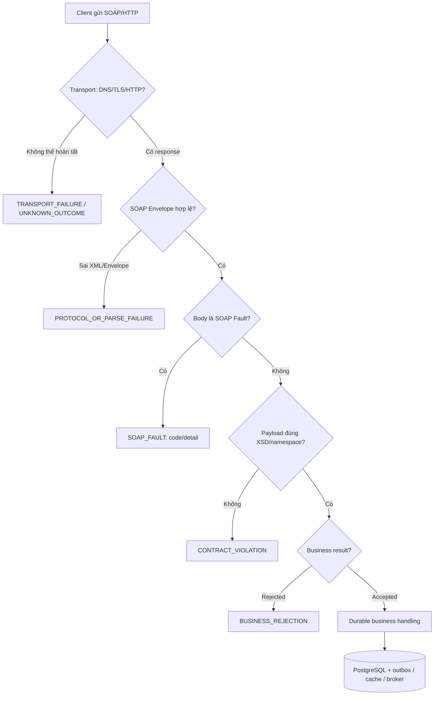
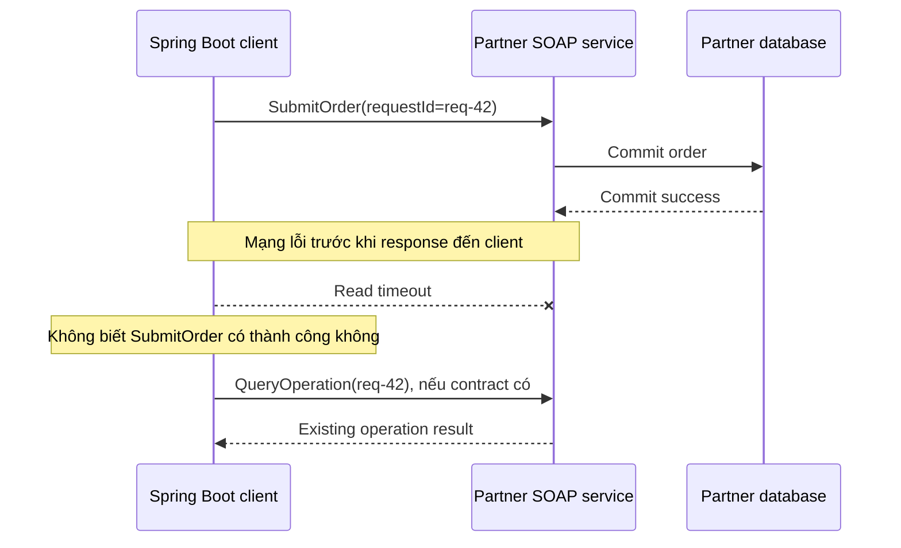
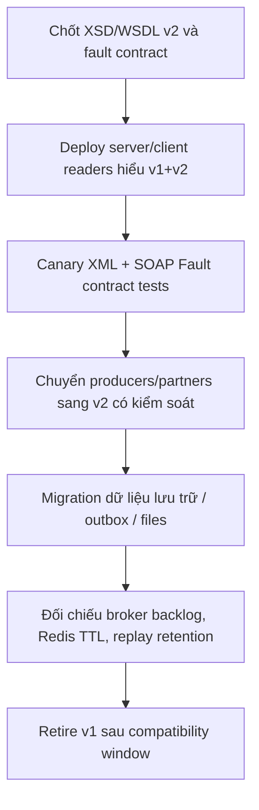
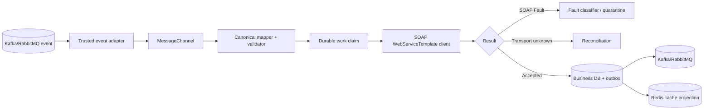

# Xác thực cấu trúc XML và phân biệt lỗi vận chuyển với lỗi dịch vụ

Trong hệ thống **SPRING_BOOT_INTEGRATION**, một ứng dụng Spring Boot có thể gọi dịch vụ SOAP để tạo đơn hàng, đối soát thanh toán, đồng bộ trạng thái vận chuyển rồi ghi kết quả vào PostgreSQL, cập nhật Redis và phát sự kiện sang Kafka/RabbitMQ. Một lỗi ở bước SOAP có thể bắt nguồn từ **kết nối TLS**, **HTTP proxy**, **XML không đúng XSD**, **SOAP Fault do nghiệp vụ trả về** hoặc **dữ liệu hợp lệ về XML nhưng sai quy tắc kinh doanh**. Nếu gộp tất cả thành “SOAP lỗi” rồi retry, ứng dụng có thể gửi lặp một lệnh thanh toán hoặc xóa dữ liệu do hiểu nhầm phản hồi.

Bài thuộc chương **SOAP và XML**, tập trung vào hai năng lực phải đi cùng nhau: **xác thực cấu trúc XML theo hợp đồng** và **phân biệt lỗi vận chuyển với lỗi dịch vụ**. Chúng ta sẽ thiết kế ranh giới kiểm tra SOAP Envelope, namespace/XSD, XML parser security, dữ liệu nghiệp vụ, HTTP/TLS, SOAP Fault; sau đó xây luồng Spring Web Services có thể xử lý retry, idempotency, transaction, kiểm thử và observability đúng nghĩa.

> Các ví dụ dùng Java 17+, Spring Boot 3.x, Spring Web Services 4.x và Jakarta JAXB tương ứng với BOM của ứng dụng. Tên service, namespace `urn:example:orders:v1`, endpoint và payload trong bài là **hư cấu**. Các API/mặc định của SOAP 1.1, SOAP 1.2, Spring-WS và HTTP message sender không hoàn toàn giống nhau; phải xác minh bằng test trên phiên bản và SOAP binding thực tế.

## 1. Mục tiêu học tập

Sau bài này, bạn có thể:

1. Xác định đúng vị trí của **HTTP/TLS**, **SOAP Envelope**, **Body payload**, **XSD**, **SOAP Fault** và **business validation** trong một request/response.
2. Phân biệt XML **well-formed**, **namespace-correct**, **schema-valid** và **semantically valid**; không đánh đồng một lần parse thành công với kết quả nghiệp vụ.
3. Thiết kế XSD có kiểu, thứ tự element, cardinality, giá trị bắt buộc và quy tắc decimal; hiểu rõ giới hạn của XSD trong việc kiểm tra nghiệp vụ.
4. Sử dụng Spring Web Services `@Endpoint`, `@PayloadRoot`, JAXB marshaller và `PayloadValidatingInterceptor` để kiểm tra hợp đồng XML.
5. Phân loại lỗi **timeout/TLS/DNS/HTTP status** với **SOAP 1.1/1.2 Fault** và response parse/validation failure; quyết định retry phù hợp.
6. Thiết kế SOAP Fault không lộ dữ liệu nhạy cảm, có fault code/detail ổn định, phân biệt lỗi caller với lỗi hệ thống.
7. Bảo vệ XML parser khỏi **XXE/DTD/entity expansion** và kiểm tra SOAP security/signature đúng thứ tự.
8. Viết unit test XSD, Spring-WS endpoint/client tests và integration tests cho lỗi transport, schema, fault, duplicate và recovery.

## 2. Bốn kết quả khác nhau của một SOAP call

Giả sử ứng dụng gửi `SubmitOrderRequest` tới đối tác:

| Kết quả | Ví dụ | Bản chất | Hành vi thường phù hợp |
| --- | --- | --- | --- |
| **Transport error** | DNS failure, connect timeout, TLS handshake fail, HTTP proxy trả HTML 502 | Chưa nhận được SOAP response hợp lệ từ đối tác, **không biết chắc** phía xa đã xử lý hay chưa khi timeout ở giai đoạn sau gửi | Retry có giới hạn **chỉ khi an toàn**; kiểm tra operation status khi outcome không rõ. |
| **SOAP Fault** | SOAP Body chứa `Fault` với code Sender/Client hoặc Receiver/Server | Peer đã trả một thông điệp SOAP Fault; có thể là lỗi request, policy, auth, service nội bộ hoặc workflow | Phân loại fault code/subcode/detail theo contract; không dựa vào mỗi HTTP status. |
| **XML/schema failure** | Response chứa `OrderState` sai namespace hoặc `amount="abc"` không phù hợp XSD | Có bytes/phản hồi nhưng **không tuân hợp đồng cấu trúc** hoặc không deserialize được | Báo contract drift, quarantine/troubleshoot; retry mù thường vô ích. |
| **Business rejection/success** | Response schema-valid, `status=REJECTED` hoặc `status=ACCEPTED` | Dịch vụ đã trả **kết quả nghiệp vụ được biểu diễn trong payload** | Áp logic domain và transaction; `REJECTED` không phải network failure. |

Một request có thể không thể đặt gọn vào một ô: ví dụ **HTTP 500 kèm SOAP Fault** là lỗi dịch vụ ở dạng SOAP Fault, không chỉ là HTTP transport failure. Ngược lại **HTTP 200 kèm SOAP Fault** có thể đến từ một tích hợp không chuẩn/binding khác nhau; cần xác nhận payload và binding trước khi gọi là thành công. **HTTP 200 + XML có thể parse** vẫn có thể sai XSD, sai business invariant hoặc chứa một message version không hỗ trợ.

### 2.1. Luồng xử lý có phân tầng



**Điều quan trọng:** XSD validation **không thay** authentication/authorization, signature verification, schema version policy hoặc idempotency. Một tài liệu XML có thể hợp lệ cấu trúc mà vẫn là lệnh nghiệp vụ không được phép.

## 3. SOAP Envelope, Body, Header và phiên bản binding

SOAP là một giao thức trao đổi thông điệp dựa trên XML với Envelope và Body; Header có thể mang metadata như WS-Security, WS-Addressing và correlation information.

Ví dụ request SOAP 1.1:

```http
POST /services/orders HTTP/1.1
Host: partner.example.org
Content-Type: text/xml; charset=utf-8
SOAPAction: "urn:example:orders:SubmitOrder"
```

```xml
<?xml version="1.0" encoding="UTF-8"?>
<soapenv:Envelope
    xmlns:soapenv="http://schemas.xmlsoap.org/soap/envelope/"
    xmlns:ord="urn:example:orders:v1">
  <soapenv:Header/>
  <soapenv:Body>
    <ord:SubmitOrderRequest>
      <ord:requestId>req-42</ord:requestId>
      <ord:orderId>ORD-42</ord:orderId>
      <ord:amount>125.00</ord:amount>
      <ord:currency>USD</ord:currency>
      <ord:occurredAt>2026-11-20T10:30:00Z</ord:occurredAt>
    </ord:SubmitOrderRequest>
  </soapenv:Body>
</soapenv:Envelope>
```

Ví dụ response:

```xml
<soapenv:Envelope
    xmlns:soapenv="http://schemas.xmlsoap.org/soap/envelope/"
    xmlns:ord="urn:example:orders:v1">
  <soapenv:Body>
    <ord:SubmitOrderResponse>
      <ord:requestId>req-42</ord:requestId>
      <ord:status>ACCEPTED</ord:status>
      <ord:operationId>op-729</ord:operationId>
    </ord:SubmitOrderResponse>
  </soapenv:Body>
</soapenv:Envelope>
```

### 3.1. SOAP 1.1 và SOAP 1.2 không dùng cùng namespace

| Khía cạnh | SOAP 1.1 | SOAP 1.2 |
| --- | --- | --- |
| Envelope namespace | `http://schemas.xmlsoap.org/soap/envelope/` | `http://www.w3.org/2003/05/soap-envelope` |
| HTTP media type thường gặp | `text/xml`, có thể dùng HTTP `SOAPAction` | `application/soap+xml`, action có thể trong media type |
| Fault code chính | `Client` / `Server` | `Sender` / `Receiver`, có thể có Subcode |
| Fault structure | `faultcode`, `faultstring`, `faultactor`, `detail` | `Code`, `Reason`, `Node`, `Role`, `Detail` |
| HTTP binding | SOAP 1.1 HTTP binding thường dùng HTTP 500 cho Fault | SOAP 1.2 HTTP binding có quy tắc status riêng, ví dụ Sender/Receiver thường là 400/500 tùy trường hợp |

Đừng chỉ thay tên namespace trong XSD payload rồi cho rằng đã đổi SOAP 1.1 → 1.2: **message factory, Content-Type, Fault format và WS-* interoperability** cũng phải tương thích. Đối tác có thể dùng HTTP status không hoàn toàn giống chuẩn; xử lý đúng cần dựa trên **cả binding, response headers, SOAP envelope và application fault contract**.

### 3.2. Namespace prefix không phải danh tính của element

Hai tags sau cùng qualified name:

```xml
<o:orderId xmlns:o="urn:example:orders:v1">ORD-42</o:orderId>
```

```xml
<x:orderId xmlns:x="urn:example:orders:v1">ORD-42</x:orderId>
```

Nhưng element `<orderId>` không namespace **khác** với element `{urn:example:orders:v1}orderId`. XSD/JAXB cần so **namespace URI + local name**, không so prefix text.

### 3.3. SOAP Fault thuộc Body, không phải response nghiệp vụ bình thường

Một response nhận được body XML không đồng nghĩa nó là `SubmitOrderResponse`. Client phải nhận diện SOAP Fault trước khi unmarshal response theo DTO thành công. Dịch vụ cũng có thể trả “từ chối nghiệp vụ” bằng `SubmitOrderResponse.status=REJECTED` nếu đó là outcome bình thường theo hợp đồng; **không tự dùng Fault cho mọi kết quả không phải ACCEPTED**.

## 4. Well-formed, schema-valid và business-valid là ba mức khác nhau

| Mức kiểm tra | Giải quyết điều gì? | Ví dụ |
| --- | --- | --- |
| **Well-formed XML** | Thẻ đóng đúng, quote/encoding hợp lệ, một root, cú pháp XML | `<orderId>ORD-42</orderId>`. |
| **Namespace/Envelope valid** | Root là SOAP Envelope đúng version; Body payload đúng QName | `{urn:example:orders:v1}SubmitOrderRequest`. |
| **XSD schema valid** | Element/attribute names, sequence, min/max occurrences, XML types, enumerations/facets | `amount` phải là decimal dương, `currency` chỉ USD/VND. |
| **Semantic valid** | Business rules mà XSD không thể xác nhận hết | Currency với scale phù hợp, tenant được cấp quyền, order chưa bị thanh toán, occurredAt phải có timezone. |

XML có thể **well-formed nhưng sai schema**:

```xml
<ord:SubmitOrderRequest xmlns:ord="urn:example:orders:v1">
  <ord:orderId>ORD-42</ord:orderId>
  <ord:requestId>req-42</ord:requestId>
  <ord:amount>ABC</ord:amount>
  <ord:currency>USD</ord:currency>
  <ord:occurredAt>2026-11-20T10:30:00Z</ord:occurredAt>
</ord:SubmitOrderRequest>
```

Ngay cả khi mọi field tồn tại, thứ tự `orderId` trước `requestId` sẽ sai nếu XSD dùng `xsd:sequence` yêu cầu ngược lại; `amount=ABC` không thể là `xsd:decimal`. Không “sửa” XML kiểu này bằng cách tắt XSD toàn cục rồi để service tự đoán.

### 4.1. XSD validation không kiểm tra toàn bộ SOAP message

Một `PayloadValidatingInterceptor` trong Spring-WS thường validate **payload (nội dung nghiệp vụ trong SOAP Body)** theo XSD, không tự xác minh mọi SOAP Header/WS-Security, chữ ký, chứng chỉ TLS hoặc toàn bộ envelope. Envelope/message parsing được framework xử lý ở tầng khác; các quy tắc security/authentication và business invariants cần cấu hình riêng.

### 4.2. XSD 1.0 dateTime có thể thiếu timezone

`xsd:dateTime` trong XML Schema 1.0 cho phép giá trị không có timezone. Vì vậy:

```xml
<ord:occurredAt>2026-11-20T10:30:00</ord:occurredAt>
```

có thể hợp lệ **theo datatype XSD**, nhưng không đủ để xác định một `Instant` duy nhất. Nếu business contract đòi event time chính xác, hãy **validate timezone/offset trong ứng dụng** hoặc sử dụng profile/schema rules đã xác định. Không mặc định timezone từ máy chạy JVM.

## 5. Viết XSD làm hợp đồng cấu trúc rõ ràng

Ví dụ file `src/main/resources/xsd/orders-v1.xsd`:

```xml
<?xml version="1.0" encoding="UTF-8"?>
<xsd:schema
    xmlns:xsd="http://www.w3.org/2001/XMLSchema"
    xmlns:tns="urn:example:orders:v1"
    targetNamespace="urn:example:orders:v1"
    elementFormDefault="qualified">

  <xsd:simpleType name="IdType">
    <xsd:restriction base="xsd:string">
      <xsd:minLength value="1"/>
      <xsd:maxLength value="128"/>
      <xsd:pattern value="[A-Za-z0-9._-]+"/>
    </xsd:restriction>
  </xsd:simpleType>

  <xsd:simpleType name="CurrencyType">
    <xsd:restriction base="xsd:string">
      <xsd:enumeration value="USD"/>
      <xsd:enumeration value="VND"/>
    </xsd:restriction>
  </xsd:simpleType>

  <xsd:simpleType name="AmountType">
    <xsd:restriction base="xsd:decimal">
      <xsd:totalDigits value="18"/>
      <xsd:fractionDigits value="2"/>
      <xsd:minExclusive value="0"/>
    </xsd:restriction>
  </xsd:simpleType>

  <xsd:simpleType name="SubmitStatusType">
    <xsd:restriction base="xsd:string">
      <xsd:enumeration value="ACCEPTED"/>
      <xsd:enumeration value="REJECTED"/>
    </xsd:restriction>
  </xsd:simpleType>

  <xsd:element name="SubmitOrderRequest">
    <xsd:complexType>
      <xsd:sequence>
        <xsd:element name="requestId" type="tns:IdType"/>
        <xsd:element name="orderId" type="tns:IdType"/>
        <xsd:element name="amount" type="tns:AmountType"/>
        <xsd:element name="currency" type="tns:CurrencyType"/>
        <xsd:element name="occurredAt" type="xsd:dateTime"/>
      </xsd:sequence>
    </xsd:complexType>
  </xsd:element>

  <xsd:element name="SubmitOrderResponse">
    <xsd:complexType>
      <xsd:sequence>
        <xsd:element name="requestId" type="tns:IdType"/>
        <xsd:element name="status" type="tns:SubmitStatusType"/>
        <xsd:element name="operationId"
                     type="tns:IdType" minOccurs="0"/>
      </xsd:sequence>
    </xsd:complexType>
  </xsd:element>
</xsd:schema>
```

### 5.1. Những gì XSD trên bảo đảm

- Root payload phải là `{urn:example:orders:v1}SubmitOrderRequest` hoặc `SubmitOrderResponse`.
- Các child elements phải đúng namespace, **đúng thứ tự** của `xsd:sequence` và số lần xuất hiện mặc định.
- `requestId` và `orderId` phải tuân pattern/độ dài đã công bố.
- `amount` là giá trị thập phân dương với giới hạn digits/fraction digits.
- `currency` chỉ nhận `USD` hoặc `VND` theo danh sách minh họa, không tự chấp nhận mã bất kỳ.
- `status` chỉ là `ACCEPTED` hoặc `REJECTED`.
- `operationId` có thể không có nhờ `minOccurs="0"`.

Trong ví dụ, `IdType` dựa trên `xsd:string` thay vì `xsd:token` để không tự **collapse whitespace** trong quá trình validation. Nếu sử dụng `xsd:token`, chuỗi đầu/cuối có whitespace có thể được chuẩn hóa trước khi kiểm tra pattern; với **idempotency ID** hoặc order ID có ý nghĩa chính xác theo từng byte/ký tự, hãy chọn policy rõ và test cả `"req-42"` với `" req-42 "`, không lặng lẽ biến chúng thành một khóa.

### 5.2. Những gì XSD trên **không** bảo đảm

1. **Tiền tệ khác scale:** `125.50 VND` có thể vượt quy tắc đơn vị tiền nếu ứng dụng đòi VND không có phần lẻ; `fractionDigits=2` không tự ghép currency và money policy.
2. **Timezone:** `xsd:dateTime` có thể không chứa offset; service cần policy bắt buộc timezone trước khi tạo `Instant`.
3. **Quyền:** `orderId` pattern đúng không đồng nghĩa caller được phép xem/sửa order.
4. **Tính duy nhất:** `requestId` không được tự ngầm unique trên mọi đối tác/tenant; cần khóa ở nguồn sự thật.
5. **Business state:** `status=ACCEPTED` không chứng minh một payment đã settle trong hệ downstream.
6. **Mối quan hệ fields:** schema cho phép `status=ACCEPTED` mà thiếu `operationId`; service có thể phải reject trường hợp đó theo rule riêng.
7. **Chữ ký và nguồn:** XML hợp lệ vẫn có thể là message giả mạo.

Không cố ép XSD gánh toàn bộ domain validation. Sử dụng XSD cho **hợp đồng cấu trúc**, sau đó normalize và kiểm tra business invariants ở application service.

### 5.3. `include`, `import`, `schemaLocation` và version

Khi XSD chia thành nhiều file, `xsd:include` thường ghép schema cùng namespace; `xsd:import` hỗ trợ schema khác namespace. Các `schemaLocation` có thể trỏ tới file hoặc network URL. Trong production:

- Pin các schema dependencies theo **phiên bản cụ thể**.
- Ưu tiên classpath/local resources, tránh fetch tài nguyên ngoài không kiểm soát lúc xử lý request.
- Chỉ allowlist đường dẫn cần thiết; cấu hình `LSResourceResolver`/catalog khi schema cần imports hợp lệ.
- Không coi một URL trong `xsi:schemaLocation` do client gửi là nguồn schema mà server được phép tự tải về.
- Khi breaking change, tách namespace/contract version hoặc có version discriminator được hai phía thống nhất; đừng âm thầm thay nghĩa field trong XSD cũ.

## 6. Dependencies và cấu hình Spring Boot cho SOAP/XML

Với Maven:

```xml
<dependency>
    <groupId>org.springframework.boot</groupId>
    <artifactId>spring-boot-starter-web-services</artifactId>
</dependency>
<dependency>
    <groupId>org.springframework.boot</groupId>
    <artifactId>spring-boot-starter-validation</artifactId>
</dependency>
<dependency>
    <groupId>org.glassfish.jaxb</groupId>
    <artifactId>jaxb-runtime</artifactId>
</dependency>
<dependency>
    <groupId>org.springframework.boot</groupId>
    <artifactId>spring-boot-starter-test</artifactId>
    <scope>test</scope>
</dependency>
<dependency>
    <groupId>org.springframework.ws</groupId>
    <artifactId>spring-ws-test</artifactId>
    <scope>test</scope>
</dependency>
```

Nhóm dependencies minh họa dùng Spring Boot BOM để quản lý phiên bản. Với SOAP 1.2/SAAJ và Java 17, cần xác minh **SAAJ/Jakarta XML SOAP runtime** do starter/dependencies mang vào classpath; không trộn `javax.xml.bind` của Java EE với `jakarta.xml.bind` trên Spring Boot 3 mà không hiểu binary compatibility.

Nếu ứng dụng chỉ làm **SOAP client** và không expose SOAP endpoint, vẫn cần SOAP client libraries/JAXB/message factory theo use case nhưng **không phải đăng ký servlet server**. Nếu ứng dụng dùng Spring Integration, Kafka hoặc JDBC, thêm starter/driver tương ứng theo adapter; SOAP starter không tự tạo Kafka listener, SQL migration hay cache policy.

### 6.1. Server SOAP endpoint path

Ví dụ cấu hình Spring Boot:

```yaml
spring:
  webservices:
    path: /ws
app:
  soap:
    contract-version: v1
```

`spring.webservices.path` là property dành cho servlet/web-services auto-configuration ở các phiên bản Boot hỗ trợ. `app.soap.contract-version` **là property tùy biến của ứng dụng**, không tự kích hoạt schema routing. Khi app tự khai báo `MessageDispatcherServlet` thay vì dùng Boot auto-configuration, cần xác minh mapping trùng/khác; đừng đăng ký **hai servlets cạnh tranh** một URL.

### 6.2. Tạo WSDL 1.1 từ XSD với Spring-WS

`DefaultWsdl11Definition` có thể công bố WSDL sinh từ schema và các conventions:

```java
import org.springframework.context.annotation.Bean;
import org.springframework.context.annotation.Configuration;
import org.springframework.core.io.ClassPathResource;
import org.springframework.ws.wsdl.wsdl11.DefaultWsdl11Definition;
import org.springframework.xml.xsd.SimpleXsdSchema;
import org.springframework.xml.xsd.XsdSchema;

@Configuration(proxyBeanMethods = false)
public class OrdersContractConfiguration {
    public static final String NS = "urn:example:orders:v1";

    @Bean
    XsdSchema ordersSchema() {
        return new SimpleXsdSchema(
                new ClassPathResource("xsd/orders-v1.xsd"));
    }

    @Bean(name = "orders")
    DefaultWsdl11Definition ordersWsdl(XsdSchema ordersSchema) {
        var wsdl = new DefaultWsdl11Definition();
        wsdl.setPortTypeName("OrdersPort");
        wsdl.setLocationUri("/ws");
        wsdl.setTargetNamespace(NS);
        wsdl.setSchema(ordersSchema);
        return wsdl;
    }
}
```

Với phù hợp servlet configuration, WSDL thường được expose dưới đường dẫn dạng `/ws/orders.wsdl`. Nhưng **không đoán URL cuối cùng** khi có context path, ingress rewrite, servlet mapping hoặc reverse proxy; kiểm tra qua HTTP từ môi trường client thực tế. Đối tác dùng WS-Security/WS-Policy hoặc WSDL/XSD phức tạp có thể cần WSDL được quản lý riêng thay vì sinh động bằng convention.

## 7. Bật request/response XSD validation trong Spring-WS

Spring-WS cung cấp `PayloadValidatingInterceptor` để validate payload XML với XSD cho các `@Endpoint` tương ứng. Một cấu hình server minh họa:

```java
import org.springframework.context.annotation.Bean;
import org.springframework.context.annotation.Configuration;
import org.springframework.xml.xsd.XsdSchema;
import org.springframework.ws.soap.server.endpoint.interceptor.PayloadValidatingInterceptor;

@Configuration(proxyBeanMethods = false)
public class OrdersValidationConfiguration {

    @Bean
    PayloadValidatingInterceptor ordersPayloadValidator(
            XsdSchema ordersSchema) {
        var validator = new PayloadValidatingInterceptor();
        validator.setXsdSchema(ordersSchema);
        validator.setValidateRequest(true);
        validator.setValidateResponse(true);
        return validator;
    }
}
```

Để đăng ký interceptor:

```java
import java.util.List;
import org.springframework.context.annotation.Configuration;
import org.springframework.ws.config.annotation.EnableWs;
import org.springframework.ws.config.annotation.WsConfigurer;
import org.springframework.ws.server.EndpointInterceptor;
import org.springframework.ws.soap.server.endpoint.interceptor.PayloadValidatingInterceptor;

@Configuration(proxyBeanMethods = false)
@EnableWs
public class OrdersWsConfiguration implements WsConfigurer {
    private final PayloadValidatingInterceptor validator;

    public OrdersWsConfiguration(
            PayloadValidatingInterceptor validator) {
        this.validator = validator;
    }

    @Override
    public void addInterceptors(
            List<EndpointInterceptor> interceptors) {
        interceptors.add(validator);
    }
}
```

**Giới hạn cấu hình:** snippets giả định ứng dụng có **một contract/schema `orders-v1.xsd`** trên endpoint path đang xử lý. Khi host nhiều SOAP operations hoặc v1/v2 namespaces, một global interceptor chỉ biết một XSD có thể từ chối các payload của operation khác. Cần schema composition/routing/endpoint mapping theo contract. Với validation của **response**, nên bật ở test và có chiến lược kiểm soát trên production vì response validation failure là **lỗi server tạo output sai**, không phải lỗi caller; xử lý lỗi và log không được lộ raw response.

### 7.1. Lỗi request schema không nên chạy business service

```text
HTTP request -> MessageDispatcherServlet
     -> Parse SOAP Envelope
     -> Endpoint mapping by payload QName
     -> Request schema validation
          | fail -> SOAP Fault / safe error, NO business write
          v
     -> JAXB unmarshal / @Endpoint method
     -> Domain validation + authorization
     -> Transactional write / idempotency
     -> JAXB marshal response
     -> Response schema validation
     -> HTTP SOAP response
```

Không dùng `try/catch` trong endpoint method để bắt một request bị interceptor từ chối **trước khi method được gọi**. Khi client cần xem lỗi field/line, cung cấp **error code/fault detail theo API contract** đã giới hạn, không nhúng toàn raw XML hoặc XSD file paths vào SOAP Fault công khai.

### 7.2. JAXB mapping và Java 17

JAXB giúp chuyển XML elements sang Java classes theo XSD. Với Java 17, JAXB không còn nằm mặc định trong JDK; dùng Jakarta JAXB API/runtime tương ứng. Một cách thiết kế bền hơn là **generate source types từ XSD/WSDL** bằng plugin XJC được pin version, đặt trong package cố định như `com.example.integration.soap.v1.generated`, không sửa trực tiếp generated classes.

```text
orders-v1.xsd / WSDL
    -> JAXB generated types (request/response, ObjectFactory)
    -> @Endpoint / WebServiceTemplate marshaller
    -> application DTO / business service
```

Generated JAXB binding có thể đại diện root element bằng `@XmlRootElement` trên class **hoặc** `JAXBElement<T>` do `ObjectFactory` tạo, tùy schema/binding. Khi copy ví dụ `@RequestPayload SubmitOrderRequest`, cần kiểm tra **kiểu thực** XJC đã tạo; không ép cast `JAXBElement` hoặc đổi annotation tùy ý mà không test marshalling/unmarshalling.

### 7.3. JAXB không thay XSD validation

Một XML unmarshaller có thể nhận một số payload không phù hợp semantic hoặc thiếu fields tùy annotations/config. `@XmlElement(required=true)` là metadata binding, **không đồng nghĩa framework tự chạy XSD validation đầy đủ** cho mọi deserialize. Cần test rằng interceptor/Schema validator thực đã chạy, đồng thời business validation vẫn giữ các bất biến domain.

## 8. Endpoint tách ranh giới XML với nghiệp vụ

Một `@Endpoint` nên nhận request JAXB **đã qua xác thực SOAP Envelope và request XSD** (nếu interceptor được cấu hình), kiểm tra những rule mà XSD chưa đủ, rồi gọi một **application service**. Không để class JAXB generated trở thành domain entity JPA hay event DTO của Kafka.

Ví dụ lớp endpoint, giả định JAXB code generation đã tạo `SubmitOrderRequest`, `SubmitOrderResponse` và `SubmitStatusType` từ XSD ở phần 5:

```java
import java.time.Instant;
import javax.xml.datatype.DatatypeConstants;
import org.springframework.stereotype.Component;
import org.springframework.ws.server.endpoint.annotation.Endpoint;
import org.springframework.ws.server.endpoint.annotation.PayloadRoot;
import org.springframework.ws.server.endpoint.annotation.RequestPayload;
import org.springframework.ws.server.endpoint.annotation.ResponsePayload;

@Endpoint
public class OrdersEndpoint {
    private static final String NS = "urn:example:orders:v1";

    private final SubmitOrderUseCase useCase;

    public OrdersEndpoint(SubmitOrderUseCase useCase) {
        this.useCase = useCase;
    }

    @PayloadRoot(namespace = NS, localPart = "SubmitOrderRequest")
    @ResponsePayload
    public SubmitOrderResponse submit(
            @RequestPayload SubmitOrderRequest request) {

        if (request.getOccurredAt() == null
                || request.getOccurredAt().getTimezone()
                    == DatatypeConstants.FIELD_UNDEFINED) {
            throw new OrderContractException(
                    "TIMEZONE_REQUIRED");
        }

        Instant occurredAt = request.getOccurredAt()
                .toGregorianCalendar()
                .toZonedDateTime()
                .toInstant();

        SubmissionOutcome outcome = useCase.submit(
                request.getRequestId(),
                request.getOrderId(),
                request.getAmount(),
                request.getCurrency(),
                occurredAt);

        SubmitOrderResponse response = new SubmitOrderResponse();
        response.setRequestId(request.getRequestId());
        response.setStatus(outcome.accepted()
                ? SubmitStatusType.ACCEPTED
                : SubmitStatusType.REJECTED);
        if (outcome.accepted()) {
            response.setOperationId(outcome.operationId());
        }
        return response;
    }
}
```

Interface và kết quả ứng dụng:

```java
import java.math.BigDecimal;
import java.time.Instant;

public interface SubmitOrderUseCase {
    SubmissionOutcome submit(
            String requestId,
            String orderId,
            BigDecimal amount,
            String currency,
            Instant occurredAt);
}

public record SubmissionOutcome(
        boolean accepted,
        String operationId) {}

public class OrderContractException extends RuntimeException {
    public OrderContractException(String code) {
        super(code);
    }
}
```

Mỗi top-level `public` type cần file `.java` riêng. `SubmitOrderUseCase` phải có Spring service implementation do ứng dụng đăng ký; ví dụ này chưa tự triển khai database hay HTTP partner. Với một XJC binding tạo `JAXBElement<SubmitOrderRequest>` và `JAXBElement<SubmitOrderResponse>` thay vì trực tiếp root classes, endpoint signature và JAXB `ObjectFactory` phải điều chỉnh tương ứng; **không khẳng định mọi XSD đều sinh cùng một Java shape**.

### 8.1. Domain validation phải biết trạng thái thực

Trong application service, ngoài XSD cần kiểm tra:

- Caller/partner đã được authenticate và được phép tác động tới `orderId` nào?
- `requestId` đã xuất hiện chưa trong namespace nguồn/tenant? Nếu trùng, payload có thực sự giống lần trước?
- Currency và fraction digits có phù hợp business operation không?
- Đơn hàng đang ở trạng thái nào, request có vi phạm state transition không?
- Có cần gọi HTTP partner, ghi SQL và phát sự kiện? Transaction và outbox nằm ở đâu?
- Nếu request giống lần trước, phải trả **cùng kết quả idempotent** hay conflict theo contract?

Nếu trạng thái kinh doanh là `REJECTED`, endpoint có thể trả `SubmitOrderResponse` schema-valid với `status=REJECTED`. Nếu request không đúng hợp đồng hoặc caller không có quyền, nên trả SOAP Fault với fault classification ổn định. Đừng đặt `accepted=true` chỉ vì XML đã qua XSD.

### 8.2. Kiểm tra response cũng là kiểm tra server

Khi service tạo `SubmitOrderResponse`, response validation có thể phát hiện bug ở server (ví dụ status enum sai hoặc `operationId` chứa ký tự không hợp lệ). **Đó là lỗi của service**, không phải bằng chứng caller gửi request hỏng. Trước production, test:

1. Request invalid XSD không gọi use case.
2. Request XSD-valid nhưng timezone thiếu bị domain validation từ chối.
3. Request hợp lệ có result `ACCEPTED`/`REJECTED` đúng schema.
4. Response mapper khi lỗi nội bộ không lộ stack trace/SQL details.
5. Retry request cùng key không tạo thêm business side effects.

## 9. Thiết kế SOAP Fault đúng và an toàn

SOAP Fault là **thông điệp giao thức** thể hiện một lỗi trong xử lý SOAP request. Một SOAP 1.1 Fault minh họa:

```xml
<soapenv:Envelope
    xmlns:soapenv="http://schemas.xmlsoap.org/soap/envelope/"
    xmlns:ord="urn:example:orders:v1">
  <soapenv:Body>
    <soapenv:Fault>
      <faultcode>soapenv:Client</faultcode>
      <faultstring>Order request violates contract</faultstring>
      <detail>
        <ord:OrderError>
          <ord:code>TIMEZONE_REQUIRED</ord:code>
          <ord:correlationId>trace-123</ord:correlationId>
        </ord:OrderError>
      </detail>
    </soapenv:Fault>
  </soapenv:Body>
</soapenv:Envelope>
```

Ví dụ SOAP 1.2 cùng ý tưởng:

```xml
<env:Envelope
    xmlns:env="http://www.w3.org/2003/05/soap-envelope"
    xmlns:ord="urn:example:orders:v1">
  <env:Body>
    <env:Fault>
      <env:Code>
        <env:Value>env:Sender</env:Value>
      </env:Code>
      <env:Reason>
        <env:Text xml:lang="en">Invalid order request</env:Text>
      </env:Reason>
      <env:Detail>
        <ord:OrderError>
          <ord:code>TIMEZONE_REQUIRED</ord:code>
        </ord:OrderError>
      </env:Detail>
    </env:Fault>
  </env:Body>
</env:Envelope>
```

Một fault có thể không có `Detail` hoặc mang subcode/business-specific details do WSDL/WS-Policy quy định. **Không parse fault string tự do để quyết định retry** nếu đối tác đã có fault code/detail ổn định; fault string thường dành cho con người, có thể đổi ngôn ngữ hoặc phiên bản.

### 9.1. Mapping lỗi sang Fault theo nguyên nhân

| Tình huống | Fault code khái quát | Policy |
| --- | --- | --- |
| XML Body không đúng XSD/namespace | SOAP 1.1 Client / SOAP 1.2 Sender, tùy binding | Không retry y nguyên request; trả safe validation code. |
| Không được phép thực hiện operation | Sender/Client hoặc fault chuyên biệt theo hợp đồng | Không retry khi chưa thay credentials/authorization. |
| Cùng idempotency ID nhưng payload khác | Business conflict fault | Cần xác minh caller, không coi như replay hợp lệ. |
| Backend SQL unavailable hoặc partner HTTP 503 | Receiver/Server nếu dịch vụ SOAP tự báo lỗi xử lý | Client chỉ retry theo hợp đồng và idempotency. |
| Lỗi lập trình/serialize response | Receiver/Server với message an toàn | Alert server, không lộ exception trace. |
| Business từ chối bình thường | Có thể là `status=REJECTED`, **không bắt buộc Fault** | Theo WSDL/contract đã ký. |

### 9.2. `SoapFaultMappingExceptionResolver` tại server

Spring-WS có exception resolver để chuyển Java exceptions từ endpoint sang SOAP Fault. Ví dụ ánh xạ một exception hợp đồng thành Client fault và dùng Server fault mặc định:

```java
import java.util.Properties;
import org.springframework.context.annotation.Bean;
import org.springframework.context.annotation.Configuration;
import org.springframework.ws.soap.server.endpoint.SoapFaultDefinition;
import org.springframework.ws.soap.server.endpoint.SoapFaultMappingExceptionResolver;

@Configuration(proxyBeanMethods = false)
public class OrdersFaultConfiguration {

    @Bean
    SoapFaultMappingExceptionResolver ordersFaultResolver() {
        var resolver = new SoapFaultMappingExceptionResolver();
        Properties mappings = new Properties();
        mappings.setProperty(
                OrderContractException.class.getName(),
                "CLIENT,Invalid order contract");
        resolver.setExceptionMappings(mappings);

        var defaultFault = new SoapFaultDefinition();
        defaultFault.setFaultCode(SoapFaultDefinition.SERVER);
        defaultFault.setFaultStringOrReason(
                "Internal SOAP service error");
        resolver.setDefaultFault(defaultFault);
        resolver.setOrder(1);
        return resolver;
    }
}
```

Các imports có thể viết trên một dòng trong project thật; định nghĩa trên diễn tả API Spring-WS 4.x theo BOM tương thích. Với SOAP 1.2, fault code translation/binding cần được test, không bê literal `CLIENT` của SOAP 1.1 thành một XML prefix do caller chọn. **Không cho runtime exception message tự động trở thành `faultstring`** nếu nó có thể chứa raw SQL, credentials, XML payload hoặc PII.

### 9.3. Request XSD interceptor có Fault path riêng

Lỗi request bị `PayloadValidatingInterceptor` chặn **trước endpoint** không nhất thiết chạy qua cùng exception resolver cho lỗi ném từ method. Nếu muốn một `OrderError` detail đồng nhất, cần tùy biến error handling của interceptor hoặc một lớp server SOAP error policy được tích hợp đúng thứ tự, rồi test với request invalid thật.

Không tự bật response validation rồi nghĩ mọi lỗi schema response sẽ thành Client fault: **response do service tạo sai** là lỗi server. Trong production, response schema checking có thể có chi phí đáng kể; nếu tối ưu bằng cách tắt, cần giữ **golden contract tests** và monitoring serialization lỗi, không loại bỏ validation business.

## 10. XML parser hardening: chống XXE, DTD và tài nguyên ngoài

Xác thực XSD **không đồng nghĩa parser an toàn**. XML chứa các tính năng như DTD và external entity resolution. Nếu parser theo mặc định được phép truy cập filesystem/network, một message bị kiểm soát bởi attacker có thể gây **XXE**, SSRF hoặc tấn công làm cạn tài nguyên.

### 10.1. XML độc hại không nên được resolve

Ví dụ payload chỉ phục vụ **negative security test**, tuyệt đối không được đưa vào production:

```xml
<?xml version="1.0"?>
<!DOCTYPE SubmitOrderRequest [
  <!ENTITY external SYSTEM "file:///private/should-not-read">
]>
<SubmitOrderRequest>&external;</SubmitOrderRequest>
```

Một XML parser bảo vệ đúng cần **không resolve entity từ file/network** và chặn DTD theo security policy, không chỉ hy vọng XSD cuối cùng sẽ reject.

### 10.2. Cấu hình StAX parser bảo vệ trước khi đọc dữ liệu

```java
import java.io.Reader;
import javax.xml.stream.XMLInputFactory;
import javax.xml.stream.XMLStreamException;
import javax.xml.stream.XMLStreamReader;

public final class SecureStax {
    private SecureStax() {}

    public static XMLStreamReader open(Reader input)
            throws XMLStreamException {

        XMLInputFactory factory = XMLInputFactory.newFactory();
        factory.setProperty(XMLInputFactory.SUPPORT_DTD, false);
        factory.setProperty(
                XMLInputFactory.IS_SUPPORTING_EXTERNAL_ENTITIES, false);

        return factory.createXMLStreamReader(input);
    }
}
```

JAXP/StAX providers có khác biệt về hỗ trợ security properties; nếu provider không hỗ trợ một cấu hình bắt buộc, **fail closed** và dùng parser/provider đã được kiểm chứng. Luôn giới hạn **request bytes, XML depth/number of nodes, thời gian parse, decompressed size và memory** ở tầng HTTP/adapters; disable DTD alone không giải quyết mọi denial-of-service.

### 10.3. XSD SchemaFactory hạn chế import tài nguyên ngoài

```java
import javax.xml.XMLConstants;
import javax.xml.validation.Schema;
import javax.xml.validation.SchemaFactory;
import javax.xml.transform.stream.StreamSource;
import java.io.InputStream;

public final class SecureSchemaLoader {
    private SecureSchemaLoader() {}

    public static Schema loadOrdersXsd(InputStream localSchema)
            throws org.xml.sax.SAXException {

        SchemaFactory factory = SchemaFactory.newInstance(
                XMLConstants.W3C_XML_SCHEMA_NS_URI);

        factory.setProperty(XMLConstants.ACCESS_EXTERNAL_DTD, "");
        factory.setProperty(XMLConstants.ACCESS_EXTERNAL_SCHEMA, "");

        return factory.newSchema(new StreamSource(localSchema));
    }
}
```

Với `ACCESS_EXTERNAL_SCHEMA=""`, schema imports/includes qua URI ngoài có thể bị chặn. Nếu cần ghép các XSD local, dùng **catalog/resource resolver đáng tin** hoặc chuẩn bị schema bundle và test trên provider thực; không mở `http` hoặc `file` vô hạn để “cho XSD hoạt động”. `Schema` có thể được chia sẻ giữa threads theo JAXP contract, nhưng **`Validator` là mutable và không thread-safe** — tạo Validator mới cho từng lần validate nếu dùng API trực tiếp.

### 10.4. Ví dụ validate bằng secure StAXSource

```java
import java.io.Reader;
import javax.xml.transform.stax.StAXSource;
import javax.xml.validation.Schema;
import javax.xml.validation.Validator;

public final class SecureXmlValidator {
    private final Schema schema;

    public SecureXmlValidator(Schema schema) {
        this.schema = schema;
    }

    public void validate(Reader xml) throws Exception {
        var streamReader = SecureStax.open(xml);
        try {
            Validator validator = schema.newValidator();
            validator.setProperty(
                    javax.xml.XMLConstants.ACCESS_EXTERNAL_DTD, "");
            validator.setProperty(
                    javax.xml.XMLConstants.ACCESS_EXTERNAL_SCHEMA, "");
            validator.validate(new StAXSource(streamReader));
        } finally {
            streamReader.close();
        }
    }
}
```

Đây là **một helper kiểm tra payload XML độc lập**, không phải thay thế toàn bộ Spring-WS message-level parsing. Nếu đưa cả SOAP Envelope vào validator xây từ **XSD payload**, validator sẽ reject root `Envelope`; cần trích Body payload sau khi xử lý SOAP protocol đúng và **verify security trước khi tin nội dung**. Test chính xác XML provider vì một số implementations có giới hạn hỗ trợ `StAXSource`, JAXP properties hoặc secure processing khác nhau.

### 10.5. Chữ ký WS-Security và XML canonicalization

Khi bên gửi ký SOAP message:

```text
TLS / authenticated channel
    -> SOAP parse với secure parser
    -> WS-Security signature/token verification
    -> kiểm tra timestamp/replay/audience
    -> XSD validation / namespace routing
    -> canonical DTO + business validation
    -> durable commit/ack
```

Thứ tự chính xác còn phụ thuộc WS-Security policy: một số hệ có encryption/signature ở các phần khác nhau của SOAP Header/Body. Không sửa whitespace, namespace prefix, Unicode hay bytes được ký trước khi signature library thực hiện canonicalization/verification theo policy. **XSD hợp lệ không chứng minh message được ký hoặc do bên được phép gửi**, và TLS không tự thay thế WS-Security nếu hợp đồng yêu cầu message-level security.

## 11. Xây SOAP client với `WebServiceTemplate` và validation

Ở chiều outbound, Spring-WS `WebServiceTemplate` đóng vai trò tương tự một SOAP-specific client: tạo SOAP message, marshal Java request thành XML, gửi qua message sender, nhận response và xử lý Fault/unmarshal. Không gọi một URL SOAP bằng HTTP JSON converter thông thường rồi giả định tự xử lý Envelope và Fault.

### 11.1. Cấu hình marshaller và HTTP transport rõ ràng

Ví dụ dùng generated JAXB package `com.example.integration.soap.v1.generated`:

```java
import org.springframework.beans.factory.annotation.Value;
import org.springframework.context.annotation.Bean;
import org.springframework.context.annotation.Configuration;
import org.springframework.core.io.ClassPathResource;
import org.springframework.oxm.jaxb.Jaxb2Marshaller;
import org.springframework.ws.client.core.WebServiceTemplate;
import org.springframework.ws.transport.http.HttpUrlConnectionMessageSender;

@Configuration(proxyBeanMethods = false)
public class PartnerOrdersSoapClientConfiguration {

    @Bean
    Jaxb2Marshaller ordersJaxbMarshaller() {
        var marshaller = new Jaxb2Marshaller();
        marshaller.setContextPath(
                "com.example.integration.soap.v1.generated");
        marshaller.setSchema(
                new ClassPathResource("xsd/orders-v1.xsd"));
        return marshaller;
    }

    @Bean("partnerOrdersWebServiceTemplate")
    WebServiceTemplate partnerOrdersTemplate(
            Jaxb2Marshaller ordersJaxbMarshaller,
            @Value("${partner.orders.soap-uri}") String endpointUri) {

        var sender = new HttpUrlConnectionMessageSender();
        sender.setConnectionTimeout(2_000); // ms
        sender.setReadTimeout(5_000);       // ms

        var template = new WebServiceTemplate();
        template.setDefaultUri(endpointUri);
        template.setMarshaller(ordersJaxbMarshaller);
        template.setUnmarshaller(ordersJaxbMarshaller);
        template.setMessageSender(sender);
        return template;
    }
}
```

Và ví dụ properties:

```yaml
partner:
  orders:
    soap-uri: ${PARTNER_ORDERS_SOAP_URI:https://partner.example.org/services/orders}
```

**Chú ý về API:** `HttpUrlConnectionMessageSender` có các setters timeout tính theo milliseconds trong Spring-WS 4.x được minh họa; khi nâng framework, xác minh overload thực và test bằng một endpoint trả chậm. **Connect timeout** giới hạn thời gian mở kết nối, **read timeout** giới hạn chờ dữ liệu trên socket theo semantics transport, **không** là một overall deadline cho toàn chuỗi SOAP call/retries. Với workload lớn cần keep-alive/pooling/proxy/TLS tuning, cân nhắc một message sender dựa trên Apache HttpClient tương thích đúng Spring-WS version.

`Jaxb2Marshaller.setSchema(...)` giúp áp schema validation cho JAXB marshal/unmarshal theo cấu hình, nhưng **không tự xác thực SOAP Header, chữ ký, HTTP status hoặc response nghiệp vụ**. Một partner có nhiều XSD operations/versions cần schema composition hoặc marshaller chuyên biệt. Không coi JAXB validation là một substitute cho server `PayloadValidatingInterceptor` ở chiều inbound.

### 11.2. SOAP 1.1/1.2 message factory và action

`WebServiceTemplate` cần tạo SOAP message phù hợp binding của đối tác. SOAP 1.1 thường dùng `SOAPAction` HTTP header, SOAP 1.2 có action qua media type; Spring-WS xử lý khác nhau theo `SoapMessageFactory`. Có thể cấu hình `SaajSoapMessageFactory` cho SOAP 1.2 với `SoapVersion.SOAP_12` khi ứng dụng và SAAJ runtime hỗ trợ, nhưng **không chọn SOAP 1.2 chỉ vì backend gửi HTTP 500**.

Khi endpoint yêu cầu action:

```java
import org.springframework.ws.soap.client.core.SoapActionCallback;

var callback = new SoapActionCallback(
        "urn:example:orders:SubmitOrder");
```

Với WS-Addressing, security tokens, mTLS hoặc custom SOAP Header, cần message callback/interceptor riêng, kiểm tra đúng thứ tự signing và transport configuration; `SOAPAction` **không phải** authentication hoặc namespace version.

### 11.3. Client adapter bắt đúng họ lỗi

```java
import jakarta.xml.bind.JAXBElement;
import org.springframework.beans.factory.annotation.Qualifier;
import org.springframework.oxm.XmlMappingException;
import org.springframework.stereotype.Component;
import org.springframework.ws.client.WebServiceIOException;
import org.springframework.ws.client.WebServiceTransportException;
import org.springframework.ws.client.core.WebServiceTemplate;
import org.springframework.ws.soap.client.SoapFaultClientException;
import org.springframework.ws.soap.client.core.SoapActionCallback;

@Component
public class PartnerOrdersSoapClient {
    private final WebServiceTemplate template;

    public PartnerOrdersSoapClient(
            @Qualifier("partnerOrdersWebServiceTemplate")
            WebServiceTemplate template) {
        this.template = template;
    }

    public SubmitOrderResponse submit(SubmitOrderRequest request) {
        try {
            Object message = template.marshalSendAndReceive(
                    request,
                    new SoapActionCallback(
                            "urn:example:orders:SubmitOrder"));

            // Tùy JAXB bindings có thể trả JAXBElement<T>.
            Object payload = message instanceof JAXBElement<?> element
                    ? element.getValue() : message;
            if (!(payload instanceof SubmitOrderResponse response)) {
                throw new PartnerResponseContractException(
                        "UNEXPECTED_SOAP_RESPONSE_TYPE");
            }
            return response;

        } catch (SoapFaultClientException fault) {
            throw new PartnerSoapFaultFailure(
                    "SOAP_FAULT_FROM_PARTNER", fault);

        } catch (WebServiceTransportException transport) {
            throw new PartnerTransportFailure(
                    "SOAP_HTTP_TRANSPORT_FAILURE", transport);

        } catch (WebServiceIOException transportIo) {
            throw new PartnerTransportFailure(
                    "SOAP_NETWORK_OR_IO_FAILURE", transportIo);

        } catch (XmlMappingException mapping) {
            throw new PartnerResponseContractException(
                    "SOAP_RESPONSE_MAPPING_FAILURE", mapping);
        }
    }

    public static final class PartnerSoapFaultFailure
            extends RuntimeException {
        public PartnerSoapFaultFailure(
                String code, Throwable cause) {
            super(code, cause);
        }
    }

    public static final class PartnerTransportFailure
            extends RuntimeException {
        public PartnerTransportFailure(
                String code, Throwable cause) {
            super(code, cause);
        }
    }

    public static final class PartnerResponseContractException
            extends RuntimeException {
        public PartnerResponseContractException(String code) {
            super(code);
        }

        public PartnerResponseContractException(
                String code, Throwable cause) {
            super(code, cause);
        }
    }
}
```

Các class `SubmitOrderRequest`/`SubmitOrderResponse` là JAXB-generated từ XSD và cần imports theo package thực. **Không retry trực tiếp trong catch blocks này**: adapter chỉ phân loại, còn application service chọn retry theo loại operation, fault code và tình trạng idempotency. Nếu client dùng custom `FaultMessageResolver`, exception không nhất thiết là `SoapFaultClientException` như mặc định; phải test error path thực.

### 11.4. SOAP Fault có thể đi cùng HTTP 500

Đây là điểm dễ sai khi triển khai:

```text
HTTP/1.1 500 Internal Server Error
Content-Type: text/xml; charset=utf-8

<soap:Envelope ...>
  <soap:Body><soap:Fault>...</soap:Fault></soap:Body>
</soap:Envelope>
```

Nếu HTTP status 500 nhưng Body là SOAP Fault hợp lệ theo binding, SOAP-aware client như `WebServiceTemplate` có thể xử lý qua **fault path** thay vì chỉ `WebServiceTransportException`. Đừng đặt một HTTP interceptor ném exception cho mọi status != 200 trước khi SOAP Fault resolver có cơ hội đọc body; nhưng cũng đừng tắt mọi transport error checks để chấp nhận proxy HTML 502 như SOAP success.

## 12. Bảng quyết định: transport, protocol, SOAP Fault, contract và business result

| Quan sát bên ngoài | Trước tiên kiểm tra | Phân loại thích hợp | Retry? |
| --- | --- | --- | --- |
| DNS resolution fail | Host/service discovery, endpoint URI, DNS | `TRANSPORT_DNS` | Có giới hạn nếu operation an toàn; có thể chưa gửi request. |
| TLS handshake fail | Truststore, hostname/SNI, mTLS/certificate chain | `TRANSPORT_TLS` | Không retry hot loop; sửa trust/cert/secret/config. |
| Connect timeout | Firewall, routing, pool, partner availability | `TRANSPORT_CONNECT_TIMEOUT` | Bounded retry nếu operation/key an toàn. |
| Read timeout sau khi gửi request | Partner có thể **đã commit** và response chưa tới | `UNKNOWN_OUTCOME` | **Không blind retry** POST không idempotent. |
| HTTP 401/403 không SOAP body | Auth gateway/proxy, token expiry, policy | `TRANSPORT_AUTHORIZATION` | Sửa credential/permission, không vô hạn. |
| HTTP 429/503 + `Retry-After`, không SOAP | Rate limit hoặc service tạm unavailable | `TRANSPORT_TRANSIENT` | Bounded backoff theo partner contract. |
| HTTP 500 + SOAP 1.1 Fault `Server` | Fault body/code/detail thực | `SOAP_RECEIVER_FAULT` | Tùy fault semantics và idempotency. |
| HTTP 400 + SOAP 1.2 Fault `Sender` | Sender fault detail và request schema | `SOAP_SENDER_FAULT` | Thường không retry y nguyên. |
| HTTP 200 + SOAP Fault | Binding/proxy interoperability và SOAP body | `SOAP_FAULT` (sau kiểm tra binding) | Theo fault code, không theo 200. |
| HTTP 200 + XML không well-formed | Truncated response, XML parser, charset | `PROTOCOL_PARSE_FAILURE` | Điều tra; POST outcome có thể UNKNOWN. |
| HTTP 200 + XML hợp lệ nhưng XSD sai | Namespace/version, schema drift, serializer | `CONTRACT_VIOLATION` | Thường không retry cùng payload. |
| HTTP 200 + response `status=REJECTED` | Business status/operation semantics | `BUSINESS_REJECTION` | Không coi là transient fault. |
| HTTP 200 + accepted response và business operation ID | Response XSD/domain validation, correlation | `SUCCESS` | Commit local business effect đúng transaction. |

**Không suy “SOAP Fault luôn retry được nếu HTTP 500”.** Một Fault `Server` có thể là temporary backend failure, nhưng cũng có thể là deterministic configuration lỗi, request schema version không hỗ trợ hoặc policy thay đổi. Tốt nhất đối tác có **fault code/detail taxonomy ổn định**, ví dụ `RATE_LIMIT`, `CONTRACT_VERSION_UNSUPPORTED`, `ORDER_ALREADY_EXISTS`, `INTERNAL_TEMPORARY_FAILURE` và hướng dẫn retry rõ ràng.

### 12.1. SOAP 1.1 Fault code và SOAP 1.2 Subcode

SOAP 1.1 `Client`/`Server` là phân loại **mức rất thô**. SOAP 1.2 `Sender`/`Receiver` và `Subcode` cho phép phân loại sâu hơn, nhưng mỗi provider có thể có custom namespaces. Không hardcode so fault string “timeout” hoặc “Internal Error” nếu code/detail đã được công bố.

Tạo một **fault classifier** ở tầng adapter:

```text
SOAP fault
  -> identify SOAP version
  -> parse Fault Code (QName) / Subcode(s)
  -> parse allowlisted business error code from Detail
  -> map to domain error category
  -> preserve safe correlation ID and retry hint
  -> do NOT expose raw partner detail to untrusted HTTP caller
```

Spring-WS `SoapFaultClientException` có các API như `getFaultCode()`, `getFaultStringOrReason()` để hỗ trợ logging/classification. Khi cần structured `detail`, đọc bằng SOAP model và schema đã biết, có namespace validation và payload limits; không parse arbitrary text bằng substring.

### 12.2. Các ngoại lệ bị ném ở những giai đoạn khác nhau

```text
WebServiceTemplate.marshalSendAndReceive(...)
  | outbound JAXB marshal failure
  | HTTP/TLS/network failure
  | HTTP response status/content-type/protocol mismatch
  | SOAP Envelope parsing
  | SOAP Fault recognition + fault resolver
  | inbound JAXB unmarshal + schema validation
  | application response validation
```

Vì thế **catch order và exception types** trong client adapter phải được điều chỉnh theo message sender, JAXB binding và custom fault resolver thực. Một lỗi XSD của response có thể xuất hiện dưới `XmlMappingException`/unmarshal error ở một cấu hình, nhưng dưới message/validation interceptor exception ở cấu hình khác. Viết integration test cho đường đang chạy, không chỉ dựa vào tên Java exception bạn nghĩ sẽ được ném.

## 13. Retry SOAP call mà không nhân đôi giao dịch

Một request SOAP **đọc dữ liệu** thường dễ retry hơn một request **tạo đơn hàng/thu tiền**. Với SOAP POST, HTTP method là POST ngay cả khi business operation chỉ đọc; vì vậy **không suy idempotency từ HTTP method**. Phải đọc WSDL/contract của operation và xác định effect thực.

### 13.1. Bốn thời điểm lỗi



| Lỗi xảy ra | Có thể suy chắc về side effect? | Phương án |
| --- | --- | --- |
| DNS fail trước khi mở connection | Thường chưa gửi request tới host | Retry có giới hạn sau khi kiểm tra config. |
| TLS handshake fail trước SOAP body | Thường chưa gửi SOAP request | Sửa trust/credential; không lặp vô hạn. |
| Read timeout sau khi body đã gửi | **Không**; partner có thể đã commit | Query operation theo stable ID, hoặc retry với provider idempotency contract. |
| SOAP Fault `ORDER_ALREADY_EXISTS` | Có thể đã có operation trước đó | Kiểm tra requestId/payload và trạng thái thực; không tự coi là fail/success. |

### 13.2. `requestId` phải ổn định qua retry

Ví dụ một idempotency key dùng trong XSD:

```text
sourceSystem = partner-A
requestId = req-42
businessOrderId = ORD-42
operationType = SUBMIT_ORDER

stable key = (sourceSystem, operationType, requestId)
```

Nhà cung cấp SOAP **phải hỗ trợ semantics**: cùng requestId/cùng payload trả cùng kết quả hoặc lỗi duplicate có thể đối soát; cùng requestId nhưng payload khác trả conflict. Chỉ gửi `requestId` mà partner không dùng chống trùng **không biến operation thành idempotent**.

Tại Spring Boot client, có thể lưu bảng workflow:

```sql
CREATE TABLE soap_operation (
    partner_id VARCHAR(64) NOT NULL,
    request_id VARCHAR(128) NOT NULL,
    order_id VARCHAR(128) NOT NULL,
    payload_hash CHAR(64) NOT NULL,
    state VARCHAR(24) NOT NULL,
    partner_operation_id VARCHAR(128),
    updated_at TIMESTAMPTZ NOT NULL,
    PRIMARY KEY (partner_id, request_id)
);
```

`state` có thể là `PENDING`, `ACCEPTED`, `REJECTED`, `UNKNOWN` theo contract, với business transitions rõ. Một HTTP timeout sau gửi phải **ghi nhận hoặc giữ trạng thái UNKNOWN** và có reconciliation, không tự đánh dấu thất bại rồi tạo requestId mới.

### 13.3. Transaction boundaries khi SOAP kết hợp database/broker

```text
Begin business operation / durable claim
  -> store stable request ID and payload hash
Commit local DB transaction

Call partner SOAP (outside long DB transaction)
  -> validate SOAP response/Fault/unknown outcome

Open SHORT business transaction
  -> transition local operation state conditionally
  -> update local projection / inbox
  -> append outbox event
Commit

Outbox publisher sends Kafka/RabbitMQ message separately
```

Không giữ transaction PostgreSQL mở trong 30 giây chỉ để chờ SOAP server. Local DB commit và remote SOAP commit **không atomic**; nếu partner đã commit mà local DB update fail, cần **reconciliation by request ID**, không tái phát một SOAP POST mới với ID khác.

Nếu SOAP response chỉ là `ACCEPTED` (đã tiếp nhận bất đồng bộ), nó **không chứng minh order đã hoàn tất**. Theo dõi partner operation status/callback, rồi cập nhật state machine và outbox theo transition bền vững.

### 13.4. Không tự retry tất cả `SoapFaultClientException`

Retry hợp lý phải kết hợp:

- **Loại operation:** read-only, idempotent write, non-idempotent payment.
- **Nguồn lỗi:** transport before-send vs after-send/unknown; SOAP Sender/Receiver subcode; XSD invalid.
- **Giới hạn:** maximum attempts, exponential backoff/jitter, deadline và rate limit.
- **Danh tính:** dùng lại requestId và payload hash; không tăng business sequence tùy tiện.
- **Side effect:** kiểm tra local inbox/outbox, payment status, partner operation lookup.
- **Operational controls:** circuit breaker/bulkhead khi partner unavailable, quarantine cho contract mismatch.

**XSD invalid và SOAP Client/Sender Fault không trở thành hợp lệ chỉ vì retry 10 lần.** Ngược lại, một SOAP Receiver Fault có thể vẫn cần manual reconciliation nếu operation có side effects và outcome không chắc chắn.

## 14. Thay đổi WSDL/XSD: tương thích cấu trúc và ngữ nghĩa

Đối tác SOAP có thể phát hành XSD/WSDL mới trong khi các message cũ còn trong queue, file archive, outbox hoặc Redis cache. Một consumer mới không chỉ cần biết XSD hiện tại mà còn phải biết **phiên bản nào có thể được replay**.

### 14.1. Ma trận thay đổi hợp đồng

| Thay đổi | Tác động với client/server cũ | Cách nâng cấp |
| --- | --- | --- |
| Thêm element `minOccurs="0"` | Có thể tương thích với một số readers nếu XML binding bỏ qua unknown element; strict schema v1 có thể **reject** | Kiểm tra cả hai hướng bằng real XML/XSD tests, không mặc định additive = compatible. |
| Thêm element required | Old sender không gửi; new XSD reject | Consumer-server tạm chấp nhận v1/v2 hoặc versioned endpoint, backfill/default có bằng chứng. |
| Đổi namespace URI | Là **QName khác**, không chỉ string khác | Đăng ký endpoint/schema v2 riêng hoặc contract routing rõ. |
| Đổi thứ tự các element trong `xsd:sequence` | XSD cũ có thể reject dù cùng fields | Có migration/binding update và golden fixtures cho order. |
| Đổi kiểu `decimal` → `string` | Java/XSD generated types khác, validation behavior đổi | Đánh giá business semantics, version/mapper riêng. |
| Đổi cách biểu diễn tiền major → minor units | Breaking semantic change dù vẫn là number/string | XSD/contract v2 rõ đơn vị; chuyển đổi theo currency policy. |
| Đổi `xsd:dateTime` sang epoch millis | Breaking cả cú pháp và ngữ nghĩa | Tách version, test timezone/epoch units. |
| Thêm SOAP header WS-Addressing/WS-Security | Header/interceptor mới, signatures/IDs | Thay message factory, callbacks, policy, credentials và test end-to-end. |
| Đổi Fault codes/detail | Client classifier có thể retry sai hoặc trả sai API error | Contract tests cho **lỗi**, không chỉ success response. |

**Không** coi XML namespace version là app release version: schema v1 có thể được hỗ trợ qua nhiều bản Java và nhiều data migration. Tên WSDL file, QName, SOAPAction, JAXB package, fault schema và XSD imports đều thuộc một compatibility surface cần quản lý.

### 14.2. Hai cách cùng tồn tại v1/v2

**Cách A — tách endpoint/version:**

```text
/ws/orders/v1  -> urn:example:orders:v1 -> generated JAXB package v1
/ws/orders/v2  -> urn:example:orders:v2 -> generated JAXB package v2
```

Ưu điểm: ranh giới rõ, XSD/validation độc lập. Nhược điểm: nhiều message dispatchers/mappings hoặc servlet paths cần quản lý; không tự phát sinh endpoint routing chỉ nhờ đổi đường dẫn.

**Cách B — một endpoint path, route bằng payload QName:**

```text
/ws/orders
  -> {urn:example:orders:v1}SubmitOrderRequest -> v1 handler/adapter
  -> {urn:example:orders:v2}SubmitOrderRequest -> v2 handler/adapter
```

Ưu điểm: giữ một URL; Spring-WS `@PayloadRoot` có thể phân biệt QName. Nhược điểm: validation interceptor/marshaller phải **chọn schema tương ứng**; một validator chỉ biết v1 có thể reject toàn bộ v2 trước khi endpoint được gọi. Không dựa vào raw `SOAPAction` hoặc một custom header chưa được authenticated để bỏ qua validation.

### 14.3. Quy trình expand → migrate → contract



Khi deploy rolling, old pods có thể chỉ hiểu QName v1. Nếu ingress gửi request v2 vào old pod thì chỉ cần một tỷ lệ request lỗi cũng gây sự cố. Có thể dùng **version-aware routing** ở gateway hoặc giữ tất cả pods đọc được v2 trước khi bật producer v2. Rollback cũng phải tính tới việc v2 đã ghi những dữ liệu mà v1 không hiểu; chỉ redeploy binary cũ chưa chắc an toàn.

### 14.4. XSD không là tất cả hợp đồng

Mỗi SOAP operation cần ghi rõ:

- HTTP method/path, SOAP version, action, WSDL port/binding.
- Authentication, TLS/mTLS, WS-Security signature/encryption và replay window.
- Input/output payload QNames/XSD versions.
- Optional/required fields, null/nil, Unicode, decimal scale, timezone.
- Business status và SOAP Fault code/detail, retry semantics.
- Idempotency key/scope, behavior khi duplicate và cách tra operation status.
- Latency/deadline, response size, streaming/attachment policy.
- Retention/compatibility/rollback và consumer inventory.

Một schema registry nội bộ/WSDL URL có thể giúp theo dõi cấu trúc, nhưng **không tự biết** một timeout HTTP có nghĩa operation chưa commit hoặc một `amount=12500` là minor units.

## 15. Tích hợp SOAP với Spring Integration và broker

Spring Integration có thể điều phối SOAP adapter cùng HTTP, database, Redis hoặc message broker. Kiến trúc tốt tách **SOAP transport adapter** khỏi **canonical business command** để business service không phụ thuộc trực tiếp JAXB/XSD:



### 15.1. Transformer chỉ chuyển hợp đồng, service chịu side effect

Một lớp translator nên nhận kết quả SOAP đã validate rồi chuyển sang **application DTO**:

```java
import java.time.Instant;

public record OrderSubmissionResult(
        String requestId,
        String orderId,
        String operationId,
        SubmissionState state,
        Instant acknowledgedAt
) {}

public enum SubmissionState {
    ACCEPTED,
    REJECTED,
    UNKNOWN
}
```

Không dùng `UNKNOWN` như `ACCEPTED` để phát order-paid event. Một `OrderSubmissionResult` có thể có `operationId=null` với `REJECTED` hoặc `UNKNOWN`, nhưng các **invariants** phải được ghi rõ và validate khi tạo DTO. `acknowledgedAt` là thời điểm adapter nhận SOAP response, không phải timestamp settlement của đối tác.

Trong Spring Integration, `@Transformer` hoặc `IntegrationFlow.transform(...)` có thể đổi SOAP response DTO sang `OrderSubmissionResult`. Việc gọi `WebServiceTemplate` để tạo side effect nên nằm trong **service activator/application service có retry/transaction policy rõ**, không trộn cùng một hàm normalize thuần túy và không phát Kafka event trực tiếp khi SQL chưa commit.

### 15.2. Sync/async channel đổi ranh giới lỗi

| Kiểu flow | Lỗi SOAP bị nhìn thấy ở đâu? | Rủi ro |
| --- | --- | --- |
| `DirectChannel` đồng bộ | Exception có thể truyền ngược tới caller/adapter trên cùng thread | Nếu HTTP request timeout, client có thể gửi lại; cần idempotency. |
| `ExecutorChannel` | Exception có thể đi `errorChannel`/error flow, caller đã return | Nếu không có durable handoff, mất work khi process crash. |
| Poller/QueueChannel | Lỗi ở poller/handler, metadata store/transaction tùy cấu hình | Queue in-memory và error channel không tự bền vững. |
| Kafka/RabbitMQ inbound | Error listener/container, offset/ack ở broker adapter | Ack sớm trước DB/partner outcome có thể làm mất event. |

**Một `Message<?>` đi qua channel không mặc định là durable event.** Nếu webhook/REST endpoint nhận request rồi return 200 trước khi xử lý SOAP async, cần một durable work table, broker confirm hoặc outbox trước khi ack theo SLA.

### 15.3. SOAP Fault sang error channel không có nghĩa đã xử lý xong

Nếu handler bắt `SoapFaultClientException` và gửi một `ErrorMessage` vào `errorChannel`:

1. Xác định `errorChannel` là synchronous/async và có persistent store hay không.
2. Phân loại fault permanent/transient/unknown; không gửi lại cùng requestId vô hạn.
3. Nếu cần bảo toàn failed work, ghi durable quarantine/retry item có **original event/operation ID**.
4. Chỉ ack Kafka/RabbitMQ theo chính sách khi work đã commit hoặc được lưu bền vững vào đường xử lý lỗi.
5. Với response schema-invalid, giữ secure payload reference/checksum; không log raw SOAP headers chứa credentials.

### 15.4. Không dùng Redis cache để chứng minh một SOAP operation đã hoàn thành

Redis có thể lưu projection `order-status:v2:...` phục vụ truy vấn nhanh, nhưng key có TTL/eviction. Một duplicate event từ Kafka không thể được chống trùng bền vững chỉ bằng `Redis SETNX processed=true` trong mọi tình huống, vì Redis key có thể hết hạn và không atomic với PostgreSQL/partner. Sử dụng **database unique business key/inbox/outbox**, state machine và partner idempotency/reconciliation. Redis phù hợp cho cache hoặc rate limiting với semantics riêng.

## 16. Kiểm thử XSD parser và XML security trước khi chạy Spring context

Đầu tiên kiểm tra schema đúng ngay ở Java/JAXP, độc lập HTTP, Spring-WS và JAXB. Golden fixtures nên có **payload hợp lệ, sai namespace, sai thứ tự, thiếu element, số tiền sai kiểu và timestamp thiếu offset**.

### 16.1. Test XSD hợp lệ và các cấu trúc sai

```java
import static org.junit.jupiter.api.Assertions.*;
import java.io.StringReader;
import javax.xml.validation.Schema;
import org.junit.jupiter.api.Test;

class OrdersXsdValidationTest {
    private static final String VALID = """
            <o:SubmitOrderRequest xmlns:o="urn:example:orders:v1">
              <o:requestId>req-42</o:requestId>
              <o:orderId>ORD-42</o:orderId>
              <o:amount>125.00</o:amount>
              <o:currency>USD</o:currency>
              <o:occurredAt>2026-11-20T10:30:00Z</o:occurredAt>
            </o:SubmitOrderRequest>
            """;

    private Schema loadSchema() throws Exception {
        try (var in = getClass()
                .getClassLoader()
                .getResourceAsStream("xsd/orders-v1.xsd")) {
            assertNotNull(in, "XSD should be on classpath");
            return SecureSchemaLoader.loadOrdersXsd(in);
        }
    }

    @Test
    void acceptsValidPayload() throws Exception {
        var validator = new SecureXmlValidator(loadSchema());
        assertDoesNotThrow(
                () -> validator.validate(new StringReader(VALID)));
    }

    @Test
    void rejectsWrongNamespace() throws Exception {
        String bad = VALID.replace(
                "urn:example:orders:v1", "urn:example:orders:v2");
        var validator = new SecureXmlValidator(loadSchema());
        assertThrows(Exception.class,
                () -> validator.validate(new StringReader(bad)));
    }

    @Test
    void rejectsNonDecimalAmount() throws Exception {
        String bad = VALID.replace(
                "<o:amount>125.00</o:amount>",
                "<o:amount>not-a-decimal</o:amount>");
        var validator = new SecureXmlValidator(loadSchema());
        assertThrows(Exception.class,
                () -> validator.validate(new StringReader(bad)));
    }

    @Test
    void rejectsWrongSequence() throws Exception {
        String bad = """
                <o:SubmitOrderRequest xmlns:o="urn:example:orders:v1">
                  <o:orderId>ORD-42</o:orderId>
                  <o:requestId>req-42</o:requestId>
                  <o:amount>125.00</o:amount>
                  <o:currency>USD</o:currency>
                  <o:occurredAt>2026-11-20T10:30:00Z</o:occurredAt>
                </o:SubmitOrderRequest>
                """;
        var validator = new SecureXmlValidator(loadSchema());
        assertThrows(Exception.class,
                () -> validator.validate(new StringReader(bad)));
    }
}
```

Test đảo thứ tự chứng minh rằng `xsd:sequence` không chỉ kiểm tra tên và kiểu field, mà còn kiểm tra **vị trí element**. Nếu XSD dùng `xsd:all` hoặc `xsd:choice`, semantics thứ tự/nhóm sẽ khác; nên kiểm thử theo **schema thật** chứ không ghi cứng giả định cho mọi XSD.

### 16.2. Unit test XSD khác security test

Để thử XXE/DTD, tạo một payload có `DOCTYPE`/entity URL **không trỏ tới file thật hay dịch vụ thật**, và kiểm tra secure parser **không thực hiện network/file access** theo policy, không chỉ assert exception:

```xml
<?xml version="1.0"?>
<!DOCTYPE SubmitOrderRequest [
  <!ENTITY xxe SYSTEM "http://127.0.0.1:9/not-allowed">
]>
<SubmitOrderRequest>&xxe;</SubmitOrderRequest>
```

Chạy kiểm thử với XML parser provider/JDK runtime giống production và fail closed nếu security properties không được hỗ trợ. Đặt giới hạn XML size/depth/node count và dùng fuzz/negative fixtures để thử entity expansion, malformed encoding và namespaces bất thường; XSD schema đúng không thay cho parser hardening.

### 16.3. Test timezone ở tầng nghiệp vụ

Một test chỉ dùng XSD có thể **chấp nhận**:

```xml
<o:occurredAt xmlns:o="urn:example:orders:v1">
  2026-11-20T10:30:00
</o:occurredAt>
```

Giá trị trên chỉ minh họa **nội dung field**, không phải một root request hợp lệ theo orders-v1.xsd. Khi test thực, đặt time này vào `SubmitOrderRequest` hợp lệ về cấu trúc, rồi assert **application service/endpoint** trả fault `TIMEZONE_REQUIRED` thay vì chuyển sang `Instant` theo default JVM timezone.

## 17. Kiểm thử Spring-WS server/client thay vì chỉ test DTO

Unit test JAXP ở phần 16 chứng minh schema validity. Nó **chưa** chứng minh Spring-WS servlet nhận đúng SOAP Envelope, endpoint mapping theo QName, interceptor chạy, JAXB mapping đúng, Fault được sinh ra và HTTP transport thực sự trả status theo binding. Cần kiểm thử theo tầng.

### 17.1. Test server endpoint bằng `MockWebServiceClient`

Spring Web Services Test có `MockWebServiceClient` để gửi payload tới endpoint trong Spring context mà không phải mở một HTTP listener ngoài.

```java
import static org.springframework.ws.test.server.RequestCreators.withPayload;
import static org.springframework.ws.test.server.ResponseMatchers.noFault;
import static org.springframework.ws.test.server.ResponseMatchers.clientOrSenderFault;

import org.junit.jupiter.api.Test;
import org.springframework.beans.factory.annotation.Autowired;
import org.springframework.boot.test.context.SpringBootTest;
import org.springframework.context.ApplicationContext;
import org.springframework.xml.transform.StringSource;
import org.springframework.ws.test.server.MockWebServiceClient;

@SpringBootTest
class OrdersEndpointIT {
    @Autowired ApplicationContext applicationContext;

    @Test
    void xsdInvalidRequestProducesClientFault() {
        String wrong = """
                <o:SubmitOrderRequest xmlns:o="urn:example:orders:v1">
                  <o:requestId>req-42</o:requestId>
                  <o:orderId>ORD-42</o:orderId>
                  <o:amount>ABC</o:amount>
                  <o:currency>USD</o:currency>
                  <o:occurredAt>2026-11-20T10:30:00Z</o:occurredAt>
                </o:SubmitOrderRequest>
                """;

        MockWebServiceClient client =
                MockWebServiceClient.createClient(applicationContext);
        client.sendRequest(withPayload(new StringSource(wrong)))
                .andExpect(clientOrSenderFault());
    }

    @Test
    void validRequestProducesNonFaultResponse() {
        String valid = """
                <o:SubmitOrderRequest xmlns:o="urn:example:orders:v1">
                  <o:requestId>req-42</o:requestId>
                  <o:orderId>ORD-42</o:orderId>
                  <o:amount>125.00</o:amount>
                  <o:currency>USD</o:currency>
                  <o:occurredAt>2026-11-20T10:30:00Z</o:occurredAt>
                </o:SubmitOrderRequest>
                """;

        MockWebServiceClient client =
                MockWebServiceClient.createClient(applicationContext);
        client.sendRequest(withPayload(new StringSource(valid)))
                .andExpect(noFault());
    }
}
```

**Điều kiện test:** application context phải có `OrdersWsConfiguration`, `OrdersValidationConfiguration`, XSD resource, endpoint, JAXB-generated types và **bean `SubmitOrderUseCase`**. Với case hợp lệ, dùng fake service trả `SubmissionOutcome(ACCEPTED,"op-729")` và có assertion rằng service nhận đúng các giá trị đã normalize; với case invalid, assert **service không được gọi**. Nếu dùng test context có production service thật, có thể vô tình ghi DB hoặc gọi partner, nên cô lập bằng `@TestConfiguration`/mock/fake appropriately.

`MockWebServiceClient` giúp test endpoint dispatch/interceptors/response, **không kiểm tra HTTP status/TLS/proxy thật**. Cần bài test HTTP riêng ở phần tiếp theo.

### 17.2. Test WebServiceTemplate bằng `MockWebServiceServer`

Spring Web Services Test có `MockWebServiceServer` cho SOAP **client**, giúp kiểm tra request được serialize và cách client xử lý SOAP Fault:

```java
import static org.junit.jupiter.api.Assertions.*;
import static org.springframework.ws.test.client.RequestMatchers.payload;
import static org.springframework.ws.test.client.ResponseCreators.withPayload;
import static org.springframework.ws.test.client.ResponseCreators.withServerOrReceiverFault;

import java.math.BigDecimal;
import java.util.Locale;
import javax.xml.datatype.DatatypeFactory;
import org.junit.jupiter.api.Test;
import org.junit.jupiter.api.extension.ExtendWith;
import org.springframework.beans.factory.annotation.Autowired;
import org.springframework.beans.factory.annotation.Qualifier;
import org.springframework.test.context.ContextConfiguration;
import org.springframework.test.context.TestPropertySource;
import org.springframework.test.context.junit.jupiter.SpringExtension;
import org.springframework.xml.transform.StringSource;
import org.springframework.ws.client.core.WebServiceTemplate;
import org.springframework.ws.soap.client.SoapFaultClientException;
import org.springframework.ws.test.client.MockWebServiceServer;

@ExtendWith(SpringExtension.class)
@ContextConfiguration(classes = PartnerOrdersSoapClientConfiguration.class)
@TestPropertySource(properties =
        "partner.orders.soap-uri=http://localhost/unused-test-url")
class OrdersSoapClientTest {
    @Autowired
    @Qualifier("partnerOrdersWebServiceTemplate")
    WebServiceTemplate template;

    private SubmitOrderRequest validRequest() throws Exception {
        SubmitOrderRequest req = new SubmitOrderRequest();
        req.setRequestId("req-42");
        req.setOrderId("ORD-42");
        req.setAmount(new BigDecimal("125.00"));
        req.setCurrency("USD");
        req.setOccurredAt(DatatypeFactory.newInstance()
                .newXMLGregorianCalendar("2026-11-20T10:30:00Z"));
        return req;
    }

    @Test
    void readsValidBusinessResponse() throws Exception {
        var server = MockWebServiceServer.createServer(template);
        String request = """
                <o:SubmitOrderRequest xmlns:o="urn:example:orders:v1">
                  <o:requestId>req-42</o:requestId>
                  <o:orderId>ORD-42</o:orderId>
                  <o:amount>125.00</o:amount>
                  <o:currency>USD</o:currency>
                  <o:occurredAt>2026-11-20T10:30:00Z</o:occurredAt>
                </o:SubmitOrderRequest>
                """;
        String response = """
                <o:SubmitOrderResponse xmlns:o="urn:example:orders:v1">
                  <o:requestId>req-42</o:requestId>
                  <o:status>ACCEPTED</o:status>
                  <o:operationId>op-729</o:operationId>
                </o:SubmitOrderResponse>
                """;

        server.expect(payload(new StringSource(request)))
                .andRespond(withPayload(new StringSource(response)));

        Object reply = template.marshalSendAndReceive(validRequest());
        assertNotNull(reply);
        server.verify();
    }

    @Test
    void serverFaultIsNotTreatedAsSuccessfulResponse()
            throws Exception {
        var server = MockWebServiceServer.createServer(template);
        server.expect(payload(new StringSource("""
                    <o:SubmitOrderRequest
                        xmlns:o="urn:example:orders:v1">
                      <o:requestId>req-42</o:requestId>
                      <o:orderId>ORD-42</o:orderId>
                      <o:amount>125.00</o:amount>
                      <o:currency>USD</o:currency>
                      <o:occurredAt>2026-11-20T10:30:00Z</o:occurredAt>
                    </o:SubmitOrderRequest>
                    """)))
                .andRespond(withServerOrReceiverFault(
                        "Partner internal error", Locale.ENGLISH));

        assertThrows(SoapFaultClientException.class,
                () -> template.marshalSendAndReceive(validRequest()));
        server.verify();
    }
}
```

Test dùng Spring TestContext tạo `PartnerOrdersSoapClientConfiguration` với JAXB/SOAP config của bài; MockWebServiceServer sẽ thay transport sender bằng mock nên địa chỉ `localhost/unused-test-url` **không được gọi qua mạng**. Ngoài assertion `assertNotNull`, nên kiểm tra `requestId`, `operationId`, status và JAXB root type; nếu XJC sinh `JAXBElement`, unmarshal phải xử lý element wrapper đúng.

**Vấn đề chính mà test phát hiện:** SOAP Fault là một *path riêng*; một server trả lỗi business/technical không được âm thầm chuyển thành một `SubmitOrderResponse` hợp lệ. Ngược lại, các client transport faults qua socket/TLS vẫn cần kiểm thử ngoài `MockWebServiceServer`.

### 17.3. Test server response validation và Fault mapping

Một bộ test nên có:

| Request/response | Kỳ vọng |
| --- | --- |
| Well-formed XML + đúng XSD | Endpoint được gọi; response không Fault; domain state hợp lệ. |
| Sai root QName/namespace | Không gọi endpoint nghiệp vụ; phân loại contract/endpoint mapping error. |
| Sai `xsd:sequence` | Validation reject; không ghi database. |
| `amount=ABC` hoặc `currency=EUR` ngoài allowlist | SOAP Client/Sender Fault theo policy; không gọi use case. |
| XML đúng XSD nhưng `occurredAt` thiếu offset | Domain validator từ chối `TIMEZONE_REQUIRED`. |
| Same `requestId` + same payload | Trả idempotent result theo contract, không tạo thêm order/outbox. |
| Same `requestId` + different payload | Conflict Fault, không ghi đè order cũ. |
| Response mapper tạo XML sai schema | Lỗi server được log/alert; không trả success bịa. |
| Application exception SQL/partner 503 | Server/Receiver Fault đã sanitized; không lộ exception trace. |
| Auth/WS-Security fail | Security layer chặn trước business, fault/challenge theo binding. |

**Validation phía server không tự chứng minh đúng SOAP Fault HTTP status**: cần kiểm tra qua network binding với container/web server thật, nhất là nếu reverse proxy/load balancer chỉnh status code hoặc Content-Type.

## 18. Kiểm thử vận chuyển thực, fault injection và unknown outcome

`MockWebServiceClient` và `MockWebServiceServer` bỏ qua một phần transport network. Để phân biệt **lỗi HTTP/TLS** với **SOAP Fault** đáng tin, phải có integration test dùng HTTP server thực hoặc programmable mock server như MockWebServer/WireMock và cùng `WebServiceTemplate`/message sender sản phẩm.

### 18.1. Ma trận transport-level bắt buộc

| Mock server hành vi | Điều cần assert |
| --- | --- |
| Trả SOAP 1.1 response HTTP 200 + `text/xml` | Client unmarshal đúng DTO, validation đúng. |
| Trả HTTP 500 + SOAP 1.1 Fault `Server` | Client nhận SOAP Fault path/classifier, không mặc định `WebServiceTransportException`. |
| Trả HTTP 400 + SOAP 1.2 Fault `Sender` | Chỉ hợp lệ khi client message factory/binding là SOAP 1.2; fault classification đúng. |
| Trả HTTP 502 + `text/html` | Transport/protocol failure, không parse HTML như SOAP Fault. |
| Trả HTTP 200 + JSON content type | Reject protocol/content-type mismatch theo client/transport policy. |
| Trả HTTP 200 + malformed SOAP XML | Parse/contract error, không trả success. |
| Trả HTTP 200 + XML hợp lệ nhưng sai namespace/XSD | Contract validation failure, không gọi business-success mapper. |
| Chấp nhận request rồi ngắt socket trước response | Outcome **UNKNOWN**, giữ request ID; không tạo ID mới khi reconcile. |
| Server đọc body rồi delay vượt read timeout | Bounded timeout, không giữ worker vô hạn; idempotency bảo vệ side effect. |
| Trả redirect tới host khác | Redirect/credential forwarding chỉ theo allowlist policy; không tự gửi token sang host lạ. |
| TLS cert hết hạn/sai hostname | TLS exception, không chuyển thành SOAP Fault/retry storm. |
| MTOM/attachment lớn | Payload schema và attachment/content size limits; SOAP Body validation không tự validate binary contents. |

**Sự khác biệt giữa “HTTP 500 kèm SOAP Fault” và “HTTP 500 kèm HTML proxy error” phải được kiểm thử bằng chính thư viện và message sender production.** Một mocked exception do Mockito ném không chứng minh body/Fault đã được parse đúng theo binding.

### 18.2. Fault injection theo thứ tự commit

Đối với `SubmitOrder` có side effect, các test quan trọng:

1. **Timeout trước connect:** HTTP request chưa đến server mock; verify retry budget và không sinh business state ACCEPTED.
2. **Timeout sau commit từ partner:** server mock ghi nhận operation `req-42` rồi ngắt socket; client đánh dấu UNKNOWN và query/retry bằng **cùng requestId** theo contract.
3. **Response SOAP Fault permanent:** caller nhận code an toàn; không lặp lại vô hạn.
4. **Response schema-invalid:** không map thành rejected/accepted tùy tiện; quarantine contract mismatch.
5. **Local DB commit trước Kafka publish:** outbox pending vẫn tồn tại nếu publisher fail, có thể publish lại cùng eventId.
6. **Kafka/Rabbit consumer redelivery:** durable inbox/unique constraint chặn duplicate business application.
7. **Redis unavailable sau business commit:** cache được invalidate/refill hoặc tạm miss; không rollback payment đã commit do Redis failure.

Đừng chạy fault-injection bằng lệnh tạo thanh toán thật trên môi trường production. Dùng sandbox/mocks/idempotent test accounts và quan sát dữ liệu giả lập có thể reset được.

### 18.3. Regression tests cho rolling XSD/WSDL upgrades

Không chỉ dùng XSD v2 và payload v2:

```text
XSD/WSDL v1 + JAXB/client v1  -> v1 golden request/response/fault
XSD/WSDL v1 + JAXB/client v2  -> legacy read/route policy
XSD/WSDL v2 + JAXB/client v2  -> v2 success/fault
XSD/WSDL v2 + JAXB/client v1  -> fail-safe/compatible behavior
Mixed pods v1/v2              -> ingress routing, no incorrect schema
Old outbox/queue XML          -> replay after v2 deploy
Rollback v2 -> v1             -> no unexpected v2 XML consumed by v1
```

Một producer v2 có thể **không** được phép gửi v2 sang old consumer. Khi không có backward compatibility, hãy có versioned endpoint/namespace/routing, consumer-first rollout và hạn chế in-flight messages trước cutover.

## 19. Observability và quy trình gỡ lỗi SOAP/XML trong production

Lỗi SOAP thường xuất hiện với biểu hiện “HTTP client timeout”, nhưng nếu không tách tầng sẽ khó biết đó là proxy, partner backend, XSD version, XML signature hay nghiệp vụ bị từ chối. Hệ thống cần **observability cho cả giao thức và kết quả kinh doanh**.

### 19.1. Các chỉ số có giá trị

| Tín hiệu | Nguồn | Trả lời câu hỏi gì? |
| --- | --- | --- |
| SOAP operation attempt/success | Client adapter/WebServiceTemplate | Operation nào đang bị ảnh hưởng? |
| Transport connect/read timeout count | HTTP message sender/metrics | Hệ thống không kết nối được hay response tới quá chậm? |
| TLS/authentication failures | TLS stack, proxy/API gateway | Cert, trust, mTLS, token hoặc quyền đang sai? |
| SOAP Fault code/subcode count | SOAP fault classifier | Sender/Receiver Fault tăng ở operation nào? |
| Request schema validation failures | `PayloadValidatingInterceptor` hoặc validation telemetry | Partner nào gửi XML lệch XSD/namespace? |
| Response schema validation failures | Client unmarshalling/validator, server response interceptor | Producer/server có đang phát XML sai contract? |
| Business reject/accept/unknown count | Application service/workflow DB | Có phải service từ chối hợp lệ, hay operation outcome chưa biết? |
| SOAP response latency p50/p95/p99 | Client observations | Deadline/partner SLA/pool bị bão hòa ở đâu? |
| Pending `UNKNOWN` operations age | Business database | Có operations cần đối soát sau timeout? |
| Inbox duplicate/conflict count | DB unique keys, reconciliation service | Retry có tạo duplicate hay producer tái dùng ID sai? |
| Outbox pending/consumer lag | PostgreSQL outbox, Kafka/RabbitMQ | SOAP thành công nhưng downstream có hoàn tất không? |
| Redis stale/miss after SOAP updates | Cache projection metrics | Dữ liệu đọc lại có phản ánh nguồn sự thật không? |

**Không dùng raw XML, requestId/orderId, partner user ID hoặc URL có PII làm metric labels.** Dùng tập hữu hạn như `operation=SubmitOrder`, `soapVersion=1.1`, `errorCategory=SOAP_FAULT` và safe fault code. Correlation ID và operation ID có thể nằm trong trace/audit log được kiểm soát quyền và retention.

### 19.2. Log an toàn, tách các lớp lỗi

Ví dụ log cho SOAP Fault:

```text
component=partner-orders-soap
direction=outbound
operation=SubmitOrder
soap_version=1.1
contract_version=v1
outcome=soap_fault
http_status=500
fault_class=Receiver
fault_code=INTERNAL_TEMPORARY_FAILURE
error_category=SOAP_SERVICE_FAULT
request_id_ref=op-ref-42
correlation_id=trace-123
duration_ms=850
```

Ví dụ log cho lỗi XSD ở inbound:

```text
component=orders-soap-endpoint
direction=inbound
operation=SubmitOrder
soap_version=1.1
contract_version=v1
outcome=rejected
error_category=XML_SCHEMA_VIOLATION
error_code=INVALID_AMOUNT_TYPE
correlation_id=trace-124
duration_ms=3
business_write_attempted=false
```

Đây là những field log **đề xuất**, không phải format Spring-WS tự phát. Thông tin `fault_code` cần được classifier trích từ **schema detail đã allowlist**, không copy nguyên `faultstring` tùy ý từ partner. Không log WS-Security Header (UsernameToken, binary cert, signature material), full XML Body, SOAP attachments hoặc credentials trong headers.

### 19.3. Bảng xử lý sự cố

| Triệu chứng | Root cause khả dĩ | Bước kiểm tra/cách sửa |
| --- | --- | --- |
| `@PayloadRoot` không gọi endpoint | Root payload QName sai namespace/localPart hoặc message mapping chưa đăng ký | Xem SOAP Body root namespace URI, endpoint mapping, servlet path. |
| Spring-WS không parse được Envelope | SOAP 1.1/1.2 mismatch, Content-Type sai, XML malformed | Kiểm tra SOAP version, message factory, HTTP media type, WSDL binding. |
| HTTP 500 nhưng client không thấy Fault | Proxy trả HTML; Fault parser bị chặn bởi HTTP interceptor; wrong SOAP binding | Kiểm tra raw response headers/body an toàn, message sender/fault resolver. |
| XSD fail dù XML “trông đúng” | `xsd:sequence` sai order, namespace khác hoặc child thiếu | Validate real XML fixture với đúng XSD; không chỉ nhìn local tag name. |
| XSD pass nhưng `Instant` sai | `xsd:dateTime` thiếu timezone, JVM dùng timezone mặc định | Require offset ở domain validator; test UTC và local-date-time. |
| JAXB báo unsupported class/element | JAXB API/runtime hoặc generated package/type mismatch | Kiểm tra Jakarta JAXB, `ObjectFactory`/`JAXBElement`, WSDL version. |
| SOAPAction sai/thiếu | Partner yêu cầu action, SOAP 1.1 vs SOAP 1.2 binding khác | Kiểm tra WSDL binding, SoapActionCallback/message factory. |
| HTTP 415 hoặc Content-Type mismatch | Gửi `application/json`/`application/soap+xml` tới SOAP 1.1 endpoint | Dùng đúng HTTP media type và Envelope version. |
| TLS handshake fail sau cert rotation | Truststore/cert chain/mTLS/SNI hostname sai | Kiểm tra truststore/keystore, cert expiry và endpoint name. |
| XML parser tự gọi URL lạ | XXE/DTD/external schema import chưa bị giới hạn | Secure parser properties, local schema resolver, security tests. |
| SOAP Fault `Client` với request XSD-valid | WS-Security, auth, business policy hoặc schema version khác | Đọc fault subcode/detail theo contract, không suy tất cả là XSD. |
| SOAP Fault `Server` bị retry vô hạn | Mọi Fault được coi transient, không có retry budget | Fault classifier, backoff, deadline, idempotency. |
| Client timeout nhưng partner có đơn mới | Partner commit trước network failure | Giữ stable requestId, query operation status, reconcile. |
| Response `ACCEPTED` nhưng Kafka event chưa tới | Outbox publisher lag hoặc async workflow chưa hoàn thành | Kiểm tra workflow DB/outbox/broker, không dùng SOAP 200 làm downstream success. |
| Redis hiển thị trạng thái cũ | Cache invalidation/version sai sau SOAP transaction | Dùng source-of-truth/transactional outbox và cache refresh. |
| Release v2 làm 20% requests fail | Old pods chưa hiểu v2 namespace/XSD | Consumer-first rollout hoặc route theo version/namespace. |
| SOAP request valid nhưng bị reject như lỗi client | Domain validation/authorization khác XSD | Xem business error code, request ID, policy/version đã xác thực. |
| Lỗi response XML chỉ xảy ra dưới tải | Shared mutable JAXB marshaller/unmarshaller/validator dùng sai vòng đời | Dùng thread-safe Spring components đúng contract; không share mutable JAXP `Validator`. |

### 19.4. Runbook 10 bước

1. **Xác định operation và version:** `SubmitOrder` hay `GetStatus`, SOAP 1.1/1.2, WSDL/XSD v1/v2, endpoint URL thực (sau proxy rewrite).
2. **Xác định pha lỗi:** DNS/connect/TLS, HTTP status, SOAP Envelope parser, SOAP Fault, payload schema, JAXB mapping hay domain validation.
3. **Giữ bằng chứng tối thiểu:** timestamp, trace ID, safe operation ID, HTTP status, Content-Type, fault code, XSD version, secure payload reference; không dump raw SOAP có secrets.
4. **Kiểm tra transport:** cert/truststore, SNI/mTLS, DNS, proxy, connect/read timeout, redirect, HTTP server logs.
5. **Kiểm tra SOAP binding:** Envelope namespace, Content-Type, SOAPAction/WS-Addressing, Fault layout và message factory.
6. **Kiểm tra XSD:** Body payload QName, namespace URI, element order, required/nillable/type/facets; chạy fixture với XSD pinned.
7. **Kiểm tra security:** xác thực chữ ký/header, replay timestamps, authorization và input size/XXE safeguards.
8. **Phân loại outcome:** sender fault/permanent, receiver fault/transient, network unknown hay business rejection; đối soát remote operation nếu có side effect.
9. **Phục hồi đúng transaction:** DB inbox/unique key, outbox pending, broker ack/offset, Redis invalidation và quarantine/redrive có kiểm soát.
10. **Chạy canary/golden tests:** với đúng WSDL, JAXB runtime, HTTP message sender và partner sandbox; theo dõi lỗi schema/Fault/UNKNOWN giảm trước khi mở traffic.

**Không** chữa một namespace mismatch bằng cách tăng timeout; **không** chữa timeout sau POST bằng cách phát lại requestId mới; **không** bỏ XSD validation toàn cục chỉ vì một response đối tác thay thứ tự element. Xác định đúng tầng lỗi mới cho ra hành động an toàn.

## 20. Checklist triển khai SOAP/XML có kiểm chứng

Trước khi triển khai một SOAP integration hoặc nâng cấp schema:

1. **Contract:** có WSDL/XSD source được version hóa, SOAP 1.1/1.2 binding, action, namespace và endpoint owner rõ?
2. **Payload:** request/response QNames, element order, cardinality, nil/missing, dateTime, decimal, enum và attachments được test?
3. **Schema validation:** `PayloadValidatingInterceptor` server và JAXB/client validation chạy thật với XSD đúng namespace/version, không nhầm validation của Envelope với Body?
4. **Security parser:** XXE/DTD/external entity và external XSD imports bị kiểm soát; XML size/depth/decompression limits đủ?
5. **WS-Security:** signature/encryption/token/timestamp/replay và TLS/mTLS authentication được verify đúng thứ tự, không normalize dữ liệu được ký trước khi verify?
6. **JAXB:** generated classes/package/`JAXBElement` bindings tương thích Jakarta JAXB/runtime trên Java 17 và SOAP version?
7. **Fault taxonomy:** SOAP Client/Sender vs Server/Receiver/subcodes, structured detail, business rejection và sanitized errors có mapping riêng?
8. **Transport policy:** DNS/TLS/connect/read timeouts, HTTP 4xx/5xx/429/503, redirects/proxy/content type và response size có test?
9. **HTTP 500 + SOAP Fault:** WebServiceTemplate vẫn xử lý Fault body, không bị HTTP interceptor biến thành exception chung trước?
10. **Unknown outcome:** SOAP POST timeout sau send có reconciliation theo stable requestId/partner operation ID, không blind retry?
11. **Business semantics:** XSD-valid không tự đồng nghĩa authorized/success; có transaction, state transition, money/timezone policy?
12. **Idempotency:** cùng source/requestId/payload xử lý đúng, same ID/different payload báo conflict; duplicate broker delivery an toàn?
13. **Transaction:** không giữ DB transaction dài qua network; inbox/projection/outbox dùng transaction bền vững và external effects có recovery?
14. **Spring Integration:** channels sync/async, transformer, errorChannel, broker ack/offset chỉ xác nhận sau durable handoff/commit?
15. **Schema evolution:** v1/v2 XSD/namespace, generated code, data-at-rest/replay, consumer-first deployment và rollback plan?
16. **Golden tests:** XSD pass/fail, wrong QName, wrong order, missing timezone, XML security, Fault response, normal result và negative contract fixtures?
17. **Transport tests:** HTTP 500 SOAP Fault vs HTML 502, 200 malformed response, read timeout after commit, TLS/redirect và SOAP 1.2 binding?
18. **Operational safety:** retry budget/backoff/circuit breaker/rate limit theo Fault/operation, không retry poison XML vô hạn?
19. **Observability:** metrics theo operation/contractVersion/fault code, trace/correlation và pending UNKNOWN/outbox lag có alert, không log raw XML/PII?
20. **Runbook:** có owner của partner/schema, procedure đối soát kết quả, quarantine/redrive, canary, rollback và xử lý cache/broker consistency?

**Ghi nhớ:** SOAP trên HTTP có ít nhất ba lớp quyết định khác nhau: **transport có truyền nhận được hay không**, **SOAP có trả Fault hay không**, và **XML Body có đúng XSD/ngữ nghĩa nghiệp vụ hay không**. XSD giúp xác minh cấu trúc payload, nhưng không thay SOAP Fault parsing, TLS/WS-Security, domain validation hay idempotency. Một **HTTP 500 kèm SOAP Fault** không giống một **HTML 502 từ proxy**; một **read timeout sau POST** có thể xảy ra khi partner đã commit. Trong Spring Boot Integration, hãy dùng Spring-WS/JAXB và secure XML validation cho đúng hợp đồng, phân loại lỗi theo boundary, giữ **stable request ID + business checkpoint + outbox/inbox** cho khôi phục, và kiểm thử cả SOAP success, SOAP Fault, lỗi schema lẫn lỗi network trước khi nâng cấp hoặc bật retry.
