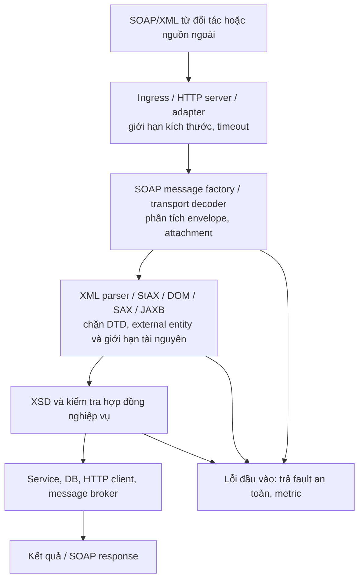

# Kiểm soát parser XML, XXE và kích thước thông điệp

## 1. Bối cảnh trong tích hợp Spring Boot

Trong các hệ thống tích hợp, XML thường xuất hiện khi Spring Boot trao đổi SOAP với ERP, ngân hàng, hệ thống vận chuyển, cổng thanh toán hoặc các đối tác có hợp đồng WSDL/XSD. Một ứng dụng có thể vừa đóng vai trò **SOAP client** (gọi dịch vụ ngoài), vừa đóng vai trò **SOAP server** (nhận request); ngoài ra XML có thể đến qua SFTP, JMS, Kafka, HTTP hoặc file được xử lý bởi Spring Integration.

XML là định dạng có cấu trúc, nhưng quá trình đọc XML cũng có thể kích hoạt truy cập tài nguyên ngoài và tiêu tốn lượng lớn tài nguyên. Hai nhóm rủi ro chính:

- **XML External Entity (XXE):** parser xử lý DTD/entity hoặc tham chiếu bên ngoài, có thể cố đọc file, truy cập URL nội bộ hoặc dùng endpoint XML làm điểm xuất phát cho yêu cầu mạng không mong muốn.
- **Denial of Service (DoS) qua XML:** dữ liệu chứa nhiều entity, cấu trúc lồng sâu, thuộc tính lớn, payload quá lớn hoặc dữ liệu nén có tỷ lệ bung nén cao khiến CPU, heap, thread xử lý request và kết nối bị chiếm dụng.

Đối với module `SPRING_BOOT_INTEGRATION`, bảo vệ parser XML là một phần của **hợp đồng và độ tin cậy luồng tích hợp**: không chỉ parse hợp lệ mà còn phải giới hạn đầu vào, kiểm soát quyền truy cập tài nguyên, phân loại lỗi, giữ an toàn giao dịch, kiểm thử và có khả năng quan sát.

**Mục tiêu của bài:** biết đường XML đi qua những parser nào, cấu hình JAXP/StAX/JAXB an toàn, đặt giới hạn đúng tầng xử lý SOAP và kiểm chứng bằng các trường hợp lỗi thật. Không thể đạt mục tiêu chỉ bằng việc kiểm tra payload có đuôi `.xml` hoặc chỉ bật xác thực XSD.

## 2. Xác định ranh giới tin cậy và vị trí parser

Một request SOAP thường đi qua nhiều tầng trước khi vào code nghiệp vụ:



Các bề mặt cần rà soát gồm:

| Nơi XML được parse | Ví dụ thực tế | Kiểm soát cần có |
| --- | --- | --- |
| SOAP server | Spring Web Services `@Endpoint`, servlet SOAP | Giới hạn request **trước** message factory; parser SOAP an toàn |
| SOAP client | `WebServiceTemplate` nhận response bên ngoài | Giới hạn response, cấu hình parser của message factory, timeout |
| Adapter XML tùy biến | `DocumentBuilderFactory`, `SAXParserFactory`, `XMLInputFactory` | Cấm entity ngoài, DTD nếu không cần; giới hạn byte/nesting |
| JAXB binding | `Unmarshaller` chuyển XML thành DTO | Truyền nguồn XML đã parse an toàn; không tin input stream mặc định |
| XSD validation | `SchemaFactory`, `Validator` | Cấm truy cập XSD/DTD bên ngoài nếu không được cho phép |
| XSLT transformation | `TransformerFactory`, stylesheet | Chặn truy cập stylesheet/DTD ngoài và hàm truy cập tài nguyên |
| Spring Integration | Inbound channel adapter, transformer, XML flow | Kiểm tra cả decoder trước flow và parser trong transformer |

Một yêu cầu có thể đi qua **nhiều parser**. Ví dụ, message factory của Spring-WS parse SOAP envelope, sau đó JAXB parse/unmarshal payload, rồi service lại parse một chuỗi XML nhúng trong payload. Bảo vệ một parser không mặc nhiên bảo vệ parser khác.

Đặc biệt, nếu `@Endpoint` nhận một `Document` hoặc đối tượng JAXB đã được framework dựng, việc kiểm tra ở method endpoint có thể đã **quá muộn** để ngăn XXE/DoS tại parser nằm trước endpoint. Phải đánh giá cả SOAP stack và transport.

## 3. XXE hoạt động như thế nào?

XML có thể khai báo Document Type Definition (DTD) và entity. Nếu parser cho phép resolve entity ngoài, nó có thể đọc tài nguyên được tham chiếu bởi `SYSTEM` hoặc `PUBLIC`.

Ví dụ minh họa đầu vào **không đáng tin cậy** (tên file trong ví dụ là giả định):

```xml
<?xml version="1.0" encoding="UTF-8"?>
<!DOCTYPE lookup [
  <!ENTITY external SYSTEM "file:///opt/example/private-config.xml">
]>
<lookup>
  <customerId>&external;</customerId>
</lookup>
```

Parser cấu hình không an toàn có thể cố mở file tại đường dẫn `file:` và thay `&external;` bằng nội dung đọc được. Một entity khác có thể trỏ tới `http:`, làm parser phát request tới dịch vụ mà ứng dụng có quyền truy cập mạng. Tùy thư viện và đường dữ liệu, điều này có thể dẫn đến:

- **Đọc tài nguyên không được phép:** file cấu hình hoặc nội dung cục bộ.
- **Server-Side Request Forgery (SSRF):** gửi request từ vùng mạng của service tới địa chỉ ngoài hoặc nội bộ.
- **DoS:** entity expansion làm tăng kích thước dữ liệu sau parse.
- **Khó truy vết:** hành vi phát sinh từ parser, trước khi code business endpoint chạy.

Hai khái niệm cần phân biệt:

1. **Entity nội bộ:** định nghĩa giá trị ngay trong DTD; có thể bị lạm dụng để tạo nhiều nội dung sau khi expansion.
2. **Entity ngoài:** khai báo tham chiếu tài nguyên file, URL hoặc tài nguyên khác; tạo nguy cơ truy cập ngoài ý muốn.

Ví dụ trên chỉ để nhận diện điều cần chặn; không nên dùng payload chứa dữ liệu nhạy cảm thật làm test. Khi định dạng SOAP/XSD của đối tác **không cần DTD**, biện pháp đơn giản và dễ kiểm chứng là **từ chối mọi `DOCTYPE`**. Nếu đối tác hợp lệ buộc dùng DTD, phải thiết kế riêng việc phân giải từ danh mục tài nguyên đã kiểm soát (XML Catalog/resource resolver), hạn chế mạng và kiểm tra từng loại entity. Không nên bật unrestricted DTD chỉ để một tài liệu đặc biệt parse được.

## 4. XML bomb: thông điệp nhỏ vẫn có thể gây tiêu tốn lớn

Một số dạng XML DoS không cần có quyền đọc file ngoài:

| Dạng đầu vào | Cơ chế gây quá tải | Phòng vệ |
| --- | --- | --- |
| Entity expansion lặp/lồng nhau | Nội dung sau expansion lớn hơn nhiều payload ban đầu | Từ chối DTD nếu không cần; hạn mức entity |
| XML lồng sâu | Parser/validator/mapper dùng nhiều stack hoặc CPU | Giới hạn độ sâu phần tử |
| Rất nhiều thuộc tính, tên quá dài | Tăng chi phí cấp phát và xử lý cấu trúc | Hạn mức thuộc tính, độ dài tên và tổng kích thước |
| Element văn bản hoặc Base64 rất lớn | Tăng heap khi đọc DOM/JAXB hoặc decode | Giới hạn byte đầu vào và dung lượng decoded |
| SOAP có attachment/MTOM lớn | Tốn disk, memory, network và thời gian xử lý | Giới hạn envelope và từng attachment/tổng attachment |
| Nội dung bị nén mạnh | Payload trên wire nhỏ nhưng sau giải nén rất lớn | Đếm byte **sau giải nén**, giới hạn tỷ lệ/đầu ra |
| Cấu trúc/schema khó xử lý | Validation hoặc XPath/XSLT tốn CPU | Hạn mức parse, deadline và độ phức tạp hợp đồng |

Chỉ cấu hình `max request bytes` là chưa đủ: một XML có kích thước hợp lệ vẫn có thể tiêu tốn tài nguyên khi parser mở rộng entity hoặc tạo cây DOM. Ngược lại, chỉ chặn DTD không bảo vệ service khỏi một XML nguyên bản lớn hàng trăm MB.

Cần phân biệt ba kích thước:

- **Kích thước trên đường truyền:** số byte HTTP/gRPC/transport nhận được, có thể được nén.
- **Kích thước XML thực tế đưa cho parser:** số byte sau giải nén/giải mã truyền tải.
- **Kích thước cấu trúc sau parse:** cây DOM, object graph JAXB hoặc nội dung entity đã mở rộng.

Quy trình an toàn đặt giới hạn tại **cả ba** tầng tương ứng.

## 5. Mô hình phòng vệ nhiều lớp

Một thiết kế thực tế thường có các lớp sau:

1. **Hợp đồng đầu vào:** chỉ nhận SOAP version, content type, XML namespace, schema version và kích thước hợp lý với nghiệp vụ.
2. **Ingress/transport:** giới hạn byte thực nhận, deadline, connection/read timeout, concurrency và độ lớn attachment; phân biệt request với response.
3. **Parser:** tắt DTD/entity ngoài, XInclude và tính năng truy cập resource không cần thiết; bật tính năng bảo vệ và giới hạn JAXP.
4. **Validation:** dùng XSD đã được phê duyệt, kiểm tra kiểu dữ liệu và các ràng buộc nghiệp vụ; không resolve schema từ URL trong payload.
5. **Xử lý nghiệp vụ:** giới hạn số bản ghi, số phép biến đổi, thời gian xử lý và các truy cập DB/HTTP phát sinh theo một request.
6. **Quan sát và phục hồi:** ghi lỗi an toàn, theo dõi số request bị chặn, kích thước, thời gian parse và ảnh hưởng tới hệ thống.

Không một property nào thay thế toàn bộ mô hình. `FEATURE_SECURE_PROCESSING` giúp kích hoạt một số giới hạn của JAXP, nhưng **không được xem là bảo đảm tuyệt đối** rằng mọi external entity/DTD đã bị cấm trên mọi provider. Cần cấu hình cụ thể và kiểm thử parser runtime đang dùng.

## 6. Hardening DOM với DocumentBuilderFactory

DOM xây dựng cả cây XML trong bộ nhớ, thuận tiện với document nhỏ nhưng có chi phí heap. Khi phải xử lý DOM, cần cấu hình trực tiếp `DocumentBuilderFactory` **trước khi parse**.

### 6.1. Ví dụ Java cấu hình fail-closed

Ví dụ phù hợp với Java 17+ và JAXP tích hợp trong JDK, không phụ thuộc Spring:

```java
import java.io.FilterInputStream;
import java.io.IOException;
import java.io.InputStream;
import javax.xml.XMLConstants;
import javax.xml.parsers.DocumentBuilder;
import javax.xml.parsers.DocumentBuilderFactory;
import javax.xml.parsers.ParserConfigurationException;
import org.w3c.dom.Document;
import org.xml.sax.InputSource;
import org.xml.sax.SAXException;

public final class SecureXmlDocuments {

    private static final long MAX_XML_BYTES = 1_048_576L; // Ví dụ: 1 MiB

    private SecureXmlDocuments() {}

    public static Document parse(InputStream source)
            throws IOException, SAXException, ParserConfigurationException {

        DocumentBuilderFactory factory = DocumentBuilderFactory.newInstance();
        factory.setNamespaceAware(true);
        factory.setXIncludeAware(false);
        factory.setExpandEntityReferences(false);

        factory.setFeature(XMLConstants.FEATURE_SECURE_PROCESSING, true);
        factory.setFeature(
                "http://apache.org/xml/features/disallow-doctype-decl", true);
        factory.setFeature(
                "http://xml.org/sax/features/external-general-entities", false);
        factory.setFeature(
                "http://xml.org/sax/features/external-parameter-entities", false);
        factory.setFeature(
                "http://apache.org/xml/features/nonvalidating/load-external-dtd",
                false);

        factory.setAttribute(XMLConstants.ACCESS_EXTERNAL_DTD, "");
        factory.setAttribute(XMLConstants.ACCESS_EXTERNAL_SCHEMA, "");

        DocumentBuilder builder = factory.newDocumentBuilder();
        builder.setEntityResolver((publicId, systemId) -> {
            throw new SAXException("External entity resolution is forbidden");
        });

        // Đếm byte thực tế parser nhận; đóng cả stream đầu vào khi hoàn tất.
        try (InputStream bounded =
                new ByteLimitInputStream(source, MAX_XML_BYTES)) {
            return builder.parse(new InputSource(bounded));
        }
    }

    private static final class ByteLimitInputStream
            extends FilterInputStream {

        private final long maxBytes;
        private long consumed;

        private ByteLimitInputStream(InputStream input, long maxBytes) {
            super(input);
            this.maxBytes = maxBytes;
        }

        private void count(long bytes) throws IOException {
            if (bytes > 0) {
                if (consumed > maxBytes - bytes) {
                    throw new IOException("XML payload exceeds byte limit");
                }
                consumed += bytes;
            }
        }

        @Override
        public int read() throws IOException {
            int value = in.read();
            if (value >= 0) {
                count(1);
            }
            return value;
        }

        @Override
        public int read(byte[] bytes, int offset, int length)
                throws IOException {
            int result = in.read(bytes, offset, length);
            if (result > 0) {
                count(result);
            }
            return result;
        }

        @Override
        public long skip(long bytes) throws IOException {
            long skipped = in.skip(bytes);
            count(skipped);
            return skipped;
        }
    }
}
```

Sử dụng:

```java
try (InputStream xml = remoteResponseBodyStream) {
    Document document = SecureXmlDocuments.parse(xml);
    // Tiếp tục kiểm tra root element, namespace, XSD và nghiệp vụ.
}
```

Đây là mẫu cho **đường parse chủ động từ InputStream**, không phải cấu hình tự động cho toàn bộ SOAP stack. Nếu dữ liệu đã được đọc thành `byte[]` hoặc `String` khổng lồ trước khi vào `parse`, việc bọc stream lúc này không cứu được chi phí đã xảy ra. Hãy áp dụng giới hạn **ở ranh giới đọc từ mạng/file trước mọi bước materialize**.

### 6.2. Ý nghĩa từng cấu hình

| Cấu hình | Mục đích |
| --- | --- |
| `setNamespaceAware(true)` | Xử lý đúng XML namespace trong SOAP/XSD |
| `setXIncludeAware(false)` | Tránh tự động nhúng tài nguyên qua XInclude |
| `setExpandEntityReferences(false)` | Hạn chế mở rộng node entity trong DOM; **không đủ để chặn XXE nếu dùng một mình** |
| `FEATURE_SECURE_PROCESSING=true` | Yêu cầu provider dùng chế độ xử lý có giới hạn an toàn |
| `disallow-doctype-decl=true` | Từ chối toàn bộ DTD/DOCTYPE khi hợp đồng không cần |
| `external-general-entities=false` | Ngăn general external entity |
| `external-parameter-entities=false` | Ngăn parameter external entity |
| `load-external-dtd=false` | Ngăn tải external DTD ở parser hỗ trợ tính năng |
| `ACCESS_EXTERNAL_DTD=""` | Không cho phép protocol truy cập DTD bên ngoài |
| `ACCESS_EXTERNAL_SCHEMA=""` | Không cho phép schema từ protocol bên ngoài |
| `EntityResolver` từ chối | Lớp kiểm soát dự phòng khi parser cố resolve tài nguyên |

Các feature dạng URI phụ thuộc implementation. Nếu `setFeature` hoặc `setAttribute` bị từ chối, code nên **dừng khởi tạo / báo lỗi cấu hình** thay vì catch rồi bỏ qua. Một parser không hỗ trợ cơ chế chặn cần được thay bằng implementation đã xác minh, hoặc phải có phương án thay thế chứng minh được an toàn. Một số JAXP provider thay đổi hành vi theo JDK/library version; cần kiểm tra provider thực tế ở môi trường triển khai.

Đặt lớp `ByteLimitInputStream` trước parser giúp đếm byte input đã đọc. Với các luồng có nhiều decoder/giải nén, phải bọc **sau bước giải nén** ở đường parse thực tế và vẫn giữ hạn mức ingress ban đầu. Ví dụ `1 MiB` chỉ để minh họa; chọn hạn mức theo kích thước yêu cầu thật và đặc điểm hệ thống.

## 7. Hardening SAX và StAX khi xử lý luồng lớn

Khi không cần giữ cả cây XML, SAX hoặc StAX có thể giảm heap so với DOM. Nhưng streaming **không tự động chống XXE** nếu parser vẫn resolve entity ngoài.

### 7.1. SAX: chặn DTD/entity trước khi parse

```java
import javax.xml.XMLConstants;
import javax.xml.parsers.SAXParserFactory;
import org.xml.sax.XMLReader;

SAXParserFactory factory = SAXParserFactory.newInstance();
factory.setNamespaceAware(true);
factory.setFeature(XMLConstants.FEATURE_SECURE_PROCESSING, true);
factory.setFeature(
        "http://apache.org/xml/features/disallow-doctype-decl", true);
factory.setFeature(
        "http://xml.org/sax/features/external-general-entities", false);
factory.setFeature(
        "http://xml.org/sax/features/external-parameter-entities", false);
factory.setFeature(
        "http://apache.org/xml/features/nonvalidating/load-external-dtd", false);

XMLReader reader = factory.newSAXParser().getXMLReader();
reader.setProperty(XMLConstants.ACCESS_EXTERNAL_DTD, "");
reader.setProperty(XMLConstants.ACCESS_EXTERNAL_SCHEMA, "");
reader.setEntityResolver((publicId, systemId) -> {
    throw new org.xml.sax.SAXException("External entity not allowed");
});

// reader.setContentHandler(handler);
// reader.parse(new InputSource(boundedInputStream));
```

`XMLReader` và `SAXParserFactory` có API cấu hình khác DOM; đoạn trên minh họa cách xác định parser cụ thể. Bao stream đầu vào bằng bộ đếm byte giống mục 6, và xử lý mọi exception khi provider không hỗ trợ feature/property theo nguyên tắc fail-closed.

### 7.2. StAX: không bật DTD hay external entity

```java
import javax.xml.XMLConstants;
import javax.xml.stream.XMLInputFactory;
import javax.xml.stream.XMLStreamReader;

XMLInputFactory factory = XMLInputFactory.newFactory();
factory.setProperty(XMLInputFactory.SUPPORT_DTD, false);
factory.setProperty(
        XMLInputFactory.IS_SUPPORTING_EXTERNAL_ENTITIES, false);
factory.setProperty(XMLConstants.ACCESS_EXTERNAL_DTD, "");

// InputStream phải được giới hạn byte từ trước.
XMLStreamReader reader = factory.createXMLStreamReader(boundedInputStream);
try {
    while (reader.hasNext()) {
        reader.next();
        // Xử lý theo token, đếm phần tử/độ sâu/số trường khi cần.
    }
} finally {
    reader.close();
}
```

Các property và mức hỗ trợ khác nhau theo StAX provider. Nếu một property bảo vệ không được hỗ trợ, không silently bỏ qua. Khi dùng provider khác JDK (ví dụ Woodstox), cần xác minh tính năng, hạn mức và hành vi với test cố ý chứa DTD/entity.

Với StAX, code ứng dụng còn nên tự đếm mức lồng nhau và số phần tử nếu protocol yêu cầu giới hạn cụ thể. Streaming giúp giảm lượng dữ liệu giữ trong bộ nhớ, nhưng vẫn có thể bị DoS nếu xử lý một thông điệp vô hạn độ dài mà không giới hạn stream.

## 8. JAXB: không parse nguồn không kiểm soát

JAXB chuyển XML thành object Java; trong Spring Boot 3.x và Jakarta XML Binding, API thường ở namespace `jakarta.xml.bind`. Điểm quan trọng là **parser đứng trước JAXB phải được kiểm soát**. Nếu gọi `unmarshaller.unmarshal(InputStream)` mà không xác định parser/provider được dùng, chính sách XXE có thể phụ thuộc cấu hình ngầm của thư viện.

Một cách tổ chức là tạo `XMLStreamReader` đã khóa DTD/external entity, sau đó truyền reader vào JAXB:

```java
import jakarta.xml.bind.JAXBContext;
import jakarta.xml.bind.JAXBElement;
import jakarta.xml.bind.Unmarshaller;
import javax.xml.XMLConstants;
import javax.xml.stream.XMLInputFactory;
import javax.xml.stream.XMLStreamReader;

// PurchaseOrder là lớp JAXB đã được khai báo theo hợp đồng XML.
JAXBContext context = JAXBContext.newInstance(PurchaseOrder.class);
Unmarshaller unmarshaller = context.createUnmarshaller();

XMLInputFactory xmlFactory = XMLInputFactory.newFactory();
xmlFactory.setProperty(XMLInputFactory.SUPPORT_DTD, false);
xmlFactory.setProperty(
        XMLInputFactory.IS_SUPPORTING_EXTERNAL_ENTITIES, false);
xmlFactory.setProperty(XMLConstants.ACCESS_EXTERNAL_DTD, "");

XMLStreamReader streamReader =
        xmlFactory.createXMLStreamReader(boundedInputStream);
try {
    JAXBElement<PurchaseOrder> result =
            unmarshaller.unmarshal(streamReader, PurchaseOrder.class);
    PurchaseOrder order = result.getValue();
} finally {
    streamReader.close();
}
```

Trong ví dụ, `boundedInputStream` là luồng đã áp đặt giới hạn byte từ trước. Code thật cần quản lý vòng đời input stream, schema validation, mapping lỗi và lựa chọn serializer cho request/response. Việc chuyển XML thành object không tự bảo đảm nội dung hợp lệ với nghiệp vụ; validate namespace, các field bắt buộc, độ dài, phạm vi giá trị và version hợp đồng.

Nếu một ứng dụng sử dụng `Jaxb2Marshaller` của Spring OXM hoặc JAXB thông qua Spring-WS, phải xác minh **đường `Source` và parser thực sự đi vào marshaller/unmarshaller**. Một `StreamSource`/DOM source có thể được tạo ở nơi khác trước đó; không thể kết luận chỉ từ việc đã cấu hình một `Unmarshaller` bean.

## 9. Cấu hình bảo vệ XSD và XSLT: hai chỗ dễ bị bỏ sót

Ngay cả khi parser chính đã chặn entity, công đoạn validation hoặc transformation có thể tự tải tài nguyên ngoài.

### 9.1. SchemaFactory và Validator

```java
import javax.xml.XMLConstants;
import javax.xml.validation.Schema;
import javax.xml.validation.SchemaFactory;
import javax.xml.transform.stream.StreamSource;
import java.io.InputStream;

SchemaFactory schemaFactory =
        SchemaFactory.newInstance(XMLConstants.W3C_XML_SCHEMA_NS_URI);
schemaFactory.setFeature(XMLConstants.FEATURE_SECURE_PROCESSING, true);
schemaFactory.setProperty(XMLConstants.ACCESS_EXTERNAL_DTD, "");
schemaFactory.setProperty(XMLConstants.ACCESS_EXTERNAL_SCHEMA, "");

try (InputStream xsd =
        MyService.class.getResourceAsStream("/xsd/purchase-order.xsd")) {
    if (xsd == null) {
        throw new IllegalStateException("Missing local XSD");
    }
    Schema schema = schemaFactory.newSchema(new StreamSource(xsd));

    // Nếu validator có resolver hoặc nhận source riêng,
    // vẫn phải kiểm soát những đầu vào và URI liên quan.
}
```

Các `xs:include`/`xs:import` trong XSD có thể tham chiếu tài nguyên khác. Với schema chuẩn thuộc ứng dụng, nên đóng gói XSD vào classpath hoặc kho tài nguyên đã duyệt, dùng resolver/catalog phù hợp. Khi chặn hoàn toàn external schema, một số `import` tương đối có thể không tải được; đây là tín hiệu cần **cấu hình tài nguyên hợp lệ có kiểm soát**, không phải lý do bật truy cập URL tùy ý.

Nếu cần validation, một `Schema` có thể được tạo từ XSD đáng tin cậy và dùng lại theo hợp đồng; `Validator` cần được sử dụng đúng tính chất vòng đời/thread-safety của API tương ứng. Đừng lấy URL `xsi:schemaLocation` từ payload bên ngoài rồi mở trực tiếp.

### 9.2. TransformerFactory và XSLT

```java
import javax.xml.XMLConstants;
import javax.xml.transform.TransformerFactory;

TransformerFactory transformerFactory = TransformerFactory.newInstance();
transformerFactory.setFeature(
        XMLConstants.FEATURE_SECURE_PROCESSING, true);
transformerFactory.setAttribute(
        XMLConstants.ACCESS_EXTERNAL_DTD, "");
transformerFactory.setAttribute(
        XMLConstants.ACCESS_EXTERNAL_STYLESHEET, "");
```

XSLT có thể dùng `xsl:import`, `xsl:include` hoặc hàm truy xuất tài liệu như `document()` tùy processor. Nếu stylesheet đến từ nguồn bên ngoài, rủi ro còn rộng hơn XXE vì bản thân chương trình biến đổi không đáng tin cậy. Chỉ chạy stylesheet đã review, hạn chế thời gian và dữ liệu, dùng `URIResolver` có allowlist nếu thật sự cần nhập tài nguyên.

**Không đồng nhất “XML hợp lệ theo XSD” với “an toàn khi parse”.** XML phải được parse trước hoặc trong validation; nếu parser/validator tự fetch tài nguyên ngoài thì việc validation có thể là nơi kích hoạt XXE.

## 10. Giới hạn kích thước ở HTTP, SOAP message factory và parser

### 10.1. Đặt giới hạn trước khi message factory chạy

SOAP server Spring-WS thường dùng `MessageDispatcherServlet` cùng một `WebServiceMessageFactory` như SAAJ hoặc Axiom. Nhiều thao tác parse envelope xảy ra **trước** `@Endpoint`.

Do đó:

1. Đặt giới hạn request body thực tế ở **gateway/reverse proxy/ingress** hoặc tầng servlet đọc input.
2. Bổ sung giới hạn byte **sau giải nén** nếu cho phép Content-Encoding; không chỉ dựa vào `Content-Length`.
3. Kiểm tra thông số của **SOAP message factory/provider** thực tế có cơ chế chặn DTD/entity ngoài và tài nguyên nào được phép truy cập.
4. Giới hạn tổng số nội dung XML/attachment và nguồn parser dùng cho payload riêng.
5. Từ chối request quá lớn trước khi cấp phát DOM/JAXB object lớn.

`Content-Length` chỉ là một tín hiệu. Request có thể dùng chunked transfer, header không có hoặc bị thay đổi qua proxy; cần **đếm số byte thực đọc**, không chỉ kiểm tra header.

Không nên nhầm các property:

| Cấu hình/tầng | Bao phủ | Giới hạn |
| --- | --- | --- |
| Reverse proxy/ingress body limit | HTTP request đi vào, tùy triển khai | Có thể tính trên byte nén; cần kiểm chứng đường giải nén |
| Servlet filter/request wrapper có bộ đếm | Luồng request qua servlet khi áp dụng đúng chỗ | Phải chạy trước SOAP parsing, xử lý đúng stream/async/error |
| `spring.servlet.multipart.max-file-size` | Multipart upload theo cơ chế servlet | Không tự đặt hạn mức cho mọi SOAP XML hoặc `multipart/related` MTOM |
| `spring.codec.max-in-memory-size` | Bộ mã hóa/giải mã WebFlux được hỗ trợ | Không tự áp dụng cho Spring-WS servlet/SAAJ |
| `server.tomcat.max-http-form-post-size` | Hạn mức form POST của Tomcat | Không phải hạn mức body XML SOAP bất kỳ |
| Bộ đếm byte quanh parser | Luồng parser đọc trực tiếp | Không bảo vệ các bước đã materialize trước đó |
| Giới hạn JAXP/entity/depth | Độ phức tạp của cấu trúc XML | Không thay thế body limit ở transport |

Tên property và cách áp dụng phụ thuộc server/framework. Khi dùng Spring Boot với servlet container nhúng, phải xác minh đường nhận request thực tế, không giả định một setting chỉ vì tên có chữ `max` là đủ.

### 10.2. SOAP client cũng cần giới hạn response

Ứng dụng gọi đối tác qua `WebServiceTemplate` vẫn phải xem SOAP response là **đầu vào không đáng tin cậy**. Một server bị lỗi hoặc bị chiếm quyền có thể trả XML cực lớn hoặc payload chứa entity.

Khi cấu hình SOAP client:

- Đặt connect/read timeout cho transport.
- Giới hạn kích thước response trước khi message factory parse, kể cả response status thành công hoặc SOAP Fault.
- Kiểm soát redirect, endpoint allowlist và TLS theo yêu cầu tích hợp.
- Kiểm tra XML parser do message factory và bộ unmarshaller thực tế sử dụng.
- Giới hạn concurrent request, số retry và khả năng giữ connection bị chậm.

Nếu response đã được `WebServiceTemplate` chuyển thành object trước khi code nhận kết quả, kiểm tra kích thước object ở service là quá muộn để tránh DoS trong quá trình parse.

### 10.3. MTOM, MIME attachment và nội dung nén

SOAP MTOM thường đóng gói envelope cùng các phần đính kèm theo `multipart/related`. Một envelope chỉ vài KB vẫn có thể mang attachment hàng trăm MB. Do đó cần:

- Giới hạn tổng bytes của request/response, số attachment và kích thước tối đa **mỗi attachment**.
- Không decode Base64 hoặc load attachment vào memory nếu không cần; streaming và spool ra kho tạm có quota/cleanup.
- Giới hạn tên file, media type, checksum và thời gian lưu tạm theo hợp đồng.
- Tách hạn mức decoded content khỏi payload nén trên wire; giới hạn tổng dữ liệu sau giải nén.
- Dừng parse/đọc và giải phóng tài nguyên khi vượt hạn mức.

Một request SOAP có thể chứa cả XML bomb và attachment lớn; vì thế kiểm soát cả parser lẫn MIME/transport.

## 11. Các giới hạn JAXP và giới hạn nghiệp vụ

Bên cạnh việc cấm DTD, các JAXP provider hiện đại thường hỗ trợ hạn mức chống XML DoS. Với JDK Java, có các thuộc tính như:

| Nhóm hạn mức | Ví dụ thuộc tính của JDK | Ý nghĩa |
| --- | --- | --- |
| Số lần mở rộng entity | `jdk.xml.entityExpansionLimit` | Chặn số lượng expansion quá lớn |
| Tổng kích thước entity | `jdk.xml.totalEntitySizeLimit` | Giới hạn lượng nội dung entity sau mở rộng |
| Độ sâu XML | `jdk.xml.maxElementDepth` | Chặn cây XML lồng quá sâu |
| Số thuộc tính của element | `jdk.xml.elementAttributeLimit` | Chặn element có quá nhiều attribute |
| Độ dài tên XML | `jdk.xml.maxXMLNameLimit` | Tránh tên phần tử/thuộc tính cực dài |

Ví dụ **tham khảo** khi khởi động JVM:

```text
-Djdk.xml.entityExpansionLimit=1000
-Djdk.xml.totalEntitySizeLimit=100000
-Djdk.xml.maxElementDepth=64
-Djdk.xml.elementAttributeLimit=100
```

Những số này **không phải chuẩn an toàn dùng chung**. Mỗi hệ thống cần đo với các payload hợp lệ, định nghĩa hạn mức từ hợp đồng và quan sát trong môi trường gần production. Nhà cung cấp parser, phiên bản JDK và thứ tự ưu tiên giữa system properties, `jaxp.properties` và property đặt trực tiếp có thể khác nhau; cần xác nhận bằng test sau khi deploy.

Nếu đã từ chối mọi DTD, `entityExpansionLimit` vẫn là một lớp phòng vệ bổ sung, không phải lý do cho phép entity ngoài. Có các hạn mức JAXP khác như độ dài tên, kích thước parameter entity, số lần lặp cấu trúc schema; không bật toàn bộ bằng các con số tùy tiện mà chưa kiểm tra compatibility.

Ở tầng nghiệp vụ có thể bổ sung:

- Số lượng hóa đơn trong một request: ví dụ tối đa 500, không chỉ dựa vào bytes.
- Độ dài `customerName`, `orderLine`, mã tham chiếu và số phần tử XML tương ứng.
- Tổng số request đồng thời cho đối tác, số step xử lý và thời gian thực thi.
- Hạn mức fan-out: một request không được tạo vô hạn HTTP call, SQL query hoặc broker message.

Nhờ giới hạn ở cả cấu trúc và nghiệp vụ, XML hợp lệ về cú pháp nhưng bất thường về khối lượng vẫn bị ngăn trước khi gây quá tải hệ thống.

## 12. XSD validation, namespace và kiểm tra hợp đồng dữ liệu

Parser an toàn chỉ giúp nhận XML mà không thực hiện hành động nguy hiểm. Một SOAP request vẫn cần được kiểm tra:

1. **Content-Type và SOAP version:** SOAP 1.1 thường dùng `text/xml`, SOAP 1.2 thường dùng `application/soap+xml`; xử lý theo hợp đồng.
2. **Namespace và phần tử root:** tránh so sánh tên local mà bỏ qua namespace.
3. **XSD:** kiểm tra kiểu dữ liệu, thứ tự element, cardinality và thuộc tính bắt buộc.
4. **Ràng buộc nghiệp vụ:** giới hạn số bản ghi, số tiền, trạng thái, quan hệ khóa, phiên bản hợp đồng.
5. **Quy tắc xử lý lỗi:** phân biệt malformed XML, vi phạm XSD, lỗi xác thực và lỗi backend.

Ví dụ payload:

```xml
<ord:CreateOrderRequest
    xmlns:ord="urn:example:order:v1">
    <ord:externalOrderId>ORD-4711</ord:externalOrderId>
    <ord:lineCount>3</ord:lineCount>
</ord:CreateOrderRequest>
```

Ngay cả khi XSD cho phép `lineCount` là số nguyên, ứng dụng phải đối chiếu giá trị với số lượng `orderLine` thực tế và chính sách giới hạn dữ liệu. XSD có thể ngăn một số lỗi cấu trúc, nhưng không thể thay thế toàn bộ quy tắc nghiệp vụ.

Nếu sử dụng WS-Security, chữ ký XML, timestamp hoặc nonce, cần xác nhận toàn bộ chuỗi xử lý: parser an toàn, xác minh chữ ký đúng node được xử lý, chống replay và kiểm tra identity. **Bật WS-Security không tự động chặn XXE.** Với XML Signature, tránh lỗi xử lý một node khác node đã được ký (signature wrapping) bằng cách dùng thư viện và quy trình xác thực đúng chuẩn.

## 13. Xử lý lỗi an toàn: trả phản hồi đúng và không lộ dữ liệu

Một request lỗi có thể bị chặn ở các tầng khác nhau:

| Lỗi | Nơi phát hiện | Phản ứng nên có |
| --- | --- | --- |
| Request body vượt hạn mức | Gateway/transport, trước SOAP parser | Từ chối request, thường HTTP 413 nếu phù hợp stack |
| `DOCTYPE`/external entity bị cấm | XML parser | Dừng parse, trả client fault/bad request phù hợp SOAP version |
| XML sai cú pháp | XML parser | Không đưa vào business handler; báo malformed XML |
| XSD không hợp lệ | Schema validator | SOAP client/sender fault với mã lỗi an toàn theo hợp đồng |
| XML hợp lệ nhưng vượt giới hạn nghiệp vụ | Service validation | Fault nghiệp vụ, không thực hiện side effect |
| Parser hoặc schema provider cấu hình sai | Startup/config validation | Fail-fast và cảnh báo vận hành; không âm thầm nới bảo vệ |
| Backend chậm/lỗi | HTTP/DB/broker adapter | Timeout/retry có giới hạn, tránh biến lỗi backend thành phản hồi chứa dữ liệu nội bộ |

SOAP 1.1 dùng khái niệm fault `Client`/`Server`, SOAP 1.2 dùng `Sender`/`Receiver`; HTTP status thực tế tùy stack và hợp đồng. Một lỗi xảy ra **trước khi envelope được parse thành SOAP message** có thể cần HTTP error thông thường, thay vì cố tạo SOAP Fault từ payload không an toàn.

Không đưa vào response thông tin như đường dẫn file, URI nội bộ, stack trace, username, SQL hoặc raw XML chứa dữ liệu khách hàng. Trong log chỉ lưu một mã lỗi có kiểm soát, request/correlation ID, kích thước, endpoint, loại parser, thời gian xử lý và nguồn gọi được cho phép. Nếu cần giữ payload để điều tra, dùng kho bảo vệ theo quyền và retention riêng.

## 14. Kiểm thử XXE và giới hạn tài nguyên

Cấu hình parser chỉ được xem là hiệu quả khi **đã kiểm thử trên provider/đường xử lý thật**. Các bài kiểm thử nên đi qua cả parser trực tiếp và SOAP endpoint/`WebServiceTemplate` nếu ứng dụng dùng Spring-WS.

| Tình huống | Kết quả mong đợi |
| --- | --- |
| SOAP XML hợp lệ, không DTD | Parse và xử lý đúng hợp đồng |
| XML có `DOCTYPE` và external entity `file:` | Bị từ chối; không đọc file |
| XML có external entity `http:` | Bị từ chối; test server không ghi nhận request mạng |
| XML chứa entity lồng nhau | Bị từ chối hoặc giới hạn trước khi gây tăng CPU/heap |
| XML có độ sâu vượt ngưỡng | Dừng parse theo hạn mức |
| XML quá `MAX_XML_BYTES` | Bị từ chối, không dựng DOM/JAXB object đầy đủ |
| Chunked request không có `Content-Length` | Bộ đếm byte vẫn chặn quá giới hạn |
| Payload HTTP nén nhỏ nhưng bung nén lớn | Giới hạn decompressed bytes vẫn có hiệu lực |
| SOAP MTOM tổng attachment vượt quota | Không nhận tràn RAM/disk; tài nguyên tạm được dọn |
| SOAP response từ đối tác vượt hạn mức | Client từ chối trước khi unmarshalling |
| `SchemaFactory` hoặc XSLT cố tải URI ngoài | Bị chặn hoặc chỉ cho phép URI trong catalog duyệt |
| Parser provider không hỗ trợ security feature | Khởi tạo/kiểm thử thất bại rõ ràng, không tiếp tục trong trạng thái không an toàn |

### 14.1. Ví dụ kiểm thử DOM với JUnit

```java
import static org.junit.jupiter.api.Assertions.assertThrows;
import java.io.ByteArrayInputStream;
import java.nio.charset.StandardCharsets;
import org.junit.jupiter.api.Test;
import org.xml.sax.SAXException;

class SecureXmlDocumentsTest {

    @Test
    void rejectsDoctypeWithExternalEntity() {
        String untrustedXml = """
                <?xml version="1.0"?>
                <!DOCTYPE invoice [
                  <!ENTITY x SYSTEM "file:///opt/example/test.xml">
                ]>
                <invoice>&x;</invoice>
                """;

        assertThrows(SAXException.class, () ->
                SecureXmlDocuments.parse(new ByteArrayInputStream(
                        untrustedXml.getBytes(StandardCharsets.UTF_8))));
    }

    @Test
    void rejectsOversizedXml() {
        String largeXml = "<invoice>" + "x".repeat(1_100_000) + "</invoice>";

        assertThrows(java.io.IOException.class, () ->
                SecureXmlDocuments.parse(new ByteArrayInputStream(
                        largeXml.getBytes(StandardCharsets.UTF_8))));
    }
}
```

Các test trên minh họa **từ chối DTD** và **giới hạn byte**, không thay thế kiểm thử tích hợp qua servlet/message factory. Khi viết test SSRF, dùng HTTP stub cục bộ được kiểm soát và khẳng định **không có request nào** được thực hiện; không dùng endpoint thực hoặc tài nguyên nhạy cảm. Với XML bomb, chỉ thử trên môi trường cô lập có hạn mức tài nguyên, tránh tạo payload quá lớn có thể làm chậm máy chạy CI.

### 14.2. Kiểm thử đường SOAP thật

Với Spring-WS:

- Gửi request tới endpoint qua đúng servlet/message factory đã cấu hình.
- Cố tình gửi request chunked và request vượt hạn mức ở ingress.
- Gửi XML có DTD tới endpoint, kể cả khi JAXB/unmarshaller có cấu hình riêng.
- Thử SOAP response từ mock đối tác qua `WebServiceTemplate`, không chỉ thử parser ở method business.
- Thử MTOM/attachment theo đúng content type mà runtime xử lý.
- Theo dõi heap, CPU, thời gian xử lý và side effect DB/HTTP khi request bị từ chối.

Test phải chứng minh **tầng bị tấn công không truy cập mạng/file ngoài, không vượt ngân sách tài nguyên và không chạy side effect**. Chỉ khẳng định HTTP trả lỗi 500 chưa đủ để kết luận parser đã an toàn.

## 15. Quan sát vận hành và xử lý sự cố XML

Khi một service tích hợp nhận SOAP/XML, nên theo dõi tối thiểu:

- Tổng request XML/SOAP theo endpoint, SOAP version và loại lỗi.
- Kích thước request/response thực tế (histogram, percentile), phần trăm request bị chặn do quá kích thước.
- Thời gian parse, XSD validation và toàn bộ thời gian xử lý.
- Lỗi liên quan `DOCTYPE`, external entity, schema validation, sâu quá mức, quá nhiều attributes.
- CPU, heap, GC, thread pool, connection pool và timeout khi kích thước hoặc tỷ lệ lỗi tăng bất thường.
- Số request tạo side effect DB/HTTP/broker sau khi parse; request lỗi đầu vào không được tạo side effect.
- Tỷ lệ lỗi theo đối tác, version XSD, bản phát hành và thay đổi cấu hình parser.

Không đưa raw payload hoặc identifier nhạy cảm vào label metric Prometheus có cardinality cao. Dùng structured log có `correlationId` và mã lỗi; dữ liệu nhạy cảm chỉ truy cập qua kênh điều tra có quyền.

Một runbook ngắn khi có nhiều lỗi XML:

1. Phân biệt lỗi mới do **đối tác đổi hợp đồng** hay do nguồn dữ liệu bất thường/tấn công.
2. Kiểm tra sự thay đổi về Content-Type, namespace, XSD version, message factory, JDK/provider.
3. Xác nhận giới hạn đang chặn ở tầng ingress hay XML parser; kiểm tra metrics CPU/heap và request size.
4. Không tắt `disallow-doctype-decl` hay `ACCESS_EXTERNAL_DTD` để xử lý tạm một lỗi hợp đồng chưa điều tra.
5. Nếu cần hỗ trợ một tài nguyên DTD/XSD hợp lệ, thêm resolver/catalog có allowlist và test chống truy cập ngoài trước khi phát hành.
6. Đối chiếu request đã vào business service hay chưa; nếu side effect đã xảy ra một phần, xử lý idempotency/reconciliation theo chính sách tích hợp.
7. Ghi nhận thay đổi parser/provider và bổ sung regression test cho mẫu lỗi.

## 16. Tình huống tổng hợp: nhận SOAP hóa đơn từ đối tác

Giả sử Spring Boot cung cấp SOAP endpoint `SubmitInvoice` cho đối tác ERP. Mỗi thông điệp có thể có tối đa 200 dòng hóa đơn; đôi khi có file PDF đính kèm qua MTOM. Khi hợp lệ, service ghi invoice vào PostgreSQL và phát message `InvoiceAccepted` qua broker.

Thiết kế phòng vệ:

1. **Ingress:** chỉ nhận từ kênh đã xác thực, đặt body limit và timeout phù hợp kích thước hóa đơn; đếm byte thực nhận, kể cả chunked request.
2. **Message factory:** xác nhận SAAJ/Axiom hoặc provider đang dùng không resolve DTD/entity ngoài; kiểm tra cả SOAP Fault và đường xử lý attachment.
3. **Parser:** từ chối `DOCTYPE`, external entity, external XSD; dùng byte budget, element depth và giới hạn cấu trúc.
4. **Validation:** XSD lấy từ classpath; kiểm tra namespace, version và số dòng hóa đơn; áp dụng giới hạn decoded bytes của PDF.
5. **Business transaction:** insert hóa đơn với unique idempotency key từ đối tác; nếu publish message cần atomicity với DB, dùng transactional outbox phù hợp.
6. **Failure handling:** malformed XML hoặc oversized request không tạo hóa đơn, không gọi downstream, không đưa raw payload vào log.
7. **Monitoring:** đo tỷ lệ lỗi parser, độ lớn payload, latency và số lần chặn; có cảnh báo khi đối tác gửi bất thường.
8. **Testing:** chạy integration test qua chính SOAP servlet và client stack, gồm external entity, XML quá sâu, request nén, MTOM quá lớn và response lỗi từ đối tác.

Tại đây, XML được coi là một **đầu vào ngoại biên** có hợp đồng và ngân sách tài nguyên rõ ràng. Bảo vệ được thực thi từ lúc nhận bytes cho tới trước khi ghi DB hoặc gửi broker, giảm nguy cơ lỗi parser phá hỏng tính ổn định của luồng tích hợp.

## 17. Những hiểu lầm thường gặp

| Nhận định dễ sai | Thực tế cần kiểm chứng |
| --- | --- |
| “Dùng SOAP framework rồi thì không phải lo XXE.” | Framework vẫn dựa vào parser/message factory; phải xác minh cấu hình và phiên bản |
| “Tôi đã bật XSD validation nên XXE bị chặn.” | Validation có thể tự resolve external DTD/XSD; cần khóa SchemaFactory và parser |
| “`setExpandEntityReferences(false)` là đủ.” | Không thay thế cấm DOCTYPE/external entity và giới hạn input |
| “`FEATURE_SECURE_PROCESSING` đảm bảo mọi provider đều an toàn.” | Đây là một lớp bảo vệ; vẫn cần cấu hình cụ thể và regression test |
| “`Content-Length` không vượt 1 MB nên XML an toàn.” | Header có thể thiếu, payload nén bung lớn, cấu trúc XML có thể tốn tài nguyên |
| “Chặn ở JAXB là đủ.” | SOAP envelope có thể đã parse trước khi JAXB chạy |
| “SOAP MTOM không tính vào XML nên không cần limit.” | Attachment cần quota riêng và giới hạn tổng dung lượng |
| “SAX/StAX streaming thì không thể bị DoS.” | Có thể bị XML vô hạn, entity, nesting hoặc xử lý quá lâu |
| “Chỉ service nhận inbound SOAP mới cần bảo vệ.” | SOAP client nhận response từ đối tác cũng có rủi ro tương tự |
| “Nếu XML parse lỗi thì chắc chắn chưa có side effect.” | Cần xác định lỗi xảy ra ở bước nào, đặc biệt trong các flow có nhiều parser |

## 18. Checklist triển khai

- [ ] Đã liệt kê mọi nơi XML đi vào service: SOAP server/client, file, message broker, Spring Integration XML flow.
- [ ] Đã xác định SOAP message factory, JAXP/StAX/JAXB provider và phiên bản runtime thật.
- [ ] Đã tắt DTD/entity ngoài/XInclude khi hợp đồng không cần, cấu hình fail-closed.
- [ ] `SchemaFactory` và `TransformerFactory` không tự tải DTD/XSD/XSLT ngoài danh mục duyệt.
- [ ] Đã giới hạn request **và response** trước khi SOAP parser/materialization chạy.
- [ ] Đã giới hạn byte sau giải nén, độ sâu XML, entity và dung lượng MTOM/attachment.
- [ ] Đã kiểm tra Content-Type, SOAP version, namespace, XSD và ràng buộc nghiệp vụ.
- [ ] Không ghi raw XML, stack trace, URL nội bộ hoặc dữ liệu khách hàng vào log/fault công khai.
- [ ] Có kết quả lỗi an toàn, metric và cảnh báo cho request bị chặn do parser/size.
- [ ] Đã test XXE dạng file/URL, entity expansion, độ sâu, chunked body, nén, SOAP response và MTOM.
- [ ] Request bị từ chối không tạo side effect DB, HTTP hoặc broker; retry/idempotency được kiểm soát.
- [ ] Có runbook xử lý sự cố khi đối tác thay đổi XML contract hoặc JDK/parser provider thay đổi.

**Kết quả mong muốn:** ứng dụng Spring Boot xử lý được SOAP/XML hợp lệ theo hợp đồng, từ chối dữ liệu có khả năng kích hoạt XXE và giới hạn rõ chi phí tài nguyên ngay từ lúc nhận request/response. Parser an toàn, kích thước thông điệp được kiểm soát và các bước validation/side effect chỉ chạy sau khi đầu vào vượt qua các lớp bảo vệ.
