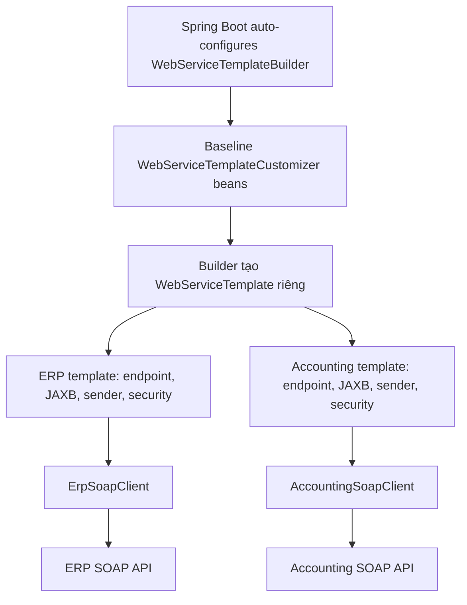
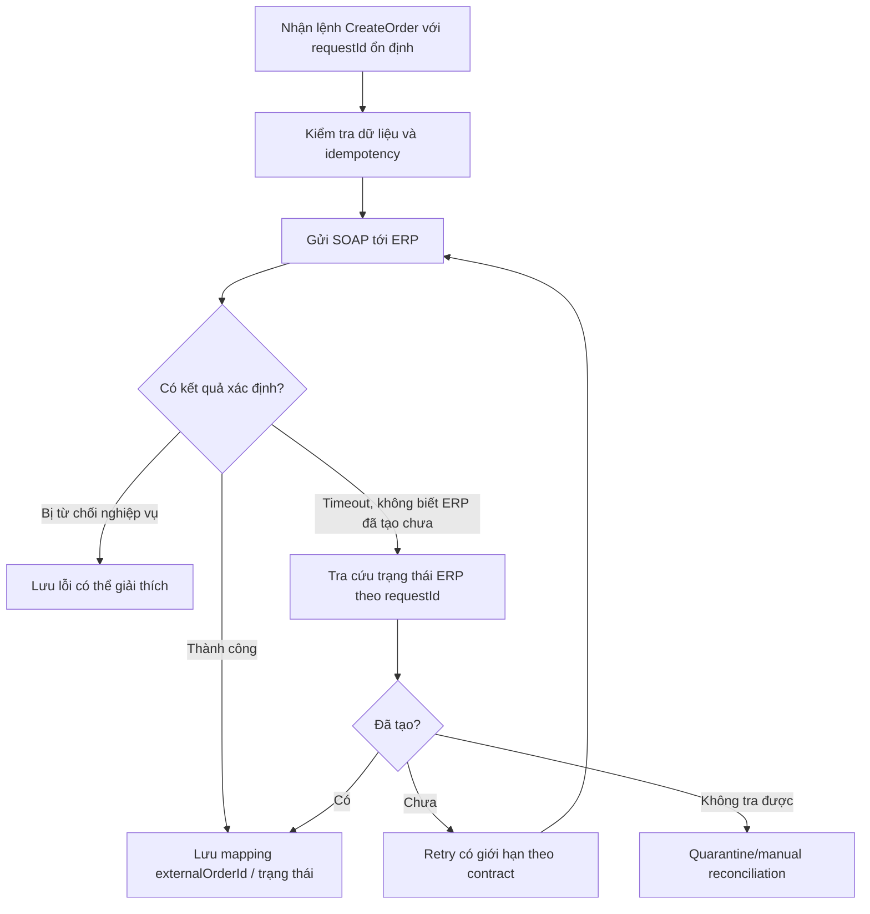

# WebServiceTemplateCustomizer và cấu hình riêng từng dịch vụ

## 1. Bài toán: nhiều SOAP service, nhiều chính sách tích hợp

Trong một ứng dụng Spring Boot, doanh nghiệp có thể gọi đồng thời nhiều SOAP API: ERP nhận đơn hàng, hệ thống kế toán xuất hóa đơn, đối tác vận chuyển tạo vận đơn và ngân hàng tra cứu giao dịch. Chúng cùng sử dụng SOAP/XML, nhưng không nhất thiết có cùng WSDL, endpoint, JAXB model, xác thực, chứng chỉ, thời gian chờ hoặc quy tắc lỗi.

Ví dụ:

| Thuộc tính | ERP | Kế toán |
| --- | --- | --- |
| Endpoint | `https://erp.example.test/ws/orders` | `https://accounting.example.test/ws/invoices` |
| Hợp đồng | `OrderService.wsdl`, namespace `urn:erp:orders:v1` | `InvoiceService.wsdl`, namespace `urn:acc:invoice:v2` |
| Java/XML binding | Các DTO đơn hàng | Các DTO hóa đơn |
| Kênh bảo mật | mTLS hoặc WS-Security theo hợp đồng ERP | HTTP authentication hoặc WS-Security riêng |
| Connect/read timeout | Ví dụ 3 s / 12 s | Ví dụ 2 s / 25 s |
| Retry | Chỉ thao tác có tính idempotent | Không tự retry lệnh phát hành hóa đơn nếu chưa đối soát |

Nếu dùng một bean `WebServiceTemplate` rồi thay `defaultUri` theo mỗi lời gọi, application có thể gọi nhầm đích hoặc rò credentials giữa đối tác. Nếu tạo thủ công nhiều instance bằng `new WebServiceTemplate()`, mỗi instance có thể bỏ qua cấu hình chung do Spring Boot cung cấp.

Bài học thuộc chương **SOAP và XML** của `SPRING_BOOT_INTEGRATION`. Trọng tâm là cách dùng `WebServiceTemplateCustomizer` và `WebServiceTemplateBuilder` để thống nhất các quy ước chung, đồng thời tách cấu hình từng SOAP service như một adapter tích hợp độc lập: endpoint, marshaller, message sender, interceptor, security, lỗi, kiểm thử và observability.

**Quy tắc thiết kế:** một chính sách áp dụng cho *mọi* SOAP client có thể nằm trong customizer chung; một quyết định gắn với *một* đối tác nên nằm trong bean template/client của đối tác đó. Không sử dụng cấu hình toàn cục để mang secret, URI hoặc schema chỉ thuộc một service.

## 2. Vai trò của WebServiceTemplate và WebServiceTemplateCustomizer

### 2.1. Các thành phần trong Spring Web Services

- `WebServiceTemplate` là client API ở tầng Spring Web Services để gửi SOAP request và nhận SOAP response. Nó thực hiện các bước marshal/send/receive/unmarshal, xử lý message/fault theo cấu hình.
- `WebServiceMessageFactory` tạo và đọc SOAP message, bao gồm envelope/header/body. Có thể sử dụng triển khai SAAJ hoặc công nghệ khác tương thích với stack đang dùng.
- `Marshaller` và `Unmarshaller` chuyển đổi Java object với payload XML; thường dùng `Jaxb2Marshaller` khi hợp đồng dựa trên XSD.
- `WebServiceMessageSender` đảm nhiệm giao tiếp transport, thường là HTTP hoặc HTTPS, có thể chứa timeout, authentication và TLS.
- `ClientInterceptor` can thiệp ở các điểm request/response/fault để bổ sung header, tracing hoặc WS-Security.
- `FaultMessageResolver` ánh xạ SOAP Fault nhận được sang exception hoặc chính sách xử lý lỗi.

Spring Boot cung cấp `WebServiceTemplateBuilder` cho việc khởi tạo template có cấu hình chung. `WebServiceTemplateCustomizer` là một điểm mở rộng kiểu callback để tùy chỉnh các instance được tạo **thông qua builder có tích hợp các customizer đó**.

### 2.2. Hai lớp cấu hình



Cần phân biệt:

1. **Customizer chung:** cấu hình những quy tắc có thể áp dụng an toàn cho mọi `WebServiceTemplate` tạo từ builder, ví dụ cách kiểm tra lỗi kết nối hoặc interceptor quan sát không chứa dữ liệu nhạy cảm.
2. **Customizer/cấu hình riêng:** đặt `defaultUri`, marshaller, sender, SOAPAction và security theo từng dịch vụ, thường thực hiện khi định nghĩa bean `WebServiceTemplate` riêng.

Một `WebServiceTemplateCustomizer` là **cơ chế tùy chỉnh**, không phải kho chứa tất cả cấu hình và không phải scheduler tự gửi SOAP request. Chỉ khi application sử dụng template để gọi dịch vụ thì việc gửi request mới diễn ra.

### 2.3. Builder không tự tạo client nghiệp vụ cho từng WSDL

Spring Boot có thể auto-configure bean `WebServiceTemplateBuilder` khi đủ dependency và điều kiện, nhưng không tự sinh `ErpSoapClient`, `AccountingSoapClient` hoặc mapping DTO từ mọi WSDL. Ứng dụng vẫn cần khai báo các template/client bean và cấu hình hợp đồng.

Ngoài ra, `WebServiceTemplateCustomizer` chỉ tác động đến template được builder tương ứng cấu hình. Nếu một thư viện bên ngoài tự tạo `new WebServiceTemplate()` hoặc tự định nghĩa template không qua builder, **không được mặc định customizer của Boot đã chạy**.

## 3. Dependency và phiên bản trong Spring Boot

Ví dụ Maven khi dùng Spring Boot dependency management:

```xml
<dependency>
    <groupId>org.springframework.boot</groupId>
    <artifactId>spring-boot-starter-web-services</artifactId>
</dependency>
```

Starter đưa vào các thành phần Spring Web Services phù hợp với phiên bản Boot. Nếu sinh DTO từ XSD/WSDL hoặc dùng JAXB, project cần những binding class và runtime phụ thuộc tương thích. Với Spring Boot 3.x, nhiều JAXB API thuộc namespace `jakarta.xml.bind`, không phải `javax.xml.bind` của những phiên bản cũ.

Không copy dependency SOAP, Apache HttpClient hay JAXB runtime từ hướng dẫn của Spring Boot 2.x vào Boot 3.x mà không kiểm tra tương thích. Đặc biệt, tên lớp HTTP message sender, timeout setter, XML parser và WS-Security interceptor có thể thay đổi giữa các major release.

Bài dùng các API phổ biến của Spring Boot 3.x/Spring-WS 4.x để minh họa mô hình. Các đoạn dành cho DTO nghiệp vụ, sender bảo mật và tích hợp bên ngoài cần được điều chỉnh theo hợp đồng và phiên bản stack thực tế. Việc kiểm chứng chi tiết framework là phần của QA/kiểm thử tích hợp trước khi triển khai.

## 4. Customizer chung: dùng cho nguyên tắc nền, không chứa cấu hình riêng của đối tác

Khai báo một customizer áp dụng cho các template do Boot builder khởi tạo:

```java
import org.springframework.boot.webservices.client.WebServiceTemplateCustomizer;
import org.springframework.context.annotation.Bean;
import org.springframework.context.annotation.Configuration;

@Configuration(proxyBeanMethods = false)
public class CommonSoapConfiguration {

    @Bean
    WebServiceTemplateCustomizer commonSoapCustomizer() {
        return template -> {
            template.setCheckConnectionForError(true);
            template.setCheckConnectionForFault(true);
        };
    }
}
```

Trong ví dụ:

- `setCheckConnectionForError(true)` giữ cơ chế kiểm tra phản hồi transport báo lỗi.
- `setCheckConnectionForFault(true)` giữ cơ chế nhận diện SOAP Fault theo thông tin kết nối/response thích hợp.
- Cả hai có thể tương ứng với mặc định sẵn có của Spring-WS; mục tiêu ví dụ là minh họa callback `customize`, **không tuyên bố đây là hai thiết lập mới bắt buộc để SOAP an toàn**.
- Không khai báo URL ERP, password kế toán hoặc một `Jaxb2Marshaller` chung cho hai schema hoàn toàn khác nhau trong customizer này.

Lưu ý: SOAP Fault có thể đi kèm HTTP status khác thông thường, ví dụ HTTP 500 với SOAP 1.1. Việc tự ý tắt kiểm tra fault/error có thể thay đổi cách client diễn giải response. Nếu đối tác tuân theo quy ước HTTP khác chuẩn, xác nhận bằng contract test trước khi điều chỉnh.

### 4.1. Customizer có phạm vi áp dụng theo builder

```java
@Bean("erpWebServiceTemplate")
WebServiceTemplate erpTemplate(WebServiceTemplateBuilder builder) {
    WebServiceTemplate template = builder.build();
    // Các WebServiceTemplateCustomizer gắn với builder đã được áp dụng.
    // Tiếp tục thiết lập riêng cho ERP.
    return template;
}
```

Không nên hiểu `WebServiceTemplateCustomizer` là một Spring BeanPostProcessor tự động sửa **tất cả** các `WebServiceTemplate` trong ApplicationContext. Nếu bạn gọi `new WebServiceTemplate()` trực tiếp, hãy tự bảo đảm rằng chính sách cần thiết được áp dụng; cách rõ ràng hơn là dùng builder do Boot cung cấp.

### 4.2. Tránh phụ thuộc thứ tự ghi đè mơ hồ

Giả sử một customizer chung đặt `Marshaller A`, còn cấu hình từng service lại đặt `Marshaller B`. Nếu có nhiều nơi ghi cùng property, người đọc rất khó biết template cuối cùng dùng đối tượng nào.

Nên phân loại:

| Cấu hình | Vị trí nên đặt |
| --- | --- |
| Kiểm tra transport/fault chung | Customizer toàn cục nếu phù hợp mọi service |
| Tracing/correlation an toàn dùng chung | Interceptor chung, có kiểm soát dữ liệu log |
| Default URI | Template hoặc client cụ thể |
| JAXB context / XSD | Template hoặc client cụ thể |
| HTTP Basic / OAuth token / mTLS | Sender/security riêng dịch vụ |
| SOAPAction/WS-Addressing action | Operation trong client và hợp đồng WSDL |
| Timeout, pool, retry | Sender/client riêng theo SLA đối tác |
| Business Fault mapping | Adapter của đối tác |
| Circuit breaker, idempotency | Tầng application integration tương ứng nghiệp vụ |

Thứ tự tùy chỉnh có thể quan trọng khi nhiều customizer thay cùng property; cách tốt hơn là **không tạo xung đột** và đọc lại cấu hình thực tế trong test. Nếu dùng thứ tự explicit, cần hiểu quy tắc order của phiên bản builder đang chạy thay vì giả định bean tạo trước sẽ luôn thắng.

## 5. Thiết kế cấu hình riêng từng SOAP service bằng @ConfigurationProperties

Tách cấu hình ra các namespace, dùng kiểu dữ liệu rõ ràng và để Spring Boot validate trước khi gửi request.

Ví dụ `application-local.yml`:

```yaml
integration:
  soap:
    erp:
      endpoint: http://localhost:18080/mock-erp/orders
      connect-timeout: 3s
      read-timeout: 12s
    accounting:
      endpoint: http://localhost:18081/mock-accounting/invoices
      connect-timeout: 2s
      read-timeout: 25s
```

Với Java record:

```java
import java.net.URI;
import java.time.Duration;
import org.springframework.boot.context.properties.ConfigurationProperties;

@ConfigurationProperties(prefix = "integration.soap.erp")
public record ErpSoapProperties(
        URI endpoint,
        Duration connectTimeout,
        Duration readTimeout) {
}

@ConfigurationProperties(prefix = "integration.soap.accounting")
public record AccountingSoapProperties(
        URI endpoint,
        Duration connectTimeout,
        Duration readTimeout) {
}
```

Đăng ký các configuration properties (một cách là đặt ở configuration class):

```java
import org.springframework.boot.context.properties.EnableConfigurationProperties;
import org.springframework.context.annotation.Configuration;

@Configuration(proxyBeanMethods = false)
@EnableConfigurationProperties({
    ErpSoapProperties.class,
    AccountingSoapProperties.class
})
public class SoapPropertiesConfiguration {
}
```

Có thể bổ sung `@Validated`, constraint `@NotNull` và validation tùy chính sách, ví dụ endpoint phải là HTTPS khi chạy production, timeout phải dương và trong giới hạn được cho phép.

**Không đặt mật khẩu, private key hoặc token trực tiếp vào source/YAML được commit.** Secret lấy từ environment, secret manager hoặc cơ chế cấp quyền runtime, chỉ inject vào bean của đúng dịch vụ.

### 5.1. Không dùng một property global cho hai endpoint

Cấu hình như:

```yaml
integration:
  soap:
    endpoint: http://localhost:18080
```

không đủ cho hai client có endpoint khác nhau, nếu không có một tầng routing chủ động và được kiểm soát. Tách `integration.soap.erp.*` và `integration.soap.accounting.*` giúp dễ review thay đổi, kiểm soát quyền truy cập và tránh deploy nhầm một client sang endpoint của đối tác khác.

### 5.2. Namespace cấu hình không thay thế bảo vệ SSRF

Dù endpoint đến từ configuration, vẫn nên xác minh scheme, host và chứng chỉ. Nếu endpoint được truyền từ HTTP request của người dùng vào `marshalSendAndReceive(String uri, ...)` mà không kiểm tra, client SOAP có thể trở thành kênh gửi request tới mạng nội bộ ngoài ý muốn.

Khi endpoint là cố định theo đối tác, ưu tiên dùng `defaultUri` từ cấu hình đã kiểm soát và không cho external caller tùy ý cung cấp URI.

## 6. Ví dụ hai WebServiceTemplate bean độc lập

Giả sử project có các JAXB DTO đã được sinh từ XSD/WSDL hoặc khai báo theo hợp đồng: `ErpCreateOrderRequest`, `ErpCreateOrderResponse`, `AccountingCreateInvoiceRequest` và `AccountingCreateInvoiceResponse`. Đây là các **lớp nghiệp vụ minh họa**, cần tồn tại trong project để đoạn code biên dịch.

### 6.1. Tạo marshaller riêng theo schema

```java
import org.springframework.context.annotation.Bean;
import org.springframework.context.annotation.Configuration;
import org.springframework.oxm.jaxb.Jaxb2Marshaller;

@Configuration(proxyBeanMethods = false)
public class SoapMarshallerConfiguration {

    @Bean("erpMarshaller")
    Jaxb2Marshaller erpMarshaller() {
        Jaxb2Marshaller marshaller = new Jaxb2Marshaller();
        marshaller.setClassesToBeBound(
                ErpCreateOrderRequest.class,
                ErpCreateOrderResponse.class);
        return marshaller;
    }

    @Bean("accountingMarshaller")
    Jaxb2Marshaller accountingMarshaller() {
        Jaxb2Marshaller marshaller = new Jaxb2Marshaller();
        marshaller.setClassesToBeBound(
                AccountingCreateInvoiceRequest.class,
                AccountingCreateInvoiceResponse.class);
        return marshaller;
    }
}
```

Trong các hệ thống WSDL thực tế, JAXB còn có thể cần `JAXBElement<T>`, `ObjectFactory`, `@XmlRootElement` hoặc context path tạo từ XJC. Không giả định mọi loại response đều cast thẳng được về DTO nếu XML binding trả về wrapper. Mỗi marshaller phải đọc đúng namespace, root element và model của dịch vụ tương ứng.

Nếu dùng `setSchema(...)` để validate payload, cần bảo đảm file XSD/SchemaFactory không tự resolve nguồn bên ngoài ngoài allowlist. Validation không thay thế việc cấu hình parser chống XXE.

### 6.2. Định nghĩa hai template bằng builder

```java
import org.springframework.beans.factory.annotation.Qualifier;
import org.springframework.boot.webservices.client.WebServiceTemplateBuilder;
import org.springframework.context.annotation.Bean;
import org.springframework.context.annotation.Configuration;
import org.springframework.oxm.jaxb.Jaxb2Marshaller;
import org.springframework.ws.client.core.WebServiceTemplate;
import org.springframework.ws.transport.WebServiceMessageSender;

@Configuration(proxyBeanMethods = false)
public class SoapClientTemplatesConfiguration {

    @Bean("erpWebServiceTemplate")
    WebServiceTemplate erpWebServiceTemplate(
            WebServiceTemplateBuilder builder,
            ErpSoapProperties properties,
            @Qualifier("erpMarshaller") Jaxb2Marshaller marshaller,
            @Qualifier("erpMessageSender") WebServiceMessageSender sender) {

        WebServiceTemplate template = builder.build();
        template.setDefaultUri(properties.endpoint().toString());
        template.setMarshaller(marshaller);
        template.setUnmarshaller(marshaller);
        template.setMessageSender(sender);
        return template;
    }

    @Bean("accountingWebServiceTemplate")
    WebServiceTemplate accountingWebServiceTemplate(
            WebServiceTemplateBuilder builder,
            AccountingSoapProperties properties,
            @Qualifier("accountingMarshaller") Jaxb2Marshaller marshaller,
            @Qualifier("accountingMessageSender") WebServiceMessageSender sender) {

        WebServiceTemplate template = builder.build();
        template.setDefaultUri(properties.endpoint().toString());
        template.setMarshaller(marshaller);
        template.setUnmarshaller(marshaller);
        template.setMessageSender(sender);
        return template;
    }
}
```

Trong đoạn này, `erpMessageSender` và `accountingMessageSender` là **hai bean transport riêng cần khai báo** theo HTTP client, TLS, credentials và timeout của từng đối tác (trình bày ở mục 8). Cố tình inject theo `@Qualifier` để không lẫn với một sender global.

Lợi ích:

1. Mỗi `builder.build()` tạo một template instance riêng và áp dụng baseline customizer.
2. `setDefaultUri` cố định endpoint đã cấu hình cho đúng đối tác.
3. Marshaller/unmarshaller tách biệt theo XSD và Java package.
4. Sender tách biệt theo timeout, credential và chính sách kết nối.
5. Không thay đổi state của một template chung trong lúc nhiều request đồng thời đang chạy.

**Lưu ý về thứ tự gọi:** trong ví dụ, cấu hình riêng được thiết lập sau `builder.build()` nên có thể ghi đè một giá trị do baseline customizer đặt. Đừng đặt secret/marshaller riêng trong global customizer để rồi phụ thuộc vào việc “ghi đè sau” như một cơ chế cô lập chính thức.

### 6.3. Nếu thực sự chỉ có một service

Với app chỉ gọi một SOAP API, có thể khai báo một template và một client, không cần tạo abstraction phức tạp. Nhưng vẫn nên dùng `WebServiceTemplateBuilder` để giữ consistency với chính sách global và tránh tạo template không được cấu hình đầy đủ.

## 7. Tạo client wrapper với @Qualifier và SOAPAction

Không nên inject thẳng `WebServiceTemplate` không qualifier vào mọi business service khi có nhiều bean cùng loại. Thay vào đó, tạo adapter riêng.

```java
import org.springframework.beans.factory.annotation.Qualifier;
import org.springframework.stereotype.Component;
import org.springframework.ws.client.core.WebServiceTemplate;
import org.springframework.ws.soap.client.core.SoapActionCallback;

@Component
public class ErpSoapClient {

    private final WebServiceTemplate template;

    public ErpSoapClient(
            @Qualifier("erpWebServiceTemplate")
            WebServiceTemplate template) {
        this.template = template;
    }

    public ErpCreateOrderResponse createOrder(
            ErpCreateOrderRequest request) {

        Object response = template.marshalSendAndReceive(
                request,
                new SoapActionCallback("urn:erp:orders:v1:CreateOrder"));

        return (ErpCreateOrderResponse) response;
    }
}
```

Một adapter khác:

```java
@Component
public class AccountingSoapClient {

    private final WebServiceTemplate template;

    public AccountingSoapClient(
            @Qualifier("accountingWebServiceTemplate")
            WebServiceTemplate template) {
        this.template = template;
    }

    public AccountingCreateInvoiceResponse createInvoice(
            AccountingCreateInvoiceRequest request) {

        Object response = template.marshalSendAndReceive(
                request,
                new SoapActionCallback(
                        "urn:acc:invoice:v2:CreateInvoice"));

        return (AccountingCreateInvoiceResponse) response;
    }
}
```

Các DTO, SOAPAction và URI ở đây chỉ minh họa. Khi tích hợp thật, phải lấy giá trị SOAPAction, namespace, phần tử và kiểu response từ WSDL/contract của đúng đối tác. Đôi khi `marshalSendAndReceive` trả `JAXBElement<...>`; adapter cần unwrap theo binding thực tế thay vì cast thiếu kiểm chứng.

Việc gói `WebServiceTemplate` trong client adapter có lợi hơn gọi trực tiếp từ controller:

- Tầng nghiệp vụ không cần biết SOAPAction, JAXB hay HTTP sender.
- Có nơi nhất quán để phân loại SOAP Fault, chuẩn hóa kết quả và đánh dấu idempotency.
- Dễ mock adapter trong unit test; dễ kiểm thử contract/SOAP envelope riêng.
- Hạn chế nguy cơ cùng một template bị tái cấu hình endpoint trên mỗi request.

## 8. HTTP message sender, timeout, connection pool và TLS riêng từng dịch vụ

`WebServiceMessageSender` là ranh giới với HTTP/HTTPS. Khi hai đối tác có SLA và security khác nhau, không nên chia sẻ một sender có cùng timeout và credentials nếu không có chủ đích.

### 8.1. Hai sender, hai cấu hình transport

Sơ đồ bean:

```text
erpWebServiceTemplate
  + erpMarshaller
  + erpMessageSender
       - connect timeout: 3s
       - response/read timeout: 12s
       - TLS trust/identity của ERP
       - pool/connection policy ERP

accountingWebServiceTemplate
  + accountingMarshaller
  + accountingMessageSender
       - connect timeout: 2s
       - response/read timeout: 25s
       - TLS trust/identity của kế toán
       - pool/connection policy kế toán
```

Spring-WS có các sender HTTP dựa trên JDK hoặc Apache HttpClient, tùy phiên bản. Có thể khai báo:

```java
@Bean("erpMessageSender")
WebServiceMessageSender erpMessageSender(
        ErpSoapProperties properties) {
    // Tạo sender dựa trên HTTP transport đã chọn.
    // Cấu hình connectTimeout, read/responseTimeout, TLS và pool của ERP.
    // Return type là WebServiceMessageSender để template không lệ thuộc
    // vào một HTTP client implementation cụ thể.
    return createConfiguredErpMessageSender(properties);
}

@Bean("accountingMessageSender")
WebServiceMessageSender accountingMessageSender(
        AccountingSoapProperties properties) {
    // Tạo sender khác, credentials và timeout riêng kế toán.
    return createConfiguredAccountingMessageSender(properties);
}
```

**Hai hàm `createConfigured...` là pseudocode có chủ đích**, không phải API có sẵn của Spring. Trong project thật, hãy dùng `HttpUrlConnectionMessageSender` hoặc sender HttpComponents tương thích với phiên bản Spring-WS, đặt timeout qua API của implementation đó, cấu hình xác thực/TLS có quản lý, rồi trả về bean `WebServiceMessageSender`.

Tách ví dụ ở mức interface vì chữ ký timeout của HTTP sender và HttpClient có thể khác giữa các major version. Không dùng một đoạn timeout setter không đúng phiên bản rồi coi việc có cấu hình là đủ.

### 8.2. Ba loại thời gian chờ

| Loại timeout | Kiểm soát | Tình huống |
| --- | --- | --- |
| Connect timeout | Thời gian tạo kết nối tới endpoint | DNS/network/firewall hoặc server chưa nhận kết nối |
| Connection acquisition timeout | Thời gian đợi lấy kết nối từ pool, nếu dùng pooling | Pool cạn vì lượng request cao |
| Read/response timeout | Thời gian chờ dữ liệu phản hồi từ server | Đối tác xử lý chậm hoặc ngắt luồng |
| End-to-end deadline | Giới hạn tổng thời gian cho một operation cả retry | Tránh vượt SLA người gọi hoặc giữ transaction quá lâu |

Các timeout không tự giới hạn toàn bộ thời gian của một operation khi có nhiều retry, DNS/TLS hoặc xử lý body lớn. Cần deadline tổng và circuit breaker/bulkhead ở tầng ứng dụng.

### 8.3. TLS, mTLS và thông tin xác thực

- **TLS:** client phải xác minh chứng chỉ và hostname thật của đối tác; không vô hiệu hóa certificate/hostname verification để làm HTTPS “hết lỗi”.
- **mTLS:** nếu ERP cần client certificate nhưng kế toán không cần, cấu hình keystore/SSL context gắn với ERP sender, không dùng chung mTLS credentials cho mọi service.
- **HTTP authentication:** Basic hoặc token có thể cần cấu hình ở transport; token của kế toán không được gửi sang ERP.
- **WS-Security:** username token, digital signature hoặc XML encryption vận hành ở tầng SOAP envelope, khác với HTTP Basic/mTLS.
- **Secret rotation:** sender/HTTP client có thể phải được tạo lại hoặc hỗ trợ refresh credential an toàn; không thay đổi các field của template đang dùng đồng thời mà chưa có thiết kế.

Một URL nhập sai có thể làm client gửi dữ liệu và credential tới nơi không được phép. Luôn có danh sách endpoint tin cậy và môi trường tách biệt, nhất là khi nhiều đối tác dùng chung platform.

### 8.4. Giới hạn kích thước response và parser XML

Timeout không ngăn một SOAP response vài trăm MB hoặc một XML chứa external entity. Client cần giới hạn bytes đầu vào, MTOM attachment, XML parser/SchemaFactory, thời gian parse và tối đa object graph theo hợp đồng.

Việc bổ sung `WebServiceTemplateCustomizer` hoặc sender HTTP không tự làm JAXB parser an toàn. Hãy kiểm tra toàn bộ đường nhận SOAP của `WebServiceMessageFactory`, parser và unmarshaller; chặn XXE/DOCTYPE không cần thiết và dùng giới hạn tài nguyên thực tế.

## 9. Interceptor toàn cục so với interceptor chỉ dành cho một đối tác

Spring Web Services cho phép gắn `ClientInterceptor` để xử lý request, response và fault. Các trường hợp:

- Global correlation interceptor ghi `correlationId` hoặc trace metadata được phép, nhưng không ghi raw SOAP body.
- ERP WS-Security interceptor ký SOAP body/header theo key ERP.
- Kế toán interceptor gắn UsernameToken hoặc header đặc thù theo hợp đồng.
- Interceptor theo dõi metric cho đúng tên adapter, tránh log nhầm dữ liệu.

Ví dụ giao diện:

```java
import org.springframework.ws.client.support.interceptor.ClientInterceptor;
import org.springframework.ws.context.MessageContext;

public class SafeSoapObservationInterceptor implements ClientInterceptor {

    @Override
    public boolean handleRequest(MessageContext messageContext) {
        // Gắn correlation/tracing header theo hợp đồng, không dump payload.
        return true;
    }

    @Override
    public boolean handleResponse(MessageContext messageContext) {
        return true;
    }

    @Override
    public boolean handleFault(MessageContext messageContext) {
        return true;
    }

    @Override
    public void afterCompletion(
            MessageContext messageContext, Exception ex) {
        // Ghi duration / exception code đã loại bỏ dữ liệu nhạy cảm.
    }
}
```

`ClientInterceptor` chỉ minh họa vòng đời. Khi cần thêm SOAP header thực, code phải làm việc với `SoapMessage` và XML namespace/WS-Security API tương thích, đồng thời kiểm tra chữ ký và nội dung hợp đồng. Nếu dùng tracing, ưu tiên instrumentation tương thích với quan sát phân tán của ứng dụng.

### 9.1. Cẩn thận khi setInterceptors

`WebServiceTemplate.setInterceptors(...)` đặt danh sách interceptor cho template. Nếu global customizer đã thiết lập interceptor chung, sau đó code per-service gọi `setInterceptors(new ClientInterceptor[]{erpSecurity})`, interceptor quan sát trước đó có thể bị **thay thế**.

Nên xác định một nơi sở hữu danh sách cuối cùng hoặc **merge** các interceptor có thứ tự rõ, thay vì nhiều bean âm thầm ghi đè. Khi interceptor ký số hoặc xác minh SOAP header, thứ tự có thể ảnh hưởng security semantics; phải được kiểm thử với WSDL/WS-Security policy của đối tác.

### 9.2. Không tái sử dụng đối tượng chứa state theo request

Một interceptor giữ biến `currentUsername`, `currentSoapAction` hoặc `lastRequest` trong field sẽ dễ gây race condition khi nhiều thread gọi template cùng lúc. Dữ liệu từng request phải nằm ở local variables, message context hoặc cơ chế context truyền được kiểm soát.

## 10. SOAP message factory và SOAP 1.1/1.2

Không phải mọi đối tác SOAP đều dùng cùng phiên bản.

| Yếu tố | SOAP 1.1 | SOAP 1.2 |
| --- | --- | --- |
| Namespace envelope | `http://schemas.xmlsoap.org/soap/envelope/` | `http://www.w3.org/2003/05/soap-envelope` |
| Content-Type thường gặp | `text/xml` | `application/soap+xml` |
| Cách truyền action | Thường qua HTTP `SOAPAction` | Có thể dùng tham số `action` trong Content-Type theo binding |
| Fault | `Client`/`Server` | `Sender`/`Receiver` |

Đừng mặc định `SoapActionCallback` trong ví dụ luôn là cách duy nhất đặt action cho mọi SOAP 1.2 binding. Cần dựa vào WSDL và message factory/transport thực tế.

Nếu ERP dùng SOAP 1.1, kế toán dùng SOAP 1.2, có thể cần **message factory riêng cho từng template** thay vì ép chung một factory.

Ví dụ mô hình:

```text
ERP template
  -> SAAJ message factory configured for SOAP 1.1
  -> ERP JAXB/WS-Security/HTTP sender

Accounting template
  -> SAAJ message factory configured for SOAP 1.2
  -> Accounting JAXB/WS-Security/HTTP sender
```

Khi cấu hình `SaajSoapMessageFactory`, phiên bản SOAP được chọn thông qua API tương ứng của Spring-WS. Cần kiểm tra hỗ trợ SAAJ/Jakarta Activation/JAXB và provider đang dùng, nhất là sau khi nâng cấp Spring Boot major version.

**Điểm kiểm thử:** không chỉ khẳng định SOAP body đúng; phải kiểm tra envelope namespace, HTTP Content-Type, action, fault format và attachment/MTOM khi hợp đồng yêu cầu.

## 11. Lỗi SOAP Fault khác lỗi HTTP transport và lỗi XML mapping

Một lỗi “call SOAP failed” có thể thuộc nhiều nhóm, cần chính sách khác nhau:

| Lỗi | Dấu hiệu | Hành động đề xuất |
| --- | --- | --- |
| Transport/network | Connection refused, timeout, TLS handshake, HTTP error không phải SOAP Fault hợp lệ | Retry hữu hạn nếu operation cho phép, cảnh báo endpoint |
| SOAP Fault nghiệp vụ | SOAP envelope có Fault code và detail theo hợp đồng | Map fault thành lỗi domain; không tự retry tất cả |
| SOAP Fault hệ thống | Server/Receiver fault tạm thời | Cân nhắc retry/backoff nếu idempotent và có bằng chứng |
| XML marshalling | Java DTO không chuyển được sang XML theo JAXB | Sửa contract/mapping; retry cùng payload thường không hữu ích |
| XML unmarshalling | Response sai schema/namespace hoặc model không tương thích | Điều tra schema version/đối tác, lưu bằng chứng an toàn |
| Authentication/authorization | HTTP 401/403, WS-Security fault hoặc chứng chỉ không hợp lệ | Xử lý credential/cert/policy, không retry vô hạn |
| Business validation | Mã hóa đơn không hợp lệ, trạng thái đơn bị từ chối | Gửi kết quả về nghiệp vụ hoặc quarantine dữ liệu |
| Kết quả không rõ | Timeout sau khi request có thể đã được xử lý | Tra trạng thái phía đối tác trước khi gửi lại |

Spring-WS có các nhóm exception như `WebServiceIOException`, `SoapFaultClientException` hoặc exception mapping/XML binding, nhưng **class cụ thể và payload Fault** còn phụ thuộc phiên bản/thư viện. Một service adapter nên chuyển chúng thành taxonomy nội bộ như `PartnerUnavailable`, `PartnerRejectedRequest`, `PartnerAuthenticationFailure`, `PartnerAmbiguousOutcome` để tầng nghiệp vụ xử lý nhất quán.

Ví dụ pseudocode:

```java
public ErpOrderResult submitOrder(ErpCreateOrderRequest request) {
    try {
        return convert(erpSoapClient.createOrder(request));
    } catch (SoapFaultClientException fault) {
        throw erpFaultMapper.toDomainException(fault);
    } catch (WebServiceIOException transportFailure) {
        throw new ErpTransportException(
                "ERP transport failed", transportFailure);
    }
}
```

`convert`, `erpFaultMapper`, `ErpOrderResult` và `ErpTransportException` là thành phần nghiệp vụ minh họa. Không trả nguyên raw SOAP Fault/stack trace chứa dữ liệu nhạy cảm lên REST API công khai.

## 12. Retry và idempotency phải cấu hình theo operation, không chỉ theo template

Một `WebServiceTemplate` có thể gọi nhiều operation cùng endpoint:

- `GetOrderStatus` là truy vấn; có thể cho retry hữu hạn khi network/HTTP tạm lỗi nếu hợp đồng cho phép.
- `CreateOrder` tạo dữ liệu; retry khi timeout có thể tạo hai đơn hàng nếu đối tác không có idempotency.
- `IssueInvoice` hoặc `CapturePayment` tạo side effect tài chính; cần idempotency key, đối soát hoặc cơ chế nghiệp vụ bù trừ, không retry mù.

Vì vậy, dù mỗi đối tác có timeout riêng, chính sách retry nên được áp dụng tại **operation adapter** hoặc tầng resilience có hiểu hợp đồng dữ liệu. Không đặt một global interceptor tự gửi lại mọi SOAP request khi gặp bất kỳ exception nào.

Ví dụ quy trình an toàn cho `CreateOrder`:



Nếu lệnh nghiệp vụ bắt nguồn từ database và còn cần publish broker, cân nhắc transactional outbox và một idempotent consumer để tránh mất/nhân đôi tác dụng phụ giữa DB, SOAP service và message broker. SOAP template chỉ xử lý request/response; nó **không tạo distributed transaction** giữa các hệ thống.

## 13. Tách môi trường local, staging và production

Không nên nhúng endpoint cố định vào Java code hoặc dùng chung secrets giữa nhiều môi trường.

```yaml
# application-local.yml
integration:
  soap:
    erp:
      endpoint: http://localhost:18080/mock-erp/orders
      connect-timeout: 3s
      read-timeout: 12s
    accounting:
      endpoint: http://localhost:18081/mock-accounting/invoices
      connect-timeout: 2s
      read-timeout: 25s
```

```yaml
# application-prod.yml
integration:
  soap:
    erp:
      endpoint: ${ERP_SOAP_ENDPOINT}
      connect-timeout: 3s
      read-timeout: 12s
    accounting:
      endpoint: ${ACCOUNTING_SOAP_ENDPOINT}
      connect-timeout: 2s
      read-timeout: 25s
```

Endpoint production, secret, key/truststore và policy mTLS cần lấy từ hệ thống cấu hình/quản lý secret đã được phân quyền. Khi local có mock server, chỉ mock theo hợp đồng của từng đối tác; không vô hiệu hóa schema validation/security một cách âm thầm khiến test xanh nhưng production sai.

Các biến môi trường chỉ được dùng làm nguồn cấu hình ở runtime của Spring Boot, không tự đồng bộ với environment của container khác. Trong Docker Compose, DNS `erp-mock` có thể chỉ dùng được giữa container cùng network, còn process Java chạy trên host thường dùng published host port.

### 13.1. Kiểm tra sai môi trường trước khi gửi dữ liệu

Đối với client tài chính/khách hàng thật, trước khi application sẵn sàng nên validate:

1. Production endpoint bắt buộc dùng HTTPS nếu hợp đồng yêu cầu.
2. Host thuộc allowlist của đối tác và môi trường được phép.
3. Certificate/truststore tương thích với endpoint.
4. Mỗi service dùng đúng credential, không dùng chung do cấu hình bị rơi vào fallback.
5. Không để profile local/test kích hoạt khi production xử lý dữ liệu thật.

Tránh tự động fallback sang production khi endpoint local không phản hồi. Một lỗi cấu hình cần fail-fast thay vì im lặng chuyển dữ liệu thật sang một nơi khác.

## 14. Tương tác với Spring Integration và HTTP adapters

Nếu ứng dụng dùng Spring Integration để điều phối luồng, một `WebServiceTemplate` có thể được gọi từ service activator/handler thay vì controller trực tiếp:

```text
Kafka / RabbitMQ / HTTP inbound
          |
          v
  Validate event + dedupe
          |
          v
  Transform to SOAP DTO
          |
          v
   ERP SOAP adapter
     (ERP template)
          |
          v
  Interpret SOAP response/fault
          |
          v
  Persist outcome + publish next event
```

Ở đây:

- Channel/flow điều phối **khi nào** gọi ERP, còn `WebServiceTemplate` quyết định **cách** tạo/đọc SOAP message và gửi transport.
- Nếu flow xử lý bất đồng bộ, không acknowledge message nguồn chỉ vì request SOAP đã được submit vào một executor.
- Với timeout hoặc SOAP Fault, cần gửi lỗi vào error channel, retry/quarantine hoặc xử lý bù trừ theo semantics nguồn.
- Nếu SOAP response cập nhật DB, transaction boundary cần rõ; broker ack và SOAP call không tự là một atomic transaction.
- Correlation ID từ message nguồn nên đi theo log/trace và có thể vào SOAP header theo hợp đồng, nhưng không đưa secret hoặc dữ liệu nhạy cảm vào log.

Không đặt một template mutable chung trong IntegrationFlow rồi sửa `defaultUri` theo header message nếu không kiểm soát allowlist và thread safety. Dùng hai adapter đã được inject đúng template theo loại nghiệp vụ; nếu cần routing động, ánh xạ khóa logic đã được duyệt sang client bean tương ứng.

## 15. Khi một service cần nhiều endpoint hoặc failover

Có những đối tác công bố endpoint chính và dự phòng:

```yaml
integration:
  soap:
    erp:
      primary-endpoint: https://erp-primary.example.test/ws
      standby-endpoint: https://erp-standby.example.test/ws
```

Không nên coi việc gọi sang standby là thay `template.setDefaultUri(...)` trên singleton đang được nhiều thread sử dụng. Có thể:

1. Tạo **hai template riêng** cùng marshaller/hợp đồng nhưng sender/URI theo mỗi endpoint.
2. Hoặc tạo adapter có một danh sách endpoint allowlist và gọi overload nhận URI trong từng lần request với chính sách routing rõ, tuyệt đối không nhận URI tùy ý từ người dùng.
3. Xác định có được failover giữa transaction nghiệp vụ hay không; một timeout ở primary có thể là kết quả **không rõ**, không thể tùy tiện gọi standby như một lệnh mới.
4. Gắn idempotency key và reconciliation theo contract đối tác, nhất là khi hai endpoint dùng chung backend.
5. Có circuit breaker riêng theo endpoint và metric phát hiện failover.

Nếu primary/standby có security policy hoặc TLS identity khác nhau, **hai sender riêng** thường dễ review hơn một sender bị cấu hình lại tại runtime.

## 16. Kiểm thử WebServiceTemplateCustomizer và từng client

Một bộ test cần chứng minh cả **cấu hình bean đúng** và **message gửi/nhận đúng hợp đồng**. Chỉ mock `ErpSoapClient` không kiểm tra được SOAPAction, marshaller hoặc template bị inject nhầm.

### 16.1. Unit test cấu hình

Xác minh Spring context có đúng hai bean:

- `erpWebServiceTemplate` và `accountingWebServiceTemplate` là **hai instance khác nhau**.
- ERP dùng URI, JAXB context, sender và interceptor của ERP; kế toán tương tự.
- Global customizer đã được builder áp dụng, trong khi per-service policy không đè nhầm nhau.
- Thay giá trị `integration.soap.erp.endpoint` không làm kế toán đổi endpoint.
- Application không tạo một `WebServiceTemplate` thủ công nào bỏ qua chính sách bắt buộc.

Nếu muốn test customizer độc lập, có thể khởi tạo một template, gọi `commonSoapCustomizer.customize(template)` rồi assert các property mà callback thực sự sửa. Tuy nhiên, test này chỉ chứng minh bản thân callback; cần kiểm tra thêm nó có được builder tích hợp trong application context.

### 16.2. MockWebServiceServer cho SOAP payload và action

Spring Web Services có `MockWebServiceServer` để kiểm thử request/response SOAP mà không gọi hệ thống ngoài. Ví dụ phác thảo:

```java
import org.junit.jupiter.api.Test;
import org.springframework.beans.factory.annotation.Qualifier;
import org.springframework.beans.factory.annotation.Autowired;
import org.springframework.boot.test.context.SpringBootTest;
import org.springframework.ws.client.core.WebServiceTemplate;
import org.springframework.ws.test.client.MockWebServiceServer;
import org.springframework.xml.transform.StringSource;

import static org.springframework.ws.test.client.RequestMatchers.payload;
import static org.springframework.ws.test.client.ResponseCreators.withPayload;

@SpringBootTest
class ErpSoapClientContractTest {

    @Autowired
    @Qualifier("erpWebServiceTemplate")
    WebServiceTemplate erpTemplate;

    @Test
    void sendsExpectedPayload() {
        MockWebServiceServer server =
                MockWebServiceServer.createServer(erpTemplate);

        String requestXml = """
                <e:CreateOrderRequest xmlns:e="urn:erp:orders:v1">
                  <e:orderId>O-4711</e:orderId>
                </e:CreateOrderRequest>
                """;
        String responseXml = """
                <e:CreateOrderResponse xmlns:e="urn:erp:orders:v1">
                  <e:accepted>true</e:accepted>
                </e:CreateOrderResponse>
                """;

        server.expect(payload(new StringSource(requestXml)))
                .andRespond(withPayload(new StringSource(responseXml)));

        // Gọi ErpSoapClient.createOrder(...) với JAXB DTO phù hợp.
        // Phải gọi thật để MockWebServiceServer nhận request.
        // erpSoapClient.createOrder(...);

        // Sau khi đã gọi thật mới kiểm tra:
        // server.verify();
    }
}
```

Các đoạn gọi client bị comment vì cần DTO/JAXB class thực tế của project. **Đây là khung test**, chưa phải một test hoàn chỉnh tự chạy; khi triển khai hãy bỏ comment, tạo fixture JAXB và gọi `server.verify()`. Test cần assert cả SOAPAction, header, namespace, SOAP Fault và việc template đúng đã được sử dụng theo WSDL.

Với hai template riêng, nên tạo **hai MockWebServiceServer riêng**; gọi adapter ERP không được tạo request sang server kiểm thử của kế toán.

### 16.3. Integration test với HTTP stub/đối tác giả lập

`MockWebServiceServer` phù hợp để kiểm tra hành vi Spring-WS, nhưng không tái hiện đầy đủ HTTP transport. Dùng stub HTTP có kiểm soát (hoặc môi trường test của đối tác) để kiểm tra:

| Kịch bản | Điều cần xác minh |
| --- | --- |
| ERP trả SOAP 1.1 response chuẩn | Marshal/unmarshal và SOAPAction đúng |
| Kế toán trả SOAP 1.2 response chuẩn | Message factory, Content-Type, action đúng |
| ERP timeout, kế toán vẫn khỏe | Timeout policy được cô lập theo client |
| ERP cần mTLS | Chỉ ERP sender có client certificate tương ứng |
| Kế toán trả SOAP Fault nghiệp vụ | Ánh xạ thành domain error, không retry mù |
| Response sai XML namespace | Unmarshaller/contract test báo lỗi rõ ràng |
| SOAP response quá lớn/XXE | Parser/size limit chặn trước khi cấp phát lớn hoặc đọc resource |
| Hai request đồng thời | Endpoint/header/credential không bị lẫn nhau |
| Có retry message broker phía ngoài | Side effect đích không bị nhân đôi khi redelivery |
| Thay local/staging/prod config | Không gọi nhầm endpoint của môi trường khác |

Các test lỗi mạng nên phân biệt connect timeout, response timeout và TLS handshake. Nếu operation không idempotent, test phải xác minh logic đối soát khi timeout gây kết quả không rõ.

### 16.4. Contract test với WSDL/XSD thật

WSDL mô tả nhiều chi tiết ngoài URI: tên operation, XML namespace, SOAP binding, message part và action. Sau khi cập nhật WSDL:

1. Sinh/điều chỉnh JAXB DTO theo quy trình quản lý schema.
2. Kiểm tra request và response XML của mỗi operation.
3. Kiểm tra binding version, SOAPAction và header bắt buộc.
4. Kiểm tra SOAP Fault chuẩn và fault riêng của đối tác.
5. Kiểm tra parser, XSD validator và hạn mức tài nguyên.
6. Đảm bảo adapter vẫn phân loại lỗi và bảo vệ idempotency.

Không dùng “HTTP 200 + có XML” làm điều kiện đủ để kết luận một SOAP integration tương thích.

## 17. Quan sát và vận hành nhiều SOAP client

Khi một ứng dụng gọi nhiều SOAP service, metric và log phải phân biệt **dịch vụ nào** bị lỗi mà không để lộ endpoint/secret.

Những trường hữu ích:

- Tên adapter logic: `erp`, `accounting`, `shipping` (cardinality thấp).
- Tên operation: `CreateOrder`, `IssueInvoice`, `GetStatus`.
- Duration tổng, connect/read timeout, số lần retry và số kết nối đang dùng.
- Tỷ lệ SOAP Fault theo nhóm code được chuẩn hóa.
- Lỗi XML marshalling/unmarshalling, WSDL/schema mismatch.
- Số operation có kết quả không rõ và cần reconciliation.
- Correlation ID/request ID trong structured log/trace.
- Kết quả DB/outbox hoặc broker sau lời gọi SOAP.

**Không nên** log toàn bộ SOAP body, UsernameToken, chữ ký XML, password, private key, số tài khoản hoặc PII. Nếu phải lưu message để điều tra, sử dụng kho bảo mật với retention/quyền riêng. Không gắn URI chứa token hoặc ID khách hàng làm label metric.

Khi có sự cố, runbook cơ bản:

1. Xác định adapter và operation bị ảnh hưởng; có phải một đối tác hay tất cả?
2. Kiểm tra property endpoint và Spring profile thực tế, DNS/TLS/credentials.
3. Kiểm tra kiểu SOAP message, SOAPAction, namespace và JAXB contract.
4. Phân biệt HTTP transport error, SOAP Fault và XML mapping error.
5. Kiểm tra timeout, pool saturation, circuit breaker và retry budget.
6. Đối soát operation có kết quả không rõ trước khi replay.
7. Xác minh những customizer/template bean vừa thay đổi sau lần deploy.
8. Giữ bằng chứng lỗi đã che dữ liệu, bổ sung test hợp đồng và cảnh báo.

Nếu cả ERP và kế toán cùng lỗi sau một lần deploy, nghi ngờ cấu hình chung, transport chung hoặc vấn đề hạ tầng. Nếu chỉ ERP lỗi và kế toán khỏe, ưu tiên kiểm tra template/credential/schema riêng của ERP.

## 18. Tình huống tổng hợp: nhận đơn hàng và phát hành hóa đơn

Một luồng tích hợp:

1. `order-service` ghi đơn hàng PostgreSQL và lưu outbox event `OrderAccepted`.
2. Outbox publisher đưa event vào Kafka/RabbitMQ.
3. Consumer Spring Boot kiểm tra idempotency và gọi `ErpSoapClient.createOrder`.
4. Khi ERP xác nhận, service cập nhật mapping và phát sự kiện `OrderSynchronized`.
5. Một consumer khác gọi `AccountingSoapClient.createInvoice`.
6. Hệ thống ghi kết quả và cung cấp trạng thái đối soát cho người vận hành.

Mỗi SOAP client có:

| Cấu phần | ERP | Kế toán |
| --- | --- | --- |
| Bean template | `erpWebServiceTemplate` | `accountingWebServiceTemplate` |
| JAXB | `erpMarshaller` | `accountingMarshaller` |
| Sender | `erpMessageSender` | `accountingMessageSender` |
| Endpoint | `integration.soap.erp.endpoint` | `integration.soap.accounting.endpoint` |
| SOAPAction | Theo WSDL ERP | Theo WSDL kế toán |
| Security | Theo policy ERP | Theo policy kế toán |
| Retry | Theo semantics tạo đơn | Theo semantics phát hành hóa đơn |

Customizer chung chỉ đặt nền tảng quan sát/transport/fault phù hợp cho cả hai. **Không** dùng cùng một authentication interceptor chứa credential cho hai đối tác.

Nếu ERP timeout sau khi đã tạo đơn, worker kiểm tra ERP bằng request ID ổn định trước khi retry. Nếu kế toán đã phát hành hóa đơn nhưng response bị mất, worker cần đối soát; không tự tạo thêm hóa đơn chỉ vì broker redeliver. Đây là phần giao dịch/idempotency ở cấp hệ thống, không phải khả năng `WebServiceTemplateCustomizer` tự giải quyết.

## 19. Những sai lầm thường gặp

| Sai lầm | Hậu quả | Hướng đúng |
| --- | --- | --- |
| Dùng một singleton template rồi `setDefaultUri` cho từng request | Race condition, gọi sai đối tác | Mỗi đối tác có bean template riêng, cấu hình bất biến sau startup |
| Gắn credential ERP trong global customizer | Rò credentials sang kế toán | Security/sender theo service |
| Tạo template bằng `new WebServiceTemplate()` mà quên baseline | Không áp dụng customizer/monitoring chung | Dùng `WebServiceTemplateBuilder` hoặc cấu hình tường minh tương đương |
| Dùng một JAXB context cho mọi schema không tương thích | Sai namespace/model, lỗi unmarshalling | Marshaller riêng theo hợp đồng |
| `setInterceptors` nhiều lần mà không merge | Mất security/tracing interceptor trước đó | Sở hữu danh sách interceptor cuối, thứ tự rõ ràng |
| Không dùng `@Qualifier` khi có nhiều template | Inject nhầm hoặc bean ambiguous | Tên/qualifier rõ và client wrapper |
| Đặt connect/read timeout như nhau cho mọi đối tác | Quá tải hoặc fail sớm đối tác chậm | Timeout theo SLA và operation deadline |
| Xem HTTP 500 luôn là lỗi transport | Bỏ qua SOAP Fault hợp lệ | Phân biệt SOAP Fault và HTTP error |
| Retry mọi SOAP Fault | Lặp lỗi nghiệp vụ, duplicate side effect | Phân loại fault và idempotency |
| Thay endpoint runtime trên singleton để failover | Mất cô lập giữa các request | Template riêng hoặc URI theo request từ allowlist |
| Chỉ test JAXB object | Chưa kiểm tra envelope, SOAPAction, HTTP/TLS | Contract test và integration test riêng |
| Ghi toàn bộ SOAP XML vào log | Rò PII/WS-Security header | Structured log đã che dữ liệu |

## 20. Checklist khi triển khai WebServiceTemplateCustomizer

- [ ] Xác định tất cả SOAP service/operation và WSDL/XSD tương ứng.
- [ ] Có một baseline customizer chỉ chứa chính sách dùng chung an toàn.
- [ ] Mỗi đối tác có `WebServiceTemplate` riêng được tạo bằng builder khi phù hợp.
- [ ] Dùng `@Qualifier` hoặc client wrapper để inject đúng template.
- [ ] Endpoint, SOAPAction, JAXB namespace và message factory đúng hợp đồng.
- [ ] HTTP sender có timeout, pool, TLS/mTLS và authentication riêng.
- [ ] Không phát tán secret/WS-Security token giữa các template hoặc vào log.
- [ ] Interceptor được ghép có thứ tự rõ, không mất tracing hoặc security do ghi đè.
- [ ] Có kiểm soát XML parser, XXE, XSD và kích thước SOAP/MTOM.
- [ ] SOAP Fault nghiệp vụ được phân loại khác transport timeout hoặc XML mapping.
- [ ] Retry theo operation và có idempotency/reconciliation cho side effect.
- [ ] Profile local/staging/prod không trỏ nhầm endpoint hoặc dùng nhầm credentials.
- [ ] Có test builder/customizer, MockWebServiceServer, HTTP stub và WSDL contract.
- [ ] Metric/log phân biệt từng adapter, không dùng nhãn cardinality cao hoặc raw payload.
- [ ] Runbook giải thích khi nào retry, dừng, quarantine và đối soát dữ liệu.

**Kết luận:** `WebServiceTemplateCustomizer` là công cụ xây dựng **chính sách chung** cho những template được cấu hình qua `WebServiceTemplateBuilder`; nó không thay thế việc thiết kế riêng mỗi SOAP client. Trong Spring Boot Integration, một cấu hình đúng phải giữ endpoint, JAXB, transport, security, SOAP Fault và retry theo từng đối tác, đồng thời duy trì kiểm thử, idempotency và khả năng quan sát xuyên suốt luồng tích hợp.
