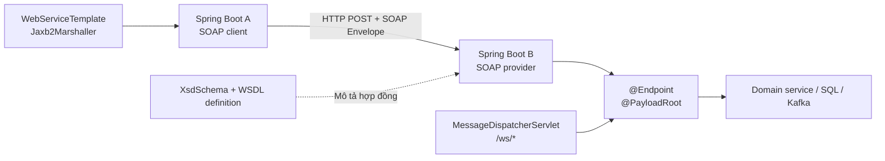
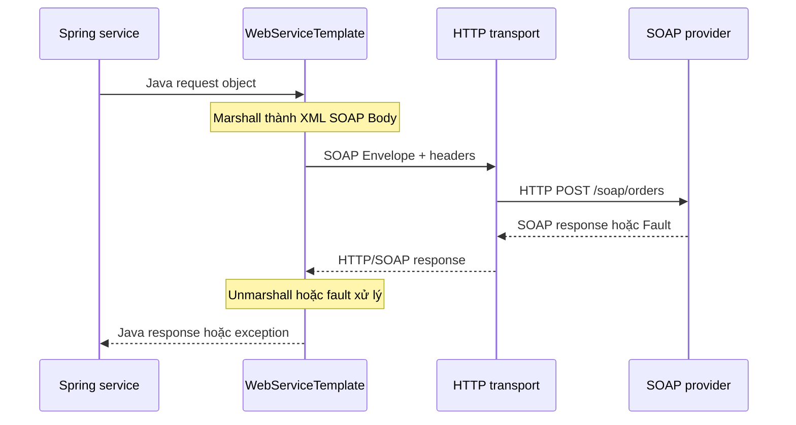
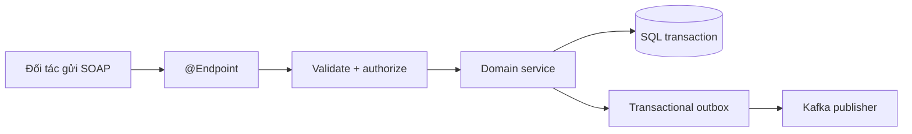
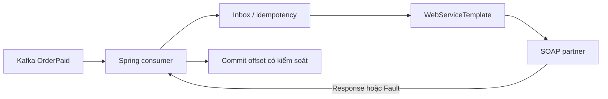

# Phân biệt gọi SOAP với công bố SOAP endpoint và XsdSchema

## 1. Một ứng dụng Spring Boot có thể đứng ở hai phía của SOAP

Trong module **SPRING_BOOT_INTEGRATION**, ứng dụng Spring Boot kết nối hệ thống qua HTTP client, database, cache, message broker và các adapter Spring Integration. Khi một đối tác yêu cầu giao tiếp bằng **SOAP/XML**, có hai vai trò độc lập:

1. **SOAP client (bên gọi):** ứng dụng của ta **gửi request** đến endpoint SOAP mà hệ thống khác đang công bố, nhận SOAP response hoặc SOAP Fault và chuyển thành kết quả nghiệp vụ.
2. **SOAP provider/server (bên công bố):** ứng dụng của ta **tiếp nhận request SOAP**, ánh xạ phần tử XML đến phương thức xử lý, gọi service/database/broker, rồi trả SOAP response hoặc SOAP Fault.

Hai vai trò đều dùng XML, SOAP Envelope, namespace và có thể dùng JAXB; nhưng **cấu hình, luồng dữ liệu, trách nhiệm hợp đồng và cách kiểm thử khác nhau**. Không thể công bố endpoint chỉ bằng cách tạo một `WebServiceTemplate`, cũng không thể gọi đối tác chỉ bằng cách tạo một `@Endpoint`.



Ví dụ xuyên suốt: hệ thống **OrderHub** cần cung cấp thao tác `GetOrderStatus` cho đối tác. Nếu OrderHub nhận yêu cầu từ đối tác, nó là SOAP **server**. Nếu OrderHub gọi dịch vụ thanh toán SOAP của ngân hàng để đối chiếu trạng thái, nó là SOAP **client**. Cùng một ứng dụng có thể đóng **cả hai vai trò**, nhưng nên tách package/configuration, security và vận hành cho từng hướng.

### Mục tiêu cần đạt

Sau bài học, người học có thể:

- Nhìn vào yêu cầu và xác định bên nào **gọi** và bên nào **công bố** SOAP.
- Phân biệt SOAP Envelope, XML namespace, **XSD**, **WSDL** và URL endpoint.
- Cấu hình Spring-WS `WebServiceTemplate` để gọi một SOAP service đã có.
- Dùng `@Endpoint`, `@PayloadRoot` và `MessageDispatcherServlet` để công bố endpoint trong Spring Boot.
- Sử dụng `XsdSchema` cùng `DefaultWsdl11Definition` đúng vai trò; hiểu việc công bố XSD/WSDL **không đồng nghĩa tự động validate mọi payload**.
- Xử lý faults, timeout, xác thực, XML không tin cậy, retry/idempotency và kiểm thử từng phía.

## 2. SOAP, XSD và WSDL khác nhau thế nào?

| Thành phần | Chức năng | Ví dụ |
| --- | --- | --- |
| **SOAP** | Định dạng thông điệp trao đổi có Envelope, Header và Body; có cơ chế Fault | `<soap:Envelope>...` |
| **XSD (XML Schema Definition)** | Định nghĩa **cấu trúc/kiểu dữ liệu XML**: tên phần tử, số lần xuất hiện, kiểu, ràng buộc | `GetOrderStatusRequest` chứa `orderId` kiểu string |
| **WSDL** | Mô tả **hợp đồng dịch vụ**: message/operation, binding/protocol và vị trí service | Operation `GetOrderStatus`, địa chỉ `/ws` |
| **Endpoint URL** | Địa chỉ HTTP mà client gửi SOAP message | `https://api.example.test/ws` |
| **JAXB mapping** | Ánh xạ XML thành Java object và ngược lại | `GetOrderStatusRequest` Java class |
| **Spring-WS** | Framework xử lý SOAP client/server, endpoint mapping, message conversion, Fault | `WebServiceTemplate`, `@Endpoint` |

**XSD chỉ nói một phần dữ liệu XML có hình dạng gì**, không tự đưa ra địa chỉ HTTP, operation binding hoặc các chính sách TLS. **WSDL bao gồm thông tin hợp đồng dịch vụ** và có thể tham chiếu XSD. Một file XSD không phải endpoint nhận request, cũng không phải một client có khả năng gửi SOAP.

### SOAP message là gì?

Đây là SOAP 1.1 request đơn giản:

```xml
<soapenv:Envelope
    xmlns:soapenv="http://schemas.xmlsoap.org/soap/envelope/"
    xmlns:ord="urn:example:orders:soap:v1">
  <soapenv:Header/>
  <soapenv:Body>
    <ord:GetOrderStatusRequest>
      <ord:orderId>ORD-204</ord:orderId>
    </ord:GetOrderStatusRequest>
  </soapenv:Body>
</soapenv:Envelope>
```

Điểm cần chú ý:

- `Envelope` và `Body` thuộc namespace SOAP 1.1.
- `ord:GetOrderStatusRequest` thuộc **namespace của hợp đồng nghiệp vụ**: `urn:example:orders:soap:v1`.
- Prefix `ord` hay `soapenv` chỉ là **bí danh namespace**; việc đổi tên prefix nhưng giữ nguyên URI namespace không làm đổi ý nghĩa XML.
- Với mapping `@PayloadRoot`, Spring-WS định tuyến dựa trên **namespace URI và local name** của phần tử gốc trong **SOAP Body**, không phải dựa vào tên prefix hay URL query.
- SOAP 1.2 dùng Envelope namespace khác: `http://www.w3.org/2003/05/soap-envelope`, cùng khác biệt ở content type/binding và fault format. Client/server phải tương thích cùng phiên bản SOAP.

Một SOAP response:

```xml
<soapenv:Envelope
    xmlns:soapenv="http://schemas.xmlsoap.org/soap/envelope/"
    xmlns:ord="urn:example:orders:soap:v1">
  <soapenv:Body>
    <ord:GetOrderStatusResponse>
      <ord:status>PAID</ord:status>
    </ord:GetOrderStatusResponse>
  </soapenv:Body>
</soapenv:Envelope>
```

Hợp đồng XML phải xác định rõ field bắt buộc, namespace, phiên bản, lỗi nghiệp vụ và giới hạn kích thước. XML hợp lệ về cú pháp vẫn có thể **sai nghiệp vụ hoặc vượt quyền truy cập**.

## 3. Bảng so sánh hai hướng tích hợp

| Tiêu chí | **Gọi SOAP** | **Công bố SOAP endpoint** |
| --- | --- | --- |
| Vai trò | Consumer/client của service khác | Provider/server cung cấp service |
| Lớp trung tâm trong Spring-WS | `WebServiceTemplate` | `@Endpoint` + `MessageDispatcherServlet` |
| Đối tượng cấu hình | URI đích, HTTP sender, JAXB marshaller/unmarshaller, timeout, auth | Servlet mapping, endpoint beans, WSDL/XSD, interceptor, security |
| Ai giữ hợp đồng? | Client phải tuân theo WSDL/XSD của nhà cung cấp | Provider chủ động version và công bố hợp đồng cho consumer |
| Gửi/nhận HTTP | Client **gửi** POST ra ngoài | Server **nhận** POST từ ngoài |
| Xử lý SOAP Fault | Phân loại response lỗi từ đối tác | Ánh xạ exception thành SOAP Fault phù hợp hợp đồng |
| Schema validation | Có thể validate request/response phía client | Có thể validate request/response phía server |
| Kiểm thử chính | Mock server/downstream SOAP, timeouts, fault, security | Mock SOAP request đến endpoint, WSDL/XSD, mapping, fault |
| Quan sát | Outbound latency, timeout, remote fault | Inbound latency, validation failures, request counts |

**Câu hỏi xác định hướng:** “Ai sở hữu HTTP URL mà bên kia gọi tới?” Nếu URL thuộc đối tác và ứng dụng gửi request đến đó, ta viết client. Nếu URL thuộc ứng dụng và đối tác gửi request đến, ta công bố endpoint.

## 4. Thiết kế XSD làm hợp đồng dữ liệu

Giả sử OrderHub chọn schema riêng phiên bản 1. File minh họa sẽ được đặt tại `src/main/resources/xsd/orders.xsd` trong một dự án Spring Boot thực tế:

```xml
<?xml version="1.0" encoding="UTF-8"?>
<xsd:schema
    xmlns:xsd="http://www.w3.org/2001/XMLSchema"
    xmlns:tns="urn:example:orders:soap:v1"
    targetNamespace="urn:example:orders:soap:v1"
    elementFormDefault="qualified">

  <xsd:element name="GetOrderStatusRequest">
    <xsd:complexType>
      <xsd:sequence>
        <xsd:element name="orderId">
          <xsd:simpleType>
            <xsd:restriction base="xsd:string">
              <xsd:minLength value="1"/>
              <xsd:maxLength value="64"/>
            </xsd:restriction>
          </xsd:simpleType>
        </xsd:element>
      </xsd:sequence>
    </xsd:complexType>
  </xsd:element>

  <xsd:element name="GetOrderStatusResponse">
    <xsd:complexType>
      <xsd:sequence>
        <xsd:element name="status" type="xsd:string"/>
      </xsd:sequence>
    </xsd:complexType>
  </xsd:element>
</xsd:schema>
```

Hai global elements `GetOrderStatusRequest` và `GetOrderStatusResponse` giúp diễn tả operation theo **quy ước suffix Request/Response** mà Spring-WS `DefaultWsdl11Definition` có thể sử dụng khi tạo WSDL. Quy ước đặt tên này hữu ích cho WSDL generation, nhưng **không phải quy tắc bắt buộc của chuẩn SOAP**.

Với một hệ thống đã có WSDL do đối tác hoặc tổ chức phát hành, nên xem WSDL/XSD hiện hữu là **nguồn hợp đồng**, tránh tự tạo một XSD mới có namespace khác rồi giả định tương thích.

### Khi nào XSD chưa đủ?

XSD có thể kiểm tra kiểu string, độ dài, số phần tử và cấu trúc XML, nhưng không tự chứng minh:

- Người gửi có quyền truy vấn `orderId` đó không.
- Trạng thái order có hợp lệ theo domain state machine không.
- Request đã được xử lý trước đây hay chưa.
- Thông điệp đã được xác thực bằng mTLS/WS-Security chưa.
- Endpoint có đáp ứng timeout, rate limit và SLA không.

Vì vậy cần phối hợp XSD validation, authentication/authorization và kiểm tra nghiệp vụ tại service.

## 5. Triển khai **server**: công bố SOAP endpoint

Một SOAP server Spring Boot cần ít nhất: Spring-WS infrastructure, servlet HTTP inbound, endpoint mapper, payload/response mapping và business service. WSDL/XSD publication là phần hợp đồng liên quan nhưng không tự thực thi nghiệp vụ.

### Dependency ví dụ

```groovy
dependencies {
    implementation 'org.springframework.boot:spring-boot-starter-web-services'

    // Nếu cần validate field/domain theo Bean Validation:
    implementation 'org.springframework.boot:spring-boot-starter-validation'

    // Đối với các Java classes JAXB từ XSD,
    // kiểm tra JAXB runtime/transitive dependencies theo Boot BOM.
    testImplementation 'org.springframework.ws:spring-ws-test'
    testImplementation 'org.springframework.boot:spring-boot-starter-test'
}
```

Ví dụ nhằm minh họa Spring Boot 3.x, Java 17+ và Spring Web Services 4.x. Khi tích hợp JAXB trong JDK mới, **JAXB không còn có sẵn trong JDK như các JDK cũ**; cần plugin codegen và implementation JAXB phù hợp. Không tự thêm hai bản JAXB `javax.xml.bind` và `jakarta.xml.bind` vào cùng đường mapping nếu không có lý do/kiểm chứng tương thích.

### Khai báo MessageDispatcherServlet và XsdSchema

```java
import org.springframework.boot.web.servlet.ServletRegistrationBean;
import org.springframework.context.ApplicationContext;
import org.springframework.context.annotation.Bean;
import org.springframework.context.annotation.Configuration;
import org.springframework.core.io.ClassPathResource;
import org.springframework.ws.config.annotation.EnableWs;
import org.springframework.ws.transport.http.MessageDispatcherServlet;
import org.springframework.ws.wsdl.wsdl11.DefaultWsdl11Definition;
import org.springframework.xml.xsd.SimpleXsdSchema;
import org.springframework.xml.xsd.XsdSchema;

@EnableWs
@Configuration
public class OrderSoapServerConfig {
    public static final String NAMESPACE =
            "urn:example:orders:soap:v1";

    @Bean
    public ServletRegistrationBean<MessageDispatcherServlet>
    messageDispatcherServlet(ApplicationContext applicationContext) {
        var servlet = new MessageDispatcherServlet();
        servlet.setApplicationContext(applicationContext);
        servlet.setTransformWsdlLocations(true);
        return new ServletRegistrationBean<>(servlet, "/ws/*");
    }

    @Bean
    public XsdSchema ordersSchema() {
        return new SimpleXsdSchema(
                new ClassPathResource("xsd/orders.xsd"));
    }

    @Bean(name = "orders")
    public DefaultWsdl11Definition ordersWsdl(XsdSchema ordersSchema) {
        var wsdl = new DefaultWsdl11Definition();
        wsdl.setPortTypeName("OrdersPort");
        wsdl.setLocationUri("/ws");
        wsdl.setTargetNamespace(NAMESPACE);
        wsdl.setSchema(ordersSchema);
        return wsdl;
    }
}
```

Ý nghĩa từng phần:

- `@EnableWs` kích hoạt cấu hình xử lý Spring-WS server-side. Trong Spring Boot, web-services auto-configuration có thể đã tạo một `MessageDispatcherServlet`; ở đây **đăng ký explicit** để minh họa URL `/ws/*`. Trong ứng dụng thật, chọn **một cách cấu hình nhất quán** để tránh đăng ký servlet/mapping hai lần.
- `MessageDispatcherServlet` nhận SOAP HTTP request và điều phối đến endpoint; nó khác Spring MVC `DispatcherServlet` dùng cho `@RestController`.
- `XsdSchema` là abstraction Spring XML cho XSD; `SimpleXsdSchema` đọc resource từ classpath.
- `DefaultWsdl11Definition` dùng XSD và các convention để tạo **WSDL 1.1** mô tả port type/binding/service, không cung cấp business handler.
- Tên bean `orders` giúp WSDL có thể được công bố qua URL kiểu **`GET /ws/orders.wsdl`** nếu servlet mapping và WSDL bean được đăng ký như ví dụ.
- `locationUri="/ws"` khai báo địa chỉ SOAP service trong WSDL. Khi triển khai sau ingress hoặc reverse proxy, cần kiểm tra URL cuối cùng, scheme/host và cách rewrite WSDL location; đừng suy rằng mọi deployment tự có public URL đúng.

`setTransformWsdlLocations(true)` có thể giúp điều chỉnh địa chỉ trong WSDL dựa trên request khi phù hợp, nhưng **không thay thế** cấu hình forwarded headers, reverse proxy và kiểm tra đường dẫn thực tế. Trong production hãy tải WSDL từ bên ngoài ingress để xem địa chỉ client sẽ sử dụng.

### Endpoint xử lý request

Giả sử đã sinh các JAXB classes `GetOrderStatusRequest` và `GetOrderStatusResponse` từ schema ở mục 4:

```java
import org.springframework.ws.server.endpoint.annotation.Endpoint;
import org.springframework.ws.server.endpoint.annotation.PayloadRoot;
import org.springframework.ws.server.endpoint.annotation.RequestPayload;
import org.springframework.ws.server.endpoint.annotation.ResponsePayload;

@Endpoint
public class OrderStatusEndpoint {
    private static final String NS =
            "urn:example:orders:soap:v1";

    private final OrderStatusService orders;

    public OrderStatusEndpoint(OrderStatusService orders) {
        this.orders = orders;
    }

    @PayloadRoot(namespace = NS, localPart = "GetOrderStatusRequest")
    @ResponsePayload
    public GetOrderStatusResponse status(
            @RequestPayload GetOrderStatusRequest request) {

        String status = orders.getStatus(request.getOrderId());
        var response = new GetOrderStatusResponse();
        response.setStatus(status);
        return response;
    }
}
```

`OrderStatusService` là service nghiệp vụ do ứng dụng triển khai; phần Java của `GetOrderStatusRequest/Response` được tạo bởi JAXB code generation hoặc viết thủ công với annotations JAXB tương đương. Đây là ví dụ minh họa, không ngụ ý chỉ cần copy một class endpoint là đủ khi chưa có schema và mapping.

**Cơ chế dispatch:** Spring-WS nhìn phần tử gốc trong SOAP Body, nhận `{urn:example:orders:soap:v1}GetOrderStatusRequest` và gọi method `status(...)`. Nếu namespace hoặc local name khác, method này có thể **không được ánh xạ**, dù path `/ws` và class Java đều tồn tại.

### HTTP request thực tế

Với SOAP 1.1, request thường gửi POST tới endpoint:

```http
POST /ws HTTP/1.1
Host: localhost:8080
Content-Type: text/xml; charset=utf-8
SOAPAction: ""

<soapenv:Envelope xmlns:soapenv="http://schemas.xmlsoap.org/soap/envelope/"
                  xmlns:ord="urn:example:orders:soap:v1">
  <soapenv:Body>
    <ord:GetOrderStatusRequest>
      <ord:orderId>ORD-204</ord:orderId>
    </ord:GetOrderStatusRequest>
  </soapenv:Body>
</soapenv:Envelope>
```

Ở đây `POST /ws` là lệnh **gọi operation**, còn `GET /ws/orders.wsdl` dùng để **tải mô tả hợp đồng**. Tùy WSDL binding, client có thể cần giá trị `SOAPAction` cụ thể; không mặc định mọi service chấp nhận chuỗi rỗng. SOAP 1.2 thường dùng media type `application/soap+xml`, không thể đánh đồng toàn bộ header với SOAP 1.1.

## 6. JAXB và lớp Java được sinh từ XSD/WSDL

Trong ví dụ `@Endpoint` trước, Spring-WS nhận một `GetOrderStatusRequest` thay vì nhận chuỗi XML thô. Để làm được điều đó, application cần ánh xạ XML ↔ Java.

Một cách phổ biến theo hướng **contract-first**:

1. Xác nhận XSD và WSDL có đúng namespace và các phần tử request/response dự kiến.
2. Dùng JAXB XJC hoặc plugin build thích hợp để sinh Java classes từ XSD. Với WSDL chứa nhiều schema/import, cần quy trình code generation tương ứng.
3. Dùng những class có JAXB annotations hoặc `JAXBElement` theo cách generator thực sự sinh ra.
4. Đưa generated sources vào quá trình biên dịch; không sửa tay từng generated class sau mỗi lần generate.
5. Tạo contract tests để xác minh marshalling/unmarshalling đúng XML fixtures và không làm đổi namespace ngoài ý muốn.

Ví dụ cấu trúc project (chỉ minh họa):

```text
src/main/resources/xsd/orders.xsd
src/main/java/com/example/orders/ws/OrderStatusEndpoint.java
src/main/java/com/example/orders/soap/OrderSoapGateway.java
build/generated/sources/xjc/.../GetOrderStatusRequest.java
build/generated/sources/xjc/.../GetOrderStatusResponse.java
```

Trên Java 17+, cần dependency JAXB API/runtime và plugin tương thích với **Jakarta XML Bind** đang dùng. Plugin và cú pháp Gradle/Maven thay đổi theo dự án; không suy luận rằng `spring-boot-starter-web-services` một mình tự chạy XJC. **Spring-WS không tự sinh các Java classes JAXB từ XSD ở runtime.**

Một số schema sinh ra `JAXBElement<T>` bao quanh element thay vì class `@XmlRootElement` trực tiếp. Khi đó endpoint/client cần xử lý đúng wrapper và chọn marshaller tương ứng; không ép cast response tùy tiện. Kiểm tra Java code được generator sinh ra trước khi viết signatures.

### Contract-first hay code-first?

| Cách thiết kế | Ưu điểm | Rủi ro cần quản lý |
| --- | --- | --- |
| **Contract-first**: thiết kế/chấp nhận WSDL/XSD trước | Hai phía thống nhất kiểu XML, namespace và compatibility | Cần codegen/versioning, tránh tự ý đổi schema |
| Code-first: bắt đầu từ Java objects rồi tìm cách xuất schema/WSDL | Thuận tiện khi chỉ có nội bộ Java | Thay đổi Java có thể vô tình đổi hợp đồng wire; không phải mọi mapping đều rõ |

Trong tích hợp doanh nghiệp có nhiều client không cùng công nghệ, contract-first thường giúp giữ ổn định giao diện. Nhưng **nguồn hợp đồng phải là bản được đối tác/phía sở hữu dịch vụ đồng ý**, không phải file XML tự tạo chỉ để code compile.

## 7. Triển khai **client**: gọi SOAP bằng WebServiceTemplate

Ở phía client, ứng dụng không cần đăng ký `MessageDispatcherServlet` để gửi request. Nó cần:

- Endpoint URL của phía cung cấp, lấy từ cấu hình môi trường.
- Contract WSDL/XSD đã được thống nhất để tạo request đúng namespace/operation.
- `Jaxb2Marshaller` hoặc cơ chế chuyển đổi payload khác.
- `WebServiceTemplate` để gửi và nhận SOAP messages.
- HTTP transport, timeout, authentication/TLS, fault mapping và observability.

### Cấu hình JAXB marshaller và WebServiceTemplate

```java
import org.springframework.context.annotation.Bean;
import org.springframework.context.annotation.Configuration;
import org.springframework.beans.factory.annotation.Value;
import org.springframework.oxm.jaxb.Jaxb2Marshaller;
import org.springframework.ws.client.core.WebServiceTemplate;

@Configuration
public class OrderSoapClientConfig {

    @Bean
    public Jaxb2Marshaller orderSoapMarshaller() {
        var marshaller = new Jaxb2Marshaller();
        // Package do JAXB/XJC sinh ra, có metadata JAXB phù hợp.
        marshaller.setContextPath("com.example.orders.ws.generated");
        return marshaller;
    }

    @Bean
    public WebServiceTemplate orderWebServiceTemplate(
            Jaxb2Marshaller orderSoapMarshaller,
            @Value("${partner.soap.order-uri}") String endpointUri) {
        var template = new WebServiceTemplate();
        template.setMarshaller(orderSoapMarshaller);
        template.setUnmarshaller(orderSoapMarshaller);
        template.setDefaultUri(endpointUri);
        return template;
    }
}
```

```yaml
# application.yml — URL chỉ là giá trị minh họa.
partner:
  soap:
    order-uri: ${ORDER_SOAP_URI:https://partner.example.test/soap/orders}
```

**Quan trọng:** `setDefaultUri` nhận **URL thực thi SOAP**, không phải địa chỉ file `?wsdl`. Ví dụ `https://partner.example.test/soap/orders?wsdl` có thể dùng để lấy hợp đồng WSDL nhưng không nhất thiết là URL để POST SOAP.

Cấu hình trên chủ yếu làm rõ marshalling và endpoint. Trong production cần bổ sung **HTTP message sender/transport** với connect/read timeout có giới hạn, connection management và TLS thích hợp; API cấu hình timeout cụ thể phụ thuộc message sender và phiên bản Spring-WS đang dùng. Không để đường gọi đối tác chờ vô hạn, đặc biệt trong consumer Kafka/RabbitMQ.

### Gọi từ một application service

```java
import org.springframework.stereotype.Service;
import org.springframework.ws.client.core.WebServiceTemplate;
import org.springframework.ws.client.core.support.WebServiceGatewaySupport;
import org.springframework.ws.soap.client.core.SoapActionCallback;

@Service
public class OrderSoapGateway {
    private final WebServiceTemplate soap;

    public OrderSoapGateway(WebServiceTemplate orderWebServiceTemplate) {
        this.soap = orderWebServiceTemplate;
    }

    public String getOrderStatus(String orderId) {
        var request = new GetOrderStatusRequest();
        request.setOrderId(orderId);

        Object rawResponse = soap.marshalSendAndReceive(
                request,
                new SoapActionCallback("urn:GetOrderStatus"));

        if (!(rawResponse instanceof GetOrderStatusResponse response)) {
            throw new IllegalStateException(
                    "Unexpected SOAP response type");
        }
        return response.getStatus();
    }
}
```

`SoapActionCallback` ở ví dụ chỉ dùng **nếu WSDL binding quy định SOAPAction đó**. Không tự bịa giá trị `urn:GetOrderStatus` cho đối tác thật: có dịch vụ dùng giá trị khác hoặc không yêu cầu SOAPAction. Nếu cần tương thích SOAP 1.2 hoặc WS-Addressing, phải cấu hình message factory/headers theo hợp đồng, không chỉ thay SOAPAction.

`WebServiceGatewaySupport` có thể giúp xây dựng một lớp client gateway, nhưng **không phải điều kiện bắt buộc** để dùng `WebServiceTemplate`. Ví dụ trên dùng constructor injection để thể hiện rõ sự phụ thuộc vào bean.

### Thực chất WebServiceTemplate làm những gì?



Client **không** dùng `@PayloadRoot` để chọn operation bên phía đối tác. Operation được xác định bằng hợp đồng wire, phần tử payload và binding/SOAPAction cần thiết. `WebServiceTemplate` gửi SOAP; nó không tự tạo WSDL của đối tác hay tự biết mọi request type nếu chưa có marshaller/mapping.

### Một client có thể gọi nhiều endpoint

Có thể cấu hình nhiều `WebServiceTemplate` được đặt tên/`@Qualifier` khác nhau hoặc dùng URI tường minh cho mỗi lần gọi. Khi hai đối tác có **namespace, truststore, credentials hoặc retry policy khác nhau**, nên tách gateway/configuration để tránh gửi token, client certificate hoặc request nhầm đích.

Nếu một service vừa làm SOAP provider vừa làm SOAP client, tránh dùng chung vô điều kiện XSD, JAXB context, timeout và security config: phía inbound và outbound có thể thuộc **hai hợp đồng, hai chủ sở hữu và hai vòng đời version** khác nhau.

## 8. XsdSchema thực sự làm gì — và không làm gì?

`XsdSchema` trong Spring XML là một abstraction đại diện schema XSD, có thể được sử dụng khi:

- Cung cấp schema cho `DefaultWsdl11Definition` để xây WSDL theo convention.
- Cấu hình `PayloadValidatingInterceptor` ở SOAP server để validate payload.
- Cung cấp schema cho thành phần validation client nếu ứng dụng chủ động cấu hình.

Nó **không** tự tạo REST controller, không đăng ký SOAP endpoint, không sinh Java classes JAXB tự động ở runtime và **không tự động validate mọi request/response chỉ vì bean `XsdSchema` tồn tại**.

### Bổ sung validation cho SOAP provider

Ví dụ một interceptor validate cả request lẫn response theo schema đã công bố:

```java
import java.util.List;
import org.springframework.context.annotation.Bean;
import org.springframework.context.annotation.Configuration;
import org.springframework.ws.config.annotation.WsConfigurer;
import org.springframework.ws.server.EndpointInterceptor;
import org.springframework.ws.server.endpoint.interceptor.PayloadValidatingInterceptor;
import org.springframework.xml.xsd.XsdSchema;

@Configuration(proxyBeanMethods = false)
public class OrderSoapValidationConfig {

    @Bean
    public PayloadValidatingInterceptor orderPayloadValidator(
            XsdSchema ordersSchema) {
        var validator = new PayloadValidatingInterceptor();
        validator.setXsdSchema(ordersSchema);
        validator.setValidateRequest(true);
        validator.setValidateResponse(true);
        return validator;
    }

    @Bean
    public WsConfigurer orderWsConfigurer(
            PayloadValidatingInterceptor orderPayloadValidator) {
        return new WsConfigurer() {
            @Override
            public void addInterceptors(
                    List<EndpointInterceptor> interceptors) {
                interceptors.add(orderPayloadValidator);
            }
        };
    }
}
```

`PayloadValidatingInterceptor` kiểm tra phần **SOAP Body payload** theo XSD được cấu hình. Việc validate response giúp phát hiện code server tạo XML không phù hợp hợp đồng, nhưng cũng tạo thêm chi phí và có thể biến lỗi response thành Fault. Phải thử với DTO/JAXB classes và schema thật, đặc biệt các phần tử tùy chọn, `xsi:nil`, namespace và XSD imports.

Nếu ứng dụng có **nhiều SOAP endpoint với schema khác nhau**, không áp dụng một validator đơn lẻ cho tất cả thông điệp nếu schema đó không bao phủ các phần tử tương ứng. Dùng interceptor mapping hoặc phân tách cấu hình phù hợp để validation diễn ra đúng endpoint.

Không nhầm **XML schema validation** với authorization hoặc WS-Security. Một message hợp lệ XSD vẫn có thể được gửi bởi client không có quyền hoặc mang `orderId` của tenant khác.

## 9. Công bố WSDL tĩnh hay tạo WSDL từ XSD?

Với Spring-WS, có hai mô hình phổ biến:

| Mô hình | Cách làm | Khi nào phù hợp? |
| --- | --- | --- |
| **WSDL sinh theo XSD** | `XsdSchema` + `DefaultWsdl11Definition` với naming convention | Hợp đồng tương đối đơn giản, muốn quản lý schema và service metadata trong Spring |
| **WSDL tĩnh đã được duyệt** | Publish một WSDL đã có (và các XSD import) bằng cơ chế `WsdlDefinition` phù hợp | Hợp đồng đối tác nghiêm ngặt, binding/SOAPAction/policy phức tạp, cần giữ đúng file gốc |

`DefaultWsdl11Definition` **không có phép màu suy ra toàn bộ Java code**. Nó dựa vào các element của XSD và naming conventions để tổ chức request, response, operations. Với WSDL phức tạp chứa nhiều bindings, header đặc biệt, policy WS-Security hoặc chuẩn đối tác đã ký duyệt, **WSDL tĩnh** thường dễ đảm bảo không làm đổi hợp đồng hơn.

Trong Spring-WS có `SimpleWsdl11Definition` để công bố WSDL có sẵn. Nếu dùng WSDL chứa đường dẫn tương đối và `xsd:import`/`wsdl:import`, cần kiểm tra cách xuất bản các tài nguyên liên quan để client bên ngoài tải và resolve được.

### URL WSDL và đường SOAP thực thi

```text
GET  https://orders.example.test/ws/orders.wsdl
     -> trả WSDL hợp đồng

POST https://orders.example.test/ws
     -> nhận SOAP Envelope và dispatch tới @Endpoint
```

Các đường dẫn chỉ là ví dụ dựa trên cấu hình ở mục 5. Trong một application context có root path hoặc reverse proxy prefix, đường thực tế có thể khác.

Tải WSDL thành công mới chứng minh **contract được công bố**; muốn chứng minh endpoint thật hoạt động, cần gửi SOAP POST hợp lệ và kiểm tra response. Ngược lại, SOAP POST có thể hoạt động dù provider không công bố WSDL qua URL public (nếu hợp đồng được phân phối qua kênh khác).

### Version hóa hợp đồng

Không tùy tiện đổi `targetNamespace`, tên global element, element order hoặc kiểu field vì client JAXB generated từ bản cũ có thể không parse được. Với breaking change, ưu tiên công bố namespace/endpoint version mới hoặc policy tương thích do hai phía thống nhất. Tăng Java package version không tự đổi namespace trên wire.

Khi bổ sung field tùy chọn, hãy kiểm tra `minOccurs` và compatibility của client cũ. Nếu thêm phần tử bắt buộc mà client cũ không gửi, validation có thể làm hàng loạt request lỗi dù server khởi động bình thường.

## 10. SOAP Fault, lỗi HTTP và phân loại retry

SOAP có cấu trúc **Fault** trong Envelope. Lỗi SOAP không giống hoàn toàn với HTTP status 4xx/5xx, dù HTTP binding thường sử dụng HTTP status để phản ánh lỗi.

Ví dụ SOAP 1.1 Fault:

```xml
<soap:Envelope xmlns:soap="http://schemas.xmlsoap.org/soap/envelope/">
  <soap:Body>
    <soap:Fault>
      <faultcode>soap:Client</faultcode>
      <faultstring>Invalid request</faultstring>
    </soap:Fault>
  </soap:Body>
</soap:Envelope>
```

Phía server cần phân biệt lỗi:

| Nhóm | Ví dụ | Cách phản hồi phù hợp |
| --- | --- | --- |
| XML sai cú pháp, không match schema | Thiếu `orderId`, sai namespace | Client/request fault theo SOAP version và policy |
| Lỗi nghiệp vụ cố định | Order không tồn tại/không thuộc quyền caller | Fault mã nghiệp vụ có kiểm soát, tránh lộ thông tin nội bộ |
| Lỗi hệ thống tạm thời | DB timeout, downstream 503 | Server/receiver fault hoặc phản hồi được quy định trong hợp đồng |
| Lỗi xác thực/phân quyền | mTLS/WS-Security không hợp lệ | Chặn sớm theo security policy, không trả nội dung nhạy cảm |

Với Spring-WS, `SoapFaultMappingExceptionResolver` có thể ánh xạ exception server sang SOAP Fault theo cấu hình. Không để exception stack trace, connection string, token hoặc SQL query lọt vào `faultstring` hoặc `detail` trong production.

Phía client, `WebServiceTemplate` có thể ném `SoapFaultClientException` khi nhận SOAP Fault, hoặc các exception transport/unmarshalling cho lỗi mạng/XML. Retry policy cần **phân loại lỗi**, không retry tất cả:

- Fault báo request invalid/schema mismatch: thường **không retry**, vì payload không đổi.
- Timeout, connection reset, HTTP 503: có thể retry giới hạn nếu operation **idempotent**, hoặc cần đối soát kết quả trước khi thử lại.
- Fault nghiệp vụ kiểu “đã xử lý” có thể là tín hiệu deduplication; kiểm tra định nghĩa hợp đồng.
- Client lỗi deserialization do response vượt hợp đồng: cần cảnh báo/tương thích, không cố parse lặp vô hạn.

**Quan trọng khi gọi operation có side effect:** timeout sau SOAP POST **không chứng minh server chưa thực hiện**. Nếu lệnh tạo thanh toán đã commit phía đối tác nhưng response mất trên đường truyền, retry mù quáng có thể tạo giao dịch trùng. Dùng idempotency key, request ID hoặc API tra cứu kết quả nếu hợp đồng hỗ trợ.

## 11. Bảo mật SOAP/XML và dữ liệu nhạy cảm

Một SOAP message đi qua HTTP/S có thể mang thông tin đơn hàng, dữ liệu khách hàng, token hoặc chữ ký XML. Bảo mật cần nhiều lớp:

| Lớp | Biện pháp | Giới hạn |
| --- | --- | --- |
| TLS | HTTPS và xác minh certificate/hostname | Không tự kiểm tra quyền nghiệp vụ |
| mTLS | Client certificate để xác thực ở tầng kết nối | Không tự xác minh từng `orderId` trong payload |
| WS-Security | UsernameToken, chữ ký/mã hóa message theo profile hợp đồng | Cần cấu hình policy, trust, khóa và canonicalization chính xác |
| XSD validation | Kiểm tra cấu trúc/kiểu payload | Không xác thực người gửi |
| Authorization | Kiểm tra principal được phép truy cập resource nào | Phụ thuộc domain/tenant context |
| Size/depth limits | Chống XML quá lớn, lồng sâu, entity expansion | Cần đặt ở gateway/parser/transport thích hợp |
| Redaction/retention | Hạn chế lộ dữ liệu trong logs, traces, DLT | Không sửa được dữ liệu đã bị ghi ra ngoài trước đó |

Spring-WS có thư viện tích hợp WS-Security, ví dụ `Wss4jSecurityInterceptor` khi bổ sung đúng dependency. Tuy nhiên, **WS-Security không tự được bật chỉ vì ứng dụng dùng SOAP**. Nếu đối tác yêu cầu chữ ký XML, timestamp, UsernameToken, nonce hoặc encryption, phải triển khai theo WSDL/policy/hợp đồng và kiểm chứng bằng fixture từ đối tác.

### Phòng chống XML External Entity và parser abuse

XML từ đối tác hoặc người dùng là **dữ liệu không tin cậy**. Không tự tạo `DocumentBuilderFactory`, `SAXParserFactory` hoặc StAX parser với cấu hình cho phép resolve DTD/external entities mà không đánh giá rủi ro. Có thể dẫn đến XXE, SSRF, đọc file nội bộ hoặc tấn công cạn tài nguyên.

Thực hành:

- Ưu tiên parser và marshaller của framework đã được cấu hình an toàn; kiểm tra behavior trong đúng phiên bản Spring-WS, JAXB, parser provider đang chạy.
- Không cho phép external DTD/entities nếu nghiệp vụ không cần; giới hạn entity expansion và độ sâu.
- Giới hạn **HTTP body bytes** ở ingress và application; `@Size`/XSD field constraint không thay thế bảo vệ trước parse.
- Với XSD có `include/import`, không cho các URI không tin cậy tự động truy cập mạng/filesystem trong lúc validate.
- Giới hạn số request đồng thời, timeout, response size và toàn bộ đường logging/tracing.
- Không in nguyên XML Envelope nếu có SOAP Header chứa credentials, chữ ký hoặc PII.

Trong luồng xử lý từ Kafka/RabbitMQ, message SOAP/XML bị reject không nên được đưa nguyên vẹn vào DLT công khai. Nếu cần replay, lưu metadata, event ID và payload ở kho cách ly có RBAC, mã hóa và retention phù hợp.

## 12. Kiểm thử SOAP server khác với kiểm thử SOAP client

Một lớp test chỉ xác minh Java service hoạt động **chưa chứng minh** phần SOAP wire format, namespace, WSDL hay fault mapping đúng. Hãy chia kiểm thử theo **hướng kết nối**.

### Server-side: MockWebServiceClient

Spring-WS cung cấp `MockWebServiceClient` để gửi SOAP payload vào các endpoint trong Spring application context mà không cần mở một cổng HTTP thật. Đoạn test dưới đây giả định `OrderStatusService` trả về `PAID` cho đơn hàng `ORD-204`:

```java
import static org.springframework.ws.test.server.RequestCreators.withPayload;
import static org.springframework.ws.test.server.ResponseMatchers.payload;

import org.junit.jupiter.api.Test;
import org.springframework.beans.factory.annotation.Autowired;
import org.springframework.boot.test.context.SpringBootTest;
import org.springframework.context.ApplicationContext;
import org.springframework.ws.test.server.MockWebServiceClient;
import org.springframework.xml.transform.StringSource;

@SpringBootTest
class OrderStatusEndpointTest {

    @Autowired
    ApplicationContext applicationContext;

    @Test
    void respondsWithPaidStatus() {
        var client = MockWebServiceClient.createClient(applicationContext);

        var request = new StringSource("""
                <ord:GetOrderStatusRequest
                    xmlns:ord="urn:example:orders:soap:v1">
                  <ord:orderId>ORD-204</ord:orderId>
                </ord:GetOrderStatusRequest>
                """);

        var response = new StringSource("""
                <ord:GetOrderStatusResponse
                    xmlns:ord="urn:example:orders:soap:v1">
                  <ord:status>PAID</ord:status>
                </ord:GetOrderStatusResponse>
                """);

        client.sendRequest(withPayload(request))
                .andExpect(payload(response));
    }
}
```

Đây là test skeleton: cần tạo fixture/service stub hoặc dữ liệu test cho `ORD-204` và có JAXB mapping hợp lệ. `withPayload` và `payload` kiểm tra phần tử SOAP Body, không yêu cầu tự viết toàn bộ SOAP Envelope.

Những điểm **test này chưa chứng minh**:

- Servlet thật có được map tới `/ws/*` trong deployment không?
- WSDL có thể tải từ `/ws/orders.wsdl` từ bên ngoài reverse proxy không?
- TLS/mTLS, authentication và các HTTP header/proxy có đúng không?
- Client đối tác có deserialize được response và dùng SOAP version/binding đúng không?

Vì vậy vẫn cần test chạy trên application server/embedded servlet container thật, sau đó tải WSDL và gửi SOAP request qua HTTP(S).

### Client-side: MockWebServiceServer

Ngược lại, nếu đang viết **bên gọi SOAP**, dùng `MockWebServiceServer` để giả lập đối tác mà không tạo một `@Endpoint` server thực:

```java
import static org.springframework.ws.test.client.RequestMatchers.payload;
import static org.springframework.ws.test.client.ResponseCreators.withPayload;

import org.junit.jupiter.api.Test;
import org.springframework.beans.factory.annotation.Autowired;
import org.springframework.boot.test.context.SpringBootTest;
import org.springframework.ws.client.core.WebServiceTemplate;
import org.springframework.ws.test.client.MockWebServiceServer;
import org.springframework.xml.transform.StringSource;

@SpringBootTest
class OrderSoapGatewayTest {

    @Autowired
    WebServiceTemplate orderWebServiceTemplate;

    @Autowired
    OrderSoapGateway gateway;

    @Test
    void marshalsRequestAndReadsResponse() {
        var server = MockWebServiceServer.createServer(
                orderWebServiceTemplate);

        var expectedRequest = new StringSource("""
                <ord:GetOrderStatusRequest
                    xmlns:ord="urn:example:orders:soap:v1">
                  <ord:orderId>ORD-204</ord:orderId>
                </ord:GetOrderStatusRequest>
                """);

        var mockedResponse = new StringSource("""
                <ord:GetOrderStatusResponse
                    xmlns:ord="urn:example:orders:soap:v1">
                  <ord:status>PAID</ord:status>
                </ord:GetOrderStatusResponse>
                """);

        server.expect(payload(expectedRequest))
                .andRespond(withPayload(mockedResponse));

        org.junit.jupiter.api.Assertions.assertEquals(
                "PAID", gateway.getOrderStatus("ORD-204"));
        server.verify();
    }
}
```

Đây cũng là skeleton: test fixture cần tạo đúng bean, JAXB package và mapping. `MockWebServiceServer` xác nhận request được gửi đúng dạng và response được đọc qua gateway; nó không tự kiểm chứng DNS, TLS, HTTP timeout hoặc hợp đồng của đối tác đang chạy. Khi tích hợp với nhà cung cấp thật, sử dụng môi trường sandbox và **WSDL/XSD phiên bản chính xác** của đối tác.

### Ma trận test tối thiểu cho cả hai vai trò

| Tình huống | SOAP client | SOAP provider |
| --- | --- | --- |
| Request/response XML hợp lệ | Serialize đúng, parse được response | Endpoint mapping đúng, trả payload hợp lệ |
| Sai namespace hoặc element local name | Phát hiện contract mismatch, không đoán tên element | Không dispatch sai operation; phản hồi lỗi theo policy |
| Thiếu `orderId` | Validate trước khi gửi nếu phù hợp | XSD interceptor/service từ chối |
| SOAP Fault nghiệp vụ | Không retry vô hạn, map thành domain error | Không tiết lộ stack trace/SQL/token |
| Đối tác HTTP timeout | Retry có giới hạn và kiểm tra idempotency | Timeout ở downstream không làm ghi trạng thái dở |
| SOAP 1.1/1.2 không khớp | Content type/message factory đúng version | Version/binding hợp đồng rõ ràng |
| WSDL/XSD nâng version | Test JAXB-generated code với XML mới và cũ | Kiểm tra backward compatibility và URL WSDL |
| Payload quá lớn/XXE | Bị chặn trước khi xử lý sâu | Bị chặn tại ingress/parser; không ảnh hưởng worker khác |
| TLS/mTLS/WS-Security | Chứng minh đúng danh tính server, ký token hợp đồng | Chỉ người có quyền được gọi operation |
| Crash sau DB commit trước broker ACK | Không gọi đối tác tạo side effect trùng sau replay | Nếu provider publish broker, không mất/nhân đôi sự kiện |

Không chỉ dựa vào `contextLoads()`: một ứng dụng có thể khởi động bình thường nhưng WSDL URL sai, generated class dùng sai namespace hoặc endpoint không có `@PayloadRoot` phù hợp.

## 13. Tích hợp SOAP với database, cache và message broker

Khi SOAP là một bước trong flow lớn, ranh giới transaction và idempotency vẫn giống các giao thức HTTP khác.

### Mô hình A: inbound SOAP → SQL → Kafka



Ví dụ OrderHub nhận `ConfirmOrderRequest` qua SOAP, cập nhật SQL và phát `OrderConfirmed` sang Kafka. **Không có một transaction SQL mặc định bao trùm SOAP response và Kafka publish**. Nếu cập nhật SQL thành công nhưng Kafka publish thất bại, hệ thống có thể lệch trạng thái.

Các biện pháp:

1. Dùng **transactional outbox** để lưu sự kiện cần publish trong cùng transaction SQL với thay đổi nghiệp vụ, rồi worker gửi từ outbox.
2. Dùng request ID/event ID ổn định để xử lý lặp an toàn nếu đối tác gửi lại SOAP request sau timeout.
3. Chỉ trả kết quả nghiệp vụ theo **cam kết đã được xác định**, không khẳng định Kafka subscriber đã xử lý xong khi mới commit SQL/outbox.
4. Với yêu cầu trả kết quả tức thì, thiết kế SLA/timeout và hợp đồng trạng thái trung gian phù hợp.

### Mô hình B: Kafka → SOAP client → đối tác



Một lỗi nguy hiểm:

1. Consumer đọc Kafka `OrderPaid`.
2. Gửi SOAP `CreateShipment`; đối tác **đã tạo** shipment.
3. Connection mất trước khi nhận SOAP response.
4. Consumer retry và tạo shipment **lần hai** nếu đối tác không có idempotency.

**Giải pháp không chỉ là retry:** cần idempotency key do producer/consumer thống nhất và được phía SOAP provider hỗ trợ, hoặc một operation đọc/truy vấn để xác định kết quả trước khi lặp lại. Nếu hợp đồng SOAP không hỗ trợ hai cơ chế này, cần thiết kế reconciliation/manual review thay vì giả định timeout là thất bại chắc chắn.

Nếu SOAP client được gọi bên trong transaction SQL dài, network timeout có thể giữ connection DB lâu và gây cạn pool. Cân nhắc tách state machine/outbox, xử lý bất đồng bộ và giới hạn thời gian operation.

### Cache không thay thế hợp đồng SOAP

Redis hoặc cache in-memory có thể giảm tải tra cứu trạng thái, nhưng cache stale không sửa được thông tin sai version. SOAP response phải đi qua authorization và quy tắc dữ liệu; không trả trạng thái của tenant khác chỉ vì key cache được tạo từ `orderId` mà thiếu tenant scope.

## 14. Vận hành, observability và xử lý sự cố

Đo riêng **SOAP client** và **SOAP provider** vì hai hướng có owner khác nhau:

| Nhóm tín hiệu | Client gọi đối tác | Server công bố SOAP |
| --- | --- | --- |
| Latency | Connect/read/overall request latency, timeout | Processing latency, queue/thread saturation |
| Availability | DNS/TCP/TLS errors, remote HTTP status | HTTP errors, servlet readiness, overload |
| Contract | Unmarshal errors, schema version mismatch | XML/XSD validation errors, unmapped payload root |
| SOAP Fault | Fault codes từ đối tác | Fault types trả cho client |
| Security | Credential/WS-Security failures, certificate expiry | AuthN/AuthZ failures, invalid signature, tenant violations |
| Business | Retry, reconciliation, duplicate remote operations | Duplicate request IDs, SQL transaction failures, Kafka outbox backlog |

Log có cấu trúc nên ưu tiên `correlationId`, tên operation, contract version, đối tác logic, thời gian, HTTP/SOAP fault code và mã lỗi nội bộ. **Không dùng raw SOAP Envelope làm nội dung log mặc định**: SOAP Header có thể chứa UsernameToken/chữ ký, SOAP Body có thể chứa PII hoặc thông tin thanh toán.

### Ma trận lỗi hay gặp

| Triệu chứng | Nguyên nhân phổ biến | Điểm kiểm tra |
| --- | --- | --- |
| `GET /ws/orders.wsdl` trả 404 | WSDL bean chưa được đăng ký, tên bean khác hoặc servlet mapping sai | `@Bean(name="orders")`, `DefaultWsdl11Definition`, mapping servlet |
| WSDL tải được nhưng POST không hoạt động | Sai URL thực thi hoặc request không tới MessageDispatcherServlet | `soap:address` trong WSDL, reverse proxy, đường POST |
| POST trả lỗi không tìm thấy endpoint | `@PayloadRoot` không khớp namespace/localPart | Payload root thực tế, không chỉ prefix XML |
| JAXB unmarshal exception | Generated classes/context path sai, schema version khác | Namespace, `ObjectFactory`, `@XmlRootElement`/`JAXBElement` |
| Client nhận SOAP Fault | Server báo lỗi hợp đồng/nghiệp vụ/hạ tầng | SOAP fault code/detail có kiểm soát, HTTP status |
| `415 Unsupported Media Type` hoặc SOAP version mismatch | Gửi SOAP 1.1 tới 1.2 endpoint hoặc ngược lại | Content-Type, SOAP Envelope namespace, binding |
| XSD lỗi khi có `include/import` | Resource không resolve được hoặc version/schema URI sai | Classpath, resolver, packaged resources |
| WSDL hiển thị địa chỉ nội bộ | Proxy forwarded headers hoặc location rewrite chưa đúng | `soap:address` qua public URL, HTTPS scheme |
| TLS handshake lỗi | CA, SAN/hostname, client certificate, phiên bản TLS | Truststore, keystore, certificate chain |
| Test local đúng nhưng production sai | Thêm auth/WS-Security, reverse proxy hoặc contract khác | Sandbox/provider WSDL đúng phiên bản, topology thật |
| Consumer gọi SOAP nhiều lần | Broker redelivery + HTTP timeout + thiếu idempotency | Event ID, retry count, trạng thái đối tác |

**Đừng sửa mọi lỗi bằng tăng timeout hoặc thêm retry.** Lỗi namespace, sai XSD, thiếu quyền hay thiếu certificate không tự hồi phục chỉ vì gửi lại cùng message.

## 15. Bài thực hành: cùng một ứng dụng vừa công bố vừa gọi SOAP

**Bối cảnh:** OrderHub công bố `GetOrderStatus` cho đối tác A theo namespace `urn:example:orders:soap:v1`. Đồng thời, sau khi nhận `OrderPaid` từ Kafka, OrderHub phải gọi SOAP service `ConfirmSettlement` của đối tác B. Hai phía có thể có namespace, JAXB package, TLS trust và chính sách lỗi khác nhau.

### Nhiệm vụ

1. Thiết kế một XSD có `GetOrderStatusRequest` và `GetOrderStatusResponse`, xác định max length, namespace và version.
2. Cấu hình `MessageDispatcherServlet` tại `/ws/*`; công bố `orders.wsdl` qua `DefaultWsdl11Definition` hoặc dùng WSDL tĩnh nếu đã có hợp đồng.
3. Tạo `@Endpoint` sử dụng `@PayloadRoot`; gọi service tra cứu trạng thái theo `orderId` và principal/tenant đã xác thực.
4. Sinh JAXB classes theo XSD và kiểm tra marshalling response, xử lý trường hợp request không hợp lệ.
5. Đăng ký `PayloadValidatingInterceptor` cho đúng schema và endpoint scope; thử XML thiếu `orderId`.
6. Tạo gateway `WebServiceTemplate` riêng để gọi B, sử dụng WSDL/XSD của B và endpoint URI đúng cho SOAP POST.
7. Kiểm tra SOAPAction/binding và TLS trust; thêm WS-Security khi B yêu cầu, không dùng trust-all.
8. Inject SOAP Fault, timeout và response XML sai namespace; phân loại lỗi retryable và lỗi cố định.
9. Mô phỏng Kafka record được giao lại sau khi đối tác B đã nhận lệnh thành công nhưng consumer chưa commit offset; chứng minh không gọi tạo settlement lần hai khi hợp đồng hỗ trợ idempotency.
10. Đo fault codes, validation errors, retry attempts, latency và outbox/inbox trạng thái mà không log raw XML nhạy cảm.

### Tiêu chí nghiệm thu

| Kiểm chứng | Kết quả kỳ vọng |
| --- | --- |
| WSDL | `GET /ws/orders.wsdl` tải được, mô tả đúng operation và SOAP address public |
| Server mapping | SOAP POST có payload root hợp lệ tới đúng `@Endpoint` |
| XSD validation | XML sai cấu trúc bị từ chối; XML hợp lệ vẫn được kiểm tra quyền nghiệp vụ |
| JAXB | Request/response có namespace đúng, đọc được từ client khác |
| Client gateway | `WebServiceTemplate` gọi đúng provider URL, parse response/fault chính xác |
| Lỗi hạ tầng | Timeout/503 được giới hạn retry; không block vô hạn consumer |
| SOAP security | TLS/WS-Security theo hợp đồng; không log credential hoặc PII |
| Broker recovery | Redelivery sau DB/remote commit không tạo duplicate business effect |
| Monitoring | Phân biệt inbound SOAP faults với outbound SOAP faults |

## 16. Những nhầm lẫn cần tránh

1. **Tạo `@Endpoint` rồi tưởng đã gọi đối tác:** `@Endpoint` chỉ là handler inbound.
2. **Tạo `WebServiceTemplate` rồi tưởng đã công bố URL:** template là outbound client, không phải servlet.
3. **Đưa URL `?wsdl` vào `setDefaultUri`:** WSDL URL thường để lấy contract, còn SOAP message phải POST tới service address.
4. **Có bean `XsdSchema` nghĩa là mọi request đã được validate:** phải cấu hình validator/interceptor tương ứng.
5. **XSD thay thế WSDL:** XSD không khai báo đầy đủ service location, binding và operations.
6. **WSDL generation tự viết Java handler:** Spring-WS không tự tạo nghiệp vụ chỉ từ schema.
7. **Định tuyến theo XML prefix:** QName thực tế là **namespace URI + local name**, không phụ thuộc chữ `ord`.
8. **Đổi SOAP 1.1 thành SOAP 1.2 chỉ bằng sửa Content-Type:** còn envelope, binding và fault semantics.
9. **Tắt TLS verify/DTD security để “fix nhanh”:** tạo rủi ro MITM, XXE hoặc resource exhaustion.
10. **Retry mọi SOAP Fault:** nhiều fault do schema/quyền sai, sẽ không tự hồi phục.
11. **Tin rằng SOAP là một phần của SQL/Kafka transaction:** cần outbox, idempotency và reconciliation giữa các hệ thống.
12. **Không kiểm chứng WSDL qua ingress:** địa chỉ `soap:address` có thể sai host, scheme hoặc context path.

## 17. Câu hỏi tự kiểm tra

1. Khi một Spring Boot service **gửi** SOAP POST đến ngân hàng, nó là client hay server? Lớp Spring-WS thường dùng là gì?
2. Khi đối tác gửi SOAP POST vào `/ws` của ứng dụng ta, phần nào nhận và điều phối request?
3. `XsdSchema` và `DefaultWsdl11Definition` đảm nhiệm hai vai trò khác nhau như thế nào?
4. Vì sao `GET /ws/orders.wsdl` trả 200 chưa chứng minh `@Endpoint` xử lý SOAP POST thành công?
5. `@PayloadRoot(namespace=..., localPart=...)` so sánh namespace URI hay XML prefix?
6. Vì sao `@ResponsePayload` và JAXB mapping phải có lớp Java/annotation phù hợp với XSD?
7. Có bean `XsdSchema` rồi, muốn reject request sai schema phải bổ sung cơ chế gì?
8. Làm sao phân biệt một SOAP Fault do dữ liệu invalid với lỗi HTTP timeout?
9. WSDL/XSD của client gọi đối tác có nhất thiết giống WSDL/XSD server mà ứng dụng công bố không?
10. Khi consumer Kafka gọi SOAP tạo shipment rồi crash trước commit offset, vì sao phải có idempotency ở hệ thống đích?
11. Các trường hợp nào đòi hỏi kiểm thử trên HTTP(S) thật thay vì chỉ `MockWebServiceClient` hoặc `MockWebServiceServer`?

## Tổng kết

**Gọi SOAP** và **công bố SOAP endpoint** là hai hướng tích hợp khác nhau trong Spring Boot. Bên gọi sử dụng `WebServiceTemplate` cùng marshaller, endpoint URI, transport và xử lý response/fault; bên công bố dùng `MessageDispatcherServlet`, `@Endpoint` và `@PayloadRoot` để nhận/định tuyến SOAP request. `XsdSchema` mô tả payload và hỗ trợ xây WSDL/validation, còn `DefaultWsdl11Definition` tạo hợp đồng WSDL theo quy ước; **chúng không tự tạo handler hoặc tự bật validation**. Khi kết nối với SQL, HTTP, Kafka và RabbitMQ, vẫn cần timeout, TLS/WS-Security, kiểm soát XML không tin cậy, idempotency, outbox/inbox, tests ở cả hai chiều và quan sát lỗi rõ ràng.

### Tài liệu tham khảo

- [Spring Web Services — Reference Documentation](https://docs.spring.io/spring-ws/docs/current/reference/html/)
- [Spring Boot Reference — Web Services](https://docs.spring.io/spring-boot/reference/io/webservices.html)
- [Spring Web Services — API Documentation](https://docs.spring.io/spring-ws/docs/current/api/)
- [Spring Framework — XML Marshalling](https://docs.spring.io/spring-framework/reference/data-access/oxm.html)
- [W3C — XML Schema Definition Language](https://www.w3.org/XML/Schema)
- [W3C — SOAP Version 1.2](https://www.w3.org/TR/soap12/)
