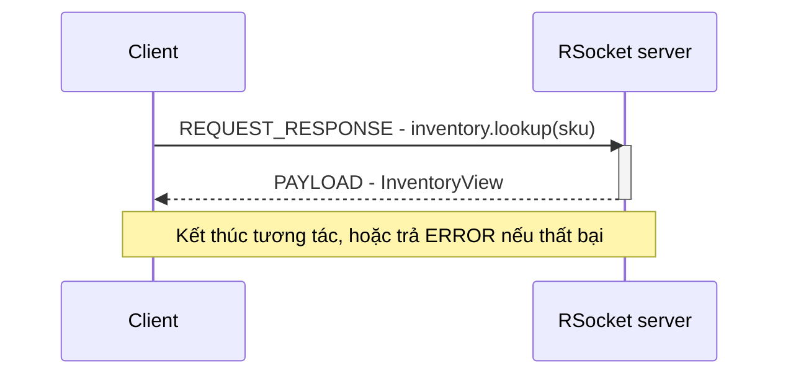
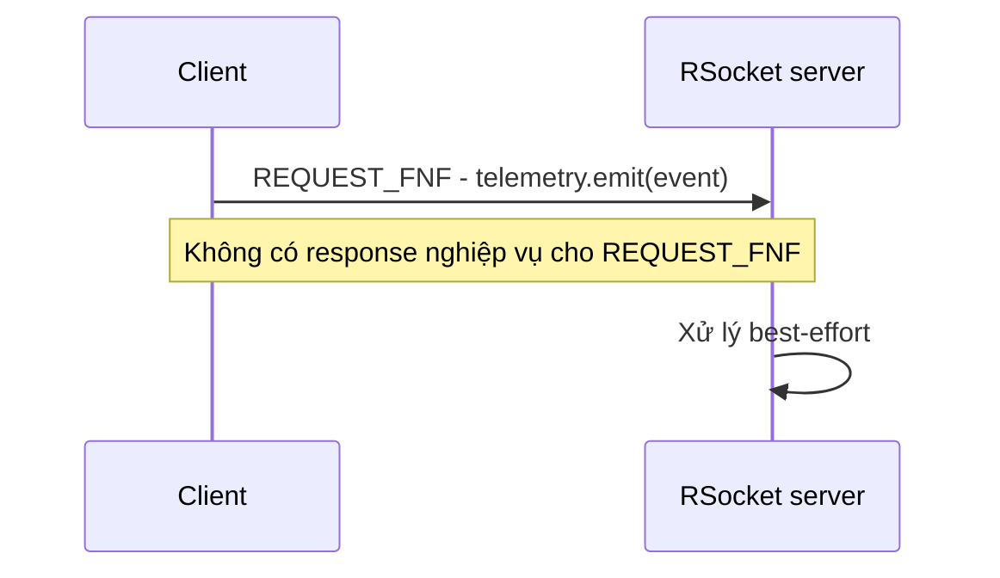
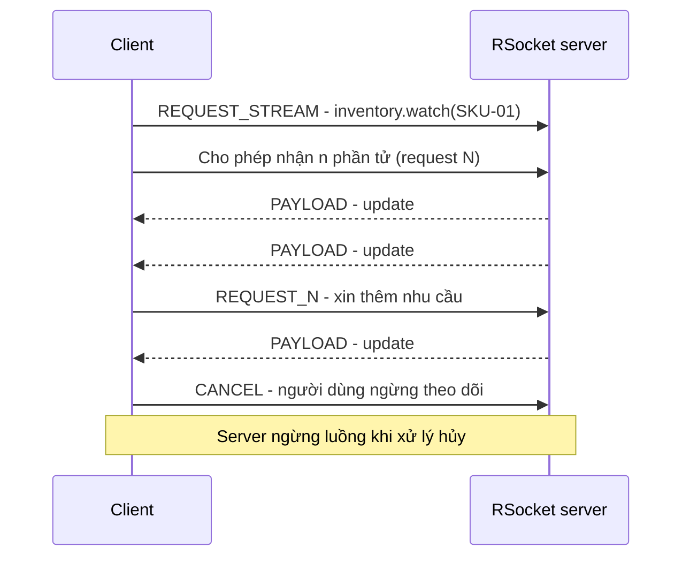
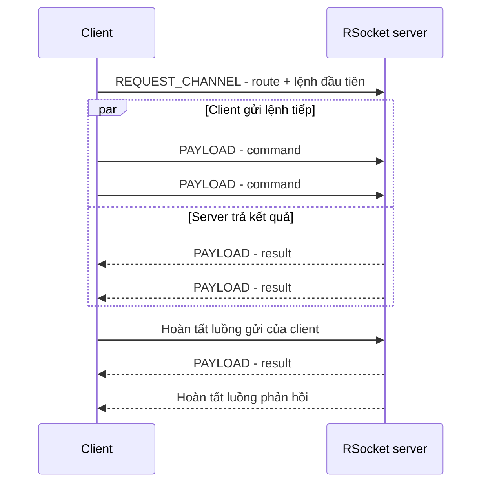

# Mô hình request-response, fire-and-forget, stream và channel

> **Chương:** RSocket  
> **Phạm vi học:** Trong module **SPRING_BOOT_INTEGRATION**, RSocket là một lựa chọn giao tiếp giữa các thành phần của hệ thống tích hợp Spring Boot, bên cạnh HTTP client, cơ sở dữ liệu, cache, broker thông điệp và các adapter của Spring Integration. Bài viết phân tích bốn kiểu tương tác, ví dụ triển khai, hợp đồng dữ liệu, xử lý lỗi, giao dịch, trùng lặp, kiểm thử và quan sát vận hành.

## 1. RSocket là gì và vì sao có bốn mô hình?

**RSocket** là giao thức truyền thông hai chiều, dựa trên thông điệp (*message-oriented*), hỗ trợ luồng dữ liệu bất đồng bộ và **backpressure** ở cấp giao thức. Hai đầu kết nối trao đổi các thông điệp có payload dữ liệu và metadata; chúng có thể giao tiếp qua transport như TCP hoặc WebSocket. RSocket cho phép nhiều luồng tương tác logic cùng sử dụng một kết nối vật lý.

Điểm đặc trưng là giao thức thể hiện rõ **mỗi phía dự kiến gửi và nhận bao nhiêu thông điệp**. Thay vì ép mọi thao tác thành “gửi một yêu cầu, nhận một phản hồi”, RSocket có bốn *interaction model*:

| Mô hình | Bên gọi gửi | Bên xử lý trả | Bản chất | Ví dụ trong hệ thống tích hợp |
| --- | --- | --- | --- | --- |
| **Request-response** | Một yêu cầu | Tối đa một kết quả hoặc lỗi | Tra cứu/gọi lệnh cần kết quả | Kiểm tra tồn kho của một SKU |
| **Fire-and-forget** | Một thông điệp | Không có phản hồi ứng dụng | Gửi không chờ kết quả xử lý từ xa | Gửi tín hiệu telemetry có thể mất |
| **Request-stream** | Một yêu cầu | Không, một hoặc nhiều kết quả theo thời gian | Đăng ký nhận một luồng | Theo dõi biến động tồn kho |
| **Request-channel** | Một luồng thông điệp | Một luồng thông điệp | Song công (*bidirectional*) | Gửi liên tục lệnh xác thực và nhận kết quả |

Ở đây, **“tối đa một” khác “chắc chắn một”**: một yêu cầu có thể hoàn thành không có giá trị hoặc kết thúc với lỗi. Đồng thời, “không phản hồi” trong fire-and-forget **không có nghĩa thông điệp được lưu bền vững** hay chắc chắn đã xử lý.

Trong Spring, bốn kiểu này thường được ánh xạ lần lượt thành `Mono<T>`, `Mono<Void>`, `Flux<T>` và tổ hợp `Flux<In> → Flux<Out>`. Đây là cách lập trình bằng Reactor/Spring Messaging; RSocket bản thân là giao thức, không phụ thuộc vào kiểu Java.

## 2. Request-response: một yêu cầu, một kết quả

### Cơ chế

Client gửi một thông điệp yêu cầu. Server xử lý rồi trả **tối đa một payload kết quả** hoặc báo lỗi. Tương tác kết thúc sau khi kết quả đã được trả hoặc khi nhận tín hiệu hoàn thành/lỗi. Nó gần với HTTP request-response về số lượng kết quả, nhưng được truyền trên kết nối RSocket có thể tái sử dụng.



**Khi chọn:** tra cứu trạng thái, xác thực một tham số, hỏi cấu hình hiện hành hoặc thực thi một lệnh mà bên gọi cần biết thành công/thất bại. Nếu phép gọi **thay đổi dữ liệu**, phải xác định rõ tính idempotent và cơ chế chống xử lý trùng trước khi tự động retry.

**Trường hợp lỗi:** timeout ở client không chứng minh server chưa xử lý. Server có thể đã commit xuống DB nhưng response bị mất khi kết nối ngắt. Với lệnh tạo đơn, một lần gửi lại không có khóa idempotency có thể tạo trùng dữ liệu.

## 3. Fire-and-forget: gửi một lần, không có kết quả ứng dụng

Client gửi **một** payload; server không gửi một response nghiệp vụ cho tương tác đó. Đây là mô hình phù hợp khi sender không cần biết kết quả xử lý và việc mất thông điệp đã được chấp nhận ở hợp đồng nghiệp vụ.



**Điểm dễ hiểu sai:** `send()` ở client trả một `Mono<Void>` để theo dõi thao tác gửi ở phía client. Việc publisher đó hoàn tất **không phải xác nhận từ server rằng sự kiện đã được xử lý, commit hoặc lưu bền vững**. Nếu server báo lỗi khi xử lý, sender không nhận được response nghiệp vụ qua chính request fire-and-forget ấy.

Fire-and-forget phù hợp với tín hiệu không quan trọng hoặc telemetry có cơ chế tổng hợp khác. Với sự kiện bắt buộc không được mất (ví dụ thanh toán, ghi nhận đơn hàng, thay đổi số dư), nên chọn mô hình có xác nhận nghiệp vụ hoặc dùng hệ thống thông điệp bền vững, cùng idempotency/retry theo yêu cầu. Không xem fire-and-forget là bảo đảm *at-least-once* hay *exactly-once*.

## 4. Request-stream: một yêu cầu, nhiều kết quả

Client gửi **một** thông điệp để đăng ký luồng. Server có thể đẩy **0..N** phần tử theo thời gian và hoàn thành luồng, hoặc kết thúc bằng lỗi. Client có thể hủy theo dõi khi không còn cần kết quả.

Ví dụ: dashboard gửi `inventory.watch("SKU-01")` một lần, sau đó nhận những bản cập nhật tồn kho mỗi khi có thay đổi.



**Backpressure** là khác biệt quan trọng với việc đẩy dữ liệu vô hạn mà không quan tâm tốc độ đọc. RSocket trao đổi nhu cầu tiêu thụ bằng tín hiệu `REQUEST_N`; server không được gửi nhiều phần tử dữ liệu hơn nhu cầu đã được cấp trên luồng. Trong Reactor, các thao tác như `request(n)`, `limitRate()` và `take(n)` ảnh hưởng cách client yêu cầu hoặc hủy luồng.

Tuy nhiên, backpressure trên kết nối **không tự bảo vệ mọi nguồn phát phía sau**. Nếu broker, cảm biến hoặc tác vụ polling đẩy dữ liệu nhanh hơn tốc độ xử lý, adapter vẫn cần chính sách buffer có giới hạn, sampling hoặc xử lý overflow. Chỉ dùng `onBackpressureDrop`/`onBackpressureLatest` khi việc làm mất bản cập nhật phù hợp hợp đồng; không được áp dụng tùy tiện cho đơn hàng hay giao dịch tiền.

**Vòng đời:** một stream có thể tồn tại lâu, kết thúc bình thường, lỗi hoặc bị cancel. Cần giải phóng subscription tới nguồn dữ liệu, timer và tài nguyên khi client hủy; tránh giữ transaction/connection DB trong suốt vòng đời stream.

## 5. Request-channel: hai luồng độc lập trên cùng tương tác

Với request-channel, client gửi **một luồng thông điệp vào** và nhận **một luồng thông điệp ra**. Hai luồng có thể diễn ra đồng thời: server có thể trả kết quả trong lúc client vẫn tiếp tục gửi yêu cầu. Mỗi hướng có vòng đời và nhu cầu tiêu thụ riêng.



Ví dụ: client liên tục gửi các lệnh kiểm tra dữ liệu đối tác; server trả kết quả kiểm tra theo từng lệnh. Trong thực tế, server cũng có thể chủ động phát dữ liệu không theo quan hệ 1:1 với lệnh đầu vào, miễn là hợp đồng dữ liệu được định nghĩa rõ.

**Cần phân biệt với request-stream:** request-stream chỉ có *một request* ban đầu; channel nhận được nhiều request payload qua thời gian. Request-channel phù hợp cho cộng tác hai chiều, phiên trao đổi liên tục, đồng bộ hóa tiến độ hoặc gateway nhận lệnh và trả sự kiện. Nó không mặc định là hàng đợi bền vững, không có “exactly-once”, và không bảo đảm mọi phần tử có phản hồi tương ứng.

## 6. Cách hiểu tín hiệu protocol và luồng dữ liệu

Ở mức khái niệm, bên khởi tạo dùng các loại request frame tương ứng `REQUEST_RESPONSE`, `REQUEST_FNF`, `REQUEST_STREAM` và `REQUEST_CHANNEL`. Dữ liệu tiếp theo truyền bằng các payload frame; tín hiệu `REQUEST_N` biểu diễn nhu cầu, `CANCEL` yêu cầu dừng, và trạng thái hoàn tất hoặc lỗi được biểu diễn trong luồng tương tác.

| Tín hiệu / khái niệm | Ý nghĩa cần nhớ |
| --- | --- |
| **Route metadata** | Spring dùng thông tin route để phân phối thông điệp đến handler `@MessageMapping`; metadata phải có encoding và cấu hình tương thích |
| **Payload** | Dữ liệu nghiệp vụ, ví dụ JSON hoặc định dạng serialization đã thỏa thuận |
| **Request N** | Nhu cầu được cấp thêm cho bên phát trong các luồng nhiều phần tử |
| **Cancel** | Bên tiêu thụ không muốn nhận tiếp; cần dọn tài nguyên phía phát |
| **Error / completion** | Một luồng có thể kết thúc thành công hoặc thất bại; với fire-and-forget không có response nghiệp vụ trở lại client |
| **Connection / stream** | Một kết nối vật lý có thể mang nhiều tương tác logic; lỗi kết nối có thể ảnh hưởng nhiều stream |

RSocket hoạt động trên connection lâu sống, nhưng **không bảo đảm stream tự tiếp tục đúng vị trí sau mất mạng**. Những tính năng reconnect/resume phải được cấu hình và kiểm thử riêng khi được hỗ trợ; resume ở cấp giao thức cũng không thay thế checkpoint nghiệp vụ, idempotency hay lưu trữ bền vững.

## 7. Triển khai minh họa với Spring Boot

### 7.1. Cấu hình tối thiểu

Thêm dependency vào ứng dụng Spring Boot dùng Maven (phiên bản do Spring Boot dependency management quản lý):

```xml
<dependency>
    <groupId>org.springframework.boot</groupId>
    <artifactId>spring-boot-starter-rsocket</artifactId>
</dependency>
```

Ví dụ server lắng nghe RSocket qua TCP:

```yaml
spring:
  rsocket:
    server:
      transport: tcp
      port: 7000
```

Trong ví dụ này, route `@MessageMapping` được đăng ký trên RSocket server; không phải URL REST. Với WebSocket transport, cần cấu hình server/đường dẫn tương ứng và triển khai client dùng WebSocket. Không tự giả định cấu hình TCP và WebSocket hoán đổi được mà không chỉnh transport/endpoint.

### 7.2. Server: bốn handler tương ứng bốn mô hình

Ví dụ bên dưới dùng dữ liệu giả lập để tập trung vào interaction model. Ở ứng dụng thật, thay logic giả lập bằng adapter lấy dữ liệu từ DB, HTTP, cache hoặc broker với chiến lược lỗi riêng. Ví dụ sử dụng Java 17+ và namespace Spring Boot 3.x:

```java
package com.example.integration.rsocket;

import java.time.Duration;
import org.slf4j.Logger;
import org.slf4j.LoggerFactory;
import org.springframework.messaging.handler.annotation.MessageMapping;
import org.springframework.stereotype.Controller;
import reactor.core.publisher.Flux;
import reactor.core.publisher.Mono;

@Controller
class IntegrationRSocketController {
    private static final Logger log =
            LoggerFactory.getLogger(IntegrationRSocketController.class);

    // 1 request -> tối đa 1 response
    @MessageMapping("inventory.lookup")
    Mono<StockView> lookup(StockQuery query) {
        return Mono.just(new StockView(query.sku(), 24));
    }

    // 1 thông điệp -> không có response nghiệp vụ
    @MessageMapping("telemetry.emit")
    Mono<Void> emit(TelemetryEvent event) {
        return Mono.fromRunnable(() ->
                log.info("Telemetry eventId={}", event.eventId())
        ).then();
    }

    // 1 request -> nhiều response, kết thúc sau 5 bản cập nhật
    @MessageMapping("inventory.watch")
    Flux<StockUpdate> watch(StockQuery query) {
        return Flux.interval(Duration.ofSeconds(1))
                .take(5)
                .map(sequence ->
                        new StockUpdate(query.sku(), sequence, 24));
    }

    // Luồng command đầu vào -> luồng kết quả đầu ra
    @MessageMapping("commands.validate")
    Flux<ValidationResult> validate(Flux<ValidationCommand> commands) {
        return commands.concatMap(command -> Mono.just(
                new ValidationResult(
                        command.commandId(),
                        command.quantity() > 0
                )
        ));
    }
}

record StockQuery(String sku) {}
record StockView(String sku, int available) {}
record StockUpdate(String sku, long sequence, int available) {}
record TelemetryEvent(String eventId, String source) {}
record ValidationCommand(String commandId, int quantity) {}
record ValidationResult(String commandId, boolean accepted) {}
```

Các handler có mục tiêu khác nhau:

- `lookup` là query hữu hạn; return `Mono<StockView>`.
- `emit` không tạo kết quả nghiệp vụ; return `Mono<Void>`. Ghi log ở ví dụ chỉ giúp quan sát, chưa thể hiện xử lý bền vững.
- `watch` trả `Flux<StockUpdate>`; `take(5)` cho phép demo kết thúc có kiểm soát, còn luồng thực tế có thể dài hơn.
- `validate` nhận `Flux<ValidationCommand>` và trả `Flux<ValidationResult>`. `concatMap` giữ thứ tự và xử lý tuần tự ở ví dụ; nếu cho phép song song phải xác định rõ thứ tự và mức concurrency.

Định nghĩa schema thông điệp nên có field bắt buộc, quy tắc validation, giới hạn kích thước, định danh correlation/idempotency và phiên bản hợp đồng. Sử dụng record trong ví dụ chỉ là lựa chọn DTO Java; hệ thống liên ngôn ngữ cần thống nhất content type và serialization.

### 7.3. Client: RSocketRequester và bốn lời gọi

Spring cung cấp `RSocketRequester` để khai báo route, payload và loại kết quả mong đợi. Ví dụ dưới đây giả sử Spring đã inject `RSocketRequester.Builder`:

```java
import java.time.Duration;
import org.springframework.messaging.rsocket.RSocketRequester;
import reactor.core.publisher.Flux;
import reactor.core.publisher.Mono;

RSocketRequester requester = builder.tcp("localhost", 7000);

// 1. Request-response
Mono<StockView> one = requester
        .route("inventory.lookup")
        .data(new StockQuery("SKU-01"))
        .retrieveMono(StockView.class)
        .timeout(Duration.ofSeconds(3));

// 2. Fire-and-forget
Mono<Void> sent = requester
        .route("telemetry.emit")
        .data(new TelemetryEvent("evt-1001", "gateway-A"))
        .send();

// 3. Request-stream: hủy sau khi client nhận 3 phần tử
Flux<StockUpdate> updates = requester
        .route("inventory.watch")
        .data(new StockQuery("SKU-01"))
        .retrieveFlux(StockUpdate.class)
        .take(3);

// 4. Request-channel: gửi một Flux và nhận một Flux
Flux<ValidationCommand> commands = Flux.just(
        new ValidationCommand("cmd-1", 2),
        new ValidationCommand("cmd-2", -1)
);

Flux<ValidationResult> results = requester
        .route("commands.validate")
        .data(commands, ValidationCommand.class)
        .retrieveFlux(ValidationResult.class);
```

Trong mã thực tế, các đoạn trên thuộc method/class có `builder` được inject và dùng chung DTO với hợp đồng server; snippet trình bày để so sánh bốn lệnh. **Publisher Reactor thường là lazy:** việc tạo biến `Mono`/`Flux` chưa nhất thiết kích hoạt giao tiếp; cần có subscriber hoặc một framework tiêu thụ publisher. Với ứng dụng WebFlux, thường trả publisher cho framework xử lý; không gọi `block()` trên event-loop.

**Đọc đúng ý nghĩa API:** `retrieveMono(...)` → response tối đa một phần tử; `send()` → fire-and-forget; `retrieveFlux(...)` sau payload đơn → request-stream; `retrieveFlux(...)` với input là `Flux` → request-channel. Spring chọn interaction theo phương thức terminal được dùng và hình dạng dữ liệu request.

## 8. Chọn mô hình dựa trên hợp đồng nghiệp vụ

| Nhu cầu | Mô hình phù hợp | Điểm phải thiết kế thêm |
| --- | --- | --- |
| Gateway hỏi hạn mức trước khi ghi một giao dịch | Request-response | Timeout, mã lỗi rõ ràng, idempotency nếu có side effect |
| Phát tín hiệu đo đạc không quan trọng | Fire-and-forget | Chấp nhận mất sự kiện, logging/metric để phát hiện lỗi |
| Dashboard liên tục nhận trạng thái thiết bị | Request-stream | Backpressure, hủy đăng ký, reconnect và khả năng bỏ lỡ cập nhật |
| Đồng bộ lệnh và kết quả trong một phiên làm việc liên tục | Request-channel | Correlation ID, thứ tự, completion của từng hướng, giới hạn buffer |
| Gửi đơn hàng bắt buộc không mất trong lúc broker/DB lỗi | Không suy ra từ một mô hình RSocket duy nhất | Cơ chế ghi bền vững, xác nhận, outbox/inbox, retry và deduplication |

**Ví dụ phân biệt stream với channel:** Một dashboard chỉ nhận cập nhật trạng thái sau một yêu cầu đăng ký ⇒ request-stream. Một thiết bị liên tục gửi các phép đo *và* nhận cảnh báo/điều khiển trong cùng phiên ⇒ request-channel.

## 9. Giao dịch, lỗi và xử lý trùng lặp trong luồng tích hợp

### 9.1. Ranh giới giao dịch

RSocket định nghĩa cách trao đổi thông điệp, **không tạo transaction phân tán** xuyên qua RSocket, database và broker. Với quy trình “nhận lệnh → ghi DB → phát event”:

1. Xác thực schema và định danh nghiệp vụ của lệnh.
2. Ghi dữ liệu và khóa chống trùng trong transaction DB ngắn; nếu cần gửi event đáng tin cậy, ghi bản ghi outbox trong cùng transaction.
3. Commit DB, sau đó worker riêng publish outbox ra broker.
4. Consumer dùng idempotency key để chấp nhận việc publish có thể xảy ra hơn một lần.

Không giữ một transaction DB mở suốt request-stream/channel dài hạn; hãy thiết kế thao tác ghi theo từng thông điệp hoặc từng nhóm hữu hạn.

RSocket và Reactor có phong cách reactive, nhưng gọi JPA/JDBC blocking trực tiếp trong handler có thể chặn event-loop và làm giảm thông lượng. Đối với SQL reactive hãy cân nhắc R2DBC và quản lý transaction reactive; khi cần dùng adapter blocking thì phải cách ly đúng scheduler/thread, đồng thời đánh giá lại cách quản lý transaction. Tránh giả định chỉ cần đổi kiểu return sang `Mono` là cả luồng đã non-blocking.

### 9.2. Timeout, retry, lỗi từng phần tử

- **Request-response:** đặt timeout; chỉ retry tự động nếu thao tác an toàn hoặc có idempotency key. Request timeout có thể xảy ra sau khi server đã hoàn thành side effect.
- **Fire-and-forget:** sender không nhận response nghiệp vụ. Nếu yêu cầu xác nhận kết quả xử lý, nên đổi hợp đồng hoặc chọn cơ chế durable messaging.
- **Request-stream:** cần quy định làm gì khi stream lỗi hoặc mất kết nối: đăng ký lại, đọc snapshot mới, tiếp tục từ cursor/version hay chấp nhận bỏ lỡ dữ liệu.
- **Request-channel:** một lỗi có thể làm kết thúc toàn bộ luồng. Nếu cần một kết quả lỗi riêng cho mỗi command rồi tiếp tục, hãy dùng kiểu envelope như `ValidationResult(commandId, status, errorCode)` và xử lý lỗi bên trong từng phần tử.

Trong mọi mô hình, server có thể kết thúc bất thường do validation, quyền truy cập, quá tải, codec không tương thích hoặc lỗi downstream. Lỗi kết nối không đồng nghĩa kết quả nghiệp vụ “chưa xảy ra”; phải kiểm tra hợp đồng idempotency và trạng thái cuối.

### 9.3. Backpressure và bảo vệ tài nguyên

Backpressure giới hạn nhu cầu trên luồng RSocket; nó không thay thế bảo vệ tài nguyên:

- Giới hạn số kết nối, stream đồng thời, payload và buffer theo năng lực dịch vụ.
- Giới hạn concurrency khi mỗi message gọi HTTP client hoặc truy vấn DB; đặt timeout cho từng downstream dependency.
- Với stream thay đổi trạng thái, quyết định rõ có được phép coalesce/drop bản cập nhật hay phải giữ mọi thay đổi.
- Dọn timer, subscription, queue và tài nguyên khi nhận cancel/connection closed; xác minh behavior trong test.

## 10. Quan sát, bảo mật và kiểm thử

### Quan sát vận hành

Ghi nhận **route**, interaction model, request/correlation ID, kết quả, độ trễ, số lỗi/timeout/cancel và kích thước dữ liệu. Với stream/channel, ngoài thời gian sống stream, cần đo **tốc độ phát–nhận, số phần tử, backlog và số lần kết thúc bất thường**. Trace nên nối được request RSocket tới HTTP/DB/broker downstream, nhưng không đưa payload có dữ liệu nhạy cảm vào log.

### Bảo mật

RSocket chạy qua một transport như TCP/WebSocket; transport phải được cấu hình TLS khi trao đổi dữ liệu nhạy cảm. Định nghĩa xác thực, phân quyền theo route, schema validation, giới hạn payload và cơ chế thu hồi/đóng kết nối phù hợp. Không mặc định rằng một endpoint RSocket có cùng lớp bảo vệ như endpoint HTTP REST.

### Bài kiểm thử tối thiểu

| Ca kiểm thử | Điều cần xác minh |
| --- | --- |
| Request-response với một SKU hợp lệ/không hợp lệ | Đúng DTO hoặc lỗi theo hợp đồng, timeout rõ ràng |
| Fire-and-forget gửi telemetry | Bên gửi không dựa vào response xử lý; server có metric/log tương ứng khi nhận |
| Request-stream có subscriber đọc chậm | Không đẩy quá nhu cầu, buffer theo giới hạn và cancel giải phóng tài nguyên |
| Request-channel gửi nhiều command trong khi đang đọc result | Có trao đổi đồng thời, mapping correlation ID và completion đúng |
| Mất kết nối rồi kết nối lại | Chính sách retry/re-subscribe, xử lý dữ liệu trùng và mất cập nhật đúng cam kết |
| Lỗi DB/broker giữa chừng | Rollback/outbox/idempotency không để trạng thái nghiệp vụ sai |
| Sai schema, route hoặc bị từ chối truy cập | Error handling và bảo mật vận hành nhất quán |

Có thể dùng `StepVerifier` cho publisher trong unit test, và một RSocket server/client thực trong integration test để xác nhận tương tác giữa route, serialization, signal hoàn thành/hủy và mạng. Với logic phụ thuộc DB hoặc broker, kiểm thử thêm bằng hạ tầng thực hoặc Testcontainers để phát hiện lỗi transaction/constraint mà mock không thể chỉ ra.

## 11. Những nhầm lẫn thường gặp

1. **“Fire-and-forget là gửi bảo đảm thành công.”** Sai: không có response nghiệp vụ xác nhận xử lý.
2. **“Request-stream chỉ là request-response trả một danh sách.”** Sai: stream có thể phát dần, có backpressure, có thể bị hủy trước khi kết thúc.
3. **“Channel luôn có một response cho mỗi request.”** Sai: hai hướng là các luồng riêng; tỷ lệ, thứ tự và tương quan phải được đặc tả.
4. **“Dùng `Flux` đồng nghĩa DB không bị block.”** Sai: adapter JDBC/JPA vẫn blocking nếu không tổ chức thực thi phù hợp.
5. **“RSocket tự bảo đảm không mất hoặc không trùng thông điệp khi mạng lỗi.”** Sai: cần cursor/checkpoint, durable storage, deduplication hoặc cơ chế resume phù hợp với yêu cầu.
6. **“Backpressure loại bỏ mọi nguy cơ tràn bộ nhớ.”** Sai: những nguồn không hỗ trợ backpressure vẫn có thể tạo buffer vượt mức nếu thiết kế adapter không cẩn thận.

## 12. Câu hỏi tự kiểm tra

1. Vì sao thao tác kiểm tra tồn kho phù hợp request-response, còn theo dõi tồn kho phù hợp request-stream?
2. Một `Mono<Void>` từ `RSocketRequester.send()` hoàn thành có chứng minh DB của server đã commit không?
3. Trong request-channel, client có thể nhận kết quả trước khi gửi xong toàn bộ command không?
4. `REQUEST_N` và `CANCEL` giúp giải quyết vấn đề gì? Chúng có thay thế giới hạn buffer ở adapter downstream không?
5. Nếu request-response tạo đơn bị timeout sau khi đã commit, cần cơ chế nào trước khi retry?
6. Làm thế nào để liên kết message của channel với kết quả khi kết quả không đến đúng thứ tự?
7. Vì sao không nên mở một transaction JPA duy nhất cho stream sống hàng giờ?

**Ghi nhớ:** **Request-response** dùng khi cần một kết quả; **fire-and-forget** khi không cần phản hồi nghiệp vụ; **request-stream** khi một yêu cầu cần nhận nhiều kết quả; **request-channel** khi hai phía cần gửi luồng dữ liệu cùng lúc. RSocket cung cấp giao tiếp đa luồng và flow control, còn tính đúng đắn của hệ thống tích hợp phụ thuộc vào hợp đồng dữ liệu, idempotency, transaction, xử lý lỗi, kiểm thử và quan sát.
