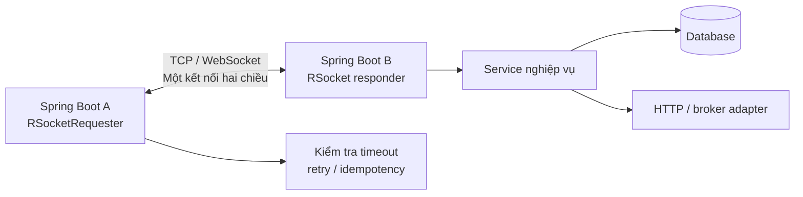
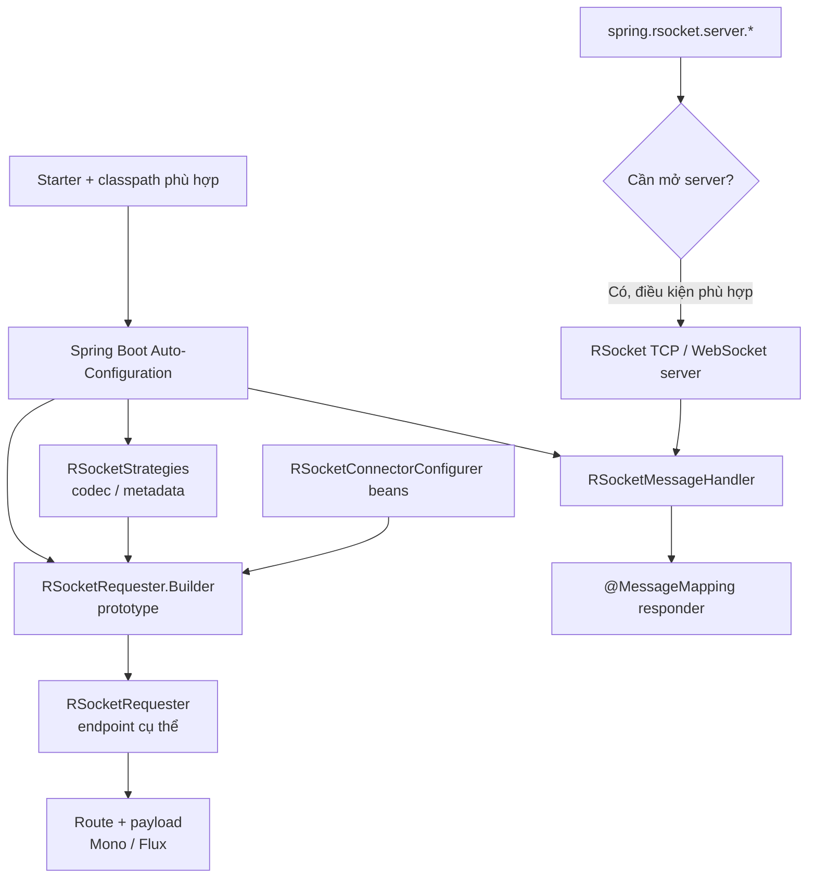
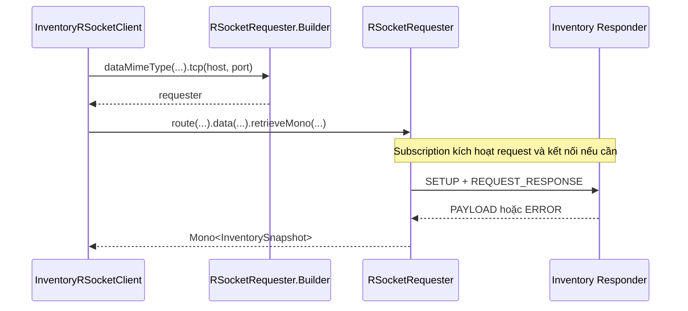
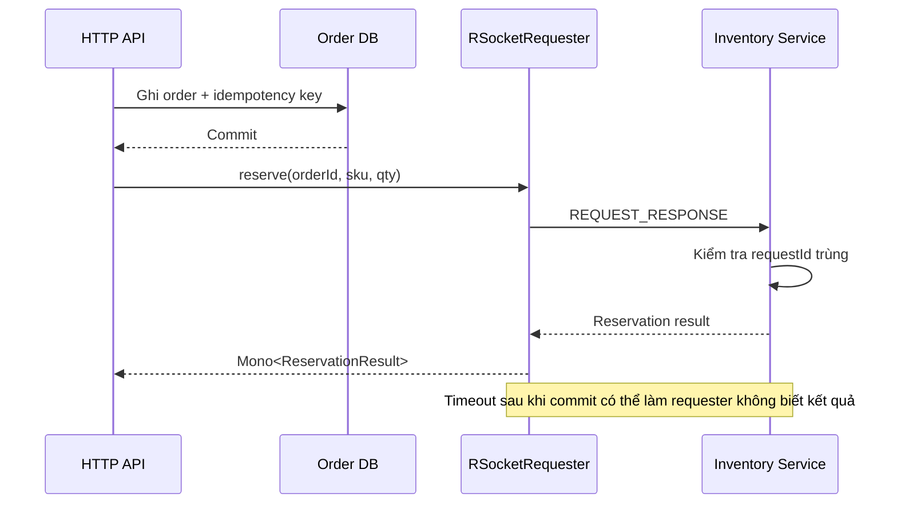

# RSocketRequester.Builder và cấu hình tự động của Spring Boot

## 1. Vì sao cần hiểu RSocketRequester.Builder?

Trong module **SPRING_BOOT_INTEGRATION**, ứng dụng có thể tích hợp qua HTTP client, database, cache, message broker và các adapter của Spring Integration. Ngoài những cách giao tiếp đó, **RSocket** phù hợp khi hai dịch vụ cần trao đổi thông điệp bất đồng bộ, duy trì kết nối và truyền dữ liệu theo luồng có cơ chế **backpressure**.

Ví dụ, hệ thống đơn hàng muốn truy vấn tồn kho theo yêu cầu, theo dõi cập nhật liên tục từ kho, hoặc truyền luồng sự kiện trạng thái giữa hai dịch vụ. `RSocketRequester` là API phía chủ động gửi yêu cầu, còn `RSocketRequester.Builder` quyết định cách khởi tạo requester: transport, codec, metadata của phiên kết nối và các tùy chỉnh thấp hơn của RSocket client.

Trong Spring Boot, thông thường **không cần tự tạo builder bằng `RSocketRequester.builder()`**. Khi đủ dependency và điều kiện tự cấu hình, Boot cung cấp một bean `RSocketRequester.Builder` dùng chung `RSocketStrategies` của application context. Bạn inject builder này rồi tạo requester cho endpoint thực tế.

Mục tiêu của bài:

1. Hiểu vai trò `RSocketRequester.Builder`, `RSocketRequester`, `RSocketStrategies` và `RSocketMessageHandler`.
2. Phân biệt **cấu hình tự động phía client** với **tự khởi động RSocket server**.
3. Sử dụng starter, TCP/WebSocket, setup metadata, codec, route và bốn interaction model.
4. Thiết kế cấu hình endpoint, timeout, retry, bảo mật, xử lý trùng lặp, kiểm thử và quan sát cho luồng tích hợp thực tế.

> Các ví dụ Java bên dưới minh họa phong cách Spring Boot 3.x/4.x và Spring Framework hiện đại (Java hỗ trợ `record`). Tên package hoặc các tùy chọn có thể thay đổi qua phiên bản lớn; dùng dependency management và tài liệu của chính phiên bản ứng dụng khi triển khai.

## 2. Phân biệt RSocket và những cơ chế tích hợp khác

RSocket là giao thức truyền thông điệp nhị phân, có thể chạy trên TCP hoặc WebSocket. Một kết nối có thể thực hiện nhiều request đồng thời, cho phép cả hai phía gửi yêu cầu và hỗ trợ các luồng phản ứng theo nhu cầu của bên nhận.

| Mô hình RSocket | Số dữ liệu gửi | Số dữ liệu nhận | Cách sử dụng trong tích hợp |
| --- | --- | --- | --- |
| **Request-Response** | Một yêu cầu | Một phản hồi | Tra cứu tồn kho, kiểm tra trạng thái đối tác |
| **Fire-and-Forget** | Một thông điệp | Không có payload phản hồi | Phát tín hiệu không cần phản hồi ở cấp giao thức |
| **Request-Stream** | Một yêu cầu | Một luồng nhiều phản hồi | Theo dõi cập nhật tồn kho/trạng thái |
| **Request-Channel** | Một luồng yêu cầu | Một luồng phản hồi | Đồng bộ hai chiều theo luồng |



**RSocket không phải message broker bền vững.** Backpressure giúp điều tiết lượng dữ liệu của stream; nó không thay thế queue lưu message, dead-letter queue, transaction hoặc khả năng replay khi một hệ thống ngừng hoạt động. Một lệnh fire-and-forget gửi thành công theo transport không chứng minh nghiệp vụ ở đối tác đã commit.

Nếu mục tiêu là chuyển giao lệnh có lưu trữ dài hạn, tách producer/consumer và xử lý lại sau downtime, hãy cân nhắc RabbitMQ/Kafka hoặc transactional outbox. Nếu cần giao tiếp tương tác hoặc streaming hai chiều, RSocket có thể là lựa chọn phù hợp hơn HTTP request ngắn.

## 3. Thêm spring-boot-starter-rsocket

### Maven

Nếu ứng dụng dùng Spring Boot parent hoặc BOM quản lý phiên bản:

```xml
<dependency>
    <groupId>org.springframework.boot</groupId>
    <artifactId>spring-boot-starter-rsocket</artifactId>
</dependency>
```

### Gradle

```groovy
dependencies {
    implementation 'org.springframework.boot:spring-boot-starter-rsocket'
}
```

Starter mang vào các thành phần cần thiết cho RSocket, Spring Messaging, Reactor và transport liên quan. Tùy loại ứng dụng, bạn có thể cần thêm `spring-boot-starter-webflux` nếu muốn gắn một endpoint RSocket qua WebSocket vào web server WebFlux.

Không tự phối hợp các phiên bản `rsocket-core`, `rsocket-transport-netty`, `spring-messaging` và Reactor khác với BOM của Spring Boot khi chưa có lý do tương thích rõ ràng. Lỗi `NoSuchMethodError` hoặc `ClassNotFoundException` sau nâng cấp thường đến từ việc trộn phiên bản không đồng bộ.

**Starter không tự quyết định server sẽ nghe ở đâu hoặc client sẽ kết nối endpoint nào.** Hai quyết định này có cấu hình riêng, được giải thích ở các mục dưới.

## 4. Các bean mà Spring Boot có thể tự cấu hình

Khi classpath và các điều kiện áp dụng đáp ứng, Spring Boot cung cấp hạ tầng RSocket thường dùng:

| Thành phần | Vai trò | Phạm vi / lưu ý |
| --- | --- | --- |
| `RSocketStrategies` | Cấu hình encoder, decoder, route matcher và metadata extraction | Thường được chia sẻ giữa các thành phần của ứng dụng |
| `RSocketRequester.Builder` | Chuẩn bị requester phía client với codecs và connector customizers | Bean **prototype**, vì builder có trạng thái |
| `RSocketMessageHandler` | Phân phối request tới các handler như `@MessageMapping` của phía responder | Cần có route handler thực tế nếu muốn xử lý yêu cầu |
| RSocket server infrastructure | Lắng nghe trên TCP hoặc WebSocket nếu cấu hình server hợp lệ | Không bắt buộc với một ứng dụng chỉ đóng vai client |
| Connector customizations | Áp dụng các `RSocketConnectorConfigurer` mà ứng dụng cung cấp cho builder | Phạm vi tác động tùy cách đăng ký bean và phiên bản |



**Auto-configuration là có điều kiện:** class có trên classpath chưa đủ nếu cấu hình liên quan bị loại trừ, bean custom làm Boot nhường chỗ hoặc context không phù hợp. Khi cần chẩn đoán thiếu bean, dùng `--debug` hoặc endpoint `/actuator/conditions` được bảo vệ để xem lý do match/không match.

### Vì sao builder là prototype?

Builder chứa cấu hình sẽ áp dụng cho một requester: data MIME type, setup metadata, connector customizations và lựa chọn transport. Nếu builder là singleton bị nhiều phần của ứng dụng sửa đồng thời, cấu hình đối tác A có thể vô tình ảnh hưởng requester của đối tác B.

Spring Boot tạo bean `RSocketRequester.Builder` theo scope **prototype**: mỗi lần Spring yêu cầu một instance từ bean factory sẽ nhận builder mới. Tuy nhiên, **inject một prototype vào một singleton chỉ diễn ra một lần khi singleton được tạo**. Vì vậy:

- Một service với **một endpoint cố định** có thể inject builder trong constructor, cấu hình rồi tạo `RSocketRequester` một lần.
- Một factory tạo requester cho **nhiều endpoint khác nhau** nên dùng `ObjectProvider<RSocketRequester.Builder>` để lấy builder mới mỗi lần tạo.
- `RSocketRequester` đã tạo thường được tái sử dụng cho nhiều request đến cùng endpoint; không tạo connection/requester mới cho từng thông điệp.

## 5. RSocketStrategies, codec và MIME type

RSocket mang **data** và **metadata** riêng biệt. Builder dùng `RSocketStrategies` để chuyển DTO Java thành bytes và giải mã dữ liệu trả về. Spring Boot cấu hình các codec có sẵn theo classpath; các phiên bản Boot hiện đại thường thử đăng ký CBOR và JSON với Jackson khi các dependency phù hợp có mặt.

| Thành phần | Câu hỏi cần trả lời |
| --- | --- |
| `dataMimeType` | Payload của kết nối được mã hóa theo định dạng nào? |
| `metadataMimeType` | Metadata như routing/authentication được đóng gói theo định dạng nào? |
| `RSocketStrategies` | Có encoder và decoder thực sự hỗ trợ DTO và MIME type đã chọn không? |
| `RSocketStrategiesCustomizer` | Có cần thêm codec, route matcher hoặc metadata extraction chuyên biệt không? |
| `@MessageMapping` | Route tới method nào, và method nhận/trả kiểu dữ liệu gì? |

Ví dụ chọn JSON rõ ràng phía client:

```java
import org.springframework.http.MediaType;
import org.springframework.messaging.rsocket.RSocketRequester;

RSocketRequester requester = builder
    .dataMimeType(MediaType.APPLICATION_JSON)
    .tcp("localhost", 9898);
```

Đoạn mã giả định `builder` là `RSocketRequester.Builder` đã được inject. Nếu chọn `application/json`, cả hai phía phải có codec JSON tương thích, đồng thời thống nhất tên trường, kiểu dữ liệu và version của DTO.

**Không mặc định “thêm starter là mọi kiểu payload đều dùng được”.** Custom DTO, Protobuf, CBOR, cấu trúc generic, hoặc metadata riêng có thể cần encoder/decoder phù hợp. Nếu một phía dùng CBOR và phía kia chỉ chấp nhận JSON, setup hoặc request có thể thất bại dù TCP kết nối thành công.

### Tùy biến codec tập trung

Spring Boot hỗ trợ bean `RSocketStrategiesCustomizer` để bổ sung codec hoặc tùy biến strategies. Khi có nhiều customizer, thứ tự thực thi (`@Order`) có thể ảnh hưởng thứ tự chọn codec. Chỉ tự định nghĩa `RSocketStrategies` hoàn chỉnh khi thực sự muốn thay thế cấu hình mặc định; dễ bỏ mất codec/hạ tầng đang được Boot cấu hình nếu tạo một strategies rỗng.

Với ứng dụng vừa đóng vai server vừa đóng vai client, nên giữ chính sách serialization nhất quán. Tuy vậy, **hợp đồng giữa các service** vẫn cần versioning và kiểm thử riêng; chia sẻ cùng `RSocketStrategies` trong một tiến trình không bảo đảm hai triển khai khác nhau tương thích.

## 6. Cấu hình RSocket server chạy TCP độc lập

Một ứng dụng đóng vai responder có thể mở RSocket server TCP riêng. Ví dụ `application.yml`:

```yaml
spring:
  rsocket:
    server:
      address: 0.0.0.0
      port: 9898
      transport: tcp
```

Trong ví dụ:

- `spring.rsocket.server.port` yêu cầu tạo server lắng nghe trên cổng `9898` nếu điều kiện tự cấu hình phù hợp.
- `spring.rsocket.server.transport` chọn `tcp`.
- `spring.rsocket.server.address` là địa chỉ **bind server**, không phải host của hệ thống downstream mà client muốn gọi.
- Đây là cổng **RSocket TCP**, khác với cổng HTTP `server.port`. HTTP client thông thường không thể gửi HTTP JSON tới cổng RSocket TCP này.

Khi phát triển trên máy riêng, có thể bind `127.0.0.1` để giới hạn truy cập local. Trong container, địa chỉ `0.0.0.0` làm server lắng nghe trên các interface; vẫn phải dùng chính sách network và bảo mật thích hợp.

Khởi động thành công không chứng minh một route như `inventory.snapshot` tồn tại. Bạn cần khai báo responder bằng `@Controller` + `@MessageMapping` hoặc một cơ chế responder tương đương.

## 7. Cấu hình RSocket qua WebSocket

Khi muốn RSocket dùng chung một WebFlux web server chạy trên Reactor Netty, cấu hình thường gặp:

```yaml
server:
  port: 8080

spring:
  rsocket:
    server:
      transport: websocket
      mapping-path: /rsocket
```

Với điều kiện web application là **reactive** và web server dùng **Reactor Netty**, endpoint RSocket được gắn vào đường dẫn `/rsocket` của WebSocket server. Trong mô hình này không cần khai báo thêm `spring.rsocket.server.port` cho một RSocket server độc lập.

Phía client dùng WebSocket transport:

```java
import java.net.URI;
import org.springframework.messaging.rsocket.RSocketRequester;

RSocketRequester requester =
    builder.webSocket(URI.create("ws://localhost:8080/rsocket"));
```

Khi triển khai production với TLS, endpoint thường là `wss://...`, đi kèm certificate verification/trust và cấu hình reverse proxy hỗ trợ WebSocket upgrade. `spring.rsocket.server.mapping-path` là cấu hình server WebSocket; nó không tự thay đổi đường dẫn của một requester được tạo bằng `tcp(...)`.

| Mô hình | Đường nhận request | Điều kiện đáng chú ý |
| --- | --- | --- |
| RSocket TCP riêng | `tcp(host, port)` | RSocket server port, mạng TCP, chính sách TLS |
| RSocket WebSocket riêng | `webSocket(URI)` | WebSocket transport, server endpoint độc lập |
| RSocket WebSocket trên WebFlux | `webSocket(URI)` | WebFlux reactive, Reactor Netty, `mapping-path` đúng |
| HTTP REST thông thường | HTTP client như `WebClient` | Không dùng `RSocketRequester` để gọi endpoint REST |

**Đừng ghép `spring.rsocket.server.port` với `server.port` như thể chúng luôn là cùng một cổng.** Tùy cấu hình, ứng dụng có thể có hai server/port khác nhau hoặc chỉ có WebSocket mapping trên web server sẵn có.

## 8. Tạo RSocketRequester bằng builder được Boot quản lý

Tình huống: dịch vụ đơn hàng cần gọi route `inventory.snapshot` trên dịch vụ tồn kho qua TCP.

### 8.1. Hợp đồng dữ liệu dùng chung

Ví dụ dùng hai Java record. Trong dự án thực, chúng phải được khai báo ở các file Java và package phù hợp; cả producer lẫn responder cần hiểu cùng schema:

```java
public record InventoryQuery(String sku) {}

public record InventorySnapshot(
    String sku,
    long available,
    String source
) {}
```

### 8.2. Cấu hình endpoint của ứng dụng client

```yaml
integration:
  rsocket:
    inventory:
      host: ${INVENTORY_RSOCKET_HOST:localhost}
      port: ${INVENTORY_RSOCKET_PORT:9898}
```

Tiền tố `integration.rsocket.inventory.*` trong ví dụ là **thuộc tính do ứng dụng tự định nghĩa**, không phải property tự cấu hình RSocket client của Spring Boot. Mục đích là tách rõ **endpoint mà client kết nối** khỏi `spring.rsocket.server.*` (chỉ cấu hình server).

### 8.3. Service sử dụng builder

```java
import java.time.Duration;

import org.springframework.beans.factory.annotation.Value;
import org.springframework.http.MediaType;
import org.springframework.messaging.rsocket.RSocketRequester;
import org.springframework.stereotype.Service;
import reactor.core.publisher.Mono;

@Service
public class InventoryRSocketClient {

    private final RSocketRequester requester;

    public InventoryRSocketClient(
            RSocketRequester.Builder builder,
            @Value("${integration.rsocket.inventory.host}") String host,
            @Value("${integration.rsocket.inventory.port}") int port) {

        this.requester = builder
            .dataMimeType(MediaType.APPLICATION_JSON)
            .tcp(host, port);
    }

    public Mono<InventorySnapshot> getSnapshot(String sku) {
        return requester
            .route("inventory.snapshot")
            .data(new InventoryQuery(sku))
            .retrieveMono(InventorySnapshot.class)
            .timeout(Duration.ofSeconds(3));
    }
}
```

Luồng diễn ra như sau:

1. Spring Boot inject builder đã áp dụng `RSocketStrategies` và connector customizers của context.
2. Constructor cấu hình data MIME type và endpoint, rồi tạo `RSocketRequester` có thể tái sử dụng.
3. `getSnapshot` tạo yêu cầu gửi tới route `inventory.snapshot` và chờ **một** phản hồi.
4. `Mono<InventorySnapshot>` là chuỗi xử lý phản ứng. Việc gọi method đơn thuần **chưa thực hiện network request**; request được kích hoạt khi có subscription.
5. `timeout` giới hạn thời gian nhận phản hồi cho luồng này; lỗi timeout không chứng minh server chưa xử lý nghiệp vụ.

Theo API `tcp(host, port)` hiện đại, việc tạo requester **không nhất thiết mở kết nối ngay trong constructor**. Kết nối chia sẻ thường được thiết lập khi có request và có thể được thiết lập lại khi cần. Vì thế, ứng dụng start thành công không có nghĩa endpoint tồn kho đã sẵn sàng.

### 8.4. Responder bên dịch vụ tồn kho

Ở application lắng nghe `spring.rsocket.server.port=9898`:

```java
import org.springframework.messaging.handler.annotation.MessageMapping;
import org.springframework.stereotype.Controller;
import reactor.core.publisher.Mono;

@Controller
public class InventoryRSocketController {

    @MessageMapping("inventory.snapshot")
    public Mono<InventorySnapshot> snapshot(InventoryQuery query) {
        // Minh họa: thay bằng service đọc dữ liệu tồn kho thật.
        return Mono.just(
            new InventorySnapshot(query.sku(), 42, "warehouse-a")
        );
    }
}
```

Method `@MessageMapping` là **responder route**, khác với `@GetMapping` của HTTP. Số lượng giá trị trả về phải phù hợp interaction model mà requester mong đợi. Nếu thêm đọc dữ liệu blocking JDBC, không gọi database blocking trực tiếp trên event loop của Reactor Netty; cần thiết kế scheduler/adapter phù hợp hoặc dùng reactive driver/Repository.

## 9. Những phương thức cấu hình chính của Builder

`RSocketRequester.Builder` cho phép điều chỉnh cả dữ liệu ở **SETUP frame** lẫn cách client vận hành:

| API | Tác dụng | Ghi chú |
| --- | --- | --- |
| `dataMimeType(MimeType)` | Chọn định dạng data cho kết nối | Phải phù hợp codec hai phía |
| `metadataMimeType(MimeType)` | Chọn định dạng metadata cho kết nối | Mặc định thường là composite metadata |
| `setupData(Object)` | Đưa dữ liệu vào SETUP frame | Không phải payload của từng request |
| `setupRoute(String,...)` | Khai báo route của SETUP để server xử lý khi kết nối | Khác với route riêng của từng request |
| `setupMetadata(Object, MimeType)` | Đưa metadata vào SETUP | Có thể dùng cho thông tin kết nối nếu hợp đồng yêu cầu |
| `rsocketStrategies(...)` | Chỉ định/tùy biến codec và metadata extraction | Chú ý tránh làm mất strategies của Boot |
| `rsocketConnector(...)` | Tùy biến `RSocketConnector` thấp hơn | Keepalive, interceptor, session settings, v.v. |
| `tcp(host, port)` | Tạo requester qua TCP | Không chấp nhận URL HTTP |
| `webSocket(uri)` | Tạo requester qua WebSocket | URI phải đúng scheme/path/port |
| `transport(clientTransport)` | Tạo requester trên transport đã tùy biến | Dùng khi cần SSL, proxy hoặc cấu hình client transport riêng |



Điểm cần phân biệt:

- `setupRoute("bootstrap")` mô tả route của **SETUP**, trong khi `requester.route("inventory.snapshot")` là route của **từng request**.
- `dataMimeType` và `metadataMimeType` thường áp dụng trên **kết nối**, không tự đổi codec theo từng method gọi.
- `rsocketConnector` là API mức thấp; không cần sử dụng nếu cấu hình mặc định đã đáp ứng nhu cầu.
- `connectTcp(...)` và `connectWebSocket(...)` là các API cũ đã được đánh dấu deprecated trong nhiều phiên bản Spring Framework; các ví dụ hiện đại nên dùng `tcp(...)` và `webSocket(...)`.

## 10. Bốn interaction model qua RSocketRequester

### 10.1. Request-Response

Gửi một truy vấn, nhận một kết quả:

```java
Mono<InventorySnapshot> result = requester
    .route("inventory.snapshot")
    .data(new InventoryQuery("SKU-001"))
    .retrieveMono(InventorySnapshot.class);
```

Dùng cho các thao tác tương tự HTTP GET hoặc request/reply, nhưng nhớ rằng RSocket không tự gán HTTP status code 2xx/4xx/5xx. Lỗi phía responder được truyền theo cơ chế lỗi RSocket/Reactive Stream và cần mapping sang lỗi miền nghiệp vụ.

### 10.2. Fire-and-Forget

Gửi tín hiệu không nhận payload phản hồi:

```java
Mono<Void> sent = requester
    .route("inventory.invalidate-cache")
    .data("SKU-001")
    .send();
```

`send()` trả về `Mono<Void>`. Hoàn tất của Mono này thể hiện yêu cầu gửi ở cấp API/giao thức; **không** chứng minh responder đã cập nhật cache, lưu DB hay xử lý hoàn toàn. Với công việc cần bảo đảm và retry sau crash, phải dùng cơ chế lưu vết/ack nghiệp vụ riêng.

### 10.3. Request-Stream

Gửi một yêu cầu, nhận nhiều bản tin:

```java
Flux<InventorySnapshot> updates = requester
    .route("inventory.watch")
    .data(new InventoryQuery("SKU-001"))
    .retrieveFlux(InventorySnapshot.class)
    .take(10);
```

Responder minh họa:

```java
import java.time.Duration;
import org.springframework.messaging.handler.annotation.MessageMapping;
import org.springframework.stereotype.Controller;
import reactor.core.publisher.Flux;

@Controller
public class InventoryWatchController {

    @MessageMapping("inventory.watch")
    public Flux<InventorySnapshot> watch(InventoryQuery query) {
        return Flux.interval(Duration.ofSeconds(1))
            .map(index -> new InventorySnapshot(
                query.sku(), 42 + index, "warehouse-a"
            ));
    }
}
```

Ví dụ phát dữ liệu tổng hợp theo timer; production thường gắn với event stream nghiệp vụ. Khi client hủy sau 10 bản tin, cancellation sẽ đi ngược về nguồn stream nếu các thành phần upstream hỗ trợ. **Backpressure** là kiểm soát tốc độ trong luồng đang chạy, không bảo đảm lịch sử bản tin bị bỏ lỡ được lưu lại.

### 10.4. Request-Channel

Cả hai phía phát nhiều giá trị, ví dụ đồng bộ cập nhật theo luồng. Về ý tưởng:

```java
Flux<InventoryQuery> queries = Flux.just(
    new InventoryQuery("SKU-001"),
    new InventoryQuery("SKU-002")
);

Flux<InventorySnapshot> replies = requester
    .route("inventory.batch-channel")
    .data(queries, InventoryQuery.class)
    .retrieveFlux(InventorySnapshot.class);
```

Responder sẽ cần handler phù hợp với `Flux<InventoryQuery>` và có thể trả về `Flux<InventorySnapshot>`. Cần nhất quán loại tương tác: **many-to-one** trong cùng một RSocket request không phải kết hợp hợp lệ của requester API cho request-channel theo cách thông thường; nếu muốn gom nhiều bản tin để lấy một kết quả, hãy định nghĩa hợp đồng khác hoặc tổng hợp phía ứng dụng trước.

### So sánh ngắn API

| Mong đợi | Requester API |
| --- | --- |
| Một phản hồi | `retrieveMono(T.class)` |
| Một luồng phản hồi | `retrieveFlux(T.class)` |
| Gửi không cần payload phản hồi | `send()` |
| Metadata push | `sendMetadata()` với cấu hình metadata phù hợp |

Không tự `subscribe()` trong service chỉ để “chạy cho chắc” rồi bỏ qua lỗi. Ở tầng ứng dụng reactive, thường trả `Mono`/`Flux` cho thành phần gọi để điều khiển vòng đời, cancellation, tracing và lỗi. Ở tầng tích hợp bắt buộc thực thi nền, phải có một thành phần quản lý subscription, retry và kết quả.

## 11. Builder prototype khi gọi nhiều đối tác

Nếu có nhiều RSocket server với cấu hình setup riêng, không nên dùng lại **một** builder mutable để thay host/metadata liên tiếp. Sử dụng `ObjectProvider` để lấy một builder mới khi tạo requester:

```java
import org.springframework.beans.factory.ObjectProvider;
import org.springframework.http.MediaType;
import org.springframework.messaging.rsocket.RSocketRequester;
import org.springframework.stereotype.Component;

@Component
public class PartnerRSocketRequesterFactory {

    private final ObjectProvider<RSocketRequester.Builder> builders;

    public PartnerRSocketRequesterFactory(
            ObjectProvider<RSocketRequester.Builder> builders) {
        this.builders = builders;
    }

    public RSocketRequester forEndpoint(String host, int port) {
        return builders.getObject()
            .dataMimeType(MediaType.APPLICATION_JSON)
            .tcp(host, port);
    }
}
```

Ví dụ chỉ minh họa **scope**. Trong production, không nhận `host`/`port` trực tiếp từ user input không tin cậy vì có thể gây kết nối tới endpoint ngoài ý muốn. Endpoint phải đến từ cấu hình được quản trị hoặc service discovery an toàn.

Nếu nhiều request dùng cùng đối tác, tạo requester một lần rồi tái sử dụng. Khi đối tác thay endpoint hoặc credential, xây cơ chế thay requester có kiểm soát và giải phóng tài nguyên liên quan theo API/phiên bản. Tránh tạo số lượng connection không giới hạn khi tải tăng hoặc tạo requester theo mỗi HTTP request.

## 12. Setup frame, routing metadata và bảo mật

Một kết nối RSocket bắt đầu bằng **SETUP frame**. SETUP có thể chứa MIME type, keepalive settings, dữ liệu và metadata mở đầu. Sau đó mỗi request có thể chứa route/metadata khác.

Ví dụ setup metadata mang một giá trị nhận diện client (không phải secret):

```java
import org.springframework.util.MimeTypeUtils;

RSocketRequester requester = builder
    .dataMimeType(MimeTypeUtils.APPLICATION_JSON)
    .setupMetadata(
        "order-service",
        MimeTypeUtils.parseMimeType("text/plain")
    )
    .tcp("inventory.internal", 9898);
```

Ví dụ này chỉ cho thấy API; muốn server đọc một metadata type tùy biến, cần cấu hình cách trích xuất metadata, hoặc handler phù hợp. **Đừng cho rằng bất kỳ `setupMetadata` nào đều tự động xuất hiện thành header Spring tại responder.**

Khi gửi metadata theo từng request, dùng `metadata(value, mimeType)` cùng route:

```java
import org.springframework.util.MimeType;
import org.springframework.util.MimeTypeUtils;

MimeType tenantType =
    MimeTypeUtils.parseMimeType("text/x-tenant-id");

Mono<InventorySnapshot> result = requester
    .route("inventory.snapshot")
    .metadata("tenant-42", tenantType)
    .data(new InventoryQuery("SKU-001"))
    .retrieveMono(InventorySnapshot.class);
```

Đây là metadata theo hợp đồng riêng; server phải đăng ký decoder/extractor tương ứng và kiểm tra quyền truy cập tenant. Không dùng một chuỗi `tenantId` trong metadata làm bằng chứng danh tính người gọi.

Về bảo mật:

- Dùng **TLS** khi truyền qua mạng không tin cậy. Phía server có thể sử dụng các thuộc tính `spring.rsocket.server.ssl.*` của Spring Boot khi phiên bản hỗ trợ; phía client phải cấu hình SSL/TLS cho **transport của requester** tương ứng.
- Cấu hình **authentication và authorization** của RSocket bằng Spring Security hoặc cơ chế được kiểm chứng. Các route có thể có quyền khác nhau dù cùng một connection.
- Không log bearer token, mật khẩu hoặc metadata nhạy cảm; không đặt secret vào code hoặc tài liệu mẫu.
- Khi kết nối WebSocket qua `wss://`, kiểm tra certificate chain, hostname, reverse proxy và chính sách WebSocket upgrade.
- Xác định ranh giới bảo mật giữa `setupMetadata` (mức kết nối) và metadata gắn với từng request.

RSocket không tự hiểu HTTP cookie, session hoặc bearer token chỉ vì kết nối chạy trên WebSocket. Phải thiết kế rõ cách Spring Security trích xuất và kiểm tra credential trong RSocket payload/metadata.

## 13. Tùy biến RSocketConnector và khôi phục kết nối

Spring Boot có thể áp dụng các bean `RSocketConnectorConfigurer` vào builder auto-configured. Thông qua `rsocketConnector(...)`, bạn có thể truy cập cấu hình cấp thấp hơn của `io.rsocket.core.RSocketConnector`, như keepalive, interceptors hoặc các khả năng do phiên bản RSocket hỗ trợ.

Ví dụ cấu hình connector cho một requester cụ thể:

```java
import java.time.Duration;
import org.springframework.messaging.rsocket.RSocketRequester;

RSocketRequester requester = builder
    .rsocketConnector(connector -> connector.keepAlive(
        Duration.ofSeconds(20),
        Duration.ofSeconds(90)
    ))
    .tcp("inventory.internal", 9898);
```

Các tham số keepalive phải phù hợp với mạng, proxy/load balancer và server. Ping/keepalive phát hiện một số trường hợp kết nối hỏng, nhưng không bảo đảm một side effect đã được commit ở đầu bên kia.

Trong Spring Framework hiện đại, requester có thể thiết lập lại connection chia sẻ khi request mới cần. Phải phân biệt:

- **Khôi phục kết nối:** có đường TCP/WebSocket mới khi connection cũ mất.
- **Gửi lại yêu cầu nghiệp vụ:** chạy lại route đã thất bại hoặc timeout.
- **Khôi phục luồng streaming:** tái đăng ký stream và xác định cần replay từ offset nào.
- **Exactly-once nghiệp vụ:** yêu cầu thiết kế idempotency/transaction riêng.

Tự động reconnect **không** đồng nghĩa request đang bay dở được phát lại chính xác một lần hoặc stream tiếp tục không mất bản tin.

## 14. Timeout, retry và backpressure

### Timeout tại nơi sử dụng

Các API trả `Mono`/`Flux` cho phép áp dụng timeout theo từng trường hợp. Với route tra cứu **chỉ đọc**:

```java
import java.time.Duration;
import reactor.core.publisher.Mono;
import reactor.util.retry.Retry;

public Mono<InventorySnapshot> readInventory(String sku) {
    return requester.route("inventory.snapshot")
        .data(new InventoryQuery(sku))
        .retrieveMono(InventorySnapshot.class)
        .timeout(Duration.ofSeconds(2))
        .retryWhen(
            Retry.backoff(2, Duration.ofMillis(200))
        );
}
```

Ví dụ này giới hạn thời gian mỗi lượt và retry tối đa hai lượt bổ sung; vì chưa lọc exception, nó có thể retry cả lỗi không khắc phục được. **Chỉ dùng để minh họa operator**; production nên lọc lỗi tạm thời và gắn giới hạn tổng thời gian, backoff, circuit breaker, bulkhead hoặc rate limit phù hợp.

Không tự động retry mọi route:

| Loại thao tác | Rủi ro khi retry | Khuyến nghị |
| --- | --- | --- |
| Tra cứu tồn kho chỉ đọc | Tăng tải, nhưng thường không nhân đôi side effect | Có thể retry hạn chế cho lỗi mạng tạm thời |
| Tạo đơn hàng | Server có thể đã lưu trước khi client timeout | Cần `requestId`/idempotency key và ràng buộc DB |
| Phát tín hiệu fire-and-forget | Client không biết kết quả nghiệp vụ | Cần trạng thái gửi, xác nhận nghiệp vụ hoặc broker nếu phải giao chắc chắn |
| Stream sự kiện | Reconnect có thể làm mất hoặc trùng bản tin | Có offset/cursor, replay và cơ chế deduplication |

### Backpressure có nghĩa gì?

Với `retrieveFlux`, downstream có thể kiểm soát lượng dữ liệu muốn nhận. RSocket chuyển demand qua ranh giới mạng để responder điều tiết stream nếu nguồn upstream hỗ trợ. Tuy nhiên:

- Nếu responder gọi JDBC blocking và gom toàn bộ dữ liệu vào list trước khi phát, backpressure không cứu được memory pressure đã xảy ra.
- `Flux.interval` hoặc luồng bên ngoài có thể có chiến lược riêng khi downstream chậm; cần test tải và cancellation.
- Backpressure không thay thế timeout, giới hạn concurrency, query pagination hoặc rate limit tới đối tác HTTP.
- Việc hủy subscription không tự động rollback transaction hoặc undo side effect đã commit.

## 15. Tính đúng đắn của luồng tích hợp: hợp đồng, giao dịch, trùng lặp

Trong một ứng dụng **SPRING_BOOT_INTEGRATION**, RSocket requester thường chỉ là một adapter trong chuỗi HTTP → database → RSocket → message broker hoặc ngược lại. Khi request đi qua nhiều hệ thống, một giao dịch ACID cục bộ không thể tự bao trùm mọi side effect ngoài database.

Ví dụ đơn hàng:



Để xử lý an toàn:

1. **Hợp đồng dữ liệu:** thống nhất route, data MIME type, metadata MIME type, DTO schema version, trường bắt buộc và thông điệp lỗi.
2. **Khóa idempotency:** gửi `orderId`/`requestId` ổn định để service nhận có thể trả lại kết quả cũ khi gặp yêu cầu trùng.
3. **Ranh giới transaction:** service nhận phải commit thay đổi và trạng thái xử lý trong transaction phù hợp; lỗi kết nối ngay sau commit phải được tính đến.
4. **Xử lý lỗi:** tách validation error, permission error, timeout, unavailable và lỗi xử lý tạm thời; không retry vô hạn.
5. **Khả năng phục hồi:** nếu một side effect bắt buộc phải xảy ra ngay cả khi app crash, dùng outbox, broker hoặc job retry bền vững để lưu ý định thực hiện.
6. **Quan sát:** liên kết HTTP trace ID với route RSocket, event ID và kết quả downstream; không log bí mật.

RSocket không có queue bền vững hay DLQ theo mặc định. Nếu một message cực kỳ quan trọng phải tồn tại sau khi cả hai đầu cùng offline, cần **lớp lưu trữ thông điệp riêng**.

## 16. Cấu hình môi trường, địa chỉ và secret

Một cấu hình tách rõ server với client:

```yaml
spring:
  rsocket:
    server:
      address: ${RSOCKET_BIND_ADDRESS:127.0.0.1}
      port: ${RSOCKET_SERVER_PORT:9898}
      transport: tcp

integration:
  rsocket:
    inventory:
      host: ${INVENTORY_RSOCKET_HOST:localhost}
      port: ${INVENTORY_RSOCKET_PORT:9898}
```

Đây là ví dụ một ứng dụng có thể vừa làm server vừa làm client, không phải yêu cầu mọi ứng dụng RSocket đều phải mở cổng. Nếu ứng dụng **chỉ là client**, thường không cần khai báo `spring.rsocket.server.port`.

Khi chạy Docker/Kubernetes:

- `localhost` trong container là chính container đó; dùng Kubernetes Service/DNS hoặc endpoint được cung cấp cho RSocket downstream.
- TCP RSocket và WebSocket RSocket phải dùng đúng cổng, giao thức và ingress/load balancer. HTTP health endpoint không tự xuất hiện ở cổng RSocket TCP.
- Secret hoặc token nên lấy từ secret manager hay biến môi trường và được truyền qua cơ chế authentication đã thiết kế.
- Nếu hai môi trường dùng codec hoặc route version khác nhau, không chỉ đổi host/port; cần kiểm thử hợp đồng tương thích.
- Cần cấu hình readiness/health cho dependency thiết yếu theo nghiệp vụ. Việc tạo `RSocketRequester` không kiểm chứng sẵn sàng downstream ở thời điểm startup.

Nên dùng `@ConfigurationProperties` cho bộ cấu hình nhiều endpoint và validate host/port/transport bằng Bean Validation ở ranh giới cấu hình. Ví dụ `@Value` ở mục 8 phù hợp để học API; khi số lượng partner lớn, typed properties giúp tránh lỗi copy-paste và nhầm endpoint.

## 17. Gỡ lỗi tự cấu hình RSocketRequester.Builder

Một lỗi điển hình:

```text
UnsatisfiedDependencyException:
  Error creating bean with name 'inventoryRSocketClient':
  No qualifying bean of type
  'org.springframework.messaging.rsocket.RSocketRequester$Builder'
  available
```

Đây là lỗi **không có bean builder được inject**; chưa đủ cơ sở để kết luận server bị mất kết nối. Hãy kiểm tra:

1. `spring-boot-starter-rsocket` có trong **runtime classpath của module thực chạy** không, hay chỉ có ở module phụ/test?
2. Các class Spring Messaging, RSocket core, Reactor Netty transport có tồn tại và có phiên bản tương thích không?
3. Auto-configuration của RSocketRequester/strategies có được xét và điều kiện có match không? Có exclusion hoặc bean custom làm Boot back off?
4. Ứng dụng đang chạy Spring Boot version nào? Có thay đổi dependency hoặc classpath sau nâng cấp không?
5. Bean có bị tiêm trong một test slice không bao gồm RSocket auto-configuration?
6. Có nhiều custom beans/qualifier khác nhau khiến injection không chọn được bean đúng không?

Bật report:

```bash
java -jar integration-service.jar --debug
```

Trong điều tra có kiểm soát, `/actuator/conditions` và `/actuator/beans` cũng hữu ích nếu Actuator được bật, endpoint được expose đúng và truy cập được bảo vệ. Tên class auto-configuration có thể thay đổi theo thế hệ Spring Boot; hãy tìm theo **RSocketRequester / RSocketStrategies** trong báo cáo thay vì bám cứng một package.

### Lỗi khác xuất hiện sau khi đã có builder

| Triệu chứng | Lớp lỗi có thể | Kiểm tra cụ thể |
| --- | --- | --- |
| `Connection refused` | TCP server không lắng nghe/sai host-port | `spring.rsocket.server.port`, network/DNS, endpoint phía client |
| `404`/WebSocket upgrade thất bại | Sai `mapping-path`, proxy hoặc web server type | WebFlux + Reactor Netty, URI `ws/wss`, ingress |
| `No handler for destination` | Thiếu `@MessageMapping` hoặc route sai | Route requester, component scan, responder mapping |
| Codec/serialization error | Không khớp MIME type hoặc DTO | `RSocketStrategies`, codec, schema version, constructor DTO |
| Kết nối mở nhưng request không hoàn tất | Responder block, không subscribe đúng, timeout không đặt | Reactor threads, operator, duration, downstream |
| Lỗi khi gọi `webSocket` vào cổng TCP | Chọn sai transport | Ghép đúng phương thức builder với server transport |
| Trả về kết quả rỗng bất ngờ | Route trả `Mono.empty()`, khác model response | Kiểm tra contract dữ liệu, error/empty semantics |
| Sự kiện bị xử lý lại | Timeout/reconnect/retry sau side effect | Idempotency key và transaction nghiệp vụ |
| App start bình thường dù server tắt | Requester lazy connect | Test request thực và định nghĩa health phù hợp |
| Latency tăng khi stream lớn | Downstream chậm, buffer/CPU/DB bottleneck | Demand, event loop, scheduler, codec và throughput |

Cần phân biệt **bean tồn tại**, **connection được thiết lập**, **route được tìm thấy**, **payload được giải mã**, và **nghiệp vụ hoàn tất**. Mỗi bước có biểu hiện lỗi khác nhau; sửa một bước không chứng minh các bước còn lại đã đúng.

## 18. Kiểm thử tích hợp với server thực

Mock `RSocketRequester` có thể hữu ích cho unit test của service, nhưng không kiểm chứng SETUP frame, transport, codec, routing hoặc tương tác `Mono`/`Flux`. Với tích hợp thực, hãy chạy một RSocket server thử nghiệm và gửi request qua `RSocketRequester.Builder` được Spring Boot inject.

Ví dụ một bài kiểm thử khởi động server TCP trên cổng test cố định:

```java
import static org.assertj.core.api.Assertions.assertThat;

import java.time.Duration;

import org.junit.jupiter.api.Test;
import org.springframework.beans.factory.annotation.Autowired;
import org.springframework.boot.test.context.SpringBootTest;

@SpringBootTest(properties = {
    "spring.rsocket.server.port=9899",
    "integration.rsocket.inventory.host=localhost",
    "integration.rsocket.inventory.port=9899"
})
class InventoryRSocketIT {

    @Autowired
    InventoryRSocketClient client;

    @Test
    void canRequestSnapshot() {
        InventorySnapshot response =
            client.getSnapshot("SKU-001").block(Duration.ofSeconds(5));

        assertThat(response).isNotNull();
        assertThat(response.sku()).isEqualTo("SKU-001");
        assertThat(response.available()).isEqualTo(42);
    }
}
```

Đoạn test **chỉ mang tính minh họa** và giả định cùng context test có `InventoryRSocketController` trả dữ liệu mẫu. Trong dự án thật, dùng cổng test được cấp động hoặc cô lập môi trường để tránh xung đột khi chạy song song; cần chú ý cách lấy cổng RSocket thực tế cho phiên bản Spring Boot sử dụng. Dùng `block(Duration)` trong test đồng bộ là có thể chấp nhận; không dùng blocking như vậy trên event loop trong luồng production.

Những kịch bản cần kiểm thử thêm:

| Kịch bản | Kết quả mong đợi |
| --- | --- |
| Server chưa mở cổng | Requester báo lỗi kết nối ở lúc subscription; lỗi được phân loại đúng |
| Request-Response hợp lệ | Đúng route, DTO, MIME type, trace/correlation ID |
| WebSocket mapping sai | Handshake thất bại có thể quan sát, không nhầm với lỗi codec |
| Server trả lỗi nghiệp vụ | Client nhận lỗi và mapping theo hợp đồng |
| Gửi cùng `requestId` hai lần | Side effect nghiệp vụ chỉ được áp dụng một lần |
| Mất kết nối giữa request có side effect | Retry/khôi phục đúng chính sách và không nhân đôi side effect |
| Request-Stream bị cancel | Nguồn phát dừng hoặc giải phóng tài nguyên theo thiết kế |
| Codec JSON/CBOR không khớp | Test bắt được lỗi trước khi deploy |
| Client chậm hơn server | Demand/backpressure và memory usage trong ngưỡng chấp nhận |
| Nâng version DTO/route | Consumer và provider cũ/mới vẫn đáp ứng hợp đồng đã công bố |

Nếu ứng dụng sử dụng Spring Integration RSocket inbound/outbound gateway, phải kiểm chứng cả `MessageChannel`, header mapping, error channel và timeout của flow, ngoài kiểm thử RSocket transport.

## 19. Quan sát và vận hành

Mỗi lần gọi RSocket quan trọng nên có:

- **Tương quan:** request ID, route, client/service name, trace/span ID, business event ID. Không log toàn bộ payload nhạy cảm.
- **Thời gian:** độ trễ kết nối, thời gian tới phản hồi đầu tiên, duration stream, timeout và số lần retry.
- **Kết quả:** số request thành công/thất bại theo route, lỗi codec, route unknown, authentication/authorization rejected.
- **Tài nguyên:** số kết nối hoạt động, lượng yêu cầu đồng thời, cancellation, mức sử dụng event loop/thread pool, bộ nhớ/buffer.
- **Nghiệp vụ:** số đơn hàng/tồn kho thực sự cập nhật, số request trùng, số lần đồng bộ thất bại và backlog của outbox nếu có.

Spring Boot Actuator, Micrometer, Reactor/Netty instrumentation hoặc các công cụ tracing có thể giúp, tùy dependency và cách bật instrumentation của phiên bản đang dùng. Không mặc định mọi metric chi tiết RSocket đều có sẵn khi chỉ thêm starter.

**Health check** cần thể hiện điều kiện thật: một bean requester tồn tại không đồng nghĩa peer đang khỏe; connection còn mở không đồng nghĩa route nghiệp vụ hoạt động; một request được gửi không đồng nghĩa cập nhật database đã commit.

## 20. Checklist triển khai trong dịch vụ tích hợp

1. Chọn RSocket vì thực sự cần **interaction/streaming**, không chỉ vì muốn thay HTTP.
2. Thêm `spring-boot-starter-rsocket` vào đúng runtime module và giữ các dependency cùng BOM Spring Boot.
3. Xác định ứng dụng **client, server, hay cả hai**; chỉ khai báo `spring.rsocket.server.*` khi cần mở responder.
4. Inject `RSocketRequester.Builder` từ Boot và tạo requester cho endpoint cụ thể; nhớ builder là **prototype** và có trạng thái.
5. Phân biệt `tcp(host, port)` và `webSocket(uri)`, URI/mapping-path, TLS và cổng.
6. Thống nhất data MIME type, metadata MIME type, codec, route, DTO version và cơ chế xử lý lỗi.
7. Tái sử dụng requester tới endpoint ổn định; với nhiều endpoint, dùng builder mới khi tạo requester.
8. Đặt timeout, retry có giới hạn, giới hạn tải, xử lý backpressure và cancellation đúng cách.
9. Chống xử lý trùng cho request gây side effect; dùng transaction/outbox khi cần khả năng phục hồi qua crash.
10. Kiểm thử thực tế request-response, fire-and-forget, request-stream/channel nếu sử dụng, lỗi kết nối, lỗi codec, authorization và reconnect.
11. Theo dõi route-level latency, error, retry, connection health và kết quả nghiệp vụ; bảo vệ token/metadata.
12. Khi nâng phiên bản, so dependency graph, auto-configuration conditions, API deprecated và cấu hình SSL/codec trên môi trường kiểm thử trước khi triển khai.

## 21. Tình huống tự đánh giá

Một dịch vụ quản lý đơn hàng dùng Spring Boot nhận HTTP request và cần gọi RSocket tới dịch vụ tồn kho. Nhóm triển khai gặp bốn lỗi:

- Ứng dụng khởi động được, nhưng request đầu tiên báo `Connection refused`.
- Client gọi `tcp("inventory.internal", 9898)` trong khi server chỉ expose `wss://inventory.example.com/rsocket`.
- Sau khi sửa transport, DTO vẫn không decode được vì client chọn JSON nhưng responder đang chờ codec khác.
- Trong một số lần timeout, lệnh giữ hàng được thực thi hai lần vì client tự retry.

Hướng xử lý:

1. **Startup thành công không chứng minh đã connect:** `RSocketRequester` được tạo trước, còn network connect thường xảy ra khi request được subscribe.
2. **Transport phải khớp:** Với server WebSocket/TLS, sử dụng `builder.webSocket(URI.create("wss://inventory.example.com/rsocket"))` và bảo đảm proxy/chứng chỉ hợp lệ.
3. **Codec phải khớp:** Đối chiếu `dataMimeType`, `RSocketStrategies`, DTO và phiên bản hợp đồng của hai phía.
4. **Side effect phải idempotent:** Lệnh giữ hàng phải có request ID ổn định; service tồn kho lưu kết quả hoặc dấu xử lý trùng trong transaction. Retry có backoff không thay cho cơ chế này.
5. **Kiểm chứng đủ tầng:** Test builder + connection + route + DTO + retry/idempotency + metrics, không dừng ở việc context có bean.

**Ghi nhớ:** Spring Boot auto-configures một **`RSocketRequester.Builder` prototype** với strategies phù hợp; ứng dụng sử dụng builder đó để tạo requester kết nối tới endpoint TCP hoặc WebSocket cụ thể. Tính tin cậy của một luồng **Spring Boot Integration** còn phụ thuộc vào hợp đồng payload, metadata, bảo mật, timeout, lỗi, idempotency, kiểm thử và khả năng quan sát từ đầu đến cuối.

## Tài liệu tham khảo

- [Spring Boot Reference – RSocket](https://docs.spring.io/spring-boot/reference/messaging/rsocket.html): auto-configuration của strategies, server, message handler và requester builder.
- [Spring Framework Reference – RSocket](https://docs.spring.io/spring-framework/reference/rsocket.html): request patterns, SETUP, data/metadata, codecs, requester và responder.
- [Spring Boot – Common Application Properties](https://docs.spring.io/spring-boot/appendix/application-properties/): kiểm tra những khóa `spring.rsocket.server.*` hỗ trợ trong phiên bản đang dùng.

Khi học với một bản Spring Boot cũ, luôn đối chiếu **phiên bản cụ thể** của các tài liệu trên để tránh sao chép API đã deprecated hoặc property được chuyển package.
