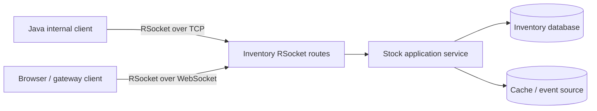
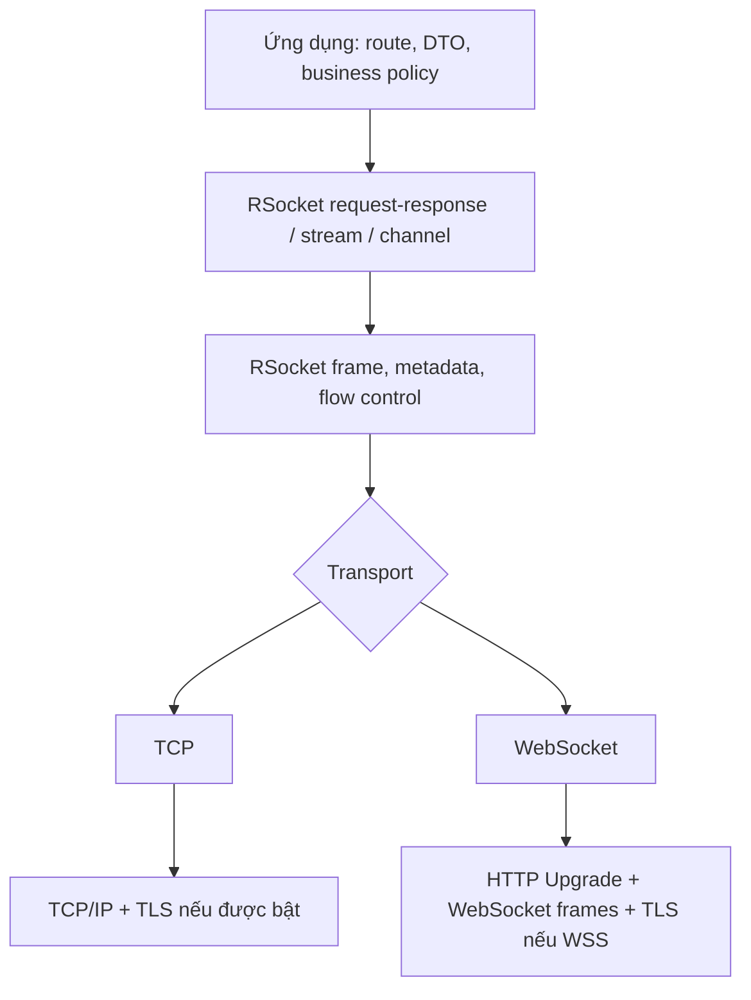
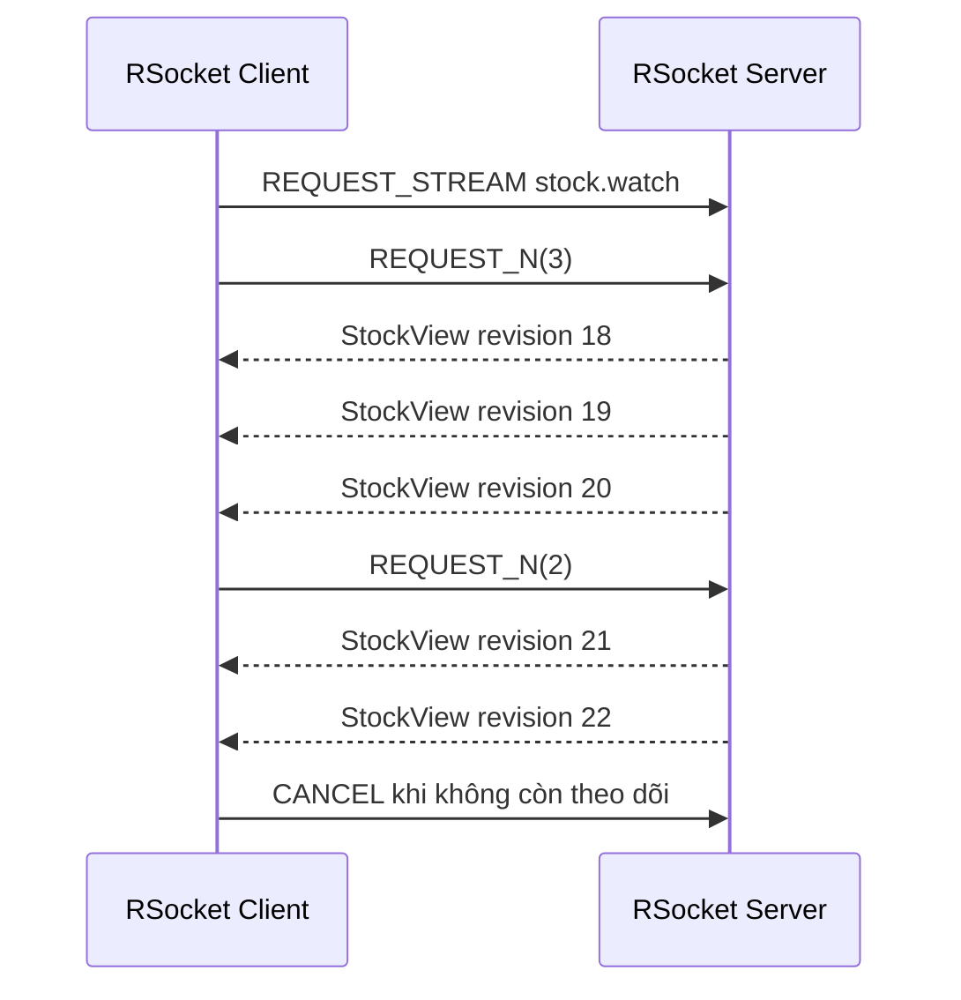
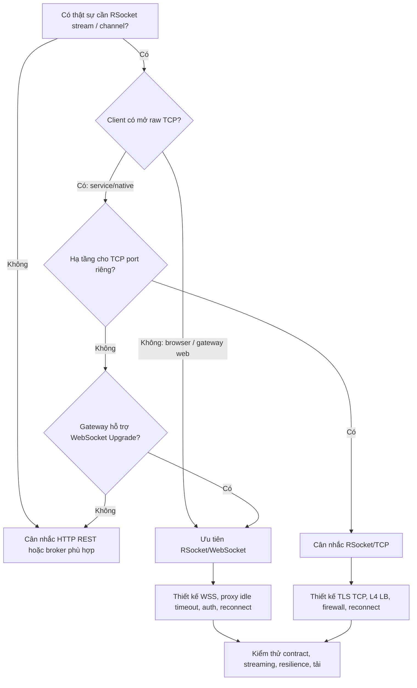

# Lựa chọn TCP hoặc WebSocket cho kết nối RSocket

## 1. Bối cảnh và mục tiêu

Một dịch vụ Spring Boot có thể trao đổi dữ liệu qua HTTP, cơ sở dữ liệu, cache, broker thông điệp hoặc những giao thức giao tiếp trực tiếp giữa ứng dụng. Khi cần một kết nối hai chiều, có khả năng truyền dữ liệu liên tục và kiểm soát số phần tử mà phía nhận sẵn sàng tiếp nhận, **RSocket** là một lựa chọn đáng xem xét. RSocket hỗ trợ các kiểu tương tác request–response, fire-and-forget, request–stream và channel. Những kiểu tương tác này có thể chạy trên nhiều **transport**, trong đó có **TCP** và **WebSocket**.

Trong module **SPRING_BOOT_INTEGRATION**, việc chọn transport là một quyết định kiến trúc tích hợp: phải xét đến cấu hình môi trường, hợp đồng payload/metadata, độ an toàn đường truyền, xử lý lỗi khi ngắt kết nối, tính nhất quán nghiệp vụ, kiểm thử và quan sát luồng thực tế. Module còn bao quát HTTP client, database, cache, message broker và các adapter Spring Integration; vì vậy cần hiểu RSocket phối hợp và khác những hệ thống đó ở đâu.

Bài này thuộc chương **RSocket**, tập trung trực tiếp vào câu hỏi: **khi nào nên dùng RSocket qua TCP, khi nào nên dùng RSocket qua WebSocket, và cấu hình mỗi lựa chọn trong Spring Boot như thế nào?**

Sau khi học, bạn có thể:

- Phân biệt **giao thức RSocket**, **transport TCP/WebSocket** và **mẫu tương tác** của ứng dụng.
- Đưa ra lựa chọn dựa trên loại client, proxy/load balancer, mạng triển khai, TLS, độ trễ và vận hành.
- Cấu hình máy chủ và `RSocketRequester` của Spring Boot cho từng transport.
- Thiết kế route, DTO, timeout, backpressure, xử lý ngắt kết nối và bảo mật theo hợp đồng cụ thể.
- Viết integration test chứng minh client thực sự giao tiếp qua TCP hoặc WebSocket, kiểm tra cả lỗi và giới hạn tài nguyên.

> **Mốc kỹ thuật:** Ví dụ hướng đến Java 17+, Spring Boot 3.2+ và Spring Framework 6.1+ với Reactor/RSocket Java. Tên cấu hình, khả năng transport và dependency có thể khác ở bản Boot hoặc thư viện RSocket khác. Khi dùng ví dụ với phiên bản cụ thể, kiểm tra API tương ứng và các chính sách mạng/TLS đang áp dụng.

### Tình huống xuyên suốt

Một **Order Console** theo dõi tồn kho từ **Inventory Service**. Backend Order cần đọc tồn kho hiện tại theo request–response; giao diện web cần xem các bản cập nhật liên tục. Inventory Service công bố hai route RSocket:

- `stock.get`: nhận mã SKU, trả một `StockView`.
- `stock.watch`: nhận mã SKU, trả một `Flux<StockView>` khi có cập nhật theo hợp đồng.

Ứng dụng Java chạy bên trong cùng mạng trung tâm dữ liệu có thể dùng RSocket/TCP; trình duyệt hoặc ứng dụng đi qua gateway HTTP/WebSocket có thể dùng RSocket/WebSocket. **Hợp đồng route và payload có thể giữ nguyên**, trong khi cách thiết lập kết nối thay đổi.



Sơ đồ biểu diễn **hai kiểu triển khai/đường truy cập** tới cùng logic route, không mặc nhiên khẳng định một instance Spring Boot với cấu hình tự động mặc định sẽ đồng thời mở cả TCP và WebSocket. Muốn phục vụ cả hai transport trên cùng một ứng dụng có thể cần tự cấu hình thêm các endpoint/server hoặc đặt gateway phù hợp; không chỉ ghép hai bộ thuộc tính YAML.

## 2. Tách ba khái niệm: RSocket, mẫu tương tác và transport

**RSocket** định nghĩa các frame, cơ chế thiết lập kết nối, luồng dữ liệu, metadata, thông báo lỗi và khả năng kiểm soát nhu cầu nhận dữ liệu. **Transport** đảm nhận việc truyền các frame ấy giữa hai đầu. **Mẫu tương tác** là ngữ nghĩa trao đổi mà phía ứng dụng mong muốn.

| Mẫu RSocket | Java thường gặp | Khi nào dùng |
|---|---|---|
| Request–response | `Mono<T>` | Tra cứu một kết quả, ví dụ stock của SKU |
| Fire-and-forget | `Mono<Void>` ở phía gửi | Thông báo không yêu cầu payload phản hồi |
| Request–stream | `Flux<T>` | Theo dõi biến động tồn kho, các sự kiện theo thời gian |
| Request–channel | `Flux<Input>` ↔ `Flux<Output>` | Trao đổi hai chiều nhiều phần tử trong cùng logical interaction |

Ví dụ, `stock.get` qua TCP và qua WebSocket đều là request–response ở tầng RSocket. Chọn WebSocket không tự biến một request thành luồng stream, cũng không làm thay đổi business contract.



### 2.1. RSocket qua TCP

RSocket/TCP dùng một kết nối TCP mang các frame RSocket; không cần mở đầu bằng HTTP Upgrade. Kiểu triển khai này phù hợp khi hai đầu là ứng dụng hoặc SDK có thể tạo kết nối TCP trực tiếp. Về hạ tầng, đường kết nối thường đi qua load balancer lớp 4, firewall và routing mạng nội bộ; muốn bảo mật trên mạng không hoàn toàn tin cậy phải cấu hình TLS đúng ở client/server hoặc một tầng transport bảo vệ tương đương.

### 2.2. RSocket qua WebSocket

RSocket/WebSocket bắt đầu bằng một HTTP/HTTPS request **Upgrade** tới endpoint WebSocket. Sau khi handshake thành công, các WebSocket frame mang dữ liệu RSocket trên một kết nối duy trì lâu dài. WebSocket có thể đi qua một số reverse proxy hoặc gateway đã được thiết kế cho HTTP/WebSocket. Trình duyệt thông thường không có quyền mở raw TCP socket tùy ý, vì vậy WebSocket là transport tự nhiên hơn nếu frontend dùng RSocket JavaScript.

**WebSocket không phải một HTTP REST request mới cho từng message.** Sau HTTP Upgrade, dữ liệu được truyền trên kết nối đã nâng cấp; các response bên trong RSocket là frame/protocol của RSocket, không có mã HTTP `200`/`404` riêng cho từng RSocket route.

### 2.3. RSocket không tự thay thế broker

RSocket cung cấp kết nối và tương tác trực tiếp. Một stream bị ngắt **không mặc nhiên có khả năng replay bền như queue/topic được lưu trữ trong broker**. Nếu sự kiện hoặc command phải tồn tại qua downtime và được phát lại có bảo đảm, cần thiết kế lưu trữ/outbox/broker, hoặc cơ chế cursor/replay ở tầng ứng dụng. Cũng không thể dùng fire-and-forget như bằng chứng rằng database ở phía nhận đã commit thành công.

## 3. Bảng lựa chọn TCP hoặc WebSocket

| Tiêu chí | RSocket/TCP | RSocket/WebSocket |
|---|---|---|
| Client phù hợp | Java/native service, SDK có quyền truy cập TCP | Trình duyệt, frontend, client đi qua HTTP/WebSocket gateway |
| Thiết lập kết nối | Kết nối TCP, RSocket setup trực tiếp | HTTP Upgrade thành WebSocket rồi RSocket setup |
| Cổng/đường dẫn | Host + cổng TCP | URL `ws://` hoặc `wss://` với path |
| Hạ tầng mạng | Thường cần cho phép cổng TCP chuyên biệt, L4 load balancing | Có thể dùng cổng web và L7 proxy hỗ trợ WebSocket Upgrade |
| TLS | Cần cấu hình transport TLS của client/server hoặc tầng bảo mật phù hợp | `wss://` dùng TLS của web endpoint; có thể tận dụng chính sách HTTPS/WSS |
| Proxy | Proxy HTTP thông thường không tự chuyển frame TCP RSocket | Phải hỗ trợ WebSocket Upgrade và kết nối dài; không phải proxy HTTP nào cũng đáp ứng |
| Hiệu năng | Có thể bớt overhead WebSocket/handshake trong cùng điều kiện | Có framing/Upgrade bổ sung; khác biệt thực phụ thuộc workload và hạ tầng |
| Backpressure RSocket | Có | Có; ngữ nghĩa request(n) không đổi theo transport |
| Quan sát | TCP connection, TLS handshake, frame/route, reconnect | Thêm HTTP Upgrade, WebSocket disconnect, proxy idle timeout |
| Trình duyệt | Không mở raw TCP theo API web thông thường | Hỗ trợ qua WebSocket của môi trường browser |
| Triển khai với Spring Boot | RSocket server lắng nghe port riêng | Với Spring WebFlux, có thể gắn RSocket endpoint vào HTTP server |

### Quy tắc chọn theo bối cảnh

1. **Giao tiếp Java-to-Java nội bộ**, mạng cho phép TCP tới port riêng và đội vận hành kiểm soát hạ tầng: cân nhắc **TCP** vì ít lớp giao thức hơn.
2. **Client là trình duyệt** hoặc cần đi qua proxy/gateway hỗ trợ WebSocket, dùng chung đường vào HTTPS: chọn **WebSocket**, ưu tiên `wss://` khi đi qua mạng production.
3. **Gateway chỉ hỗ trợ HTTP request/response và không cho Upgrade**: WebSocket không giải quyết được vấn đề nếu hạ tầng không hỗ trợ; cần điều chỉnh gateway hoặc chọn một giao thức được hỗ trợ (chẳng hạn HTTP API).
4. **Ứng dụng cần lưu thông điệp khi receiver offline, retry có kiểm soát hoặc replay bền**: cân nhắc message broker và outbox. Lựa chọn TCP/WebSocket không tự cung cấp các bảo đảm này.
5. **Ứng dụng chỉ gọi vài API request–response đơn giản**: REST/`RestClient` có thể dễ triển khai và quan sát hơn; RSocket phù hợp hơn khi có nhu cầu rõ về stream/channel và kết nối dài.

Khi cả hai transport đều khả thi, đừng quyết định chỉ bằng giả định “TCP luôn nhanh hơn”. Hãy đo độ trễ p95/p99, throughput, CPU, số connection, chi phí TLS, tỷ lệ reconnect và hoạt động của proxy dưới workload dự kiến.

## 4. Tạo hợp đồng RSocket độc lập với transport

### 4.1. Dependency

Với Maven và Spring Boot parent/BOM:

```xml
<dependencies>
    <dependency>
        <groupId>org.springframework.boot</groupId>
        <artifactId>spring-boot-starter-rsocket</artifactId>
    </dependency>
    <dependency>
        <groupId>org.springframework.boot</groupId>
        <artifactId>spring-boot-starter-test</artifactId>
        <scope>test</scope>
    </dependency>
    <dependency>
        <groupId>io.projectreactor</groupId>
        <artifactId>reactor-test</artifactId>
        <scope>test</scope>
    </dependency>
</dependencies>
```

Nếu muốn **server WebSocket dùng chung HTTP/WebFlux server**, bổ sung:

```xml
<dependency>
    <groupId>org.springframework.boot</groupId>
    <artifactId>spring-boot-starter-webflux</artifactId>
</dependency>
```

Không mặc nhiên thêm `spring-boot-starter-web` chỉ vì WebSocket có handshake HTTP: ví dụ WebSocket ở đây dùng hạ tầng **reactive WebFlux**. Nếu dự án có cả MVC và WebFlux starter, Spring Boot có thể chọn kiểu ứng dụng servlet; phải xác nhận web application type và cách mapping RSocket phù hợp trước khi kỳ vọng property WebFlux được dùng.

### 4.2. Định nghĩa DTO có contract rõ ràng

```java
// StockQuery.java
public record StockQuery(String sku) {}

// StockView.java
public record StockView(
        String sku,
        long available,
        long revision,
        Instant observedAt
) {}
```

`revision` thể hiện phiên bản dữ liệu theo định nghĩa của Inventory; `observedAt` là thời điểm quan sát, không nên dùng làm khóa idempotency. Với dữ liệu động, phía phát và nhận cần thống nhất các trường bắt buộc, trường có thể thiếu, cách xử lý version mới, error route/code và giới hạn kích thước payload. Bất kể transport nào, deserialize một JSON không hợp lệ vẫn là lỗi hợp đồng dữ liệu.

### 4.3. Ánh xạ route bằng `@MessageMapping`

```java
// StockRSocketController.java — imports lược bỏ
@Controller
public class StockRSocketController {
    private final StockApplicationService service;

    public StockRSocketController(StockApplicationService service) {
        this.service = service;
    }

    @MessageMapping("stock.get")
    public Mono<StockView> getStock(StockQuery query) {
        return validate(query)
                .flatMap(value -> service.findCurrent(value.sku()));
    }

    @MessageMapping("stock.watch")
    public Flux<StockView> watchStock(StockQuery query) {
        return validate(query)
                .flatMapMany(value -> service.watch(value.sku()));
    }

    private Mono<StockQuery> validate(StockQuery query) {
        if (query == null || query.sku() == null
                || query.sku().isBlank()) {
            return Mono.error(new IllegalArgumentException(
                    "sku phải có giá trị"));
        }
        return Mono.just(query);
    }
}
```

`StockApplicationService` là một contract nội bộ được triển khai theo database/cache/nguồn sự kiện thật, ví dụ:

```java
public interface StockApplicationService {
    Mono<StockView> findCurrent(String sku);
    Flux<StockView> watch(String sku);
}
```

Server method `stock.get` trả một kết quả hoặc tín hiệu lỗi; `stock.watch` trả stream. Kiểu `Flux` không bắt buộc có dữ liệu ngay; với stream dài, client phải có quy định khi không có event, khi connection bị ngắt và khi nào hủy đăng ký. Đây là contract của ứng dụng **không gắn với TCP hay WebSocket**.

Spring RSocket dùng message codec/metadata strategies để chuyển route và payload giữa frame và Java DTO. Ví dụ giả định Jackson JSON converter đã được cấu hình phù hợp từ starter; nếu service/client dùng codec khác như CBOR, Protobuf hoặc content type tùy chỉnh, hai bên phải thống nhất MIME type và codec.

## 5. RSocket/TCP trong Spring Boot

### 5.1. Server lắng nghe port TCP

Trong ứng dụng RSocket server với starter phù hợp, có thể cấu hình:

```yaml
# application-rsocket-tcp.yml
spring:
  rsocket:
    server:
      transport: tcp
      port: 7000
```

Với cấu hình này, server RSocket lắng nghe ở TCP port `7000` (nếu port khả dụng và ứng dụng khởi tạo RSocket server thành công). Đây không phải endpoint HTTP `http://localhost:7000`. Client cần dùng RSocket/TCP đúng giao thức để kết nối. Port `7000` chỉ là ví dụ; production nên lấy từ cấu hình môi trường và đặt firewall/network policy.

Nếu ứng dụng đồng thời có HTTP API, HTTP server và RSocket/TCP có thể chạy trên **cổng khác nhau**. Các chính sách health check, load balancing, TLS và firewall phải xét từng endpoint.

### 5.2. Client dùng `RSocketRequester.Builder.tcp`

```yaml
# application.yml của client
integration:
  inventory:
    rsocket:
      host: ${INVENTORY_RSOCKET_HOST:localhost}
      port: ${INVENTORY_RSOCKET_PORT:7000}
```

```java
// InventoryTcpRequesterConfiguration.java — imports lược bỏ
@Configuration(proxyBeanMethods = false)
public class InventoryTcpRequesterConfiguration {

    @Bean
    RSocketRequester inventoryRequester(
            RSocketRequester.Builder builder,
            @Value("${integration.inventory.rsocket.host}") String host,
            @Value("${integration.inventory.rsocket.port}") int port
    ) {
        return builder.tcp(host, port);
    }
}
```

`RSocketRequester.Builder` do Spring Boot cấu hình khi có các dependency tương ứng. Requester nên được quản lý như một client dùng lại, thay vì tạo một kết nối mới cho mọi request. Việc mở kết nối, tái kết nối và vòng đời tài nguyên cần được kiểm soát theo cấu hình của RSocket Java và ứng dụng.

### 5.3. Gửi request–response và nhận request–stream

```java
// InventoryRSocketGateway.java — imports lược bỏ
@Service
public class InventoryRSocketGateway {
    private final RSocketRequester requester;

    public InventoryRSocketGateway(
            @Qualifier("inventoryRequester")
            RSocketRequester requester
    ) {
        this.requester = requester;
    }

    public Mono<StockView> getStock(String sku) {
        return requester.route("stock.get")
                .data(new StockQuery(sku))
                .retrieveMono(StockView.class)
                .timeout(Duration.ofSeconds(3));
    }

    public Flux<StockView> watchStock(String sku) {
        return requester.route("stock.watch")
                .data(new StockQuery(sku))
                .retrieveFlux(StockView.class);
    }
}
```

`retrieveMono` yêu cầu một kết quả theo mẫu request–response; `retrieveFlux` biểu diễn stream theo mẫu request–stream. `timeout(Duration.ofSeconds(3))` đặt thời hạn đối với Publisher khi có subscription, **không phải** bảo đảm rằng transaction database phía server đã bị rollback nếu request bị hủy. Với stream dài, đặt timeout cho **toàn stream** có thể làm nó bị dừng ngoài ý muốn; nên xác định cơ chế heartbeat/idle timeout, timeout cho từng bản cập nhật hoặc giới hạn tuổi subscription theo SLA.

**Ứng dụng reactive nên để caller quản lý subscription.** Không gọi `.block()` trong controller WebFlux hoặc trên Reactor event loop; điều đó làm mất tính không chặn luồng và có thể dẫn đến lỗi runtime khi thread không cho phép blocking.

## 6. RSocket/WebSocket trong Spring Boot

### 6.1. Cho RSocket đi qua WebFlux HTTP server

Khi ứng dụng có `spring-boot-starter-rsocket` cùng `spring-boot-starter-webflux`, Spring Boot hỗ trợ ánh xạ RSocket/WebSocket vào web server reactive. Ví dụ:

```yaml
# application-rsocket-websocket.yml
server:
  port: 8080

spring:
  rsocket:
    server:
      transport: websocket
      mapping-path: /rsocket
```

Với thiết lập này, WebSocket endpoint để client kết nối ở môi trường local là `ws://localhost:8080/rsocket`. Path `/rsocket` dùng cho **WebSocket handshake**, còn route ứng dụng bên trong frame RSocket vẫn là `stock.get` hay `stock.watch`. Không gửi yêu cầu HTTP `GET /rsocket` thông thường rồi mong nhận JSON tồn kho.

**Điểm cấu hình quan trọng:** Trong phương án tích hợp với WebFlux server, dùng `server.port` của web server và `spring.rsocket.server.mapping-path` cho endpoint WebSocket; **không khai báo `spring.rsocket.server.port`** như trường hợp TCP standalone nếu mục tiêu là dùng chung HTTP listener. Một cổng RSocket riêng có thể khiến Spring Boot chọn cấu hình RSocket server độc lập thay vì mapping theo cách mong muốn. Cần kiểm tra thực tế cấu hình khi ứng dụng có nhiều starter web hoặc custom server.

### 6.2. WebSocket client với `RSocketRequester.Builder`

```yaml
# application.yml của client
integration:
  inventory:
    rsocket:
      websocket-uri: ${INVENTORY_RSOCKET_WS_URI:ws://localhost:8080/rsocket}
```

```java
// InventoryWebSocketRequesterConfiguration.java
@Configuration(proxyBeanMethods = false)
public class InventoryWebSocketRequesterConfiguration {

    @Bean
    RSocketRequester inventoryRequester(
            RSocketRequester.Builder builder,
            @Value("${integration.inventory.rsocket.websocket-uri}")
            URI websocketUri
    ) {
        return builder.webSocket(websocketUri);
    }
}
```

Adapter `InventoryRSocketGateway` ở mục 5 **không cần thay đổi**: nó nhận `RSocketRequester`, gọi route rồi nhận `Mono`/`Flux`. Chỉ phần tạo requester thay đổi theo transport. Cấu hình TCP và WebSocket ở mục 5–6 là **hai phương án thay thế**: không định nghĩa cả hai bean `inventoryRequester` cùng tên trong một application context.

Ở môi trường production, thay `ws://` bằng `wss://` khi kết nối đi qua mạng không hoàn toàn tin cậy; kiểm tra certificate, hostname, proxy TLS termination và quy định bảo mật nội bộ. URI là cấu hình của client, không nên lấy từ tham số đầu vào do người dùng tùy ý gửi để tránh kết nối đến endpoint ngoài phạm vi cho phép.

### 6.3. Nếu frontend là trình duyệt

Trong môi trường browser, ứng dụng JavaScript thường dùng client RSocket tương thích WebSocket. Trình duyệt chủ yếu cung cấp WebSocket API cho kết nối kiểu này; raw TCP socket không sẵn qua web page thông thường.

Thực tế cần lưu ý:

- Browser kết nối URL `wss://inventory.example.org/rsocket` từ ứng dụng chạy qua HTTPS để tránh mixed-content hoặc chính sách bảo mật của trình duyệt.
- Gateway phải **hỗ trợ WebSocket Upgrade**, truyền và giữ kết nối hai chiều, không cắt kết nối chỉ vì quá thời gian HTTP request thông thường.
- Chính sách `Origin`/CORS, authentication và authorization phải được kiểm tra theo kiến trúc WebFlux/gateway đang dùng; **Origin không thay thế xác thực** và WebSocket không tự cấp quyền truy cập route.
- Nếu trình duyệt không nên nắm thông tin xác thực của Inventory, có thể đặt backend-for-frontend làm proxy ứng dụng, hoặc quy định token có phạm vi phù hợp; không đưa secret dài hạn của service vào mã JavaScript.
- Không truyền bearer token, mật khẩu hoặc dữ liệu nhạy cảm qua query parameter vì URL thường xuất hiện trong access log.

Việc chọn WebSocket chỉ giải quyết đường truyền vào ứng dụng; quyền đọc tồn kho của user/tenant vẫn phải được kiểm tra trong logic RSocket request.

## 7. TLS và bảo mật của hai lựa chọn

### 7.1. WebSocket: `ws://` khác `wss://`

`ws://` là WebSocket không được TLS bảo vệ; `wss://` thực hiện WebSocket qua TLS. Nếu RSocket/WebSocket chạy trực tiếp trên Spring Boot WebFlux server, có thể cấu hình TLS như HTTPS server:

```yaml
# Ví dụ ý tưởng triển khai WebFlux TLS/WSS trực tiếp
server:
  port: 8443
  ssl:
    enabled: true
    key-store: ${SERVER_KEYSTORE_LOCATION}
    key-store-password: ${SERVER_KEYSTORE_PASSWORD}
    key-store-type: PKCS12

spring:
  rsocket:
    server:
      transport: websocket
      mapping-path: /rsocket
```

Với cấu hình certificate/keystore hợp lệ, đường vào phù hợp là `wss://inventory.example.org:8443/rsocket`, trong đó tên máy chủ phải khớp certificate SAN và client phải tin cậy CA phát hành. Secret được lấy qua môi trường/secret manager; không commit mật khẩu và private key vào repository.

Nếu TLS kết thúc tại ingress/reverse proxy, ứng dụng phía sau có thể nhận WebSocket không mã hóa trên mạng nội bộ. Khi đó cần đánh giá **toàn bộ đường truyền proxy → backend**, giới hạn network access hoặc dùng TLS tiếp theo nếu chính sách yêu cầu. Phía client phải xác minh certificate của endpoint `wss://`; không tắt hostname verification hay dùng cấu hình trust-all để bỏ qua lỗi TLS.

### 7.2. TCP: mã hóa bằng TLS cần cấu hình transport

RSocket/TCP cơ bản có thể chạy trên một cổng TCP không mã hóa. Để bảo vệ traffic cần cấu hình **TLS cho transport TCP của cả server và client** (thường thông qua RSocket Java/Reactor Netty hoặc một tầng kết nối bảo mật được kiểm soát).

Không đổi chuỗi `tcp://host:7000` thành `https://...` rồi cho rằng có TLS. `RSocketRequester.Builder.tcp(host, port)` chỉ mô tả kết nối TCP thông thường; muốn bật TLS tùy biến phải cung cấp client transport/SSL context hoặc cấu hình được hỗ trợ bởi phiên bản cụ thể. Server cũng cần cùng chế độ, certificate/key và chính sách trust. Các cấu hình SSL cho web server như `server.ssl.*` **không đương nhiên bảo vệ cổng TCP RSocket riêng**.

Đối với TCP TLS, phải xác minh ít nhất: chain CA tin cậy, hostname/SAN, thời hạn cert, TLS protocol và cipher hợp lệ, credential rotation, và mTLS nếu hai phía cần xác thực bằng certificate. Nếu vận hành không có kinh nghiệm quản lý custom TCP TLS, việc dùng một WSS gateway có chính sách HTTPS đã trưởng thành có thể đơn giản hơn, nhưng phải đo và kiểm thử.

### 7.3. TLS không thay thế authorization của RSocket route

Dù dùng TCP hay WebSocket, bảo mật đường truyền và **quyền gọi nghiệp vụ** là hai vấn đề khác nhau. RSocket có phần metadata để mang thông tin route, MIME type, xác thực và tracing. Spring Security có khả năng tích hợp RSocket authentication/authorization khi cấu hình phù hợp; phải kiểm tra các route được phép với từng danh tính và tenant.

| Lớp bảo vệ | Điều cần đảm bảo |
|---|---|
| Network | Chỉ mở cổng TCP/WebSocket cần thiết, policy firewall/ingress rõ ràng |
| TLS | Certificate hợp lệ, CA và hostname đúng, tránh plaintext ở điểm không được phép |
| Authentication | Chứng thực danh tính client/service qua cơ chế được chấp thuận |
| Authorization | Ràng buộc route, hành động, tenant và dữ liệu; không cho gọi tùy ý |
| Input validation | Giới hạn SKU, kích thước payload, tốc độ yêu cầu và stream concurrent |
| Logging | Không ghi token, payload nhạy cảm, private key hoặc metadata bí mật |

Không mặc định đặt quyền chỉ ở bước bắt tay kết nối; nếu cùng một connection gửi nhiều request thuộc nhiều phạm vi nghiệp vụ, policy ứng dụng phải kiểm soát đủ ở mức route và dữ liệu.

## 8. Proxy, load balancer và vòng đời kết nối

RSocket hướng đến **kết nối dài**. Điều này khác HTTP request–response ngắn, nơi một load balancer có thể chọn backend khác nhau cho từng request. Với RSocket, các frame của một connection thường gắn với cùng backend trong suốt thời gian connection còn hoạt động.

### 8.1. Với TCP

- Đảm bảo port RSocket được phép đi qua firewall, network policy và load balancer TCP phù hợp.
- Nếu qua L4 load balancer, kiểm tra cách phân phối **connection mới**, health check và xử lý khi một backend bị drain.
- Mất backend không tự làm các request/stream đang chạy được chuyển nguyên vẹn sang instance khác.
- TCP keepalive của OS và RSocket keepalive của protocol là hai cơ chế khác; chỉ bật một cơ chế không bảo đảm gateway sẽ giữ connection đủ lâu.

### 8.2. Với WebSocket

- Reverse proxy/ingress phải hỗ trợ HTTP Upgrade, header cần thiết và proxying hai chiều.
- Cấu hình idle/read timeout cho kết nối WebSocket lâu dài; giá trị mặc định dành cho HTTP request ngắn có thể đóng stream dù ứng dụng vẫn khỏe.
- Load balancer phân phối **lúc tạo connection**, sau đó nhiều RSocket request qua connection đó thường dùng cùng backend.
- Khi deploy rolling update, cần có chính sách graceful shutdown/drain, reconnect và resubscribe phía client.
- Nếu TLS được terminate tại proxy, xác minh trust và policy của chặng backend.

### 8.3. Reconnect không phải resume nghiệp vụ

Nếu mạng rớt giữa lúc Order Console đang `stock.watch`, client có thể phải kết nối lại và **subscribe lại** route. Một số thư viện/giao thức hỗ trợ resumption trong điều kiện cụ thể nhưng không nên mặc định coi nó được bật hoặc đã đảm bảo replay đầy đủ. Mất kết nối có thể làm:

1. Request chưa gửi được.
2. Request đã đến server nhưng client không nhận response.
3. Stream bị hủy sau một số sự kiện, phần cập nhật ở khoảng mất mạng không được nhận.

Đối với `stock.watch` có yêu cầu không bỏ sót sự kiện, nên thiết kế **cursor/sequence number** hoặc API snapshot + replay theo `revision`, kèm nguồn lưu sự kiện đáng tin cậy. Khi reconnect, client lấy snapshot mới và tiếp tục từ vị trí xác định theo contract. Với một command ghi, phải dùng **idempotency key** và API kiểm tra trạng thái; không phát lại bừa vì không nhận được response.

## 9. Backpressure, timeout và xử lý lỗi

### 9.1. Backpressure thuộc RSocket, không phụ thuộc TCP/WebSocket

Trong mẫu request–stream hoặc channel, bên nhận có thể gửi yêu cầu về số phần tử được phép phát tiếp (`request(n)`). RSocket có cơ chế flow control dựa trên Reactive Streams để tránh producer liên tục đổ dữ liệu vào consumer không theo kịp.



Backpressure không tự làm bộ nhớ hay database vô hạn; nếu upstream không hỗ trợ điều tiết, ứng dụng vẫn cần chiến lược buffer có giới hạn, sampling, drop/coalesce event hoặc chặn tốc độ phát theo business SLA. Một stream không có consumer có thể tích lũy dữ liệu ở cache/event source nếu code tự xây queue vô hạn; đó vẫn là lỗi thiết kế.

### 9.2. Mẫu lỗi và cách xử lý

| Lỗi | Có thể xảy ra ở | Hành vi phù hợp |
|---|---|---|
| Host/port không truy cập được | TCP và WebSocket | Kết nối thất bại; phát tín hiệu lỗi, retry với backoff giới hạn |
| WebSocket Upgrade bị từ chối | WebSocket | Kiểm tra URL/path, proxy, auth, HTTP handshake status |
| TLS certificate/hostname sai | TCP TLS hoặc WSS | Từ chối kết nối, sửa CA/SAN; không bỏ kiểm tra |
| Route không tồn tại | Cả hai | Sửa route hoặc version contract, không retry vô hạn |
| Payload không giải mã được | Cả hai | Kiểm tra codec/MIME/schema, ghi nhận lỗi hợp đồng |
| Backend đóng connection | Cả hai | Xử lý error/termination; reconnect/resubscribe theo policy |
| Client timeout sau command ghi | Cả hai | Kết quả server có thể không rõ; dùng operation ID và đối soát |
| Stream quá nhanh | Cả hai | Kiểm tra demand, buffer, consumer concurrency và source |

Một route RSocket trả error qua tín hiệu/frame RSocket, **không có HTTP `404` hoặc `503` cho từng route**, kể cả khi transport là WebSocket. HTTP status có ý nghĩa ở bước handshake WebSocket trước khi kết nối RSocket được thiết lập. Nên chuẩn hóa mã lỗi ứng dụng/metadata thay vì chỉ kiểm tra message của Java exception.

### 9.3. Retry, cancellation và deadline

- Retry kết nối cần **exponential backoff có jitter**, giới hạn số lần hoặc giới hạn theo thời gian để tránh nhiều client cùng tạo bão kết nối sau outage.
- Khi request–response hết thời gian chờ, caller nhận lỗi; việc cancel có thể gửi tín hiệu hủy, nhưng **không chứng minh server đã rollback thay đổi ở database hoặc external API**.
- Một stream dài cần quy tắc vòng đời riêng: idle timeout, keepalive, reconnect, resubscribe, giới hạn số subscription và cleanup khi client hủy.
- Với thao tác ghi, cần `operationId` ổn định và lưu trạng thái idempotent tại bên nhận; đừng tạo UUID mới cho mỗi lần retry cùng lệnh.
- Đặt timeout theo **ngân sách của cả luồng**: connect/handshake, request, retry và xử lý database/broker. Các timeout ở nhiều tầng không tự cộng thành overall deadline đáng tin cậy.

## 10. Gắn RSocket vào các luồng tích hợp thực tế

### 10.1. Database và cache

Route `stock.get` có thể đọc dữ liệu từ Redis cache hoặc R2DBC repository. Nhưng cache có thể stale; màn hình theo dõi tồn kho có thể chấp nhận độ trễ nhỏ, còn lệnh giữ hàng phải đảm bảo điều kiện nhất quán tại nguồn dữ liệu hoặc transaction. RSocket stream không thay đổi quy tắc transaction của PostgreSQL/JPA/R2DBC.

### 10.2. Broker thông điệp và event stream

Nếu Inventory cần phát cập nhật tồn kho tới nhiều client, một luồng từ message broker có thể được chuyển thành `Flux<StockView>` cho các subscription RSocket. Cần quy định retention, khả năng replay, giới hạn consumer và xử lý event lặp. **Backpressure RSocket điều tiết luồng ra client**, nhưng không tự áp cùng chính sách lên Kafka/JMS/RabbitMQ hoặc database ở phía sau.

### 10.3. Command ghi và idempotency

Với route `stock.reserve` giả định, một timeout sau khi server thực hiện giữ hàng có thể khiến client không biết lệnh đã thành công. Dù dùng TCP hay WebSocket, yêu cầu nên mang `operationId` duy nhất theo **một giao dịch nghiệp vụ**. Inventory ghi operation ID với unique constraint và trạng thái xử lý; khi client gọi lại cùng ID, trả kết quả cũ theo contract.

Một `@Transactional` trên service Inventory chỉ bao trùm những resource được transaction manager quản lý, không tự atomic với kết nối RSocket hoặc broker. Nếu phát event sau khi cập nhật database, cân nhắc transactional outbox, consumer idempotent và quy trình đối soát. Đây là yêu cầu của hệ thống tích hợp chứ không phải tính năng transport TCP hay WebSocket.

### 10.4. Spring Integration

Spring Integration có channel, router, transformer và adapter để tổ chức message flow. Khi kết hợp một endpoint RSocket với các flow này, cần vạch ranh giới: nơi tạo Publisher, nơi subscribe, cách chuyển metadata, điều phối lỗi, kiểm soát demand và cách giữ correlation ID. Không mặc định rằng tạo bean Spring Integration hoặc route RSocket sẽ mang lại giao dịch phân tán và message replay bền.

## 11. Kiểm thử cả TCP và WebSocket

Một unit test gọi thẳng `StockApplicationService.findCurrent` không chứng minh đường truyền RSocket hoạt động. Khi chọn transport, ít nhất cần chạy một **integration test tạo requester thực, gửi route, mã hóa payload, nhận response** qua đúng transport được triển khai. Các kiểm thử phải tách biệt với bài kiểm tra lỗi nghiệp vụ của service.

### 11.1. Test RSocket/WebSocket trên HTTP port ngẫu nhiên

Ví dụ dưới đây giả định dự án đã thêm `spring-boot-starter-rsocket`, `spring-boot-starter-webflux`, `spring-boot-starter-test` và `reactor-test`. Test khởi động embedded WebFlux server ở random port, cấu hình RSocket/WebSocket endpoint `/rsocket`, sử dụng `RSocketRequester` để gọi qua một WebSocket connection thật.

```java
// StockRSocketWebSocketIT.java — imports lược bỏ
@SpringBootTest(
        webEnvironment = SpringBootTest.WebEnvironment.RANDOM_PORT,
        properties = {
                "spring.rsocket.server.transport=websocket",
                "spring.rsocket.server.mapping-path=/rsocket"
        }
)
class StockRSocketWebSocketIT {

    @LocalServerPort
    int httpPort;

    @Autowired
    RSocketRequester.Builder requesterBuilder;

    @Test
    void getsStockThroughWebSocket() {
        URI uri = URI.create(
                "ws://localhost:" + httpPort + "/rsocket");
        RSocketRequester requester =
                requesterBuilder.webSocket(uri);

        Mono<StockView> response =
                requester.route("stock.get")
                        .data(new StockQuery("SKU-42"))
                        .retrieveMono(StockView.class);

        StepVerifier.create(response)
                .assertNext(stock -> {
                    assertEquals("SKU-42", stock.sku());
                    assertEquals(8L, stock.available());
                })
                .verifyComplete();
    }

    // Fixture tự chứa, không phụ thuộc Inventory DB thật.
    @TestConfiguration(proxyBeanMethods = false)
    static class StockFixture {
        @Bean
        @Primary
        StockApplicationService stockApplicationService() {
            return new StockApplicationService() {
                @Override
                public Mono<StockView> findCurrent(String sku) {
                    return Mono.just(new StockView(
                            sku, 8L, 17L,
                            Instant.parse("2026-01-01T00:00:00Z")));
                }

                @Override
                public Flux<StockView> watch(String sku) {
                    return Flux.just(new StockView(
                            sku, 8L, 17L,
                            Instant.parse("2026-01-01T00:00:00Z")));
                }
            };
        }
    }
}
```

Ví dụ dùng `@Primary` để Spring ưu tiên bean fixture khi inject `StockApplicationService`. Nếu ứng dụng thật có bean backend với side effect ở thời điểm khởi tạo, `@Primary` **không bắt buộc ngăn bean đó khởi động**; khi cần cô lập hoàn toàn thì sử dụng profile/test override phù hợp. Fixture nằm trong nested `@TestConfiguration` của test class, không phải cấu hình production.

`@LocalServerPort` thuộc `org.springframework.boot.test.web.server`; `StepVerifier` thuộc `reactor.test`. HTTP server của test mở cổng thực, phép thử dùng WebSocket Upgrade và RSocket request/response; tuy vậy nó **không kiểm chứng TLS**, vì URI local sử dụng `ws://`. Muốn kiểm tra `wss://` cần thêm test server với chứng chỉ riêng và client trust configuration tương ứng.

### 11.2. Test RSocket/TCP

Ví dụ kết nối TCP với RSocket server test đang nghe port `7000`:

```java
// StockRSocketTcpIT.java — imports lược bỏ
@SpringBootTest(
        webEnvironment = SpringBootTest.WebEnvironment.NONE,
        properties = {
                "spring.rsocket.server.transport=tcp",
                "spring.rsocket.server.port=7000"
        }
)
class StockRSocketTcpIT {

    @Autowired
    RSocketRequester.Builder requesterBuilder;

    @Test
    void getsStockThroughTcp() {
        RSocketRequester requester =
                requesterBuilder.tcp("localhost", 7000);

        StepVerifier.create(requester
                .route("stock.get")
                .data(new StockQuery("SKU-42"))
                .retrieveMono(StockView.class))
                .assertNext(stock ->
                        assertEquals("SKU-42", stock.sku()))
                .verifyComplete();
    }
}
```

Test TCP cần một implementation `StockApplicationService` như fixture ở ví dụ WebSocket hoặc một test service khác; nếu chỉ có interface mà không có bean thì context không khởi động được. Cổng `7000` giúp minh họa đơn giản nhưng **không phù hợp khi nhiều test chạy song song trên cùng host**; trong CI nên cấp port động/cô lập môi trường và dùng đúng port đã được server khởi tạo. Đừng chạy test TCP và ứng dụng local cùng chiếm một cổng.

Khi test RSocket client/server connection thực, cần quản lý vòng đời requester và đóng connection sau test khi công cụ/API đang dùng hỗ trợ; tránh để nhiều test tạo connection còn sống làm cạn tài nguyên và gây treo CI.

### 11.3. Kiểm tra request–stream và cancellation

Ví dụ với service fixture phát hai bản cập nhật hữu hạn:

```java
StepVerifier.create(requester
        .route("stock.watch")
        .data(new StockQuery("SKU-42"))
        .retrieveFlux(StockView.class))
        .expectNextCount(1)
        .thenCancel()
        .verify();
```

Đoạn mã trên yêu cầu đúng một phần tử rồi hủy subscription; nó kiểm tra phía client có thể nhận và cancel stream trong điều kiện fixture. **Chưa chứng minh** source database/broker đã giải phóng tài nguyên, chưa kiểm chứng backpressure dưới tải hoặc reconnect sau mất mạng. Với stream production, cần bổ sung test cancellation cleanup, demand nhỏ, subscriber chậm và server disconnect.

### 11.4. Ma trận kiểm thử cho quyết định transport

| Ca kiểm thử | TCP | WebSocket |
|---|---|---|
| Connect thành công | Kiểm tra đúng host/port, RSocket setup | Kiểm tra URL/path, HTTP Upgrade, RSocket setup |
| Route request–response | Gửi DTO và đọc `Mono` | Tương tự |
| Request–stream | Kiểm tra nhiều phần tử, demand, cancellation | Tương tự |
| Route không tồn tại | Lỗi RSocket được chuyển đúng | Lỗi RSocket sau handshake |
| Payload không hợp lệ | Codec/validation phát lỗi hợp đồng | Tương tự |
| Server dừng bất ngờ | Client nhận connection error, reconnect policy | Client nhận close/error qua WebSocket và reconnect |
| TLS CA/hostname sai | Với TCP TLS, handshake bị từ chối | Với `wss://`, handshake bị từ chối |
| Proxy ngắt kết nối nhàn rỗi | L4/network idle behavior | L7 WebSocket idle/read timeout |
| Client gửi quá nhanh | Thử flow control, giới hạn buffer | Thử flow control, giới hạn buffer |
| Command timeout sau xử lý | Không lặp thay đổi nghiệp vụ | Tương tự, cần idempotency |
| Rollout/scale | Kiểm tra connection drain và reconnection | Kiểm tra WebSocket proxy/LB và reconnection |

**Đặt tên test theo ranh giới được kiểm chứng.** Nếu test dùng `ws://` local, nó kiểm tra WebSocket/RSocket framing và route mapping, không thể xác nhận WSS production. Test TCP plaintext không chứng minh mTLS hoặc xác minh certificate. Mock trực tiếp service có thể kiểm tra business logic nhưng không chứng minh codec/transport, trong khi fake RSocket server chạy qua socket thật kiểm tra được nhiều chi tiết protocol hơn.

## 12. Quan sát vận hành của kết nối RSocket

Ở môi trường production, kết nối dài làm tăng nhu cầu quan sát thời gian sống của connection và lượng stream đang hoạt động. Đừng chỉ ghi nhận số request thành công như với HTTP API.

| Nhóm tín hiệu | Điều nên đo/ghi nhận |
|---|---|
| Connection | Số connection đang mở, connect/reconnect rate, thời gian thiết lập, disconnect reason |
| TLS/handshake | TLS failure, certificate expiration, HTTP Upgrade status nếu dùng WebSocket |
| RSocket route | Số request theo route, latency p95/p99, error ratio, request–stream duration |
| Backpressure | Stream concurrent, demand/consumer lag, buffer occupancy nếu ứng dụng có buffer |
| Proxy/LB | Idle timeout, số connection bị đóng, churn trong rolling deployment |
| Business | Cập nhật `revision` có bị thiếu sau reconnect, số command trùng, số kết quả `UNKNOWN` |
| Downstream | Query latency, cache hit/miss, broker lag, connection pool và timeout |

Spring Boot Actuator và Micrometer có thể hỗ trợ telemetry tùy dependency/instrumentation; không mặc định nghĩ mọi tín hiệu RSocket nói trên đều đã xuất hiện tự động. Có thể đo ở route/gateway, reactor operators, network layer và proxy, rồi đối chiếu trace/correlation ID giữa các hệ thống.

**Tránh high-cardinality tags:** Không dùng `sku`, `orderId`, JWT, định danh người dùng hay URI có tham số động làm metric label; nên dùng route template như `stock.get` và transport như `tcp`/`websocket`. Log lỗi cần loại lỗi, route, kết nối (ID nội bộ an toàn), thời lượng và correlation ID đã qua chính sách bảo mật. Không log token hay nội dung message nhạy cảm.

Một số dấu hiệu cần cảnh báo:

1. WebSocket disconnect tăng sau khi đổi cấu hình ingress/read timeout.
2. TCP reconnect bùng lên đồng thời sau restart backend hoặc sự cố mạng.
3. Số stream mở tăng nhưng số consumer hữu ích không tăng, nghi ngờ leak subscription.
4. Một SKU sau reconnect nhảy `revision`, cho thấy client có thể thiếu cập nhật.
5. Latency tăng trong khi CPU Netty thấp nhưng database/cache/broker chậm.
6. Tỷ lệ lỗi authorization/handshake tăng sau khi đổi certificate hoặc token policy.

## 13. Bài toán quyết định và checklist triển khai

### 13.1. Cây quyết định



### 13.2. Checklist áp dụng

| Hạng mục | Câu hỏi nghiệm thu |
|---|---|
| Nhu cầu | Có request–stream/channel hoặc full-duplex thực sự cần thiết? |
| Client | Browser/WebSocket hay Java/native có quyền TCP? |
| Cấu hình | TCP dùng RSocket port; WebSocket dùng WebFlux web port + mapping path? |
| Hợp đồng | Route, DTO/MIME, error code, revision và schema version có rõ? |
| Bảo mật | Đã có TLS/WSS, trust, hostname verification, route auth và least privilege? |
| Gateway | Đã test Upgrade, idle/read timeout, connection drain và scaling? |
| Backpressure | Upstream có tuân thủ demand, buffer có giới hạn, cancel có cleanup? |
| Lỗi | Timeout, remote error, reconnect, resubscribe và duplicate command xử lý ra sao? |
| Consistency | Stream có cần replay, command ghi có operation ID/outbox/idempotency? |
| Kiểm thử | Đã chạy integration test thật với transport, TLS và proxy gần production? |
| Quan sát | Có metrics disconnect, stream, route latency, backend và missing revision? |

### 13.3. Ví dụ quyết định

**Trường hợp A — Giao tiếp giữa hai Spring Boot service trong cùng mạng nội bộ.** Hai bên đều dùng RSocket Java, không qua browser/gateway HTTP, yêu cầu request–response và request–stream. Chọn **TCP** nếu đội hạ tầng quản lý được port, TLS, load balancer và reconnect; đo hiệu năng thực tế. Nếu ứng dụng chỉ có một vài request–response thông thường, vẫn nên so sánh với REST.

**Trường hợp B — Dashboard chạy trong browser.** Người dùng xem các cập nhật gần thời gian thực. Trình duyệt dùng WebSocket API, ingress hỗ trợ Upgrade và WSS. Chọn **RSocket/WebSocket**, xác thực token theo chính sách web, áp timeout kết nối dài, quản lý subscription khi người dùng chuyển trang.

**Trường hợp C — Mạng doanh nghiệp có proxy HTTP kiểm soát chặt.** Raw TCP tới port riêng bị chặn nhưng gateway có hỗ trợ WebSocket. Chọn **WebSocket** nếu kiểm chứng HTTP Upgrade, TLS, proxy idle timeout và số lượng kết nối concurrent; nếu proxy không hỗ trợ Upgrade thì cần làm việc với đội mạng hoặc dùng HTTP API khác.

**Trường hợp D — Hệ thống đặt hàng phải bảo đảm lệnh giữ hàng không bị mất.** Đơn hàng phải sống qua downtime của Inventory, có khả năng xử lý lại và đối soát. Không nên dựa riêng vào fire-and-forget TCP/WebSocket; sử dụng **transactional outbox + broker + consumer idempotent**, còn RSocket có thể dùng cho dashboard trạng thái hoặc truy vấn tức thời.

### Câu hỏi tự kiểm tra

1. RSocket khác TCP và WebSocket ở tầng khái niệm nào? Vì sao route `stock.get` có thể giữ nguyên giữa hai transport?
2. Khi nào nên chọn TCP và khi nào nên chọn WebSocket cho Spring Boot?
3. Vì sao `ws://localhost:8080/rsocket` không phải endpoint REST nhận từng HTTP GET trả JSON?
4. Vai trò của `spring.rsocket.server.port` và `spring.rsocket.server.mapping-path` khác nhau ra sao?
5. Vì sao trình duyệt thông thường khó dùng RSocket/TCP nhưng có thể dùng RSocket/WebSocket?
6. Dùng `wss://` có tự bảo đảm mọi RSocket route đều được phân quyền không?
7. Load balancer phân phối connection RSocket khác request HTTP ngắn thế nào?
8. RSocket backpressure bảo đảm điều gì, và những giới hạn nào vẫn phải đặt ở upstream/buffer?
9. Khi mạng ngắt giữa lúc stream đang chạy hoặc command vừa gửi, ứng dụng cần reconnect và đối soát như thế nào?
10. Tại sao một integration test qua `ws://` chưa chứng minh tính đúng đắn của WSS/TLS production?
11. Nếu một thông điệp phải được giữ bền khi receiver offline, vì sao nên xem xét broker và outbox bên cạnh RSocket?

**Ghi nhớ:** **RSocket/TCP** phù hợp giao tiếp giữa các ứng dụng/native client khi mạng cho phép kết nối TCP trực tiếp và có năng lực vận hành TLS/L4. **RSocket/WebSocket** phù hợp trình duyệt và hạ tầng đã hỗ trợ HTTP/WebSocket gateway, với lưu ý về WSS, HTTP Upgrade, timeout của proxy và kết nối dài. Cả hai mang **cùng ngữ nghĩa RSocket** về route, request–response/stream/channel và backpressure; chọn transport không thay thế việc thiết kế hợp đồng dữ liệu, bảo mật, reconnect, replay, transaction, xử lý trùng lặp, kiểm thử và quan sát hệ thống.
