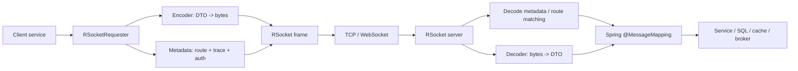
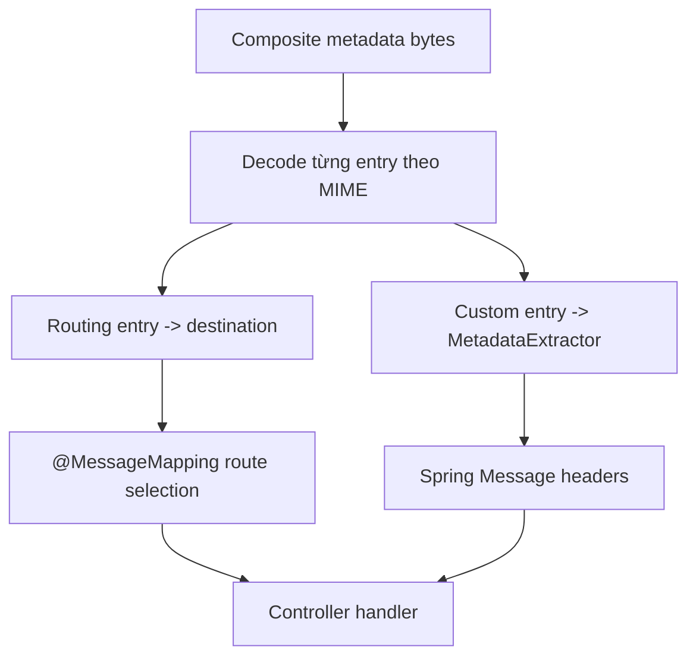
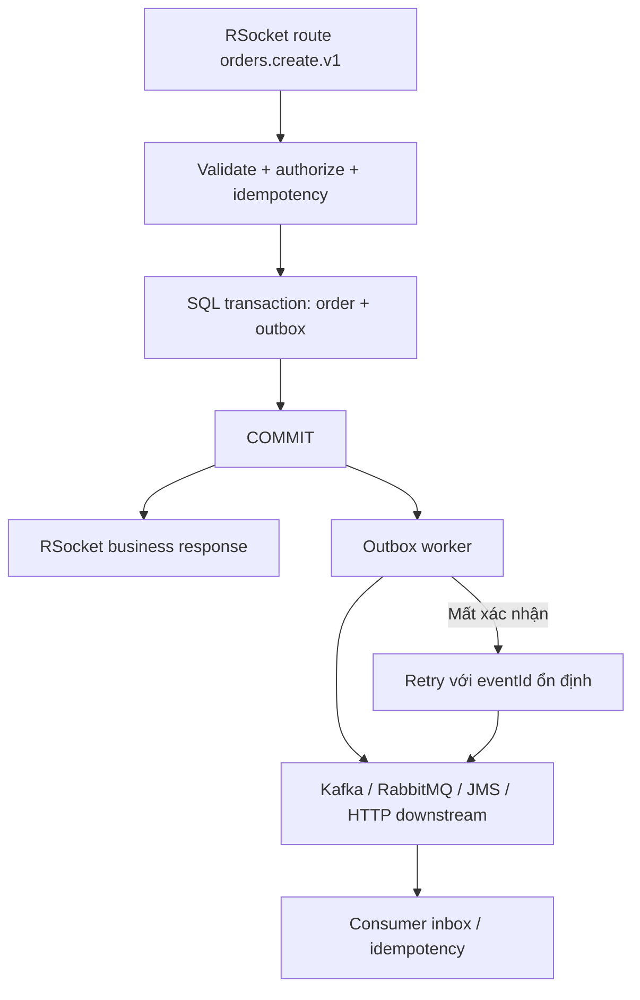

# Route, metadata, định dạng dữ liệu và codec

> **Chương:** RSocket  
> **Phạm vi:** Trong module **SPRING_BOOT_INTEGRATION**, Spring Boot tổ chức giao tiếp với hệ thống ngoài qua HTTP client, cơ sở dữ liệu, cache, broker thông điệp và adapter Spring Integration. Bài học này tập trung vào **route**, **metadata**, **định dạng dữ liệu** và **codec** của RSocket; từ đó xác định hợp đồng giữa hai dịch vụ, xử lý lỗi, timeout, bảo mật, phiên bản dữ liệu, trùng lặp, kiểm thử và khả năng quan sát.

## 1. RSocket có hai phần cần hiểu riêng: tương tác và nội dung

RSocket là giao thức giao tiếp message có hỗ trợ các mô hình tương tác **request-response**, **fire-and-forget**, **request-stream** và **request-channel**. Một kết nối RSocket có thể chạy trên transport như TCP hoặc WebSocket. Mô hình truyền dữ liệu được biểu diễn bằng những frame của giao thức, không phải HTTP request/response thông thường.

Tuy nhiên, **biết mô hình tương tác chưa đủ để hai hệ thống hiểu nhau**. Bên gọi còn phải thống nhất:

- **Route:** thao tác/handler đích, ví dụ `orders.lookup.v1`.
- **Data payload:** đơn hàng, truy vấn hay sự kiện cần trao đổi.
- **Data MIME type:** cách giải mã payload, ví dụ `application/json`.
- **Metadata MIME type:** cách biểu diễn phần metadata của frame, ví dụ composite metadata.
- **Metadata entries:** routing, authentication, tracing hoặc thông tin nghiệp vụ bổ sung, mỗi mục có ý nghĩa và encoding riêng.
- **Codec:** encoder/decoder ở hai phía biến đối tượng Java thành bytes và ngược lại.
- **Schema và ngữ nghĩa:** trường bắt buộc, null, số tiền, thời gian, ID, xử lý lỗi và thay đổi phiên bản.

**RSocket route không tương đương HTTP URL.** Một route chủ yếu là metadata để Spring Messaging chọn `@MessageMapping` phù hợp; phương thức `RSocketRequester.route(...)` không tự mở HTTP endpoint tương ứng.

### 1.1. Hình dung luồng xử lý



Đừng trộn **transport** với **payload encoding**: TCP/WebSocket quyết định cách frame được vận chuyển, còn JSON/CBOR/Protobuf quyết định cấu trúc bytes trong phần data.

## 2. Route dùng để chọn handler

Trong Spring Messaging for RSocket, `@MessageMapping` đặt tên một destination pattern. RSocketRequester thường gửi route bằng **routing metadata**.

```java
@Controller
class OrderRSocketController {

    @MessageMapping("orders.lookup.v1")
    Mono<OrderStatus> lookup(OrderLookup request) {
        return orderService.find(request);
    }
}
```

Phía gọi:

```java
Mono<OrderStatus> result = requester
        .route("orders.lookup.v1")
        .data(new OrderLookup("tenant-a", "ORD-0042"))
        .retrieveMono(OrderStatus.class);
```

Đây là hai **đoạn code minh họa quan hệ route–handler**: `requester` là một `RSocketRequester` đã kết nối; `OrderLookup`, `OrderStatus` và `orderService` được định nghĩa trong ví dụ đầy đủ ở mục 6.

Khi route trong message không khớp mapping, hoặc handler đòi hỏi kiểu interaction/payload khác, xử lý có thể thất bại. Đó không phải HTTP 404; lỗi được truyền theo cơ chế RSocket/Spring Messaging.

### 2.1. Quy tắc đặt route

| Quyết định | Ví dụ nên dùng | Điều cần tránh |
| --- | --- | --- |
| Tên thể hiện nghiệp vụ | `orders.lookup.v1`, `orders.events.v1` | `doWork` không rõ hợp đồng |
| Version khi thay đổi breaking | `orders.create.v1` và `orders.create.v2` | Đổi nghĩa payload cũ nhưng giữ route không đổi |
| Route ổn định, ít giá trị | Một route dùng cho nhiều order | `orders.ORD-000001` rồi sinh route khác cho mỗi order |
| ID trong payload khi phù hợp | `OrderLookup(orderId)` | Đưa PII, token hoặc chuỗi đầu vào chưa kiểm soát vào route |
| Phân quyền theo thao tác | Policy cho `orders.cancel.v1` | Xem route do client gửi là bằng chứng đã được ủy quyền |

Route có thể có **destination variable** và mapping pattern tùy Spring Messaging, nhưng không nên dùng route để mã hóa mọi tham số nghiệp vụ. Route thay đổi theo từng order làm khó kiểm soát schema, authorization, metric cardinality và khả năng tiến hóa hợp đồng.

### 2.2. Route không thay thế business identity

`orders.create.v1` xác định *loại thao tác*, không định danh *một lần tạo đơn*. Nếu client retry do kết nối đứt, cần **idempotency key** hoặc business key ổn định trong payload/metadata đã được xác thực theo contract. Không dựa vào route để chống trùng.

## 3. RSocket DATA và METADATA trong một payload

Một RSocket payload có thể mang hai vùng bytes:

| Vùng | Chứa gì? | Ví dụ |
| --- | --- | --- |
| **Data** | Nội dung nghiệp vụ cần giải mã theo data MIME type đã thỏa thuận | JSON `{"orderId":"ORD-0042"}` |
| **Metadata** | Thông tin định tuyến và ngữ cảnh được mã hóa theo metadata MIME type | Route `orders.lookup.v1`, auth metadata, trace context |

Trong quá trình thiết lập kết nối, frame **SETUP** mang thông tin MIME type mà các bên sử dụng để diễn giải data và metadata trên kết nối đó. MIME type không đơn thuần là một trường JSON có thể đổi tùy ý ở mỗi handler.

Một metadata entry riêng có thể sử dụng kiểu MIME:

- `message/x.rsocket.routing.v0`: routing metadata chuẩn của RSocket.
- `message/x.rsocket.composite-metadata.v0`: envelope cho phép đóng gói **nhiều metadata entry có MIME type riêng**.
- Các MIME type khác có thể dành cho authentication hoặc dữ liệu ứng dụng tùy đặc tả, thư viện và hợp đồng.

**Đừng nhầm metadata MIME type của cả payload với MIME type của một entry bên trong composite metadata.** Khi dùng composite, thông tin route được đóng gói như một entry routing và có thể đi kèm các entry khác.

### 3.1. Cấu trúc khái niệm của composite metadata

```text
RSocket SETUP:
  data MIME type     = application/json
  metadata MIME type = message/x.rsocket.composite-metadata.v0

RSocket REQUEST_RESPONSE:
  metadata:
    entry #1:
      MIME = message/x.rsocket.routing.v0
      data = orders.lookup.v1
    entry #2:
      MIME = application/vnd.example.trace.v1+json
      data = {"correlationId":"corr-527"}
  data:
    {"tenantId":"tenant-a","orderId":"ORD-0042"}
```

Đây là **biểu diễn để đọc hiểu**, không phải bytes/composite encoding hợp lệ có thể gửi trực tiếp. Composite metadata dùng định dạng nhị phân riêng, bao gồm header/type và length cho từng entry; hãy để RSocket library encode/decode, không nối các chuỗi MIME bằng dấu xuống dòng.

### 3.2. Vì sao không chuyển tất cả metadata vào payload JSON?

Không phải mọi metadata nên được đưa vào DTO nghiệp vụ:

- **Route** thuộc tầng chọn handler.
- **Authentication** nên theo cơ chế bảo mật của transport/RSocket; không nhận một field `role=admin` trong JSON như bằng chứng quyền.
- **Trace/correlation** thường được truyền xuyên nhiều tầng mà không thay đổi domain DTO.
- **Business idempotency key** có thể nằm trong payload hoặc metadata; cách nào cũng được nếu contract thống nhất, được xác thực scope và không đổi giữa retries.

Tuy nhiên, metadata không phải nơi chứa dữ liệu vô hạn. Payload metadata cũng tiêu tốn băng thông, bộ nhớ và cần schema/giới hạn; tránh đặt nguyên token, payload nhạy cảm hoặc dữ liệu biến động rất lớn vào log.

## 4. MetadataExtractor và khả năng bind vào Spring Message

Spring RSocket Messaging cung cấp **`MetadataExtractor`** để biến các metadata entry cần quan tâm thành những giá trị/header mà Spring Messaging có thể sử dụng trong handler. Routing metadata có đường xử lý được framework hỗ trợ; **metadata tự định nghĩa không tự hiện ra trong `@Header`** chỉ vì client đã gửi bytes.

Một luồng điển hình:



### 4.1. Khi nào cần cấu hình trích xuất metadata?

Giả sử client gửi entry kiểu `application/vnd.example.trace.v1+json` với `correlationId`. Nếu server cần nhận nó qua `@Header("traceContext")`, phải cấu hình cách decode MIME entry đó và tên header sẽ xuất hiện.

Ví dụ cấu hình **mang tính hướng dẫn API** trong stack Spring Boot hỗ trợ `RSocketStrategiesCustomizer`:

```java
package com.example.integration.rsocket;

import org.springframework.boot.rsocket.messaging.RSocketStrategiesCustomizer;
import org.springframework.context.annotation.Bean;
import org.springframework.context.annotation.Configuration;
import org.springframework.util.MimeType;
import org.springframework.util.MimeTypeUtils;

@Configuration
class RSocketMetadataConfiguration {
    static final MimeType TRACE_MIME = MimeTypeUtils.parseMimeType(
            "application/vnd.example.trace.v1+json"
    );

    @Bean
    RSocketStrategiesCustomizer traceMetadata() {
        return strategies -> strategies.metadataExtractorRegistry(
                registry -> registry.metadataToExtract(
                        TRACE_MIME,
                        TraceMetadata.class,
                        "traceContext"
                )
        );
    }
}

record TraceMetadata(String correlationId) {}
```

**Lưu ý:** Code dựa trên API cấu hình RSocketStrategies của các phiên bản Spring Boot/Spring Messaging tương ứng; trước khi sử dụng trong ứng dụng, đối chiếu chữ ký API và codec của version đang chạy. Việc khai báo extractor chỉ có tác dụng khi MIME entry được giải mã bằng codec phù hợp (ở đây là JSON) và client thật sự gửi metadata composite tương ứng.

Handler sau khi metadata được extract:

```java
@MessageMapping("orders.lookup.v1")
public Mono<OrderStatus> lookup(
        @Payload OrderLookup request,
        @Header(name = "traceContext", required = false)
        TraceMetadata trace
) {
    return orderService.find(request)
            .doOnNext(status -> auditTrace(trace, status.orderId()));
}
```

`auditTrace(...)` chỉ là hàm ứng dụng để ghi thông tin chẩn đoán đã được xử lý an toàn. Đừng dùng một `correlationId` do client tự đặt như chứng cứ phân quyền hoặc chấp nhận bất kỳ giá trị nào làm metric tag.

### 4.2. Client gửi route và custom entry

Với requester dùng **composite metadata**:

```java
Mono<OrderStatus> response = requester
        .route("orders.lookup.v1")
        .metadata(
                new TraceMetadata("corr-527"),
                RSocketMetadataConfiguration.TRACE_MIME
        )
        .data(new OrderLookup("tenant-a", "ORD-0042"))
        .retrieveMono(OrderStatus.class);
```

`route(...)` đảm nhiệm routing metadata; `metadata(...)` bổ sung entry tùy chỉnh. Phần data vẫn là `OrderLookup`, không phải một metadata object. Nếu kết nối được cấu hình metadata MIME type chỉ hỗ trợ một routing entry đơn, việc gửi thêm entry không thể được diễn giải như composite; phải thống nhất kết nối composite ngay từ đầu.

**Không tự viết xử lý authentication bằng cách trích xuất header `userId` hoặc `role` rồi tin ngay vào nó.** Xác thực bằng Spring Security RSocket hoặc cơ chế bảo mật thích hợp, gắn identity từ kết quả xác thực và thực thi authorization ở route/service.

## 5. Data MIME type khác schema và khác codec

Khi bên gửi gọi:

```java
requester.route("orders.lookup.v1")
        .data(new OrderLookup("tenant-a", "ORD-0042"))
        .retrieveMono(OrderStatus.class);
```

Object Java không được gửi nguyên dạng. Framework dùng **encoder** để chuyển sang data bytes theo MIME type và dùng **decoder** tương ứng phía nhận.

| Thành phần | Quyết định điều gì? | Ví dụ |
| --- | --- | --- |
| **Data MIME type** | Cách biểu diễn payload ở mức wire | `application/json`, `application/cbor`, một MIME binary được thỏa thuận |
| **Encoder** | Chuyển Java object sang bytes | Jackson JSON encoder |
| **Decoder** | Chuyển bytes sang Java type | Jackson JSON decoder |
| **Schema** | Cấu trúc và tương thích nội dung | JSON Schema, Protobuf `.proto`, Avro schema |
| **Business contract** | Ý nghĩa và invariant của trường | `amountMinor` có currency, `orderId` là opaque ID |

**Một MIME type hợp lệ không chứng minh payload có schema đúng**. `application/json` chỉ nói “dữ liệu JSON”, không nói event type, field bắt buộc hoặc ngữ nghĩa. Nếu JSON bị thiếu `orderId` nhưng record Java vẫn deserialize được thành `null`, service phải validate và trả lỗi thích hợp.

### 5.1. Ba lựa chọn dữ liệu phổ biến

| Format | Khi nào nên chọn | Ưu điểm | Rủi ro / công việc cần thêm |
| --- | --- | --- | --- |
| **JSON** | Giao tiếp service-to-service thông thường; ưu tiên dễ debug | Dễ đọc, mapping Jackson rộng | Number precision, nullable fields, enum, schema evolution |
| **CBOR** | Hai đầu đã thống nhất nhị phân compact với cấu trúc gần JSON | Có thể giảm payload so với JSON trong một số workload | Cần codec/module đúng ở hai phía và test tương tác |
| **Protobuf hoặc binary khác** | RPC/event có throughput cao, type/schema rõ | Payload compact, hợp đồng field number nếu dùng Protobuf | Cần schema/code generation, registry/version strategy, custom codec tương ứng |

**RSocket không buộc phải dùng JSON**, nhưng **không tự hỗ trợ mọi format**. Một thư viện codec hỗ trợ MIME nào, và hai phía dùng cùng schema/serializer hay không, đều phải được kiểm chứng.

### 5.2. JSON numeric và dữ liệu nghiệp vụ

Ví dụ:

```json
{
  "eventId": "evt-901",
  "orderId": "ORD-00042",
  "amountMinor": 125000,
  "currency": "VND",
  "occurredAt": "2026-11-21T03:00:00Z"
}
```

Nên biểu diễn ID như chuỗi để giữ số 0 đầu. Tiền cần có đơn vị/precision rõ, tránh gửi số thực dấu phẩy động cho số tiền quan trọng. Timestamp cần quy định UTC/offset; `null`, field vắng và empty string có thể khác nghĩa. Khi producer thay đổi DTO, phải kiểm tra compatibility với client cũ, không chỉ unit test Jackson round-trip.

## 6. Ví dụ Spring Boot request-response với JSON

Mục tiêu: chạy RSocket server TCP trên port 7000, nhận route `orders.lookup.v1` và trả trạng thái đơn hàng. Ví dụ dùng **Spring Boot 3.x, Java 17+**, Reactor và Spring RSocket messaging.

### 6.1. Dependency Maven

```xml
<dependency>
    <groupId>org.springframework.boot</groupId>
    <artifactId>spring-boot-starter-rsocket</artifactId>
</dependency>
```

Spring Boot BOM/starter parent nên quản lý version các dependency Spring Messaging, Reactor, RSocket Java và encoder. Nếu là một dự án chỉ cần RSocket server/client trên TCP thì không cần suy ra phải có REST controller; WebFlux có thể được thêm riêng khi ứng dụng đồng thời phục vụ HTTP reactive.

### 6.2. Cấu hình server

```yaml
spring:
  rsocket:
    server:
      transport: tcp
      port: 7000
```

Port và transport trên áp dụng cho RSocket TCP server. Nếu chọn WebSocket, phải cấu hình tương ứng với WebFlux/web server và mapping path của phiên bản Spring Boot; **không dùng một URL WebSocket HTTP như endpoint TCP** chỉ vì cả hai dùng RSocket ở tầng trên.

### 6.3. Hợp đồng dữ liệu

```java
package com.example.integration.rsocket;

public record OrderLookup(String tenantId, String orderId) {}
```

```java
package com.example.integration.rsocket;

public record OrderStatus(String orderId, String status) {}
```

Để đơn giản, DTO chỉ gồm hai trường. Trong sản phẩm thật, phải xác thực caller, phân quyền `tenantId` từ security context, giới hạn độ dài đầu vào và quy định trạng thái khi không tìm thấy order.

### 6.4. Server controller

```java
package com.example.integration.rsocket;

import org.springframework.messaging.handler.annotation.MessageMapping;
import org.springframework.messaging.handler.annotation.Payload;
import org.springframework.stereotype.Controller;
import reactor.core.publisher.Mono;

@Controller
public class OrderRSocketController {
    private final OrderQueryService service;

    public OrderRSocketController(OrderQueryService service) {
        this.service = service;
    }

    @MessageMapping("orders.lookup.v1")
    public Mono<OrderStatus> lookup(@Payload OrderLookup request) {
        return service.find(request);
    }
}
```

Để ví dụ tự chứa, service bên dưới tạo trạng thái giả định; **không truy cập SQL thật** và không dùng `tenantId` do client gửi để cấp quyền:

```java
package com.example.integration.rsocket;

import org.springframework.stereotype.Service;
import reactor.core.publisher.Mono;

@Service
public class OrderQueryService {
    public Mono<OrderStatus> find(OrderLookup request) {
        return Mono.defer(() -> {
            if (request == null || request.orderId() == null
                    || request.orderId().isBlank()) {
                return Mono.error(new IllegalArgumentException(
                        "orderId is required"));
            }
            return Mono.just(new OrderStatus(
                    request.orderId(), "CONFIRMED"));
        });
    }
}
```

Nếu thay bằng truy vấn database, sử dụng `DatabaseClient`/R2DBC khi muốn giữ một pipeline reactive non-blocking. Nếu dùng JDBC/JPA blocking, không gọi trực tiếp trên event loop của RSocket. Việc trả `Mono` **không biến một DAO blocking thành reactive**.

### 6.5. Tạo RSocketRequester phía client

```java
package com.example.integration.rsocket;

import org.springframework.beans.factory.annotation.Value;
import org.springframework.context.annotation.Bean;
import org.springframework.context.annotation.Configuration;
import org.springframework.messaging.rsocket.RSocketRequester;
import org.springframework.util.MimeTypeUtils;

@Configuration
class OrderRSocketClientConfiguration {

    @Bean("ordersRequester")
    RSocketRequester ordersRequester(
            RSocketRequester.Builder builder,
            @Value("${remote.orders.host:localhost}") String host,
            @Value("${remote.orders.port:7000}") int port) {
        return builder
                .dataMimeType(MimeTypeUtils.APPLICATION_JSON)
                .metadataMimeType(MimeTypeUtils.parseMimeType(
                        "message/x.rsocket.composite-metadata.v0"))
                .tcp(host, port);
    }
}
```

Với ứng dụng Java tạo nhiều requester, dùng `@Qualifier("ordersRequester")` để không nhầm endpoint. Cách `tcp(...)` tạo requester/connection có lifecycle riêng; không mặc định thư viện tự reconnect vĩnh viễn sau mọi lỗi mạng. Cần cấu hình khởi tạo, retry/reconnect và dispose theo hợp đồng/phiên bản nếu yêu cầu độ sẵn sàng cao.

### 6.6. Client gọi route

```java
package com.example.integration.rsocket;

import java.time.Duration;
import org.springframework.beans.factory.annotation.Qualifier;
import org.springframework.messaging.rsocket.RSocketRequester;
import org.springframework.stereotype.Service;
import reactor.core.publisher.Mono;

@Service
public class RemoteOrderLookup {
    private final RSocketRequester requester;

    public RemoteOrderLookup(
            @Qualifier("ordersRequester") RSocketRequester requester) {
        this.requester = requester;
    }

    public Mono<OrderStatus> lookup(String tenantId, String orderId) {
        return requester.route("orders.lookup.v1")
                .data(new OrderLookup(tenantId, orderId))
                .retrieveMono(OrderStatus.class)
                .timeout(Duration.ofSeconds(3));
    }
}
```

Mã chỉ mô tả **request-response**: client gửi một request và nhận tối đa một response. `Mono.timeout` hạn chế thời gian đợi của caller; nó **không chứng minh** server đã hủy được mọi thao tác trước khi timeout. Với các route có side effect (tạo đơn/thu tiền), cần idempotency key ổn định và khả năng tra cứu trạng thái trước khi retry.

## 7. Bốn interaction model dùng route và codec như thế nào?

| Mô hình | API client điển hình | Handler return | Hợp đồng cần chú ý |
| --- | --- | --- | --- |
| **Request-response** | `retrieveMono(Result.class)` | `Mono<Result>` | Timeout, không có result, validation, retry theo ngữ nghĩa |
| **Fire-and-forget** | `send()` | Thường `Mono<Void>` / handler không trả business reply | Không dùng local completion làm bằng chứng business commit |
| **Request-stream** | `retrieveFlux(Event.class)` | `Flux<Event>` | Backpressure, cancellation, giới hạn bộ nhớ, stream termination |
| **Request-channel** | `data(Flux<Input>, Input.class).retrieveFlux(Output.class)` | Handler có thể nhận publisher và trả publisher | Đồng bộ hai chiều, demand, error/complete ở mỗi phía |

### 7.1. Fire-and-forget không đồng nghĩa xử lý xong

Ví dụ audit message:

```java
Mono<Void> sent = requester
        .route("audit.capture.v1")
        .data(new AuditEvent("evt-1", "ORDER_CONFIRMED"))
        .send();
```

`send()` không nhận business response. Nó không cung cấp bảo đảm end-to-end rằng sự kiện đã được lưu trong SQL hoặc broker phía đích. Nếu audit là nghĩa vụ bắt buộc, cần acknowledgement nghiệp vụ riêng, outbox hoặc cơ chế delivery có thể phục hồi.

### 7.2. Request-stream

Server có thể khai báo route trả nhiều phần tử:

```java
@MessageMapping("orders.changes.v1")
public Flux<OrderChange> changes(OrderChangesQuery query) {
    return changeStreamService.stream(query);
}
```

Client:

```java
Flux<OrderChange> changes = requester
        .route("orders.changes.v1")
        .data(new OrderChangesQuery("tenant-a"))
        .retrieveFlux(OrderChange.class);
```

`OrderChange`, `OrderChangesQuery` và `changeStreamService` là ví dụ domain riêng chưa được triển khai trong bản request-response ở mục 6. Một stream không tự cung cấp persistence/replay giống event log; dữ liệu phát khi subscriber offline có thể mất tùy kiến trúc nguồn stream.

### 7.3. Backpressure không thay idempotency

RSocket hỗ trợ Reactive Streams demand cho interaction stream/channel, nhưng **không biến transport thành hàng đợi bền vững**. Nếu client ngắt giữa stream, cần chính sách resume/replay ở ứng dụng nếu muốn tiếp tục đúng vị trí. Nếu publisher phát sự kiện được xử lý lặp lại sau reconnect, consumer vẫn cần event ID/sequence và idempotency ở SQL.

## 8. JSON, CBOR, Protobuf và codec tùy biến

### 8.1. RSocketStrategies là điểm mở rộng

Spring RSocket Messaging dùng `RSocketStrategies` để tập hợp **encoders, decoders, route/metadata extraction và các thành phần phục vụ messaging**. Với JSON thông thường, starter và Jackson có thể cung cấp codec phù hợp. Với định dạng tùy biến:

1. Hai phía định nghĩa **MIME type** chính xác.
2. Chọn codec hiện có hoặc triển khai `Encoder<T>`/`Decoder<T>` tương ứng.
3. Đăng ký chúng qua `RSocketStrategies.Builder`/customizer của stack Spring đang dùng.
4. Cấu hình data MIME type cho kết nối phù hợp với codec.
5. Kiểm thử bytes thực, bao gồm null/empty/invalid payload và version khác nhau.

Không giải quyết incompatibility chỉ bằng:

```java
// Chưa đủ nếu thiếu codec và schema đồng nhất:
builder.dataMimeType(
        MimeTypeUtils.parseMimeType("application/x-protobuf"));
```

MIME type chỉ mô tả định dạng đã chọn. **Codec Java, generated class, field numbers và schema evolution vẫn do ứng dụng quản lý.**

### 8.2. Binary payload không đồng nghĩa Protobuf

Nếu hai hệ thống thỏa thuận truyền bytes opaque:

```java
byte[] data = /* bytes từ codec/thiết bị đã được kiểm tra */;

Mono<byte[]> reply = binaryRequester
        .route("files.digest.v1")
        .data(data)
        .retrieveMono(byte[].class);
```

`binaryRequester` ở đây là một requester **riêng** đã cấu hình MIME type và byte-array codecs phù hợp. Không lấy requester JSON ở mục 6 rồi gửi bytes và kỳ vọng server tự suy ra `application/octet-stream`. Không sử dụng ví dụ trên để truyền file cực lớn toàn bộ trong RAM; lựa chọn stream/chunking hoặc object storage với checksum, quyền truy cập và giới hạn kích thước tùy nhu cầu.

### 8.3. Codec metadata có thể độc lập với codec data

Một kết nối có thể dùng data là JSON và metadata composite gồm:

- Routing entry theo chuẩn RSocket.
- Auth metadata theo định dạng riêng của Spring Security/RSocket setup.
- Trace entry JSON tùy chỉnh.

Việc data là JSON **không có nghĩa mọi metadata entry đều JSON**. Mỗi entry bên trong composite có MIME type và cách giải mã riêng; custom entry phải được đăng ký extract/codec khi handler cần đọc.

## 9. Thiết kế hợp đồng version và compatibility

Giả sử `orders.lookup.v1` nhận:

```json
{
  "tenantId": "tenant-a",
  "orderId": "ORD-0042"
}
```

Sau đó nhóm phát triển muốn thêm một trường `includeHistory`. Một hướng thay đổi:

```json
{
  "tenantId": "tenant-a",
  "orderId": "ORD-0042",
  "includeHistory": false
}
```

Nếu trường mới optional, consumer mới có default hợp lệ và consumer cũ chấp nhận unknown fields, thay đổi **có thể** tương thích. Nhưng còn cần kiểm tra:

- Deserializer ở server có reject unknown field không?
- Client cũ không gửi field thì logic mặc định có giữ hành vi cũ không?
- Nếu thêm enum value hoặc đổi kiểu số/string, consumer cũ có xử lý được không?
- Định nghĩa idempotency và quyền truy cập có thay đổi khi thêm lựa chọn mới không?

**Route version không phải schema version**: một route có thể dùng một schema có nhiều phiên bản compatible. Với thay đổi phá vỡ ngữ nghĩa/kiểu dữ liệu, route mới như `orders.lookup.v2` và quá trình rollout song song thường an toàn hơn việc thay đổi im lặng.

### 9.1. Schema được quản lý ở đâu?

| Định dạng | Artifact hợp đồng có ích | Kiểm soát tương thích |
| --- | --- | --- |
| JSON | DTO, JSON Schema, bộ payload fixture | Thử old client/new server và new client/old server |
| CBOR | Schema ở mức DTO/hợp đồng, fixture binary | Đảm bảo cách biểu diễn số, kiểu và null |
| Protobuf | `.proto`, generated code, reserved field numbers | Thêm field an toàn, không tái sử dụng số field |
| Custom binary | Tài liệu byte layout/version/checksum | Không thay đổi layout mà thiếu version/decoder cũ |
| Metadata tùy chỉnh | MIME type, codec, field schema/version | Cho phép optional field, reject kiểu không hỗ trợ có kiểm soát |

Không chỉ kiểm thử serialize rồi deserialize **cùng thư viện/cùng phiên bản**: hai dịch vụ hoặc hai ngôn ngữ có thể giải mã khác nhau. Tạo contract test giữa hai đầu với fixture của những phiên bản còn được hỗ trợ.

## 10. Bảo mật route và metadata

RSocket duy trì kết nối có thể sống lâu và xử lý nhiều request; cần phân biệt **bảo vệ transport**, **xác thực connection** và **ủy quyền mỗi route**:

1. Dùng TLS/TCP hoặc WebSocket qua TLS theo topology, không mặc định kết nối TCP rõ-text an toàn.
2. Áp dụng **Spring Security RSocket** hoặc cơ chế xác thực được tích hợp đúng vào setup/request metadata.
3. Kiểm tra authorization ở route **và** service nghiệp vụ, dựa trên principal/tenant đã xác thực.
4. Không tin trường `tenantId` trong payload nếu không đối chiếu với identity đã xác thực.
5. Không chấp nhận string `admin=true` hoặc `role=MANAGER` trong metadata tự định nghĩa để tự cấp quyền.
6. Giới hạn payload, metadata, nesting, stream length và số stream đồng thời.
7. Không log token hoặc metadata authentication; giới hạn quyền truy cập trace/log.

**Authentication metadata và tracing metadata có mục đích khác nhau.** Correlation ID giúp chẩn đoán, không cấp quyền. Đối với stream dài, cần cân nhắc token expiry/re-authentication và termination behavior theo thiết kế bảo mật của ứng dụng.

### 10.1. Không dùng route làm metric label tùy tiện

Route thường là tập giá trị hữu hạn và có thể dùng trong metric, nhưng nếu ứng dụng tạo route động theo từng order/user, cardinality sẽ tăng rất mạnh. Đưa `orders.lookup.v1` vào tag có thể hợp lý; đưa `orders.ORD-123456` vào tag là không tốt. Log request với trace ID và ID đã redact theo chính sách, không xuất raw metadata có chứa credential.

## 11. Lỗi ở tầng route, codec và nghiệp vụ

| Lỗi | Dấu hiệu thường thấy | Cần kiểm tra |
| --- | --- | --- |
| **Route không khớp** | Request đến server nhưng không chọn được handler | Chuỗi `route(...)`, `@MessageMapping`, pattern, ký tự phân tách |
| **Không có routing metadata** | Handler không thấy destination | Metadata MIME type SETUP, composite/routing metadata encode |
| **MIME/codec không khớp** | Decode failure, unsupported MIME, sai object type | Data MIME type, encoder/decoder trong `RSocketStrategies` ở cả hai phía |
| **Schema sai** | Deserialize null/missing, validation error | Required fields, type mapping, version, JSON/Protobuf schema |
| **Custom metadata không bind được** | `@Header` rỗng hoặc không có | `MetadataExtractor`, MIME entry, tên header, codec metadata |
| **Server ném exception** | Client nhận RSocket error signal | Phân loại validation, lỗi nghiệp vụ, lỗi hạ tầng; không retry vô hạn |
| **Connection thất bại** | Không gửi/nhận được request, reconnect liên tục | Host/port, transport, TLS, auth, SETUP reject, load balancer |
| **Stream quá tải** | Queue/heap tăng, latency lớn | Demand/backpressure, `flatMap` concurrency, buffer và timeouts |
| **Kết quả không rõ sau timeout** | Caller không nhận được response nhưng remote có thể đã xử lý | Idempotency key, status lookup, durable command log |

### 11.1. RSocket ERROR không phải HTTP status code

Trong HTTP, client có thể căn cứ vào 400/404/409/500. RSocket dùng **error signaling** qua protocol/Reactor; để truyền lỗi nghiệp vụ cần một hợp đồng rõ:

- Với input không hợp lệ, chọn error signal có **mã lỗi nghiệp vụ ổn định** hoặc response kiểu error envelope.
- Với không tìm thấy, quy định trả `Mono.empty()`, một DTO `NOT_FOUND` hoặc error signal; không để mỗi consumer tự suy đoán.
- Với lỗi hệ thống, tránh gửi stack trace, SQL, token hoặc dữ liệu cá nhân trong thông báo trả cho client.
- Với timeout, không suy luận side effect chắc chắn chưa xảy ra.

Không dùng `onErrorResume(error -> Mono.empty())` cho mọi trường hợp, vì có thể che giấu lỗi codec hoặc lỗi authorization thành “không có dữ liệu”.

### 11.2. Retry và idempotency

`retryWhen(...)` trong Reactor có thể phát lại subscription, dẫn tới **gửi lại request**. Chỉ retry tự động nếu:

- Route có ngữ nghĩa đọc/idempotent; hoặc
- Client dùng **cùng idempotency key**, server bảo đảm dedup với transaction/unique constraint; và
- Lỗi được phân loại transient, số lần retry hữu hạn, có backoff/jitter và deadline.

Với route `payments.charge.v1`, nếu kết nối mất sau khi server đã charge nhưng trước response, retry bằng key mới có thể tạo thanh toán trùng. **Transport không thay ứng dụng thiết kế xử lý trùng**.

## 12. RSocket kết hợp SQL, cache và message broker

Một route RSocket có thể gọi SQL, Redis hoặc gửi message. Mỗi tài nguyên có **ranh giới giao dịch riêng**:



**Đừng giữ transaction SQL khi chờ một RSocket stream kéo dài**. Đặt transaction SQL ở service cập nhật database, commit xong mới phát event hoặc khởi tạo stream theo quy tắc. Nếu downstream yêu cầu sự kiện phát bền vững ngay cả khi app crash, transactional outbox phù hợp hơn việc `send()` trực tiếp rồi kỳ vọng transaction DB có thể rollback phần gửi.

Nếu dùng R2DBC trong handler, áp dụng `TransactionalOperator`/reactive transaction cho **chuỗi SQL hữu hạn**. Nếu dùng JPA/JDBC blocking, phải cân nhắc thread isolation và saturation. Redis cache có thể giảm tải truy vấn, nhưng **cache miss** không chứng minh không tồn tại order; không dựa vào Redis TTL đơn thuần để chống trùng những lệnh quan trọng.

## 13. Quan sát route, metadata và codec

Các chỉ số cần thiết cho một dịch vụ RSocket:

| Tín hiệu | Giá trị chẩn đoán |
| --- | --- |
| Kết nối đang mở, lỗi SETUP, reconnect | Mạng/TLS/auth/MIME negotiation |
| Request count và latency theo route | Hot route, handler chậm, thay đổi tải |
| Decode/encode failures theo MIME | Codec không tương thích hoặc payload sai schema |
| Missing/invalid metadata count | Route metadata, tracing, auth hoặc custom extractor bị lỗi |
| Active streams, cancellation, errors | Stream dài, client chậm, timeout hoặc lỗi backpressure |
| SQL/Redis/broker downstream errors | Phân biệt lỗi tích hợp với lỗi RSocket transport |
| Idempotency replay/conflict count | Caller retry, duplicate và payload mismatch |
| Client timeout vs server completion | Tìm các trường hợp kết quả chưa xác định và cần đối chiếu |

Spring Boot Actuator/Micrometer có thể cung cấp instrumentation ở một số tầng khi thêm dependency/config phù hợp, nhưng **không mặc định có tất cả metric trên**. Có thể phải tạo metric riêng cho codec, metadata extraction, business result và số lần xử lý trùng.

**Log được phép:** route name hữu hạn, error code, MIME type, schemaVersion, correlation ID đã kiểm soát, latency và outcome. **Không log raw authentication metadata**, token hay toàn bộ data payload chứa PII.

## 14. Kiểm thử hợp đồng hai đầu thay vì chỉ kiểm tra controller

### 14.1. Kiểm thử nên có

| Nhóm | Kết quả kỳ vọng |
| --- | --- |
| **Route matching** | Route hợp lệ đến đúng `@MessageMapping`, route không tồn tại báo lỗi theo contract |
| **MIME setup** | JSON/composite metadata được hai phía hiểu đúng |
| **Metadata** | Route entry hoạt động, custom trace metadata được extract đúng và không cấp quyền |
| **Schema** | DTO đúng field/type; payload thiếu bắt buộc hoặc enum lạ được xử lý có chủ đích |
| **Codec** | Encode/decode JSON hoặc binary trên **hai runtime** độc lập, không double-encode |
| **Request-response** | Thành công, không tìm thấy, validation error, timeout có kết quả rõ |
| **Fire-and-forget** | Không coi local `send()` complete là proof of server DB commit |
| **Stream** | Demand, cancellation, server error và reconnection được quản lý |
| **Security** | Route bị cấm không truy cập được dù client tự gửi tenant/admin metadata |
| **Idempotency** | Retry cùng key không tạo side effect khác; key khác payload báo conflict |
| **Downstream failure** | SQL/broker lỗi được phân loại, không bị nuốt thành empty response |
| **Upgrade/compatibility** | Client v1 và server v2 còn hỗ trợ nhau theo chính sách đã công bố |

### 14.2. Ví dụ test bằng RSocketRequester

Khi test, có thể chạy server trên một port riêng và tạo `RSocketRequester` tới port đó, thay vì gọi trực tiếp method controller. Ví dụ **ý tưởng** với JUnit 5 và Reactor Test:

```java
@Test
void requestsOrderStatusByRoute() {
    Mono<OrderStatus> response = requester
            .route("orders.lookup.v1")
            .data(new OrderLookup("tenant-a", "ORD-0042"))
            .retrieveMono(OrderStatus.class);

    StepVerifier.create(response)
            .assertNext(status -> {
                assertThat(status.orderId()).isEqualTo("ORD-0042");
                assertThat(status.status()).isEqualTo("CONFIRMED");
            })
            .verifyComplete();
}
```

Trong snippet, `requester` là kết nối test đã cấu hình, `StepVerifier` thuộc `reactor-test` và `assertThat` thuộc AssertJ; cần khởi động server thật trong test context, đặt port không xung đột và dọn connection sau test. Không suy luận chỉ vì controller unit test PASS thì metadata MIME setup, network codec và route matching cũng PASS.

### 14.3. Case lỗi đáng kiểm tra nhất

1. Client bật composite metadata, server thiếu custom `MetadataExtractor`: route có thể vẫn khớp nhưng trace header không xuất hiện; test phải phát hiện chứ không bỏ qua ngầm.
2. Client gửi `application/json` còn server chỉ đăng ký một codec nhị phân tùy biến: request phải bị từ chối có thể quan sát, không cho data được giải mã sai thành DTO.
3. Client retry một lệnh tạo đơn sau khi server commit SQL nhưng response mất: cùng key phải trả kết quả cũ hoặc trạng thái đã xử lý.
4. Stream bị cancel giữa chừng: service giải phóng tài nguyên, không giữ transaction/DB connection vô hạn.
5. Route cũ và route mới chạy song song khi rollout: giữ behavior tương thích, báo lỗi rõ với version không còn hỗ trợ.

## 15. Checklist thiết kế RSocket route và metadata

1. **Chọn interaction model:** request-response, fire-and-forget, stream hay channel có phù hợp nghiệp vụ?
2. **Đặt route có version:** có tên ổn định, tránh chèn ID người dùng vào route.
3. **Chốt data MIME:** JSON/CBOR/binary; codec cả hai đầu có tương thích?
4. **Chốt metadata MIME:** dùng routing-only hay composite, custom entries nào, có extractor không?
5. **Bảo vệ security:** authentication, authorization theo route/tenant thật, TLS và giới hạn request.
6. **Định nghĩa schema:** required/optional fields, time, money, enum, trường lạ và compatibility.
7. **Xác định hành vi lỗi:** không tìm thấy, invalid payload, timeout, network error, downstream error.
8. **Chọn idempotency:** đối với route có side effect, key ổn định, transaction/unique constraint và status lookup.
9. **Giới hạn stream:** concurrency, timeout, cancellation, buffer và cách replay sau reconnect.
10. **Kiểm thử + quan sát:** route matching, metadata extraction, codec wire test, v1/v2 contract, auth và downstream failures.

### Câu hỏi tự kiểm tra

1. Route trong RSocket khác HTTP path ở đâu?
2. Data payload và metadata của một RSocket message chứa thông tin khác nhau như thế nào?
3. `message/x.rsocket.routing.v0` khác `message/x.rsocket.composite-metadata.v0` thế nào?
4. Tại sao một custom metadata entry không tự xuất hiện dưới dạng `@Header` nếu thiếu extractor?
5. Data MIME type `application/json` có chứng minh dữ liệu đúng JSON Schema hoặc business contract không?
6. Vì sao cần cấu hình codec/`RSocketStrategies` khi dùng một định dạng Protobuf hoặc binary tùy chỉnh?
7. `RSocketRequester.route("orders.lookup.v1")` chuyển dữ liệu định tuyến qua cơ chế nào?
8. Tại sao `Mono.timeout` hoặc fire-and-forget `send()` không đủ chứng minh remote side effect chưa hoặc đã xảy ra?
9. Khi nào nên thêm route `v2` thay vì âm thầm thay schema của `v1`?
10. Route authorization, trace correlation và idempotency key bảo vệ những vấn đề khác nhau ra sao?

**Ghi nhớ:** Trong Spring Boot RSocket, **route** là đích được biểu diễn bằng routing metadata và thường khớp với `@MessageMapping`; **data MIME type** quy định cách diễn giải bytes nghiệp vụ; **metadata MIME type** quy định cách đóng gói ngữ cảnh, trong đó composite metadata cho phép nhiều entry cùng tồn tại. **Codec/`RSocketStrategies`** chuyển đổi giữa Java DTO và bytes, còn schema, phiên bản, auth, transaction và idempotency phải được thiết kế riêng. Kiểm thử kết nối và payload giữa hai đầu mới xác nhận được một hợp đồng tích hợp thực sự hoạt động.
