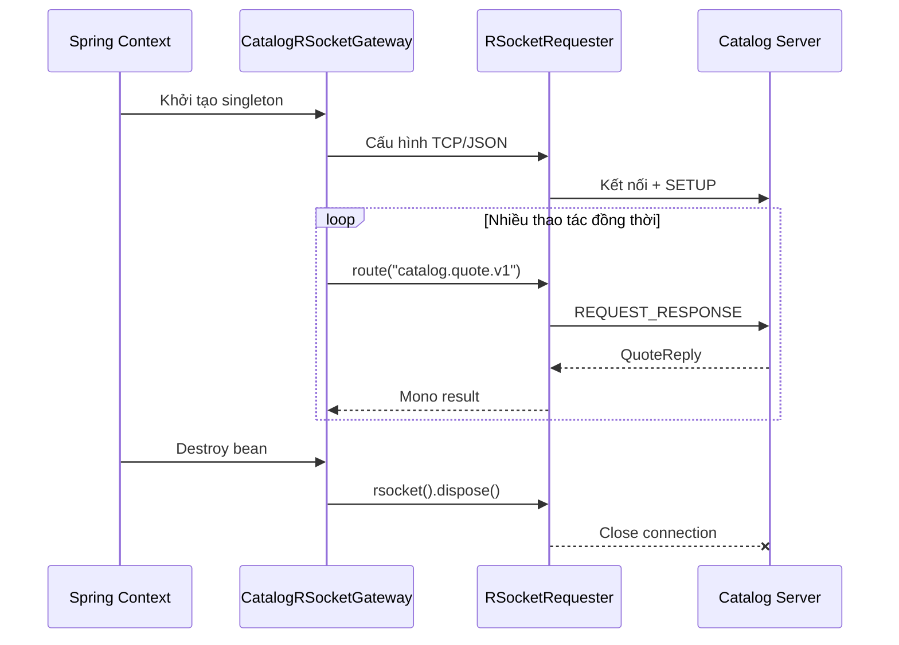
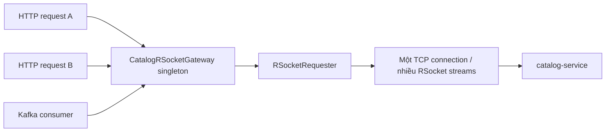
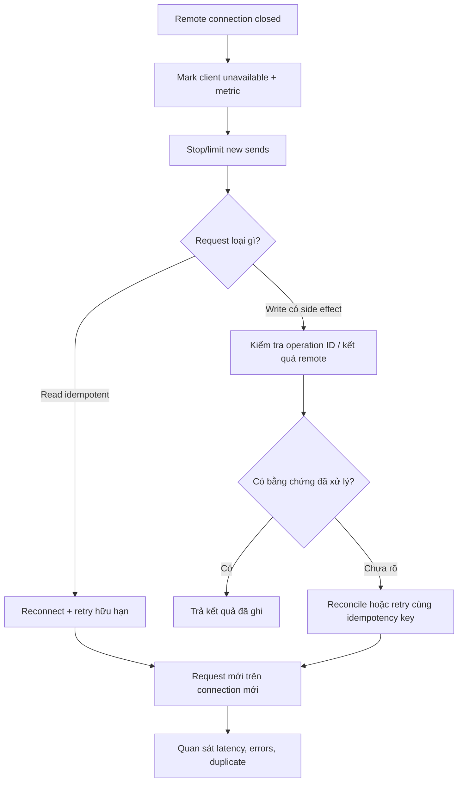

# Tạo client, tái sử dụng kết nối và đóng tài nguyên

> **Chương:** RSocket  
> **Phạm vi:** Trong module **SPRING_BOOT_INTEGRATION**, Spring Boot tổ chức tích hợp qua HTTP client, cơ sở dữ liệu, cache, message broker và adapter Spring Integration. Bài này tập trung vào **tạo RSocket client bằng `RSocketRequester`, tái sử dụng kết nối, quản lý vòng đời và đóng tài nguyên**. Các quyết định này ảnh hưởng trực tiếp đến lỗi kết nối, thời gian phản hồi, xử lý trùng lặp, kiểm thử và khả năng quan sát của luồng tích hợp.

## 1. Bài toán: một ứng dụng gọi RSocket hàng nghìn lần

Giả sử dịch vụ **order-service** cần hỏi **catalog-service** về giá sản phẩm khi nhận một đơn hàng. Mỗi request có thể gọi route RSocket `catalog.quote.v1`. Hai cách cài đặt tưởng giống nhau nhưng hiệu quả vận hành khác hẳn:

```text
Phương án A - mỗi thao tác lại tạo client:

HTTP request 1 -> RSocketRequester.Builder -> connect TCP -> request -> dispose
HTTP request 2 -> RSocketRequester.Builder -> connect TCP -> request -> dispose
HTTP request 3 -> RSocketRequester.Builder -> connect TCP -> request -> dispose

Phương án B - dùng client chung có vòng đời rõ:

Spring Boot startup -> tạo một CatalogRSocketGateway
                          |
                          v
                    RSocketRequester
                          |
                 TCP / WebSocket connection
                          |
           +--------------+---------------+
           |              |               |
        request 1       request 2       request 3
           |              |               |
           +--------------+---------------+
                          |
                 Spring shutdown -> dispose
```

**Phương án B thường thích hợp hơn** khi nhiều request cùng đến một remote RSocket server với cùng cấu hình và phạm vi bảo mật. Một kết nối RSocket có thể **multiplex nhiều stream/request** trên cùng transport, vì vậy không cần mở kết nối TCP mới cho mỗi message.

Nhưng “dùng một connection chung” không có nghĩa là giữ connection bất kể trạng thái. Connection có thể đứt, TLS credentials có thể hết hạn, remote có thể restart và các request đang bay có thể không rõ kết quả. Một client production phải có chiến lược **khởi tạo, sở hữu, quan sát, xử lý reconnect và hủy tài nguyên khi shutdown**.

### Mục tiêu của bài học

Sau khi học, người đọc có thể:

1. Phân biệt `RSocketRequester.Builder`, `RSocketRequester`, underlying `RSocket` và transport connection.
2. Tạo requester TCP/WebSocket tương thích cấu hình Spring Boot.
3. Tái sử dụng một requester cho nhiều request–response, fire-and-forget và stream theo phạm vi hợp lệ.
4. Định nghĩa ai **sở hữu** kết nối và gọi `dispose()` **vào thời điểm nào**.
5. Phân biệt timeout, cancellation, connection close và reconnect/resume.
6. Xử lý trường hợp kết quả remote không rõ sau lỗi, không tạo side effect trùng.
7. Kiểm thử với RSocket server thật, không chỉ mock một method Java.

## 2. Các đối tượng cần phân biệt trong client

| Thành phần | Vai trò | Vòng đời |
| --- | --- | --- |
| **`RSocketRequester.Builder`** | Cấu hình data/metadata MIME, codec, setup payload, connector, transport | Dùng để **xây requester**; không phải message client để gọi mỗi request |
| **`RSocketRequester`** | API Spring Messaging để gọi `route(...)`, `data(...)`, `retrieveMono(...)`, `retrieveFlux(...)`, `send()` | Thường lưu trong bean adapter/gateway tái sử dụng |
| **Underlying `RSocket`** | Kết nối logic với các interaction RSocket, có thể phát hiện close và dispose | Là tài nguyên cần quản lý/đóng đúng sở hữu |
| **Transport** | TCP hoặc WebSocket kết nối tới remote endpoint | Có socket, TLS và lifecycle mạng riêng |
| **`RSocketStrategies`** | Bộ encoder/decoder, route/metadata extraction và công cụ Spring Messaging | Thường được cấu hình chung cho các requester tương thích |
| **`Mono`/`Flux`** | Publisher đại diện một invocation/stream | Subscription khởi tạo hoặc tiêu thụ request; cancellation có semantics riêng |
| **Application gateway/adapter** | Bao bọc requester dưới API nghiệp vụ như `quote(sku)` | Là nơi thích hợp để quản lý retry, timeout, auth scope, metric và shutdown |

Một sai lầm phổ biến là coi `RSocketRequester.Builder` giống một **factory tạo kết nối mới ở mỗi request**, rồi gọi `tcp(...)` ngay trong service method. Hành vi đó vừa tăng overhead, vừa khó đóng connection khi timeout/exception. Thay vào đó, xây client một lần ở **composition root** (cấu hình Spring), và sử dụng requester bên trong adapter.

### 2.1. RSocket không phải HTTP connection pool

Trong HTTP/1.1, ứng dụng thường dùng connection pooling để tái sử dụng nhiều socket khi có nhiều request. RSocket khác ở chỗ **một connection có thể đồng thời mang nhiều logical stream**, vì vậy câu hỏi quan trọng không chỉ là “pool bao nhiêu socket” mà còn là:

- Một connection đang có bao nhiêu request/stream in-flight?
- Remote giới hạn concurrency, payload, buffer và throughput như thế nào?
- Có cần nhiều connection để tách authentication/tenant hoặc tránh một điểm nghẽn không?
- Khi connection đứt, các request/stream cũ được xử lý thế nào?
- Có yêu cầu client-side load balancing, reconnect hoặc RSocket resume đặc thù không?

**Không tự lập một pool gồm hàng trăm RSocketRequester** chỉ vì hệ thống tải cao. Benchmark theo nhu cầu thực và tài nguyên ở cả client/server. Nhiều connection có thể tăng overhead TLS/socket/keepalive, không mặc định làm throughput tốt hơn.

## 3. Cấu hình nền trong Spring Boot

Ví dụ sử dụng **Spring Boot 3.x, Java 17+, Spring Framework/RSocket Java tương thích**. Chữ ký API hoặc điều kiện auto-configuration có thể thay đổi theo bản Boot; trước khi dùng production cần đối chiếu đúng BOM và tài liệu version của dự án.

### 3.1. Maven dependencies

```xml
<dependencies>
    <dependency>
        <groupId>org.springframework.boot</groupId>
        <artifactId>spring-boot-starter-rsocket</artifactId>
    </dependency>
    <dependency>
        <groupId>org.springframework.boot</groupId>
        <artifactId>spring-boot-starter-test</artifactId>
        <scope>test</scope>
    </dependency>
    <dependency>
        <groupId>io.projectreactor</groupId>
        <artifactId>reactor-test</artifactId>
        <scope>test</scope>
    </dependency>
</dependencies>
```

Starter cung cấp các thành phần cần thiết để xây client/server RSocket trong Spring Boot. Nếu ứng dụng chỉ gọi RSocket, **không bắt buộc phải mở một RSocket server**. Nếu đồng thời cung cấp endpoint HTTP, thêm starter web hoặc webflux tương ứng với kiến trúc; đừng mặc định `spring-boot-starter-rsocket` sẽ mở HTTP API.

### 3.2. Server TCP dùng cho ví dụ

Ở catalog-service:

```yaml
spring:
  rsocket:
    server:
      transport: tcp
      port: 7000
```

Ở order-service:

```yaml
integration:
  catalog:
    host: ${CATALOG_RSOCKET_HOST:localhost}
    port: ${CATALOG_RSOCKET_PORT:7000}
    timeout: 3s
```

Đây là **nhóm properties do ứng dụng tự định nghĩa** cho client, không phải một cấu hình mặc định khiến Spring Boot tự tạo requester tới catalog. Cần có bean factory/adapter đọc chúng. Port `7000` và `localhost` chỉ phục vụ local/test.

RSocket TCP và WebSocket dùng **transport khác nhau**:

| Server transport | Client connect | Điều phải khớp |
| --- | --- | --- |
| `tcp` | `RSocketRequester.Builder.tcp(host, port)` | Host, port, TLS, SETUP metadata/data MIME và auth |
| `websocket` | `RSocketRequester.Builder.websocket(URI)` | URI `ws://` hoặc `wss://`, mapping path, reverse proxy, TLS và WebSocket upgrade |

Không lấy URI `ws://...` truyền cho API `tcp(...)` rồi kỳ vọng tự chuyển protocol. Nếu chạy qua load balancer/gateway, xác nhận hạ tầng hỗ trợ WebSocket upgrade hoặc TCP passthrough đúng với transport đã chọn.

## 4. Ví dụ server Spring Boot: route để client gọi

Đầu tiên tạo một service RSocket đơn giản để thực hành. Nó cố ý không truy cập database thật, giúp tập trung vào client lifecycle.

### 4.1. DTO và handler

```java
package com.example.catalog.rsocket;

public record QuoteRequest(String tenantId, String sku) {}
```

```java
package com.example.catalog.rsocket;

public record QuoteReply(String sku, long amountMinor, String currency) {}
```

```java
package com.example.catalog.rsocket;

import org.springframework.messaging.handler.annotation.MessageMapping;
import org.springframework.messaging.handler.annotation.Payload;
import org.springframework.stereotype.Controller;
import reactor.core.publisher.Mono;

@Controller
public class QuoteRSocketController {

    @MessageMapping("catalog.quote.v1")
    public Mono<QuoteReply> quote(@Payload QuoteRequest request) {
        return Mono.defer(() -> {
            if (request == null
                    || request.sku() == null
                    || request.sku().isBlank()) {
                return Mono.error(new IllegalArgumentException(
                        "sku is required"));
            }
            return Mono.just(new QuoteReply(
                    request.sku(), 125000L, "VND"));
        });
    }
}
```

`Mono.defer(...)` giúp logic được đánh giá khi có subscription và không giữ state dùng chung giữa các caller. Ví dụ này chỉ minh họa *route + DTO*, **không triển khai authentication/authorization theo tenant**. Trong hệ thống thật, `tenantId` do client gửi phải được đối chiếu với identity đã được xác thực; không dùng DTO như bằng chứng quyền truy cập.

### 4.2. MIME type của hai đầu phải tương thích

Client và server phải hiểu cùng cách encode **data** (ví dụ JSON) và **metadata** (routing metadata/composite metadata). Với Spring RSocket, `@MessageMapping` được chọn qua routing metadata mà requester gửi khi gọi `route(...)`.

Nếu server dùng JSON nhưng client chỉ đăng ký codec nhị phân hoặc gửi metadata MIME không tương thích, request có thể lỗi khi SETUP, route matching hoặc deserialize. Đây là lỗi contract/wiring, **không nên sửa bằng retry không giới hạn**.

## 5. Cấu hình một RSocketRequester dùng chung

### 5.1. Bước khởi tạo client

Trong ứng dụng order-service, tạo requester **một lần** từ builder đã được Spring Boot cung cấp:

```java
package com.example.orders.rsocket;

import org.springframework.beans.factory.annotation.Value;
import org.springframework.context.annotation.Bean;
import org.springframework.context.annotation.Configuration;
import org.springframework.messaging.rsocket.RSocketRequester;
import org.springframework.util.MimeTypeUtils;

@Configuration(proxyBeanMethods = false)
public class CatalogRSocketConfiguration {

    @Bean(destroyMethod = "close")
    CatalogRSocketGateway catalogRSocketGateway(
            RSocketRequester.Builder builder,
            @Value("${integration.catalog.host}") String host,
            @Value("${integration.catalog.port}") int port) {

        RSocketRequester requester = builder
                .dataMimeType(MimeTypeUtils.APPLICATION_JSON)
                .metadataMimeType(MimeTypeUtils.parseMimeType(
                        "message/x.rsocket.composite-metadata.v0"))
                .tcp(host, port);

        return new CatalogRSocketGateway(requester);
    }
}
```

Đoạn code này **trao quyền sở hữu requester** cho bean `CatalogRSocketGateway`. Spring gọi method `close()` của gateway khi bean bị hủy theo vòng đời application context. Nếu ứng dụng dùng một version/API quản lý client khác hoặc hỗ trợ reconnect/load-balancing qua `RSocketClient`, cần điều chỉnh phương thức dispose và lifecycle cho đúng abstraction mà mình sở hữu.

**Không xây requester trong constructor của mỗi request-scoped object** và không tự đóng requester sau một method `quote()` khi các request khác vẫn dùng chung connection.

### 5.2. Adapter nghiệp vụ và đóng tài nguyên

```java
package com.example.orders.rsocket;

import java.time.Duration;
import org.springframework.messaging.rsocket.RSocketRequester;
import reactor.core.publisher.Mono;

public final class CatalogRSocketGateway implements AutoCloseable {
    private final RSocketRequester requester;

    public CatalogRSocketGateway(RSocketRequester requester) {
        this.requester = requester;
    }

    public Mono<QuoteReply> quote(String tenantId, String sku) {
        return requester.route("catalog.quote.v1")
                .data(new QuoteRequest(tenantId, sku))
                .retrieveMono(QuoteReply.class)
                .timeout(Duration.ofSeconds(3));
    }

    @Override
    public void close() {
        requester.rsocket().dispose();
    }
}
```

```java
package com.example.orders.rsocket;

public record QuoteRequest(String tenantId, String sku) {}
```

```java
package com.example.orders.rsocket;

public record QuoteReply(String sku, long amountMinor, String currency) {}
```

Ở đây `requester.rsocket().dispose()` là **cách đóng underlying RSocket trong mô hình requester gắn với một kết nối** của Spring RSocket. Khi dùng một client/provider có lifecycle khác, hoặc API version không expose underlying RSocket theo cách này, hãy quản lý/dispose đúng client owner theo tài liệu tương ứng. Điều bất biến là **bên sở hữu** connection mới có quyền đóng, không phải từng caller mượn requester.

**Lưu ý startup:** tùy API/transport/version và thời điểm kết nối được thiết lập, việc khởi tạo requester có thể yêu cầu remote đã sẵn sàng hoặc báo lỗi khi connect. Nếu remote là dependency tùy chọn và application phải khởi động dù nó down, phải thiết kế lazy/reconnect/client factory rõ ràng, không mặc định constructor luôn thành công khi server offline.

### 5.3. Spring Boot và dependency lifecycle

Với bean singleton trong Spring context:

1. Spring dựng cấu hình và inject `RSocketRequester.Builder`.
2. Factory method tạo một `CatalogRSocketGateway` với requester riêng cho catalog.
3. Mọi service khác inject **cùng bean gateway** qua constructor.
4. Gateway phục vụ nhiều subscription có kiểm soát.
5. Khi context shutdown, bean được hủy và gọi `close()` để dispose tài nguyên do nó sở hữu.

Không cần gọi `close()` trong `finally` của mỗi HTTP request hay broker listener. Làm vậy có thể đóng kết nối đang được các request khác dùng và gây lỗi ngẫu nhiên dưới tải.



Sơ đồ biểu diễn lifecycle logic. Thời điểm socket thực sự được kết nối có thể phụ thuộc cách API/client được xây dựng; điều cần giữ là **một owner rõ ràng và không dispose khi còn người dùng hợp lệ**.

## 6. Tái sử dụng một connection cho nhiều request

### 6.1. RSocket multiplexing

Một RSocket connection có thể mang nhiều **stream identifier** và nhiều interaction đồng thời. Ví dụ hai HTTP requests cùng đến order-service:



Các caller **chia sẻ connection**, nhưng **không chia sẻ business state** của từng publisher. Lời gọi `quote(...)` tạo một publisher/request riêng; kết quả và lỗi được giao theo đúng invocation.

Đây là khác biệt so với việc tạo socket TCP mới cho mỗi request. Tuy nhiên, việc multiplex không có nghĩa một connection có vô hạn throughput. Trên cùng transport vẫn có giới hạn network bandwidth, event loop, serialization, buffers, số stream và tài nguyên xử lý của server.

### 6.2. Tái sử dụng không đồng nghĩa chia sẻ một Mono đang chạy

Ví dụ:

```java
Mono<QuoteReply> first = gateway.quote("tenant-a", "SKU-42");
Mono<QuoteReply> second = gateway.quote("tenant-a", "SKU-42");
```

Thông thường đây là **hai publisher** và có thể tạo **hai remote requests** khi được subscribe. Chúng dùng chung requester/connection nhưng không tự động cache kết quả. Nếu muốn cache một quote có TTL hợp lý, cần một lớp cache được thiết kế theo tenant, SKU, currency, version và freshness; không dùng `Mono.cache()` vô điều kiện cho dữ liệu dễ thay đổi.

**Một publisher có thể được subscribe nhiều lần.** Với publisher lạnh, mỗi subscription có thể khởi phát một thao tác mới; điều này rất quan trọng cho `retryWhen(...)` hoặc khi một pipeline vô tình được subscribe hai lần.

### 6.3. Tránh subscribe thủ công trong service

```java
// Anti-pattern: subscribe mất kiểm soát, khó propagate lỗi và cancel.
public void sendAndForget(String tenantId, String sku) {
    gateway.quote(tenantId, sku)
            .subscribe(result -> log.info("{}", result));
}
```

Ví dụ này chỉ nhằm chỉ ra anti-pattern. Một `subscribe()` nội bộ làm caller không còn sở hữu lifecycle/error/cancellation của publisher. Nếu gọi từ một WebFlux controller, trả `Mono<QuoteReply>` cho framework quản lý:

```java
@GetMapping("/quotes/{sku}")
public Mono<QuoteReply> getQuote(
        @PathVariable String sku,
        Authentication authentication) {
    String tenantId = trustedTenant(authentication);
    return gateway.quote(tenantId, sku);
}
```

Đây là **snippet của controller có Spring Security đã cấu hình**; `trustedTenant(...)` là helper nghiệp vụ cần triển khai. Không lấy tenant chỉ từ query/header của caller rồi coi đó là identity đã xác thực.

Nếu là worker chủ động gửi message, subscription phải được **quản lý tại ranh giới worker/scheduler**, bao gồm error handling, cancellation và shutdown. Không tạo subscription “rơi tự do” cho một side effect bắt buộc phải lưu bền vững.

## 7. Giới hạn đồng thời: dùng chung connection nhưng không gửi vô hạn

Ví dụ một batch cần lấy giá của 2.000 SKU:

```java
import reactor.core.publisher.Flux;

Flux<QuoteReply> quotes = Flux.fromIterable(skus)
        .flatMap(
                sku -> gateway.quote("tenant-a", sku),
                12  // tối đa 12 lời gọi quote đồng thời trong pipeline này
        );
```

`skus` là danh sách đầu vào đã validate; snippet minh họa một pipeline, không phải method Java hoàn chỉnh. Tham số concurrency của `flatMap` giúp giới hạn số lời gọi đang xử lý trong pipeline. Nếu 100 request HTTP mỗi request chạy pipeline này, tổng số lời gọi đồng thời **có thể lớn hơn 12 nhiều lần**.

Khi triển khai, cần kết hợp:

- **Bulkhead/semaphore** ở cấp service hoặc instance khi cần giới hạn tổng in-flight.
- **Rate limit** theo đối tác và tenant; không dùng một tenant làm cạn toàn bộ remote capacity.
- **Timeout** cho từng invocation và deadline cho toàn bộ batch.
- **Giới hạn buffer/queue**; không gom toàn bộ `Flux` vô hạn thành `collectList()`.
- **Backpressure** trong request-stream/request-channel và kiểm soát tốc độ ở data source.

Không chỉ tăng số RSocket connection để che giấu việc không giới hạn concurrency. Bài toán thật có thể là database của catalog, CPU encode JSON hoặc một stream chậm giữ tài nguyên.

### 7.1. Thứ tự phản hồi

`flatMap` có thể trả kết quả theo thứ tự hoàn thành, **khác thứ tự đầu vào**. Nếu hợp đồng cần thứ tự theo SKU, cân nhắc `concatMap` hoặc `flatMapSequential` và chấp nhận trade-off throughput/latency. Đừng gắn kết quả vào index ngầm định của danh sách nếu đã chọn xử lý song song không giữ thứ tự.

## 8. Tách client theo endpoint và phạm vi bảo mật

Một application có thể gọi hai RSocket server khác nhau: catalog và pricing. Cả hai đều dùng `RSocketRequester` nhưng có:

- Host/port/transport khác nhau.
- Data MIME/codec/metadata contract khác nhau.
- Service credentials, scopes và policy khác nhau.
- Retry, timeout và circuit breaker khác nhau.

Không tiêm một `RSocketRequester` không qualifier rồi giả định Spring sẽ biết nó thuộc backend nào. Tạo **typed adapter** hoặc bean đặt tên rõ:

```text
CatalogRSocketGateway -> catalog requester -> catalog-service
PricingRSocketGateway -> pricing requester -> pricing-service
```

Nếu thật sự expose nhiều requester:

```java
@Bean("catalogRequester")
RSocketRequester catalogRequester(RSocketRequester.Builder builder) {
    return builder
            .dataMimeType(MimeTypeUtils.APPLICATION_JSON)
            .tcp("catalog.internal", 7000);
}

@Bean("pricingRequester")
RSocketRequester pricingRequester(RSocketRequester.Builder builder) {
    return builder
            .dataMimeType(MimeTypeUtils.APPLICATION_JSON)
            .tcp("pricing.internal", 7001);
}
```

Đây là **snippet minh họa**, cần bảo đảm **mỗi client builder được cấu hình độc lập** theo Spring Boot version (ví dụ nhận builder riêng hoặc clone khi API hỗ trợ), và mỗi connection có đúng một owner thực hiện dispose. Không sử dụng cùng một builder mutable trong hai thread đồng thời rồi thay đổi host/auth/setup metadata.

**Tại sao typed adapter tốt hơn inject requester thô?** Domain service chỉ gọi `catalog.quote(...)`; nó không thể tùy ý đổi route, dùng credentials của pricing hoặc đóng connection catalog của các service khác.

### 8.1. Setup authentication gắn với connection

RSocket có thể truyền authentication metadata khi **SETUP** và/hoặc từng request tùy Spring Security RSocket, cấu hình client/server và hợp đồng. Nếu authentication **gắn với connection**, một requester được tạo bằng token của user A **không được chia sẻ cho user B**.

Các lựa chọn phổ biến:

1. **Service-to-service identity:** một requester singleton đại diện một service account có scope cố định; mỗi request vẫn phải kiểm tra tenant/resource authorization ở server.
2. **Per-request authentication metadata:** chỉ khi server/client hỗ trợ mô hình này và auth được validate cho từng request; phải ngăn lộ credential qua logs/headers.
3. **Per-principal connection:** nếu thực sự cần setup-time user identity, định nghĩa pool/cache client theo principal có TTL, giới hạn số lượng và dispose khi hết hạn; không tạo connection vô hạn cho mọi user.

Không copy nguyên HTTP `Authorization` header của caller vào RSocket setup metadata để dùng lâu dài mà thiếu chính sách audience, expiry, rotation và authorization phù hợp.

## 9. Đóng tài nguyên: dispose cái gì, khi nào?

**Lỗi lifecycle thường không xuất hiện trên test một request**. Nó lộ ra khi shutdown, remote restart, test suite chạy hàng trăm test hoặc ứng dụng có nhiều subscriber đồng thời.

| Tình huống | Hành động đúng |
| --- | --- |
| Một request `quote()` đã xong | Không đóng requester chung; chỉ hoàn tất publisher của request đó |
| Caller hủy một `Mono`/`Flux` | Cancel subscription tương ứng; không dispose cả connection chung |
| Một stream dài kết thúc | Giải phóng subscription/buffer/handler resources của stream |
| Spring context shutdown | Bean **sở hữu** requester dispose underlying connection |
| Application chủ động thay remote config/credential | Tạo requester mới theo policy, chuyển traffic, dispose requester cũ sau giai đoạn drain |
| Connection bị remote đóng | Ghi metric/error, ngừng dùng session hỏng và áp chiến lược reconnect |
| Một test tạo requester ngoài Spring context | Test có trách nhiệm `dispose()` trong `finally`/teardown |
| Nhiều bean cùng tham chiếu một requester | Chỉ một owner đóng; các bean còn lại không tự gọi dispose |

### 9.1. Không dispose bên trong doFinally của từng request

```java
// Sai khi requester được chia sẻ:
public Mono<QuoteReply> quote(String sku) {
    return requester.route("catalog.quote.v1")
            .data(new QuoteRequest("tenant-a", sku))
            .retrieveMono(QuoteReply.class)
            .doFinally(signal -> requester.rsocket().dispose());
}
```

Lần request đầu hoàn tất/cancel sẽ đóng underlying RSocket. Các request khác có thể thất bại dù không liên quan. `doFinally` là hook của **subscription**, không phải hook của **application context lifecycle**.

### 9.2. Đóng một requester do phương thức ngắn hạn tự tạo

Đối với test hoặc lệnh quản trị chạy một lần, người tạo có thể tự sở hữu kết nối:

```java
RSocketRequester testRequester = builder
        .dataMimeType(MimeTypeUtils.APPLICATION_JSON)
        .tcp("localhost", testPort);

try {
    StepVerifier.create(
            testRequester.route("catalog.quote.v1")
                    .data(new QuoteRequest("tenant-a", "SKU-42"))
                    .retrieveMono(QuoteReply.class))
            .expectNextMatches(reply -> reply.amountMinor() == 125000L)
            .verifyComplete();
} finally {
    testRequester.rsocket().dispose();
}
```

Đoạn này giả định test đã khởi động server, có `builder` và `testPort`, cùng dependencies/imports phù hợp. Không đưa kiểu tạo/đóng per-call vào luồng nghiệp vụ thường xuyên chỉ vì nó thuận tiện trong một bài test.

### 9.3. `onClose()` giúp quan sát, không phải replace dispose

Underlying RSocket có tín hiệu `onClose()` để quan sát khi kết nối đóng, ví dụ:

```java
requester.rsocket().onClose()
        .doFinally(signal ->
                metrics.connectionClosed("catalog", signal))
        .subscribe();
```

`metrics` là component do ứng dụng định nghĩa. Đây là **ý tưởng quan sát**; nếu tự tạo subscription cho lifecycle signal, hãy quản lý nó theo cùng lifecycle và bảo đảm tránh log/error bị bỏ qua. `onClose()` báo sự kiện connection đã kết thúc, **không tự tái kết nối**. Không gọi `onClose().block()` trên event-loop hoặc trong shutdown mà không có deadline.

Nếu dùng một RSocket client abstraction có API reconnect/close khác, instrumentation cần gắn vào **connection generations** thực tế, không đếm một requester Java như chắc chắn một socket cố định suốt thời gian chạy.

## 10. Connection loss, reconnect và resumption

**RSocket requester dùng chung không có nghĩa kết nối sẽ tồn tại mãi**. Catalog server có thể restart, network proxy có thể cắt idle connection hoặc TLS session có thể hết hiệu lực.

### 10.1. Bốn khái niệm dễ nhầm

| Khái niệm | Ý nghĩa | Không được suy ra |
| --- | --- | --- |
| **Keepalive** | Phát hiện peer/connection không còn đáp ứng theo cấu hình giao thức | Không xác nhận business request đã commit |
| **Reconnect** | Thiết lập một connection mới sau khi connection cũ chết | Không tự khôi phục mọi publisher cũ hoặc loại bỏ duplicate |
| **Retry** | Đăng ký/gửi lại một operation sau lỗi | Không an toàn cho mọi lệnh có side effect |
| **Resumption (RSocket resume)** | Tính năng protocol để tiếp tục một kết nối/stream trong điều kiện, cấu hình và bộ đệm hỗ trợ | Không mặc định được bật; không thay durability của database/broker |

Không gọi một vòng `retryWhen(...)` vô hạn là “connection resilience”. Nếu requester gắn với một connection đã dispose mà không có cơ chế reconnect, subscribe lại cùng publisher có thể vẫn lỗi. Phải xác định **ai tạo connection mới, khi nào chuyển requester, và yêu cầu cũ có được replay không**.

### 10.2. Luồng xử lý khi connection mất



Với một ứng dụng có yêu cầu availability cao, nên xây **client manager/reconnection policy** ở lớp infrastructure thay vì để mỗi service tự dựng requester mới khi gặp exception. Một manager có thể cần quản lý backoff/jitter, giới hạn connection attempts, health status và shutdown; đây là thiết kế riêng, không do `@Bean` singleton tự cung cấp.

### 10.3. Chỉ retry khi hiểu outcome

Một route `catalog.quote.v1` dùng để đọc giá thường có thể retry nếu lỗi kết nối transient và deadline còn đủ. Ngược lại, route `payments.charge.v1` có thể đã thu tiền trước khi response mất. Retry không có business key và kết quả truy vấn lại dễ tạo duplicate.

**Mô hình an toàn hơn cho write operation:**

- Caller tạo `operationId` ổn định và request fingerprint.
- Server ghi operation record với unique key cùng business side effect trong transaction nguồn phù hợp.
- Nếu client timeout, tra cứu operation result bằng `operationId` hoặc gửi lại cùng key theo contract.
- Nếu server gọi HTTP/broker khác, cần outbox/inbox hoặc reconciliation cho các biên ngoài.

RSocket transport chỉ chuyển message; nó không bảo đảm exactly-once xuyên SQL, HTTP, cache và broker.

## 11. Timeout, cancellation và đóng connection có ba ý nghĩa khác nhau

| Hành động | Tác động chính | Điều không được giả định |
| --- | --- | --- |
| `Mono.timeout(Duration)` | Dừng chờ kết quả của subscription sau deadline và phát lỗi timeout | Remote chắc chắn chưa xử lý request |
| `Subscription.cancel()` | Dừng nhu cầu từ subscriber, phát cancellation khi protocol hỗ trợ | Đã rollback side effect ở SQL/HTTP ngoài |
| `requester.rsocket().dispose()` | Đóng **underlying connection** dùng chung và ảnh hưởng mọi stream trên nó | Giống cancel một request riêng lẻ |
| Network disconnect | Làm connection/streams có thể lỗi hoặc dừng | Tự nối lại và tiếp tục công việc như không có gì xảy ra |

Ví dụ request–response với deadline:

```java
public Mono<QuoteReply> quoteWithDeadline(
        String tenantId, String sku) {
    return gateway.quote(tenantId, sku)
            .timeout(Duration.ofSeconds(3))
            .onErrorMap(
                    java.util.concurrent.TimeoutException.class,
                    ex -> new CatalogUnavailableException(
                            "Catalog quote timed out", ex));
}
```

`CatalogUnavailableException` là exception của ứng dụng cần định nghĩa. Nếu `gateway.quote(...)` đã có timeout 3 giây, timeout bổ sung ở đây không tăng deadline; trong thực tế nên **có một chủ sở hữu timeout rõ** thay vì lồng nhiều operator giống nhau.

### 11.1. Deadline theo toàn hành trình

Giả sử HTTP caller chỉ chờ tối đa 5 giây, nhưng order-service:

1. Chờ lấy SQL connection 2 giây.
2. Gọi catalog RSocket 3 giây.
3. Retry hai lần với backoff 1 giây.
4. Ghi DB rồi publish event.

Tổng thời gian có thể vượt HTTP deadline. Thiết kế **time budget tổng**, giới hạn retry/concurrency và trả một kết quả **PENDING/UNKNOWN** có thể theo dõi nếu nghiệp vụ không thể hoàn tất trong thời hạn. Không tự động dispose requester chung khi request hết deadline.

### 11.2. Cancellation của stream dài

Với request-stream hoặc request-channel, subscriber hủy stream phải được truyền tới nơi sản xuất dữ liệu khi phù hợp. Server có thể dừng stream và giải phóng buffer/cursor, nhưng **không mặc định đảo ngược database commit đã xảy ra trước đó**. Nếu stream lấy dữ liệu từ SQL bằng cursor và downstream client rất chậm, cần hạn chế số row và giám sát thời gian giữ connection DB.

## 12. Fire-and-forget và request-stream: lifecycle tinh vi hơn

### 12.1. Fire-and-forget

```java
Mono<Void> dispatched = requester
        .route("audit.capture.v1")
        .data(new AuditEvent("evt-101", "ORDER_CONFIRMED"))
        .send();
```

`AuditEvent` là DTO nghiệp vụ được ứng dụng khai báo. Với `send()`, client không nhận **business reply** từ handler. Hoàn tất publisher ở phía client không chứng minh event đã được lưu trong database đích. Nếu audit bắt buộc, cần durable outbox/broker hoặc acknowledgement nghiệp vụ theo contract; đừng dispose connection tức thì chỉ để “đợi đến khi send xong”.

### 12.2. Request-stream

```java
Flux<OrderChange> changes = requester
        .route("orders.changes.v1")
        .data(new OrderChangesQuery("tenant-a"))
        .retrieveFlux(OrderChange.class)
        .take(100)
        .timeout(Duration.ofSeconds(30));
```

`OrderChange` và `OrderChangesQuery` là các DTO ví dụ. `take(100)` có thể cancel upstream sau 100 phần tử; điều đó **không đóng requester chung**. `timeout(Duration.ofSeconds(30))` trên một `Flux` có ngữ nghĩa deadline giữa các tín hiệu theo Reactor operator và không phải lúc nào cũng là “deadline 30 giây cho toàn stream”; khi yêu cầu thời hạn tổng, thiết kế deadline/cancellation khác cho đúng.

### 12.3. Request-channel

RSocket request-channel cho phép hai luồng dữ liệu trao đổi qua một interaction. Khi một bên cancel hoặc complete, cần hiểu semantics của upstream/downstream, buffer, cleanup và status của side effect. Đừng coi nó là message queue bền vững. Nếu client disconnect, server có thể mất stream đang chạy; cần lưu checkpoint/sequence riêng nếu nghiệp vụ cần resume/replay.

## 13. Bảo mật và tính biệt lập của connection dùng chung

Kết nối lâu dài là một **trust boundary**:

| Rủi ro | Cách kiểm soát |
| --- | --- |
| Gửi plaintext qua TCP | Dùng TLS theo client transport và endpoint phù hợp; kiểm tra certificate/hostname |
| Token setup metadata hết hạn | Chọn cơ chế refresh/renew/reconnect hoặc request-level auth theo contract; không giữ token cũ vô hạn |
| Dùng service identity cho mọi tenant | Server vẫn phải xác thực và phân quyền tenant/resource trên từng operation |
| Dùng requester của user A cho user B | Tách identity scope; không chia sẻ connection-bound credentials sai phạm vi |
| Log raw metadata auth | Chỉ log route, error type, trace IDs được xử lý an toàn; không log credential |
| Route hoặc payload do caller kiểm soát tùy ý | Allowlist route, validate dữ liệu, giới hạn payload/metadata/stream count |
| Reconnect tới host không tin cậy | Host/port lấy từ cấu hình deployment/allowlist, chặn SSRF và redirect/proxy không mong muốn |
| Shutdown khi request còn in-flight | Drain có giới hạn hoặc chấp nhận hủy có chủ đích; không xem close là business rollback |

Một requester singleton **thích hợp nhất với service-to-service auth có phạm vi rõ**. Với per-user credentials, phải thiết kế cách ly và lifecycle cẩn thận; đừng tạo một `ConcurrentHashMap<user, RSocketRequester>` không giới hạn rồi bỏ quên cleanup.

## 14. Quan sát connection lifecycle và request

Một ứng dụng chỉ log `catalog.quote.v1 succeeded` chưa đủ để xác định chất lượng tích hợp. Cần phân biệt:

| Tín hiệu | Câu hỏi cần trả lời |
| --- | --- |
| Active connections theo remote/service | Có tạo quá nhiều requester hoặc leak socket không? |
| Connection establish errors và latency | DNS, TLS, server unavailable hay overload? |
| Connection close reason và reconnect count | Remote restart, idle proxy, policy hay lỗi mạng? |
| Requests/streams in-flight | Multiplexing có đang vượt khả năng remote không? |
| Route latency P50/P95/P99 | Handler chậm hay network chậm? |
| Timeout/cancellation rate | Caller deadline quá ngắn, server chậm hay stream không tiêu thụ? |
| Codec/SETUP/metadata failures | Data/metadata MIME, schema hoặc authentication không khớp |
| Retry attempts, exhausted count | Retry có che lỗi kéo dài hoặc gây load storm không? |
| Business idempotency conflict/replay | Có write operation được gửi trùng sau mất kết nối không? |
| SQL/cache/broker downstream latency | Chậm ở RSocket transport hay hệ phụ thuộc bên trong? |

Spring Boot Actuator/Micrometer và instrumentation RSocket/Reactor có thể hỗ trợ một phần, nhưng **không bảo đảm mọi metric ở bảng đã có theo mặc định**. Khi cần, bổ sung custom metrics ở adapter, connection manager và service; tag phải có cardinality thấp như remote name, route template, outcome/error class.

**Không dùng `tenantId`, `sku`, `operationId`, raw route động hoặc token làm metric tag**. Correlation ID phù hợp cho trace/log có quyền truy cập; không thay idempotency key.

### 14.1. Health check: trạng thái connection khác business readiness

Một TCP connection còn mở không chứng minh route nghiệp vụ đang xử lý được request hoặc SQL của server còn khỏe. Ngược lại, một lỗi RSocket tạm thời không nhất thiết khiến toàn order-service mất khả năng đọc SQL nội bộ.

Tách:

- **Liveness:** tiến trình còn hoạt động, không dùng để liên tục restart vì downstream chỉ chập chờn.
- **Readiness:** mức sẵn sàng thực sự của chức năng bắt buộc; theo kiến trúc có thể giảm năng lực một phần.
- **Dependency health:** reachability, xác thực, SETUP/route probe và tình trạng lỗi gần đây.

Không để một health probe gửi lệnh ghi gây side effect hoặc mở kết nối mới vô hạn theo tần suất của load balancer.

## 15. Kiểm thử tái sử dụng và giải phóng tài nguyên

### 15.1. Những điều unit test không đủ chứng minh

Mock `RSocketRequester` có thể kiểm tra rằng code gọi route đúng, nhưng **không chứng minh**:

- TCP/WebSocket connect và SETUP thành công.
- JSON/metadata được encode/decode giữa hai process thực.
- Hai request dùng chung một connection.
- Server đóng connection làm publisher phát lỗi đúng.
- App shutdown dispose socket và giải phóng stream.
- Timeout không tạo business retry trùng.

Vì vậy cần integration test với **RSocket server thật** (có thể chạy trong Spring Boot test context hoặc một process/container test) và đo cả client lẫn server khi có yêu cầu về resource lifecycle.

### 15.2. Test request–response qua TCP thực

```java
// Test skeleton: test setup đã tạo RSocket server trên testPort
// và inject một RSocketRequester.Builder tương thích.

RSocketRequester requester = builder
        .dataMimeType(MimeTypeUtils.APPLICATION_JSON)
        .tcp("localhost", testPort);
try {
    StepVerifier.create(
            requester.route("catalog.quote.v1")
                    .data(new QuoteRequest("tenant-a", "SKU-42"))
                    .retrieveMono(QuoteReply.class))
            .assertNext(reply -> {
                assertThat(reply.sku()).isEqualTo("SKU-42");
                assertThat(reply.amountMinor()).isEqualTo(125000L);
            })
            .verifyComplete();
} finally {
    requester.rsocket().dispose();
}
```

Trong skeleton, `StepVerifier` thuộc `reactor-test`, `assertThat` thuộc AssertJ, và test setup phải khởi động server cùng route/codec. Với những bản Spring Boot có hỗ trợ random RSocket server port trong test, có thể inject actual bound port; tránh dùng cố định 7000 nếu CI chạy nhiều test song song.

### 15.3. Test connection reuse

Test **đúng mục đích** cần chứng minh nhiều invocation không tạo kết nối mới:

1. Khởi động RSocket server test có instrumentation đếm **connection accepted/closed**.
2. Tạo đúng một gateway/requester dưới test.
3. Gửi nhiều `quote(...)`, kể cả vài request đồng thời.
4. Assert tất cả trả kết quả đúng và **connection count không tăng theo số request** trong điều kiện connection vẫn khỏe.
5. Gọi `gateway.close()` và kiểm tra connection đóng theo deadline hữu hạn.

Chỉ quan sát rằng Java field `requester` là cùng một object **chưa đủ** chứng minh socket reuse nếu bên dưới có abstraction tự tạo connection mới; nếu cần yêu cầu nghiêm ngặt, kiểm tra cả metrics/connection events ở server.

### 15.4. Test cancellation và shutdown

Ví dụ bảng test:

| Ca kiểm thử | Kỳ vọng |
| --- | --- |
| Request–response thành công | Caller nhận DTO; requester vẫn có thể dùng cho request kế tiếp |
| Nhiều request đồng thời | Không có state leak/cross-talk; một connection có thể multiplex |
| Một request timeout | Request đó phát lỗi; **không dispose** requester chung |
| Caller cancel một stream | Stream dừng; connection vẫn phục vụ stream khác |
| Server restart | Lỗi connection được phân loại, reconnect/backoff theo policy nếu có |
| Client shutdown | Underlying connection dispose; không giữ socket/thread không cần thiết |
| Stop khi còn in-flight | Các thao tác kết thúc/cancel theo drain policy, kết quả unknown được đánh dấu để đối chiếu |
| Invalid MIME/codec | Lỗi rõ, không retry hàng nghìn lần |
| Setup authentication sai | Không cho request tiếp tục; không leak credential |
| Retry write sau response mất | Cùng operation ID không tạo side effect trùng |
| Hàng nghìn request với concurrency giới hạn | Không tích tụ buffer vô hạn, có metric request in-flight |

### 15.5. Không chỉ dựa vào test đi qua Spring proxy

Khi test bean `@Bean(destroyMethod="close")`, cách chắc chắn nhất để quan sát cleanup là tạo một test context riêng, khởi tạo và **đóng context** (hoặc gọi close trên resource trong một test tự sở hữu), rồi assert tín hiệu server connection closed. Đừng manually close một requester singleton của cả test suite rồi dùng lại trong test kế tiếp.

Nếu test dùng Testcontainers, việc container ngừng chạy giữa các test class trong khi Spring TestContext vẫn cache bean kết nối có thể khiến request tiếp theo dùng endpoint không còn sống. Quản lý container lifecycle và application context caching phù hợp.

## 16. Các anti-pattern cần nhận diện

1. **“Mỗi message phải gọi `builder.tcp(...)`.”** Sai: connection có thể multiplex nhiều request; tạo liên tục gây overhead/leak.
2. **“Cứ dùng singleton thì connection sẽ không bao giờ đứt.”** Sai: remote và mạng có lifecycle riêng.
3. **“`Mono.timeout` đồng nghĩa đóng requester.”** Sai: timeout/cancel subscription khác dispose connection.
4. **“Trong `doFinally` của request nên dispose requester chung.”** Sai: sẽ ảnh hưởng mọi caller dùng cùng connection.
5. **“Reconnect tự replay request đúng một lần.”** Sai: cần biết outcome và idempotency/business reconciliation.
6. **“RSocket resume luôn bật sẵn và bền vững như Kafka.”** Sai: phụ thuộc cấu hình/protocol và không thay durable log.
7. **“Tạo nhiều requester luôn tăng throughput.”** Sai: còn giới hạn bandwidth, remote capacity và buffer.
8. **“Một requester có SETUP token của user A dùng được cho user B.”** Sai: vi phạm identity scope nếu connection-bound auth.
9. **“Gọi `subscribe()` trong adapter là đủ cho message bắt buộc.”** Sai: không có durable delivery/lifecycle/error management.
10. **“Fire-and-forget `send()` complete chứng minh SQL remote đã commit.”** Sai: thiếu business acknowledgement.
11. **“Một `Flux` dài sẽ không giữ tài nguyên.”** Sai: stream có thể giữ buffer, subscription và database cursor.
12. **“`@Bean` tự đóng mọi transport dù code dùng custom client.”** Sai: phải xác định owner và destroy method thực.
13. **“Ping/keepalive thành công nghĩa là route và SQL downstream khỏe.”** Sai: health cần nhiều tầng.
14. **“Chỉ assert hai DTO giống nhau chứng minh reuse.”** Sai: cần test connection events/instrumentation.

## 17. Checklist production cho RSocket client

1. **Xác định remote:** hostname, port, TCP/WebSocket và TLS phù hợp deployment.
2. **Chốt hợp đồng:** route, interaction model, data/metadata MIME, schema version và validation.
3. **Chọn owner:** một typed adapter/gateway giữ requester, Spring đóng qua lifecycle rõ ràng.
4. **Tái sử dụng:** không tạo client per request; không dùng requester chung sai tenant/principal/credentials.
5. **Timeout:** deadline hữu hạn cho request, stream và toàn workflow; không nhầm với connection close.
6. **Concurrency:** kiểm soát in-flight, stream count, buffer và downstream capacity.
7. **Reconnect:** phân loại network loss, backoff/jitter, giới hạn attempts và kiểm tra client API thực sự hỗ trợ reconnect/resume gì.
8. **Idempotency:** lệnh có side effect dùng operation ID ổn định và cơ chế đối chiếu/unique constraint.
9. **Cleanup:** Spring destroy/dispose đúng ownership; không dispose ở `doFinally` của từng request.
10. **Bảo mật:** TLS, setup/request auth đúng scope, authorization từng route và an toàn metadata.
11. **Quan sát:** connection lifecycle, request/stream latency, retries, timeout, cancellations và downstream errors.
12. **Kiểm thử:** server RSocket thật, reuse, remote restart, shutdown, codec, auth và unknown outcome.

### Câu hỏi tự kiểm tra

1. `RSocketRequester.Builder`, `RSocketRequester` và underlying `RSocket` có trách nhiệm khác nhau ra sao?
2. Vì sao một RSocket connection có thể phục vụ nhiều request đồng thời mà không cần một socket mới cho mỗi message?
3. Khi nào nên tạo requester một lần trong Spring context thay vì trong mỗi service method?
4. `requester.rsocket().dispose()` nên được gọi ở đâu nếu requester là tài nguyên singleton dùng chung?
5. Vì sao `doFinally(signal -> dispose())` trên từng `Mono` dễ gây lỗi dưới tải?
6. Cancellation của một stream khác thế nào với việc đóng cả connection?
7. Khi server restart, `retryWhen(...)` trên một requester đã chết có chắc tạo được connection mới không?
8. Keepalive, reconnect, retry và RSocket resume giải quyết những vấn đề nào khác nhau?
9. Tại sao một timeout sau route `payments.charge.v1` không chứng minh remote chưa charge?
10. Với RSocket SETUP token gắn với user A, tại sao không được dùng requester đó cho user B?
11. Khi `Flux.flatMap(..., 12)` được chạy bởi 100 HTTP requests cùng lúc, hệ thống có thực sự chỉ có tối đa 12 remote calls không?
12. Những phép thử nào chứng minh requester tái sử dụng transport và shutdown không để lại connection leak?

## 18. Tài liệu tham khảo

- [Spring Framework — RSocket](https://docs.spring.io/spring-framework/reference/rsocket.html): client requester, server message mapping, transport, metadata và requester lifecycle.
- [Spring Boot — RSocket](https://docs.spring.io/spring-boot/reference/messaging/rsocket.html): auto-configuration, builder và RSocket server properties.
- [RSocket Protocol](https://rsocket.io/): interaction models, framing, keepalive, backpressure và resume.
- [Project Reactor — Reference Guide](https://projectreactor.io/docs/core/release/reference/): publishers, subscription, cancellation, retry, backpressure và scheduler.

**Ghi nhớ:** **Tạo `RSocketRequester` ở ranh giới infrastructure, tái sử dụng nó cho nhiều request cùng phạm vi endpoint và bảo mật, và chỉ đóng underlying connection khi owner kết thúc vòng đời**. Một requester được share không bảo đảm remote luôn sẵn sàng; timeout, cancellation, dispose, reconnect và resumption là những thao tác khác nhau. Trong luồng tích hợp Spring Boot có SQL, cache, HTTP hoặc broker, mất phản hồi RSocket không chứng minh side effect chưa xảy ra. Vì thế client cần **hợp đồng dữ liệu rõ, giới hạn tài nguyên, idempotency, quan sát connection lifecycle và kiểm thử với server thật**.
