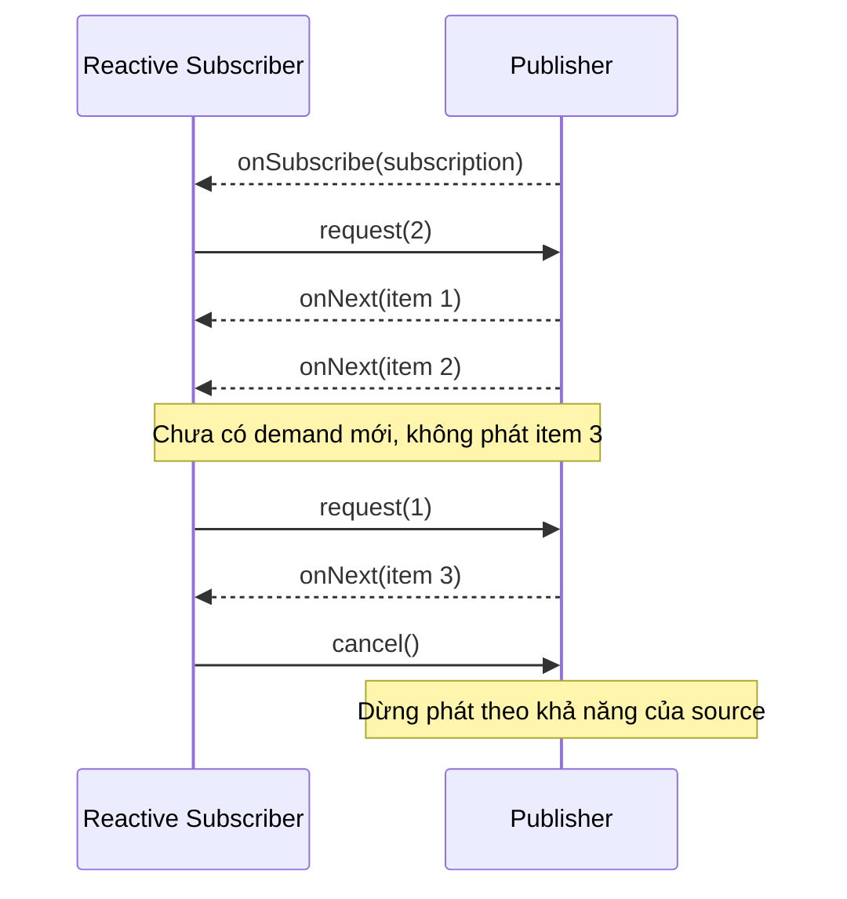
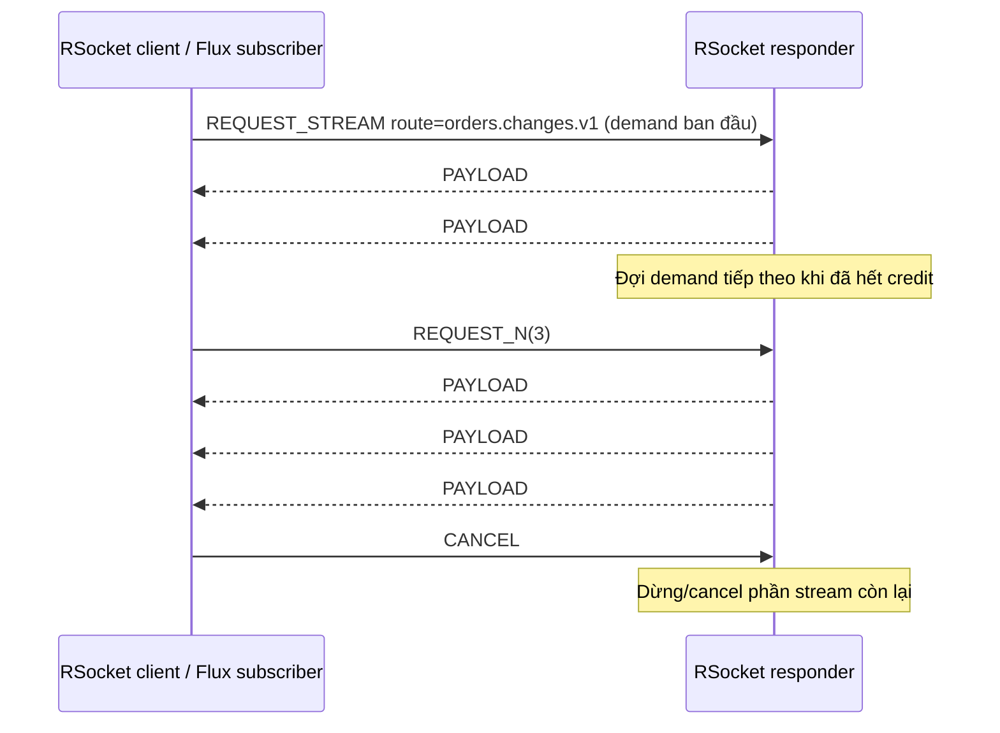
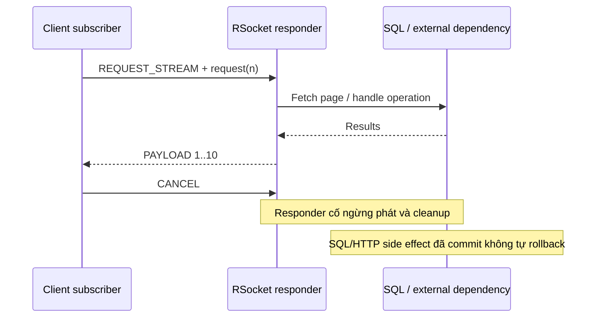
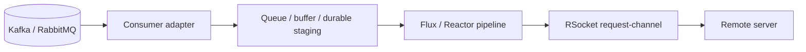
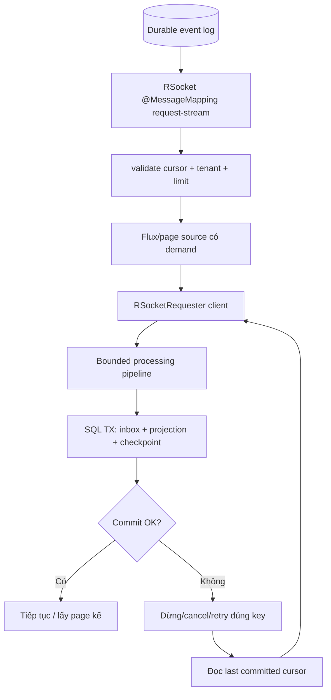

# Backpressure, hủy luồng và kiểm soát lượng dữ liệu

> **Chương:** RSocket  
> **Phạm vi:** Trong module **SPRING_BOOT_INTEGRATION**, Spring Boot tổ chức tích hợp hệ thống qua HTTP client, cơ sở dữ liệu, cache, broker thông điệp và adapter của Spring Integration. Bài này giải thích **backpressure**, tín hiệu **hủy luồng** (*cancellation*) và các cách **giới hạn lượng dữ liệu đang được yêu cầu, truyền, lưu đệm, xử lý** với RSocket và Project Reactor. Trọng tâm vận hành là tránh quá tải, truyền dữ liệu đúng hợp đồng, kiểm soát transaction/ACK, xử lý trùng lặp và kiểm thử những tình huống client chậm, ngắt kết nối hoặc restart.

## 1. Vấn đề: server tạo dữ liệu nhanh hơn client xử lý

Giả sử dịch vụ `order-feed` xuất sự kiện đơn hàng qua RSocket route `orders.changes.v1`. Một client khác nhận dữ liệu rồi lưu vào PostgreSQL:

```text
order-feed:
  tạo 50.000 thay đổi/giây
             |
             | RSocket request-stream
             v
integration-worker:
  ghi SQL được 2.000 thay đổi/giây
```

Nếu nguồn gửi liên tục mà phía nhận chỉ xử lý được một phần nhỏ, lượng dữ liệu tồn trong RAM hoặc trên đường truyền sẽ tăng. Hệ quả có thể là:

- JVM tăng heap/GC, cuối cùng `OutOfMemoryError`.
- Queue/decoder/transport buffer tăng, kéo theo độ trễ và timeout.
- Dữ liệu đến chậm hơn thời gian thay đổi nghiệp vụ; kết quả đã **stale** ngay khi ghi.
- Client đóng kết nối trước khi luồng hoàn tất.
- Nếu ứng dụng tự retry các thao tác ghi, dữ liệu có thể bị xử lý **trùng**.

**Backpressure** là cơ chế để **consumer phát tín hiệu về mức nhu cầu (*demand*) của mình**, giúp publisher có thể không phát vượt quá số phần tử đã được yêu cầu. RSocket hỗ trợ flow control dựa trên tín hiệu yêu cầu số phần tử; Project Reactor thực hiện hợp đồng **Reactive Streams** để kết nối publisher–subscriber trong code Java.

Tuy nhiên, backpressure **không** tự giải quyết mọi vấn đề: nó không bảo đảm data source là vô hạn mà vẫn không mất dữ liệu, không tự giới hạn byte size của một message, không tạo durability và không chứng minh remote side effect đã được commit.

### Mục tiêu bài học

Sau khi học, người đọc có thể:

1. Giải thích `Subscription.request(n)`, `REQUEST_N` và `CANCEL` ở mức khái niệm.
2. Phân biệt flow control trong RSocket **request-stream/request-channel** với request–response và fire-and-forget.
3. Viết Spring Boot RSocket server/client trả `Flux`, nhận demand và phát tín hiệu cancellation.
4. Chọn `take`, `limitRate`, `concatMap`, `flatMap(concurrency)`, bounded buffering và timeout đúng mục đích.
5. Nhận biết khi backpressure **không được truyền xuyên** một JDBC call, broker hoặc adapter tự đệm dữ liệu.
6. Phân biệt **hủy subscription**, **đóng RSocket connection** và **rollback giao dịch**.
7. Thiết kế cursor/checkpoint, idempotency và retry khi stream bị cắt giữa chừng.
8. Kiểm thử nhu cầu theo từng bước bằng `StepVerifier` và kiểm tra thật trên RSocket transport.

## 2. Bốn interaction model của RSocket

RSocket là giao thức truyền thông định hướng message, hỗ trợ nhiều interaction trên cùng một kết nối. Bốn mô hình quan trọng:

| Interaction | Bên gọi gửi | Bên gọi nhận | Backpressure cần hiểu |
| --- | --- | --- | --- |
| **Request–response** | Một yêu cầu | Tối đa một response | Có vòng đời subscription/cancellation, nhưng không có một response stream dài để cấp nhu cầu từng item |
| **Fire-and-forget** | Một yêu cầu | Không có business response | Không có stream response để áp `request(n)`; `send()` hoàn tất không chứng minh side effect ở đích |
| **Request-stream** | Một yêu cầu | Nhiều response | **Responder chỉ được gửi theo demand** từ requester cho các phần tử response |
| **Request-channel** | Luồng request payload | Luồng response payload | Hai phía có flow control/cancellation cho các hướng streaming theo semantics của giao thức |

Spring Messaging hỗ trợ API phổ biến qua `RSocketRequester`:

```java
// Request–response: một response DTO.
Mono<QuoteReply> quote = requester
        .route("catalog.quote.v1")
        .data(new QuoteRequest("SKU-42"))
        .retrieveMono(QuoteReply.class);

// Fire-and-forget: không có business response.
Mono<Void> dispatched = requester
        .route("audit.capture.v1")
        .data(new AuditEvent("evt-101"))
        .send();

// Request-stream: nhiều phần tử.
Flux<OrderChange> changes = requester
        .route("orders.changes.v1")
        .data(new ChangeQuery("tenant-a", 0L, 100))
        .retrieveFlux(OrderChange.class);
```

Đây là **snippet khái niệm**; `QuoteReply`, `QuoteRequest`, `AuditEvent`, `OrderChange` và `ChangeQuery` là DTO ứng dụng cần định nghĩa. Cần có requester được cấu hình đúng transport, codec, authentication và route ở server.

**Điểm mấu chốt:** “Reactive” trong Java không có nghĩa mọi operation tự động có nhu cầu vô hạn hoặc mọi remote service hiểu được backpressure. Hãy xét **đơn vị demand thực sự đi qua protocol**.

## 3. Reactive Streams: request(n) và cancel()

Ở mức Reactive Streams, `Publisher<T>` cung cấp dữ liệu cho một `Subscriber<T>`. Sau `onSubscribe(Subscription)`, subscriber:

- Gọi `request(n)` với `n > 0` để thông báo nhu cầu thêm tối đa `n` phần tử.
- Có thể gọi `request(n)` nhiều lần; demand được cộng dồn theo quy tắc API.
- Gọi `cancel()` khi không còn muốn nhận tín hiệu mới.
- Nhận các tín hiệu `onNext(item)`, `onError(error)` hoặc `onComplete()` theo contract.



Một source **tuân thủ backpressure** không phát `onNext` vượt quá demand còn lại. Khi demand bằng 0, source không nên tiếp tục đẩy item vào subscriber ấy. Không phải mọi thư viện/bridge từ API callback sang `Flux` đều có khả năng dừng upstream: nếu bridge đệm không giới hạn, memory vẫn có thể tăng dù subscriber bên dưới request rất ít.

### 3.1. Demand đếm **phần tử**, không phải byte

`request(5)` nghĩa là yêu cầu tối đa **5 message/item** tiếp theo, không có nghĩa 5 KB, 5 SQL rows nhất định hay 5 giây dữ liệu.

```text
request(5)
  item A = 1 KB
  item B = 2 KB
  item C = 12 MB
  item D = 800 B
  item E = 4 KB

Tổng bytes có thể vượt xa trực giác từ số 5.
```

Vì vậy phải **giới hạn kích thước payload**, batch size, codec allocation, buffer size và rate/bytes khi cần. Một hệ thống nhận 100 JSON objects, mỗi object chứa mảng lớn, vẫn có thể hết heap dù demand chỉ là 100 items.

### 3.2. Demand là luồng tín hiệu, không phải một hàng đợi bền vững

`request(n)` điều khiển việc phát dữ liệu trên một subscription. Nó không tự ghi các item chưa gửi xuống PostgreSQL, Kafka hay một file. Nếu server lấy dữ liệu từ nguồn không lưu lại được và client ngắt giữa chừng, phần dữ liệu chưa tiêu thụ **có thể không còn cách phục hồi**.

Khi nghiệp vụ cần không mất thông tin, thiết kế **durable event log, cursor hoặc replay API** là trách nhiệm riêng của application.

## 4. Từ request(n) của Reactor tới REQUEST_N của RSocket

Với RSocket request-stream, requester phát một request yêu cầu stream và thông tin demand ban đầu; sau đó có thể gửi thêm tín hiệu **REQUEST_N** khi downstream yêu cầu các response tiếp theo. Responder quan sát demand, giảm số phần tử được gửi theo luồng.



Sơ đồ minh họa **tín hiệu về mặt khái niệm**, không phải bản trace frame-byte của một thư viện RSocket cụ thể. Client library có thể gửi nhu cầu theo từng đợt hoặc có **prefetch** để tối ưu throughput; đừng mong `request(1)` ở tầng ứng dụng luôn tương ứng đúng một frame `REQUEST_N(1)` trên mạng.

### 4.1. Hai điều kiện cần để backpressure hiệu quả

1. Client dùng một pipeline tôn trọng demand và không tự subscribe với nhu cầu vô hạn khi dữ liệu phải được xử lý có kiểm soát.
2. Server không đẩy dữ liệu từ nguồn nóng (*hot source*) hoặc vòng lặp blocking vào một buffer vô hạn nằm **trước** điểm RSocket có thể điều tiết.

Nếu server đọc hết 2 triệu dòng SQL vào `List` trước khi tạo `Flux.fromIterable(list)` thì RSocket có thể phát dần, **nhưng hai triệu object vẫn đã được tạo trong RAM**. Backpressure ở transport không cứu được việc load eager tại source.

### 4.2. Request-channel có hai hướng cần thiết kế

```text
Client                      Server
  |---- request payload #1 -->|
  |---- request payload #2 -->|
  |<--- acknowledgment #1 ---|
  |<--- acknowledgment #2 ---|
  |---- request payload #3 -->|
  |<--- acknowledgment #3 ---|
```

Trong request-channel, luồng request payload và luồng response payload có thể có **nhu cầu, completion và cancellation riêng theo semantics API/protocol**. Không giả định client có thể gửi vô hạn mà server sẽ luôn chứa đủ dữ liệu; cũng không giả định một response acknowledgment đại diện cho SQL commit nếu contract chưa nói rõ.

## 5. Chuẩn bị ứng dụng Spring Boot RSocket

Ví dụ sử dụng **Spring Boot 3.x, Spring Framework 6.x, Java 17+** với các API RSocket/Project Reactor tương thích BOM. Khi dùng Boot 4.x hoặc phiên bản RSocket mới, kiểm tra imports, startup, transport và codec theo documentation tương ứng.

### 5.1. Maven

```xml
<dependencies>
    <dependency>
        <groupId>org.springframework.boot</groupId>
        <artifactId>spring-boot-starter-rsocket</artifactId>
    </dependency>
    <dependency>
        <groupId>org.springframework.boot</groupId>
        <artifactId>spring-boot-starter-test</artifactId>
        <scope>test</scope>
    </dependency>
    <dependency>
        <groupId>io.projectreactor</groupId>
        <artifactId>reactor-test</artifactId>
        <scope>test</scope>
    </dependency>
</dependencies>
```

Nếu nguồn là R2DBC, thêm R2DBC driver/repository phù hợp. Nếu thực hiện blocking JDBC, cần JDBC starter/driver và **tách blocking khỏi event-loop** khi dùng reactive server/client. Không thêm dependency chỉ để “làm cho Flux nhanh” mà bỏ qua bản chất nguồn dữ liệu.

### 5.2. Server TCP và client endpoint

Ứng dụng server:

```yaml
spring:
  rsocket:
    server:
      transport: tcp
      port: 7000
```

Ứng dụng client:

```yaml
integration:
  order-feed:
    host: ${ORDER_FEED_HOST:localhost}
    port: ${ORDER_FEED_PORT:7000}
    max-items-per-call: 500
    request-timeout: 5s
```

`integration.order-feed.*` là properties **ứng dụng tự định nghĩa**, không phải chỉ cần viết YAML là Spring Boot tự tạo requester. Ví dụ dùng TCP local; nếu chạy WebSocket, cần URI/transport/route và reverse proxy tương thích, không truyền `ws://` vào builder `tcp(host, port)`.

## 6. Một route request-stream có thể kiểm soát nhu cầu

### 6.1. Contract có giới hạn hữu hạn

Ta xây route xuất các thay đổi có sequence tăng dần:

```java
package com.example.rsocket.feed;

public record ChangeQuery(
        String tenantId,
        long afterSequence,
        int limit) {}
```

```java
package com.example.rsocket.feed;

public record OrderChange(
        String tenantId,
        long sequence,
        String orderId,
        String state) {}
```

Các trường mang ý nghĩa:

| Trường | Ý nghĩa | Tại sao cần |
| --- | --- | --- |
| `tenantId` | Phạm vi dữ liệu | Tránh trộn tenant; phải được authorization bằng identity tin cậy |
| `afterSequence` | Cursor của item **đã xử lý bền vững** cuối cùng | Có thể gọi lại khi ngắt/cancel |
| `limit` | Số item tối đa trong một lời gọi | Bound RAM, thời gian và khối lượng dữ liệu |
| `sequence` | Thứ tự dữ liệu từ nguồn | Phát hiện thiếu, trùng hoặc out-of-order |
| `orderId` | Business reference | Hỗ trợ dedup, audit và reconciliation |

**Hợp đồng `afterSequence` chỉ có ý nghĩa nếu nguồn cung cấp thứ tự ổn định và dữ liệu có thể replay**. Không được lấy offset tùy ý của một nguồn nóng không retention rồi hứa client có thể đọc lại sau một giờ.

### 6.2. Server với Publisher tôn trọng demand

```java
package com.example.rsocket.feed;

import org.springframework.messaging.handler.annotation.MessageMapping;
import org.springframework.stereotype.Controller;
import reactor.core.publisher.Flux;
import reactor.core.publisher.Mono;

@Controller
public class OrderChangeController {

    @MessageMapping("orders.changes.v1")
    public Flux<OrderChange> changes(ChangeQuery query) {
        return Mono.justOrEmpty(query)
                .flatMapMany(request -> {
                    if (request.tenantId() == null
                            || request.tenantId().isBlank()
                            || request.afterSequence() < 0
                            || request.limit() < 1
                            || request.limit() > 500) {
                        return Flux.error(new IllegalArgumentException(
                                "Invalid change query"));
                    }

                    // Chỉ là dữ liệu mô phỏng cho bài thực hành.
                    return Flux.range(1, request.limit())
                            .map(index -> new OrderChange(
                                    request.tenantId(),
                                    request.afterSequence() + index,
                                    "ORD-" + (request.afterSequence() + index),
                                    "CONFIRMED"))
                            .doOnRequest(n ->
                                    observeDemand("orders.changes.v1", n))
                            .doOnCancel(() ->
                                    observeCancellation("orders.changes.v1"));
                });
    }

    private void observeDemand(String route, long n) {
        // Thực tế: ghi metric/tổng hợp mức demand, không log từng item.
    }

    private void observeCancellation(String route) {
        // Thực tế: ghi một counter theo route/outcome.
    }
}
```

`Flux.range` là nguồn **lạnh** (*cold*), tạo một số nguyên khi có demand; `map` biến thành DTO mà không làm I/O. Đây là điểm bắt đầu tốt để **đo demand**, chưa phải một server production có persistent event log.

**Điều kiện triển khai thực tế:**

- Server phải xác thực client và **kiểm tra quyền tenant** trước khi trả dữ liệu; không tin `tenantId` do caller tự khai.
- Kiểm tra overflow của `afterSequence + index` nếu sequence tiến sát `Long.MAX_VALUE`.
- Giới hạn payload, số item, rate theo tenant/identity và số stream đồng thời.
- Nếu source lấy dữ liệu từ SQL, phải truy vấn theo page/cursor thay vì `SELECT *` rồi cache cả result trong memory.

### 6.3. Vì sao không gọi collectList() trước khi trả Flux?

```java
// Không phù hợp với tập dữ liệu không giới hạn:
return repository.findAllChanges(tenantId)
        .collectList()
        .flatMapMany(Flux::fromIterable);
```

Đây là anti-pattern minh họa: `collectList()` gom hết dữ liệu vào một danh sách rồi mới phát, nên phía dưới RSocket có `REQUEST_N` cũng không ngăn bước gom bộ nhớ trước đó. Với 10 triệu records có thể OOM.

**Quy tắc:** kết nối demand tới **nguồn phát** gần nhất có khả năng điều tiết; limit/page dữ liệu ở database; không đặt một tầng eager collection trước điểm control.

## 7. Client RSocketRequester cho luồng nhiều kết quả

### 7.1. Cấu hình client dùng chung

```java
package com.example.rsocket.client;

import org.springframework.beans.factory.annotation.Value;
import org.springframework.context.annotation.Bean;
import org.springframework.context.annotation.Configuration;
import org.springframework.messaging.rsocket.RSocketRequester;
import org.springframework.util.MimeTypeUtils;

@Configuration(proxyBeanMethods = false)
public class OrderFeedClientConfiguration {

    @Bean(destroyMethod = "close")
    OrderFeedClient orderFeedClient(
            RSocketRequester.Builder builder,
            @Value("${integration.order-feed.host}") String host,
            @Value("${integration.order-feed.port}") int port) {
        RSocketRequester requester = builder
                .dataMimeType(MimeTypeUtils.APPLICATION_JSON)
                .tcp(host, port);
        return new OrderFeedClient(requester);
    }
}
```

```java
package com.example.rsocket.client;

import com.example.rsocket.feed.ChangeQuery;
import com.example.rsocket.feed.OrderChange;
import org.springframework.messaging.rsocket.RSocketRequester;
import reactor.core.publisher.Flux;

public final class OrderFeedClient implements AutoCloseable {
    private final RSocketRequester requester;

    public OrderFeedClient(RSocketRequester requester) {
        this.requester = requester;
    }

    public Flux<OrderChange> changes(ChangeQuery query) {
        return requester.route("orders.changes.v1")
                .data(query)
                .retrieveFlux(OrderChange.class);
    }

    @Override
    public void close() {
        requester.rsocket().dispose();
    }
}
```

Đây là requester dùng chung trong một Spring bean, phù hợp với **cùng endpoint và phạm vi identity**. Mỗi `changes(...)` tạo publisher riêng; nhiều subscriptions có thể được multiplex qua RSocket connection. **Không gọi `requester.rsocket().dispose()` khi chỉ một subscription bị cancel**, vì sẽ đóng cả connection dùng chung của những thao tác khác.

**Lưu ý về vòng đời:** API và behavior của requester/client có thể thay đổi theo phiên bản. Khi áp dụng reconnect/load-balancing client riêng, đóng tài nguyên ở **owner** của abstraction đó, không giả định mọi bản triển khai chỉ có một TCP socket suốt đời bean.

### 7.2. Đặt giới hạn tổng số item của một lần đọc

```java
Flux<OrderChange> firstPage = client
        .changes(new ChangeQuery("tenant-a", 0L, 500))
        .take(100);
```

Ở ví dụ này, server có thể có 500 item nhưng client chỉ muốn 100. `take(100)` **giới hạn tổng item quan sát bởi downstream và cancel upstream khi đủ**, chứ không chỉ yêu cầu ít item trong mỗi lần.

Nếu client không định dùng hơn 100 item, tốt hơn **đưa limit=100 vào contract server** ngay từ đầu thay vì dùng `limit=500` rồi bỏ 400 item. `take` vẫn hữu ích để bảo vệ caller khi server gửi dài hơn hợp đồng hoặc user dừng sớm.

## 8. Kiểm soát demand bằng BaseSubscriber

Để nhìn rõ từng lần yêu cầu, có thể tự tạo `BaseSubscriber` của Reactor:

```java
import org.reactivestreams.Subscription;
import reactor.core.publisher.BaseSubscriber;
import reactor.core.publisher.Flux;

Flux<Integer> source = Flux.range(1, 5)
        .doOnRequest(n ->
                System.out.println("requested=" + n));

source.subscribe(new BaseSubscriber<>() {
    @Override
    protected void hookOnSubscribe(Subscription subscription) {
        request(1);
    }

    @Override
    protected void hookOnNext(Integer value) {
        System.out.println("received=" + value);
        // Chỉ tăng demand khi consumer đã xử lý xong item hiện tại.
        request(1);
    }

    @Override
    protected void hookOnComplete() {
        System.out.println("done");
    }

    @Override
    protected void hookOnError(Throwable throwable) {
        System.err.println(throwable.getMessage());
    }
});
```

Đoạn code là **thí nghiệm Reactive Streams local**, không dùng làm kiến trúc quản lý consumer production. Trong `hookOnNext`, công việc ví dụ hoàn tất đồng bộ ngay; nếu xử lý SQL/HTTP bất đồng bộ thì `request(1)` ngay ở đây **không chứng minh xử lý đã commit**.

**Chú ý lỗi thường gặp:** `subscribe(onNext -> ...)` theo overload đơn giản thường tạo demand mặc định lớn/không giới hạn. Đừng viết một consumer tự subscribe rồi giả định chỉ xử lý một item tại một thời điểm vì bạn thấy các callback được gọi tuần tự.

### 8.1. Không dùng blocking trong hookOnNext trên event loop

```java
// Anti-pattern:
@Override
protected void hookOnNext(OrderChange change) {
    jdbcTemplate.update("UPDATE ...", ...); // JDBC blocking
    request(1);
}
```

Nếu callback chạy trên Reactor Netty event-loop, JDBC blocking chiếm thread phục vụ I/O khác và làm mất lợi ích của reactive pipeline. Dùng worker scheduler phù hợp hoặc một pipeline tách rõ blocking I/O ra khỏi event loop (mục 12).

## 9. limitRate khác take, timeout và delayElements thế nào?

Các operator Reactor giải quyết **những chiều khác nhau**:

| Operator | Mục đích | **Không** bảo đảm |
| --- | --- | --- |
| `take(n)` | Chỉ lấy tối đa `n` phần tử rồi complete/cancel upstream | Server không từng prefetch nhiều hơn `n` item |
| `limitRate(n)` | Phân nhỏ lượng demand gửi lên upstream theo batch | Không hạn chế **tổng** số item cả stream |
| `flatMap(fn, concurrency)` | Giới hạn số inner publishers đang active | Không phải global semaphore giữa mọi request |
| `concatMap(fn)` | Chạy các inner publisher theo thứ tự, có phối hợp demand | Không tự làm SQL/broker transaction atomic |
| `buffer(n)` | Gom nhiều item thành các list kích thước tối đa `n` | Không giới hạn tổng memory nếu downstream giữ quá nhiều lists |
| `onBackpressureBuffer(n)` | Cho phép đệm tối đa `n` item tại một điểm pipeline | Không tạo durable queue hoặc chữa upstream vô hạn |
| `onBackpressureDrop` | Bỏ item khi downstream không theo kịp | Không phù hợp với sự kiện nghiệp vụ không được mất |
| `onBackpressureLatest` | Chỉ giữ giá trị mới nhất khi downstream chậm | Không giữ mọi trạng thái lịch sử |
| `delayElements(duration)` | Thêm độ trễ khi phát item | Không phải rate limiter/byte limiter có SLA chính xác |
| `timeout(duration)` | Lỗi nếu thiếu tín hiệu trong khoảng thời gian do operator định nghĩa | Không nhất thiết là deadline **toàn stream** |

### 9.1. Ví dụ limitRate

```java
Flux<OrderChange> flow = client
        .changes(new ChangeQuery("tenant-a", 0L, 500))
        .limitRate(32);
```

`limitRate(32)` định hình lượng demand upstream thành từng đợt; Reactor có thể **replenish** trước khi tất cả 32 item của đợt trước hoàn toàn được xử lý, theo threshold của operator. Không nói rằng nó “luôn gửi đúng frame REQUEST_N(32)” hoặc “chỉ có tối đa 32 item trong toàn bộ đường ống”.

Nếu cần giới hạn **tổng số kết quả**, kết hợp `take(100)` hoặc parameter `limit=100`. Nếu cần giới hạn **số tác vụ đồng thời**, chọn operator concurrency/bulkhead khác. Nếu cần **giới hạn bytes/giây**, thêm policy đo bytes và scheduling riêng.

### 9.2. Không dùng delayElements để che overload

```java
// Không phải giải pháp hệ thống để bảo vệ database:
client.changes(query)
        .delayElements(Duration.ofMillis(10));
```

`delayElements` có thể làm chậm subscriber và ảnh hưởng nhu cầu upstream, nhưng không thay được rate limiting ở nguồn, giới hạn burst, dead-letter policy và capacity planning. Với upstream tự phát vào buffer không bounded, phía sau có chậm cũng không làm upstream an toàn.

## 10. onBackpressureBuffer, drop và latest: dùng có điều kiện

### 10.1. Bounded buffer

```java
Flux<OrderChange> bounded = hotSource
        .onBackpressureBuffer(128);
```

Đoạn này giả định `hotSource` là `Flux<OrderChange>` có nguồn khác. `onBackpressureBuffer(128)` tạo một đệm **có giới hạn số phần tử tại vị trí operator**, không phải giới hạn tổng heap của JVM. Khi overflow, behavior/error phụ thuộc overload và strategy đã chọn; không mặc định source và downstream sẽ tiếp tục khỏe.

**Hậu quả của overflow:** nếu dữ liệu không được phép mất, phải chuyển sang **durable queue hoặc lưu offset** để producer giảm tốc/consumer retry. Không silently drop business messages rồi ghi nhận flow thành công.

### 10.2. Khi nào onBackpressureDrop/Latest có thể đúng?

Một luồng cập nhật CPU temperature mỗi 100 ms cho dashboard có thể chỉ cần **trạng thái mới nhất**:

```java
Flux<TemperatureSnapshot> display = telemetrySource
        .onBackpressureLatest();
```

Đây là **snippet ý tưởng**: `TemperatureSnapshot` và `telemetrySource` do ứng dụng định nghĩa, không phải API built-in. Nếu dashboard không kịp theo dõi mọi thay đổi, bỏ snapshot cũ có thể chấp nhận theo hợp đồng.

Không áp dụng tương tự cho:

- Giao dịch thanh toán.
- Event xác nhận/hủy đơn.
- Audit log bắt buộc.
- Kafka offset phải được xử lý mọi message.
- Hóa đơn/batch data cần đối soát.

Ở các luồng này, drop có thể làm mất trạng thái trung gian, khiến dữ liệu cuối bị sai hoặc không thể replay.

### 10.3. Buffered item vẫn tiêu tốn RAM

Một buffer 128 item với mỗi item 2 MB là khoảng 256 MB **chỉ riêng payload thô**, chưa tính object graph/codec, network buffers và các stage khác. Vì vậy **limit số lượng phần tử không thay được giới hạn size của từng payload**.

## 11. Kiểm soát concurrency khi mỗi item tạo side effect

Giả sử mỗi change cần kiểm tra trạng thái ở một HTTP service:

```java
Flux<EnrichedChange> enriched = client
        .changes(new ChangeQuery("tenant-a", 0L, 500))
        .flatMap(
                change -> partnerClient.enrich(change),
                8
        );
```

`partnerClient.enrich(...)` là method trả `Mono<EnrichedChange>` đã có retry/timeout phù hợp. Tham số `8` giới hạn **số inner publishers active của một pipeline**, không phải giới hạn toàn bộ instance/cluster.

Nếu 100 clients đồng thời chạy pipeline này, ứng dụng có thể phát **tối đa hàng trăm** remote calls song song. Khi cần bảo vệ đối tác, thêm:

- **Bulkhead/semaphore** ở cấp remote adapter/service.
- Rate limiter theo endpoint/tenant.
- Timeout/deadline và retry budget.
- Giới hạn số connections và tổng in-flight.
- Backpressure tới **source** nếu thực sự hỗ trợ; nếu không thì durable staging.

### 11.1. flatMap có thể đổi thứ tự

`flatMap` đưa item ra theo thứ tự hoàn thành của inner publishers, có thể **khác** sequence input. Nếu `OrderChange(seq=10)` và `seq=11` cập nhật cùng aggregate, xử lý song song có thể ghi seq=11 trước seq=10.

Với yêu cầu giữ thứ tự:

```java
Flux<PersistResult> written = client.changes(query)
        .concatMap(change -> persistence.persistOnce(change));
```

`persistence.persistOnce(...)` là method trả `Mono<PersistResult>`, có unique key và transaction SQL phù hợp. `concatMap` chờ inner publisher trước hoàn tất rồi mới xử lý publisher kế tiếp, giữ thứ tự output/side effect ở **pipeline này**.

**Nhưng:** nhiều client/pod độc lập vẫn có thể cập nhật cùng aggregate song song. Cần **version check/unique constraint/partition key** trong database; một `concatMap` cục bộ không tạo khóa phân tán.

### 11.2. flatMapSequential và trade-off

`flatMapSequential` có thể giữ thứ tự output dù một số inner publishers được chạy đồng thời, nhưng phải **buffer kết quả của những inner hoàn tất sớm** đang chờ inner trước. Nếu dữ liệu lớn hoặc handler chậm không cân bằng, memory/latency có thể tăng. Dùng khi trade-off phù hợp, không coi nó là “concurrency miễn phí”.

## 12. Đưa blocking JDBC ra khỏi event loop

RSocket với Reactor thường sử dụng non-blocking I/O cho network. Nhưng `JdbcTemplate` là **blocking JDBC API**. Gọi JDBC trực tiếp trong `map`/`doOnNext` trên event-loop có thể chặn tiến trình xử lý network.

### 12.1. Bọc một đơn vị blocking I/O

```java
package com.example.rsocket.client;

import org.springframework.jdbc.core.JdbcTemplate;
import org.springframework.stereotype.Service;
import reactor.core.publisher.Mono;
import reactor.core.scheduler.Schedulers;

@Service
public class OrderChangePersistence {
    private final JdbcTemplate jdbc;

    public OrderChangePersistence(JdbcTemplate jdbc) {
        this.jdbc = jdbc;
    }

    public Mono<Long> persistOnce(OrderChange change) {
        return Mono.fromCallable(() -> {
                    // SQL/unique constraint của nghiệp vụ phải là idempotent.
                    jdbc.update("""
                        INSERT INTO order_change_inbox
                            (tenant_id, sequence_no, order_id, state)
                        VALUES (?, ?, ?, ?)
                        ON CONFLICT (tenant_id, sequence_no) DO NOTHING
                        """, change.tenantId(), change.sequence(),
                        change.orderId(), change.state());
                    return change.sequence();
                })
                .subscribeOn(Schedulers.boundedElastic());
    }
}
```

Đây là **mẫu đơn giản hóa**: `OrderChange` phải được import từ package contract, bảng `order_change_inbox` được tạo trước, và câu `ON CONFLICT` dành cho PostgreSQL. Để hoàn chỉnh:

- Đặt **inbox insert + business update + checkpoint** trong cùng transaction SQL.
- Kiểm tra fingerprint nếu cùng key nhưng payload khác; `DO NOTHING` một mình không đủ.
- Khi SQL rollback, không cập nhật cursor hay coi message đã xử lý.
- Dùng thread/connection pool và concurrency limit phù hợp để `boundedElastic` không tích lũy hàng nghìn công việc đang đợi.

`Schedulers.boundedElastic()` là scheduler phục vụ blocking work có giới hạn, **không phải pool JDBC** và không tự chuyển nhiều SQL statements thành một transaction. Transaction của Spring JDBC thường thread-bound; cần đặt `@Transactional` tại **service method thực sự chạy trên thread thực hiện JDBC** và gọi qua Spring proxy.

### 12.2. Xử lý tuần tự với blocking source

```java
Flux<Long> committedSequences = client
        .changes(new ChangeQuery("tenant-a", lastCommittedSeq, 500))
        .concatMap(persistence::persistOnce);
```

`concatMap` tránh bắt đầu các side effects theo thứ tự vượt trước trong **pipeline này**. Nhưng một sequence có thể bị retry sau crash, do đó SQL vẫn phải idempotent theo business key và persisted checkpoint.

Nếu source là R2DBC `Flux<OrderChange>` đúng non-blocking, không cần đưa **toàn bộ** luồng sang boundedElastic chỉ theo thói quen. Chọn scheduler dựa trên API đang dùng.

## 13. Bảo vệ SQL khỏi nguồn RSocket quá nhanh

**Demand propagation không trực tiếp nói cho PostgreSQL biết “đừng gửi thêm rows”** nếu cách đọc là blocking hoặc driver fetch tất cả.

| Nguồn server | Có thể phối hợp backpressure thế nào? | Rủi ro |
| --- | --- | --- |
| `Flux.range`/`Flux.generate` | Tạo item khi được request theo semantics | Công việc mapping item vẫn có thể nặng |
| R2DBC `Flux` | Driver/publisher có non-blocking streaming behavior tùy implementation | Connection giữ lâu, buffer ở driver, query plans |
| JDBC cursor / paging | Chủ động fetch theo page, kiểm soát fetch size và lifecycle | JDBC blocking; phải close cursor/connection khi cancel |
| `List` chứa tất cả 1 triệu rows | Chỉ điều tiết phát sau khi `List` đã được nạp | Eager memory allocation |
| Kafka broker adapter | Poll/commit/pause theo consumer config và backpressure bridge | Broker log retention, poll batch, offset/ACK không tự đồng bộ với Reactor demand |
| RabbitMQ adapter | Prefetch/ACK theo consumer config và flow bridge | Unacked deliveries/queue backlog vẫn cần policy |
| File input stream | Đọc dần và close trên cancel | Parser buffer, file handle, checksum/truncated-file contract |

**Quy tắc:** Backpressure hiệu quả đến đâu phụ thuộc **điểm đầu tiên có thể dừng việc tạo/nạp dữ liệu**. Một pipeline RSocket rất “reactive” bên ngoài vẫn có thể làm nghẽn database nếu source code phía trong đọc toàn bộ dữ liệu vào RAM.

### 13.1. Pagination bằng cursor ổn định

Khi phục vụ batch, chia thành các lời gọi có limit hợp lý:

```text
GET RSocket route orders.changes.v1
request:
  tenantId = tenant-a
  afterSequence = 5000
  limit = 500

response:
  sequence = 5001 ... 5500

Client chỉ lưu checkpoint=5500
SAU KHI các side effects tương ứng đã commit.
Lần tiếp theo:
  afterSequence = 5500, limit = 500
```

**Không checkpoint dựa trên item đã nhận qua network.** Nếu nhận seq=5500 rồi cancel trước khi SQL commit, checkpoint=5500 sẽ làm mất dữ liệu khi resume. Cursor phải phản ánh **đã xử lý bền vững**, không chỉ “đã deserialize”.

## 14. Hủy luồng: CANCEL không phải rollback nghiệp vụ

Khi client không còn muốn nhận stream, Reactive Streams phát `cancel()` và RSocket có thể truyền tín hiệu **CANCEL** tới responder cho interaction phù hợp.



**CANCEL là tín hiệu về nhu cầu nhận dữ liệu tiếp theo**, không phải một giao thức phân tán “undo operation”. Có thể có:

- Frame đang trên mạng khi cancel đến.
- Async operation đã được dispatch nhưng chưa hoàn tất.
- SQL transaction đã commit.
- HTTP POST đã được đối tác xử lý nhưng response chưa đến.
- Buffer của driver/file stream đang được giải phóng bất đồng bộ.

Vì thế phải phân biệt **luồng kết quả bị hủy**, **operation nghiệp vụ bị yêu cầu hủy** và **operation đã hoàn tất hay chưa**.

### 14.1. take(n) phát hủy khi đủ phần tử

```java
Flux<OrderChange> sample = client
        .changes(new ChangeQuery("tenant-a", 0L, 500))
        .take(25)
        .doFinally(signal -> recordClientTermination(signal));
```

Khi đã nhận đủ 25 item, `take(25)` complete downstream và cancel upstream nếu còn stream đang chạy. `doFinally` cho phép quan sát completion/error/cancellation theo **vị trí gắn operator**. Không nhầm rằng mọi `doFinally` đều nhận `CANCEL`: ở downstream sau `take`, tín hiệu kết thúc có thể là **ON_COMPLETE**, còn upstream do `take` cancel có thể thấy **CANCEL**.

**Một lỗi debug hay gặp:** client thấy `verifyComplete()` và kết luận server hoàn tất tự nhiên. Có thể client đã **chủ động ngừng sớm** nhờ `take`; server cần xử lý cancellation sạch và không coi đó là lỗi hệ thống nếu contract cho phép.

### 14.2. Đóng connection khác cancel một stream

```java
// Hủy một subscription - đúng phạm vi subscription:
Disposable subscription = client.changes(query)
        .subscribe(this::onChange, this::onError);
subscription.dispose();

// Đóng underlying requester do bean owner quản lý:
requester.rsocket().dispose();
```

Đây là đoạn mã **đối chiếu khái niệm**. Với requester singleton dùng chung, **đừng dispose underlying RSocket vì một stream đã cancel**, vì tất cả các stream khác trên connection có thể bị ảnh hưởng. Đoạn `subscribe(...)` cũng không phải mẫu consumption production cho message quan trọng: subscription fire-and-forget tự quản lý như vậy dễ thiếu ACK, checkpoint và shutdown handling.

## 15. Resource cleanup khi subscriber cancel

Một stream có thể giữ:

- JDBC/R2DBC connection hoặc cursor.
- File input stream/parser.
- Buffer, frame decoder, references tới DTO lớn.
- Scheduler task hoặc interval timer.
- Subscription ở upstream.

Khi cancel/timeout:

1. **Stop nguồn tạo dữ liệu** nếu source hỗ trợ.
2. **Close/cleanup resource** bằng hook/using pattern phù hợp.
3. **Không commit checkpoint** cho dữ liệu chưa xử lý.
4. **Không chặn Netty event-loop** khi cleanup có I/O blocking.
5. Ghi metric **cancellation reason** (user cancel, timeout, shutdown, load shedding).

### 15.1. Dùng using cho resource theo subscription

```java
import java.io.BufferedReader;
import java.io.IOException;
import java.io.UncheckedIOException;
import java.nio.file.Files;
import java.nio.file.Path;
import reactor.core.publisher.Flux;
import reactor.core.scheduler.Schedulers;

Flux<String> readLines(Path path) {
    return Flux.using(
            () -> Files.newBufferedReader(path),
            reader -> Flux.fromStream(reader.lines()),
            reader -> {
                try {
                    reader.close();
                } catch (IOException ex) {
                    throw new UncheckedIOException(ex);
                }
            })
            .subscribeOn(Schedulers.boundedElastic());
}
```

Ví dụ thể hiện **resource per subscription** và cleanup khi publisher kết thúc/cancel. Vì các lần đọc `BufferedReader` là blocking, `subscribeOn(boundedElastic)` đưa việc subscribe/request source sang scheduler phù hợp; trong ứng dụng production cần kiểm tra thực tế nơi iterator/stream pull xảy ra và giới hạn concurrency/line length/file size.

**Cảnh báo:** Hàm tạo tài nguyên của `Flux.using` chấp nhận `Callable` nên có thể truyền lỗi `IOException` khi mở file; callback dọn dẹp là `Consumer` nên **không được ném checked exception**, vì vậy ví dụ chuyển lỗi đóng file sang `UncheckedIOException`. Trong ứng dụng thật cần phân loại/log/giám sát lỗi cleanup theo semantics của thư viện. Nếu dùng `Flux.usingWhen`, đó là cơ chế cleanup bất đồng bộ dành cho resource reactive; không chuyển blocking close sang event-loop vô điều kiện.

### 15.2. Cleanup không phải “undo”

Đóng file reader khi cancel không có nghĩa file output đã ghi được rollback. Đóng JDBC connection không chứng minh transaction đã rollback nếu code trước đó đã commit. Đóng RSocket subscription không khôi phục một Kafka offset đã được commit.

**Cleanup giải phóng tài nguyên; consistency cần hợp đồng nghiệp vụ và durable state.**

## 16. Timeout: timeout giữa các item khác deadline tổng

`Flux.timeout(Duration.ofSeconds(5))` trên một stream thường biểu thị **lỗi nếu khoảng chờ cho tín hiệu tiếp theo vượt giới hạn**, không mặc định ngắt toàn stream sau đúng 5 giây kể từ lúc bắt đầu.

```java
Flux<OrderChange> guarded = client.changes(query)
        .timeout(Duration.ofSeconds(5))
        .doOnError(error -> recordStreamError(error));
```

Nếu server gửi đều đặn một item mỗi giây trong 30 phút, operator có thể **không timeout**, dù deadline toàn workflow của user chỉ là 20 giây. Cần thiết kế một **time budget tổng** hoặc cancellation deadline riêng.

### 16.1. Ví dụ giới hạn thời gian tổng

```java
Flux<OrderChange> limited = client.changes(query)
        .take(Duration.ofSeconds(20))
        .take(500);
```

`take(Duration)` có thể complete/cancel sau khoảng thời gian được cấp, vì thế nó **không tự báo lỗi timeout**. Nếu business cần phân biệt “đã đủ dữ liệu” với “bị cắt vì deadline”, phải lưu trạng thái và kiểm tra completion condition/cursor; không coi một `Flux` complete bình thường bởi `take(Duration)` là batch complete.

### 16.2. Timeout không chứng minh remote chưa làm gì

Với route ghi `payments.charge.v1`, client timeout sau 3 giây nhưng server có thể đã commit payment. Nếu retry, phải dùng **operation ID/idempotency key cố định**, stored fingerprint và status lookup/reconciliation thay vì tạo payment mới.

RSocket là kênh truyền message; không có một `timeout(...)` nào biến remote database và local SQL thành distributed transaction.

## 17. Xử lý lỗi, retry và resubscribe

### 17.1. Retry trên Flux có thể chạy lại luồng

```java
Flux<OrderChange> retried = client.changes(query)
        .retryWhen(
                reactor.util.retry.Retry.backoff(
                        3, Duration.ofMillis(200)));
```

Đây là snippet minh họa. `retryWhen` **resubscribe** sau lỗi theo policy, và với một request-stream có thể bắt đầu lại từ **cursor ban đầu của `query`**, làm các item trước lỗi được gửi lại.

Vì vậy nếu downstream đã commit seq=1..10 rồi network error ở seq=11, retry cùng `afterSequence=0` có thể nhận lại seq=1..10. Chỉ an toàn khi:

- Consumer có durable inbox/unique key/compare-version.
- Hoặc coordinator đọc lại **last committed cursor** rồi tạo một **request mới** từ vị trí đã commit.
- Không copy side effect lên các dòng `doOnNext` rồi cho rằng retry là transparent.

### 17.2. Phân loại lỗi trước khi retry

| Lỗi | Retry tự động? | Hướng xử lý |
| --- | --- | --- |
| Mạng chập chờn, connection reset trước khi đọc dữ liệu | Có thể, hữu hạn nếu replayable | Reconnect + đọc từ committed cursor |
| Invalid route, codec/MIME mismatch | **Không** retry mù | Sửa contract/client/server |
| Authentication expired | Refresh credential rồi reconnect theo policy | Không phát lặp các lệnh có side effect |
| Business rejection | Không retry vô hạn | Báo lỗi/quarantine theo hợp đồng |
| Overload/rate limit từ remote | Retry có backoff/jitter khi được phép | Giới hạn concurrency và deadline |
| Timeout sau write operation | Outcome không rõ | Status lookup + idempotency/reconcile |
| Buffer overflow tại client | Không chỉ tăng RAM | Backpressure boundary, bounded queue/limit, giảm source rate |
| Data source mất snapshot cũ | Retry không có ích nếu replay không tồn tại | Làm reconciliation hoặc full resync |

**Dừng retry khi application đang graceful shutdown** nếu không còn deadline đủ để hoàn tất/reconcile. Không giữ một luồng retry vô hạn khiến process không kết thúc.

### 17.3. Reconnect khác retry và RSocket resume

- **Reconnect**: xây connection mới sau khi connection cũ không sử dụng được.
- **Retry**: chạy lại một operation/publisher có thể gây duplicate.
- **Resume**: khả năng của giao thức RSocket khi cả hai phía hỗ trợ/cấu hình, nhằm phục hồi transport/session trong những điều kiện cụ thể.

**Không mặc định RSocket resume đã bật** hoặc sẽ thay được Kafka retention, SQL outbox/inbox hay application cursor. Nếu server đã mất buffered frames hoặc client đổi instance, cần chiến lược replay ở tầng dữ liệu.

## 18. Checkpoint và idempotency cho stream có side effect

Một consumer nhận `OrderChange` rồi ghi projection SQL cần một **durable checkpoint** thể hiện item đã **commit**, không chỉ đã nhận:

```sql
CREATE TABLE order_change_checkpoint (
    consumer_name VARCHAR(80) NOT NULL,
    tenant_id VARCHAR(80) NOT NULL,
    last_sequence BIGINT NOT NULL,
    updated_at TIMESTAMPTZ NOT NULL DEFAULT CURRENT_TIMESTAMP,
    PRIMARY KEY (consumer_name, tenant_id)
);

CREATE TABLE order_change_inbox (
    tenant_id VARCHAR(80) NOT NULL,
    sequence_no BIGINT NOT NULL,
    order_id VARCHAR(120) NOT NULL,
    state VARCHAR(32) NOT NULL,
    payload_sha256 VARCHAR(64),
    PRIMARY KEY (tenant_id, sequence_no)
);
```

### 18.1. Transaction theo item

Trong **cùng SQL transaction**:

1. Kiểm tra sequence đã được xử lý chưa.
2. Nếu trùng cùng fingerprint, ghi nhận replay hợp lệ; nếu trùng khác payload, báo conflict.
3. Kiểm tra sequence mới có hợp lệ theo thứ tự không (ví dụ bằng `lastSequence + 1` với một stream không có gap).
4. Ghi business projection và inbox.
5. Cập nhật checkpoint lên sequence vừa commit.
6. Commit transaction.

Sau đó mới cho pipeline xử lý tiếp item sau nếu business yêu cầu thứ tự nghiêm ngặt.

```mermaid
sequenceDiagram
    participant R as RSocket Stream
    participant C as Consumer
    participant DB as PostgreSQL
    R-->>C: change seq=11
    C->>DB: BEGIN; validate inbox/sequence
    C->>DB: Update projection + inbox + checkpoint=11
    DB-->>C: COMMIT
    Note over C: Chỉ lúc này seq=11 mới là durable
    C-->>R: Demand tiếp theo / xử lý tiếp
    Note over C,R: Cancel/crash trước COMMIT => replay từ checkpoint cũ
```

**Lưu ý:** Reactive Streams demand có thể được **prefetch**, nên không khẳng định wire-level REQUEST_N chỉ xuất hiện đúng sau commit của từng item. Mẫu này nói về **đơn vị nghiệp vụ đã bền vững** và consumer pipeline, không phải một phép đồng bộ frame tuyệt đối.

### 18.2. Nếu sequence có khoảng trống hợp lệ

Một stream có thể có dữ liệu chỉ cho tenant/partition được filter, nên sequence `11, 14, 18` đều hợp lệ nếu nguồn cấp global sequence. Khi đó không kiểm tra cứng `last + 1` mà cần:

- Cursor theo **vị trí của log/partition** và filter semantics.
- Source-defined continuation token hoặc watermark.
- Cơ chế phát hiện gaps theo hợp đồng (nếu yêu cầu).
- Idempotency theo `eventId` và source partition.

Không dùng `max(sequence)` một cách mù quáng khi events có thể đến out-of-order; checkpoint cao có thể làm bỏ qua events thấp chưa xử lý.

### 18.3. Đã nhận đủ item không có nghĩa downstream xong

Nếu consumer chỉ đặt change vào một `QueueChannel` in-memory rồi yêu cầu thêm RSocket items, luồng input có thể kết thúc dù công việc chưa bền vững. Nếu queue mất khi JVM restart, dữ liệu cũng mất.

Để ACK được mức độ bền vững, dùng **SQL staging/outbox, message broker có xác nhận phù hợp hoặc persistent channel**, tùy hợp đồng. Đừng coi `Flux.onComplete` là business completion khi còn asynchronous workers.

## 19. Request-channel: vừa gửi vừa nhận có flow control hai phía

Một client có thể gửi lô command qua request-channel và nhận kết quả từng phần.

### 19.1. Contract mẫu

```java
package com.example.rsocket.channel;

public record ImportCommand(
        String tenantId,
        String operationId,
        long sequence,
        String payload) {}
```

```java
package com.example.rsocket.channel;

public record ImportAck(
        String operationId,
        boolean accepted,
        String state) {}
```

**`ImportAck.accepted=true` phải có hợp đồng rõ**: đã decode? đã ghi staging bền vững? đã commit business result? Không dùng boolean không diễn giải để mặc định nghĩa “đã xử lý hoàn tất”.

### 19.2. Server @MessageMapping nhận Flux

```java
package com.example.rsocket.channel;

import org.springframework.messaging.handler.annotation.MessageMapping;
import org.springframework.stereotype.Controller;
import reactor.core.publisher.Flux;

@Controller
public class ImportChannelController {
    private final ImportService service;

    public ImportChannelController(ImportService service) {
        this.service = service;
    }

    @MessageMapping("imports.commands.v1")
    public Flux<ImportAck> importCommands(
            Flux<ImportCommand> commands) {
        return commands.concatMap(service::persistAccepted);
    }
}
```

`ImportService.persistAccepted(...)` là method trả `Mono<ImportAck>`, chỉ complete khi command đã **lưu bền vững theo business idempotency key**. `concatMap` minh họa xử lý theo thứ tự; nếu xử lý độc lập có thể dùng concurrency cao hơn với limit, nhưng phải xác định ack order và dedup.

### 19.3. Client gửi một Publisher

```java
Flux<ImportCommand> requests = Flux.fromIterable(commands);

Flux<ImportAck> replies = requester
        .route("imports.commands.v1")
        .data(requests, ImportCommand.class)
        .retrieveFlux(ImportAck.class);
```

`commands` là iterable hữu hạn được cung cấp bởi ứng dụng; với nguồn lớn, đừng nạp toàn bộ file vào `List` trước khi tạo Flux. Với request-channel, **cancellation hoặc mất connection** có thể xảy ra khi một phần commands đã được server chấp nhận. Client phải đọc ledger/ack theo `operationId` và replay an toàn những commands chưa có outcome chắc chắn.

### 19.4. Không coi response count là số command chắc chắn đã commit

Nếu server có pipeline async, response có thể là “queued” chứ không phải “committed”; nếu consumer hủy response stream, server có thể đã nhận thêm commands. Hợp đồng cần nói rõ:

- Ack được tạo **sau commit staging hay sau xử lý cuối**.
- Nếu response mất thì tra cứu outcome bằng ID nào.
- Nếu cùng operation ID nhưng payload khác thì xử lý conflict ra sao.
- Có giới hạn số request/channel, payload bytes và thời gian giữ stream không.

## 20. Flow control và message broker không giống nhau

Một integration flow có thể nối:



RSocket backpressure điều tiết **giữa các publisher/subscriber tương ứng**, không tự động truyền thành policy ACK/prefetch/pause của Kafka/Rabbit/JMS nếu adapter không được thiết kế để bridge tín hiệu ấy.

| Nguồn | Flow control riêng | Điều cần nối vào policy |
| --- | --- | --- |
| **Kafka** | Poll, `max.poll.records`, pause/resume, offset commit, partitions | Pause khi downstream quá tải; commit offset **sau durable state** |
| **RabbitMQ** | Prefetch/QoS, ACK/NACK, consumer concurrency | Giữ unacked có giới hạn, ACK đúng sau business commit |
| **JMS** | Session/consumer receive, ack/transacted session | Không tự coi subscriber demand là JMS commit |
| **Spring Integration QueueChannel** | Capacity, poller maxMessagesPerPoll, executor | Pending store có persistence nếu đã accepted |
| **SQL outbox** | Claim batch, lease, worker concurrency | Tránh claim quá nhiều khi RSocket remote chậm |
| **RSocket request-stream** | Demand/REQUEST_N/CANCEL theo subscriber | Bounded source, checkpoint/replay khi cancel |

**Không dùng một `Flux` bao quanh Kafka consumer rồi tự suy ra offset sẽ chỉ commit khi Flux request(n).** Bridge phải xử lý riêng subscription, broker poll, ack, duplicates, shutdown và error recovery.

## 21. Tín hiệu quan sát backpressure và cancellation

| Metric / trace | Câu hỏi |
| --- | --- |
| Active RSocket connections | Có tạo quá nhiều requester/socket không? |
| Active streams per route | Có stream giữ lâu hoặc resource leak không? |
| Demand request counts / batches | Downstream đang tiêu thụ nhanh/chậm thế nào? |
| Received/sent items per stream | Có được giới hạn tổng số item theo contract không? |
| Request/response payload byte sizes | Một item lớn có vượt memory budget không? |
| Buffer current/max/overflow counts | Có chỗ nào đệm tăng quá mức không? |
| Cancellation count/reason | User cancel, timeout, graceful shutdown hay upstream failure? |
| Error rate theo route | Codec, auth, overload, remote unavailable hay business rejection? |
| Event loop pending tasks/CPU | Có blocking I/O trên Netty thread không? |
| JDBC pool wait và transaction duration | Có bottleneck ở SQL dù RSocket còn demand không? |
| Cursor lag và oldest unprocessed age | Consumer có tụt hậu so với nguồn không? |
| Replay/duplicate/checkpoint conflict count | Cancel/retry có làm xử lý trùng hay bỏ sót không? |

Không phải tất cả metric ở bảng tự có trong Spring Boot Actuator. Cần instrument ở adapter, Reactor operators, RSocket server/client, SQL transaction, broker hoặc stream manager khi cần.

**Tránh metric label cardinality cao:** không dùng `orderId`, `operationId`, `tenantId` tự do, raw payload hoặc dynamic route làm tag. Có thể dùng route template và outcome/error class. Trace/log có quyền truy cập phù hợp để gắn business correlation, không lộ token/PII.

### 21.1. Tránh log từng request(n)

`doOnRequest(n -> log.info(...))` có thể tạo hàng trăm nghìn log khi traffic cao. Trong ví dụ nhỏ nó giúp học mechanics; production nên sample, aggregate counters/histograms hoặc instrument tại layer thấp phù hợp.

### 21.2. Nhận biết đường nghẽn

```text
Scenario A:
  RSocket demand rất ít, server không gửi được nhiều
  -> Client hoặc downstream bị chậm / rate limit

Scenario B:
  RSocket demand lớn, server gửi ít, SQL query 30s
  -> Source DB/driver chậm, không phải thiếu REQUEST_N

Scenario C:
  RSocket vẫn gửi nhanh, heap tăng liên tục
  -> Có eager list / buffering / hot producer trước điểm demand

Scenario D:
  Cancellation tăng sau deployment
  -> Kiểm tra graceful shutdown, connection lifetime và deadline
```

**Quan sát nhiều tầng:** metrics RSocket đơn độc không chứng minh SQL/broker và nghiệp vụ đã commit đúng.

## 22. Kiểm thử demand bằng StepVerifier

`reactor-test` cung cấp `StepVerifier` cho phép **đặt initial request bằng 0**, sau đó yêu cầu số item từng đợt:

```java
import static org.assertj.core.api.Assertions.assertThat;

import org.junit.jupiter.api.Test;
import reactor.core.publisher.Flux;
import reactor.test.StepVerifier;

class DemandContractTest {
    @Test
    void requestsItemsInBatches() {
        Flux<Integer> source = Flux.range(1, 5);

        StepVerifier.create(source, 0)
                .thenRequest(2)
                .expectNext(1, 2)
                .thenRequest(1)
                .expectNext(3)
                .thenRequest(2)
                .expectNext(4, 5)
                .verifyComplete();
    }
}
```

Test này chứng minh **Reactor publisher local** tuân thủ demand. Nó **chưa chứng minh REQUEST_N frame đi qua TCP RSocket** hay server có xử lý cancellation đúng. Muốn xác nhận end-to-end, cần chạy RSocket server thực và test trên requester network.

### 22.1. Test giới hạn phần tử và cancel

```java
import java.util.concurrent.atomic.AtomicBoolean;
import reactor.core.publisher.Flux;
import reactor.test.StepVerifier;

AtomicBoolean cancelled = new AtomicBoolean(false);
Flux<Integer> source = Flux.range(1, 100)
        .doOnCancel(() -> cancelled.set(true));

StepVerifier.create(source.take(3))
        .expectNext(1, 2, 3)
        .verifyComplete();

assertThat(cancelled).isTrue();
```

Đây là **snippet trong method test** với AssertJ imports; dùng `take(3)` trên một source còn 97 items cho thấy downstream complete và upstream bị cancel. Không suy ra một remote SQL write đã rollback chỉ từ `cancelled=true`.

### 22.2. Test request-stream thật bằng Spring Boot

Ý tưởng:

```java
// Test setup đã chạy RSocket server với route orders.changes.v1
// và tạo một OrderFeedClient nối vào cổng thực của server.

StepVerifier.create(
        client.changes(new ChangeQuery("tenant-a", 0L, 100))
                .take(3), 0)
        .thenRequest(1)
        .expectNextMatches(c -> c.sequence() == 1)
        .thenRequest(2)
        .expectNextMatches(c -> c.sequence() == 2)
        .expectNextMatches(c -> c.sequence() == 3)
        .verifyComplete();
```

Đây là **test skeleton**, cần tự khởi động server, cấu hình codec/transport, tạo requester và dispose requester sau test. Server phải expose instrumentation để đo `doOnRequest`/`doOnCancel`; **không dùng exact frame count làm điều kiện test** vì transport/prefetch và thư viện có thể gộp nhu cầu.

### 22.3. Test cancellation giải phóng tài nguyên

Khi server đọc file hoặc DB cursor, test:

1. Gửi stream rất dài.
2. Client `take(5)` hoặc hủy subscription sớm.
3. Assert client nhận đúng 5 item và không nhận thêm.
4. Quan sát server có cleanup resource trong deadline hữu hạn.
5. Gửi một request-stream khác trên cùng requester để chứng minh **connection chưa bị dispose** do cancel một stream.

Đừng dùng test chỉ check `dispose()` được gọi bằng mock nếu cần chứng minh socket/file handle thật đã được giải phóng.

## 23. Test khi downstream chậm, timeout và crash

| Test case | Hành vi cần chứng minh |
| --- | --- |
| Client initial demand=0 | Server không đẩy vượt demand của stream |
| Client request 1 rồi request 5 | Số item được giao đúng, không skip |
| Client `take(10)` trên stream 500 | Chỉ nhận 10; upstream có cancellation |
| Source dùng `Flux.range` | Producer không tạo data không cần thiết trước demand |
| Source dùng `collectList` 1 triệu items | Test/profiling phát hiện memory cost trước demand |
| Một item có payload lớn | Byte limit và decoder guard hoạt động |
| Buffer đầy | Error/drop đúng contract, không OOM |
| Một remote call chậm trong `flatMap` | Concurrency/circuit breaker có giới hạn |
| Chỉ một item blocking JDBC | Event-loop không bị chiếm; boundedElastic/DB pool được quan sát |
| Cancel khi SQL transaction chưa commit | Không checkpoint vượt transaction |
| Cancel sau SQL commit | Resume không xử lý lặp side effect |
| Mất TCP giữa seq 10 và 11 | Reconnect từ committed cursor |
| Client retry cùng `afterSequence` | Inbox nhận diện duplicate |
| Server route trả lỗi validation | Không retry vô hạn |
| RSocket request-channel mất response | Tra cứu status bằng operation ID |
| Hai tenants cùng sequence | Không cross-tenant key/cursor |
| Graceful shutdown khi stream đang chạy | Tạm ngừng new streams, cancel/drain và recover hợp lệ |

### 23.1. Test lỗi tại điểm commit

Thiết kế một test:

```text
T1: client nhận seq=41
T2: bắt đầu SQL transaction
T3: tắt network hoặc cancel subscription
T4: SQL transaction chưa commit
T5: restart consumer
T6: đọc checkpoint cũ=40
T7: nhận lại seq=41, ghi một lần thành công
```

Nếu checkpoint đã được ghi 41 trước transaction commit rồi source cho phép bắt đầu từ 42, test phải **phát hiện sai lệch**. Một test chỉ đếm số payload client từng nhận sẽ không bắt được lỗi này.

### 23.2. Test forced kill khác graceful cancellation

`doFinally(CANCEL)` chỉ chạy khi process có cơ hội nhận và xử lý cancel. Với `SIGKILL`/OOM/host crash, cleanup hook có thể **không chạy**. Vì vậy durable checkpoint, inbox và replay source quan trọng hơn việc chỉ dựa vào `doFinally` để ghi trạng thái.

## 24. Bảo mật và giới hạn tài nguyên cho RSocket stream

Backpressure là flow control, không phải authorization hay bảo vệ đầy đủ trước client ác ý.

| Rủi ro | Phòng vệ |
| --- | --- |
| Client yêu cầu `limit=1_000_000_000` | Server giới hạn tối đa items/query/page; reject sớm |
| Client mở 100.000 streams không cancel | Giới hạn active streams/connections theo identity, memory và time budget |
| Payload JSON nhiều MB hoặc nested sâu | Codec/max payload bytes, validation và memory allocation policy |
| Cursor có tenant khác | Authorization per route/request theo trusted principal |
| SETUP metadata/token bị lộ | TLS, secure metadata, không log credentials |
| Stream quá dài giữ SQL cursor | Deadline, time-bounded cursor, paging, cancellation cleanup |
| Retry storm khi remote chậm | Backoff/jitter, circuit breaker, rate limits và fail-fast |
| Observable logging làm nghẽn | Sample/aggregate logs, không log từng item |
| Hot telemetry làm mất business events | Chọn drop/latest chỉ cho noncritical snapshot, durable queue cho ledger |
| User cancel dẫn đến mất dữ liệu | Durable checkpoint và replay; không coi CANCEL là SQL rollback |

### 24.1. Tenant isolation trên stream lâu dài

Xác thực khi tạo connection không phải lúc nào cũng đủ cho **quyền truy cập hiện tại** của một stream giữ nhiều giờ. Có thể cần:

- TTL ngắn cho stream hoặc yêu cầu kết nối lại/re-auth.
- Kiểm tra quyền khi mở route và khi truy vấn những page mới.
- Cơ chế revocation/disconnect nếu quyền thay đổi.
- Cursor và store state được partition theo tenant.

Đừng chỉ lưu `tenantId` trong DTO và coi đó là bằng chứng client được phép đọc dữ liệu tenant đó.

## 25. Bài thực hành: đồng bộ thay đổi đơn hàng qua RSocket

### Yêu cầu

Một hệ thống phải đồng bộ event đơn hàng vào SQL projection:

- Server có event log bền vững, sequence tăng theo tenant.
- Client lấy tối đa 500 items mỗi lần.
- Chỉ xử lý tối đa 8 tác vụ độc lập đồng thời, nhưng với một order cần giữ đúng thứ tự phiên bản.
- SQL ghi idempotent theo `(tenantId, sequence)`.
- Client bị kill hoặc cancel bất kỳ lúc nào vẫn không bỏ qua event.
- Có metric lag, retry, cancellation và duplicate.

### Đề xuất luồng



### Các bước triển khai

1. Tạo hai DTO `ChangeQuery` và `OrderChange`, giới hạn `limit` và validation tenant.
2. Tạo RSocket server với `Flux` đọc từ nguồn replayable; không `collectList()` toàn bộ log.
3. Tạo `RSocketRequester` dùng chung; đóng khi Spring bean owner shutdown.
4. Viết consumer dùng `concatMap` cho một stream/aggregate cần thứ tự; thêm global bulkhead khi có nhiều streams.
5. Lưu `inbox + projection + checkpoint` trong **một SQL transaction**.
6. Nếu source có nhiều partitions, định nghĩa cursor và idempotency key **theo partition**.
7. Giới hạn payload bytes, active streams và backlog; phân biệt overload error với business error.
8. Thử `take(n)`, timeout giữa item, reconnect và cancellation.
9. Tiêm crash sau đã nhận nhưng trước SQL commit; restart từ checkpoint cũ.
10. Tiêm crash sau SQL commit nhưng trước client thấy complete; replay không tạo duplicate.

### Tiêu chí nghiệm thu

| Tiêu chí | Bằng chứng |
| --- | --- |
| Backpressure đúng | StepVerifier với demand từng đợt và RSocket test server |
| Không load eager | Heap/SQL pagination test với tập dữ liệu lớn |
| Bound tài nguyên | Stream count, byte size, concurrency/queue depth có giới hạn |
| Cancel chỉ hủy stream | Requester vẫn phục vụ stream khác sau `take(5)` |
| Cursor an toàn | Checkpoint phản ánh SQL commit, không phản ánh network receive |
| Retry không ghi trùng | Inbox unique key/fingerprint và integration test replay |
| Phân biệt error | Validation failure không retry, transient lỗi hữu hạn |
| Multi-tenant | Không có key/cursor cross-tenant, server kiểm tra quyền |
| Quan sát | Demand/cancel/errors/lag/backlog có metric phù hợp |
| Hard kill có thể phục hồi | Test kill process và resume từ durable checkpoint |

## 26. Những hiểu nhầm cần tránh

1. **“Reactive Streams nghĩa là upstream luôn dừng chính xác ngay khi client bận.”** Sai: phụ thuộc source/adapter/prefetch và giới hạn các buffer.
2. **“`request(10)` là tối đa 10 KB.”** Sai: đơn vị là phần tử, không phải byte.
3. **“`limitRate(32)` chỉ cho phép tổng cộng 32 item.”** Sai: nó định hình demand, không cap tổng số item.
4. **“`take(10)` chứng minh server chỉ từng tạo 10 item.”** Sai: upstream có thể có prefetch/buffer/eager load trước đó.
5. **“`onBackpressureBuffer(128)` lưu được dữ liệu qua restart.”** Sai: đây là buffer RAM, không phải durable queue.
6. **“`onBackpressureDrop` phù hợp mọi message stream.”** Sai: dễ mất sự kiện nghiệp vụ.
7. **“`Flux.interval` tự thích nghi với mọi slow subscriber.”** Sai: timer/hot source có semantics và overflow riêng, phải kiểm thử.
8. **“`flatMap(..., 8)` giới hạn cả cluster 8 requests.”** Sai: chỉ cho một pipeline; nhiều pipelines cộng dồn.
9. **“`flatMapSequential` giữ thứ tự nên không cần buffer.”** Sai: có thể buffer kết quả đến sớm.
10. **“Gọi JDBC trong `doOnNext` là non-blocking vì method trả Flux.”** Sai: JDBC vẫn blocking.
11. **“CANCEL rollback mọi SQL/HTTP side effect.”** Sai: cancellation là subscription flow control, không phải transaction.
12. **“`doFinally` sau `take` chắc nhận CANCEL.”** Không đúng ở mọi vị trí: downstream có thể thấy complete, upstream mới thấy cancel.
13. **“`Flux.timeout(5s)` luôn ngắt toàn stream sau 5 giây.”** Sai: thường timeout theo thời gian thiếu tín hiệu kế tiếp.
14. **“Retry Flux an toàn vì client chỉ đọc thêm item mới.”** Sai: resubscribe có thể phát lại item từ cursor cũ.
15. **“RSocket resume luôn bật và thay được Kafka event log.”** Sai: cần hỗ trợ/cấu hình, không thay durable replay.
16. **“Nhận đến seq=500 thì checkpoint=500.”** Sai nếu side effects chưa commit.
17. **“Request-channel ACK nghĩa là business hoàn tất.”** Chỉ đúng nếu contract định nghĩa và implementation bảo đảm vậy.
18. **“Broker adapter hiểu REQUEST_N nên tự commit offset đúng.”** Sai: phải nối riêng semantics ack/offset với durable outcome.
19. **“Cancel một stream nên dispose RSocketRequester singleton.”** Sai: có thể phá các streams còn lại.
20. **“StepVerifier test local là đủ chứng minh RSocket network frame.”** Sai: cần integration test transport thực.

## 27. Checklist production

1. **Chọn interaction đúng:** request-response, fire-and-forget, request-stream hay request-channel.
2. **Giới hạn contract:** tenant, cursor, limit, payload bytes, deadline và auth.
3. **Thiết kế replay:** source có retention/snapshot/sequence và cursor ổn định.
4. **Giữ pipeline lazy:** tránh `collectList`/eager SQL load trước backpressure boundary.
5. **Điều tiết demand:** hiểu `request(n)`, `limitRate`, prefetch và RSocket REQUEST_N.
6. **Giới hạn tài nguyên:** active streams, buffer size, concurrency, worker/DB pool và rate.
7. **Chọn operator theo nghĩa:** `take` là cap, `limitRate` là demand, `flatMap` là concurrency, `timeout` là thời gian.
8. **Không drop business data:** dùng durable queue/inbox khi cần, không dùng latest/drop vô điều kiện.
9. **Cleanup đúng:** cancel subscription, close file/cursor, không dispose requester dùng chung.
10. **Không block Netty:** đưa JDBC/file blocking sang scheduler phù hợp hoặc dùng reactive driver.
11. **Commit đúng:** business effect + inbox/checkpoint trong transaction tương ứng.
12. **Retry có ngữ nghĩa:** phân biệt transient/permanent/unknown, giữ idempotency key và reconcile.
13. **Bảo mật:** tenant authorization, TLS, data-size limits, không log token/PII.
14. **Quan sát:** demand/cancel, source rate, backlog, byte size, SQL latency và replay count.
15. **Kiểm thử:** StepVerifier, RSocket server thật, slow consumer, cancellation, hard kill và resume.

### Câu hỏi tự kiểm tra

1. Backpressure nghĩa là gì và vì sao cần thiết khi server nhanh hơn client?
2. Reactive Streams `request(n)` đếm số byte hay số phần tử?
3. RSocket `REQUEST_N` liên quan thế nào đến `Flux` demand?
4. Request–response và request-stream khác nhau ở mức flow control nào?
5. Vì sao `limitRate(32)` không hạn chế tổng số phần tử được trả?
6. `take(100)` có tự chứng minh SQL không đọc nhiều hơn 100 rows trước đó không?
7. Khi nào `onBackpressureLatest()` là hợp lệ và vì sao không dùng cho payment events?
8. `flatMap(change -> enrich(change), 8)` khác gì một rate limiter toàn cluster?
9. Vì sao `concatMap` có thể cần thiết cho cập nhật cùng aggregate?
10. Tại sao `JdbcTemplate` trong method trả `Mono` vẫn có thể block event loop?
11. Khi client `take(5)`, server nhận cancellation thì SQL commit cũ có rollback không?
12. Cancel một subscription khác đóng underlying RSocket connection ở điểm nào?
13. `Flux.timeout(Duration.ofSeconds(5))` có luôn giới hạn tổng stream 5 giây không?
14. Vì sao `retryWhen` có thể replay những item đã nhận trước lỗi?
15. Trong stream có seq 1..100, checkpoint nên cập nhật sau lúc nhận hay sau SQL commit?
16. Nếu sequence global bị filter theo tenant, có nên bắt buộc seq tăng chính xác 1 không?
17. Một response `ImportAck(accepted=true)` cần được định nghĩa thế nào để client phục hồi?
18. Vì sao backpressure từ RSocket không tự commit Kafka offset/RabbitMQ ACK?
19. Những tài nguyên nào phải được cleanup sau `CANCEL`?
20. Cần những loại test nào để chứng minh vừa điều tiết được nhu cầu, vừa không mất dữ liệu sau crash?

## 28. Tài liệu tham khảo

- [Spring Framework — RSocket](https://docs.spring.io/spring-framework/reference/rsocket.html): `RSocketRequester`, route mapping, interaction models và xử lý reactive.
- [Spring Boot — RSocket](https://docs.spring.io/spring-boot/reference/messaging/rsocket.html): cấu hình và auto-configuration RSocket trong Spring Boot.
- [Project Reactor — Reference Guide](https://projectreactor.io/docs/core/release/reference/): backpressure, demand, cancellation, `Flux`/`Mono` và operators.
- [Project Reactor — Testing](https://projectreactor.io/docs/test/release/reference/): `StepVerifier`, virtual time và testing publishers.
- [Reactive Streams JVM Specification](https://www.reactive-streams.org/): hợp đồng `Publisher`, `Subscriber` và `Subscription`.
- [RSocket Protocol](https://rsocket.io/): interaction models, frame types, flow control và resumption.
- [Spring Integration Reference](https://docs.spring.io/spring-integration/reference/): các adapter, channel, message store và ranh giới với broker/SQL.

**Ghi nhớ:** **Backpressure** của RSocket/Reactor giúp downstream phát nhu cầu dữ liệu và hạn chế phát vượt demand, nhưng chỉ hiệu quả nếu **nguồn và các adapter ở giữa thực sự tôn trọng flow control**. `limitRate` không thay `take`, buffer hữu hạn không phải durable storage, và `CANCEL` **không rollback side effect** đã commit. Trong Spring Boot tích hợp SQL, broker, HTTP hoặc file, hãy kết hợp **giới hạn item/bytes/concurrency, cleanup theo subscription, cursor/checkpoint sau commit, idempotency, retry/reconciliation và integration test với RSocket server thật** để luồng lớn vẫn an toàn khi chậm, ngắt hoặc restart.
