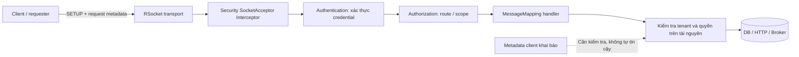
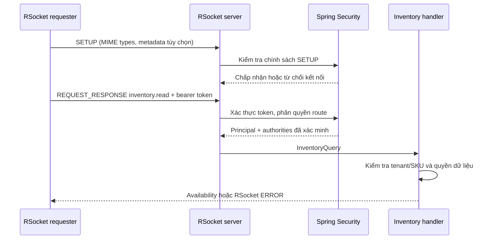
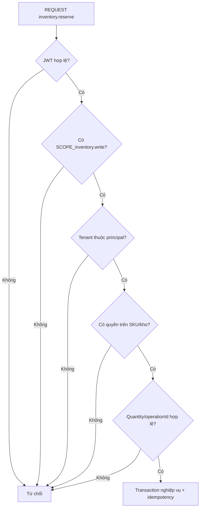
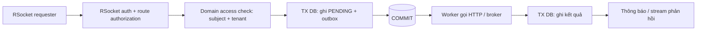

# Tích hợp xác thực và giới hạn tin cậy của metadata trong RSocket

## 1. Vấn đề bảo mật nằm ở đâu?

Trong **SPRING_BOOT_INTEGRATION**, Spring Boot có thể giao tiếp với dịch vụ tồn kho, thanh toán, dữ liệu khách hàng hoặc các adapter khác bằng HTTP client, cơ sở dữ liệu, cache, broker thông điệp và **RSocket**. Với RSocket, một kết nối có thể tồn tại lâu, truyền nhiều request đồng thời và hỗ trợ trao đổi hai chiều. Vì vậy, thiết kế bảo mật không chỉ là xác minh một kết nối được mở thành công.

Ví dụ dịch vụ tồn kho cung cấp hai route:

- `inventory.read`: đọc số tồn kho theo SKU, chỉ dành cho người có quyền đọc dữ liệu thuộc tenant hợp lệ.
- `inventory.reserve`: giữ hàng, là thao tác có side effect; yêu cầu quyền ghi và kiểm tra tenant, số lượng, khóa idempotency.

Request RSocket có **data** và **metadata**. Metadata có thể chứa route, bearer token, correlation ID, tenant ID, ngôn ngữ và những dữ liệu định tuyến khác. Client có thể tự tạo hoặc sửa nhiều trường trong số này. Nếu server xem metadata như bằng chứng đã xác thực, kẻ gọi có thể giả mạo danh tính hoặc vượt quyền.

**Nguyên tắc trọng tâm:** metadata do phía bên kia gửi tới là **dữ liệu đầu vào chưa đáng tin**. Chỉ sau khi cơ chế xác thực kiểm tra credential và cơ chế phân quyền đối chiếu quyền với thao tác/tài nguyên cụ thể, ứng dụng mới được sử dụng danh tính và quyền đã xác minh. Tên route, MIME type và tên tenant tự khai báo không chứng minh quyền truy cập.



Bài học tập trung vào việc tích hợp **Spring Security RSocket** với Spring Boot và xác định ranh giới tin cậy của metadata, bao gồm cả những request bất đồng bộ, luồng nhiều phần tử và các adapter tích hợp thực tế.

## 2. RSocket khác HTTP ở điểm nào liên quan tới xác thực?

RSocket là giao thức nhị phân hỗ trợ bốn mô hình tương tác cơ bản:

| Mô hình | Đặc điểm | Lưu ý bảo mật |
| --- | --- | --- |
| **Request-Response** | Một request nhận một response | Xác thực request, phân quyền route và dữ liệu trước truy vấn |
| **Request-Stream** | Một request nhận nhiều phần tử | Xác thực đầu luồng, giữ ràng buộc quyền trong suốt luồng; kiểm soát số lượng/khoảng thời gian |
| **Request-Channel** | Hai phía gửi stream trong cùng tương tác | Kiểm soát quyền của request khởi tạo **và** nội dung từng phần tử gửi sau; backpressure không phải authorization |
| **Fire-and-Forget** | Gửi một chiều, không chờ response nghiệp vụ | Gửi thành công không chứng minh handler đã commit DB hoặc gọi downstream thành công |

Ban đầu, requester gửi frame `SETUP` để thương lượng kết nối, MIME type và metadata tùy chọn. Sau khi thiết lập, mỗi request có thể mang route, authentication metadata và các metadata khác. Một kết nối TCP hoặc WebSocket có thể được tái sử dụng lâu dài và phục vụ nhiều request.



Khác với HTTP, RSocket request không phải một HTTP request với `Authorization` header thông thường. Nếu RSocket được vận chuyển qua WebSocket, HTTP chỉ tham gia ở giai đoạn handshake/upgrade; các request RSocket sau đó vẫn cần chính sách bảo mật **ở tầng RSocket**. Khi từ chối, client thường nhận tín hiệu lỗi RSocket, không phải lúc nào cũng là HTTP `401`/`403`.

**RSocket hoạt động hai chiều:** sau khi kết nối được thiết lập, phía trước đây gọi là “server” cũng có thể gửi request cho bên kia. Vì thế mọi responder, kể cả responder trên client, cần có chính sách xác thực, phân quyền và giới hạn tài nguyên phù hợp, không mặc định đối tác đã mở kết nối thì mọi hành động đều đáng tin.

## 3. Cấu trúc metadata và các mức độ tin cậy

Thông thường, Spring RSocketRequester sử dụng **composite metadata** theo mặc định: nhiều mục metadata độc lập, mỗi mục có MIME type và giá trị riêng. Phổ biến có:

- Route ở MIME type `message/x.rsocket.routing.v0`.
- Metadata xác thực theo RSocket Authentication Extension, có thể mang simple authentication hoặc bearer token.
- Correlation/trace ID, locale, tenant hint hoặc metadata ứng dụng tự định nghĩa.
- Thông tin bổ sung cho kết nối trong frame `SETUP`.

```text
RSocket SETUP:
  dataMimeType      = application/json (ví dụ)
  metadataMimeType  = message/x.rsocket.composite-metadata.v0
  metadata tùy chọn = setup route / authentication / khả năng ứng dụng

RSocket REQUEST_RESPONSE:
  metadata:
    - route: inventory.reserve
    - auth: bearer token (theo authentication MIME type)
    - tenant hint: tenant-A
    - correlation ID: trace-123
  data:
    { "sku": "SKU-101", "quantity": 2, "operationId": "op-123" }
```

Dù metadata được gửi qua đường TLS, **TLS chỉ bảo vệ đường truyền và danh tính của endpoint theo cấu hình**, không tự biến mọi trường do client gửi thành dữ liệu có thẩm quyền của ứng dụng.

### Bảng phân loại tin cậy

| Giá trị | Ai có thể quyết định nội dung? | Có được tin trực tiếp không? | Cách sử dụng đúng |
| --- | --- | --- | --- |
| Route `inventory.reserve` | Requester | **Không** | Dùng để dispatch, đồng thời phân quyền route và thao tác |
| Bearer token dạng chuỗi | Requester gửi credential | **Không trước khi kiểm chứng** | Verify chữ ký, issuer, audience, thời hạn, authorities; tạo authentication |
| Claim bên trong JWT đã xác minh | Identity provider được cấu hình tin cậy | Tin **trong phạm vi validation/policy** | Sử dụng subject, scope và tenant claim đúng nghĩa; vẫn kiểm tra quyền trên tài nguyên |
| `tenantId` do requester tự gửi | Requester | **Không** | Đối chiếu tenant đã xác minh và quyền dữ liệu; không tự gán vai trò |
| Correlation ID/trace ID | Requester hoặc proxy | **Không về mặt bảo mật** | Kiểm tra độ dài/ký tự, tạo ID nội bộ nếu không hợp lệ; dùng cho quan sát |
| IP/`forwarded-for` trong metadata | Requester có thể giả mạo | **Không** | Chỉ tin thông tin đã chuẩn hóa từ ingress/proxy có ranh giới tin cậy rõ |
| Data MIME type | Requester thương lượng | **Không** | Chọn decoder được phép, giới hạn kích thước và xác thực schema |
| `SETUP` metadata | Requester ban đầu | **Không** | Áp chính sách xác thực connection nếu cần; kiểm soát tài nguyên trước/sau SETUP |
| `METADATA_PUSH` | Bên kết nối gửi | **Không** | Chỉ xử lý kiểu thông điệp được cho phép; không mặc định nó thay đổi quyền |

Một bearer token được gửi qua metadata vẫn chỉ là **credential để xác thực**. Chữ ký hợp lệ chưa đủ để mọi request được phép: server còn phải kiểm tra issuer/audience/expiry, scope hoặc role, tenant membership và quyền trên đúng đối tượng nghiệp vụ.

### Composite metadata không phải bản ghi quyền

`metadataMimeType` là cách mô tả định dạng. Việc biết một mục có MIME type `message/x.rsocket.authentication.v0` không có nghĩa token bên trong hợp lệ. Tương tự, một mục metadata kiểu `application/vnd.example.tenant+json` không được phép thay thế Authentication đã được xác thực.

Không đưa dữ liệu bí mật như bearer token vào header log, trace attribute, audit event hoặc lỗi trả cho client. Khi cần chẩn đoán, log ID yêu cầu, route đã chuẩn hóa, issuer hoặc loại lỗi theo mức tối thiểu; tránh log toàn bộ buffer metadata vì có thể chứa credential.

## 4. Xác thực lúc SETUP và xác thực theo từng request

Spring Security hỗ trợ authentication tại **SETUP**, tại **request**, hoặc cả hai. Đây là một quyết định thiết kế quan trọng.

| Phương án | Ý nghĩa | Khi phù hợp | Rủi ro cần xử lý |
| --- | --- | --- | --- |
| **SETUP authentication** | Xác minh credential khi tạo kết nối | Một kết nối dành cho một service/thiết bị/user ổn định | Kết nối dài sống qua thời hạn token; thay đổi quyền hoặc thu hồi token không tự cập nhật mọi trạng thái |
| **Per-request authentication** | Mỗi request mang credential riêng | Một connection pool chia sẻ cho nhiều người dùng/tenant | Phải kiểm tra token của **mỗi request** và không rò principal giữa các request đồng thời |
| **Cả hai** | SETUP xác thực ứng dụng gọi, request xác thực user cụ thể | API gateway/BFF mở kết nối đến service nội bộ thay nhiều user | Phải xác định rõ identity nào là service, identity nào là user, không để user token nâng quyền connection |
| **Chỉ có SETUP permitAll + route hạn chế** | Cho phép mở kết nối ban đầu, chặn request không được xác thực/phân quyền | Demo hoặc hệ thống per-request authentication sau ingress được bảo vệ | Kết nối ẩn danh vẫn tiêu thụ tài nguyên; phải kiểm soát quota, timeout và kết nối bất thường |

### 4.1. Xác thực một lần ở SETUP không phù hợp cho mọi kết nối

Giả sử hệ thống frontend mở một kết nối RSocket chia sẻ rồi đại diện nhiều người dùng gọi backend. Nếu credential ở `SETUP` thuộc **user A**, việc tái sử dụng cùng kết nối cho user B có thể dẫn tới nhầm danh tính hoặc lộ dữ liệu. Đặc biệt tránh gắn một `SecurityContext` theo thread hoặc một biến mutable `currentUser` chung lên requester.

Với kết nối chia sẻ, truyền token của đúng **request hiện tại** qua authentication metadata, để server xác thực và phân quyền từng request. Credential của service dùng để xác nhận bên mở kết nối có thể được kiểm tra riêng tại SETUP.

### 4.2. Hiểu đúng ý nghĩa token hết hạn trên kết nối dài

Đối với JWT:

- `exp` và `nbf` được đánh giá khi token được xác thực; token đã hết hạn ở request sau phải bị từ chối theo cơ chế validation đang chạy.
- Nếu chỉ xác thực token **một lần tại SETUP**, không tự suy ra rằng tất cả request tiếp theo sẽ được xác thực lại theo thời gian thực. Cần thiết kế chính sách đóng/kết nối lại khi credential hết hạn, hoặc dùng authentication per request.
- Việc thu hồi quyền/user cũng cần chiến lược nhất quán: TTL token ngắn, cơ chế revocation/introspection phù hợp, ngắt connection hoặc reauthorization khi nghiệp vụ yêu cầu. JWT hợp lệ về mật mã có thể vẫn bị từ chối do thay đổi quyền/tài nguyên.

**Không dùng metadata từ request sau để tự thay principal ở connection** nếu chưa có cơ chế xác thực rõ ràng. `METADATA_PUSH` là một interaction của giao thức; nó không tự động là cơ chế refresh token hay nâng quyền.

## 5. Dependency và bật Spring Security RSocket

Ví dụ dưới đây dùng API thông dụng của **Spring Boot 3.x / Spring Framework 6.x / Spring Security 6.x** và Java 17+. Những dòng major mới hơn có thể thay đổi package, DSL hoặc dependency; nên dùng BOM và tài liệu tương ứng với phiên bản của ứng dụng.

Ví dụ dependency Maven:

```xml
<dependencies>
    <dependency>
        <groupId>org.springframework.boot</groupId>
        <artifactId>spring-boot-starter-rsocket</artifactId>
    </dependency>
    <dependency>
        <groupId>org.springframework.boot</groupId>
        <artifactId>spring-boot-starter-security</artifactId>
    </dependency>
    <dependency>
        <groupId>org.springframework.security</groupId>
        <artifactId>spring-security-rsocket</artifactId>
    </dependency>
    <dependency>
        <groupId>org.springframework.boot</groupId>
        <artifactId>spring-boot-starter-oauth2-resource-server</artifactId>
    </dependency>
</dependencies>
```

`spring-security-rsocket` cung cấp cơ chế xác thực/phân quyền RSocket; OAuth2 resource server/Jose cung cấp thành phần xử lý JWT. Cần cấu hình `ReactiveJwtDecoder` và chọn rule phù hợp với token do identity provider thực tế phát hành.

Cấu hình server TCP minh họa:

```yaml
spring:
  rsocket:
    server:
      transport: tcp
      port: 7000
```

**Đây là ví dụ chức năng**, chưa phải cấu hình đủ an toàn để đưa ra Internet. RSocket TCP cần kết nối bảo mật (TLS ở transport hoặc một ranh giới hạ tầng được bảo vệ và kiểm soát đầu cuối). Nếu expose qua WebSocket, cần dùng `wss://`, cấu hình HTTP handshake và Origin phù hợp; nhưng policy HTTP handshake **không thay thế** RSocket authorization.

Spring Boot tự cấu hình các thành phần RSocket server khi có dependency và properties tương ứng. Trong ứng dụng cấu hình trực tiếp RSocket Java thay vì qua auto-configuration của Boot, phải đăng ký Security SocketAcceptor interceptor trên **đúng server**. Chỉ khai báo bean bảo mật mà interceptor không gắn với server đang lắng nghe thì sẽ không bảo vệ những request thực tế.

## 6. Ví dụ xác thực JWT theo từng request và phân quyền route

Giả sử client sẽ gửi bearer token trên **mỗi request**. Ta cho phép SETUP chưa mang token, nhưng chỉ cho gọi route được liệt kê và có authority phù hợp.

```java
import org.springframework.context.annotation.Bean;
import org.springframework.context.annotation.Configuration;
import org.springframework.security.config.Customizer;
import org.springframework.security.config.annotation.rsocket.EnableRSocketSecurity;
import org.springframework.security.config.annotation.rsocket.RSocketSecurity;
import org.springframework.security.oauth2.jwt.ReactiveJwtDecoder;
import org.springframework.security.oauth2.jwt.ReactiveJwtDecoders;
import org.springframework.security.rsocket.core.PayloadSocketAcceptorInterceptor;

@Configuration(proxyBeanMethods = false)
@EnableRSocketSecurity
public class InventoryRSocketSecurityConfiguration {

    @Bean
    PayloadSocketAcceptorInterceptor rsocketInterceptor(
            RSocketSecurity rsocket) {

        rsocket.authorizePayload(authorize -> authorize
                    .setup().permitAll()
                    .route("inventory.read")
                        .hasAuthority("SCOPE_inventory.read")
                    .route("inventory.reserve")
                        .hasAuthority("SCOPE_inventory.write")
                    .anyRequest().denyAll()
                    .anyExchange().permitAll())
               .jwt(Customizer.withDefaults());

        return rsocket.build();
    }

    @Bean
    ReactiveJwtDecoder jwtDecoder() {
        return ReactiveJwtDecoders.fromIssuerLocation(
                "https://identity.example.test/realms/shop");
    }
}
```

Đây là **một cấu hình minh họa**; URL issuer phải được cấu hình từ nguồn đáng tin ở môi trường triển khai. Không lấy issuer hoặc JWK endpoint từ metadata của request, nếu không có thể cho client tự chọn nơi ký token được chấp nhận.

Giải thích từng rule:

1. `setup().permitAll()` cho phép tạo kết nối chưa xác thực theo mô hình **per-request authentication**. Nó không đồng nghĩa mọi request đều được phép.
2. `route("inventory.read").hasAuthority("SCOPE_inventory.read")` chỉ cho phép đọc khi Authentication có authority tương ứng.
3. `route("inventory.reserve").hasAuthority("SCOPE_inventory.write")` bảo vệ thao tác có side effect; cần kiểm tra quyền trên tài nguyên ở service nữa.
4. `anyRequest().denyAll()` từ chối các route/request khởi tạo khác chưa được cho phép.
5. `anyExchange().permitAll()` xử lý những payload exchange khác không khớp request ban đầu, đặc biệt các frame bổ sung không mang metadata của `REQUEST_CHANNEL`. Điều này **không cho phép bỏ kiểm tra dữ liệu** trong stream; handler vẫn phải kiểm soát nội dung, quyền và quota của từng phần tử.

**Thứ tự rule có ý nghĩa:** rule khớp đầu tiên được áp dụng. Không đặt `anyRequest().authenticated()` lên trước các rule đòi hỏi scope cụ thể, vì như vậy một người dùng chỉ đăng nhập có thể qua được route yêu cầu quyền cao hơn.

Ví dụ giả định JWT hợp lệ có authorities `SCOPE_inventory.read` và `SCOPE_inventory.write` được tạo bởi cấu hình converter/claim mapping. Nếu identity provider phát role claim theo kiểu khác, phải cấu hình mapping authorities tương ứng. Đừng mặc định mọi JWT đều có các `SCOPE_*` authority.

### Xác thực theo SETUP: một cấu hình thay thế

Nếu một kết nối đại diện cho một service duy nhất và phải xác thực ngay khi mở kết nối, thay policy bằng cấu hình thích hợp:

```java
rsocket.authorizePayload(authorize -> authorize
            .setup().hasAuthority("SCOPE_rsocket.connect")
            .route("inventory.read")
                .hasAuthority("SCOPE_inventory.read")
            .route("inventory.reserve")
                .hasAuthority("SCOPE_inventory.write")
            .anyRequest().denyAll()
            .anyExchange().permitAll())
       .jwt(Customizer.withDefaults());
```

Cấu hình thay thế chỉ có tác dụng khi client cung cấp authentication metadata trong `SETUP` và token chứa quyền kết nối như mong đợi. Nếu đồng thời có token theo request, phải xác định rõ chính sách ghép **service identity tại setup** và **user identity của request**, rồi kiểm thử để bảo đảm không thể dùng token user làm giả token setup hoặc ngược lại.

### JWT validation phải phản ánh đúng đối tác

Một JWT hợp lệ thường cần kiểm tra chữ ký với khóa tin cậy, `iss`, `exp`, `nbf`, và **audience** nếu hệ thống dùng audience làm ranh giới giữa các API. Không dựa vào mỗi việc token “parse được”:

- Chỉ chấp nhận issuer đã cấu hình; lấy JWK từ nguồn được kiểm soát.
- Kiểm tra audience dành cho RSocket API, không chấp nhận token phát cho dịch vụ khác một cách vô điều kiện.
- Áp chính sách thuật toán ký, đồng hồ lệch và rotation key phù hợp; tuyệt đối không chấp nhận token thiếu xác minh chữ ký.
- Scope/roles được ánh xạ theo hợp đồng với identity provider; không nâng quyền từ claim tùy ý mà backend chưa xác minh nghĩa.
- Nếu yêu cầu revocation gần thời gian thực, cần chiến lược bổ sung như introspection, short-lived token hoặc tra trạng thái phiên.

`ReactiveJwtDecoders.fromIssuerLocation(...)` minh họa cấu hình decoder từ issuer. Trong môi trường cần kiểm tra audience riêng, bổ sung `OAuth2TokenValidator<Jwt>`/decoder phù hợp theo chính sách; đừng mặc định đoạn mẫu tự kiểm tra mọi claim đặc thù.

## 7. Client gửi bearer authentication metadata đúng vị trí

Spring Security RSocket dùng **Bearer Token Authentication Metadata Extension**. Spring Framework hỗ trợ composite metadata để một request mang cả route lẫn authentication metadata. Với Spring Security, có thể dùng `BearerTokenMetadata` và MIME type xác thực chuẩn:

```java
import io.rsocket.metadata.WellKnownMimeType;

import org.springframework.messaging.rsocket.RSocketRequester;
import org.springframework.security.rsocket.metadata.BearerTokenMetadata;
import org.springframework.util.MimeType;
import org.springframework.util.MimeTypeUtils;

import reactor.core.publisher.Mono;

public final class InventoryRSocketClient {

    private static final MimeType AUTH_MIME_TYPE =
            MimeTypeUtils.parseMimeType(
                WellKnownMimeType.MESSAGE_RSOCKET_AUTHENTICATION.getString());

    private final RSocketRequester requester;

    public InventoryRSocketClient(
            RSocketRequester.Builder requesterBuilder,
            String host, int port) {
        this.requester = requesterBuilder.tcp(host, port);
    }

    public Mono<Availability> getAvailability(
            String sku, String verifiedClientToken) {
        return requester.route("inventory.read")
                .metadata(
                    new BearerTokenMetadata(verifiedClientToken),
                    AUTH_MIME_TYPE)
                .data(new InventoryQuery(sku))
                .retrieveMono(Availability.class);
    }

    public record InventoryQuery(String sku) {}
    public record Availability(String sku, int available) {}
}
```

Trong ví dụ, `verifiedClientToken` là tên tham số chỉ token mà **phía client đã nhận từ luồng xác thực đáng tin**; server vẫn phải tự xác minh JWT. Tuyệt đối không nhúng token tĩnh vào source code hoặc log nó.

Cần hiểu vòng đời:

- `RSocketRequester.Builder` do Spring Boot cung cấp có thể mang codecs/strategies của ứng dụng; dùng builder được inject khi muốn nhất quán serialization và security metadata.
- Mô hình per-request sẽ gửi `BearerTokenMetadata` trên **mỗi request**. Không cố giữ một token user cố định trong một requester được chia sẻ cho nhiều user.
- Nếu requester lưu kết nối lâu, phải cân nhắc reconnect, hạn dùng token và giới hạn queue/request khi server không thể truy cập.
- Với bearer metadata, đừng tự tạo một metadata mục `"Authorization: Bearer ..."` ở MIME type tùy ý rồi mong interceptor RSocket tự hiểu như HTTP header.
- Client phải sử dụng composite metadata khi muốn gửi route và authentication dưới các MIME type khác nhau; nếu cố thay `metadataMimeType` thành routing-only, việc bổ sung metadata có MIME type riêng có thể không hoạt động.
- Nếu gọi API qua WebSocket, lựa chọn transport `webSocket(URI)` cần phù hợp với TLS/đường đi của ingress; credential ở RSocket metadata vẫn cần được kiểm tra ở RSocket server.

Trong trường hợp gửi token ngay tại kết nối `SETUP` thay vì mỗi request, client có thể dùng `setupMetadata(new BearerTokenMetadata(token), AUTH_MIME_TYPE)` trên builder **trước khi kết nối**. Đây là mô hình xác thực khác, không phù hợp để chia sẻ kết nối của một user cho những user khác.

## 8. Định tuyến bằng metadata không có nghĩa đã cấp quyền

Route là một giá trị được requester gửi để server chọn `@MessageMapping` hoặc handler khác. Ví dụ attacker gửi:

```text
route = inventory.reserve
metadata.tenantId = "vip-tenant"
metadata.role = "ADMIN"
data = { "sku": "SKU-100", "quantity": 1000 }
```

Nếu server chỉ kiểm tra `role=ADMIN` từ metadata, attacker có thể tự gán role. Quy tắc đúng:

1. Security interceptor xác minh credential thực tế.
2. RSocket authorization xác nhận principal có quyền gọi `inventory.reserve`.
3. Handler/service xác thực `tenantId` trong request với danh sách tenant mà principal được phép truy cập.
4. Service kiểm tra quyền trên đúng SKU/kho hàng, hạn mức và quy tắc nghiệp vụ trước khi tạo side effect.
5. Transaction DB hoặc adapter bên dưới thực hiện thao tác có điều kiện và ghi audit từ **principal đã xác minh**, không lấy tên user tự khai báo trong metadata.



### Ví dụ handler lấy danh tính từ SecurityContext

Trong một reactive handler, truy cập principal được Spring Security xác thực qua `ReactiveSecurityContextHolder`. Không dùng trường `userId` client gửi như nguồn danh tính chính.

```java
import org.springframework.messaging.handler.annotation.MessageMapping;
import org.springframework.security.access.AccessDeniedException;
import org.springframework.security.core.context.ReactiveSecurityContextHolder;
import org.springframework.stereotype.Controller;
import reactor.core.publisher.Mono;

@Controller
public class InventoryRSocketController {

    private final InventoryService inventoryService;

    public InventoryRSocketController(InventoryService inventoryService) {
        this.inventoryService = inventoryService;
    }

    @MessageMapping("inventory.reserve")
    public Mono<ReservationResult> reserve(ReserveCommand command) {
        return ReactiveSecurityContextHolder.getContext()
                .switchIfEmpty(Mono.error(
                        new AccessDeniedException("Chưa xác thực")))
                .flatMap(context -> inventoryService.reserveForPrincipal(
                        context.getAuthentication(), command));
    }
}
```

`ReserveCommand`, `ReservationResult` và `InventoryService` là các kiểu nghiệp vụ. `reserveForPrincipal(...)` phải kiểm tra quyền tenant/tài nguyên và idempotency **trên server**. Có thể dùng `@AuthenticationPrincipal` trong handler được tích hợp đúng với Spring Security, nhưng không bỏ qua kiểm tra quyền trên từng tài nguyên.

**Tránh một lỗi phổ biến:** gateway không được tin `command.tenantId()` chỉ vì token JWT hợp lệ; attacker có thể sử dụng token hợp lệ cho tenant A nhưng đổi payload/metadata sang tenant B. Đọc tenant đã được xác minh từ claim phù hợp **và/hoặc** tra quan hệ user–tenant tại hệ thống quyền, rồi đối chiếu với tenant đích.

### Không dùng quyền của service làm quyền của user

Trong một BFF hoặc service nội bộ, token của gateway có thể chứng minh rằng “backend A đang kết nối”, nhưng không chứng minh “người dùng U được phép giữ hàng cho tenant T”. Nếu nghiệp vụ thay mặt user:

- Chọn mô hình ủy quyền rõ ràng (token user phù hợp audience, token exchange hoặc service-to-service authorization theo policy).
- Ràng buộc user identity với request và đối chiếu tenant/tài nguyên.
- Không cho một service dùng credential của mình rồi tự gửi metadata `userId=admin` để chiếm quyền.
- Ghi audit gồm **verified subject**, actor service và business operation ID nếu chính sách yêu cầu; phân biệt actor với subject thay mặt.

## 9. MetadataExtractor và sự khác nhau giữa giải mã và xác thực

Spring Framework cung cấp `MetadataExtractor` để giải mã các mục composite metadata thành những header mà handler đọc được, chẳng hạn qua `@Header`. Ví dụ, correlation ID có thể được đăng ký dưới MIME type do ứng dụng quy định.

Ví dụ cấu hình chiến lược giải mã metadata:

```java
import org.springframework.messaging.rsocket.RSocketStrategies;
import org.springframework.util.MimeType;

RSocketStrategies strategies = RSocketStrategies.builder()
        .metadataExtractorRegistry(registry -> {
            registry.metadataToExtract(
                    MimeType.valueOf("text/plain"),
                    String.class,
                    "clientCorrelationId");
        })
        .build();
```

Đây là minh họa phần **registration**; muốn áp dụng cho RSocket server thật của Spring Boot, cần tích hợp cấu hình này vào `RSocketStrategies` mà ứng dụng sử dụng, cùng các codec/decoder đang được Boot cung cấp. Không thay bean auto-configured tùy tiện khiến mất codec JSON hoặc authentication metadata. Trong trường hợp nhiều loại metadata, cần đăng ký MIME type đủ cụ thể để tránh xung đột.

Khi handler dùng:

```java
@MessageMapping("inventory.read")
public Mono<Availability> read(
        InventoryQuery query,
        @Header(name = "clientCorrelationId", required = false)
        String clientCorrelationId) {
    // clientCorrelationId chỉ phục vụ logging sau khi validate.
    // Không dùng giá trị này như chứng minh identity hoặc authority.
    return inventoryService.load(query);
}
```

**Đọc được header ≠ header đáng tin.** `MetadataExtractor` và `RSocketStrategies` chỉ phụ trách giải mã/đặt tên dữ liệu. Xác thực phải do security layer làm; phân quyền nghiệp vụ thuộc tầng service. Không tự lấy bearer token qua `@Header` rồi parse chuỗi JWT và sử dụng claims trước khi validate.

Nếu client gửi metadata lạ, trùng lặp hoặc không có decoder, cần chính sách rõ: giới hạn kích thước metadata, chỉ đăng ký những MIME type cần dùng, xử lý lỗi parse theo cách an toàn và xác định thứ tự ưu tiên khi có nhiều nguồn cho cùng một trường. Đừng để phần tử metadata thứ hai ghi đè một identity đã được xác thực.

## 10. Giới hạn tin cậy theo loại metadata

### 10.1. Tenant ID

Đối với ứng dụng nhiều tenant, client đôi khi gửi `tenantId` để định tuyến dữ liệu. Đây chỉ là một **hint yêu cầu truy cập tenant đó**. Backend phải so sánh nó với principal đã được xác thực và chính sách cho phép truy cập tenant. Nếu tenant membership có thể thay đổi nhanh, phải cân nhắc khi nào tra DB/cache phân quyền, TTL và cách invalidation.

Dùng `@PreAuthorize` hoặc custom `ReactiveAuthorizationManager` khi phù hợp, nhưng rule ở route như `hasAuthority("SCOPE_inventory.read")` vẫn chưa đủ để giới hạn **SKU thuộc tenant nào**. Không dùng cache key chỉ chứa SKU trong hệ thống đa tenant, vì ngay cả response hợp lệ cũng có thể bị đọc chéo tenant khi cache key thiếu ngữ cảnh.

### 10.2. Trace ID, correlation ID và baggage

Client có thể đặt ID chứa ký tự điều khiển, chuỗi rất dài hoặc giá trị đụng độ với trace của người khác. Khi dùng cho log/metric:

- Giới hạn kích thước và charset hợp lệ, chuẩn hóa hoặc sinh ID nội bộ mới khi không hợp lệ.
- Không ghép trực tiếp vào tên metric label có cardinality cao; dùng attribute giới hạn, span phù hợp.
- Không ghi bearer token hoặc dữ liệu nhạy cảm trong baggage/trace.
- Phân biệt `clientCorrelationId` do client khai báo và ID nội bộ do server kiểm soát.

### 10.3. Routing metadata và MIME type

Route được dùng để tìm handler, không nên được xem như scope/role. Tránh cho client khai báo tên class, tên bean, expression hoặc URL downstream rồi chuyển thành lệnh thực thi động. Nếu cần proxy nhiều backend, dùng allowlist route và mapping tĩnh hoặc policy có kiểm soát; chống SSRF và tránh gửi token của service đến đích do client tự chọn.

MIME type chỉ mô tả định dạng, không phải một cơ chế cấp quyền. Giới hạn codec được phép, schema, số phần tử, độ sâu JSON, kích thước payload và metadata để giảm rủi ro giải mã tiêu tốn tài nguyên hoặc type confusion.

### 10.4. Authentication metadata và các trường trùng lặp

Không chấp nhận “bearer token” dưới một metadata field tự đặt rồi mặc định nó đã được Spring Security xử lý. Sử dụng chuẩn RSocket Authentication Extension và interceptor tương ứng. Đối với credential trùng, metadata trái định dạng hoặc token không hợp lệ, nên **fail closed** theo policy của hệ thống; không fallback sang trường `userId`/`role` tự khai báo.

Một token được xác minh nên được biến thành `Authentication`/principal dùng trong reactive security context. Khi ghi logs, chỉ ghi subject/tenant đã kiểm chứng theo chính sách bảo mật, tránh lưu token raw.

## 11. Bảo vệ request-stream và request-channel

RSocket hỗ trợ backpressure nhưng nó **không phải cơ chế xác thực** và cũng không có nghĩa ứng dụng tự động giới hạn tổng lượng dữ liệu. Một client hợp lệ vẫn có thể gửi quá nhiều request, payload lớn hoặc duy trì stream quá lâu.

Ví dụ handler nhận nhiều yêu cầu trong một `REQUEST_CHANNEL`:

```java
@MessageMapping("inventory.batch.reserve")
public Flux<ReservationResult> reserveBatch(
        Flux<ReserveCommand> requests) {

    return ReactiveSecurityContextHolder.getContext()
            .switchIfEmpty(Mono.error(
                    new AccessDeniedException("Chưa xác thực")))
            .flatMapMany(context -> requests
                    .take(100)
                    .concatMap(command ->
                            inventoryService.reserveForPrincipal(
                                    context.getAuthentication(), command)));
}
```

Ví dụ minh họa cần chính sách route riêng `inventory.batch.reserve` trong cấu hình bảo mật; nếu dùng `anyRequest().denyAll()` mà chưa khai báo rule, request này **bị từ chối đúng như thiết kế**. Khi muốn áp dụng giới hạn 100 phần tử, hãy lựa chọn semantics thích hợp: `take(100)` hoàn tất sau phần tử thứ 100, nhưng **không tự xem phần còn lại là một lỗi giao thức hoặc hành vi tấn công**. Với hợp đồng cần từ chối khi vượt giới hạn, dùng bộ đếm/validation và trả error rõ ràng thay vì cắt lặng lẽ.

Trong các hệ thống production:

- Phân quyền **request khởi tạo** theo route và credential; kiểm tra tenant/operation trên **từng phần tử**.
- Giới hạn số phần tử, bytes, tốc độ, duration, số stream đồng thời và request tổng theo user/service/tenant.
- Dùng backpressure, timeout, budget và cơ chế hủy rõ ràng; không tự động buffer vô hạn khi downstream xử lý chậm.
- Kiểm tra quyền sau khi trạng thái principal/tenant thay đổi nếu stream rất dài và nghiệp vụ cần reauthorization.
- Không tự cho rằng `anyExchange().permitAll()` nghĩa mọi frame đều an toàn. Rule đó chỉ xử lý các frame không khớp request có metadata, còn việc bảo vệ stream phải đi cùng policy của route và nội dung.

Với `Fire-and-Forget`, khi `RSocketRequester.send()` hoàn tất chỉ có thể kết luận tín hiệu gửi đã được thực hiện theo giao thức, **không chứng minh** DB đã commit hoặc adapter bên ngoài đã tạo side effect. Nếu thao tác quan trọng như “xuất kho”, cần ACK nghiệp vụ, idempotency key và trạng thái bền vững.

## 12. TLS, ingress và ranh giới giữa network identity với application identity

Không nên nghĩ rằng đã có Spring Security cho HTTP endpoint đồng nghĩa RSocket đã được bảo vệ. Cần kiểm tra đúng đường tiếp nhận:

| Đường kết nối | Điều bảo vệ cấp transport | Điều vẫn cần ở RSocket |
| --- | --- | --- |
| TCP trực tiếp `tcp://` | TLS cho RSocket TCP, network ACL, mTLS nếu phù hợp | SETUP/request authentication, route authorization, quota |
| WebSocket qua `wss://` | HTTPS/WSS, bảo vệ handshake, Origin/CORS policy thích hợp, reverse proxy | Authentication/authorization từng request RSocket |
| BFF/gateway dùng connection pool tới backend | mTLS hoặc service credential tại setup | Per-user token/authorization và tenant isolation nếu nhiều user dùng chung |
| Kết nối giữa các dịch vụ nội bộ trong mạng riêng | Network segmentation, certificate/identity của service | Không bỏ qua xác thực application, least privilege, audit |

Nếu dùng WebSocket từ trình duyệt, cần kiểm tra `Origin`/chính sách cookie/session và đường upgrade để giảm nguy cơ kết nối trái phép từ website khác. Với token trong URL query string, token có thể rò qua log proxy, browser history hoặc telemetry; ưu tiên cơ chế truyền credential an toàn phù hợp thiết kế và bảo vệ HTTPS/WSS.

**mTLS xác thực endpoint ở tầng transport**, có thể là một phần quan trọng của service identity; nhưng nếu service A đại diện cho nhiều user, xác thực mTLS của A vẫn không thay thế kiểm tra user B có quyền truy cập dữ liệu tenant T hay không.

Không cho phép bearer metadata đi qua kênh plaintext ở môi trường không đáng tin: token có thể bị nghe lén. Quản lý vòng đời certificate/token, timeout, keepalive và maximum connection theo thực tế.

## 13. Lỗi xác thực và phân quyền được biểu diễn như thế nào?

Trong HTTP, ứng dụng thường nhìn status `401 Unauthorized` hoặc `403 Forbidden`. Ở RSocket, thất bại xác thực/kết nối/request thường được truyền thành **error signal/frame của giao thức**.

Ví dụ policy:

| Tình huống | Kỳ vọng |
| --- | --- |
| Thiếu token khi gọi `inventory.read` với per-request JWT | Request bị từ chối, không gọi handler |
| Token sai chữ ký/hết hạn | Không tạo principal hợp lệ, request bị từ chối |
| Token có scope đọc nhưng gọi `inventory.reserve` | Phân quyền từ chối trước side effect |
| Token có quyền ghi nhưng tenant khác | Handler/service từ chối theo tenant/tài nguyên |
| Route không được khai báo trong allowlist | `anyRequest().denyAll()` từ chối |
| Credential SETUP không hợp lệ trong policy yêu cầu SETUP auth | Kết nối không được chấp nhận theo policy |
| Correlation ID lỗi định dạng | Tạo ID thay thế hoặc trả lỗi đầu vào theo quy tắc; không ảnh hưởng principal |
| Mất kết nối giữa stream | Client xử lý interruption, cancellation và trạng thái nghiệp vụ chưa xác định |

Không nên trả nguyên stack trace, token, JWT claims nhạy cảm, danh sách quyền hệ thống hoặc thông tin tồn tại của tenant trong thông báo lỗi gửi client. Log phía server nên phân loại `authentication_failed`, `authorization_denied`, `invalid_metadata`, `payload_rejected` và `downstream_unavailable` để vận hành nhưng không ghi credential raw.

## 14. Kiểm thử tích hợp xác thực và metadata

Test nên chứng minh rằng **policy thực sự được gắn vào RSocket server**, không chỉ bean bảo mật đã được khai báo. Với Spring Boot có thể khởi động RSocket server trên cổng động trong integration test, lấy cổng được cấp phát, tạo `RSocketRequester` và quan sát kết quả bằng `StepVerifier`.

### Ma trận test quan trọng

| Test case | Request gửi gì? | Điều cần xác minh |
| --- | --- | --- |
| Kết nối per-request không có SETUP token | SETUP không credential | Kết nối được phép theo mẫu `setup().permitAll()`, chưa được gọi route bảo vệ |
| Thiếu bearer trên route đọc | `inventory.read` không authentication metadata | Request lỗi; repository/gateway không bị gọi |
| Token bị sửa chữ ký | Bearer không hợp lệ | Từ chối, không tạo Authentication |
| Token hết hạn/sai issuer | Credential không đạt validation | Từ chối; không dùng claim để cấp quyền |
| Token sai audience | Token dành cho API khác | Từ chối **nếu audience validation được cấu hình đúng** |
| User chỉ có scope đọc | Gọi `inventory.read` rồi `inventory.reserve` | Đọc theo tenant được phép; ghi bị từ chối |
| Metadata tự khai role ADMIN | Token chỉ có quyền đọc + metadata `role=ADMIN` | Không tăng authority |
| Metadata tenant giả | Token của tenant A, yêu cầu tenant B | Bị chặn ở service hoặc policy tenant |
| Route giả hoặc chưa biết | `inventory.admin.export` | `anyRequest().denyAll()` từ chối |
| Metadata MIME không hợp lệ/trùng | Trường định dạng sai hoặc nhiều bản sao | Không bỏ qua xác thực hoặc tự động chọn identity do client khai |
| Request-stream quá dài | Nhiều phần tử, giữ kết nối lâu | Có quota, backpressure, cancel và chính sách reauthorization |
| Hai user cùng connection | Mỗi request mang token khác nhau | Quyền và dữ liệu không rò chéo principal |
| Reconnect khi token hết hạn | Kết nối cũ/tái kết nối | Áp chính sách token hết hạn và reconnect đã định |
| Side effect khi request lỗi | Dùng `inventory.reserve` với token thiếu quyền | Không có bản ghi giữ hàng hoặc message downstream |

### Ví dụ StepVerifier cho request bị từ chối

Giả sử test đã tạo một `RSocketRequester` trỏ tới **server test thực** và server đã nạp security config ở phần 6:

```java
import java.time.Duration;

import org.junit.jupiter.api.Test;
import reactor.test.StepVerifier;

@Test
void readRouteWithoutBearerIsRejected() {
    StepVerifier.create(
                requester.route("inventory.read")
                        .data(new InventoryQuery("SKU-100"))
                        .retrieveMono(Availability.class))
            .expectError()
            .verify(Duration.ofSeconds(3));

    // Còn cần verify service/repository không bị gọi.
}
```

Trong code snippet, `requester` là client đã kết nối đến cổng động của integration-test server, không phải Mockito mock. `InventoryQuery`/`Availability` là DTO của bài. Test phải bổ sung kiểm tra service không có side effect và quan sát số request, vì `expectError()` tự nó có thể qua bởi một lỗi kết nối hoặc lỗi decoder **không liên quan đến phân quyền**. Hãy kiểm tra loại lỗi RSocket phù hợp version, đồng thời chạy một test cùng route với token hợp lệ để chứng minh đường kết nối và codec hoạt động.

Ví dụ gửi bearer giả để thử bước JWT:

```java
MimeType authMimeType = MimeTypeUtils.parseMimeType(
        WellKnownMimeType.MESSAGE_RSOCKET_AUTHENTICATION.getString());

StepVerifier.create(
        requester.route("inventory.read")
                .metadata(
                        new BearerTokenMetadata("invalid.jwt.token"),
                        authMimeType)
                .data(new InventoryQuery("SKU-100"))
                .retrieveMono(Availability.class))
        .expectError()
        .verify(Duration.ofSeconds(3));
```

Đây là snippet bổ sung; cần import những lớp như trong `InventoryRSocketClient`. Với test scope/tenant, dùng JWT test fixture được ký bằng khóa test hoặc issuer giả lập có validator tương ứng, tránh vô tình dựa vào identity provider production. Nếu mock decoder, cần kết hợp test thật của validator/issuer/audience ở lớp khác để không bỏ lọt lỗi cấu hình.

### Kiểm thử connection setup khác per-request

Phải có hai bộ test nếu triển khai cả SETUP authentication và per-request authentication:

- **Setup test:** credential sai phải không tạo được connection theo policy; credential hợp lệ tạo connection thành công; token setup không thay cho user token nếu policy yêu cầu tách.
- **Request test:** trên connection hợp lệ, mỗi request của user được xác thực và phân quyền độc lập; hai user cùng connection không chia sẻ authorization.
- **Reauthorization test:** token hết hạn/thu hồi và quyền tenant thay đổi trong thời gian connection tồn tại được xử lý theo chính sách rõ ràng.

Kiểm tra cả server chạy trên transport thật mà ứng dụng sử dụng: TCP hoặc WebSocket; nếu môi trường production sử dụng TLS, bổ sung test certificate/truststore và handshake phù hợp. Một unit test chỉ gọi `InventoryService` sẽ không chứng minh Spring Security RSocket interceptor đã được lắp đúng.

## 15. Liên hệ với các luồng tích hợp thực tế

Trong hệ thống có HTTP client, database, cache, broker và Spring Integration, RSocket authentication chỉ là **cửa vào** của một luồng dài:



Không giữ transaction DB mở khi chờ stream RSocket hoặc HTTP downstream. Khi client gửi `inventory.reserve`, cần lưu operation ID/idempotency key bền vững; có thể có timeout hoặc mất kết nối sau khi DB đã commit, do đó không khẳng định “chưa thực hiện” chỉ từ việc client không thấy response.

Bảo vệ cache bằng key chứa tenant đã xác minh, không dùng metadata tenant chưa kiểm tra. Khi phát Kafka/RabbitMQ message, đặt actor/tenant từ **security context đã được xác minh và service policy**, kèm operation ID; consumer vẫn phải xác thực/quyết định quyền của hệ thống gửi nếu message đi qua ranh giới tin cậy khác. Đừng xem trace metadata là vé truy cập message hoặc DB.

Nếu dùng RSocket inbound/outbound gateway của Spring Integration, cần xác nhận chúng đi qua **security interceptor của đúng RSocket connection/server**. Spring Integration flow, Spring Security RSocket và bảo mật broker/HTTP downstream là các lớp có ranh giới riêng; việc một lớp hoạt động không tự cấp quyền ở lớp khác.

## 16. Những lỗi thiết kế dễ gặp

| Sai sót | Hệ quả | Cách khắc phục |
| --- | --- | --- |
| Tin trường `userId`/`role` trong metadata | Attacker tự nhận quyền | Lấy principal/authority từ authentication đã xác minh |
| Chỉ có HTTP security khi dùng RSocket over WebSocket | Route RSocket phía sau upgrade có thể thiếu authorization | Cấu hình và kiểm thử `RSocketSecurity` riêng |
| Dùng token setup của user A cho connection chung nhiều user | Nhầm hoặc rò danh tính giữa request | Per-request token, xác thực độc lập trên từng request |
| Cho `anyRequest().authenticated()` đứng trước rule write scope | User chỉ đăng nhập vẫn gọi được route cần quyền cao | Đặt rule cụ thể trước, kiểm tra thứ tự |
| Xem `anyExchange().permitAll()` là cấp quyền cho mọi stream | Bỏ qua validation payload sau request đầu | Bảo vệ route khởi tạo và từng phần tử nghiệp vụ |
| Chỉ kiểm tra JWT chữ ký, bỏ issuer/audience | Token từ context/API khác được chấp nhận | Thiết lập validator đúng đối tác/audience |
| Client gửi `tenantId=other` nhưng handler tin trực tiếp | Đọc/ghi chéo tenant | So tenant với principal và quyền tài nguyên |
| Log toàn bộ metadata buffer | Rò bearer token, dữ liệu cá nhân | Redact, whitelist field và giới hạn log |
| Cho phép route chỉ định URL downstream tùy ý | SSRF hoặc lộ token khi proxy | Allowlist route/endpoint, không chuyển token bừa |
| Dựa vào backpressure như rate limit/authorization | Client hợp lệ vẫn có thể gây tiêu tốn tài nguyên | Quota, timeout, concurrent-stream và payload-size limits |
| Xem `METADATA_PUSH` là cách đổi quyền | Thay đổi identity không qua validation | Chỉ cho phép protocol/application metadata theo policy |
| Xem fire-and-forget send thành công là nghiệp vụ đã commit | Ghi trạng thái sai, thiếu phục hồi | ACK/trạng thái bền vững và idempotency |
| Chỉ kiểm thử service mà không test RSocket server thật | Security interceptor có thể chưa được gắn | Integration test với actual connector + JWT fixtures |
| Tự chia sẻ SecurityContext qua thread local trong Reactor | Sai principal trong reactive chain | Sử dụng reactive security context và truyền DTO cần thiết rõ ràng |

## 17. Checklist trước khi triển khai RSocket an toàn

1. Xác định **actor**: service tại SETUP, user tại request, hay cả hai; mỗi actor có quyền gì.
2. Chọn transport bảo mật (TLS/WSS), kiểm tra ingress, certificate, Origin/handshake và quota kết nối.
3. Bật Spring Security RSocket và xác minh `PayloadSocketAcceptorInterceptor` thực sự gắn vào server nhận request.
4. Chọn xác thực JWT hoặc simple authentication phù hợp; không tin identity metadata trước khi verify.
5. Cấu hình issuer, audience, key/algorithm, expiry, claim-to-authority mapping, rotation và revocation theo nhu cầu.
6. Viết rule `authorizePayload` theo route cụ thể, đặt rule từ cụ thể đến tổng quát; mặc định từ chối route ngoài allowlist.
7. Khi sử dụng request-channel/stream, kiểm tra quyền và dữ liệu **từng phần tử**, giới hạn tốc độ, bytes, duration và đồng thời.
8. Dùng principal đã xác thực để quyết định tenant/resource; coi tenant ID/role/trace ID do client gửi chỉ là dữ liệu cần kiểm tra.
9. Không log credential raw; kiểm soát metadata/codec/schema/JSON size và loại metadata được xử lý.
10. Khi luồng có DB/cache/broker hoặc HTTP side effect, thiết kế transaction ngắn, outbox, idempotency, retry và trạng thái chưa xác định.
11. Kiểm thử riêng SETUP, per-request, token lỗi, scope lỗi, tenant giả, route lạ, payload lớn và nhiều user trên connection dùng chung.
12. Quan sát số request bị từ chối, kết nối thất bại, expired tokens, rate-limit hits và lỗi metadata, đồng thời bảo vệ thông tin nhạy cảm trong logs.

**Điều cần nhớ:** trong RSocket, **metadata được truyền cùng request nhưng không tự mang độ tin cậy**. Authentication biến credential đã kiểm tra thành principal; authorization quyết định principal có được gọi route và truy cập tài nguyên hay không; còn validation nghiệp vụ kiểm soát tenant, payload và side effect. Tách rõ ba bước này, đồng thời coi kết nối dài và các stream hai chiều là ranh giới an ninh có vòng đời riêng, sẽ giúp các luồng tích hợp Spring Boot hoạt động an toàn và có thể kiểm thử được.

### Tài liệu tham khảo

- [Spring Security Reference — RSocket Security](https://docs.spring.io/spring-security/reference/reactive/integrations/rsocket.html): AuthenticationPayloadInterceptor, JWT, simple authentication, SETUP/request authorization.
- [Spring Framework Reference — RSocket](https://docs.spring.io/spring-framework/reference/rsocket.html): SETUP, composite metadata, route, requester, responder và MetadataExtractor.
- [Spring Boot Reference — RSocket](https://docs.spring.io/spring-boot/reference/messaging/rsocket.html): auto-configuration, RSocketRequester.Builder, server TCP/WebSocket và RSocketStrategies.
- [Spring Security API — BearerTokenMetadata](https://docs.spring.io/spring-security/reference/api/java/org/springframework/security/rsocket/metadata/BearerTokenMetadata.html): metadata chứa bearer token.
- [RSocket Protocol — Authentication Extension](https://github.com/rsocket/rsocket/blob/master/Extensions/Authentication.md): định dạng metadata xác thực.
