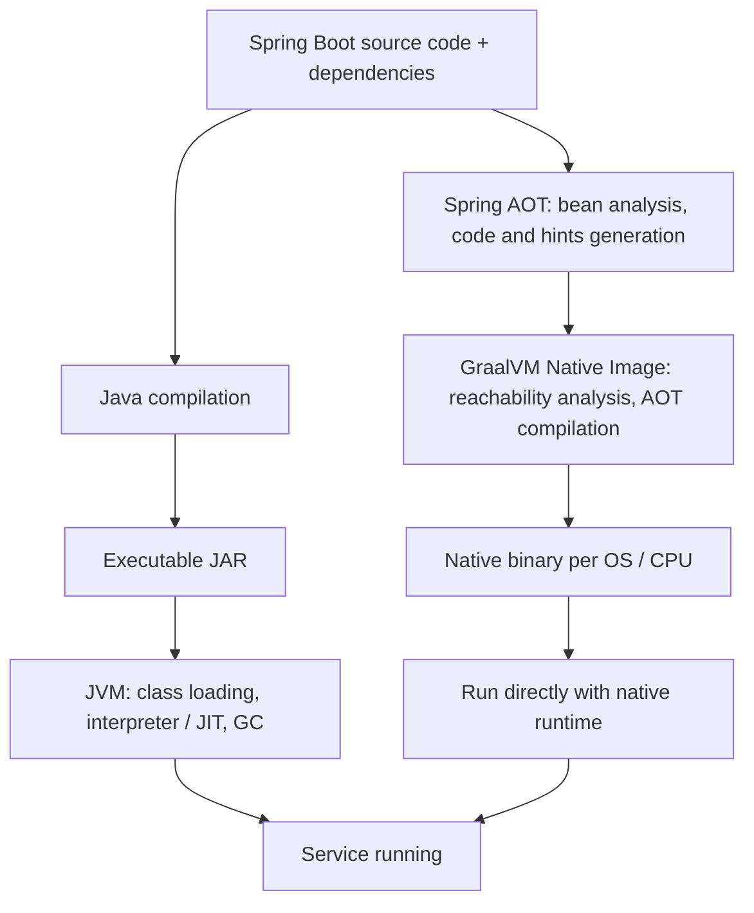

# Distinguishing a JVM JAR from a Native Executable

## Learning Objectives

After this lesson, you will be able to:

1. Explain why a Spring Boot application can be packaged as a **JAR running on the JVM** or a **native executable** from the same source code.
2. Distinguish the roles of JVM/JIT, Spring Ahead-of-Time (Spring AOT), and GraalVM Native Image.
3. Compare startup time, memory, sustained-load performance, build time, compatibility, and deployment approaches.
4. Build and run both packaging options with Maven/Gradle, measure them using the same scenario, and choose what fits a real-world system.

## 1. One Application, Two Distribution Formats

Suppose a team develops a Spring Boot REST API for orders. The application uses Spring Web, Jackson, environment configuration, and may connect to a database. The business goal stays the same, but how the application is **compiled, started, and operated** differs.

**A JAR running on the JVM** is a package containing Java bytecode, resources, metadata, and required dependencies (for a Spring Boot executable JAR). When running `java -jar app.jar`, the machine must have a compatible Java runtime. The JVM loads classes, manages memory, and can compile frequently executed bytecode segments into machine code using JIT (*Just-in-Time*).

**A GraalVM Native Image** is a machine-code program for a specific operating system/architecture, produced at build time. Run `./app` on Linux or `app.exe` on Windows without installing an extra JVM to execute that program. The binary still bundles necessary runtime components such as memory management, garbage collection, and threads; the word "native" **does not mean** there is no runtime or that every OS library is always statically linked.

Flow diagram:



> **Key takeaway:** A JAR defers many decisions and optimizations to runtime; Native Image shifts significant analysis, code generation, and compilation work to build time.

### Is a JAR an Executable?

The name *Spring Boot executable JAR* means the JAR contains a structure, manifest, and launcher to start via `java -jar`. Fundamentally, a JAR is still an archive containing bytecode, not a machine-code program executed directly by the operating system like a GraalVM Native Image. Some packaging approaches may add a shell launcher, but that does not eliminate the requirement for a Java runtime.

## 2. Comparison Table Across the Application Lifecycle

| Criterion | Spring Boot JAR on JVM | Spring Boot Native Image |
|---|---|---|
| Build output | `.jar` containing bytecode, libraries, resources | Machine-code binary, e.g., `app` or `app.exe` |
| Typical run command | `java -jar app.jar` | `./app` or `app.exe` |
| Java dependency at deployment | Requires a compatible JRE/JDK or a container image with a Java runtime | No separate JVM needed; still depends on OS/architecture and potentially system libraries |
| Machine-code compilation timing | JVM can use JIT while the application is running | Most application code is compiled ahead of time before running |
| Class/dependency analysis | Flexible dynamic loading and linking at runtime | *Closed-world* and *reachability* analysis at build time |
| Startup | Usually takes extra time for JVM startup, class loading, and Spring context setup | Usually starts significantly faster |
| Memory | Includes overhead of JVM, class metadata, JIT, heap, and runtime structures | Often has a lower memory footprint, though it depends on the app and workload |
| Sustained-load performance | JIT can optimize hot spots after warm-up; often advantageous under steady load | No similar JIT warm-up process; throughput/latency is not guaranteed to be better |
| Build time and resources | Usually faster and lighter | Analysis and native compilation can take several minutes, significant CPU, and RAM |
| Runtime flexibility | Strong support for class loading, reflection, and dynamic configuration in the Java ecosystem | Requires reachability metadata/hints for dynamic mechanisms; classpath is fixed at build time |
| Distribution | One JAR can run on multiple OS/CPUs with a compatible Java runtime | Must build for the target platform or use a supported cross-build pipeline |
| Debugging, observability | Very rich JVM/JFR, heap dump, agent, and profiler ecosystem | Must check specific native tool support; some JVM agents/tools do not apply |
| Typically suited scenarios | Long-running services, ecosystems with dynamic/complex libraries, workflows needing fast builds | Scale-to-zero, serverless, short-lived jobs, high instance counts, and fast startup requirements |

Trends around speed and memory are **hypotheses to measure**, not guarantees for every application. Comparing only JAR size versus binary size can also be misleading: compare the **entire container image** and runtime footprint under actual deployment conditions.

## 3. Why Does Native Image Usually Start Faster?

### 3.1. JAR: The JVM Works During Process Startup and Operation

With a JAR, after running `java -jar`, the JVM initializes its runtime, loads required classes, verifies/links bytecode, initializes the Spring `ApplicationContext`, and processes auto-configuration. As the program runs, the JVM collects execution profiles and can JIT-compile hot code segments to improve performance. Not all code needs JIT, and startup time is also affected by application tasks such as connecting to a database, running migrations, or loading data.

### 3.2. Native: Spring AOT and GraalVM Perform Two Different Jobs

- **Spring AOT** analyzes the application structure at build time, generating code to instantiate beans, proxies, and *runtime hints* for reflection, resources, serialization, etc. This reduces the need for dynamic inference during Spring startup.
- **GraalVM Native Image** analyzes code branches reachable from the program's entry points, combining metadata to determine which code and resources must be included in the binary, then compiles them into machine code for the target platform.

For example, Spring can know ahead of time how to create a bean and generate a direct instantiation method, rather than rediscovering all metadata via reflection at runtime. GraalVM then decides which classes, methods, and resources need to be present in the binary.

In return, Native Image operates under a **closed-world** assumption: components that cannot be determined or were not properly declared at build time may not be present at runtime. With Spring AOT, the set of beans and the conditions governing bean creation are typically fixed at build time. For instance, changing profiles or conditional properties that alter the bean graph after the build may not work as they do in a JVM build.

That **does not mean every configuration is frozen**. Values read at runtime such as service ports, endpoint URLs, or credentials can still come from environment variables/configuration files as long as they do not require altering the AOT-processed bean structure.

## 4. Example: Building a REST API Both Ways

Suppose a project has `Spring Boot` and `Spring Web`. The following code is shared between both builds:

```java
package com.example.demo;

import java.util.Map;
import org.springframework.boot.SpringApplication;
import org.springframework.boot.autoconfigure.SpringBootApplication;
import org.springframework.web.bind.annotation.GetMapping;
import org.springframework.web.bind.annotation.RestController;

@RestController
@SpringBootApplication
public class DemoApplication {

    @GetMapping("/ping")
    Map<String, String> ping() {
        return Map.of("status", "ok");
    }

    public static void main(String[] args) {
        SpringApplication.run(DemoApplication.class, args);
    }
}
```

Before starting, you need a JDK supported by your Spring Boot version. To build native **locally**, install GraalVM with the `native-image` tool, a C compiler, and development libraries appropriate for your OS. The project must configure the Spring Boot plugin along with **GraalVM Native Build Tools**; projects generated from Spring Initializr with the **GraalVM Native Support** option usually include the required integration. The commands below use the Maven/Gradle Wrapper; on Windows, replace `mvnw`/`gradlew` with `mvnw.cmd`/`gradlew.bat` and run the corresponding `.exe` file.

### 4.1. Approach A — JAR on the JVM

With Maven:

```bash
./mvnw clean package
java -jar target/demo-0.0.1-SNAPSHOT.jar
```

With Gradle:

```bash
./gradlew clean bootJar
java -jar build/libs/demo-0.0.1-SNAPSHOT.jar
```

The JAR name is an **example**; replace it with the actual artifact generated in `target/` or `build/libs/`. Open `http://localhost:8080/ping` and verify the JSON `{"status":"ok"}`.

### 4.2. Approach B — Native Image

With Maven using the `native` configuration supported by `spring-boot-starter-parent` and `native-maven-plugin`:

```bash
./mvnw -Pnative native:compile
# Run the file generated in target/ (filename depends on artifact configuration)
./target/demo
```

With Gradle when the `org.graalvm.buildtools.native` plugin is applied:

```bash
./gradlew nativeCompile
# Filename may vary based on project name
./build/native/nativeCompile/demo
```

The `native:compile` and `nativeCompile` commands run the Spring AOT and Native Image processing chain according to plugin configuration. Test the same `/ping` endpoint again. The binary is built for the corresponding OS and architecture; a Linux x86-64 build will not run natively on Windows or Linux ARM64.

### 4.3. Container Packaging

Spring Boot integrates **Cloud Native Buildpacks** to build either a JVM-based image or an image containing a native executable. With Maven configured with the plugin:

```bash
# Image containing the JVM application
./mvnw spring-boot:build-image

# Image containing the native executable
./mvnw -Pnative spring-boot:build-image
```

With Gradle, when the GraalVM Native Build Tools plugin is applied, `bootBuildImage` is configured by Spring Boot to create a native image; if you want to create a JVM image, check or separate the corresponding build configuration. You need a working container build environment, sufficient CPU/RAM, and a matching image platform.

You should not conclude "native always has a smaller Docker image" solely from binary size. Final size also depends on the base image, system libraries, embedded resources, and how the image is constructed.

## 5. Compatibility Issues: Reflection and Resources

On the JVM, many libraries can look up class names from strings, use reflection to access constructors, or load a file from the classpath at runtime. GraalVM cannot predict every class name or resource path computed from runtime data, so **reachability metadata** may need to be declared.

Example:

```java
String className = request.getParameter("handler");
Class<?> handlerType = Class.forName(className);
```

In a JAR build, a class on the classpath can be loaded by name at runtime. In a native build, a class can only be accessed dynamically if the necessary components were properly analyzed/registered at build time. Missing metadata can cause errors that only surface after the native executable has already started.

In a Spring Boot application, you can add hints using `RuntimeHintsRegistrar`. Example of registering dynamically read resources:

```java
package com.example.demo;

import org.springframework.aot.hint.RuntimeHints;
import org.springframework.aot.hint.RuntimeHintsRegistrar;
import org.springframework.context.annotation.Configuration;
import org.springframework.context.annotation.ImportRuntimeHints;

@Configuration
@ImportRuntimeHints(CatalogResourceHints.class)
class CatalogConfiguration {
}

class CatalogResourceHints implements RuntimeHintsRegistrar {
    @Override
    public void registerHints(RuntimeHints hints, ClassLoader classLoader) {
        hints.resources().registerPattern("catalog/*.json");
    }
}
```

Suppose `src/main/resources/catalog/` contains the required JSON files. The hint above tells the AOT process that the resource pattern must be included in the native image. To read resources, prefer `getResourceAsStream()` rather than assuming it is always a physical file accessible via a disk path. For JSON binding, reflection, or serialization, use the corresponding hint APIs (e.g., `@RegisterReflectionForBinding`, `RuntimeHintsRegistrar`) as actually needed; Spring infers many common cases automatically, though not every custom library.

Areas to test thoroughly when migrating include:

- Jackson and dynamically discovered DTO types; serialization/deserialization.
- Reflection, dynamic proxies, conditional dependency injection, plugins, or class loading.
- Template files, resource bundles, configurations read from the classpath, and path-derived files.
- Database drivers, security/cryptography libraries, JNI, and third-party libraries that do not yet provide metadata.
- `@Profile`, `@ConditionalOnProperty`, and configurations that determine bean instantiation across environments.

**How to handle:** reproduce the behavior on the native build, read the missing registration/resource error, add minimal hints or upgrade to a library version with Native Image support, and then retest the affected code path. Avoid "opening up all reflection" just to make errors disappear, as doing so forfeits part of the benefits of static analysis.

## 6. Measuring Benefits Properly: Startup, Memory, and Throughput

The module's objective is to evaluate **startup time** and **memory**. To draw meaningful conclusions, also measure responsiveness under load, build cost, and compatibility.

### 6.1. Defining the Metrics

| Metric | How to Understand and Measure |
|---|---|
| Time to readiness | From process creation until the health/readiness endpoint returns a success status |
| Spring startup time | Time reported in the `Started ... in ... seconds` log; useful, though it does not strictly match process readiness time |
| RSS / container memory | Actual memory of the process/container at idle and under the same load level; distinct from JVM `-Xmx` configuration |
| P50/P95/P99 latency | Latency at the same concurrency, traffic rate, dataset, and run duration |
| Throughput | Completed requests per second under the same resource limit policy |
| Build time and peak build RAM | Time, CPU, and RAM required to produce the JAR or native executable; factored into CI/CD cost |
| Artifact/image size | Size of the JAR/native binary and the final container image, recorded separately |

### 6.2. Recommended Experimental Procedure

1. Use the **same commit, Spring Boot version, endpoints, database, data, and configuration** for both builds. Record JDK/GraalVM versions, OS, CPU, RAM, and replica count.
2. Build the JAR and native variants according to the defined configuration; record build times. Run one variant at a time to avoid resource contention.
3. Measure from process start until health/readiness succeeds. Repeat multiple times, distinguishing cold starts from normal restarts; use median and percentiles rather than a single run.
4. Once ready, record idle RSS. Apply identical load to `/ping` and realistic endpoints involving JSON, database, or I/O; record RSS, CPU, throughput, and latency.
5. For the JVM, separate metrics **before** and **after warm-up** so as not to underestimate JIT effectiveness. If capping heap/JVM flags, document them clearly; apply equivalent container CPU/RAM limits to both.
6. Test real behaviors: DB connections, migrations, serialization, resources, TLS, profiles/configs, error paths, and restarts. Report features that fail only on the native build.

Result recording template (leave blank until real measurements are available):

| Metric | JAR/JVM | Native | Measurement Conditions |
|---|---:|---:|---|
| Median time to readiness (ms) | … | … | … |
| Idle RSS (MiB) | … | … | … |
| RSS at standard load (MiB) | … | … | … |
| Post-warm-up P95 latency (ms) | … | … | … |
| Throughput (req/s) | … | … | … |
| Build time (s) | … | … | … |
| Container image size (MiB) | … | … | … |

For example, if you only measure the JVM's `Started ...` log time and compare it against running the native binary via the `time` command, the two numbers **do not share the same definition**. Use the same readiness measurement or use a process/container manager that timestamps from start to successful health check.

## 7. Deciding Between JAR and Native in Practice

**Scenario A — A 24/7 REST API with high load and many dynamic libraries.** If the service rarely restarts and needs to leverage JIT optimization when hot, JAR/JVM is usually a sensible starting option. Native is still worth trying if RAM limits, instance counts, or scaling costs are major issues, but real throughput and compatibility must be benchmarked.

**Scenario B — Short-lived job workers, aggressive autoscaling, or scale-to-zero.** Every job must spin up a new process. Fast startup and low RSS can directly cut wait times and resource costs; native is often a strong candidate. Even so, time spent connecting to databases, calling external services, or loading data can overshadow the startup time saved.

**Scenario C — Heavy plugins, runtime-loaded code, or profiles governing beans.** Review compatibility first. Native requires a fixed code/resource list at build time and appropriate hints; some dynamic extension models require redesign or continuing to run on the JVM.

**Scenario D — Frequent CI/CD builds with constrained build machines.** Native build costs are usually substantially higher. If startup/memory gains are not large enough relative to pipeline costs, a JAR may yield better total operational cost.

Deployment notes: a native binary must match the OS/CPU and relevant system libraries; building a binary on a developer machine does not automatically guarantee it runs in every runtime container. Both JAR and native builds require dependency updates and security patches. With native, changes to the runtime compiled into the application typically require rebuilding the binary/image to receive patches.

## 8. Self-Check Knowledge Questions

1. Why is a Spring Boot JAR called *executable* yet still requires `java -jar`?
2. What two different parts of the work do Spring AOT and GraalVM Native Image solve?
3. If the native build has low startup time but higher P95 latency after 30 minutes under load than the JVM, what factor could explain it?
4. Why does changing profiles when starting a native executable require closer verification than when running a JAR?
5. A JSON resource read via a path computed from a request does not appear in the native executable. How would you investigate and add metadata?

## Summary

JAR/JVM leverages a flexible Java runtime and JIT optimization at runtime. GraalVM Native Image together with Spring AOT shifts significant work to build time to produce a binary tailored to the target platform, often improving startup and memory, at the cost of higher build overhead and requiring control over dynamic behaviors. **Choose based on measurements and compatibility tests on real workloads**, not on a single startup number or file size.

## References

- [Spring Boot — Introducing GraalVM Native Images](https://docs.spring.io/spring-boot/reference/packaging/native-image/introducing-graalvm-native-images.html): Spring AOT principles, differences between JVM and native, closed-world.
- [Spring Boot — Developing Your First GraalVM Native Application](https://docs.spring.io/spring-boot/how-to/native-image/developing-your-first-application.html): building with Maven/Gradle, local executable, and Buildpacks.
- [Spring Boot — Advanced Native Images Topics](https://docs.spring.io/spring-boot/reference/packaging/native-image/advanced-topics.html): runtime hints, resources, and compatibility limits.
- [Spring Boot — Testing GraalVM Native Images](https://docs.spring.io/spring-boot/how-to/native-image/testing-native-applications.html): running AOT and native tests.
- [GraalVM — Reachability Metadata](https://www.graalvm.org/latest/reference-manual/native-image/metadata/): static analysis, reflection, and resources requiring registration.
