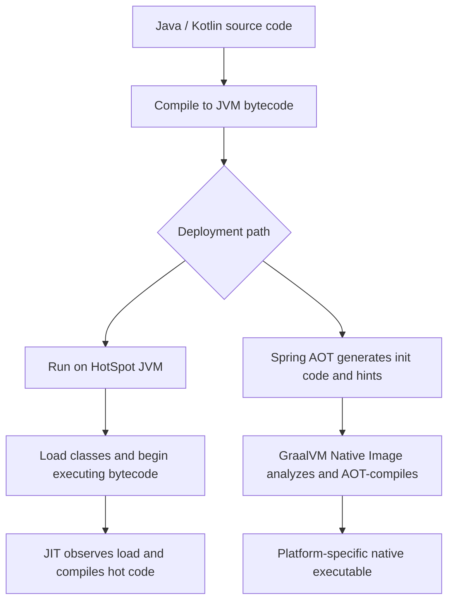

# AOT Differs from JIT and Does Not Mean Every JVM Optimization

When optimizing a Spring Boot application, the two terms **AOT (Ahead-of-Time compilation)** and **JIT (Just-in-Time compilation)** often appear alongside GraalVM Native Image, Spring AOT, JVM startup, memory, and request processing performance. They are related, but they are neither interchangeable names nor a blanket term for every way to make a Java application faster.

Within the scope of **Spring Boot Native Image**, we need to distinguish three layers of work:

1. **Spring AOT** analyzes the application configuration and generates code/metadata at build time to reduce dynamic processing during initialization.
2. **GraalVM Native Image** analyzes and compiles the program into directly executable machine code before deployment.
3. **JVM with JIT** runs bytecode and progressively compiles and optimizes critical code paths based on data observed while the application operates.

Understanding the boundaries of these three layers helps evaluate benefits in startup time, memory, throughput, and maintenance cost accurately, rather than assuming "AOT is always faster than JIT".

## 1. When Do AOT and JIT Differ in Timing?

**AOT** is compilation performed before the program actually serves load in the runtime environment. In the case of GraalVM Native Image, Java bytecode and dependencies are analyzed at build time and then compiled into a native executable for a specific operating system/architecture.

**JIT** is compilation performed while the program is running. The JVM starts executing bytecode; when it identifies a frequently called method or loop worth optimizing, the JVM can compile that segment into machine code. Optimization choices can rely on object types, branch frequencies, and actual workload behavior.

Note: `javac` also compiles `.java` source code into `.class` bytecode before execution. However, in the **JVM JIT vs. GraalVM Native Image AOT** discussion, "AOT" primarily refers to generating **native machine code ahead of running**, not merely the regular bytecode compilation step.



The diagram depicts **two common deployment paths**; it does not assert that the JVM never uses ahead-of-time preparation techniques. Modern JVMs have multiple mechanisms to reduce startup cost or reuse prepared data; those mechanisms should be named accurately and evaluated separately.

## 2. How Does JIT Optimize a Running Application?

On the JVM deployment path, execution typically includes the following activities:

1. The JVM loads classes, verifies bytecode, and begins executing the application. Some code may run via the interpreter or already be compiled at various optimization tiers.
2. The JVM collects telemetry on invocation counts, frequently taken branches, and observed data types. With HotSpot, **tiered compilation** can coordinate multiple compilation levels, typically involving C1 and C2.
3. "Hot" methods/loops are compiled, potentially applying *inlining*, redundant check elimination, loop optimizations, and many other transformations.
4. If an optimization assumption ceases to hold, the JVM can perform **deoptimization**: falling back to a more general execution form and re-optimizing according to new data.

For example, a payment processing method called millions of times generally stands a much better chance of receiving heavy JIT optimization investment than a rarely triggered error-handling branch. Hence, the speed of the first few requests can differ from the speed after the system has reached steady state (*warm-up*).

```java
public long sumAmounts(List<Order> orders) {
    long total = 0;
    for (Order order : orders) {
        total += order.amountInCents();
    }
    return total;
}
```

On the JVM, when this method is called repeatedly, the JIT **can** use runtime statistics to optimize the code. It is impossible to conclude exactly which optimizations the JVM will perform solely from this example: the outcome also depends on the JDK version, the `List` implementation type, data, hotness threshold, and optimization state at measurement time.

**The benefit of JIT** is its ability to adapt to real workloads and optimize steady-state performance after warm-up. **The costs** include CPU and memory for compilation, profiling data, and compiled machine code; initial processing speed may also lag behind steady-state speed.

## 3. What Does Native Image AOT Solve?

GraalVM Native Image uses an ahead-of-time application analysis approach. The tool attempts to determine which classes, methods, and resources may be needed from known entry points, applies optimizations such as unreachable code elimination, and then builds a native executable.

In a Spring Boot application, **Spring AOT** supports this phase by pre-processing certain configurations, bean initializations, and generating *runtime hints* for cases requiring reflection, proxies, serialization, resources, or other dynamic mechanisms. GraalVM Native Image then consumes those results together with the code and libraries to produce the binary.

Because much of the work is shifted to build time, native builds typically enjoy an advantage at **startup**, especially in environments that frequently spin up processes/containers. However, native binaries still include a runtime supporting memory allocation, thread management, and **garbage collection**; "native" should not be misunderstood as "no runtime" or "no GC".

A notable limitation is the **closed-world** assumption during analysis: the tool must have complete information about what components may be used. Behaviors that are hard to see in static analysis—such as loading classes from string names, dynamic reflection, or reading resources by runtime-constructed names—may require appropriate configuration/hints. Simply succeeding at the build does not guarantee that every functional path at runtime will work.

### One Application, Two Different Optimization Goals

Suppose a Spring Boot service has an `/orders` API:

- With **JVM + JIT**, the application may spend extra time on initialization and warm-up, yet the JIT has the opportunity to optimize order-processing paths based on actual requests after running long enough.
- With **Spring AOT + Native Image**, much of the initialization is already handled at build time; the process may become ready to accept requests sooner, but it will not have HotSpot's JIT continuously recompiling hot code as load shifts.

Neither option wins unconditionally on every metric. A short-lived service recreated continuously has different requirements from a process running for days under heavy, steady CPU load.

## 4. Comparison Table: Native Image AOT vs. JVM JIT

| Aspect | JVM with JIT (e.g., HotSpot) | Spring Boot Native Image with AOT |
| --- | --- | --- |
| When machine code is generated for app code | Primarily at runtime, based on hotness | Primarily at build time |
| Data guiding optimization | Can observe live runtime profiles | Analyzed ahead of time; can use profiles gathered via PGO if configured |
| Startup | Involves class loading/JVM init and may require warm-up | Usually has an advantage in startup time |
| Steady-state performance | JIT can optimize for live load | Depends on ahead-of-time generated machine code and build configuration |
| Memory | Includes heap, JIT code cache, metadata, and other JVM components | Has native runtime and heap/GC; often reduces some JVM overhead, though not guaranteed always lower |
| Build time | Usually shorter if only building a JAR | Usually longer due to analysis and native compilation |
| Dynamic flexibility | Broad support for class loading/reflection per JVM contract | Some dynamic mechanisms require hints or design adjustments |
| Distribution | JAR/bytecode runs with a compatible JRE/JDK | Binary is tied to OS/architecture and a compatible build environment |
| Debugging and operations | Rich JVM ecosystem: JFR, JMX, profilers, GC logs… | Dedicated native tooling exists; data collection methods may differ |
| Typically suited goals | Long-running services needing flexibility and high throughput | Workloads sensitive to cold start, process/container density, and footprint |

Notes saying "usually" in the table are **trends for forming hypotheses**, not guaranteed numbers. You must measure on your exact application and tool versions.

## 5. Why Does AOT Not Represent Every JVM Optimization?

"JVM optimization" is a very broad group of techniques spanning multiple independent layers. You can picture them as follows:

| Technique | What Does It Do? | Is It Synonymous with Native Image AOT? |
| --- | --- | --- |
| JIT compilation and tiered compilation | Generates and adapts machine code from runtime profiles | No; this is optimization inside a running JVM |
| Spring AOT | Generates code and hints to reduce dynamic work during app startup | No; Spring AOT itself is not a native compiler |
| GraalVM Native Image | Performs reachability analysis, compiles ahead of time into a native executable | This is a form of AOT machine-code compilation |
| Class Data Sharing (CDS/AppCDS) | Shares/reuses class metadata to reduce class-loading, startup, or memory costs | No; still runs the application on the JVM |
| Garbage collector/heap tuning | Tunes GC pause latency, throughput, and footprint for the workload | No; belongs to runtime memory management |
| SQL, cache, I/O, thread pool tuning | Reduces database round-trips, network waits, contention, and redundant work | No; belongs to application design/performance |
| Profile-guided optimization (PGO) | Uses execution profiles to guide optimization choices | Not a single execution mode; profiles can be applied in different ways |

**Two common misconceptions:**

**Misconception 1 — "Using GraalVM means using Native Image."** GraalVM is an ecosystem of tools; the Graal compiler can also appear in a JIT context. You must clearly distinguish between running **bytecode on the JVM** and running a **binary produced by `native-image`**.

**Misconception 2 — "With AOT, runtime optimization is unnecessary."** Native Image still deals with allocations, GC, locks, network I/O, connection pools, and how the application uses CPU. A 500 ms database query does not become a 5 ms query simply by switching from a JAR to a native executable.

Likewise, enabling CDS, switching garbage collectors, or tuning `-Xmx` does not automatically turn a JVM application into an AOT native build. Conversely, a JVM's support for an ahead-of-time preparation technique does not eliminate the role of JIT at runtime.

## 6. Spring Boot Workflow: Where Do Spring AOT and Native Image Fit?

With Spring Boot AOT support and Native Build Tools configured, you can compare the two build paths on the **same version of the source code**.

### 6.1. Standard JVM Path

Maven project example:

```bash
./mvnw clean package
java -jar target/my-service.jar
```

`my-service.jar` is an illustrative name: in a real project, substitute the generated artifact. The application is still executed by the JVM; JIT can optimize hot code while the program runs.

### 6.2. Native Image Path

Maven example when the project has a `native` profile and compatible plugins:

```bash
./mvnw -Pnative native:compile
./target/my-service
```

Gradle example when GraalVM Native Build Tools is applied and configured:

```bash
./gradlew nativeCompile
./build/native/nativeCompile/my-service
```

Binary names and run syntax may vary by artifact, OS, and project configuration (on Windows it may have `.exe`). The commands above **do not automatically install** GraalVM, the Native Image toolchain, or plugins; you must prepare a compatible toolchain beforehand.

On the Native Image path, the build typically includes:

1. Compiling source code into bytecode and resolving dependencies.
2. Running **Spring AOT** to generate initialization code and hints identifiable by the framework.
3. Running the **GraalVM Native Image** compiler to analyze reachability and produce the binary.
4. Running the binary, testing real behavior, and measuring performance.

This is why you should avoid saying "Spring AOT is just early JIT": Spring AOT performs transformations and preparation at the framework layer; the Native Image compiler performs the machine-code generation. They collaborate, but they do not perform the same function.

### 6.3. Example of a Case Requiring Runtime Hints

Suppose a custom library reads a class name from configuration and then calls `Class.forName` and reflection to instantiate an object. On a regular JVM, the class can be loaded dynamically if it is on the classpath. In a native build, the tooling needs to know ahead of time which type will be accessed this way.

For a case where Spring Framework recognizes a type used for data binding, you can declare a hint like this:

```java
import org.springframework.aot.hint.annotation.RegisterReflectionForBinding;
import org.springframework.context.annotation.Configuration;

@Configuration(proxyBeanMethods = false)
@RegisterReflectionForBinding(OrderPayload.class)
class NativeBindingConfiguration {
}
```

This annotation illustrates how to register reflection information for **binding** `OrderPayload`; it is **not a catch-all solution** for every reflection operation or dynamic class loading pattern. With custom libraries, you may need `RuntimeHintsRegistrar`, separately registered resources, library-provided metadata, or design adjustments. Only add hints when an actual need is identified, and test the corresponding code path on the native binary.

### 6.4. Container Native Is Not a Synonym for AOT

A native binary can also be packaged into an OCI image, for instance via Spring Boot buildpacks when Native Image is enabled in the build configuration. However, a **container image** is merely a packaging and runtime vehicle; a container holding a JAR/JVM is still the JVM path, whereas a container holding a native executable is the native path.

Therefore, deployment documentation must explicitly state **JVM container** or **Native Image container**, JDK/GraalVM version, CPU architecture, and build method. Using Docker alone does not indicate whether an application uses JIT or AOT.

## 7. Measuring Performance Properly to Decide

To determine whether to move Spring Boot to Native Image, build both artifacts from the same commit, use the same configuration and data, and run on equivalent resources.

| Metric | Measurement / Meaning | Notes When Comparing |
| --- | --- | --- |
| **Startup to readiness** | Time from process creation until the readiness endpoint returns an acceptable response | Measures the milestone of serving real requests, not just when the JVM prints a log line |
| **RSS / working set** | Total resident memory of the process | Do not equate RSS with Java heap; both JVM and native have off-heap memory |
| **Latency p50/p95/p99** | Latency percentiles under a given request scenario | Measure both at cold start and post-warm-up, reporting the load level |
| **Throughput** | Requests/second while keeping error rate and latency within acceptable bounds | Do not extrapolate throughput from startup time |
| **CPU** | CPU during startup and steady-state load | Include JVM JIT overhead if applicable, alongside real application load |
| **Build time and artifact size** | Time to produce JAR/binary, artifact/container sizes | Native builds can consume substantial CPU and RAM on the build machine |
| **Functional compatibility** | Number of functional flows, integration tests, and error paths working properly | Includes reflection, resources, serialization, JNI, dynamic plugins |

A sound practical procedure:

1. Build both versions from the **same commit**; record JDK, Spring Boot, GraalVM, OS, architecture, and build options.
2. Start each version multiple times under equivalent conditions. Measure time until `/actuator/health/readiness` reports ready if enabled and configured; otherwise define an appropriate readiness signal.
3. Measure RSS and CPU of the **entire process**. For containers, apply identical CPU/memory limits, isolating differences caused by monitors or base images during analysis.
4. Generate the same request set and data. Record the initial phase, warm-up phase, and steady-state load separately; report p50/p95/p99, throughput, and error rate.
5. Run integration tests and rarely hit flows on the native binary: JSON binding, TLS, resources, scheduling, serialization, exceptions, and libraries using reflection if any.
6. Also compare build costs, ease of debugging, image size, and operational tasks before choosing a deployment path.

**Example result template** (cells intentionally left blank; must be filled with actual measurements):

| Metric | JVM + JIT | Native Image + AOT |
| --- | --- | --- |
| Startup to readiness (ms) | *Measure* | *Measure* |
| Idle RSS (MiB) | *Measure* | *Measure* |
| RSS at rated load (MiB) | *Measure* | *Measure* |
| Post-warm-up p95 latency (ms) | *Measure* | *Measure* |
| Throughput at same SLO (req/s) | *Measure* | *Measure* |
| Clean build time (s) | *Measure* | *Measure* |
| Container image size (MiB) | *Measure* | *Measure* |
| Integration tests passed/total | *Measure* | *Measure* |

Never copy figures like "Native is N times faster" from another application into this table. Results depend on CPU/I/O usage, dependencies, bean count, initialization configuration, GC behavior, data, and measurement conditions.

## 8. Choosing the Right Path by Scenario

**Scenario A — Service scaling from 0 to many instances.** If the application is constrained by time to readiness for requests and memory cost per instance, Native Image is worth trying. Still, verify compatibility and CI build costs.

**Scenario B — Long-running service with heavy CPU processing.** JVM + JIT may be a solid choice thanks to adaptive load optimization and strong profiling tools. Without benchmarks for this specific workload, you cannot conclude whether native is worse or better.

**Scenario C — Service using many dynamically loaded plugins or complex reflection libraries.** Predicting all classes/resources at build time becomes the primary hurdle. Try a native build, test the hardest functional flows first, and only then weigh performance.

**Scenario D — API mostly waiting on database/network.** Optimizing queries, caching, connections, and concurrency limits may improve latency far more than changing the compilation strategy. Native can still help with cold starts, but clearly categorize the bottleneck first.

## 9. Key Takeaways to Remember

- **JIT** compiles and can optimize code based on profiles while the application runs; its strengths typically become clear after warm-up.
- **AOT Native Image** produces machine code before deployment and can lower startup/runtime overhead, trading off a more complex build step and explicitness requirements for dynamic code.
- **Spring AOT** is the framework's code/metadata preparation layer supporting Native Image; it is not another name for JIT or for the entire GraalVM compiler.
- **JVM optimization** also encompasses CDS, GC/heap tuning, JIT, profiling, and application-level tuning; none of those techniques automatically equates to native compilation.
- **Right choice depends on measured workloads**: time to readiness, RSS, p95/p99, throughput, build time, and compatibility testing together drive the decision.

Once you understand the conceptual differences, the next practical step is to build both a JAR/JVM and a Native Image from the same Spring Boot project, test dynamic runtime cases, and record metrics following the methodology in section 7.
