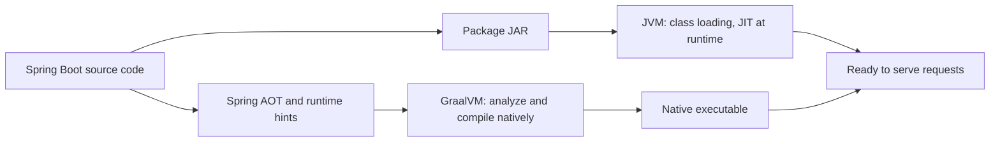

# Trade-offs Between Build Cost, Memory Usage, and Runtime Performance

## 1. Why Evaluate Across the Entire Application Lifecycle?

With Spring Boot Native Image, **Spring AOT** analyzes and generates supporting code for the application right during the build; **GraalVM Native Image** further analyzes reachable components and compiles them into an executable for a specific platform. The application can start up quickly, use less memory in certain workloads, and cut wait times when spinning up new instances.

In return, creating a native executable generally consumes more **build time and resources** than packaging a JAR for the JVM. Once an application runs steadily over long periods, the JVM with its JIT (Just-in-Time compiler) can optimize code based on live behavior; therefore, a native executable **does not automatically deliver better throughput or latency**. Dynamic mechanisms such as reflection, proxies, and resource loading also require verification when shifting to a build-time analysis model.

Deciding between the two deployment approaches requires evaluating simultaneously:

- **Build cost:** compilation time, peak CPU/RAM, artifact size, number of builds in CI/CD, and effort to maintain native configuration.
- **Operational cost:** memory consumption, CPU, replica density per node, container cost, and autoscaling capability.
- **Application performance:** time to readiness to serve requests, first-request latency, steady-state latency, throughput, and recovery time upon failure.
- **Compatibility cost:** testing libraries using reflection, resources, serialization, JNI, or dynamic initialization features; operating the binary on the target OS/CPU architecture.

> Principle: **optimizing one metric does not mean optimizing total cost**. Measure on the same application, data, resources, and load level before choosing.

## 2. Which Mechanisms Drive the Trade-offs?

### 2.1. Running Spring Boot on the JVM

In the traditional deployment approach, Java code is compiled into bytecode, packaged into a JAR, and executed on the JVM. The JVM is responsible for class loading, heap management, garbage collection, and can use JIT to compile frequently executed code segments into optimized machine code.

The practical advantages are typically fast development loops, strong support for dynamic behaviors, and opportunities to optimize for runtime load patterns. In return, the application incurs JVM/framework initialization work and may go through a **warm-up** phase before reaching steady throughput.

### 2.2. Running Spring Boot with Native Image

When creating a Native Image, Spring AOT prepares information about Spring configuration, beans, and determinable runtime hints. GraalVM performs *reachability analysis*, ahead-of-time (AOT) compilation, and links the required components into an executable. A large share of work shifts **from runtime to build time**.

As a result, the application usually has less initialization work and relies less on JIT mechanisms at runtime. However, the compiler must execute complex analysis across the entire application and its dependencies. A native executable still includes a runtime, heap, and garbage collection mechanism; calling it an app "without GC" or "without using heap" is incorrect.

| Aspect | JAR on JVM | GraalVM Native Image |
| --- | --- | --- |
| Packaging | Bytecode + compatible JVM at runtime | Executable compiled for target OS/architecture |
| Build process | Usually shorter, requires less build RAM | Usually longer, may require significant CPU/RAM |
| Startup | Includes JVM, class loading, and framework initialization | Usually faster due to pre-build processing |
| Runtime memory | Can be higher due to JVM runtime and structures | Often advantageous in many small workloads, depending on load and config |
| Sustained-load performance | JIT can optimize for actual behavior | No equivalent JIT warm-up needed; throughput must be benchmarked |
| Dynamic behavior | Usually more forgiving | Requires checking metadata/hints for reflection, resources, proxies, JNI... |
| Operations | Requires a JVM on the image/host | Requires a binary and native libraries compatible with the environment |

Flow diagram:



## 3. Build Cost: Paying Upfront to Reduce Some Runtime Work

### 3.1. Time, CPU, RAM, and CI Capacity

For a JAR, the build mainly compiles Java, runs annotation processors, executes tests, and packages. A native build adds Spring AOT and GraalVM's machine-code analysis/compilation phase. Thus, the difference is not only average build duration but also:

1. **Pipeline completion time:** affects developer feedback speed and release cadence.
2. **Peak RAM during compilation:** can trigger OOM on CI runners even though the native app uses little RAM at runtime.
3. **CPU and concurrent job count:** a resource-heavy native job can reduce the throughput of an entire runner pool.
4. **Artifact size and compatibility:** the binary is tied to OS/architecture and library linking; multi-architecture releases often require building and testing artifacts per target.
5. **Cost of application changes:** a small change can still re-trigger the expensive native compilation phase, depending on caching and pipeline layout.

Examples of common build commands, **once the project has configured GraalVM Native Build Tools and an appropriate build environment**:

```bash
# Maven: JAR/JVM
./mvnw -DskipTests package

# Maven: native executable (with native profile configured)
./mvnw -Pnative native:compile

# Gradle: JAR/JVM
./gradlew bootJar

# Gradle: native executable
./gradlew nativeCompile
```

These commands illustrate the two Maven/Gradle choices; use only the build system actually present in your project. When benchmarking builds, clearly specify whether tests are run, whether dependencies are cached, and which machine runs the build. Do not compare a native build downloading all dependencies over the network against a warm-cache JAR build.

On Linux environments with GNU `/usr/bin/time`, you can start measuring elapsed time and peak RSS of the **build command process**:

```bash
/usr/bin/time -f 'elapsed=%e sec; max_rss=%M KiB' ./mvnw -DskipTests package
/usr/bin/time -f 'elapsed=%e sec; max_rss=%M KiB' ./mvnw -Pnative native:compile
```

Run independent measurements keeping the same JDK/GraalVM version, CPU, RAM limit, cache state, and daemon status; record CPU usage and any OOM events. The `max_rss` value above reflects the process tracked by the tool and **does not necessarily capture full peak RAM of all child processes or the entire CI container**. For containerized builds, also collect container/cgroup-level peak memory. Do not draw conclusions from a single run.

### 3.2. How to Lower Costs Without Skewing the Comparison

- Cache Maven/Gradle dependencies and reusable build artifacts; measure both cold-cache and warm-cache cases.
- Separate fast unit tests from the native compilation step in appropriate pipelines; still retain native compatibility tests before release.
- Choose runners with adequate CPU/RAM and cap concurrent native builds to match infrastructure capacity.
- Build only the architectures you need to deploy, logging actual build times to evaluate impact as release frequency rises.
- Consider Profile-Guided Optimization (PGO) if supported by your toolchain and versions, while accounting for the extra profile-collection and rebuild steps in build cost.

## 4. Memory: Distinguishing Heap, RSS, and Container Limits

In Java, the **heap** is only part of process memory. Actual total memory also involves thread stacks, machine code, native libraries, off-heap memory, runtime structures, and mapped memory pages. Therefore:

**A smaller heap does not guarantee a proportionally smaller RSS.** RSS (*Resident Set Size*) estimates the number of process pages currently resident in RAM; when measured at the container level, cgroup memory can include additional items such as page cache and auxiliary processes. Figures from `docker stats` and `ps` can thus differ even at the same instant.

When comparing JVM and native, track at least:

| Metric | When to Measure | Meaning |
| --- | --- | --- |
| RSS right after readiness succeeds | Post-startup, pre-load | Evaluates initial footprint |
| Steady idle RSS | After a fixed wait period | Avoids misreading startup fluctuations |
| RSS at the same RPS/concurrency | During load testing | Reflects memory needed to serve equivalent work |
| Peak RSS / container memory | Under heavy load, GC, and bursts | Estimates risk of hitting memory limits |
| Heap, GC pauses, allocation rate | Under steady load and stress | Explains drivers of memory consumption |
| Number of OOM kills or restarts | Throughout the test run | Reveals under-provisioned memory configuration |

Example observation commands on Linux:

```bash
# Process RSS in KiB (replace PID with actual PID).
ps -o pid,rss,%mem,comm -p "$PID"

# Memory usage of running containers.
docker stats --no-stream

# If running under cgroup v2 with read permissions:
cat /sys/fs/cgroup/memory.current
cat /sys/fs/cgroup/memory.peak
```

These commands are only a starting point. In Kubernetes, also track memory working set, memory limits, OOMKill/restarts, and **requested** resources, because the scheduler packs Pods based on requests rather than average RSS directly. If the JVM over-allocates heap or native uses a mismatched heap limit configuration, results will be unfair; tune both to the same SLO, load level, and memory limit.

### 4.1. When RAM Reduction Actually Translates to Savings

Suppose an application runs 30 replicas, with steady-state footprints measured at 240 MiB on the JVM and 120 MiB with native at the **same load level**:

```text
Theoretical RAM savings ≈ (240 - 120) MiB × 30 = 3,600 MiB ≈ 3.52 GiB
```

This is a multiplication of process footprints, **not yet a cloud bill reduction**. To turn it into real savings, check Pod requests/limits, CPU requests, packable node capacity, autoscaling behavior, and the platform's billing model. If the cluster cannot reduce node count or lower resource allocations, immediate financial gains may be much smaller.

## 5. Runtime Performance: Separating Startup, First Request, and Steady Load

### 5.1. Startup and Rapid Scaling

Native Image typically delivers clear advantages in startup time by reducing dynamic initialization work. This helps short-lived jobs, scale-to-zero, frequently recreated containers, bursty autoscaling, and fast failure recovery.

However, distinguish three milestones:

- **Process start:** when the OS creates the process.
- **Application ready:** when Spring Boot finishes initialization and reports ready.
- **Service ready:** when external callers can send a request to a real endpoint and get a valid response; this may lag due to readiness probes, DB connections, DNS, ingress, or service discovery.

If wait time is dominated by database connections, migrations, remote configuration, or external cache loading, native compilation may barely change **service ready** time. Measure from the client or orchestrator side to avoid relying solely on the "Started" log line.

### 5.2. Latency and Throughput

Early on, the JVM may not have finished JIT warm-up; a native executable may offer steadier first-request latency. Once a JVM application runs long enough, however, the JIT can use runtime telemetry (such as hot paths, concrete types, and call structures) to optimize. Ahead-of-time compiled native code does not necessarily achieve the highest throughput for long-running workloads.

To evaluate properly, measure separately:

1. **Cold start:** time from process creation to readiness and the first valid request.
2. **Warm-up:** initial phase under controlled load; record how latency and throughput evolve over time.
3. **Steady state:** p50, p95, p99, error rate, and throughput once the system stabilizes.
4. **Peak/burst:** impact of concurrency, GC, CPU saturation, and throttling as load rises.
5. **Recovery:** speed of restarting, adding replicas, and returning to SLO compliance.

**Low p99 at light load is not enough to declare a winner.** One build might have great p99 at 100 RPS yet become CPU-starved at 1,000 RPS; or one build might deliver higher throughput while breaching the memory limit. Compare at the **same offered load**, then determine the maximum load each build can sustain while still meeting the SLO.

### 5.3. Impact of Configuration and Versions

Results depend on Spring Boot, JDK, and GraalVM versions, GC mode, CPU architecture, application libraries, and optimization choices. PGO can boost native performance for profiled flows, but demands representative workload profiles and extra build cost. Conversely, the JVM can leverage heap/GC tuning or built-in startup enhancements. Avoid absolute claims like "native is always faster than JVM", "native always uses less RAM", or "native needs no tuning".

## 6. Designing a Fair and Reproducible Benchmark

Run an A/B experiment on the **same commit** of the Spring Boot application, with two artifacts:

- **A — JVM:** the application JAR running on the selected JDK version.
- **B — native:** the executable compiled with GraalVM Native Image, with Spring AOT and required runtime hints.

### Step 1 — Fix the Conditions

Record the commit, Spring Boot/JDK/GraalVM versions, OS, CPU architecture, core count, memory requests/limits, GC/heap settings, base image, test data, connection counts, and external service configs. Both builds must share identical functional behavior, endpoints, dataset, logging policies, and DB/cache access patterns.

If using Docker/Kubernetes, prevent the two test runs from competing for CPU/RAM on the same host; monitor CPU throttling and separate network latency from application processing time. For I/O-heavy endpoints, measure DB/remote API latency independently.

### Step 2 — Measure Builds Independently

Perform at least several builds for each option, labeling cold/warm cache, and collect:

```text
build_elapsed_seconds
build_peak_ram_mib
build_cpu_seconds
artifact_or_image_size_mib
build_success_rate
```

Report the median and variance range rather than picking the fastest run. For native containers, also verify architecture, runtime libraries, and CA certificates before benchmarking.

### Step 3 — Verify Application Compatibility

Before load testing, run smoke/integration tests on the **native executable itself**: opening the context, calling endpoints, authentication, serialization/deserialization, DB queries, scheduled tasks, resource loading, reflection/proxies, and any integrations using native libraries/JNI. Missing runtime hints can allow a native build to succeed yet fail on a rarely exercised code path.

If any feature behaves differently between the two builds, performance numbers are no longer comparable. Fix the AOT/runtime hint configuration and retest, while logging the maintenance effort involved.

### Step 4 — Measure Time to Readiness Externally

Launch each artifact from a cold state with no running process, measure until the readiness endpoint succeeds, and then send the first business request. If using Spring Boot Actuator, configure and measure the corresponding readiness endpoint; **do not assume** every application enables this path by default. Each run must clearly define cache state, database readiness, and probe delays.

Perform multiple startups and report median/p95 readiness times; for scheduled jobs, also record **total job completion time** rather than app startup alone.

### Step 5 — Measure Load and Runtime Cost

Choose realistic scenarios: read endpoints, write endpoints, small/large JSON payloads, cache hits/misses, and multiple RPS and concurrency levels. You can use k6, wrk, or your project's load-testing tool. The load generator should run on a separate machine or with isolated resources; confirm it is not bottlenecked itself.

At each load level, collect **p50/p95/p99**, error rate, successful requests/sec, CPU time, RSS, peak memory, GC pauses, and CPU throttling rate. Separate the warm-up phase from the steady-state reporting window. Ramp load until one build violates the SLO to find **sustainable throughput**, not merely peak throughput for a few seconds.

### Step 6 — Present and Interpret the Data

Example of a **purely hypothetical** results table, solely to illustrate how to interpret measurements:

| Metric | JVM | Native | Interpretation |
| --- | ---: | ---: | --- |
| Build with warm cache | 1 min | 6 min | Native adds 5 min per build |
| Peak build RAM | 2 GiB | 8 GiB | Native runner requires larger capacity |
| External readiness | 2.5 sec | 0.3 sec | Native saves 2.2 sec/start |
| Idle RSS | 240 MiB | 120 MiB | Idle footprint cut in half |
| RSS at 200 RPS | 330 MiB | 180 MiB | Continues to save memory under measured load |
| p95 at 200 RPS | 18 ms | 20 ms | JVM edges ahead in this steady-state check |
| Sustainable throughput at same SLO | 2,800 RPS | 2,600 RPS | JVM edges ahead in this sustained-load scenario |

Read the table against your goals: if a system runs many small replicas that start frequently, native may fit well despite longer builds. If a few replicas run 24/7 with CPU-bound workloads needing maximum throughput, the JVM may be the more economical choice. Both conclusions **depend on the problem**; the table above is not a standard benchmark from Spring Boot or GraalVM.

## 7. Translating Measurements into Architectural Decisions

A simple calculation framework is:

```text
Lifecycle cost
  ≈ CI/build cost
  + runtime compute and memory cost
  + headroom/recovery/scaling cost
  + testing and compatibility maintenance effort.

Startup time saved
  ≈ startup count × (startup_JVM - startup_native).

RAM footprint saved at a target load
  ≈ replica count × (RSS_JVM - RSS_native).
```

These expressions help ask the right questions, though they are not enough to price things out directly: you must add runner cost/minute, Pod request settings, node pricing, CPU consumption, daily replica creation rate, and infrastructure downscaling ability. When using request/execution-time billing platforms, check the platform's exact pricing rules directly.

### Example: Higher Release Frequency or Memory Savings?

Suppose a native build adds 5 minutes and the team runs 20 builds/day; extra runner time could be roughly **100 minutes/day** if every build uses the same runner type. In exchange, a system running 30 replicas might save substantial RAM and start faster during autoscaling. If actual node count drops without breaching SLOs, the extra build cost can be justified.

Conversely, if the application runs only one long-lived replica near CPU saturation and native lowers throughput at the same SLO, the cost of adding CPU/replicas could outweigh RAM savings. Do not compare cost per process alone; compare the **cost to handle the same amount of work with the same reliability**.

### Scenario Matrix

| Scenario | Selection Tendency | What Must Be Proven |
| --- | --- | --- |
| Functions, short jobs, or scale-to-zero | Native worth trying first | Cold start and total job duration drop noticeably |
| Many microservices with low requests/replica | Native has potential | RAM requests shrink and infrastructure packs tighter |
| API needing rapid scale-out on bursts | Native has potential | Readiness and burst absorption improve |
| Continuously running CPU-bound service | Benchmark JVM and native carefully | Throughput/CPU, p99, and GC under sustained load |
| RAM-constrained CI, very frequent releases | Weigh native build cost | Pipeline latency, OOM frequency, and runner cost |
| Dependencies heavily using dynamic reflection/serialization | Prioritize compatibility check | Native tests cover all flows, runtime hints maintainable |
| Multi-architecture container deployments | Account for release cost | Binaries match target OS/architecture and pass per-target tests |

## 8. Mistakes That Make Benchmarks Meaningless

1. **Measuring only heap to judge container memory:** misses native memory, stacks, code, and page cache.
2. **Comparing a warming-up JVM against a steady native binary**, or measuring only steady state while ignoring startup: conclusions skew toward the measured slice.
3. **Using unrepresentative traffic:** an endpoint returning a static string poorly reflects serialization, DB access, caching, and real business logic.
4. **Failing to fix CPU/memory limits:** native and JVM can diverge drastically due to throttling, OOM, or heap sizing.
5. **Treating one build command's elapsed time as absolute CI cost:** ignores caching, queue time, runner CPU/RAM, and concurrent builds.
6. **Seeing lower RSS and assuming bills automatically drop:** if memory requests and node counts stay unchanged, financial savings may never materialize.
7. **Skipping tests on the native executable:** branches using reflection or resources can fail even when compilation succeeds.
8. **Assuming a native binary runs on any Linux image:** must verify libraries, libc, CPU architecture, certificates, and runtime dependencies.
9. **Comparing two artifacts with different features or configs:** if native disables logging, caching, monitoring, or validation, results do not reflect the same work.
10. **Relying on a single average:** startup, p95/p99, peak RAM, errors, and variance reveal actual operational risk.

## 9. Decision Sign-Off Checklist

Before choosing Native Image for Spring Boot in production, require a brief report covering:

- **Compatibility:** all critical business flows and integration tests pass on native.
- **Build:** build time/peak RAM fit CI budgets, and the release pipeline supports the target platforms properly.
- **Startup:** readiness and first-request gains are meaningful given actual startup frequency.
- **Memory:** idle and peak footprints allow lowering memory requests or real compute costs.
- **Performance:** p95/p99, error rate, and throughput meet the same SLO under target and burst loads.
- **Operations:** containers, observability, crash/restart behavior, runtime libraries, and debugging workflows are tested.
- **Total cost:** runtime gains outweigh build cost, testing overhead, metadata maintenance effort, and multi-architecture support cost.

**Conclusion:** Native Image trades upfront build work and cost for fast startup and potentially lower runtime footprint. The JVM retains advantages in dynamic flexibility, build speed, and JIT optimization potential for long-running workloads. For Spring Boot, the right option is determined by **controlled benchmarks on real workloads and total lifecycle cost**, rather than a single startup or RAM number.
