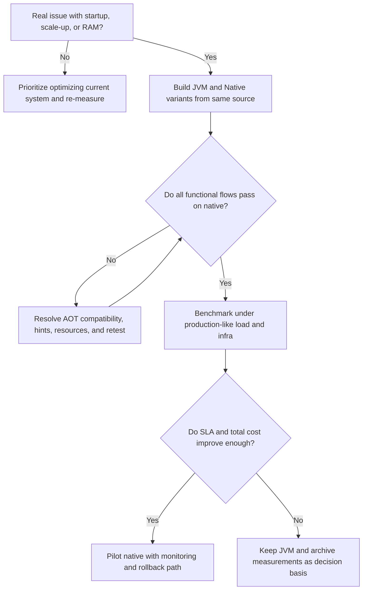

# Suitable Scenarios: Short-Lived Services, Rapid Scaling, and Constrained Resources

## Lesson Objectives

In the **Spring Boot Native Image** ecosystem, Spring AOT (Ahead-of-Time) analyzes and prepares part of the application's configuration at build time; GraalVM Native Image further compiles the application into a native executable for the target operating system and architecture. The result typically offers advantages in **startup time** and **memory usage** compared to running a Spring Boot application on a traditional JVM. In exchange, the build process is more complex and dynamic mechanisms such as reflection, resource loading, or proxy generation require thorough verification.

This lesson helps you:

- Identify three problem categories likely to benefit noticeably: **short-lived tasks**, **services that must scale replica counts rapidly**, and **resource-constrained environments**.
- Explain *why* startup and memory characteristics affect latency, scalability, and cost.
- Distinguish scenarios worth trying Native Image from scenarios where the JVM may fit better.
- Design a fair measurement and a proof of concept (POC) before promoting a native build to production.

> **Guiding principle:** Native Image is an optimization choice based on real workload characteristics, not a default upgrade for every Spring Boot application. Numbers in the examples below are **hypothetical illustrations of how to calculate**; you must measure on your own application.

## 1. Which Characteristics of Native Image Make the Difference?

A JVM-based Spring Boot application typically goes through JVM initialization, class loading, framework initialization, and application component setup. Native Image shifts part of the analysis and compilation work to the **build phase**. Consequently, a native application usually becomes ready to serve sooner and can use less memory under identical conditions.

| Criterion | Spring Boot on JVM | Spring Boot Native Image |
|---|---|---|
| Process startup | Requires JVM initialization and code loading | Usually faster due to ahead-of-time compiled code |
| Idle memory | Includes overhead for JVM, class metadata, JIT, and the app | Often reduces part of runtime overhead; still uses heap and garbage collector |
| Long-running optimization | JIT can optimize frequently executed code paths | Performance depends on build flags, profiles, and workload characteristics |
| Build time and resources | Usually faster and less resource-intensive | Native compilation can consume substantial CPU, RAM, and time |
| Dynamic code, reflection, resources | JVM can look up many components at runtime | Requires config/hints when the AOT analyzer cannot infer usage |
| Packaging | Requires a compatible Java runtime environment | Executable is bound to target OS and CPU architecture |

Key distinctions to make:

- **Startup time:** time from process start until the application is ready to handle requests.
- **Cold-start latency:** latency of the first request when a fresh runtime environment must be provisioned. This value may include scheduling, image pull, process startup, dependency connections, and application initialization.
- **Resident memory (RSS/working set):** actual memory consumed by the process; should not be equated with heap limit settings.
- **Steady-state throughput/latency:** processing capacity after the application has started and is handling steady load.

Native Image directly affects process startup and part of memory consumption. It **does not automatically** make databases faster, cut container image pull time, or guarantee higher throughput than the JVM.

## 2. Short-Lived Services: When Startup Cost Dominates the Lifecycle

### 2.1. Typical Examples

- **Scheduled jobs:** tasks running every few minutes to reconcile orders, purge expired records, aggregate metrics, or sync data.
- **Event-driven workers:** each trigger spawns a new process or container to process a small batch of work.
- **Functions/serverless with cold starts:** services that only run on demand and may have their runtime environment reclaimed during idle periods.
- **Internal CLI utilities:** Spring Boot tools leveraging dependency injection to perform an operation and then exit.

For these workloads, startup can account for a substantial share of total processing time:

```text
Total time per run ≈ startup time + business processing time

Startup cost share ≈ startup time / total run time
```

**Hypothetical example:** a job takes 1 second to process data. The JVM build takes 4 seconds to start, whereas the native build takes 0.5 seconds:

| Quantity | JVM | Native |
|---|---:|---:|
| Startup | 4 seconds | 0.5 seconds |
| Business processing | 1 second | 1 second |
| Total duration | 5 seconds | 1.5 seconds |
| Startup share | 80% | About 33% |

In this example, total duration drops from 5 to 1.5 seconds. **These are not Spring Boot or GraalVM benchmark figures**: they only illustrate why a higher startup share yields greater potential benefit.

### 2.2. How to Structure a Spring Boot Job

For purely batch tasks, you can disable the web mode to avoid starting an unnecessary web server:

```java
import org.springframework.boot.CommandLineRunner;
import org.springframework.boot.WebApplicationType;
import org.springframework.boot.SpringApplication;
import org.springframework.boot.autoconfigure.SpringBootApplication;
import org.springframework.context.annotation.Bean;

@SpringBootApplication
public class ReportJobApplication {

    public static void main(String[] args) {
        SpringApplication app = new SpringApplication(ReportJobApplication.class);
        app.setWebApplicationType(WebApplicationType.NONE);
        app.run(args);
    }

    @Bean
    CommandLineRunner exportReport() {
        return args -> System.out.println("Report export completed");
    }
}
```

The example shows a job that runs automatically upon application startup. In real production code, replace the print statement with business logic, manage exit codes on failure, and close resources properly. **Disabling the web server can be beneficial even on the JVM**; when comparing two builds, keep the same non-web configuration.

### 2.3. When Are the Gains No Longer Large?

If a job processes data for 30 minutes, shaving off a few seconds of startup barely affects total completion time. Similarly, serverless functions reused repeatedly in a **warm** state may incur startup cost on only a tiny fraction of invocations. In such cases, measure the cold-start ratio, requests per runtime instance, actual processing time, and operational costs.

**Practical questions:** how many times per day is the application created fresh? How long does each process live? Is a user or upstream system actually waiting on startup?

## 3. Rapidly Scaling Services: When Replica Creation Speed Impacts Responsiveness

An API service facing sudden traffic surges may need to scale from a few replicas to dozens. Common scenarios include:

- Backends for flash sales, where traffic spikes sharply within a short window.
- Queue-based event processors, scaling workers based on backlog via Kubernetes Event-driven Autoscaling (KEDA) or similar mechanisms.
- APIs running on **scale-to-zero** platforms, where the system scales down to 0 replicas when idle and must spin them back up on demand.
- Microservices using multi-wave rolling update strategies that need to reach readiness quickly.

### 3.1. Which Step Does Native Image Help?

Time to serve during scale-out is not just Spring Boot's startup time:

```text
Scale need detected
      ↓
Scheduler picks node and provisions resources
      ↓
Pull container image (if not cached)
      ↓
Start Spring Boot process
      ↓
Connect DB / cache / dependent services
      ↓
Readiness probe succeeds
      ↓
Replica receives traffic
```

Native Image primarily cuts latency at the **start process** step, and occasionally eases memory pressure so the scheduler can pack more replicas. If most of the time goes into image pulls, waiting for new nodes, establishing connections, or dependent services, end-user gains may be smaller than expected.

Illustrative example: a replica takes 15 seconds to become ready, of which Spring Boot startup takes 6 seconds. If the native build reduces startup to 1 second while other steps stay unchanged, total time drops to around 10 seconds, **not** 1 second.

### 3.2. What Must Be Designed Alongside Native Image

1. **Accurate readiness.** Route traffic to a replica only when the application can genuinely serve requests; do not use the "Started" log line as a substitute for checking critical dependencies.
2. **Autoscaling on the right signal.** Whether using CPU, queue depth, or concurrent requests, choose proper thresholds; Native Image does not determine when the platform detects load.
3. **Connection limits.** Scaling from 5 to 50 replicas can cause a sudden surge in database connections. Pool sizes must match downstream system limits.
4. **Graceful shutdown.** When scaling down or rolling out new versions, drain in-flight requests and respect termination grace periods.
5. **Burst resilience.** Test scaling from 0→N or low→high replica counts, measuring 5xx errors, queueing, p95/p99 latency, and time to full serving capacity.

For always-on services with near-constant replica counts, startup only happens during deploys or restarts. If the primary goal is maximum throughput during continuous operation, evaluate the JVM build side by side.

## 4. Constrained Resources: When Memory Is the Deployment Bottleneck

### 4.1. Common Environments

- **Small Pods/containers:** the platform assigns a fixed RAM budget per instance.
- **Many microservices on one cluster:** many replicas must fit onto a finite number of nodes.
- **Edge or small servers:** devices/VMs with limited RAM that still require Spring Boot capabilities.
- **Pay-per-allocated-resource environments:** responsibly lowering memory requests can cut costs or increase node packing density.

A Native Image usually reduces memory devoted to runtime infrastructure, yet **does not eliminate heap, GC, application caches, thread stacks, network buffers, connections, or library native memory**. Outcomes depend on data allocation patterns and load levels.

### 4.2. Estimating Replica Density

Suppose a node has 4 GiB of RAM *allocatable to workloads*, CPU and other resources are sufficient, ignoring overhead:

| Memory request per replica | Max replicas by simple RAM division |
|---|---:|
| 512 MiB | 8 |
| 256 MiB | 16 |

Estimation formula:

```text
Replicas by RAM ≈ floor(Allocatable RAM / memory request per replica)
```

This is a **theoretical limit considering RAM alone**. In real Kubernetes clusters, CPU requests, daemons, system-reserved memory, per-node pod limits, and scheduling policies also apply.

Lowering memory requests is only safe after measuring **usage at peak load**, including traffic bursts, GC, and background tasks. If requests are lowered while memory limits are set too tight, containers risk OOM kills, degrading service availability. Never rely solely on idle RAM to set limits.

### 4.3. Metrics to Measure

| Metric | Why Is It Important? |
|---|---|
| Idle RSS/working set | Shows the cost of keeping replicas ready |
| RSS/working set at representative and peak load | Basis for setting requests/limits |
| CPU usage and CPU throttling | Lower RAM does not mean CPU is always lower |
| Throughput and p95/p99 latency | Ensures resource tuning does not degrade service quality |
| OOM kills, restarts, and errors | Detects overly tight resource sizing |
| Build/CI cost and deploy time | Accounts for lifecycle cost instead of runtime cost alone |

## 5. Cases Where Native Image Should Not Be Prioritized Yet

Native Image may **not be the best starting point** when:

| System Characteristic | Reason to Weigh Carefully |
|---|---|
| Long-lived, rarely restarted, CPU-bound apps | Low startup benefit; JVM JIT may yield better throughput on some loads |
| Libraries using hard-to-analyze dynamic reflection, proxies, or class loading | May require Runtime Hints, extra metadata, and dedicated native tests |
| Dependencies on JNI, native libraries, or dynamically named resources | Must verify compatibility per OS/architecture and packaging approach |
| Build pipeline has strict CPU/RAM or time constraints | Native compilation is typically much heavier than JAR builds |
| High code-change frequency requiring very short dev feedback loops | Compiling natively on every edit slows teams down; keep the JVM dev loop |
| Latency dominated by database, network, or processing algorithms | Optimizing startup does not fix the root cause |

**There is no rule that native is always faster across every metric.** For long-running applications, the JVM JIT compiler can optimize hot code exceedingly well. Native Image performance also varies by tool version, compiler optimizations, and workload traits. Let latency, throughput, and cost data decide.

## 6. POC: Measuring One Application Under Both Deployments

### 6.1. Preparing Two Builds from the Same Source Code

Use a Spring Boot version supporting AOT and GraalVM Native Image, configuring the Spring Boot plugin with compatible **GraalVM Native Build Tools**. The native build machine needs a GraalVM JDK and the `native-image` tool, or a buildpack environment supporting native compilation.

**Maven** (example on a Unix shell once the project has configured required plugins):

```bash
# JVM build
./mvnw clean package

# Native build
./mvnw -Pnative native:compile
```

**Gradle** (once the project has configured GraalVM Native Build Tools):

```bash
# JVM build
./gradlew bootJar

# Native build
./gradlew nativeCompile
```

The JVM app can run via `java -jar ...jar`; the native build runs directly via the generated executable (for example in Maven's `target/` or Gradle's `build/native/nativeCompile/`). File names depend on the project and OS. For containers, Spring Boot Buildpacks can also produce a native image, e.g., `./mvnw -Pnative spring-boot:build-image` when buildpack and Maven configs are compatible.

**Mind the target architecture:** a Windows native executable will not automatically run on Linux; build for the exact OS and CPU architecture used at deployment. Both JVM and native builds must use the same business configuration, load level, and infrastructure class for comparison.

### 6.2. Checking AOT Compatibility

Before benchmarking, exercise functional flows involving JSON, serialization/deserialization, validation, ORM, security, proxies, reflection, resource files, TLS, and third-party libraries that the application actually uses.

Spring AOT and well-supported libraries can auto-generate much of the required configuration. For types/resources accessed **dynamically** that the analyzer cannot detect, registering `RuntimeHints` may be necessary. Example hints registration structure:

```java
import org.springframework.aot.hint.MemberCategory;
import org.springframework.aot.hint.RuntimeHints;
import org.springframework.aot.hint.RuntimeHintsRegistrar;
import org.springframework.context.annotation.Configuration;
import org.springframework.context.annotation.ImportRuntimeHints;

class ExternalPayloadHints implements RuntimeHintsRegistrar {
    @Override
    public void registerHints(RuntimeHints hints, ClassLoader classLoader) {
        hints.reflection().registerType(
                ExternalPayload.class,
                MemberCategory.INVOKE_DECLARED_CONSTRUCTORS,
                MemberCategory.INVOKE_PUBLIC_METHODS
        );
        hints.resources().registerPattern("templates/external-payload.json");
    }
}

@Configuration(proxyBeanMethods = false)
@ImportRuntimeHints(ExternalPayloadHints.class)
class NativeRuntimeHintsConfig {
}
```

In the example, `ExternalPayload` is a hypothetical application DTO class; replace it with the actual type. Only add hints when a specific dynamic access need exists, and verify correctness on the **compiled native binary**. A feature passing on the JVM is not enough to prove it works in native.

### 6.3. Designing the Measurement Matrix

Create both deployments using the same code revision, data, allocated resources, and environment variables; run multiple iterations to filter noise. Measure both **cold** and **warm** if the production platform reuses instances.

| Measurement | How to Observe | Which Workload Group Does It Evaluate? |
|---|---|---|
| Start to successful readiness | Container/process start timestamp to first valid health/readiness response | All three; especially scale-to-zero |
| First-request latency after scale-up | Issue requests when the system has 0 or few replicas | Serverless, rapid scaling |
| Total job completion time | From trigger to exit code/successful result | Short-lived services |
| Idle, normal, and peak memory | RSS/working set, `docker stats`, container/Kubernetes metrics | Constrained resources |
| RPS, p95/p99 latency, and error rate | Load testing tool and application metrics | Long-running API services |
| Build time, build machine memory, image size | CI logs and artifact registry | Overall operational cost |
| Functional errors and integration tests | E2E/API/DB/serialization tests on the native build | Mandatory gate before production |

Do not compare an unwarmed JVM build against a differently warmed native build when measuring throughput. For APIs, run an **equivalent warm-up**, then measure steady load and burst load separately. If testing on Kubernetes, keep initial resource requests/limits, image pull policy, startup/readiness probes, and autoscaling policies consistent; only then tune requests per build based on measurements.

### 6.4. One Test Per Scenario

**Short-lived tasks:** run 30–50 job executions with identical data, recording startup time, processing time, and exit code. Compare median and p95 of total duration. If a job exhibits abnormal cold starts, investigate the root cause before concluding.

**Rapid scaling:** trigger a burst load from 0 or a small replica count, recording timestamps for scale detection, pod scheduling, container start, readiness, and SLA recovery. Measure backlogs or delayed requests throughout.

**Constrained resources:** hold normal load and ramp up to design limits; measure peak RSS and OOM errors. Select new memory requests/limits with safety headroom based on results, then confirm actual packable replica counts per node without service quality degradation.

## 7. Decision Framework

| Question | Leans Toward Trying Native Image | Leans Toward Keeping JVM or Evaluating Further |
|---|---|---|
| Are processes created/destroyed continuously? | Yes; startup directly affects processing time | No; processes run continuously for days |
| Is scale-to-zero or scaling replicas within seconds required? | Yes; slow readiness causes delays/errors | No; steady load with infrequent scaling |
| Is memory a bottleneck for cost or deployability? | Yes; lower RSS enables lowering requests safely | No; CPU or I/O is the true bottleneck |
| Does the app rely heavily on dynamic runtime mechanisms? | Little, or supported with hints and native tests | Many libraries unverified for compatibility |
| Does CI have enough resources for native compilation? | Yes, and build frequency is manageable | Not yet; build duration is a major constraint |
| Does the native build meet the same SLA and functional needs? | Tested successfully under representative load | No data yet; requires a POC first |

You can use a simple selection workflow:



## 8. Synthesis Scenario

**Problem:** an e-commerce system has three Spring Boot components:

1. **Promotion update job:** invoked repeatedly on a schedule, with each run processing for a few seconds. This is a strong candidate to test native because startup time may represent a high share of runtime.
2. **Promotion lookup API:** during flash sales, replica counts fluctuate rapidly with traffic. Native can help replicas become ready faster and reduce RAM per replica. Also measure pod startup, image pull time, DB connections, and burst resilience.
3. **24/7 order analytics service:** consumes heavy CPU, maintains long-lived data caches, and rarely restarts. Startup is unlikely to be the main bottleneck; compare throughput and latency against the JVM before choosing native.

You should not make one blanket decision for all three just because all use Spring Boot. An architecture can **combine native and JVM applications**, tailored to each service's characteristics.

## 9. Self-Check

1. Why can cutting startup time from 5 seconds to 1 second be crucial for a 2-second job yet negligible for a 10-day process?
2. When Kubernetes takes 40 seconds to pull an image and 3 seconds to start Java, does optimizing startup down to 0.5 seconds eliminate most of the scale-up time? Which additional step would you measure?
3. If idle RSS drops by half while p99 latency spikes significantly under load, can you conclude Native Image is superior? Why?
4. Why is passing REST API tests on the JVM insufficient to confirm that resources/reflection work in the native binary?
5. When choosing between JVM and Native Image for a microservice, propose at least **three technical metrics** and **one cost metric** to compare.

**Key takeaway:** Spring Boot Native Image is especially worth testing when startup costs recur frequently, when replica readiness time governs service responsiveness, or when memory is a clear constraint. The final decision must rest on **native functional testing and apples-to-apples measurements**, including throughput, latency, and build cost.
