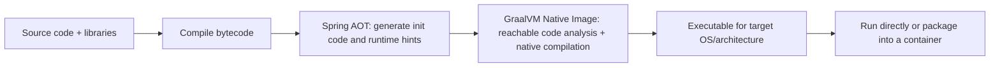
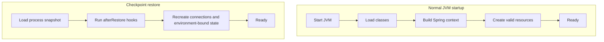

# Boundaries Between Spring Boot Native Image, Container Images, jlink, CDS, and Checkpoint

> **Chapter:** Overview  
> **Focus:** Distinguish Spring Boot application deployment and startup optimization mechanisms, identify which technology changes execution versus packaging, and know when to combine them.

## 1. Why Is It Important to Distinguish These Concepts?

When optimizing a Spring Boot service, you often hear claims like "packaging into a Docker image makes startup faster", "using jlink means native compilation", or "CDS is like checkpointing". These statements conflate different technical layers. They can coexist in a single system, yet they solve different problems.

A Spring Boot application typically spans the following layers:

1. **Application code and framework initialization:** Spring reads configuration, discovers beans, builds the context, maps endpoints, and initializes resources.
2. **How code becomes a running program:** running bytecode via a JVM or compiling ahead of time into machine code with GraalVM Native Image.
3. **Runtime/startup optimization mechanisms:** jlink, CDS/AppCDS, Spring AOT initialization optimizations, or checkpoint/restore.
4. **Shipping and deployment format:** JAR file, native executable, container image, virtual machine, or serverless platform.

**Container images** belong to the packaging layer. **jlink** creates a trimmed Java runtime. **CDS** helps the JVM reuse stored class metadata. **Checkpoint/restore** preserves a process's state to restore it later. **GraalVM Native Image** fundamentally changes execution: compiling the Java application into a native executable at build time.

In the **SPRING_BOOT_NATIVE_IMAGE** module, the goal is to use **Spring AOT together with GraalVM Native Image** to compile a Spring Boot application, measure startup time and memory, handle reflection/resources, build with Maven or Gradle, package containers, and evaluate operability. Therefore, treat the remaining mechanisms as comparison options or combinable layers, rather than equating them with native.

## 2. Comparison Matrix: What Does Each Mechanism Actually Do?

| Mechanism | Artifact Created or Preserved | What Is Needed at Runtime? | Typical Impact | What Must **Not** Be Inferred |
|---|---|---|---|---|
| **GraalVM Native Image** | Ahead-of-time compiled machine-code executable | Native runtime bundled in binary; may still need OS libraries | Short startup, minimal JVM init cost; often memory-favorable for small workloads | Does not automatically create containers; does not guarantee higher throughput than the JVM |
| **Container image (OCI/Docker)** | Filesystem layers, metadata, and entrypoint command | Container runtime and dependencies inside the image | Reproducible environment, consistent deployment | Does not itself convert bytecode to machine code or cut startup time |
| **jlink** | Java runtime image containing only selected JDK modules | Still runs the Java app using the JVM in that runtime | Shrinks distributed JDK/JRE size; reduces runtime surface area | Does not remove the JVM/JIT; does not compile app bytecode to native |
| **CDS / AppCDS** | Archive of class data that the JVM can reuse | Compatible JVM, matching app, and classpath | Cuts class loading/linking work; can lower startup time and share some memory | Does not persist the full Spring context, heap, or connections |
| **Checkpoint / restore (e.g., CRaC)** | Initialized JVM process state at a point in time | Compatible environment, JVM, and restore mechanism | Faster recovery than cold booting from scratch in suitable scenarios | Does not produce a native binary; cannot blindly reuse old sockets, tokens, or connections |

The metrics **startup time**, **time to readiness**, **RSS/PSS**, **image size**, and **throughput** are distinct quantities. An option strong on package size is not necessarily strong on active memory or request latency.

### Two Independent Axes: Execution Method and Packaging

| Execution Method | Without Container | Running in a Container |
|---|---|---|
| **JVM + JAR** | `java -jar app.jar` on host | Image containing JRE/JDK and JAR |
| **JVM + jlink** | Run JAR using trimmed runtime | Image containing jlink runtime and JAR |
| **JVM + CDS** | Run JVM with matching archive | Image containing JAR, JVM, and compatible CDS archive |
| **GraalVM Native Image** | Run native executable directly | Image containing native executable and required OS libraries |
| **JVM + checkpoint/restore** | Restore process state in a supported environment | Feasible when runtime/container and restore resources are properly designed |

Thus, the question "should we choose Docker or Native Image?" places two technologies on different axes: **you can and usually will use both**.

## 3. Native Image: Ahead-of-Time Compilation, Fundamentally Different from JVM Optimizations

With Spring Boot running on the JVM, Java/Kotlin is compiled to bytecode. When the application runs, the JVM loads classes, verifies, interprets, or JIT-compiles hot code paths. Spring initializes the application context, applies configuration, and manages beans.

With Native Image, the build process typically includes:



**Spring AOT** analyzes application configuration at build time, generates code supporting context initialization, and supplies hints needed for an environment with limited dynamic discovery. **GraalVM Native Image** uses that information alongside reachable-code analysis to produce the binary. The two steps complement each other: Spring AOT is not a machine-code compiler itself, and GraalVM needs to know the framework's dynamic behaviors to build a working binary.

Examples of areas to verify when migrating to native:

- **Reflection:** class names, constructors, methods, or fields determined only at runtime may require `RuntimeHints` or corresponding registration mechanisms.
- **Resources:** templates, config files, certificates, i18n messages, and resources read via classpath paths must be properly included in the binary.
- **Dynamic proxies, serialization, JNI:** reachability and corresponding metadata must be verified.
- **Runtime-dependent conditions:** beans or classes loaded by plugins, dynamic config class names, or scripts may conflict with the closed-world assumption of the native build process.

For instance, when a library calls `Class.forName("com.example.PaymentPlugin")` from a runtime config name, Native Image might miss that class during static analysis. The application may build cleanly yet fail on a live code path if hints are missing or the design must change. Hence, running tests on the JVM does not replace **testing the native binary**.

Examples of common build commands for a project configured with GraalVM Native Build Tools:

```bash
# Maven: native profile and corresponding plugin must be configured in the project
./mvnw -Pnative native:compile

# Gradle: project requires the org.graalvm.buildtools.native plugin
./gradlew nativeCompile
```

The output is an executable specific to the matching build/target platform. A Linux binary for `amd64` will not natively run on Windows or `arm64`; requirements around `glibc`/`musl` and dynamic libraries must also be checked. "Native" does not always mean "a binary completely independent of the OS".

For a long-lived service with continuous traffic, the JVM with JIT can still achieve better throughput on certain workloads; Native Image usually trades off extra time, CPU, and RAM in the **build step**. Do not look solely at startup time and conclude native is better on every axis.

## 4. Container Image: A Deployment Unit, Not a Compilation Strategy

An OCI-compliant container image describes a filesystem and how to launch a process. It can contain a Java runtime plus a JAR, or just a native executable and required OS libraries. The container does not dictate whether the app uses JIT or AOT.

**Case A — Spring Boot running on the JVM in a container:**

```dockerfile
FROM eclipse-temurin:21-jre
WORKDIR /app
COPY target/app.jar app.jar
ENTRYPOINT ["java", "-jar", "app.jar"]
```

**Case B — Linux native executable running in a container:**

```dockerfile
FROM debian:bookworm-slim
WORKDIR /app
COPY target/app /app/app
ENTRYPOINT ["/app/app"]
```

The Dockerfiles above only illustrate the difference in the **running process**. Artifact names, executable permissions, CPU architecture, libc, CA certificates, timezones, and system libraries must match the actual binary. With native, a minimal base image might fail to run if the binary lacks dynamic libraries it links against.

Spring Boot can also use Cloud Native Buildpacks to create an OCI image. Depending on configuration, that image contains either a JVM application or a native executable; the task name **`build-image`** alone does not prove the artifact was compiled natively.

When evaluating images, separate three questions:

1. **Pull/push size:** total layer sizes and layer cache reuse during deployment.
2. **Time to application readiness:** measure the process inside the container from start until health/readiness succeeds.
3. **Memory while serving load:** measure the process/cgroup under the same workload, because registry image size is not the RAM the process uses.

**Boundary conclusion:** Docker solves deployment; Native Image solves compilation and execution. You can package a native build with Docker and still benefit from orchestration, networking, health checks, and container deployment mechanisms.

## 5. jlink: Trimming the Java Runtime, Still a JVM

**`jlink`** is a JDK tool that builds a custom Java runtime based on the JDK module system (JPMS). Instead of shipping the full runtime, you include only the JDK modules needed. Its primary goal is cutting **distributed runtime size**, which can also help reduce patch surface area and unnecessary components.

Illustrative example:

```bash
# Module list must be determined by the application's actual dependencies
jlink \
  --add-modules java.base,java.logging,java.sql,java.naming \
  --strip-debug \
  --no-man-pages \
  --no-header-files \
  --output custom-jre

# The application is still run by java inside the generated runtime
./custom-jre/bin/java -jar app.jar
```

Here, `app.jar` **is still Java bytecode** and `custom-jre/bin/java` **is still a JVM**. JIT, GC, classloading, and the JVM lifecycle do not vanish. The command above is not guaranteed to include enough modules for a real Spring Boot app; libraries using service loaders, reflection, or optional modules may require additional modules.

You can use `jdeps` to help find module dependencies, yet for Spring Boot executable JARs with nested libraries in `BOOT-INF/lib`, analyzing a single JAR directly may **miss** dependencies. You must analyze the appropriately unpacked classpath/libraries, add modules uncovered through testing, and run functional tests on the actual jlink runtime.

**When jlink is useful:** the system still wants the JVM, the team wants JIT and the Java ecosystem, while also needing a slim image and controllable runtime. If the main goal is slashing cold starts, measure empirically rather than treating jlink as a replacement for Native Image.

## 6. CDS and AppCDS: Reusing Class Data, Not Saving the Entire Process

**Class Data Sharing (CDS)** enables the HotSpot JVM to use class metadata stored in an archive, avoiding repeating part of class loading and metadata processing on subsequent runs. **Application CDS (AppCDS)** extends scope to application and library classes when configuration permits. Certain data regions are mapped as shared memory, yielding benefits when multiple compatible JVMs run on the same host.

Basic illustration on a JVM supporting dynamic archives:

```bash
# Run the app in archive-creation mode upon normal process exit
java -XX:ArchiveClassesAtExit=app.jsa -jar app.jar

# Subsequent run: tell the JVM to use the created archive
java -XX:SharedArchiveFile=app.jsa -jar app.jar
```

This illustrates the mechanism, not a recipe guaranteeing every Spring Boot class ends up in the archive. Executable JAR packaging, Spring Boot's classloader, JDK version, classpath, and JVM flags affect which classes are shared. In some setups, you must **unpack the JAR and run with a compatible classpath** for AppCDS to cover more classes.

CDS is **not** equivalent to:

- **Spring AOT:** CDS reuses class data on the JVM side; Spring AOT generates code and hints for Spring's application structure at build time.
- **Native Image:** CDS still requires the HotSpot JVM and still runs JIT/GC like a normal Java app.
- **Checkpoint:** CDS does not restore a constructed Spring `ApplicationContext`, heap, threads, database connections, or in-flight tasks.

Archives are typically tightly coupled to the JDK, classpath, classloader, and related flags. Whenever you change the JAR, dependencies, JDK, or launch mechanism, rebuild and re-verify the archive. When deploying in containers, ensure the archive is generated in an environment compatible with runtime.

**When CDS is useful:** you want to keep the JVM while trimming classloading time, especially when running multiple replicas of a service. CDS can pair with jlink or containers, depending on JDK build and packaging compatibility.

## 7. Checkpoint/Restore: Restoring an Initialized State

A **checkpoint/restore** mechanism snapshots a process's state at an appropriate point and restores it to resume execution. For Java, **Coordinated Restore at Checkpoint (CRaC)** is an approach offering APIs/hooks so an application can prepare resources before taking a snapshot and recreate resources after restore; it requires a supporting JVM and infrastructure.

Visualizing two paths to bring an application to readiness:



The biggest difference from CDS is that a checkpoint can hold **live executed process state**, whereas CDS mainly holds class metadata. The difference from Native Image is that the restored process **is still a JVM process**.

A conceptual example with a CRaC-enabled JVM:

```bash
# Launch on a CRaC-capable JVM; app must have a flow that triggers checkpointing
java -XX:CRaCCheckpointTo=/opt/checkpoint -jar app.jar

# Restore from the created checkpoint via a compatible mechanism
java -XX:CRaCRestoreFrom=/opt/checkpoint
```

Merely passing `-XX:CRaCCheckpointTo` does not automatically create a checkpoint: the application or framework integration must **actively trigger the checkpoint** at the right moment. Exact commands, OS, kernel capabilities, and runtime requirements depend on the specific CRaC implementation; do not copy an example assuming every JDK supports it.

With Spring Boot, challenges typically lie in environment-dependent state:

| Resource at Checkpoint | Why Handle on Restore? | Approach |
|---|---|---|
| Database connection pools | Old TCP connections may no longer be valid | Close/quiesce before checkpoint, recreate after restore |
| Server sockets, HTTP clients, message brokers | Ports and sessions depend on host or environment | Reinitialize listeners/clients via lifecycle hooks |
| Short-lived tokens, credentials, certificates | May have expired or been cloned into the snapshot | Refresh secrets and auth sessions |
| Clocks, timeouts, random state | Wall time elapsed while paused; RNG state may be duplicated | Re-read clocks, schedules, and reseed randomness when needed |
| Background jobs, schedulers, threads | Could be in an unsafe state at snapshot time | Pick a stable checkpoint boundary and restart work idempotently |
| File descriptors, filesystem paths | Restore environment may lack identical files/mounts | Verify environment, close/reopen resources |

**Checkpoints do not equal portable snapshots across any machine.** Restore procedures can depend on kernel, architecture, JVM version, mounts, and runtime config. Snapshots may also hold sensitive data in memory; control access permissions and storage lifecycles strictly.

Platforms that use runtime-level snapshots to accelerate startup may impose their own rules; never assume every mechanism is CRaC-compatible. Startup savings must account for snapshot preparation, storage, restore, and resource handling overhead.

## 8. How Can These Technologies Work Together?

Several practical combinations:

- **Spring Boot JVM + OCI image:** common deployment choice that is straightforward to operate.
- **Spring Boot JVM + jlink + OCI image:** prioritizes shrinking runtime size while keeping HotSpot/JIT.
- **Spring Boot JVM + CDS + OCI image:** optimizes classloading; requires managing archives aligned with binary/JDK/classpath.
- **Spring Boot JVM + jlink + CDS:** combinable if the custom JDK includes supporting modules and features; test the archive against the exact runtime.
- **Spring Boot JVM + CRaC:** prioritizes restoring an already initialized app; requires managing checkpoints and resource hooks.
- **Spring Boot AOT + GraalVM Native Image + OCI image:** lowers startup cost on the native execution path while providing a container deployment unit.

Some optimizations complement each other, yet **Native Image does not run on the HotSpot JVM**, so it cannot use HotSpot-specific CDS/CRaC the way a JAR build does. Do not expect to stack every technology into one binary and add up their speedups.

### Choosing an Option Based on the Actual Problem

| Situation | First Experiment Direction | Verification Questions |
|---|---|---|
| High image download size, startup time already fine | Reduce layers, use jlink, or change base image | How much do image/layers shrink, and does runtime keep needed modules? |
| Many JVM instances starting frequently | CDS/AppCDS; also compare Native Image | How long to readiness, and is the archive stable? |
| Scale-to-zero, CLIs, short jobs, cold-start-sensitive serverless | Native Image or snapshot/restore if supported by platform | What are cold-start p50/p95 and RAM on real workloads? |
| Long-lived service where throughput/JIT is top priority | Tuned JVM, optionally combined with jlink/CDS | Are throughput, p99 latency, and CPU better after warm-up? |
| Need to preserve initialized Spring state for rapid cloning | Evaluate CRaC/checkpoint with lifecycle hooks | Are connections, tokens, and schedulers safe after restore? |
| Want consistent deployment on Kubernetes | OCI image for either JVM or native | Are health/readiness, shutdown signals, and image architecture right? |

These rows are **experimental starting points**, not substitutes for benchmarks.

## 9. Comparative Exercise for Spring Boot

Suppose you have a Spring Boot REST service with identical business code, configuration, data, and endpoints:

- **Variant J:** JAR on a fixed JDK JVM version.
- **Variant JL:** same JAR on a jlink runtime with required modules.
- **Variant JC:** same JAR/JVM with a compatible CDS/AppCDS archive.
- **Variant N:** GraalVM Native Image executable built from the same commit; using Spring AOT and needed runtime hints.
- **Variant R (advanced):** JVM checkpointed after init with full resource hooks and restored.

Package each variant into an OCI image if production uses containers, while recording **execution method** and **image size** separately. Pick identical CPU/RAM limits, architecture, data, and external dependencies. For checkpoints, state precisely when the snapshot is taken and whether snapshot creation cost is counted in the workflow.

### Metrics and Interpretation

| Metric | Proper Measurement | Common Interpretation Mistakes |
|---|---|---|
| **Startup to ready** | From process/container start until HTTP readiness succeeds | Measuring only the "Started …" log when the endpoint is not yet ready |
| **Cold start p50/p95** | Repeated in a standardized environment, reporting distribution and cache state | Extrapolating from a single run |
| **Active memory** | RSS/PSS, cgroup metrics, and heap/native memory at idle and under load | Mistaking JAR, binary, or image file size for RAM |
| **Throughput and latency** | Same load tool, concurrency, warm-up window, data, and SLO | Measuring native warm while JVM is still JIT-compiling |
| **Build cost** | Time, peak CPU/RAM, and stability in CI | Ignoring resources consumed to build the Native Image |
| **Compatibility** | Smoke tests, integration tests, and reflection/resource path behavior | Seeing build success and assuming native compatibility |

Example testing procedure:

1. Lock down the commit, JDK, GraalVM, Spring Boot versions, CPU architecture, container limits, and JVM settings. Record cache conditions and OS version too.
2. Run the same integration test suite on the JVM and native binary; verify paths involving reflection, serialization, JSON binding, templates, resources, TLS, databases, and message brokers.
3. Start each variant multiple times, wait for true readiness, and log each run. Separate restarts/warm starts from cold-start results.
4. Apply the same load scenario to record p50/p95/p99 latency, throughput, CPU, and idle/loaded memory. For JVM, define warm-up clearly so JIT has adequate time.
5. Compare against service goals: e.g., cutting scale-from-zero latency, reducing replicas under RAM limits, or maintaining high throughput with low build cost.

### Sample Report Template (Fill with Real Measurements)

| Option | Ready p50 (ms) | Ready p95 (ms) | Idle memory (MiB) | p99 latency (ms) | Throughput (req/s) | Build time (min) |
|---|---:|---:|---:|---:|---:|---:|
| JVM | — | — | — | — | — | — |
| JVM + jlink | — | — | — | — | — | — |
| JVM + CDS | — | — | — | — | — | — |
| Native Image | — | — | — | — | — | — |
| JVM + checkpoint/restore | — | — | — | — | — | — |

Never fill in "illustrative" numbers as though they were experimental outcomes. When picking an option, base the decision on concrete thresholds: for example, cold-start p95 must stay below the defined SLO, RAM must fit within cgroup limits, and latency under load must meet requirements.

## 10. Misconceptions to Avoid

**"Running in Docker means it's already native."** False. A container can run `java -jar` with HotSpot just like a physical host.

**"Smaller image means lower RAM."** False. jlink can shrink the packaged JRE size; application RSS depends on heap, metaspace, threads, GC, native allocations, and load.

**"jlink is equivalent to GraalVM Native Image."** False. jlink selects modules to create a trimmed Java runtime; Native Image builds an executable via ahead-of-time analysis and compilation of application code.

**"CDS already saved the Spring context so init is skipped."** False. CDS shares class data; the application still executes startup initialization according to its launch mode.

**"Checkpoint is just a better kind of CDS."** False. Checkpointing saves live process state so it can restore near readiness, while also introducing challenges with OS resources, connections, clocks, and in-memory secrets.

**"Native binaries don't need to worry about reflection."** False. Spring AOT eliminates many dynamic discovery issues, yet libraries or apps may still need runtime hints, revised resource loading, or design changes.

**"Native is always faster."** False unless you specify *faster on which metric*. Native is often compelling for startup and footprint in certain services; HotSpot JIT can hold an edge in throughput for long-running services. Benchmark with the same workload.

## 11. Takeaways to Apply

Tie each option to the problem it directly addresses:

- **Container image:** *which process should be packaged and deployed?*
- **jlink:** *which JDK modules must be carried to run the JVM?*
- **CDS/AppCDS:** *which class metadata can the JVM reuse?*
- **Checkpoint/restore:** *which process state is safe to snapshot and restore?*
- **Spring AOT + GraalVM Native Image:** *how much work can move from runtime to build time to build a native executable?*

For the **SPRING_BOOT_NATIVE_IMAGE** module, a thorough evaluation proves more than just that Maven/Gradle can produce a binary. It must prove the binary correctly executes business branches requiring reflection/resources, packages cleanly for the target environment, handles signals and health checks properly, and provides **startup, memory, and performance measurements** compared fairly against JVM alternatives. Only then do you have a solid basis to choose Native Image, optimize the JVM, or combine techniques for specific operational needs.
